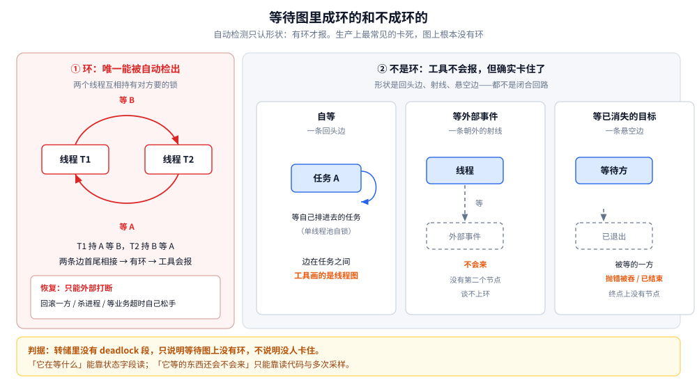
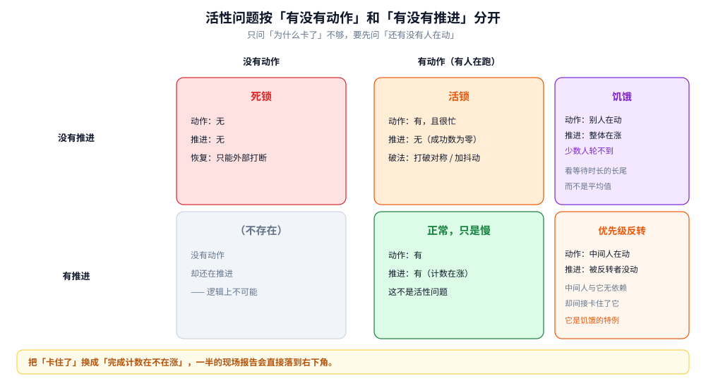

# 活性与泄漏

> 覆盖：为什么环检测工具报「没有死锁」而服务确实卡住、五种不构成环的卡死、活锁与饥饿与优先级反转三者的区分、执行体泄漏的四类形态与它为什么比内存泄漏更隐蔽，以及把「卡死」降级成「超时」时最容易搞错的那个前提。
>
> 不覆盖：死锁的四个必要条件（Coffman）、等待图与环检测、检测之后的回滚处置——那几节在 [死锁原理与防治.md](../../03-数据与中间件/数据存储/并发控制/死锁原理与防治.md) 已经写完整，本篇不重复。语言侧的转储读法与命令在 [协程泄漏与死锁.md](../../01-编程语言/go/并发编程/协程泄漏与死锁.md) 与 [死锁与并发缺陷诊断.md](../../01-编程语言/java/并发编程/死锁与并发缺陷诊断.md)。
>
> 内容整理自个人学习笔记，素材见 [素材清单.md](../../素材清单.md)。
>
> 口径：本篇**不新增实测**，给的是判据、读法与现场分类。文中提到的工具输出格式随版本变动，命令与真实转储原文在语言侧两篇里。

---

## 一、为什么检测工具说「没有死锁」，服务却卡住了？

**本节要点**：因为所有自动检测做的都是同一件事——在等待图里找环。而生产上最常见的卡死，图上根本没有环。

### 1.1 三种检测，其实只有两种判据

| 检测手段 | 在哪 | 判定的是什么 | 前提 |
|---|---|---|---|
| 等待图找环 | 数据库引擎、`ThreadMXBean.findDeadlockedThreads` | 一组等待者是否**互相**等 | 边要能连成闭合回路 |
| 全阻塞判定 | Go 运行时 `all goroutines are asleep` | 是否**所有**执行体都阻塞且无外部唤醒源 | 必须全阻塞 |
| 超时 | 应用自己设的每一处等待 | 没什么可判定的，到点就报错 | 必须有超时 |

前两种都是「结构性判定」：它看的是**等待关系的形状**。第一种要环，第二种要全。**只要有任何一个执行体还在跑（哪怕只是一个空转的 `for {}`），第二种判定就永远不触发**——这是 Go 那句 `fatal error` 时有时无的原因。

而生产上真正的卡死，形状往往是第三种：一小撮执行体卡住，其余几百个照常跑，图上既没有环也不是全阻塞。**没有任何自动检测会报它**。

### 1.2 五种不构成环的卡死

图里左半是唯一能被自动检出的形状——两条边首尾相接成环。右半三种都不成环：自等是一条回头边、等外部事件是一条射线、等一个已经消失的目标是一条悬空边。**要读出的结论是：检测工具报「无死锁」只说明图上没有环，不说明没有人在等一件永远不会发生的事。**

| 形态 | 等待关系的形状 | 工具为什么不报 | 现场特征 |
|---|---|---|---|
| **单线程池自锁** | 任务 A 等任务 B，B 排在 A 后面的队列里 | 边在**任务**之间，工具画的是**线程**图 | worker 栈上同时有池的调度帧与「等结果」的帧 |
| **锁没释放** | 一堆边共同指向同一个「不会返回」的持有者 | 是一条**射线**，不是环 | 大量执行体同状态、栈停在同一个加锁点 |
| **等一个永不来的外部事件** | 一条朝外的射线 | 没有第二个节点可连，谈不上环 | 有超时的等待 / 无超时的 socket 读，`cpu` 不涨 |
| **计数或信号不配对** | 一条射线（等一个永远不会被满足的计数） | 同上 | `wait` 类调用，计数差 1，永不归零 |
| **等一个已消失的目标** | 边的终点已经不存在 | 目标线程/任务已退出，图上没有这个节点 | 等的一侧在等，被等的一侧栈里已经没它 |

四条里最该记住的是第二条：**「锁没释放」造成的卡死是死锁的实质、却不是死锁的形状**。某个异常分支跳过了释放，此后所有想进来的人都排在一条射线上，没有环——转储里只有一堆「等同一把锁」的人，和唯一那个已经跑飞的持有者。这时候正确的问题是「谁持有它」而不是「谁和谁互等」。

### 1.3 判据：等待图能回答什么

- 能回答：**这几个执行体是不是在互相等**。这是纯结构问题，检测器很擅长。
- 不能回答：**某个人等的那件事会不会发生**。这是语义问题，只有读代码或读栈才能答。

所以现场排查的顺序应该反过来：先用「同一栈是否重复出现」确认它真的没动（见第六节），再去判断「它等的东西还会不会来」。上来就问「有没有死锁」，多半会得到「没有」，然后卡在这里。

## 二、都在跑却推进不了，是什么问题？

**本节要点**：死锁是**不动**；活锁是**动了但白动**；饥饿是**有人一直在动、有人一直轮不到**。三者要靠「有没有动作」和「有没有推进」两个维度分开。

图里把四种情况按「动没动」和「成没成」摆开：既有动作又有推进是正常；无动作无推进是死锁；有动作无推进是活锁；有推进但某些参与者长期轮不到是饥饿。优先级反转是饥饿的特例——被反转的那个高优先级任务，正是「别人都在动、只有它轮不到」。**这张图的价值在于：只问「为什么卡了」是不够的，要先问「有没有人在动」。**

### 2.1 活锁：每个局部决策都正确，合起来无效

两个人迎面走，各往自己左边让一步，结果还是面对面；再让，还是面对面。每一次避让都是当下最合理的选择，合起来却谁也没能通过。

工程上的经典形态是**对称重试**：两个事务冲突，都失败；都退避 100 ms；都同时重试；又撞上。冲突没有恶化成死锁，CPU 也没闲着，**但成功次数是零**。

- 认定：执行体状态在变、`cpu` 在涨、**业务成功计数不涨**。三次采样看到的栈几乎一样。
- 破法：**打破对称**。退避加随机抖动（jitter）、让一方固定优先、按 id 决定谁先让。凡是「两个参与者执行同一套确定性算法」的地方，都可能出活锁。
- 与死锁的关键区别：死锁要外部打断才能恢复（重启、回滚）。活锁**理论上会自己解开**，前提是恰好出现一次不对称——而这一次可能要等很久。

### 2.2 饥饿：有人在推进，只是永远轮不到它

锁从「抢」变成「排队」之后，如果实现允许**刚释放锁的人立刻重新抢到**，排队者就可能一直排不上。这种现象叫 barging，是很常见的饥饿来源。

- 认定：一部分执行体长期停在同一个等待点，另一部分 `cpu` 很高；把等待时长看成分布时，出现**秒级的长尾**——整体吞吐看着正常，但这条尾巴就是有人一直没轮到。
- 破法：公平模式（释放时唤醒队首、不许插队），代价是每次交接都要多一次唤醒与切换。多数场景先缩短临界区，比开公平更划算。
- 与活锁的关键区别：活锁是**所有人**都没推进，饥饿是**整体在推进、少数人没推进**。

### 2.3 优先级反转：中间人插队

低优先级的 L 持有一把锁，高优先级的 H 来要，H 只能等 L。这时中优先级的 M 抢占了 L 的 CPU——于是 **H 被 M 间接阻塞**，而 M 与 H 之间既没有锁也没有依赖。1997 年火星探路者号在火星表面反复重启，根因就是这条链。

- 关键点：**反转不是「谁抢了谁的锁」，而是「不相干的人通过抢占 CPU 间接影响了别人的等待时间」**。所以它在用户态也成立：线程池里高优先级任务等低优先级任务持有的锁，而中等任务占满了所有工作线程。
- 破法：**优先级继承**（持锁者临时继承等待者的优先级，让它快点跑完放锁）或**优先级上限**（持锁时直接升到最高）。两者都是把「中间人插队」这条路堵掉。
- 用户态现实：大多数语言运行时**不提供**优先级继承，所以正确做法是别让长任务与短任务抢同一把锁，而不是去调优先级。

### 2.4 一张区分表

| 形态 | 有动作吗 | 有推进吗 | 图上成环吗 | 恢复方式 |
|---|---|---|---|---|
| 死锁 | 无 | 无 | 是 | 只能外部打断 |
| 活锁 | **有** | 无 | 否 | 引入不对称，可能自解 |
| 饥饿 | 有（别人在动） | **部分** | 否 | 改公平性 / 缩短临界区 |
| 优先级反转 | 有（中间人在动） | 无（被反转者） | 否 | 优先级继承或拆锁 |
| 正常但慢 | 有 | 有 | 否 | 不是活性问题，是性能问题 |

最后一行是有意加进来的：现场报告「系统卡住了」时，很大一部分其实是「很慢」，先确认**完成计数在不在涨**，比先抓转储有效。

## 三、执行体泄漏为什么比内存泄漏更难发现？

**本节要点**：内存泄漏有 OOM 这个终点，执行体泄漏没有终点——它只是缓慢地吃掉调度能力，表现成「越来越慢」，而不会被归因成泄漏。

### 3.1 四种泄漏形态

这四种与具体语言无关，凡是有轻量执行体（协程、虚拟线程、异步任务）的运行时都成立。

| 形态 | 怎么形成 | 为什么不报错 |
|---|---|---|
| **① 无终止条件** | 循环里没有出口，或出口条件永远不成立 | 它就是在正常工作，没人觉得错 |
| **② 一直阻塞** | 等一个永不到来的信号（收不到的消息、永不 close 的通道、永不满足的计数） | **最隐蔽**：不 panic、不报错、不吃 CPU，只是挂着 |
| **③ 无界增长** | 每个请求创建一个，流量一涨就爆 | 流量小时完全正常，压力测试也可能不触发 |
| **④ 被丢弃但没关闭的资源** | 池丢掉了引用，对象却还持有外部句柄（连接、心跳、订阅） | 引用没了但资源没释放，GC 收不掉、代码也拿不到 |

第四种值得单独说，因为它的因果链最长：对象不在池里了 → 但连接的心跳线程还在跑 → 这个对象被心跳线程引用着 → **GC 判定它可达** → 内存不降 → 而且每个连接还挂着几个执行体。于是同一个 bug 同时表现为**内存泄漏**和**执行体泄漏**，而排查时容易只盯其中一头。**「池的回收」与「资源的关闭」是两件事**，池只会丢掉引用，关闭必须自己写在丢弃路径上。

### 3.2 为什么它不报错：成本落在别处

- **栈也是内存**。每个执行体都带一块栈，数量翻十倍，内存就跟着涨——但归因会错到「内存泄漏」上，去查堆反而查不出来。
- **泄漏的执行体仍在被调度**。它们被唤醒、检查条件、再睡回去，这些都要占调度器的时间，表现为「CPU 不高但整体变慢」。
- **没有终点**。内存泄漏会在某次 OOM 时被迫暴露；执行体泄漏只要没撞到上限，可以带着病跑几个月。

### 3.3 判据：看数量曲线，不看单次快照

单次快照只能告诉你「现在有多少个」，不能告诉你「这个数是不是在涨、涨上去会不会降」。可用的是三条：

1. **数量随负载的响应曲线**：压测时涨是正常的，**压力撤掉之后回不回落**才是判据。回落 = 池在复用；不回落 = 有人在泄漏。
2. **栈聚类**：把同一时刻所有执行体按「创建点」分组，看哪一组在增长。数量本身没意义，**增长的那一组的创建点**才是答案。
3. **与请求量的比值**：每个请求对应的执行体数应当是个常数。这个比值随时间上升，就是在泄漏。

## 四、怎么把「卡死」降级成「超时」？

**本节要点**：超时的作用是把「永久」变成「有限」，但它有个前提——**超时之后底层真的能停下来**。只放弃等待、不放弃工作，泄漏照旧。

### 4.1 第一道防线，以及它的前提

给每一处等待设超时，是性价比最高的一条：死锁只能靠重启恢复，超时至少能返回一个错误让业务兜住。

但要注意：**超时只是让等待方不再等，不等于让工作方停下来**。一个没有取消机制的网络写调用，即使调用方超时返回，底层的 socket 写仍可能挂在那里，线程/协程照样被占着。**「可取消」是一种要主动设计的性质**，不是加一个 `WithTimeout` 就自动获得的。

### 4.2 超时必须打在能被放弃的位置上

| 位置 | 该不该设 | 为什么 |
|---|---|---|
| 等锁、等条件、等消息 | **要** | 放弃的代价小，重试即可 |
| 一次远程调用 | **要** | 放弃等待，且要能把取消传下去 |
| 一段纯计算 | **不要** | 算到一半没法放弃，超时只是让调用方先走、算的人还在算 |
| 一次本地磁盘写 | 谨慎 | 中途放弃可能留下半写状态 |

第二行还有一条纪律：**外层超时必须大于内层超时之和**。外层给 10 秒、内层三处各给 10 秒，内层等于白设——外层早已返回，内层还在跑，泄漏就是这么来的。

### 4.3 超时之后的三件事

1. **释放资源**：连接、临时文件、持有的锁。超时路径最容易漏掉 `unlock`，而这正好会造出 1.2 里那条「射线」。
2. **留一条可归因的记录**：谁超时、在等什么、等了多久。只记「timeout」等于没记。
3. **决定后续**：可重试的重试（要有上限与抖动）、不可重试的降级、已经产生副作用的走对账。

## 五、应用场景：六种形态各自在什么现场

| 现场症状 | 属于哪一类 | 先看什么 | 对应节 |
|---|---|---|---|
| 接口大面积超时、CPU 却不高 | 单线程池自锁 / 等外部事件 | 栈上是否同时有「调度帧」与「等结果帧」 | 1.2 |
| 一批请求同时挂住，重启就好 | 锁没释放（射线） | 谁持有那把锁、它卡在哪一行 | 1.2 |
| 日志在刷、CPU 打满、业务不前进 | 活锁 | 业务成功计数是否为零 | 2.1 |
| 整体正常，少数请求耗时秒级 | 饥饿 | 等待时长的分布尾巴 | 2.2 |
| 加了优先级/分了池，高优任务反而更慢 | 优先级反转 | 中优任务是否占满了执行体 | 2.3 |
| 内存缓慢上涨、堆直方图看不出大头 | 执行体泄漏 | 执行体数量曲线与栈聚类 | 3.1 |
| 池化连接的进程越跑越胖 | 被丢弃但没关闭 | 对象是否被心跳/订阅线程引用 | 3.1 |

## 六、具体使用：怎么确认「它真的卡住了」

**本节要点**：判据不是「此刻在等什么」，而是「同一个等待是否重复出现」。一次采样只能看状态，两次以上才能看趋势。

本节四条都是**观察路线**，**本机未实测**——具体的命令、日志标签与转储原文在语言侧两篇里，本节只给判断标准。

### 六.1 第一条：三次采样，看栈是否重复

| 采样方式 | 能得出什么 |
|---|---|
| 只采一次 | 只知道此刻在等什么，**不能**断言它一直没动 |
| 间隔十几秒采三次 | 同一执行体、同一状态、同一业务帧都在 → 确实卡住 |
| 三次栈在变、业务计数不动 | 活锁或饥饿，转 2.1 / 2.2 |

判断时看**业务帧**（你自己代码里的函数名），不要看框架帧——框架帧在一批执行体里本来就长得一样，容易误判成「全都卡在同一处」。

### 六.2 第二条：区分「在等」与「在算」

状态字段并不能回答这个问题。有些运行时的「可运行」状态包含了「在原生调用里阻塞」，看起来在跑，其实在等。可靠的做法是取两次累计 CPU 时间相减：涨 → 在算；不涨 → 在等，哪怕状态写的是可运行。

### 六.3 第三条：等待时长要看分布，不要看条数

记录等待事件的工具通常有阈值，只记「足够长」的样本。所以：

- **条数不能当次数**。几十条记录可能对应几百次实际等待。
- **时长分布才有信息**。出现的秒级长尾，就是饥饿的证据（2.2）。
- 想拿到真实次数只能自己埋点，或者看业务指标。

### 六.4 第四条：给泄漏建一条曲线，而不是一次快照

按 3.3 的三条判据做：数量随负载的响应曲线、栈聚类、与请求量的比值。三者里最能定案的是第二条——**增长的那一组的创建点**，通常直接就是泄漏的现场。

## 延伸追问

- **为什么「锁没释放」不算死锁？** → 它是死锁的实质（有人永久等），但不是死锁的形状（没有环）。自动检测只认形状，所以不报。这也是「转储里没有 deadlock 段」最常见的误解来源。
- **活锁和「性能差」怎么分？** → 看成功计数。活锁是计数为零还在耗 CPU；性能差是计数在涨但慢。前者要改算法对称性，后者要优化路径，方向完全不同。
- **公平锁能解决饥饿吗？** → 能消除插队造成的偏斜，但吞吐会降，且不解决「临界区太长」这个根因。先量临界区时长，再决定要不要开公平。
- **优先级继承在用户态能自己实现吗？** → 能但不划算：需要运行时暴露调度优先级，而多数语言不暴露。更现实的做法是把长任务与短任务拆到不同的池，从结构上避免反转。
- **给所有等待都加超时，是不是就没有活性问题了？** → 不是。超时把「永久」变成「有限」，但超时之后如果底层停不下来，执行体照样被占着（4.1）。真正要的是「可取消」，超时只是它的触发条件。
- **执行体泄漏能不能靠压测发现？** → 只有「无界增长」这一类能。另外三类在压测的压力撤掉之后也未必回落得明显，得靠长期曲线。所以线上要常驻一个数量指标，别等到出事才去抓。
- **池化对象为什么会被「丢弃但没关闭」？** → 因为池的语义只是「不再持有引用」，它不负责关闭。关闭必须显式写在丢弃路径上，而很多池的实现把这条路径留给了调用方。
- **怎么在 Code Review 里提前拦住这几类？** → 对每个新起的执行体问三个问题：它什么时候退出、会不会无限增长、它碰了哪些共享状态。三个问题答不全的，就是下一份故障报告。

## 关联

- **上游/总纲**：[死锁原理与防治.md](../../03-数据与中间件/数据存储/并发控制/死锁原理与防治.md) — Coffman 四条件、等待图、检测后回滚；本篇是它覆盖不到的那一半
- **上游/总纲**：[共享内存与消息传递.md](共享内存与消息传递.md) — 两条路线的失败模式：共享内存错在值、消息传递错在时；本篇 1.2 的「等一个永不来的事件」就是「错在时」的极端形态
- **同层/底座**：[互斥的实现.md](../计算机底层原理/底层同步/互斥的实现.md) — 4.1 里 Go 的饥饿模式（等过 1 ms 就直接交队首、新来的不许插队）就是 2.2 饥饿的一条现成解法
- **同层/底座**：[内存重排、Happens-Before与数据竞争.md](../计算机底层原理/底层同步/内存重排、Happens-Before与数据竞争.md) — 另一类「不报错的错误」，与泄漏的隐蔽性同源
- **对照/互补**：[协作式取消与传播.md](协作式取消与传播.md) — 本篇 4.1 那条「可取消要主动设计」的完整展开
- **对照/互补**：[任务池.md](任务池.md) — 1.2 的单线程池自锁、3.1 的无界增长都发生在池上
- **下游机制**：[协程泄漏与死锁.md](../../01-编程语言/go/并发编程/协程泄漏与死锁.md) — Go 侧的转储原文、pprof 定位与四类成因的真实案例
- **下游机制**：[死锁与并发缺陷诊断.md](../../01-编程语言/java/并发编程/死锁与并发缺陷诊断.md) — Java 侧两种环的转储写法、六种等待的字段读法与竞争量化
- **架构投影**：[分布式锁.md](../../03-数据与中间件/数据存储/NoSQL/Redis/分布式锁.md) — 跨进程之后没有全局等待图，活性只能靠租约与超时自己扛
