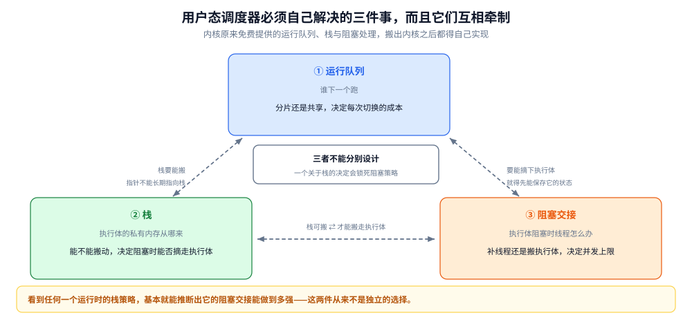
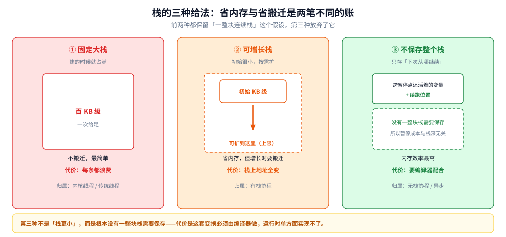
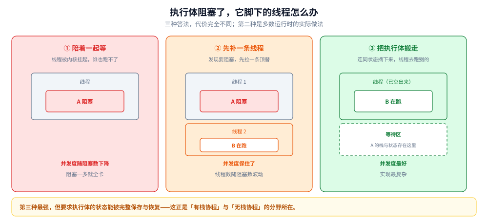

# 用户态调度：把调度搬出内核之后多出什么

> 覆盖：为什么要在用户态自己调度、M:N 模型必须自己解决的三个部件（运行队列 / 栈 / 阻塞交接）、三个部件为什么互相耦合、栈的三种给法与各自的代价、执行体阻塞时它占的线程怎么处理、以及用户态为什么难以抢占、什么叫「把执行体钉在线程上」。
>
> 不覆盖：内核调度本身（时间片、优先级、上下文切换成本）见 [调度与时间片.md](../操作系统/调度与时间片.md)；进程与线程的区别见 [进程与线程模型.md](../操作系统/进程与线程模型.md)；具体运行时的字段、队列与抢占实现见 [GMP调度.md](../../01-编程语言/go/运行时/GMP调度.md) 与 [虚拟线程.md](../../01-编程语言/java/并发编程/虚拟线程.md)；成本实测见 [协程与线程成本.md](../../01-编程语言/go/并发编程/协程与线程成本.md)。
>
> 内容整理自个人学习笔记，素材见 [素材清单.md](../../素材清单.md)。
>
> 口径：本篇**不新增实测**。文中「栈的常见默认值」是各运行时的配置默认值（文档口径），不是本机读数；成本对比的实测在语言侧两篇。

---

## 一、内核调度不够用在哪？

**本节要点**：内核调度的单位是线程，而线程的固定成本有三笔——栈、特权级切换、调度器自身的竞争。这三笔都是**按线程数**计的，不随「有多少活要干」变化。

### 1.1 三笔固定成本

| 成本 | 为什么是固定的 | 量级 |
|---|---|---|
| 栈 | 每条线程必须有一块私有栈，大小在建线程时就定了 | 常见默认在百 KB 到 MB 级 |
| 切换 | 用户态与内核态之间的往返，加上寄存器与调度结构的维护 | 微秒级 |
| 调度器竞争 | 内核调度器是全核共享的结构，线程越多抢得越凶 | 随线程数上升 |

这三笔的问题不在「贵」，而在**它们与任务量无关**。一个只做 10 微秒工作的任务，也要背上一整块栈和一整套切换成本。

### 1.2 「更轻」是怎么来的

轻量执行体的思路是：**把「执行体」和「线程」解耦**。执行体只是一个「待执行的栈 + 一组寄存器状态」，它不绑定任何内核对象。真正被内核调度的仍是线程（通常数量等于核数或略多），而执行体在线程之间流转。

这样得到的效果是：

- 执行体的数量可以到百万级（每个只占一块很小的初始栈）；
- 创建与切换都在用户态完成，不进内核；
- 线程数保持在核数量级，那三笔固定成本的总量就控制住了。

代价是：**原来由内核免费提供的东西，现在要自己实现**。这就是下一节。

## 二、M:N 调度器必须自己解决的三个部件

**本节要点**：运行队列、栈、阻塞交接。三个都要，而且**互相牵制**——改一个会牵连另外两个。

图里三个部件围成一圈，圈内三条虚线是它们之间的约束：运行队列 ↔ 栈（栈要能搬，执行体就不能被栈上的地址长期引用）、栈 ↔ 阻塞交接（阻塞时栈要能被保存下来）、运行队列 ↔ 阻塞交接（一个执行体阻塞后，它的位置要让出来）。要读出的是：**这三件事不能分别设计**——一个看起来只关于「栈」的决定，会决定「阻塞时能不能把执行体搬走」。

### 2.1 运行队列：谁下一个跑

内核有它就绪队列，用户态也得有。区别在于**队列怎么分**：

- **一条全局队列**：所有线程从同一条队列取，负载天然均衡，但取任务本身要竞争。
- **每条线程一条队列**：取任务无竞争，但要额外机制补偿均衡（这就引出了「空闲的线程去别人那里拿活」）。

后者是主流，因为**取任务发生在每一次切换上**，是热路径；均衡补偿只发生在「本地空了」的时候，是冷路径。把成本从热路径挪到冷路径，是这一层的核心设计取向。

### 2.2 栈：执行体的私有内存从哪来

这是三个部件里最贵的一个决定，详见第三节。

### 2.3 阻塞交接：执行体阻塞了，线程怎么办

一个执行体发起了一个会阻塞的操作（读网络、等锁、睡一段时间），它脚下的那条线程也会被内核挂起——**线程一旦被挂起，就没法再去跑别的执行体了**。

于是用户态调度器必须回答：**要不要补一条线程进来**？三种答法：

| 答法 | 做法 | 代价 |
|---|---|---|
| 不补 | 就让这条线程陪着一起等 | 并发度随阻塞数下降，阻塞一多就全卡 |
| 补一条 | 发现线程要阻塞时，先拉起/唤醒另一条线程顶替 | 线程数随「同时阻塞数」波动，上限难控 |
| 把执行体搬走 | 阻塞前把执行体从线程上摘下来、连同栈存起来，等它可运行时再挂到别的线程 | 需要能保存与恢复执行体的完整状态，实现最复杂，并发度也最好 |

第二种是大多数运行时的实际做法：**在会阻塞的调用外面包一层，先确认有空闲线程再放行**。第三种更强，但要求执行体的状态可以被完整保存与恢复——这也是「无栈协程」与「有栈协程」的分野所在。

### 2.4 三者为什么耦合

- 如果栈是**固定大小且不可搬动**，那执行体在运行期间地址不变 → 阻塞时可以直接把「线程 + 栈」一起挂起，交接简单。
- 如果栈是**可增长的**，增长时要重新分配并搬迁 → 栈上的地址会变 → 那么任何「指向栈的指针」都不能长期持有 → 阻塞交接与这个约束必须一起考虑。
- 如果允许**把执行体从线程上摘下来**，那栈必须能被保存成一块独立的数据 → 「栈就是线程的栈」这个假设就不成立了。

所以看到任何一个运行时的栈策略，基本就能推断出它的阻塞交接能做到多强。

## 三、栈怎么给才够轻？

**本节要点**：三种给法——固定大栈、可增长栈、不复制栈（把执行体的状态做成可恢复的）。省内存与省搬迁是两笔不同的账。

### 3.1 三种给法

图里三列按「内存效率」递增排开：固定大栈每条都占满，简单但浪费；可增长栈按需扩，省内存但要搬迁；第三种干脆不保存整个栈，只保存「下次从哪继续」所需的状态。要读出的是：**前两种都保留了「一整块连续栈」这个假设，第三种放弃了它**——放弃之后内存效率最高，但「暂停在任意位置再恢复」这件事需要语言与编译器配合，不是运行时单方面能做的。

| 给法 | 每条执行体占多少 | 增长时要搬迁吗 | 实现难度 | 典型归属 |
|---|---|---|---|---|
| 固定大栈 | 建的时候就占满（百 KB 级） | 不会（一开始就够） | 最低 | 内核线程、传统线程 |
| 可增长栈 | 初始很小（KB 级），按需扩 | **会**，要改所有指向栈的指针 | 中 | 有栈协程 |
| 不保存栈 | 只存「下次从哪继续」的状态 | 不需要 | 最高 | 无栈协程 / 异步 |

### 3.2 可增长栈的那笔搬迁账

「初始小、需要时再扩」听起来只有好处，但它带来一个硬约束：**搬迁之后，栈上所有地址都变了**。于是：

- 指向栈内存的指针不能跨搬迁存活 → 语言层面通常要禁止「把栈变量的地址带出作用域」；
- 运行时要能找到并改写所有指向栈的引用 → 要么语言不允许这种引用，要么扫描整个栈去修；
- 搬迁瞬间要有一次内存复制 → 深栈的执行体在增长时会有一笔可观测的抖动。

这就是为什么「更省内存」和「更简单」往往不能同时拿到：固定大栈省掉了全部这些复杂度，代价是每条都浪费。

### 3.3 「不保存栈」到底是什么意思

第三种不是「栈更小」，而是**根本没有一整块可以被称为栈的东西需要保存**。一个被暂停的执行体，它的状态被表示成一个「下次从哪继续」的标记加上若干局部变量——编译器把函数拆成了若干段，每段结束时把需要跨段存活的值存进一个结构里。

好处：暂停与恢复的代价与「栈有多深」无关，只与「跨暂停点还活着的变量有多少」有关。
代价：**这套变换必须由编译器做**，运行时单方面实现不了；而且一旦有一处代码不能被这样变换（比如调用了不可拆分的原生代码），整条链路就退化成必须独占一个线程。

最后这一点正是「钉住」的来源（见 4.2）。

## 四、一个执行体阻塞了，它占的线程怎么办？

### 4.1 三种处理的取舍

图里三列按「并发度」递增排开。第一列线程陪着执行体一起被挂起，一个阻塞就少一条线程；第二列在阻塞前先拉起一条顶替，并发度保住了但线程数随阻塞数上涨；第三列把执行体连同它的状态摘下来放进等待区，线程立刻空出去跑别的。要读出的是：**能走第三条的前提是「执行体的状态可以被完整保存」**，而这个前提又回到了第三节的栈怎么给。

| 处理 | 什么时候用 | 副作用 |
|---|---|---|
| 陪着一起等 | 阻塞很短、或者无法预知要阻塞 | 一条线程被占住，并发度下降 |
| 先补一条线程再阻塞 | 能提前知道要阻塞 | 线程数上涨，要有上限 |
| 把执行体搬走 | 执行体状态可以被保存 | 实现复杂，且要求「可搬运」这个前提 |

第二种的关键是「**提前知道**」——所以运行时会区分「会阻塞的调用」与「不会阻塞的调用」。前者走「先安排好线程」的慢路径，后者走直接执行。

这也解释了一个常见现象：**同样的代码，在网络调用前后并发度会明显变化**。不是调度器变了，是它从「不阻塞」路径切到了「要预备线程」路径。

### 4.2 钉住是怎么产生的

「钉住」（pinning）指：一个执行体因为某种原因**无法被从它当前的线程上移走**，只能让线程陪着它。

成因不是一个，而是一类：**任何「运行时不掌握其内部状态」的操作**都可能造成钉住。常见的三种：

1. **调用了运行时不认识的原生/阻塞代码**。运行时无法在它外面做「搬走执行体」的动作，只能让线程陪着。
2. **在持有某个运行时内部锁的状态下阻塞**。此时把执行体搬走会让那把锁的持有关系错乱。
3. **依赖「当前线程」这一属性的代码**。比如把状态存在线程本地变量里、或者依赖线程 ID 做判断——执行体一旦换线程，这些假设全部失效。

第三种最隐蔽：代码本身完全合法，单测也能过，只在「它恰好被搬到另一条线程」时才出错。

钉住的后果很直接：**被钉住的执行体越多，实际并发的上限就越接近线程数**，轻量执行体的优势被逐步吃掉。所以排查「为什么并发上不去」时，「有多少执行体被钉住」是一个该看的量。

## 五、用户态怎么抢占？

**本节要点**：内核可以靠硬件时钟随时打断，用户态不行——它**没有任何机制能在一个正在执行的执行体中间强行插入**。所以只能靠「执行体自己走到检查点」或者「用信号打断」。

### 5.1 纯协作式的边界

如果调度器只在「执行体主动让出」时才切换，那么**一个不让出的执行体可以永久占住线程**。典型形态：

- 一个长循环里没有任何函数调用（没有让出点）→ 同线程上其他执行体全部饿死；
- 一个阻塞在没有超时的调用里 → 连让出的机会都没有。

第一类是纯协作式的经典缺陷，修法有两种：**在循环回边插入检查点**（编译器配合），或者**用信号周期性打断**。

### 5.2 抢占的两种实现

| 方式 | 怎么做 | 代价 |
|---|---|---|
| 检查点 | 编译器在函数入口或循环回边插入「该让出了吗」的判断 | 每次判断都是一条额外指令；且只覆盖被编译的代码 |
| 信号抢占 | 运行时给线程发一个信号，信号处理函数里把执行体挂起并让出 | 能在任意指令处打断；但信号处理函数里能做的事很有限，且与原生代码混用时要小心 |

前者便宜但不完整（原生代码覆盖不到），后者完整但更重。多数运行时是两者结合：常见路径用检查点，卡住的用信号兜底。

这一节和 [调度与时间片.md](../操作系统/调度与时间片.md) 第三节是一组对照：**内核靠时钟中断抢回 CPU，用户态只能靠检查点或信号**——这是「把调度搬出内核」付出的最直接的一笔代价。

## 六、应用场景

| 场景 | 该考虑什么 | 判据 |
|---|---|---|
| 大量阻塞型请求（网关、RPC 服务端） | 轻量执行体的优势最大 | 瓶颈在等待而不是 CPU |
| CPU 密集计算 | 轻量执行体几乎没有优势 | 线程数已经等于核数，切换成本不是瓶颈 |
| 有大量原生调用（数据库驱动、加密库） | 小心钉住 | 被钉住的比例决定实际并发上限 |
| 单次任务极短（微秒级） | 调度成本占比上升 | 执行体的创建/切换成本与任务本身可比 |
| 需要严格实时性 | 用户态调度不可控 | 调度延迟由运行时决定，无法给硬保证 |
| 单核环境 | M:N 退化成 1:N | 并行度本来就是 1，只有并发没有并行 |

倒数第三条值得展开一点：**用户态调度器不给你实时保证**。它跑在你的进程里，与业务代码共享同一个 CPU 时间片；业务代码不让出，调度器也没机会跑。需要硬实时的地方，这条路走不通。

## 七、具体使用：怎么判断「轻量执行体到底轻在哪」

**本节要点**：三个量——单条执行体的常驻内存、创建速率上限、以及被钉住的比例。三者合起来决定「它是不是真的适合你的场景」。

本节是**观察路线**，**本机未实测**；具体命令与实测读数在语言侧各篇。

### 7.1 三个量

| 量 | 怎么看 | 说明 |
|---|---|---|
| 单条常驻内存 | 执行体数量翻十倍时，常驻内存涨多少 | 这个数就是「栈 + 元数据」的实际开销 |
| 创建速率上限 | 单位时间内能创建多少条 | 反映创建路径的成本，与任务时长一起决定吞吐上限 |
| 被钉住比例 | 处于「绑定线程」状态的执行体占比 | 这个比例高，轻量的优势就被吃掉 |

第一个量最容易被误解：很多人以为「初始栈很小」就等于「每条只占那么点」，实际上**执行体一跑起来栈就会长**，长到多深取决于调用深度，不是初始值。

### 7.2 一条反向判据

如果下面三条同时成立，用轻量执行体多半没有收益，甚至会亏：

1. 任务以 CPU 计算为主（瓶颈不在等待）；
2. 任务粒度大（每条跑很久，创建成本可忽略）；
3. 执行体总数远小于核数。

这种场景下，池化线程 + 少量任务就够了，引入轻量执行体只是多了一层调度。

### 7.3 什么时候该警惕钉住

看到「并发度上不去、但 CPU 也没满、线程数却不少」这个组合，就该去查钉住比例。它和 [活性与泄漏.md](活性与泄漏.md) 里「不是环的卡死」是两种不同的病：那个是「等不到」，这个是「跑不开」。

## 延伸追问

- **协程一定比线程快吗？** → 不一定。它省的是「创建」与「切换」的固定成本，如果任务本身很长、或者瓶颈在 CPU，这笔节省可以忽略。「快」的前提是任务多、任务短、且大量时间在等待。
- **为什么用户态调度器不能像内核那样随时抢占？** → 因为内核有硬件时钟中断这个特权手段，而用户态没有任何机制能在一条正在执行的指令流中间强行插入。只能靠检查点或信号。
- **可增长栈的搬迁为什么这么麻烦？** → 搬迁后栈上所有地址都变了，任何指向栈内存的指针都会失效。要么语言禁止把栈地址带出作用域，要么运行时要能找出并改写所有引用。
- **「无栈协程」是不是没有栈？** → 有栈，只是它不在暂停时被完整保存。它保存的是「下次从哪继续」加上跨暂停点仍存活的变量，所以暂停的成本与调用深度无关。
- **M:N 里的 N 一定等于核数吗？** → 不一定，但通常取核数或略多。N 大于核数会让内核在它们之间做时间分片，把「用户态调度」的好处抵掉一部分；N 小于核数则浪费核。
- **什么叫「把执行体钉在线程上」？** → 运行时无法把它从当前线程摘走，只能让线程陪着它。常见成因是调用了运行时不认识的原生阻塞代码、或在持有运行时内部锁时阻塞。
- **轻量执行体能不能替代线程池？** → 在「大量阻塞等待」的场景里能，在「CPU 密集 + 任务粒度大」的场景里不能。判断标准是瓶颈在等待还是在计算。
- **单核上还有必要用 M:N 吗？** → 有，但收益只有「并发」没有「并行」。单核上多线程本来也是时间分片，轻量执行体省的是切换成本，不是并行度。

## 关联

- **上游/总纲**：[调度与时间片.md](../操作系统/调度与时间片.md) — 内核视角的同一件事：时间片、抢回 CPU、切换成本；本篇讲把这些搬出内核之后多出什么
- **上游/总纲**：[进程与线程模型.md](../操作系统/进程与线程模型.md) — 线程是内核调度单位这个前提，是本篇全部讨论的起点
- **同层/底座**：[互斥的实现.md](../计算机底层原理/底层同步/互斥的实现.md) — 执行体阻塞在锁上时，线程交接就是本篇 2.3 的一种具体情形
- **同层/底座**：[活性与泄漏.md](活性与泄漏.md) — 钉住与「不是环的卡死」是两种不同的「跑不动」，成因与判据都不同
- **对照/互补**：[任务池.md](任务池.md) — 用线程池还是用轻量执行体，是同一道并发度问题的两条路线
- **对照/互补**：[协作式取消与传播.md](协作式取消与传播.md) — 不可拆分的原生调用既会造成钉住，也会让取消无法生效
- **下游机制**：[GMP调度.md](../../01-编程语言/go/运行时/GMP调度.md) — 三个部件的具体实现、队列分片、系统调用处理、异步抢占的演进
- **下游机制**：[虚拟线程.md](../../01-编程语言/java/并发编程/虚拟线程.md) — 另一种实现路线，以及钉住在真实代码里长什么样
- **下游机制**：[协程与线程成本.md](../../01-编程语言/go/并发编程/协程与线程成本.md) — 创建与切换成本的实测对比
