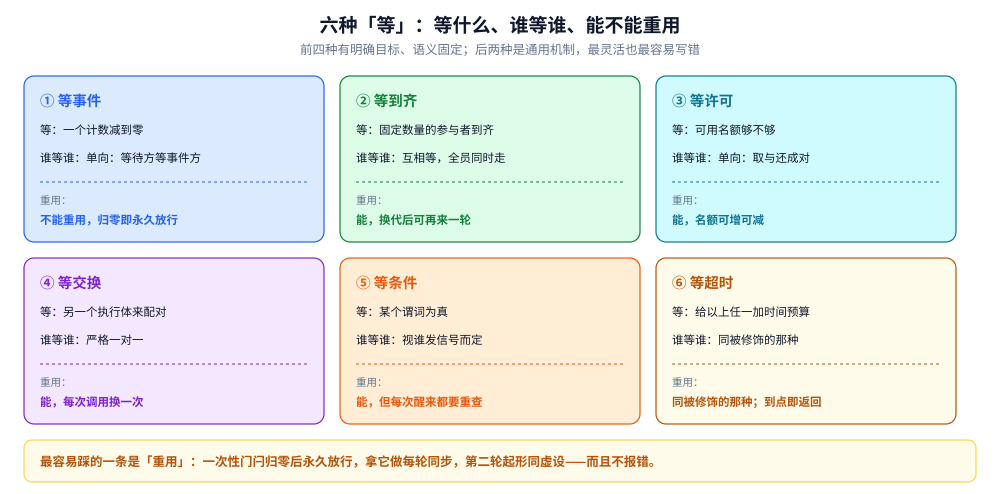
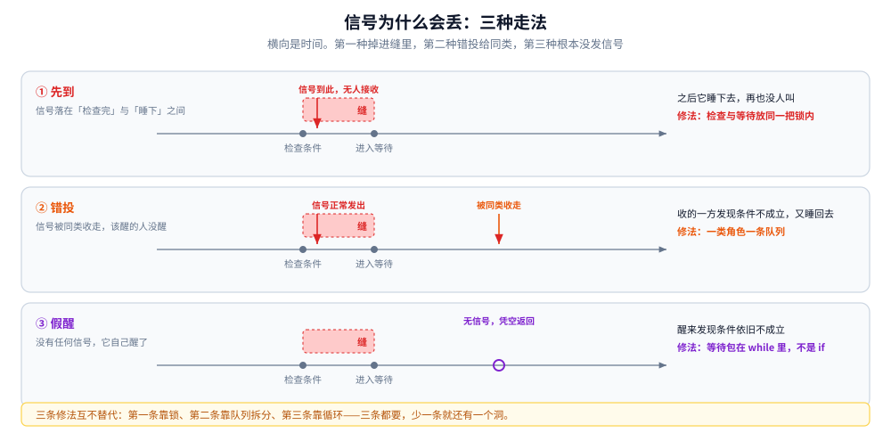
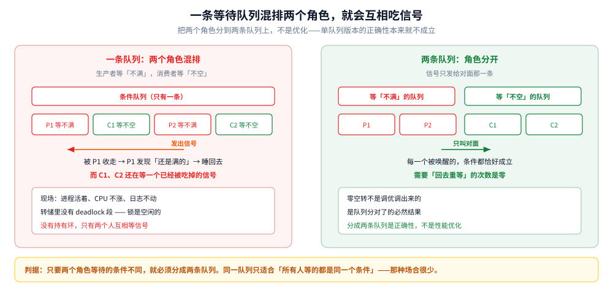

# 「等」的原语谱系

> 覆盖：互斥之外的另一半——执行体之间怎么约定**顺序**。六种「等」（等事件 / 等到齐 / 等许可 / 等交换 / 等条件 / 等超时）、信号为什么会凭空消失、为什么每次唤醒都要重新检查条件、一把锁为什么要挂多条等待队列，以及「唤醒所有人」的代价是怎么算出来的。
>
> 不覆盖：加锁本身怎么实现、无竞争有多便宜，见 [互斥的实现.md](../计算机底层原理/底层同步/互斥的实现.md)；原子指令与内存序见 [原子操作.md](../计算机底层原理/底层同步/原子操作.md)；具体类的构造参数与实测读数见 [线程间协作与并发工具类.md](../../01-编程语言/java/并发编程/线程间协作与并发工具类.md)。
>
> 内容整理自个人学习笔记，素材见 [素材清单.md](../../素材清单.md)。
>
> 口径：本篇**不新增实测**。文中「零空转」「归零后立刻放行」等结论转引自语言侧那篇的真实实验，此处只用作说明机制，不复述读数。

---

## 一、互斥解决不了「顺序」

**本节要点**：加锁保证的是「不会同时进去」，它并不保证「谁先进、谁后进」。而并发程序里一半以上的 bug 不是撞了，是**顺序不对**。

### 1.1 两件不同的事

| | 互斥 | 协作 |
|---|---|---|
| 要保证什么 | 同一时刻只有一个人进入临界区 | 谁先做、谁后做、谁等谁 |
| 不同步会怎样 | 数据被写坏（丢更新、中间态） | 拿到的是空数据、做的是无用功、或者永远等下去 |
| 典型手段 | 锁、原子操作 | 条件变量、计数门闩、栅栏、信号量、交换点 |
| 搞错的症状 | 结果偏小、字段是中间态 | 空转、卡死、提前放行 |

只加锁不协作，最典型的症状是**空转**：消费者在锁的保护下反复检查「有没有数据」，没有就放锁、再抢锁、再检查。数据不会错，但 CPU 全花在「什么也没等到」上。

### 1.2 「等」的六种形态



图里六格按「等的是什么」分开，每一格写了三件事：等什么、谁等谁、能不能重复使用。要读出两点：**第一，前四种是「有明确目标」的等**（等一个计数归零、等 N 方到齐、等一个许可、等一个对手），语义固定，可以直接按名字选；**第二，最后两种是「通用机制」**，等条件是最灵活的但也最容易写错，等超时不是独立原语，而是给前五种加一个时间预算。

| 形态 | 等什么 | 谁等谁 | 能否重用 | 归零/到齐之后 |
|---|---|---|---|---|
| 等事件 | 一个计数减到零 | 单向：等待方等事件方 | **不能**，一次性 | 永久放行，再等立刻返回 |
| 等到齐 | 固定数量的参与者互相到齐 | 互相等，全员同时走 | 能，换代后可再来一轮 | 换代，计数重新填满 |
| 等许可 | 可用名额够不够 | 单向：取与还成对 | 能，名额可增可减 | 不适用（是配额不是事件） |
| 等交换 | 有没有另一个执行体来配对 | 严格一对一 | 能，每次调用换一次 | 不适用（每次配对） |
| 等条件 | 某个谓词为真 | 单向或多向，取决于谁发信号 | 能，但每次都要重新检查 | 不适用（状态驱动） |
| 等超时 | 以上任一种 + 时间预算 | 同被修饰的那种 | 同被修饰的那种 | 到点即返回「没等到」 |

## 二、信号为什么会丢？

**本节要点**：因为「检查条件」和「进入等待」不是同一个原子操作。两者之间有一个缝，信号掉进缝里就永远没人接。

### 2.1 检查与等待之间的那道缝



图里三条时间轴，横向是时间、两条竖线分别是「检查条件」和「进入等待」。第一条走法里信号落在两条竖线之间——那时等待方还没睡下，信号无人接收，随后它睡下去，永远不会再醒。第二条走法是信号被**同类**收走，真正等它的那一类没被叫到。第三条不是丢信号，而是**没被任何人发信号却醒了**，醒来发现条件依旧不成立。**三种走法对应三种修法：前两种靠「持同一把锁把检查与等待包起来」，第三种靠「醒来必须重新检查」。**

### 2.2 三类丢失，各有各的修法

| 类型 | 怎么发生 | 症状 | 修法 |
|---|---|---|---|
| **先到** | 信号在「检查完」与「睡下」之间发出 | 明明发过信号，等的人永远不醒 | 把检查与等待放在**同一把锁**内，让发信号的人必须等锁 |
| **被同类吃掉** | 一条队列上排着两种角色，信号被错的那一类收走 | 空转，或两边互相等对方的信号 | **一类角色一条队列**，信号只发给对面 |
| **虚假唤醒** | 实现允许「没有信号也返回」 | 醒来后发现条件不成立 | 等待必须包在 `while (!条件)` 里，不是 `if` |

第一类的关键是那条纪律：**发信号的人必须持有同一把锁**。这不是为了互斥，而是为了让「发信号」这个动作被迫排在「睡下」之后——锁成了检查与等待之间的那道闸门。

第三类值得单独强调：**虚假唤醒不是 bug，是规格允许的**。所以 `if (条件) wait()` 这种写法在任何支持虚假唤醒的平台上都是错的。用 `while` 不是防御性编程，是正确性要求。

### 2.3 为什么等待必须包在循环里

除了虚假唤醒，还有第二个理由：**被唤醒不等于条件成立**。有多个等待者时，一次信号只叫醒一个，但「谁先抢到锁」是任意的；先抢到的人消耗了这次条件成立的窗口，后到的人醒来时条件已经不成立，必须回去接着等。

所以等待的正确形状永远是：

```text
持锁 → while (条件不成立) { 等待 } → 做事 → 放锁
```

漏掉 `while` 的代码在低并发下往往跑得很好，一上量就出错——这也是它难查的原因。

## 三、一个锁为什么需要多个条件队列？

### 3.1 一条队列上的两个角色会互相吃信号

生产者与消费者共用一条等待队列，两者的等待条件相反：生产者等「不满」，消费者等「不空」。它们排在同一条队列里，于是**发给消费者的信号可能被生产者收走**——生产者醒来一看「还是满的」，又睡回去；而真正该被叫醒的消费者还在等。

这个错误在低并发下完全看不出来：队列来回都有余量，随便叫醒谁都大概率能推进。一旦队列被打满或打空，两个人就会卡在同一个等待集里互相等对方的信号。

⚠️ 这里有个反直觉点：**这种卡死在转储里看不到任何「死锁」报告**。锁是空闲的，没有持有环——两个人都在等「对方发信号」，而不是等「对方放锁」。所有基于持有环的检测工具都不会报。现场表现是「进程活着、CPU 不涨、日志不动、转储里没有 deadlock 段」。



左右两半是同一份逻辑的两种队列划分。左边四个执行体排一条队，信号被 P1 接住、P1 发现条件不成立又睡回去，C1 与 C2 还在等一个已经被吃掉的信号；右边按角色分成两排，信号只能跨到对面，于是每一次醒来条件都恰好成立。

### 3.2 这是正确性问题，不是优化

一个锁挂多个条件队列，常被当成「减少无谓唤醒」的性能优化。**它不是。** 单队列版本的正确性本来就是不成立的，只是低并发时错误不显现。

判据很直接：**只要两个角色等待的条件不同，就必须分成两条队列**。同一队列只适合「所有等待者等的都是同一个条件」的场合，而那种场合恰恰很少。

分成两条队列之后，「每次唤醒都恰好是条件成立」是可以做到的——语言侧的实验里，拆队列之后「被唤醒但条件不满足、需要回去重等」的次数是**零**。零空转不是调优的结果，是队列分对了的自然结果。

## 四、唤醒所有人，代价是什么？

### 4.1 一次唤醒的成本乘上人数

「唤醒全部」是单队列时代唯一安全的选择（因为你不知道队列里谁在等什么），但它的成本是**线性的**：

每次被唤醒的执行体都要：重新参与抢锁 → 抢到后重新检查条件 → 不成立就再睡回去。这三步都不便宜，尤其是抢锁——几十个执行体同时被叫醒、同时抢同一把锁，只有一个能进，其余全部白跑一趟。

人数一多，这就成了「唤醒风暴」：CPU 尖峰、吞吐反而下降，而真正该做的事只有一件。

### 4.2 精确唤醒的边界

分成多条队列之后，就可以只叫醒需要的那一类人。但「精确」有两个前提，缺一个就退回「全叫」：

1. **等待条件互斥**：一条队列只对应一个条件。条件之间有交叉（比如「队列不空 且 未关闭」）时，只能拆成两条队列让一个等待者同时排两边——而这又回到复杂度里。
2. **信号只发一次够用**：一次信号只叫醒一个等待者，其余继续睡。如果一次状态变化需要叫醒多个（比如「关闭」了要叫醒所有等的人），就必须广播。

实践中的分界线：**状态变化是「多了一个」→ 叫醒一个；状态变化是「整个状态没了」→ 叫醒全部**。前者是生产者放了一个元素，后者是连接关闭、服务停止。

## 五、六种「等」怎么选

### 5.1 判据：等的是事件、人、资源还是对手

| 等的是 | 用哪一格 | 为什么不能用别的 |
|---|---|---|
| 一件事做完了（初始化、加载、某个任务完成） | 等事件（计数门闩） | 它是单向的、一次性的；用栅栏会要求「谁等谁」对称 |
| 一批参与者都到了才能继续 | 等到齐（栅栏） | 需要每轮重新到齐，且「有人没来」要能传播给所有人 |
| 同时最多 N 个在做 | 等许可（信号量） | 它是配额，与「谁等谁」无关；用门闩会把「放行」变成不可逆 |
| 两个执行体交换中间结果 | 等交换（配对点） | 严格一对一；用队列要额外定协议 |
| 某个状态成立（非空、未关闭、容量未满） | 等条件 | 状态是可逆的、可反复变化的；前四种都不支持反复 |

### 5.2 能不能重用，是最容易踩的一条

「等事件」是一次性的：计数归零之后**永久放行**，再等会立刻返回。拿它做「每轮同步」的人会发现第二轮、第三轮全部形同虚设——**而且不报错**，只是门闩已经不存在了。

判断方法：问一句「这个等待会不会重复发生」。会 → 用可重用的那一格（栅栏、信号量、条件变量）；不会 → 用一次性的那一格，并且**不要再复用那个对象**。

### 5.3 一张总表

| 形态 | 一次性还是可重复 | 谁等谁 | 唤醒方式 | 典型误用 |
|---|---|---|---|---|
| 等事件 | 一次性 | 单向 | 归零时放行全部 | 拿它做每轮同步 |
| 等到齐 | 每轮一代 | 互相 | 全员放行 | 有人超时后整轮作废却没人知道 |
| 等许可 | 可重复 | 单向 | 有许可即可获取 | 许可数不设上限，限流形同虚设 |
| 等交换 | 每次配对 | 一对一 | 配对成功 | 参与方数量为奇数时最后一个永远等 |
| 等条件 | 可重复 | 视情况 | 单发或广播 | 用 `if` 而不是循环；单队列多角色 |
| 等超时 | 修饰前者 | 同前者 | 到点返回 | 只在外层设，内层没有预算 |

## 六、应用场景

| 场景 | 该用哪一格 | 判据 |
|---|---|---|
| 服务启动等配置加载完 | 等事件 | 一次性，等完就再也不等 |
| 分片计算，全部到齐再汇总 | 等到齐 | 每轮都要重新到齐 |
| 下游限流、连接池配额 | 等许可 | 要的是「同时最多几个」 |
| 生产者-消费者 | 等条件（两条队列） | 状态可逆、会反复变化 |
| 两阶段流水线交接中间结果 | 等交换 | 严格一对一 |
| 「队列空了就等，有数据就干」 | 等条件 | 单队列多角色是最常见的错 |
| 关闭服务时叫醒所有等待者 | 等条件 + 广播 | 状态是「整体失效」而不是「多了一个」 |
| 任何跨网络、跨进程的等待 | 以上 + 等超时 | 对端可能永远不回应 |

## 七、具体使用：怎么发现「等」写错了

**本节要点**：这类 bug 的共同特征是**不报错**。所以判据不在日志里，在三个可观察的量上：空转次数、被唤醒后重等的次数、以及「没有 deadlock 段却卡住」。

本节是**观察路线**，**本机未实测**；具体命令与转储原文在语言侧那篇。

### 7.1 三个可观察的量

| 量 | 说明 | 异常含义 |
|---|---|---|
| 被唤醒后重等的次数 | 每次醒来条件不成立就要重等 | 远大于零 → 队列分得不对，或用了广播 |
| 空转次数 | 检查—放弃—再检查的循环次数 | 有值 → 根本没有进入等待，在忙等 |
| 等待集里的人数 | 同一时刻在等的人数 | 多于「该等的人数」→ 角色混在一条队列上 |

这三个量里，第一个最能定案：**「每次唤醒都恰好条件成立」是队列分对了的标志**，反过来，重等次数高就说明信号发给了不该收的人。

### 7.2 排查顺序

1. **先确认是不是「等」的问题**：CPU 不涨、日志不动、依赖的下游正常 → 大概率有人在等一个不会来的信号。
2. **再看有没有死锁报告**：有 → 是锁的持有环；没有但仍卡住 → 去数有几条等待队列、几个角色（见 3.1）。
3. **最后看等待是否包在循环里**：这是唯一能靠读代码直接确认的一条，而且它一旦写错，虚假唤醒和多等待者两个问题会同时爆发。

### 7.3 写的时候的三条硬规约

1. **检查与等待必须在同一把锁内**，否则信号会掉进缝里（2.2 第一类）。
2. **等待永远包在 `while` 里**，不是 `if`。
3. **一类角色一条队列**；只要两个角色等的是不同条件，就别共用。

三条都不需要额外工具，但都不能靠测试覆盖发现——它们在低并发下全部表现正常。

## 延伸追问

- **为什么「唤醒全部」在单队列时代是唯一正确选择？** → 因为一条队列里混着等不同条件的人，发信号的人无法知道该叫谁，只能全叫、让大家自己判断。分成多条队列之后才能精确叫醒。
- **条件变量和信号量能互相模拟吗？** → 能，但都要付代价。用信号量模拟条件变量要额外维护状态、且「检查与等待」仍需互斥；用条件变量模拟信号量要把许可数做成一个被保护的变量。选原语应该按语义选，不该按「手头有什么」选。
- **为什么「等到齐」里一个人超时会让整轮作废？** → 因为栅栏的语义是「全员到齐才放行」。一个人没来，其余人必须知道「这一轮不会发生了」，否则会永远等下去。所以实现会把异常传播给所有参与者，这一轮作废、重新开始。
- **一次性门闩归零后为什么不能重置？** → 它的全部状态就是一个计数，没有地方记录「这是第几轮」。要可重用就用栅栏，那是另一个语义。
- **信号量不设上限会怎样？** → 「限流」失效。许可可以被反复归还，归还的次数超过初始值之后，允许的并发数就在往上漂，最终等于没限。
- **条件变量的「条件」由谁维护？** → 由使用者维护，条件变量本身只负责「等」和「叫」。这是它最容易出错的地方：条件是一个普通变量，读写它必须持有同一把锁，否则检查和等待之间就有缝。
- **为什么这类 bug 在测试里抓不到？** → 它们全部依赖「在某个极窄的时间窗口内发生了某件事」。低并发、慢机器、单核 CI 上这个窗口几乎不出现。能抓到的是压力测试和形式化的竞态检测，不是单元测试。
- **能不能不用「等」，全改成轮询？** → 能，代价是延迟与 CPU 的取舍。轮询的延迟下界是一个轮询周期，CPU 成本与频率成正比。低延迟高并发场景下，等待原语省下的正是这部分。

## 关联

- **上游/总纲**：[共享内存与消息传递.md](共享内存与消息传递.md) — 「锁被搬进了队列」这句话的另一半：队列内部靠的就是本篇这些原语
- **上游/总纲**：[互斥的实现.md](../计算机底层原理/底层同步/互斥的实现.md) — 「等锁」（进内核睡）与「等条件」（自己睡在队列上）是两种等待，代价不同
- **同层/底座**：[原子操作.md](../计算机底层原理/底层同步/原子操作.md) — 无锁路线用原子指令替代了本篇的全部原语，代价是复合逻辑要自己保证
- **对照/互补**：[活性与泄漏.md](活性与泄漏.md) — 本篇 3.1 那条「一条队列上两个角色互相吃信号」，在那边 1.2 的「不是环的卡死」里占一种（等待数与信号数对不上）；本篇给成因，那边给现场判据
- **对照/互补**：[任务池.md](任务池.md) — 池的「取任务」就是一次等条件；队列有界与否决定了这里是「等」还是「拒绝」
- **对照/互补**：[协作式取消与传播.md](协作式取消与传播.md) — 「等到超时」与「被取消」是同一处等待的两个出口，本篇只讲了时间预算，取消是另一套
- **下游机制**：[线程间协作与并发工具类.md](../../01-编程语言/java/并发编程/线程间协作与并发工具类.md) — 四个协调器的实测、单队列变死锁的转储原文、零空转的对照
