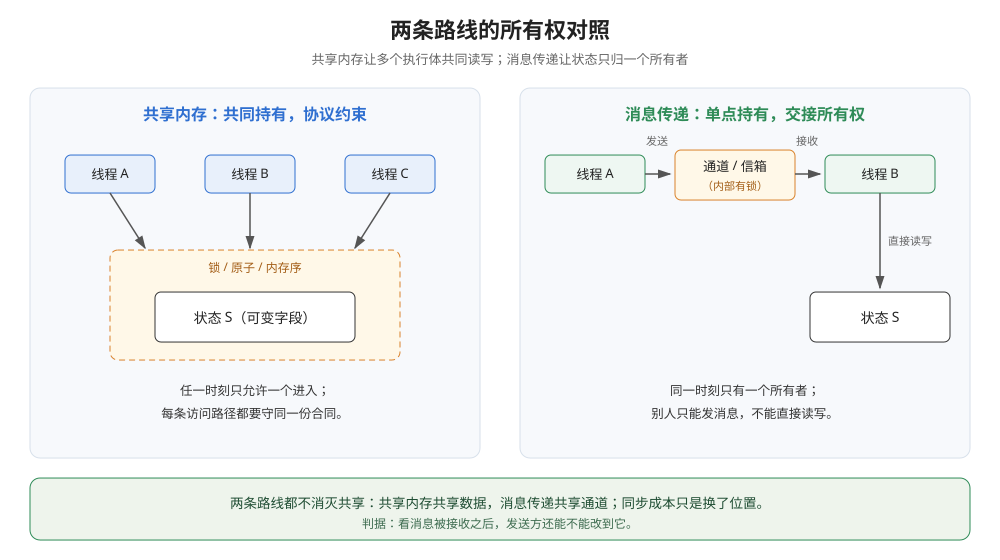
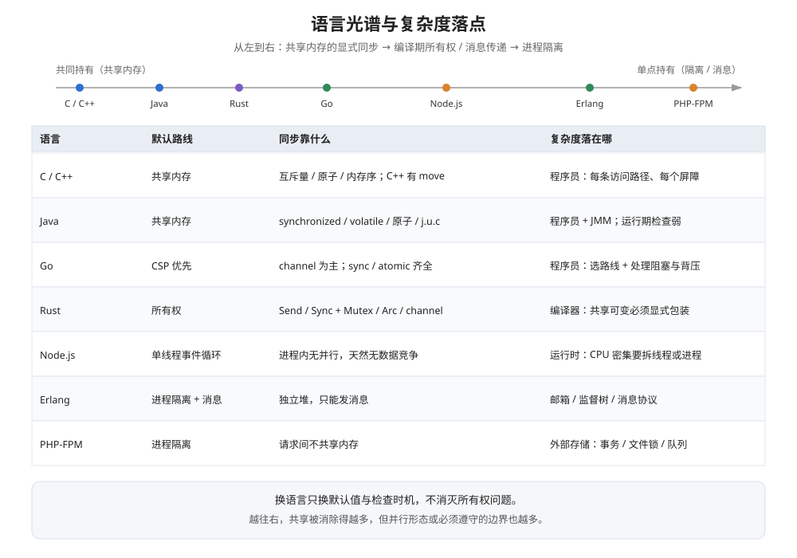
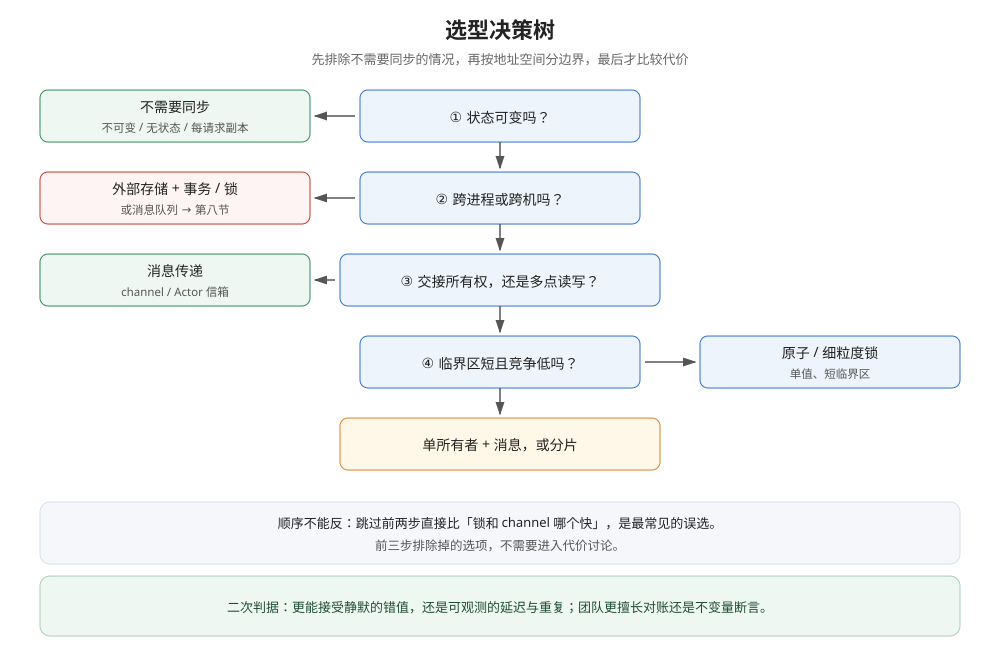
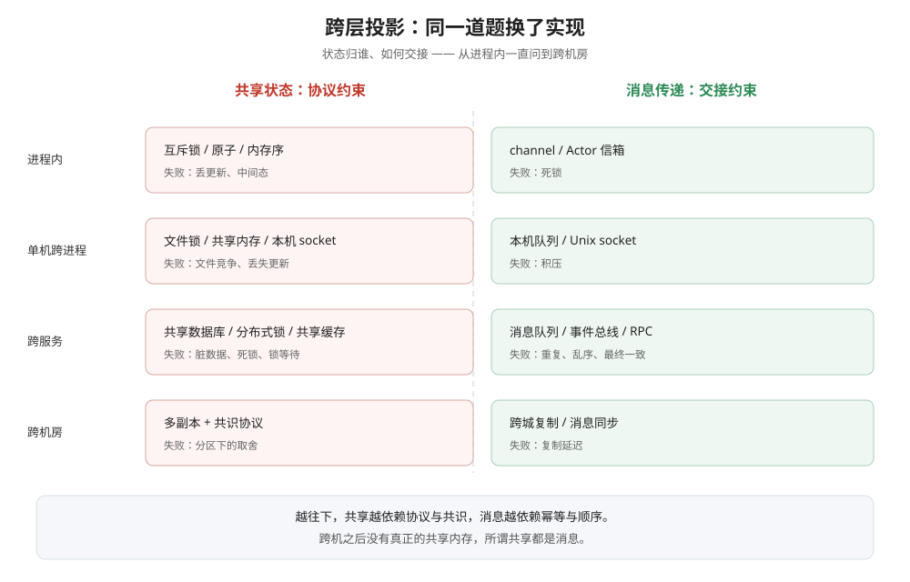

# 共享内存与消息传递

> 覆盖：线程安全的共同问题是什么（状态与所有权）；共享内存与消息传递两条路线各自为什么成立、把复杂度挪到了哪；两条路线的失败模式为什么不同；同一套判断在 C / Java / Go / Rust / Node / Erlang / PHP 上落成什么默认值；代价在什么条件下反转；以及这套判断在进程内 → 跨进程 → 跨机 → 架构层的投影。
>
> 不覆盖：Happens-Before、原子操作与互斥锁的硬件和内核机制见 [内存重排、Happens-Before与数据竞争.md](../计算机底层原理/底层同步/内存重排、Happens-Before与数据竞争.md) 与 [底层同步 README](../计算机底层原理/底层同步/README.md)；Go 侧原语、channel 实现与实测见 [线程安全与CSP.md](../../01-编程语言/go/并发编程/线程安全与CSP.md) 与 [channel原理与底层实现.md](../../01-编程语言/go/并发编程/channel原理与底层实现.md)；Java 侧见 [锁与AQS.md](../../01-编程语言/java/并发编程/锁与AQS.md) 与 [并发容器.md](../../01-编程语言/java/并发编程/并发容器.md)；跨服务的事务与消息见 [最终一致方案.md](../../04-架构与系统/分布式/分布式事务/最终一致方案.md) 与 [消息队列选型对比.md](../../03-数据与中间件/中间件/消息队列/消息队列选型对比.md)。
>
> 内容整理自个人学习笔记，素材见 [素材清单](../../素材清单.md)。**实测口径**：Go 读数转引自 [线程安全与CSP.md](../../01-编程语言/go/并发编程/线程安全与CSP.md)（宿主机 `go1.26.5 windows/amd64`，4 协程 × 10 万次）；Java 8、PHP 8.0、Node 20 的读数为本篇新跑，都在 Docker 容器内完成（镜像见「具体使用」），多轮取范围；Erlang / Akka / Rust / C 只做机制陈述，**未实跑**。⚠️ 跨语言的绝对耗时不可横向比较 —— 语言、运行时和机器都不同，本篇只比较**同一语言内部**的量级关系。

---

## 一、线程安全到底在保护什么？

**本节要点**：线程安全不是「给代码加锁」，而是**给一份可变状态定一条「谁在什么时候能碰它」的规则**。先把三件事分开：被保护的状态、并发访问、以及所有权归谁。

### 1.1 三个要素缺一不可

「线程安全」的常用定义是**多线程并发访问时，结果仍然可预期**。反过来读，出问题需要同时满足三个条件：

| 要素 | 含义 | 缺了会怎样 |
|---|---|---|
| **可变状态** | 至少有一个执行体会写的数据 | 全部不可变 → 不需要任何同步 |
| **并发访问** | 两个以上执行体在时间上重叠地碰它 | 严格串行 → 不需要任何同步 |
| **缺少顺序约束** | 没有 happens-before 规定谁先谁后 | 同步正确 → 结果确定 |

> 这张表的用法是**排除法**：与其问「这里要不要加锁」，不如先问「这三条里能不能去掉一条」。
> 能在设计上把状态变成不可变、把访问变成单线程、把顺序约束显式化，就不需要进入「选锁还是选 channel」的讨论。

### 1.2 共享出错只有三种形态

看起来千奇百怪的并发 bug，落到状态上只有三类：

| 形态 | 最小复现 | 结果表现 |
|---|---|---|
| **丢更新** | `a++` 或 `v = a; a = v + 1` 被两个线程交错 | 值偏小，程序不报错 |
| **中间态** | 一组字段只改了一半（先改余额、后改流水） | 别的线程读到自相矛盾的状态 |
| **旧值 / 半成品** | 没有同步就发布对象：指针先可见、字段后可见 | 读到未初始化或过期的值 |

三类的共同点不是「缺一把锁」，而是**某个执行体在它不该碰这份状态的时候碰了它**。这就是「所有权」问题。

### 1.3 所有权才是根概念

同一份状态，在任一时刻可以有两种归属规则：

- **共享所有权**：所有执行体都能直接读写，靠一套协议约定「何时可以访问」；
- **独占所有权**：任一时刻只有一个执行体持有它，别人想改只能发消息请求。

所有并发方案都是这两种之一。锁、原子操作、内存序属于前者；channel、Actor 信箱、消息队列属于后者。



这张图要读出的结论是：共享内存保护的是**数据**，消息传递保护的是**交接**。右边的状态框只在所有者手里，其他人碰不到它；但中间的通道本身仍然是所有线程共享的对象——它不是「无同步」，只是把同步收进了一个地方。

> 换语言不会让所有权问题消失，只会让它换个位置。PHP-FPM 每个请求一个进程，进程内存天然不共享，看起来「没有线程安全问题」；但两个请求同时改同一个文件或同一行数据库记录时，问题原样存在。后文的 PHP 实测里，8 个进程各自把本地变量加到了 20000，共享文件却只剩 49。

---

## 二、共享内存路线为什么必须同步？

**本节要点**：状态放在公共内存，任何执行体都能直接读写，所以必须约定**互斥**与**访问顺序**两件事。同步原语不是「让代码变慢的开关」，而是把「谁能进、进去之后能看到什么」写成合同。

### 2.1 同步原语做了两件事

| 职责 | 解决的问题 | 典型手段 |
|---|---|---|
| **互斥** | 同一时刻只允许一个执行体进入临界区 | 互斥锁、信号量、自旋锁 |
| **可见性与顺序** | 前一个临界区里的写，对后一个进入者可见；临界区内的读写不越界重排 | 内存屏障、`volatile`、原子操作的顺序语义 |

第二件事常被忽略：即使两个线程没有同时进入，CPU 和编译器也可能让写「晚一点」被看见。**Happens-Before 是判断「能不能读到正确值」的唯一合法工具**，详细规则在 [内存重排、Happens-Before与数据竞争.md](../计算机底层原理/底层同步/内存重排、Happens-Before与数据竞争.md)，本篇不重复。

### 2.2 一条路径漏了，整个合同作废

共享内存最危险的地方在于：**规则必须是全量的**。同一个字段只要有一条读写路径没走同步，其他路径加得再对也没用。

Java 的 `volatile` 是一个常见半成品。它保证可见性，**不保证「读-改-写」的原子性**：

```java
static volatile long counter = 0;

// 8 个线程，每个 200 万次
long v = counter;   // ① 读
counter = v + 1;    // ② 写回
```

实测 3 轮，16,000,000 次累加只留下 4,227,513 / 4,462,239 / 4,281,933 次，**丢失 73.6% / 72.1% / 73.2%**：

```text
round 1 | counter=4227513 expect=16000000 lost=11772487 (73.6%) 518 ms
round 2 | counter=4462239 expect=16000000 lost=11537761 (72.1%) 435 ms
round 3 | counter=4281933 expect=16000000 lost=11718067 (73.2%) 406 ms
```

> 这条读数的价值不在于「丢了多少」，而在于**它每一轮都错**：`volatile` 让每次读都真的去内存读，于是两个线程更容易读到同一个旧值，再各自写回——比完全不声明 `volatile` 时更容易复现。
> 结论：**可见性、原子性、有序性是三件事，少一件都不构成正确的互斥**。

### 2.3 锁背后有三条隐含合同

加锁的代码本身只有两行，难的是它默认了三件不会被编译器检查的事：

| 合同 | 内容 | 违约后果 |
|---|---|---|
| **保护范围** | 这把锁保护哪些字段、哪些不变量 | 漏保护一个字段 → 该字段仍会坏 |
| **访问纪律** | 所有读写路径都必须拿同一把锁 | 有一条只读路径绕过 → 读到中间态 |
| **加锁顺序** | 多把锁必须按固定顺序获取 | 环形等待 → 死锁 |

这也是为什么「加锁」比「用 channel」更依赖 code review：**锁的正确性在于所有调用方都守约，而编译器只看得见当前函数**。

### 2.4 粒度是一个连续谱

| 粒度 | 做法 | 并行度 | 代价 |
|---|---|---|---|
| **粗锁** | 整个对象一把锁 | 最低 | 简单、不易漏 |
| **细锁** | 每个字段 / 每个桶一把锁 | 较高 | 合同数量成倍增加 |
| **无锁** | CAS 循环、原子变量 | 最高（低竞争时） | ABA、活锁、内存序推理 |
| **分片** | 按 key 哈希到 N 个独立单元 | 高 | 需要能定义分片键 |

粒度的选择不是「越细越好」：细锁把一把锁的合同拆成 N 份合同，**出错面也变成 N 份**。无锁也不是「没有同步」，只是把等待从「阻塞」换成「重试」。

### 2.5 共享内存的复杂度随访问点增长

共享内存的成本不在第一次加锁，而在**每新增一个访问点，都要重新检查合同**。一个字段被三个模块读写，就有三处要守约；跨团队时，合同往往只存在于口头和注释里。设计上通常用两种方式收口：

1. **封装**：字段私有，只暴露带锁的方法，调用方无法绕过；
2. **所有权收口**：把状态交给一个执行体独占，对外只留消息接口——这就是第三条路线。

---

## 三、消息传递路线为什么可以「不加锁」？

**本节要点**：消息传递不是消除了共享，而是把「多点直接读写」收敛成「单点持有 + 消息请求」。业务状态因此不需要锁，但**通道/信箱本身仍是并发对象，内部仍有同步**。把这句话说准，才不会把 channel 当成免费的午餐。

### 3.1 交接，而不是共享

消息传递的核心动作是**所有权转移**：

- 状态只由所有者读写；
- 其他人想读或改，发一条消息；
- 所有者在自己的控制流里串行处理消息，因此**不存在两个执行体同时碰它**。

Go 的官方说法是「不要通过共享内存来通信，而要通过通信来共享内存」；换成所有权语言就是：**不要共同持有，要把持有权交出去**。Erlang 的进程、Akka 的 Actor、Go 的 channel 都是这条规则的实现。

### 3.2 「不加锁」的准确含义：锁被搬进了队列

业务代码里看不到 `lock`，不等于底层没有同步：

| 实现 | 内部的同步 |
|---|---|
| Go `chan` | `hchan` 结构体内有互斥锁，收发与关闭都要先拿它（见 [channel原理与底层实现.md](../../01-编程语言/go/并发编程/channel原理与底层实现.md)） |
| Java `ArrayBlockingQueue` | 内部 `ReentrantLock` + 两个 `Condition`（notEmpty / notFull） |
| Actor 信箱 | 并发队列 / 无锁队列，入队出队本身要保证多生产者、单消费者的正确性 |

所以准确的说法是：**消息传递把「每个访问点各加一把锁」换成了「所有访问点共用一条队列，队列内部同步一次」**。共享面从 N 个字段缩小到 1 个通道，但同步的固定成本落在每一次交接上。

Java 的实测能直接看出这笔成本：同样 1600 万次操作，原子变量 254~306 ms，`synchronized` 122~474 ms，`ArrayBlockingQueue` 交接 3408~4100 ms。**队列比原语贵一个数量级**——贵的就是每次入队/出队、唤醒与调度的固定开销。

### 3.3 CSP 与 Actor 不是一回事

两者都叫「消息传递」，但所有权和时序不同：

| 维度 | CSP / channel | Actor / mailbox |
|---|---|---|
| **状态归谁** | 接收方在处理消息时临时拥有 | Actor 长期拥有，状态封装在内部 |
| **发送是否等待** | 无缓冲时同步（发送与接收 rendezvous）；有缓冲时异步 | 默认异步投递，发送方不等处理完成 |
| **双方是否必须同时在场** | 无缓冲时必须 | 不需要，信箱解耦生命周期 |
| **典型失败** | 发送/接收阻塞 → 死锁可被检测 | 信箱积压 → 延迟上升，可能静默 |
| **典型代表** | Go | Erlang / Elixir、Akka |

一句话：**CSP 是「交接时刻双方对齐」，Actor 是「投递之后各走各的」**。前者把时序约束写得最死，后者把解耦做得最彻底，代价是积压与顺序问题转移到信箱上。

### 3.4 消息里装什么，决定共享有没有真的消失

如果消息里传的是**值或所有权**（拷贝、move、不可变快照），接收方拿到的是独立数据，共享确实消失。
如果消息里传的是**指向可变数据的指针/引用**，发送方和接收方仍然共享同一份内存——锁只是从「访问字段」挪到了「约定谁在什么时候改这个指针指向的对象」。

> 判据：**看消息被接收之后，发送方还能不能改到它**。能改到 → 还是共享内存，只是多绕了一条队列；不能改到 → 所有权真的转移了。

---

## 四、两条路线的失败模式为什么不同？

**本节要点**：共享内存的错误发生在**值**上，程序往往正常退出；消息传递的错误发生在**时**上，表现为卡住、变慢、重复或乱序。前者更难发现，后者更难恢复。选型时必须同时接受这两种失败形态和它们各自的监控手段。

### 4.1 共享内存错在「值」

三个语言的实测指向同一个现象：**程序不报错，结果不对**。

| 语言 / 写法 | 期望 | 实际 | 程序表现 |
|---|---|---|---|
| Go 裸 `int` 并发累加 1000 次 | 1000 | **975** | 正常退出，退出码 0 |
| Go 4 协程 × 10 万次 | 400000 | **145745** | 正常退出，退出码 0 |
| Java `volatile` 读改写 | 16000000 | 4227513~4462239 | 正常退出，退出码 0 |
| PHP 8 进程写同一文件（无锁） | 160000 | **49** | 正常退出，退出码 0 |

这类错误的共同特征是**随机、静默、与负载相关**：测试环境可能一直对，生产上偶发；同一份代码跑 10 轮，可能有 3 轮恰好完全正确。**「我跑了一遍是对的」不能作为正确性证据**。

### 4.2 消息传递错在「时」

消息传递把错误从数据搬到了控制流，常见四种：

| 失败 | 触发条件 | 现象 |
|---|---|---|
| **死锁** | 发送与接收互相等待，且没有第三方推进 | 所有协程阻塞，运行时直接报 `fatal error: all goroutines are asleep - deadlock!` |
| **背压 / 积压** | 生产速度长期高于消费速度 | 队列变长、延迟上升，最终 OOM 或超时 |
| **丢失 / 重复** | 异步投递 + 重试 / 至少一次语义 | 业务少做或多做一次，需要幂等与去重 |
| **乱序** | 多通道、多分区、多生产者 | 后发的消息先到，状态机跳步 |

死锁是「当场暴露」的那一种：Go 运行时会打印全部协程栈，并指出 `goroutine 1 [chan send]` 卡在哪一行。积压、重复、乱序则可能长期不报错——它们不会让进程崩，只会让**结果慢慢不对**或**服务慢慢变慢**。

### 4.3 一张对照表


这张图要读出的是「错误暴露的时机」这一列：共享内存的错误往往要等对账或用户投诉才发现，消息传递的错误通常在进程卡住、队列深度报警或超时率上升时就被看见。

| 维度 | 共享内存 | 消息传递 |
|---|---|---|
| **错误落在** | 数据的值 | 事件的时序 |
| **典型表现** | 结果偏小 / 中间态 / 旧值 | 死锁 / 积压 / 重复 / 乱序 |
| **暴露时机** | 往往延迟，依赖对账 | 死锁当场；积压与重复延迟 |
| **程序是否崩溃** | 通常不崩 | 死锁崩；积压与重复不崩 |
| **主要排查手段** | race detector、压力测试、不变量断言 | 协程栈、队列深度、延迟分位、trace、幂等校验 |
| **最难的场景** | 低频路径，测试覆盖不到 | 高峰期积压与重试风暴 |

### 4.4 监控与测试要分别落点

- **共享内存**：`go test -race`、Java 的 jcstress 类压测、对关键不变量做运行期断言（如「余额 + 冻结 = 总额」）、把并发路径纳入 CI 的反复运行。
- **消息传递**：队列深度与最老消息年龄、消费延迟分位、死信队列、重复率、端到端 trace、消费者幂等与去重表。

两条路线的共同底线是：**单次运行通过不算证据**，要么用工具（race detector / 死锁检测），要么用不变量（任何时刻都成立的关系），要么用故障注入（杀掉消费者、灌满队列）。

---

## 五、同一问题在语言光谱上怎么落？

**本节要点**：语言之间的差别不是「有没有锁」，而是**默认把复杂度放在哪、在什么时机检查**。换语言只换默认值和检查时机，不消灭所有权问题。

### 5.1 七种落点

| 语言 / 运行时 | 默认路线 | 同步靠什么 | 复杂度落在哪 |
|---|---|---|---|
| **C / C++** | 共享内存 | 互斥量、原子、内存序；C++ 另有 move 语义 | 程序员：每条访问路径、每个屏障 |
| **Java** | 共享内存 | `synchronized` / `volatile` / 原子类 / `j.u.c`；也有 `BlockingQueue` | 程序员 + JMM 规则；运行期检查弱 |
| **Go** | CSP 优先 | channel 为主，`sync` / `atomic` 齐全 | 程序员：选择路线 + 处理阻塞与背压 |
| **Rust** | 所有权 | `Send` / `Sync` + `Mutex` / `Arc` / channel | 编译器：共享可变必须显式包装 |
| **Node.js** | 单线程事件循环 | 进程内无并行，天然无数据竞争 | 运行时：CPU 密集要靠 worker_threads 或拆进程 |
| **Erlang / Elixir** | 进程隔离 + 消息 | 每个进程独立堆，只能发消息 | 运行时 + 程序员：信箱、监督树、消息协议 |
| **PHP-FPM** | 进程隔离 | 请求间不共享内存 | 外部存储：DB 事务、文件锁、队列 |

### 5.2 三条读法

**读法一：默认值决定「第一反应」。**
C / Java 程序员看到共享状态，第一反应是加锁；Go 程序员第一反应是把状态交给一个 goroutine；Erlang 程序员第一反应是「为什么会有共享状态」。第一反应不同，代码形态就不同。

**读法二：检查时机不同。**
Rust 把「共享可变」做成编译错误，问题在运行前暴露；Java / Go 主要靠运行期与测试期；PHP 靠「根本不共享进程内存」躲开一部分问题，但躲不开外部状态。**检查越早，修复越便宜，但表达约束也越强**。

**读法三：复杂度守恒。**
每一行最后一列都写着复杂度落在哪——它没有消失，只是换了承担者。Node 把并行去掉了，代价是 CPU 密集任务会阻塞整个事件循环；Erlang 把共享去掉了，代价是消息协议、信箱积压与分布式节点管理。



这张图要读出的是：光谱两端都不是「更安全」，而是**把成本放在了不同位置**。越往右，语言/运行时替你消除的共享越多，但你失去的并行形态或必须遵守的边界也越多。

### 5.3 两个容易误读的落点

**Node.js：没有数据竞争，不等于没有并发问题。**
进程内只有一个 JS 执行线程，所以两个「并发」的 `async` 函数不会同时改一个变量：

```text
workers=4 shared=400000 expect=400000 elapsed=12ms
```

4 个异步任务各加 10 万次，结果精确等于 400000，且只用了 12 ms。但这不是「消息传递赢了」——是**根本不存在进程内并行**。一旦任务是 CPU 密集的，事件循环会被占满；要利用多核就得上 `worker_threads` 或拆进程，那时共享与消息的问题原样回来。

**PHP：进程隔离只隔离了进程内存。**
8 个独立 PHP 进程各自把本地变量加到 20000（合计 160000），共享文件在无锁时只剩 **49**（另一组 8 × 2000 的三轮是 40 / 33 / 32），加 `flock` 后精确等于 160000 / 16000。进程内存确实不共享，但**文件、数据库、缓存这些外部状态仍然共享**，仍然需要锁或事务。

> 这条对架构的提示很直接：**进程隔离把「进程内同步」问题变成了「外部状态同步」问题**，后者要靠数据库事务、分布式锁或消息队列解决，难度通常更高，不是更低。

---

## 六、代价差在哪、什么时候会反转？

**本节要点**：同一语言内部，消息传递比原子/锁贵一个数量级左右；但跨进程、跨机之后，共享内存物理上不存在，消息传递从「更贵的选择」变成「唯一的选择」。代价比较必须先固定边界，否则会得出反的结论。

### 6.1 同一份负载的量级

| 运行时 | 负载 | 原子 / 锁 | 消息传递 |
|---|---|---|---|
| **Go**（4 协程 × 10 万） | 累加 | `atomic` 4 ms / `Mutex` 31 ms | channel 73 ms |
| **Java**（8 线程 × 200 万） | 累加 / 交接 | `AtomicLong` 254~306 ms；`synchronized` 122~474 ms | `ArrayBlockingQueue` 3408~4100 ms |

两组的稳定结论是同一条：**为了「改一个整数」而走队列，代价高一个数量级**。Java 的 `synchronized` 波动很大，低竞争时甚至比原子变量快——这说明含计时的读数只能看量级，不能当性能指标；**能稳定复现的是「队列明显更贵」**。

### 6.2 贵在哪

| 成本项 | 共享内存 | 消息传递 |
|---|---|---|
| 进入/退出临界区 | 一次原子操作或一次阻塞 | 入队 + 出队 + 可能的唤醒 |
| 数据搬运 | 不搬，直接读写 | 拷贝或所有权移动 |
| 调度 | 竞争激烈时才让出 CPU | 每次交接都可能切换执行体 |
| 缓存 | 多核争用同一缓存行 | 生产/消费各写各的，争用少 |

所以消息传递在**高竞争、长临界区、需要解耦**时反而可能更划算：它把「大家抢同一把锁」换成了「各写各的队列位置」。

### 6.3 代价反转的五个条件

| 条件 | 倾向 | 原因 |
|---|---|---|
| **跨进程 / 跨机** | 消息传递（唯一可行） | 共享内存不存在，只能靠网络消息或外部存储 |
| **对象很大** | 共享 + 锁，或 move | 每次交接都拷贝，成本随大小线性上升 |
| **临界区很长 / 竞争很高** | 消息传递 / 分片 | 锁的串行化损失超过队列开销 |
| **延迟预算极低** | 原子 / 无锁 | 队列的唤醒与调度有固定延迟 |
| **需要削峰 / 解耦 / 重放** | 消息队列 | 队列本身是缓冲与解耦设施，不只是通信 |

> 判据：**先问「状态在不在同一个地址空间」**。在同一个进程内，两条路线都可行，比代价；跨出进程，共享内存这条路直接消失，讨论就结束了。

---

## 七、选型的判据是什么？

**本节要点**：按「能不能不共享 → 在不在同一地址空间 → 是交接还是多点读写 → 临界区与竞争强度」四步走，前三步就能排除掉大部分选项；「哪个更高级」不是判据。

### 7.1 先问四个问题

1. **状态能不能不共享？** 不可变、无状态、每请求独立副本 → 什么都不用。
2. **状态在不在同一个地址空间？** 跨进程/跨机 → 外部存储 + 事务/锁，或消息队列；语言原语退场。
3. **访问模式是「交接」还是「多点读写同一份」？** 交接（任务分发、流水线、所有权转移）→ channel / Actor；多点读写 → 锁/原子/分片。
4. **临界区多长、竞争多强？** 短且低竞争 → 原子或细粒度锁；长或高竞争 → 单所有者 + 消息，或分片。

### 7.2 一棵决策树



这张图要读出的是顺序：**先排除、再分边界、最后比代价**。大多数误选发生在跳过前两步，直接比较「锁和 channel 哪个快」。

### 7.3 三个常见误判

| 误判 | 为什么错 | 正确做法 |
|---|---|---|
| **channel 更高级，所以都用 channel** | 改一个计数器也走队列，代价高一个数量级 | 单值/单字段用原子或锁；交接与分发才用 channel |
| **锁一定慢** | 无竞争时锁几乎免费；Java 实测低竞争下 `synchronized` 比原子变量还快 | 先量竞争，再谈代价 |
| **Actor 自动线程安全** | 只保证 actor 内部串行；跨 actor 的顺序、重复、丢失仍要处理 | 把消息协议、幂等、信箱上限当成一等公民 |

### 7.4 二次判据：你更能接受哪种失败

技术判据打平之后，用失败形态做决定：

- 团队更擅长**对账与不变量**、状态是强一致的账目 → 共享内存 + 事务/锁；
- 团队更擅长**监控队列与链路追踪**、业务能接受最终一致 → 消息传递 + 幂等；
- 两边都不擅长 → 优先选**状态更少、所有权更单一**的设计，先把问题规模降下来。

---

## 八、同一套哲学在架构层怎么投影？

**本节要点**：进程内选「锁还是 channel」，与架构层选「共享数据库还是事件驱动」是同一道题：**状态归谁、如何交接**。跨机之后「共享内存」物理上不存在，所谓分布式共享其实都是消息。

### 8.1 四层是同一道题

| 层 | 共享状态的做法 | 消息传递的做法 | 主要失败形态 |
|---|---|---|---|
| **进程内** | 互斥锁 / 原子 / 内存序 | channel / Actor 信箱 | 丢更新 vs 死锁 |
| **单机跨进程** | 文件锁 / 共享内存 / 本机 socket | 本机队列 / Unix socket | 文件竞争 vs 积压 |
| **跨服务** | 共享数据库 / 分布式锁 / 共享缓存 | 消息队列 / 事件总线 / RPC | 脏数据、死锁 vs 重复、乱序、最终一致 |
| **跨机房** | 多副本 + 共识协议 | 跨城复制 / 消息同步 | 分区下的取舍（CAP） |



这张图要读出的是：越往下，左边的「共享状态」越依赖协议与共识，右边的「消息传递」越依赖幂等与顺序保证；**两边的复杂度都在上升，没有一层是免费的**。

### 8.2 共享数据库与事件驱动

| 维度 | 共享数据库 | 事件驱动 |
|---|---|---|
| **状态归谁** | 多个服务共同读写同一份表 | 每个服务独占自己的状态 |
| **一致性** | 靠事务、行锁、隔离级别 | 靠幂等、去重、补偿、最终一致 |
| **耦合点** | 表结构（schema 成为公共契约） | 事件契约（消息格式与语义） |
| **失败形态** | 脏读、死锁、长事务锁表 | 重复消费、乱序、积压、不一致窗口 |
| **扩展方式** | 垂直扩展 + 读写分离 + 分库分表 | 分区 + 消费者扩容 |

前者是「共享内存」在服务层的放大版：所有服务直接碰同一份状态，所以必须有一套所有人都遵守的锁/事务合同——和进程内「所有访问路径都要拿同一把锁」完全同构。
后者是「消息传递」的放大版：状态归一个服务，别人发命令或订阅事件——和「状态归一个 goroutine，别人发 channel」完全同构。

### 8.3 跨机之后没有「共享内存」

RPC 看起来像调用本地函数，缓存看起来像读写本地内存，分布式锁看起来像 `lock()`；但它们的底层都是**网络消息 + 超时 + 重试**。所谓「分布式共享内存」只是把这层消息包装成读写接口，失败模式仍然是消息的那一套：超时、重复、乱序、分区。

> 所以架构层的选型不是「共享还是消息」，而是**「你愿意把哪一种失败暴露给业务」**：共享数据库把失败暴露成锁等待与事务回滚；事件驱动把失败暴露成延迟与最终一致。这句话和第七节的二次判据是同一条。

### 8.4 往下读的入口

- 跨服务的消息与事件：[消息队列选型对比.md](../../03-数据与中间件/中间件/消息队列/消息队列选型对比.md)、[Topic切分与事件设计.md](../../03-数据与中间件/中间件/消息队列/Topic切分与事件设计.md)
- 跨服务的一致性：[最终一致方案.md](../../04-架构与系统/分布式/分布式事务/最终一致方案.md)、[一致性模型.md](../../04-架构与系统/分布式/理论基础/一致性模型.md)
- 数据库层的锁与隔离：[锁的粒度与模式.md](../../03-数据与中间件/数据存储/并发控制/锁的粒度与模式.md)、[MVCC多版本并发控制.md](../../03-数据与中间件/数据存储/并发控制/MVCC多版本并发控制.md)

---

## 应用场景

| 场景 | 倾向 | 理由 |
|---|---|---|
| 计数器、指标聚合 | 原子操作 | 单值、单次读改写，队列是过度设计 |
| 配置热更新（读多写少） | 不可变快照 + 原子指针 | 读者拿到的是一份完整旧/新配置，不需要锁 |
| 连接池、任务分发 | channel / 队列 | 本质是所有权交接与限流 |
| 请求上下文传递 | 参数 / `ctx`，不共享 | 每个请求一份，天然无竞争 |
| 订单状态机 | 单所有者 + 消息 | 状态转移必须串行，交给一个执行体最稳 |
| 跨服务下单 + 扣库存 | 事件 / Saga | 跨地址空间，锁不可行（见 04 分布式事务） |
| 日志采集 | 有界队列 + 背压 | 削峰、解耦、可重放 |
| 多实例共享缓存 | 外部存储 + 版本/锁 | 进程内锁管不到别的实例 |

## 具体使用

四段代码分别在四个运行时里跑，用来把「同一道题的不同默认值」落到可观察的输出上。Java 用 `eclipse-temurin:8-jdk`、PHP 用 `php:8.0-cli`、Node 用 `node:20-alpine`，均以 `--rm` 容器挂载脚本目录运行；完整工程与更多读数见 [线程安全与CSP.md](../../01-编程语言/go/并发编程/线程安全与CSP.md)。

### 用法一：Go 的锁与 channel

```go
func withMutex(n int) int64 {
    var mu sync.Mutex
    var total int64
    var wg sync.WaitGroup
    for i := 0; i < 4; i++ {
        wg.Add(1)
        go func() {
            defer wg.Done()
            for j := 0; j < n; j++ {
                mu.Lock()
                total++
                mu.Unlock()
            }
        }()
    }
    wg.Wait()
    return total
}

func withChannel(n int) int64 {
    ch := make(chan int64, 1024)
    var wg sync.WaitGroup
    for i := 0; i < 4; i++ {
        wg.Add(1)
        go func() {
            defer wg.Done()
            for j := 0; j < n; j++ {
                ch <- 1
            }
        }()
    }
    go func() { wg.Wait(); close(ch) }()

    var total int64
    for v := range ch {
        total += v
    }
    return total
}
```

同样 4 协程 × 10 万次，`Mutex` 31 ms、channel 73 ms、`atomic` 4 ms（5 轮取最快一轮）。三者结果都正确——**差别只在代价，不在正确性**。

### 用法二：Java 的 volatile、synchronized 与阻塞队列

```java
static volatile long counter = 0;   // 只保证可见性，不保证原子性
static long synced = 0;
static synchronized void inc() { synced++; }

// 错误示范：读改写三步，8 线程 × 200 万次，丢 73%
long v = counter;
counter = v + 1;

// 正确示范：临界区串行化
inc();

// 消息传递形态：单生产者 / 单消费者交接
ArrayBlockingQueue<Long> q = new ArrayBlockingQueue<>(1024);
```

实测（JDK 8，8 线程 × 200 万，3 轮）：`volatile` 读改写只剩 4227513 / 4462239 / 4281933；`AtomicLong` 254~306 ms；`synchronized` 122~474 ms；`ArrayBlockingQueue` 3408~4100 ms。**`volatile` 那一组每一轮都错，队列那一组每一轮都对但最慢**。

### 用法三：PHP 的进程隔离与外部共享状态

```php
<?php
$file = $argv[1];
$per = (int) $argv[3];
$useLock = ($argv[4] ?? 'nolock') === 'lock';

$local = 0;
for ($i = 0; $i < $per; $i++) {
    $local++;
    if ($useLock) {
        $fh = fopen($file, 'r+');
        flock($fh, LOCK_EX);
        $v = (int) stream_get_contents($fh);
        ftruncate($fh, 0);
        rewind($fh);
        fwrite($fh, (string) ($v + 1));
        flock($fh, LOCK_UN);
        fclose($fh);
    } else {
        $v = (int) file_get_contents($file);
        file_put_contents($file, (string) ($v + 1));   // 截断 + 写入，非原子
    }
}
```

启动方式是 8 个独立进程并发跑同一份脚本：

```bash
for i in 0 1 2 3 4 5 6 7; do
  php php_worker.php /tmp/count.txt $i 2000 nolock &
done
wait
```

8 个独立进程各跑一份，结果：

```text
8 × 20000，无锁：final=49          expect=160000
8 × 2000，无锁：final=40 / 33 / 32 expect=16000
8 × 2000，flock：final=16000       expect=16000
每个进程的 local 都是 20000（合计 160000）
```

进程内存确实不共享，**但共享文件不是**：`file_put_contents` 先截断再写，其他进程常常读到空文件，于是几乎全部更新都被覆盖。这段耗时被文件 I/O 主导（16 万次约 34~57 秒），**只用来证明正确性，不作代价对比**。

### 用法四：Node 的单线程事件循环

```javascript
let shared = 0;
await Promise.all(
  Array.from({ length: 4 }, async () => {
    for (let i = 0; i < 100000; i++) shared++;
  })
);
// shared === 400000
```

4 个异步任务各加 10 万次，结果精确等于 400000，耗时 12 ms。原因不是「Node 的锁更好」，而是**同一时刻只有一个 JS 执行线程**，两个任务不可能同时执行 `shared++`。要利用多核，就得用 `worker_threads` 或拆进程，届时共享/消息的选择重新出现。

| 观察 | 结论 |
|---|---|
| Go 的 channel 结果正确但比 `atomic` 贵十几倍 | 消息传递不是免费的 |
| Java 的 `volatile` 每轮都错、队列每轮都对 | 可见性不等于原子性；消息传递把错误换成时序 |
| PHP 的进程内变量精确、共享文件几乎全丢 | 进程隔离只隔离进程内存，不隔离外部状态 |
| Node 的结果精确但只有一条执行线程 | 消除并行也能消除数据竞争，代价是并行度 |

## 延伸追问

- **为什么「消息传递」不是无锁的？** → 通道/信箱本身是多执行体共享的对象，入队、出队、唤醒都需要同步。准确说法是「业务状态不加锁」，同步被收进了队列。
- **Go 官方说「用通信来共享内存」，是不是意味着 channel 永远优于锁？** → 不是。官方同时保留了 `sync` 与 `atomic`；单值计数、只读快照、只由一个协程访问的状态，用锁或原子更直接。判据见第七节，代价见第六节。
- **既然共享内存会静默出错，为什么不全部改成消息传递？** → 消息传递把错误换成死锁、积压、重复与乱序，并增加拷贝与调度成本；跨机时它确实是唯一选择，但进程内的小状态用队列是过度设计。
- **Rust 的所有权能消灭这类问题吗？** → 它能消灭**数据竞争**（共享可变必须显式包装），但不能消灭逻辑竞争：用 `Mutex` 保护的两个操作仍可能以错误顺序执行，死锁也仍然存在。
- **Actor 模型是不是自动线程安全？** → Actor 内部状态是串行的，所以内部不需要锁；跨 Actor 的消息顺序、重复、丢失、信箱上限仍要自己处理，和 channel 一样。
- **PHP 每个请求一个进程，还需要考虑并发吗？** → 进程内存不需要，但数据库行、文件、缓存、队列都是共享的；并发问题从「进程内」搬到了「外部状态」，通常更难。
- **怎么在 Code Review 里快速发现共享内存的漏洞？** → 对每个可变字段列出所有读写点，检查是否都走同一把锁/同一个原子接口；再看锁的获取顺序是否全局一致。字段多、路径多时，优先考虑收口成单所有者。

## 关联

- **上游/总纲**：[计算机底层原理/底层同步 README](../计算机底层原理/底层同步/README.md) — 同步原语在硅与内核层怎么履行合同，本篇只讲「为什么需要合同」
- **上游/总纲**：[操作系统 README](../操作系统/README.md) — 进程、线程与内核调度底座
- **对照/互补**：[线程安全与CSP.md](../../01-编程语言/go/并发编程/线程安全与CSP.md) — Go 侧的同一道题：值传递、失败模式与 4/31/73 ms 实测
- **下游机制**：[内存重排、Happens-Before与数据竞争.md](../计算机底层原理/底层同步/内存重排、Happens-Before与数据竞争.md) — 共享内存路线所依赖的顺序规则
- **下游机制**：[channel原理与底层实现.md](../../01-编程语言/go/并发编程/channel原理与底层实现.md) — 消息传递路线的队列内部如何加锁
- **对照/互补**：[锁与AQS.md](../../01-编程语言/java/并发编程/锁与AQS.md) — Java 共享内存路线的完整实现
- **对照/互补**：[并发容器.md](../../01-编程语言/java/并发编程/并发容器.md) — Java 消息传递形态（阻塞队列）的实现与选型
- **架构投影**：[最终一致方案.md](../../04-架构与系统/分布式/分布式事务/最终一致方案.md) — 跨服务消息传递的可靠性设计
- **架构投影**：[消息队列选型对比.md](../../03-数据与中间件/中间件/消息队列/消息队列选型对比.md) — 跨进程队列的产品选型
