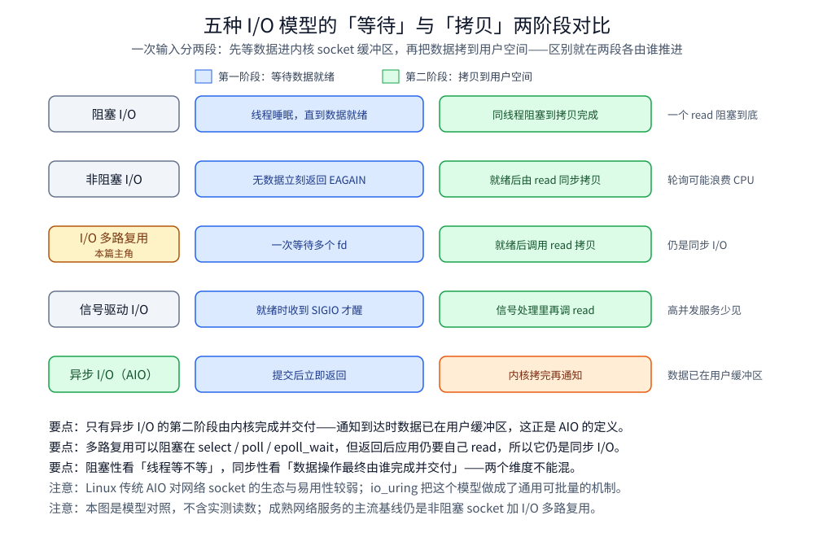
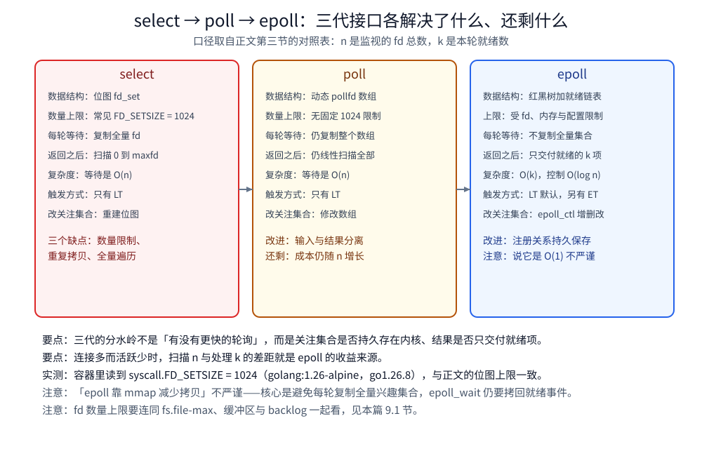
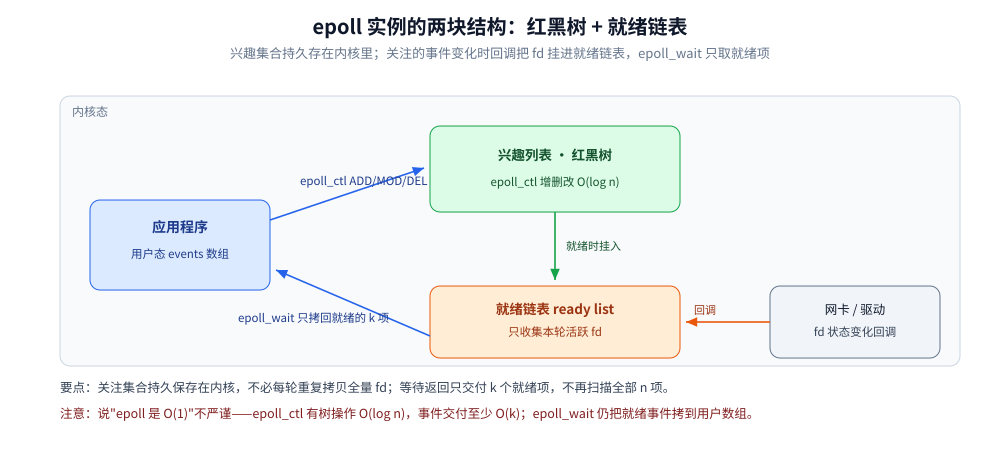
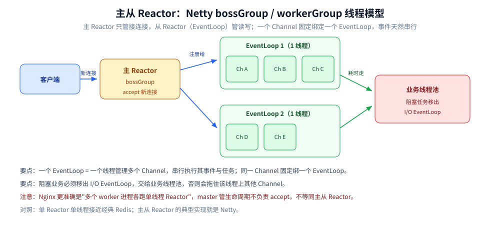
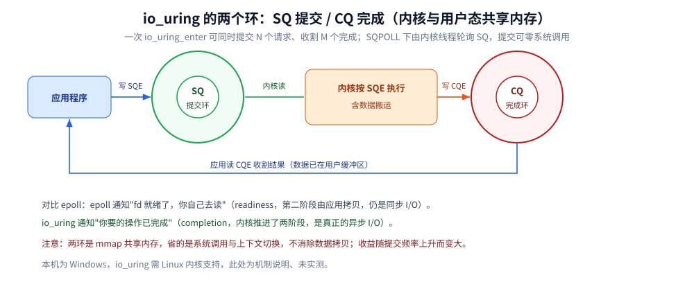

# I/O 多路复用

> 覆盖：五种 I/O 模型、select / poll / epoll 三代演进、LT 与 ET、惊群与 Reactor、`io_uring` 的提交—完成模型与常见问题。
>
> 不覆盖：Go 的 netpoller 怎么把 goroutine 挂到 epoll 上，见 [GMP调度.md](../../01-编程语言/go/运行时/GMP调度.md) 与 [网络IO与netpoll.md](../../01-编程语言/go/运行时/网络IO与netpoll.md)；Java 的 NIO 三件套与 `Selector` 服务见 [NIO与Selector.md](../../01-编程语言/java/网络编程/NIO与Selector.md)；零拷贝是另一层的优化，见 [零拷贝.md](零拷贝.md)；连接关闭侧的状态见 [TCP四次挥手.md](../网络/传输层/tcp/TCP四次挥手.md)。
>
> 内容整理自个人学习笔记，素材见 [素材清单](../../素材清单.md)。
>
> ✅ 实测口径：3.1 的 `FD_SETSIZE=1024` 在 `golang:1.26-alpine`（`go1.26.8 linux/amd64`）容器内读 Go `syscall` 包常量得到，连跑 4 次读数一致；⚠️ **未实测** `io_uring`（本机为 Windows，且容器沙箱常禁用该系统调用）。本篇**只讲机制**，语言侧的可运行代码已各自归位（见第八节）。

---

## 一、I/O 多路复用解决什么问题？

**I/O 多路复用让一个进程或线程同时监视多个 I/O 通道，只在通道就绪时处理它。**
网络服务的大量连接通常都在等待数据；若采用“每连接一线程”，连接数上升后会遇到 C10K 问题。

| 成本 | 每连接一线程 | I/O 多路复用 |
|---|---|---|
| 内存 | 每个线程需要栈和内核数据结构 | 少量事件循环管理大量连接 |
| 调度 | 线程多导致上下文切换、缓存失效 | 只唤醒负责就绪事件的线程 |
| 同步 | 共享状态需要加锁 | 单事件循环可减少锁竞争 |
| 空闲连接 | 一个线程长期睡眠等待 | 一个等待点收集全部就绪事件 |

多路复用优化“**如何等待许多 fd**”；零拷贝优化“**数据如何搬运**”，两者是不同层面的优化。

---

## 二、五种 I/O 模型分别是什么？⭐

一次输入分两段：① **等待数据就绪**，数据进入内核 socket 缓冲区；② **数据拷贝**，内核将数据复制到用户空间。

| 模型 | 等待数据 | 内核拷贝到用户空间 | 一句话 |
|---|---|---|---|
| 阻塞 I/O | 线程睡眠 | 线程继续阻塞 | 一个 `read` 从等待阻塞到拷贝完成 |
| 非阻塞 I/O | 无数据立即返回 `EAGAIN` | 就绪后由 `read` 同步拷贝 | 应用轮询，可能浪费 CPU |
| I/O 多路复用 | 一次等待多个 fd | 就绪后调用 `read` 同步拷贝 | 一个等待点管理许多连接 |
| 信号驱动 I/O | 就绪时收到 `SIGIO` | 收信号后调用 `read` 同步拷贝 | 等待被通知，拷贝仍同步 |
| 异步 I/O（AIO） | 提交后立即返回 | 内核完成拷贝后通知 | 通知到达时数据已在用户缓冲区 |



图注：五种 I/O 模型的两阶段对照：等待数据与拷贝数据分别由谁推进，只有异步 I/O 的两阶段都由内核完成。

### 2.1 各模型一句话展开

- **阻塞 I/O**：最简单，但一个线程同一时刻只能等待一个操作。
- **非阻塞 I/O**：`read` 暂不可完成就返回；若应用忙轮询，大量空检查会消耗 CPU。
- **I/O 多路复用**：线程可阻塞在 `select/poll/epoll_wait`，返回后再处理就绪 fd，仍属同步 I/O。
- **信号驱动 I/O**：通过 `O_ASYNC` 等订阅 `SIGIO`；信号处理复杂，高并发服务中不如 epoll 常见。
- **AIO**：完成通知代表等待和拷贝都已完成，应用无需再调用一次 `read` 搬数据。

```c
// 非阻塞 I/O 的本质：暂时不能读就立即返回，而不是内核替应用完成整个请求。
ssize_t n = read(fd, buf, sizeof(buf));
if (n < 0 && (errno == EAGAIN || errno == EWOULDBLOCK)) {
    /* 稍后重试 */
}
```

⚠️ Linux 传统 AIO 对网络 socket 的生态和易用性较弱；`io_uring` 扩展了异步能力，
但成熟网络服务的主流基线仍是**非阻塞 socket + I/O 多路复用**。

### 2.2 同步/异步与阻塞/非阻塞 ⭐

| 维度 | 关注点 | 区分 |
|---|---|---|
| 同步 / 异步 | I/O 两阶段由谁推进、如何交付结果 | 同步仍由应用调用数据操作；异步由内核完成后通知 |
| 阻塞 / 非阻塞 | 当前调用不能完成时线程是否原地等待 | 阻塞会睡眠；非阻塞立即返回 |

- 阻塞 `read` 是**同步 + 阻塞**；非阻塞 `read` 是**同步 + 非阻塞**。
- `epoll_wait` 可以阻塞，但返回后应用仍要 `read`，所以多路复用仍是**同步 I/O**。
- AIO 提交立即返回，通知到达时数据已复制完成，才是**异步 I/O**。

> ⭐ 记忆：阻塞性看“线程等不等”，同步性看“数据操作最终由谁完成并交付”。

---

## 三、select / poll / epoll 三代是怎么演进的？⭐

设监视 fd 总数为 `n`，本轮就绪数为 `k`。

| 维度 | select | poll | epoll |
|---|---|---|---|
| 数据结构 | 位图 `fd_set` | `pollfd` 数组 | epoll 实例；红黑树 + 就绪链表 |
| 最大连接数 | 常受 `FD_SETSIZE=1024` 限制 | 无固定 1024 限制 | 受 fd、内存和系统配置限制 |
| 每次等待复制全量 fd | 是 | 是 | 否，注册关系由内核持久保存 |
| 就绪后遍历全量 fd | 是，扫描 `0..maxfd` | 是，扫描全部数组 | 否，只返回就绪项 |
| 典型复杂度 | `O(n)` | `O(n)` | 等待返回 `O(k)`；`epoll_ctl` 通常 `O(log n)` |
| 触发方式 | LT | LT | LT（默认）/ ET |
| 修改关注集合 | 重建/修改位图 | 修改数组 | `epoll_ctl` 增删改 |



图注：select → poll → epoll 三代接口逐项对照：数据结构、数量上限、每轮是否复制全量、返回后扫描范围、复杂度、触发方式与改关注集合的代价。

### 3.1 select 的三个缺点

1. **数量限制**：`fd_set` 是固定位图，常见 `FD_SETSIZE` 为 1024。
2. **重复拷贝**：每次调用都要在用户态与内核态之间传递 fd 集合。
3. **全量遍历**：返回后仍需 `O(n)` 检查哪个 fd 就绪；集合还会被改写，下轮要重建。

📌 本机容器实测：`golang:1.26-alpine`（`go1.26.8 linux/amd64`）里读 Go `syscall` 包常量 `syscall.FD_SETSIZE` 得 **1024**，连跑 4 次读数一致 —— 与上面第 1 条的上限口径对得上。

### 3.2 poll 改进了什么、还剩什么

`poll` 用动态 `pollfd` 数组去掉 1024 的接口级上限，并以 `events/revents` 分离输入和结果。
⚠️ 它每次仍复制整个数组，内核和用户态仍线性扫描；连接多、活跃少时成本依旧随 `n` 增长。

### 3.3 epoll 的三个函数

```c
int epfd = epoll_create1(EPOLL_CLOEXEC);          // 创建实例
int rc = epoll_ctl(epfd, EPOLL_CTL_ADD, fd, &ev); // ADD / MOD / DEL
int n = epoll_wait(epfd, events, maxevents, -1);  // 返回就绪事件
```

- `epoll_create` 创建实例；现代代码优先 `epoll_create1`。
- `epoll_ctl` 持久维护关注集合，避免每轮重新提交全部 fd。
- `epoll_wait` 等待就绪链表；超时为 `-1/0/正数` 分别表示永久等待、立即返回、毫秒超时。

### 3.4 epoll 为什么高效

1. **红黑树管理 fd**：增删改通常 `O(log n)`。
2. **就绪链表记录活跃 fd**：驱动在状态变化时通过回调挂入 ready list。
3. **只返回就绪 fd**：应用处理 `k` 项，不再扫描全部 `n` 项。
4. **关注集合持久化**：等待时不反复复制完整集合，只交付本轮事件。

资料常把第 4 点简称为“通过 mmap 减少拷贝”。严格说，核心是**避免每轮复制全量兴趣集合**；
`epoll_wait` 仍要把就绪事件复制到用户数组，不能理解成完全零拷贝。
⚠️ “epoll 是 `O(1)`”也不严谨：`epoll_ctl` 有树操作，事件交付至少为 `O(k)`。



图注：epoll 实例的两块结构：兴趣列表红黑树与就绪链表，以及驱动回调、epoll_ctl 与 epoll_wait 各自接触哪一块。

---

## 四、epoll 的两种触发模式怎么选？⭐

| 维度 | LT（水平触发，默认） | ET（边缘触发） |
|---|---|---|
| 通知条件 | fd 仍就绪就持续通知 | 状态发生变化时通知 |
| 可否只读一部分 | 可以，下轮继续通知 | 不可以，必须读到 `EAGAIN` |
| fd 模式 | 可阻塞，但事件循环仍建议非阻塞 | **必须非阻塞** |
| 优点 | 直观，不易漏事件 | 减少重复通知 |
| 易错点 | 不处理会反复唤醒、忙循环 | 未排空缓冲区可能永久漏事件 |

### 4.1 LT：缓冲区有数据就持续提醒

接收缓冲区有 10 KB 而本轮只读 1 KB，下轮 `epoll_wait` 仍报告可读。
⚠️ LT 也建议使用非阻塞 fd：若数据被并发消费者抢走，阻塞读仍可能卡住事件循环。

### 4.2 ET：只提醒状态变化

ET 必须持续读到 `EAGAIN/EWOULDBLOCK`：

```c
for (;;) {
    ssize_t n = read(fd, buf, sizeof(buf));
    if (n > 0) { handle(buf, n); continue; }
    if (n == 0) { close(fd); break; }
    if (errno == EINTR) continue;
    if (errno == EAGAIN || errno == EWOULDBLOCK) break;
    close(fd); break;
}
```

写操作也要循环到发送缓冲区满；剩余数据放用户态队列并订阅 `EPOLLOUT`，写完立即取消订阅。

> ⚠️ ET 最典型事故：只读一次便返回，缓冲区仍有旧数据，却没有新的边沿，连接像“卡死”。

---

## 五、惊群与 Reactor 是什么关系？

### 5.1 惊群（thundering herd）

多个进程/线程同时 `epoll_wait` 同一实例或竞争监听 socket 时，一个事件可能唤醒大量等待者，
最终只有少数获得工作，其余唤醒变成调度与锁竞争。

| 方案 | 原理 |
|---|---|
| Nginx accept 锁 | 同一时刻只让一个 worker 接受新连接 |
| `EPOLLEXCLUSIVE` | 内核对共享监听 fd 排他唤醒，减少无效唤醒 |
| `SO_REUSEPORT` | 每个 worker 独立监听同一端口，由内核分流 |

⚠️ `SO_REUSEPORT` 下每个 worker 有独立监听队列，还要关注负载均衡和重启策略。

### 5.2 Reactor 模式

Reactor 把流程拆成“等待事件 → 分发给 Handler → 执行业务 → 更新关注事件”。

| 模式 | 事件与业务 | 特点/实现 |
|---|---|---|
| 单 Reactor 单线程 | 都在一个线程 | 简单无锁；业务阻塞拖住全局，经典 Redis 接近此模式 |
| 单 Reactor 多线程 | Reactor 分发，线程池执行业务 | I/O 集中，耗时任务并行，结果需安全回到 I/O 线程 |
| 主从 Reactor | 主 Reactor 接连接，从 Reactor 管读写 | Netty `bossGroup/workerGroup` 是典型实现 |

Nginx 更准确地说是“多个 worker 进程各自运行单线程 Reactor”；master 管生命周期而不负责 accept，
阻塞文件任务可交给线程池，因此它不应被机械等同为教科书式主从 Reactor。



图注：主从 Reactor 线程模型：主 Reactor（bossGroup）只 accept，新连接注册给从 Reactor（EventLoop），阻塞业务再移出到业务线程池。

---

## 六、Go 与 Java 各自怎么落到 epoll 上？

两侧调的是同一套内核接口，差别只在「**谁替你调 `epoll_wait`**」。

| 语言 | 谁跑事件循环 | 编程模型 | 完整内容在哪 |
|---|---|---|---|
| Go | runtime 的 netpoller | 写成阻塞式 `Accept` / `Read` / `Write`，fd 未就绪时挂起 goroutine 而非阻塞 M | [网络IO与netpoll.md](../../01-编程语言/go/运行时/网络IO与netpoll.md)、[GMP调度.md](../../01-编程语言/go/运行时/GMP调度.md) |
| Java | 应用自己管 `Selector`，或交给 Netty | 显式事件循环 + `SelectionKey`；Netty 再包一层主从 Reactor | [NIO与Selector.md](../../01-编程语言/java/网络编程/NIO与Selector.md) |

> ⭐ Go 里能写阻塞式 `Accept/Read/Write`，底层却由非阻塞 fd + 多路复用承接，这降低了并发编程的心智负担。

⚠️ 「底层是 epoll」不等于「所有阻塞都被接管」：普通文件 I/O、部分系统调用与 cgo 仍可能真的阻塞线程。

---

## 七、应用场景

**本节要点**：I/O 多路复用是所有高并发网络服务的底座 —— 它决定「一个线程能盯住多少连接」。

| 场景 | 涉及哪一块 | 为什么值得注意 |
|---|---|---|
| 高并发网关 / 代理 | epoll + Reactor | 事件循环与上游连接管理，详见 [反向代理原理.md](../网络/代理与网关/反向代理原理.md) |
| Go 服务 | netpoller + goroutine | 运行时把阻塞包装成协程挂起，详见 本篇第六节 |
| Java 服务 | NIO `Selector` / Netty | 主从 Reactor 的线程模型，详见 [NIO与Selector.md](../../01-编程语言/java/网络编程/NIO与Selector.md) |
| Nginx / Redis | 单线程事件循环 | 用 epoll 换掉「每连接一线程」，详见 [03-事件驱动与epoll.md](../linux/深入理解Nginx/03-事件驱动与epoll.md) |
| fd 上限 / 连接数告警 | `ulimit -n` 与 `somaxconn` | 事件循环的性能之外还有资源上限，详见 [性能排查.md](../linux/性能排查.md) |
| 连接泄漏 | 半开连接与心跳 | `CLOSE_WAIT` 堆积多半是应用没关，详见 [TCP四次挥手.md](../网络/传输层/tcp/TCP四次挥手.md) |
| 高吞吐本地文件 I/O | `io_uring` | 从「就绪通知」到「提交—完成」，详见 本篇第十节 |

## 八、两侧的可运行代码在哪？

本篇只讲机制，**可运行代码按语言各归其位**。这样改 epoll 的语义只动本篇，改某一侧的写法只动那一篇。

| 语言 | 日常写法 | 直接操作 epoll 的写法 |
|---|---|---|
| Go | 用 `net` 包——非阻塞 fd、netpoller、deadline 与资源管理都已封装 | [net包与TCP-UDP编程.md](../../01-编程语言/go/网络编程/net包与TCP-UDP编程.md) 的「使用」节（最小 ET 读取服务） |
| Java | NIO 三件套 + 完整 `Selector` Echo 服务；Netty 的主从 Reactor 线程模型同见该篇 | [NIO与Selector.md](../../01-编程语言/java/网络编程/NIO与Selector.md) |

**本节要点**：机制只有一份，代码按语言分家——Go 侧的关键差异是 runtime 替你跑事件循环，Java 侧是应用自己跑。

---

## 九、生产实践中有哪些坑？

### 9.1 fd 与连接上限

每个 socket 占一个 fd；同时检查进程限制、服务管理器配置、系统总量和内存：

```bash
ulimit -n
cat /proc/$PID/limits
sysctl fs.file-max
ss -s
```

仅提高 `ulimit -n` 不够；还要估算收发缓冲区、连接对象、epoll 注册项，并检查 `listen(backlog)` 与 `somaxconn`。
「一个 socket 在进程里占哪几层结构、`backlog` 怎么被 `somaxconn` 截断、打满后客户端为什么只是卡住」见 [Socket接口与连接生命周期.md](../网络/传输层/Socket接口与连接生命周期.md) 第一、二节。

### 9.2 epoll 与普通文件

普通文件从 readiness 视角通常总是就绪，Linux 把它加入 epoll 还常返回 `EPERM`；
epoll 无法表示磁盘何时真正完成。文件 I/O 应使用线程池、AIO 或 `io_uring`。

### 9.3 半开连接、心跳与 CLOSE_WAIT

断网、NAT 状态丢失或对端崩溃可能形成半开连接；`CLOSE_WAIT` 则表示对端已发 FIN、本地应用尚未 close。
事件循环这一侧的要点只有两条：**把空闲 deadline 纳入统一的事件循环**，以及**所有退出路径都关闭 fd**。
心跳周期怎么定、TCP keepalive 探不到什么、连接池旧连接怎么探活，见 [TCP保活与连接存活.md](../网络/传输层/tcp/TCP保活与连接存活.md)；`CLOSE_WAIT` 的四种成因见 [TCP四次挥手.md](../网络/传输层/tcp/TCP四次挥手.md) 第三节。

### 9.4 事件循环规则

- fd 使用非阻塞模式，统一处理 `EINTR`、`EAGAIN/EWOULDBLOCK`；ET 必须 drain。
- 只在有待发送数据时订阅 `EPOLLOUT`，完成后立即取消。
- 限制单连接单轮处理量和发送队列，避免热点连接饥饿与慢客户端耗尽内存。
- 所有退出路径注销事件并关闭 fd；I/O 线程不执行阻塞 DNS、磁盘或长耗时业务。

---

## 十、`io_uring` 的「提交—完成」模型是什么？

**本节要点**：epoll 是**就绪通知**模型——「这个 fd 可读了，你自己去读」；`io_uring` 是**提交—完成**模型——「我把要做的操作交给你，你做完后把结果写回来」。它省掉的是**系统调用与上下文切换**，而不是数据拷贝。

### 10.1 两个环：SQ 与 CQ

`io_uring` 的全部结构就是**两个环形队列**，二者都是**内核与用户态共享内存**（通过 `mmap`），所以提交与收割不需要每次都把数据在内核与用户之间搬一遍：

| 队列 | 谁写、谁读 | 装什么 |
|---|---|---|
| **SQ**（Submission Queue） | **应用写**，内核读 | 提交项 **SQE**：要做什么（如「从 fd 读 N 字节到这块缓冲」） |
| **CQ**（Completion Queue） | **内核写**，应用读 | 完成项 **CQE**：做完了、结果码与字节数是多少 |

⭐ **批量是它省系统调用的关键**：一次 `io_uring_enter` 可以**同时提交 N 个请求并收割 M 个完成**；更进一步还有 **SQPOLL** 模式——由内核线程轮询 SQ，应用**提交时一次系统调用都不用做**（代价是一个常驻内核线程）。



图注：io_uring 的 SQ 与 CQ 双环：应用写 SQE、内核读并执行、内核写 CQE、应用收割，两环都是内核与用户态共享内存。

### 10.2 与 epoll 的本质差异

| 维度 | epoll（readiness） | `io_uring`（completion） |
|---|---|---|
| 通知的是什么 | 「fd 就绪了，**你可以读**」 | 「**你要的读操作已经完成**，数据在我的缓冲区里」 |
| 谁执行数据搬运 | **应用**（就绪后自己 `read`） | **内核**按提交的 SQE 执行 |
| 系统调用形态 | `epoll_wait` + 每个 fd 一次 `read` / `write` | 批量 `io_uring_enter`；SQPOLL 下提交可零系统调用 |
| 同步 / 异步 | 仍是**同步 I/O**（第二阶段由应用主动拷贝） | **真正的异步 I/O**：两阶段都由内核推进 |

⭐ 所以它落在第二节那张「五种 I/O 模型」表的最后一行：**通知到达时数据已在用户缓冲区**——这正是 AIO 的定义，而 `io_uring` 是把这个模型做成了**通用、可批量、可组合**的机制（不只网络 socket，也覆盖普通文件——补上了 §9.2 说的那个缺口）。

### 10.3 它能优化什么、**不能**优化什么

| 能 | ⚠️ 不能 / 限制 |
|---|---|
| 减少**系统调用次数与上下文切换**（高 IOPS 场景收益明显） | **数据拷贝本身仍然存在**（可用固定/注册缓冲区降低映射开销，但不等于「零拷贝」） |
| 把「提交」与「完成」流水化，便于批量处理 | 不改变 TCP / socket 的语义，**不会让协议变快** |
| 让普通文件的异步 I/O 成为可能（epoll 对普通文件不合适，见 §9.2） | 需要**较新内核**；部分加固环境、容器 `seccomp` 策略与个别云厂商会**禁用**这套系统调用 |

⭐ **「`io_uring` 一定更快」是不成立的**：在低并发、低 IOPS 的场景，epoll 的固定开销本来就很小，换成 `io_uring` 往往只是把复杂度搬进了代码。它的收益随**提交频率**上升而变大。

### 10.4 什么时候值得用

- **高 IOPS 的存储负载**，或「网络 + 磁盘」混合且需要批量的场景；
- 需要**真正的异步 I/O**（连数据搬运都由内核完成），例如数据库与存储引擎；
- 反过来：一般的 HTTP / RPC 服务在「非阻塞 socket + epoll + 多线程」下通常已经够用，
  **不要为了"用新技术"替换掉稳定的基础设施**——先量出系统调用与上下文切换到底占了多少 CPU。

> ⚠️ 本节为机制说明；本机为 Windows，**没有做 `io_uring` 的实测**（需要 Linux 内核支持）。

---

## 延伸追问

- **select、poll、epoll 的区别？** select 有位图/1024 限制，poll 去掉数量限制但仍复制和遍历；epoll 持久注册且只返回就绪项。
- **epoll 为什么高效？** 红黑树管理兴趣集合、就绪链表收集活跃项；等待处理 `k` 而非扫描 `n`，但并非所有操作都是 `O(1)`。
- **LT、ET 有何区别？** LT 持续报告就绪；ET 报告状态变化，必须非阻塞并读写到 `EAGAIN`，否则会漏事件。
- **同步/异步与阻塞/非阻塞如何区分？** 前者看完成责任和通知，后者看当前调用是否让线程等待。
- **五种 I/O 模型怎么答？** 沿“等待数据、复制数据”两阶段说明阻塞、非阻塞、多路复用、信号驱动和 AIO。
- **Redis 单线程为什么快？** 内存操作、epoll、高效结构和 pipeline；串行命令减少锁与切换，新版本可用 I/O 线程。
- **epoll 能用于普通文件吗？** 不适合；普通文件通常总是就绪且常注册失败，不能表示真实磁盘完成。
- **什么是惊群，如何解决？** 多个等待者被同时唤醒却只有少数获益；可用 accept 锁、`EPOLLEXCLUSIVE`、`SO_REUSEPORT`。
- **Go 网络代码为何像阻塞？** runtime 用 netpoller 挂起 goroutine 而非长期阻塞 M，就绪后再唤醒。
- **Reactor 与 Proactor 的区别？** Reactor 通知“可执行 I/O”；Proactor 完成 I/O 后通知“操作已完成”。
- **`io_uring` 和 epoll 最本质的区别是什么？** → **通知的语义不同**：epoll 通知「fd 就绪了，你自己去读」（**readiness**，应用还要执行数据拷贝，所以仍是同步 I/O）；`io_uring` 通知「你要的操作已完成」（**completion**，内核执行了两阶段，是真正的异步 I/O）。
- **`io_uring` 是不是一定更快？** → 不是。它省的是**系统调用与上下文切换**，在**高提交频率**下收益明显；低并发场景 epoll 开销本就很小，换了只会增加复杂度。而且它**不消除数据拷贝**，也不改变协议语义。
- **`io_uring` 的 SQ / CQ 是什么？** → 两个**内核与用户态共享内存**的环形队列：**SQ 装提交项 SQE**（要做什么），**CQ 装完成项 CQE**（结果是什么）。一次 `io_uring_enter` 可批量提交与收割；SQPOLL 模式下由内核线程轮询 SQ，提交可做到零系统调用。
- **为什么说 `io_uring` 补上了 epoll 的缺口？** → epoll 对**普通文件**不合适（普遍总是就绪、常注册失败），表达不了「磁盘操作何时完成」；`io_uring` 是**通用的完成式接口**，普通文件的异步 I/O 也能用它（见 §9.2 与 §10.2）。

## 关联

- **上游/总纲**：[网络分层与数据包旅程.md](../网络/网络分层与数据包旅程.md) — 传输层在五层模型里的位置
- **上游/接口**：[Socket接口与连接生命周期.md](../网络/传输层/Socket接口与连接生命周期.md) — 本篇等待与操作的那个对象是什么：fd 的三层结构、`read` 的三种返回、关闭的三条出口
- **对照/互补**：[通信选型.md](../网络/选型/通信选型.md) — 支撑高并发长连接的底层机制在这套选型里的位置
- **对照/互补**：[反向代理原理.md](../网络/代理与网关/反向代理原理.md) — 事件循环之上的代理实现
- **对照/互补**：[TCP滑动窗口.md](../网络/传输层/tcp/TCP滑动窗口.md) — 半开连接与事件循环
- **对照/互补**：[UDP与数据报传输.md](../网络/传输层/udp/UDP与数据报传输.md) — UDP 服务端常见的 `SO_REUSEPORT` 多 socket 分摊
- **下游机制**：[channel原理与底层实现.md](../../01-编程语言/go/并发编程/channel原理与底层实现.md) — netpoller 与 goroutine 挂起唤醒
- **下游机制**：[零拷贝.md](零拷贝.md) — 数据搬运的另一半成本（`io_uring` 也不消除拷贝）
- **下游机制**：[网络IO与netpoll.md](../../01-编程语言/go/运行时/网络IO与netpoll.md) — Go 侧：fd 怎么注册进 epoll、`pollDesc` 三态、`SetReadDeadline` 怎么打断
- **下游机制**：[NIO与Selector.md](../../01-编程语言/java/网络编程/NIO与Selector.md) — Java 侧：NIO 三件套、`Selector` 服务与 Netty 主从 Reactor
- **运维/配置**：[性能排查.md](../linux/性能排查.md) — 连接状态分布与 fd 上限的排查

> 反向引用（本篇被下列文档引到）：[net包与TCP-UDP编程.md](../../01-编程语言/go/网络编程/net包与TCP-UDP编程.md)、[03-事件驱动与epoll.md](../linux/深入理解Nginx/03-事件驱动与epoll.md)、[TCP四次挥手.md](../网络/传输层/tcp/TCP四次挥手.md)、[网络通信链路详解.md](../网络/网络通信链路详解.md)、[网络与存储.md](../../06-工程实践/部署/docker/网络与存储.md)
