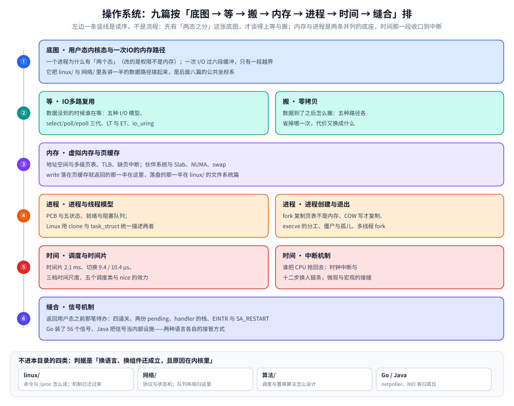

# 操作系统

> 本目录只收「**换一个语言、换一个组件仍然成立，且原因在内核里**」的那部分 OS 知识：进程与线程的调度边界、
> 虚拟内存与页缓存、I/O 的等与搬、时间怎么被切开、中断与信号。
>
> 当前 **9 篇**，按「**底图 → 等 → 搬 → 内存 → 进程 → 时间 → 缝合**」排，读序就是下面的顺序：
> [用户态内核态与一次IO的内存路径.md](用户态内核态与一次IO的内存路径.md) 先解决横切问题——用户态与内核态到底分了什么、一次 I/O 要过哪六段缓冲；
> [IO多路复用.md](IO多路复用.md) 讲**数据还没到的时候谁在等**；
> [零拷贝.md](零拷贝.md) 讲**数据到了之后怎么搬**；
> [虚拟内存与页缓存.md](虚拟内存与页缓存.md) 讲**这份数据在内存里怎么被组织和回收**——地址空间、页表与 TLB、缺页、Page Cache 与 kswapd；
> [进程与线程模型.md](进程与线程模型.md) 讲**谁在跑**——PCB 与五状态、三种线程映射、Linux 用 `clone` 统一描述两者；
> [进程创建与退出.md](进程创建与退出.md) 讲**进程怎么从无到有、又怎么收场**；
> [调度与时间片.md](调度与时间片.md) 讲**时间怎么被切开**；
> [中断机制.md](中断机制.md) 讲**谁通知时间片用完了**，也就是微观流水线与宏观调度接上的那一瞬；
> [信号机制.md](信号机制.md) 讲**返回用户态之前那笔待办**。
> ⚠️ 其余条目**已判为不开篇**（宿主在相邻目录），见下面「二」的缺口表。
> >
> ⭐ [IO多路复用.md](IO多路复用.md) 与 [零拷贝.md](零拷贝.md) 是 I/O 侧**成对的两半**：前者优化「如何等许多 fd」，后者优化「数据如何搬运」，两者正交、不可互相替代。
> >
> 内容整理自个人学习笔记。

---

## 一、本目录收什么？与相邻目录的边界在哪？

**本节要点**：判据是「**这条结论换一个语言 / 换一个组件还成立吗**」——成立且原因在内核里，才归本目录；只在某个发行版、某个文件系统、某个 syscall 上成立的，归别处。

| 归本目录 | 不归本目录，归 | 原因 |
|---|---|---|
| 进程 / 线程 / 协程在内核里的调度实体与切换成本；时间片长度、切换单价、调度类与 nice 的效力 | [算法/](../算法/)（调度**算法**本身：CFS、时间片轮转的原理） | 一边是"内核怎么实现、实测多少"，一边是"算法怎么设计" |
| 虚拟内存、页表、TLB、缺页、swap、mmap、Page Cache 与回收 | [linux/](../linux/)（`/proc` 怎么读、`free` 的每一列怎么判）、[垃圾回收/](../垃圾回收/)（堆内存在语言层的分配与回收） | 机制在任何 OS 上都有；读数与命令是 Linux 特有，GC 管"语言堆" |
| 硬中断、软中断、时钟中断，以及「返回用户态之前的那次判断」 | [网络/](../网络/)（协议处理逻辑与状态机）、[linux/](../linux/)（`/proc` 怎么读、命令怎么敲） | 中断是**内核机制**；协议是约定，`/proc` 与命令是运维视角 |
| epoll / kqueue / IOCP 的**机制**（五种 I/O 模型、三代演进、LT / ET、`io_uring`） | [linux/](../linux/)（命令与参数怎么调：`ulimit -n`、`ss`）、[网络/](../网络/)（协议语义与状态机） | ✅ 机制已归本目录（2026-10-29 从 `网络/传输层/` 迁入）；语言侧实现分家为 Go netpoller 与 Java NIO |
| socket 选项与连接状态机 | [网络/](../网络/)（协议语义与状态机） | 协议是"约定"；**但队列在内存里长什么样、数据怎么过它们**归本目录 |
| `fsync` 为什么贵、写序保证在内核里怎么成立 | [linux/落盘路径与fsync代价.md](../linux/落盘路径与fsync代价.md)（五种写法 × 3 轮的实测账） | 「写成功 ≠ 落盘」的语义归这里；本机 overlayfs 上的毫秒数归那边 |

⭐ 第一行和第二行最容易混：[算法/](../算法/) 讲「时间片轮转这个算法怎么写」，本目录讲「本机的时间片**实际是 2.1 ms**、切一次**实际是 9.4 µs**」——同一个话题的两层，一边给伪代码，一边给读数。

## 二、篇目：9 篇已落地，其余为缺口登记

**本节要点**：九篇的顺序不是难度排序，是**依赖排序**——先有「两态之分」这张底图，才谈得上「等」与「搬」；内存与进程是两条并列的底座（谁先读都行），时间那一段收口到中断。⚠️ 本轮把原先挂在 `linux/` 的两篇机制篇收回本目录（判据是「换 OS 还成立吗」），缺口表因此从五条收缩到三条。

| 篇名 | 要回答的问题 | 状态 |
|---|---|---|
| [用户态内核态与一次IO的内存路径.md](用户态内核态与一次IO的内存路径.md) | 两态之分改的是权限还是内存、一次 I/O 过哪六段缓冲、**收发两个方向的段序列（同一趟拷贝，读在最后、写在最前）**、系统调用五步、DMA 与 CPU 拷贝的差别 | ✅ **已落地** |
| [IO多路复用.md](IO多路复用.md) | **数据没到的时候谁在等**：五种 I/O 模型、select / poll / epoll 三代演进（含 `FD_SETSIZE=1024` 实测）、LT 与 ET、惊群与 Reactor、`io_uring` 的提交—完成模型 | ✅ **已落地**（原在 `网络/传输层/`，2026-10-29 迁入：判据是「换语言还成立、原因在内核里」；迁入时**拆掉 231 行 Go / Java 代码**，各归其语言目录） |
| [零拷贝.md](零拷贝.md) | 同一趟拷贝账的优化版：传统 `read` + `write` 的 4 次拷贝基准线、五种实现路径（`mmap` / `sendfile` / SG-DMA / `splice` / `MSG_ZEROCOPY`）各省掉哪一次、代价换成什么、按什么场景选 | ✅ **已落地**（原在 `linux/`，因是纯机制篇且被 9 个目录族引用，已迁入） |
| [虚拟内存与页缓存.md](虚拟内存与页缓存.md) | 每个进程为什么要有一份独立的地址空间、**overcommit 三档各允许超售到什么程度**、多级页表与 TLB 的账、缺页中断在什么时候发生、伙伴系统与 Slab 的分工、Page Cache 与 Buffer Cache 为什么统一、kswapd 与直接回收、NUMA 与 swap、容器里的内存限额怎么读 | ✅ **已落地**（原 `linux/内存管理.md`，本轮迁入并改名） |
| [进程与线程模型.md](进程与线程模型.md) | 进程由哪三部分组成、**五个状态之间只有哪四条边**、就绪队列与阻塞队列、上下文切换到底保存了什么；线程的三种对应关系（多对一 / 一对一 / 多对多）与三种实现方式；为什么 Linux 没有独立的线程概念（`clone` 与 `task_struct`）；多线程带来的五类问题 | ✅ **已落地**（原 `linux/进程与线程.md`，本轮迁入并改名） |
| [进程创建与退出.md](进程创建与退出.md) | 一个 `fork` 为什么有两个返回值；**复制的是页表不是内存**，COW 什么时候才真的复制 4 KB；`fork` 的代价为什么随地址空间的页数涨（32 K 页实测）；`execve` / `vfork` / `posix_spawn` / `clone` 各省掉了什么；僵尸与孤儿的区别、`SIGCHLD` 两种「忽略」的不同结局；多线程进程 `fork` 只剩一个线程的死因；fd 表 / stdio 缓冲 / `O_CLOEXEC` 的继承 | ✅ **已落地** |
| [调度与时间片.md](调度与时间片.md) | 单核只有一条指令流，为什么能装下 N 个"同时"在跑的进程；时间片**直接从内核读出来是多少**；自愿切换与非自愿切换怎么区分；上下文切换贵在哪（**寄存器那笔账很小，TLB 那笔账反直觉**）；多核 / 超线程 / 时间片**三层不是一回事**；五个调度类与 nice 的真实效力 | ✅ **已落地** |
| [中断机制.md](中断机制.md) | 没有中断 CPU 怎么干活、轮询贵在哪；一次硬中断五步（存现场 → 切栈 → 查 IDT → 上半部 → `iret`）与为什么要分上下半部；软中断十类与 `ksoftirqd` 的两个执行时机；时钟中断为什么是抢占的**物理前提**；**宏观与微观在哪一刻接上**（十二步换人链条）；一次收包到底打不打断用户态 | ✅ **已落地** |
| [信号机制.md](信号机制.md) | 信号从产生到跑起来要过哪四道关、pending 为什么分进程 / 线程两份；连发五次为什么 handler 只跑一次（标准信号合并 vs 实时信号排队，**实测**）；handler 跑在哪条栈上、`sigaltstack` 什么时候救命、handler 里为什么只能调 async-signal-safe 函数；`EINTR` 与 `SA_RESTART` 怎么分工（**实测 1000 ms 返回 −1 vs 1200 ms 读到数据**）；`SIGCHLD` / `SIGPIPE` 两个反直觉默认动作；`SIGKILL` / `SIGSTOP` 为什么抓不到；Go（`SigCgt` 装 56 缺 8、`SIGURG` 抢占、`SIGQUIT` 全量栈）与 Java 各接管了什么 | ✅ **已落地** |
| 文件系统与页缓存 | inode、dentry、page cache、写回策略与 `fsync` 的真实代价 | ➖ **不开篇**：`fsync` 的实测账在 [落盘路径与fsync代价.md](../linux/落盘路径与fsync代价.md)——2.1 是五种写法的实测账（4 KB 与 1 MB 各三轮），2.3 讲组提交换来的窗口期；**VFS 与 inode 是 Linux 的实现，不是通用机制**，留在 [文件系统与VFS.md](../linux/文件系统与VFS.md) 更合适 |
| 并发原语的 OS 底座 | 自旋锁、futex、RCU 在内核里的实现 | ➖ **不开篇**：机制在 `02-计算机基础/计算机底层原理/底层同步/`（三条内存序、屏障单价）与 `02-计算机基础/并发模型/` |
| cgroup 与 namespace | 资源限制与隔离的内核机制 | ➖ **不开篇**：在 `06-工程实践/部署/docker/容器原理.md`（容器是被这两者隔离的进程） |

看图抓三点：**左列编号是「先读谁」，不是调用顺序**——② 与 ③④ 组内的两篇并列，谁先读都行；右下角那四个格子是本目录的边界，凡是落在这四格的（命令、协议语义、调度算法、语言侧实现）都不在这里展开。九篇里只有一条依赖是硬的：⑤ 的两篇必须按「调度 → 中断」读，因为中断篇要回答「谁把时间片用完的 CPU 抢回来」；另一条是 ③ 的页缓存与 `linux/` 的落盘篇各管同一趟账的一半——`write` 落在页缓存就返回的那一半在这里，落盘的那一半与它的毫秒数在那边。

## 三、这些内容现在在哪？

**本节要点**：判据收紧后，散在运维与语言目录里的机制段已收回本目录；**留在 `linux/` 的只剩「Linux 特有语义 + 读数 + 命令」**。同一条结论若两处都有，以标了跑法与轮次的那一处为准。

- **`/proc` 各文件怎么读、`taskset` / `nice` / `chrt` 怎么敲** → [linux/性能排查.md](../linux/性能排查.md)。本目录只讲「读到的那个数为什么是那个数」，命令与参数留给 `linux/`。
- **`free` 的每一列怎么判、容器内存限额读哪个文件** → [linux/性能排查.md](../linux/性能排查.md) 与 [linux/常用命令.md](../linux/常用命令.md)；`free` 为什么「几乎用完」是好事，机制在 [虚拟内存与页缓存.md](虚拟内存与页缓存.md) 2.2。
- **`ps -eLf` / `top -Hp` / `ulimit -u`** → 归属是 [linux/性能排查.md](../linux/性能排查.md) 第三节。⚠️ 这几条命令现在仍在 [进程与线程模型.md](进程与线程模型.md) 第五节里（迁篇时随正文带了过来），读机制时跳过那一节即可。
- **已迁入本目录的三篇**：
  [零拷贝.md](零拷贝.md) 原在 `linux/`，纯机制篇（85% 篇幅讲拷贝账）且被 9 个目录族 26 篇引用；
  [虚拟内存与页缓存.md](虚拟内存与页缓存.md) 与 [进程与线程模型.md](进程与线程模型.md) 本轮迁入——理由同一条：**判据是「换 OS 还成立吗」，不是「谁先写」**。三篇的引用路径已全部重算。
- **页面置换（OPT / FIFO / LRU / Clock）** → [缓存淘汰算法.md](../../03-数据与中间件/数据存储/缓存/缓存淘汰算法.md) 第二节（含缺页次数实测）。
- **GC 的算法层（标记清除 / 复制 / 分代 / 三色）** → [垃圾回收/](../垃圾回收/)。
- **TCP 状态机、滑动窗口、拥塞控制** → [网络/](../网络/)。
- **Linux 收包路径（NAPI、软中断分流、绑核）** → [中断机制.md](中断机制.md) 第六节；协议侧解释在 [网络/](../网络/)。
- **cgroup / namespace 与容器** → [docker/](../../06-工程实践/部署/docker/)。

## 关联

- [用户态内核态与一次IO的内存路径.md](用户态内核态与一次IO的内存路径.md) — 本目录第一篇：两态之分与六段缓冲，`linux/` 与 `网络/` 两条支路的公共上游
- [IO多路复用.md](IO多路复用.md) — I/O 侧「等」的那一半：五种 I/O 模型、epoll 三代演进与 `io_uring`，与零拷贝成对
- [零拷贝.md](零拷贝.md) — I/O 侧「搬」的那一半：五种路径各省掉哪一次，`linux/` 与 Go / Kafka 那侧的上游
- [虚拟内存与页缓存.md](虚拟内存与页缓存.md) — 内存侧底座：地址空间、页表与 TLB、缺页、Page Cache 与回收，Go / Java 运行时与所有数据存储的上游
- [进程与线程模型.md](进程与线程模型.md) — 进程侧底座：状态机、PCB、三种线程映射，Go / Java `并发编程` 与 `运行时` 共 12 篇引用
- [进程创建与退出.md](进程创建与退出.md) — 进程从哪来、到哪去：`fork` / COW / `execve` / 僵尸与孤儿 / 多线程 fork，与调度篇成对
- [调度与时间片.md](调度与时间片.md) — 宏观视角：时间片 2.1 ms、切换 9.4 / 10.4 µs、TLB 那笔账与本机的假超线程
- [中断机制.md](中断机制.md) — 缝合篇：时钟中断与软中断、十二步换人链条，微观流水线与宏观调度在哪一刻接上
- [信号机制.md](信号机制.md) — 返回用户态前的待办：四道关、两份 pending、handler 栈与 async-signal-safe、`EINTR`、Go / Java 的信号接管
- [README.md](../linux/README.md) — 与本目录分工的正式声明：`linux/` 只留 Linux 特有语义、读数与命令
- [目录.md](../../目录.md) — 全仓知识点索引
- [README.md](../算法/README.md) — 全仓算法地图（调度 / 置换算法的原理层）
- [README.md](../计算机底层原理/README.md) — 上游：一条指令在硅里怎么被执行（`操作系统/` 管「谁用 CPU」，那边管「CPU 怎么执行一条指令」）
- [垃圾回收/](../垃圾回收/) — 语言运行时侧的内存管理
