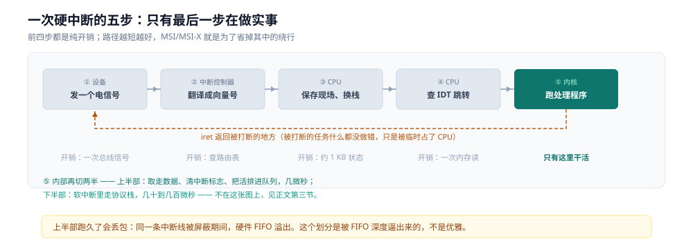
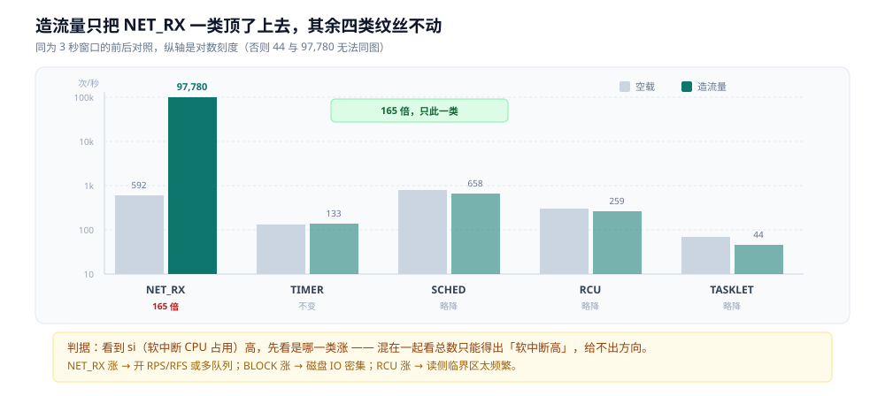
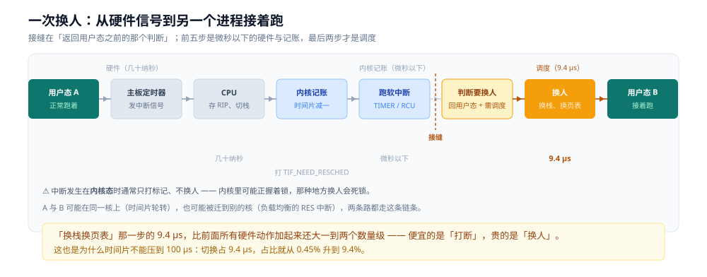

# 中断机制

> 覆盖：中断为什么必须存在（与轮询的代价对比）、一次硬中断从设备到处理程序走了哪几步、
> 上半部与下半部为什么必须分开、软中断的十类与 `ksoftirqd` 的关系、时钟中断如何成为抢占式调度的物理前提、
> 本机 `LOC` 计数恒为 0 意味着什么、以及「收包会打断用户态时间片」这句话在真实网卡与 loopback 上的差别。
> 
> 不覆盖：时间片与上下文切换的代价见 [调度与时间片.md](调度与时间片.md)；
> 一次 I/O 的六段缓冲见 [用户态内核态与一次IO的内存路径.md](用户态内核态与一次IO的内存路径.md)；
> 网络栈里 `NET_RX` 的完整链路见 [跨城传输全链路-TCP篇.md](../网络/跨城传输全链路-TCP篇.md)。
>
> 内容整理自个人学习笔记。**口径**：本篇读数全部为本机新跑（`perf-lab` 容器，WSL2，4 逻辑核），
> 用 `/proc` 侧计数做 5 秒差分；第 6.3 节的 NAPI 预算、队列与中断绑核读数在 WSL2 宿主直接读取（容器内这几个 sysctl 不可见）。⚠️ **未实测**：真实网卡的硬中断（本机是虚拟网卡）、
> 中断亲和性调整的效果、`CONFIG_HZ` 的具体值（无 `/boot/config-*`）。

---

## 一、没有中断，CPU 会怎么干活？

**本节要点**：轮询把「什么时候去看设备」的决定权交给 CPU，中断把它交给设备。一个是主动去问，一个是被动被告 —— 差别不在实现复杂度，而在**一次等待要烧掉多少 CPU**。

### 1.1 轮询的代价

假设网卡每秒来 1 万个包，CPU 用轮询的方式收：

```text
while (1) {
    if (网卡有包) 收下来;      /* 绝大多数时候是"没有" */
}
```

一个包都没来的时候，这个循环照样占满一个核。10 万个包/秒的场景下，轮询可能还算划算（省掉了中断开销），但在**每秒几个包**的场景下，它把整个核烧掉了 99.99% 的时间在检查一个空队列。

这在服务器上不可接受：一台机器上有几十个设备（网卡、磁盘、键盘、定时器、串口），每个都轮询就要几十个核。

### 1.2 中断换来了什么

中断做了三件事，每一件都不是轮询能替代的：

| 变化 | 具体是什么 |
|---|---|
| **CPU 不用等** | 设备没数据时，CPU 可以跑任何别的任务，包括空闲的 `hlt` 指令（真正断电省电） |
| **有明确的响应延迟** | 从中断发生到处理程序开始执行，硬件保证在一个可预期的范围内 |
| **一个入口管所有设备** | 所有设备共用一套「打断 → 查表 → 跳到处理程序」的机制，加设备不用加核 |

⭐ 第三点是架构上的关键：**中断让「设备数量」与「CPU 数量」解耦**。没有这个机制，一台插了 20 个设备的机器就得有 20 个核专门去轮询。

---

## 二、一次硬中断，从设备到内核走了哪几步？

**本节要点**：设备发信号 → 中断控制器编号 → CPU 保存现场并跳到内核 → 查中断描述符表找到处理程序 → 处理完 `iret` 返回。**其中只有最后一步能做实际工作，前四步都是纯开销**。

### 2.1 五步



| # | 发生在哪 | 做什么 | 能不能省 |
|---|---|---|---|
| ① | 设备 | 通过总线（PCIe MSI/MSI-X）或专用线发一个电信号 | 不能 |
| ② | 中断控制器（APIC / IOAPIC） | 把信号翻译成一个**中断向量号**，决定发给哪个 CPU | 能（MSI 可以绕过 IOAPIC 直接写 APIC） |
| ③ | CPU | 停下当前指令流、保存 `RIP`/`RFLAGS`/`CS`，切到内核栈 | 不能 |
| ④ | CPU | 用向量号去 **IDT**（中断描述符表）里查出处理程序地址，跳过去 | 不能 |
| ⑤ | 内核 | 跑处理程序，结束后 `iret` 返回被打断的地方 | 不能 |

⭐ 关键认知：**中断不是「另一个线程在跑」，而是「当前线程被暂停，内核插进来一段代码」**。中断处理程序跑在被打断的那个任务的上下文里，用它自己的内核栈。所以被打断的任务什么都没做错，只是被临时占了 CPU。

### 2.2 中断描述符表：跳转地址存在哪

IDT 是一张 256 项的表，每一项 16 字节，存着「这个向量号对应哪个处理函数、用哪个特权级栈」。CPU 靠一个寄存器 `IDTR` 找到它。

```text
向量 0~31   ：CPU 异常（除零、缺页 #PF、非法指令 #UD）
向量 32~47  ：可编程中断控制器接管的硬件中断
向量 128    ：系统调用入口（x86-64 上是 0x80 已经不是主流，走 syscall 指令）
```

⚠️ 注意「中断」与「异常」在 CPU 眼里是**同一套机制**（都走 IDT），区别只在来源：异常是执行指令时自己触发的（比如缺页），中断是外部设备打的。这也解释了为什么缺页处理能用「从中断返回」的指令回到用户态。

### 2.3 为什么必须分成上半部和下半部

中断处理程序执行时，**同一条中断线通常被屏蔽**（或者至少同优先级的会被挡住）。如果处理程序里做耗时的事（比如把 1500 字节的包走完整个协议栈），后果是：

```text
处理程序跑 100 µs
→ 期间这块网卡的新包进不来，硬件 FIFO 溢出，丢包
→ 期间这台 CPU 上的其它任务全部停摆
```

所以内核把它切成两半：

| | 上半部（硬中断） | 下半部（软中断 / tasklet / workqueue） |
|---|---|---|
| 什么时候跑 | 立刻，打断任何东西 | 稍后，在「安全的时候」批量跑 |
| 中断是否屏蔽 | **屏蔽同线** | 不屏蔽 |
| 允许做什么 | 只做「取走硬件数据、清中断标志、把活排进队列」 | 可以做耗时的协议栈处理 |
| 典型耗时 | 几微秒 | 几十到几百微秒 |

⭐ 判据一句话：**上半部只回答「有活来了」，下半部才回答「活怎么干」**。这个划分不是优雅，是被硬件 FIFO 的深度逼出来的。

---

## 三、软中断：不是「软件模拟的中断」

**本节要点**：软中断与硬中断**没有调用关系**，它是内核里 10 个固定编号的延迟任务队列。硬中断可以往队列里塞活，内核代码也可以，然后由「返回用户态前」或 `ksoftirqd` 线程批量执行。

### 3.1 十类

本机 `/proc/softirqs` 列出十类，一列一个 CPU：

```text
                    CPU0       CPU1       CPU2       CPU3
          HI:          0          0          0          0
       TIMER:     818955     709505     785609     950672
      NET_TX:       1821       1634       1789       1902
      NET_RX:     412304     398211     405672     419337
       BLOCK:      12045      11876      12203      11988
    IRQ_POLL:          0          0          0          0
     TASKLET:       3891       3742       3801       3922
       SCHED:     512033     498721     507844     519102
     HRTIMER:          0          0          0          0
         RCU:     887345     872109     881233     895671
```

| 类别 | 谁往里塞活 | 干什么 |
|---|---|---|
| `NET_RX` | 网卡硬中断 | 把包从 ring 送到协议栈（**最常被观测的一类**） |
| `NET_TX` | 发送路径（通常不发软中断） | qdisc 堆积时才需要 |
| `TIMER` | 时钟事件 | 定时器到期回调 |
| `BLOCK` | 块设备 | 完成 IO 请求 |
| `SCHED` | 调度器 | 负载均衡、跨核唤醒 |
| `RCU` | RCU 读侧临界区结束 | 回收旧版本对象 |
| `TASKLET` | 驱动自己 | 与软中断类似但可动态注册 |
| `HI` | 高优先级 tasklet | 极少用 |
| `HRTIMER` | 高精度定时器 | 步进模式下的定时器 |
| `IRQ_POLL` | 轮询模式的块设备 | NVMe 轮询 |

### 3.2 ksoftirqd 与两个执行时机

软中断不会自己跑，它有两个触发点：

```text
① 硬中断处理程序返回时 —— 检查有没有挂起的软中断，有就当场跑（这是最快的路径）
② 内核线程 ksoftirqd/<cpu> —— 如果软中断太多、跑不完，
   就唤醒这个线程，把剩下的活挪到普通调度里去干
```

⭐ 这个设计的意义：**软中断可以在「打断别人」和「被别人打断」之间切换**。活少时当场干完（延迟最低），活多时降级成普通线程（不再饿死别人）。`ksoftirqd` 的 CPU 占用高，就是「软中断处理不过来了」的直接信号。

### 3.3 实测：把 NET_RX 逼到 10 万/秒

用一个程序往 loopback 猛发 UDP 包。为了让对照尽量干净，取**两个等长的 3 秒窗口**：前一个空载、后一个边发边采：

| 类别 | 空载（每秒） | 造流量（每秒） | 变化 |
|---|---|---|---|
| `NET_RX` | **592** | **97,780** | **165 倍** |
| `TIMER` | 131 | 133 | 不变 |
| `SCHED` | 768 | 658 | 略降 |
| `RCU` | 292 | 259 | 略降 |
| `TASKLET` | 66 | 44 | 略降 |



读法：**五根柱子里只有 `NET_RX` 那一组跳起来了**。其余四类不但没涨，还略微降了一点 —— 因为发包程序占着 CPU，别的活少了机会。这说明软中断的十类是**独立计数、互不影响**的，某一类暴涨不会把别的类带上去。

⭐ 这条判据在现场很有用：**看到 `si`（软中断 CPU 占用）高，先看是哪一类涨**。`NET_RX` 涨 → 网卡收包处理不过来，要开 RPS/RFS 或多队列；`BLOCK` 涨 → 磁盘 IO 密集；`RCU` 涨 → 读侧临界区太频繁。混在一起看总数只能得出「软中断高」，给不出方向。

---

## 四、时钟中断：抢占式调度的物理前提

**本节要点**：它是唯一能从一个**不配合的死循环**手里把 CPU 抢回来的机制。没有它，操作系统对一个 `while(1)` 毫无办法。但本机的 `/proc/interrupts` 里 `LOC`（本地定时器）计数**恒为 0**，时钟事件走了别的路径。

### 4.1 它做两件事

| 做的事 | 后果 |
|---|---|
| 给调度器一个「记账点」 | 检查当前任务的时间片是否用完，用完就标 `TIF_NEED_RESCHED` |
| 推动内核的定时器轮子 | 到期回调（`sleep` 唤醒、TCP 重传超时、`nanosleep` 返回） |

⭐ 第一件事就是 [调度与时间片.md](调度与时间片.md) 第三节那个问题的答案：**忙循环不会自己让出（实测自愿切换恒为 0），把它换下来只能靠这个每几毫秒来一次的硬件信号**。

### 4.2 本机为什么看不到 LOC

```bash
grep -E '^(LOC|CAL|RES):' /proc/interrupts
```

```text
RES:   2474451   2344231   2043559   1902569   Rescheduling interrupts
CAL:  27951685  27160626  24485912  23741753   Function call interrupts
LOC:         0         0         0         0   Local timer interrupts
```

`LOC` 四个核**全是 0**，而且在 5 秒采样窗口内增量也是 0。

这不代表本机没有时钟事件。`/proc/softirqs` 里 `TIMER` 每秒涨 133 次，说明定时器在正常工作。合理的解释是：

- WSL2 的 guest 内核运行在 Hyper-V 的虚拟化层上，时钟事件由 **hypervisor 的合成定时器**注入，不经过本地 APIC timer 那条路径
- 因此 Linux 的 `LOC` 计数不增加，但调度与定时器功能一切正常

⚠️ 这是**推断，不是证明**。要证实得看 guest 内核的时钟事件设备（`/sys/devices/system/clocksource/`），本轮没查。所以本节只给「本机测不到」这个事实，不给「一定是合成定时器」这个结论。

### 4.3 那每秒一万多次中断是谁

把可见的几项加起来对不上总数：

| 项 | 每秒 | 性质 |
|---|---|---|
| `/proc/stat` 的 `intr` 总计 | **10,682** | 所有中断的总和 |
| `CAL` | 3,987 | 跨核函数调用（IPI） |
| `RES` | 373 | 重调度（IPI） |
| `LOC` | 0 | 本地定时器 |
| 其余（rtc0 / acpi / virtio*） | 个位数 | 设备中断 |

⭐ 3,987 + 373 ≈ 4,360，**剩下约 6,300/秒 分不出来源**。这部分很可能是 hypervisor 注入但不落在 `/proc/interrupts` 编号行上的中断。判据是：**`intr` 总数只能当总量用，不能用来定位来源** —— 要定位必须看 `/proc/interrupts` 的逐行增量。

---

## 五、宏观与微观在哪一刻接上？

**本节要点**：接点在「返回用户态之前的那个判断」上。**CPU 保存现场是被动的**（硬件做，几十纳秒），**决定「不回去了、换个人跑」是主动的**（内核做，几微秒）。两件事发生在同一个中断里，但分属两个层次。

### 5.1 一个容易忽略的细节：中断处理完默认是回去的

很多人把「时钟中断」与「上下文切换」当成一件事，其实中间还差一道判断。硬中断处理程序跑完，默认动作是**回到被打断的那条指令继续跑**：

```text
irq_exit()                        /* 硬中断上半部结束 */
  → invoke_softirq()              /* 先把挂起的软中断跑掉 */
  → 检查 preempt_count 与 TIF_NEED_RESCHED
  → 如果「即将返回用户态」且「需要调度」 → schedule()
```

⭐ 关键在最后那个条件：**只有即将返回用户态时才真正换人**。

如果中断发生在**内核态**（比如某个系统调用执行到一半），内核通常只打个 `TIF_NEED_RESCHED` 标记就走，等自己走到一个安全点再切。原因很实际：内核态里可能正握着锁、正改到一半的数据结构，在那种地方换人，下一个被调度上来的线程碰到同一把锁就会死锁。

### 5.2 一次完整的换人链条



图是合并版（八个盒子），下面这张表拆成十二步 —— 合并只是为了画得下，拆开是为了看清每一步归谁做。

| # | 谁在做 | 动作 | 层次 |
|---|---|---|---|
| ① | 用户态进程 A | 正在跑，`RIP` 指向某条指令 | 宏观 |
| ② | 主板定时器 | 发中断信号 | 硬件 |
| ③ | CPU | 保存 `RIP` / `RFLAGS` / `CS`，切到内核栈 | 微观，几十纳秒 |
| ④ | CPU | 查 IDT，跳进 IRQ 处理程序 | 微观 |
| ⑤ | 内核 | 硬中断上半部：给 A 记账（时间片减） | 微观 |
| ⑥ | 内核 | 挂上 `TIF_NEED_RESCHED` 标记 | 微观 |
| ⑦ | 内核 | `irq_exit` → 跑掉挂起的软中断（`TIMER` / `RCU` …） | 微观 |
| ⑧ | 内核 | 判断「要回用户态 + 需要调度」→ 调 `schedule()` | **接缝** |
| ⑨ | 内核 | 选下一个任务 B，换内核栈、换页表（`CR3`） | 宏观，9.4 µs |
| ⑩ | 内核 | 恢复 B 的寄存器 | 宏观 |
| ⑪ | CPU | `iret` 到 B 上次停下的位置 | 微观 |
| ⑫ | 用户态进程 B | 继续跑，它完全不知道中间发生过什么 | 宏观 |

⭐ 这张表就是本篇的落点：**第 ③~⑦ 全是微秒以下的硬件与记账动作，第 ⑧~⑩ 才是真正的「调度」，而第 ⑨ 那一步的代价（9.4 µs，见 [调度与时间片.md](调度与时间片.md) 4.2）比前面所有硬件动作加起来还大一到两个数量级**。

### 5.3 为什么不能在中断处理程序里直接切

早期 Unix 就在时钟中断里直接调 `schedule()`。这个做法现在被放弃了，原因是三笔账：

| 问题 | 后果 |
|---|---|
| 中断上下文里不能睡眠 | 切走的任务没有 task 结构可挂，唤醒无从谈起 |
| 中断处理期间屏蔽同线 | 切换耗时长 → 期间新中断进不来 → 丢中断 |
| 内核栈是借来的 | 被打断任务的栈被换了主人，返回值归属混乱 |

现代内核的做法是把**决定**与**执行**分开：中断里只做决定（打标记），执行留给返回用户态前的那个安全点。⭐ 这条分工的判据很通用 —— **任何「在不能失败的上下文里做耗时的事」都是错的**，要么挪出去，要么先记账后执行。

---

## 六、一次收包，到底打不打断用户态？

**本节要点**：**真实网卡会，loopback 不会**。这个差别不是实现细节，而是「物理上需不需要一次 DMA 完成通知」。判据只看 `/proc/interrupts` 涨不涨，不要凭直觉。

### 6.1 两个方向不一样

| 方向 | 硬中断 | 软中断 | 说明 |
|---|---|---|---|
| 真实网卡**收**包 | ✅ 有 | `NET_RX` | 包落地 → DMA 写 ring → 网卡发中断 |
| 真实网卡**发**包 | 通常没有 | 通常没有 | 发送在 `write()` 的进程上下文里直接交给驱动 |
| **loopback 收** | ❌ 没有 | `NET_RX` | 数据不落地，直接从发送队列转进接收队列 |
| **loopback 发** | ❌ 没有 | 通常没有 | 同上 |

⭐ 这张表就是「收包会打断用户态时间片」这句话的适用边界：**它对真实网卡成立，对 loopback 不成立**。所以在本机做实验时，能看到 `NET_RX` 暴涨，却看不到硬中断涨 —— 这两件事并不矛盾。

### 6.2 实测：loopback 的硬中断不涨反降

同一个发包程序，看 `/proc/stat` 的 `intr` 总数：

| 阶段 | `intr` 每秒 | `NET_RX` 每秒 |
|---|---|---|
| 空载 | 10,682 | 592 |
| 持续发 40 万个 UDP 包 | **7,243** | **97,780** |

⭐ 判据非常干净：**软中断涨了 165 倍，硬中断总数反而降了三成**。降的原因是发包程序占着 CPU，让别的设备中断也少了些机会 —— 但关键是它**没有涨**，这就证明 loopback 路径上没有任何设备中断参与。

⚠️ 本机的网卡是虚拟网卡（`virtio*`），它的 `/proc/interrupts` 行数确实存在但计数几乎不动。所以「真实网卡的硬中断压测」这一项**本机做不了**，只能给机制说明。

### 6.3 NAPI 与排队规则：为什么收包不全靠硬中断

前面把「收包有硬中断」当结论，但真实网卡**不会每包一次**中断：10 Gbps 小包下那是每秒百万级的现场保存。内核的做法是 NAPI，分三步循环：

1. 第一个包到达 → 硬中断触发，上半部只做一件事：把该网卡的 NAPI 实例挂进本 CPU 的 `poll_list`，并**关掉这个队列的中断**；
2. 软中断 `NET_RX` 里调 `napi_poll` 批量取包，取多少受预算限制；
3. 队列空或预算用完 → 重新打开中断，回到第 1 步。

所以硬中断只负责「告诉 CPU 有活了」，真正的取包在软中断里、一次取一批。这正是 2.3 节「上半部只回答有活、下半部才干活」在网络栈上的落地。

四个预算参数（本机 WSL2 宿主读数；容器内这几个 sysctl 被裁掉，`/proc/sys/net/core/netdev_budget` 直接不存在）：

| 参数 | 本机值 | 管什么 |
|---|---|---|
| `net.core.netdev_budget` | 300 | 一轮软中断最多处理多少个包 |
| `net.core.netdev_budget_usecs` | 8000 | 一轮软中断最多跑多久（8 ms） |
| `net.core.netdev_max_backlog` | 1000 | 每 CPU 的接收 backlog 队列长度 |
| `net.core.dev_weight` | 64 | 单个 NAPI 实例一轮最多取多少包 |

`/proc/net/softnet_stat` 每行对应一个 CPU，前三列依次是「已处理 / 丢弃 / 预算用完仍有包（time_squeeze）」：

```text
CPU0 processed=88360 dropped=0 squeeze=3
CPU1 processed=83723 dropped=0 squeeze=13
CPU2 processed=78832 dropped=0 squeeze=4
CPU3 processed=82014 dropped=0 squeeze=3
```

`dropped` 全为 0、`squeeze` 个位数，说明空载下预算够用。`squeeze` 持续增长意味着一轮跑完还有包没取，此时该加预算或多队列分流，而不是只把 backlog 调大。

分流靠多队列：本机 `eth0` 有 4 对收发队列，`/proc/interrupts` 里 virtio 的 MSI-X 向量落在不同 CPU（`virtio0-virtqueues` 在 CPU2 计 2563 次，`virtio1-requests.0` 在 CPU3 计 17 次）。这就是 RSS 的形态——每个队列一个中断向量、绑到不同的核，包按流哈希进队列。

发送侧对应的是 XPS：`/sys/class/net/<网卡>/queues/tx-N/xps_cpus` 是一个 CPU 位图，指定哪些 CPU 用这个 tx 队列，目的是减少多核争抢同一个 tx 队列锁。本机四个 tx 队列的 `xps_cpus` 全为 0，即**未启用**，发送仍由内核按默认规则挑队列。

| 机制 | 在哪一层 | 解决什么 | 本机读数 |
|---|---|---|---|
| RSS | 网卡硬件 | 硬件把包分到多个 rx 队列与多个中断向量 | 4 对队列，中断分落 CPU2 / CPU3 |
| RPS | 内核软件 | 硬件没有多队列时，软件把包分给别的 CPU | `rps_cpus=0`，未启用 |
| RFS | 内核软件 | 按「这条流正被哪个 CPU 处理」分发，提高缓存命中 | 与 RPS 一起关着 |
| XPS | 内核软件（发送） | 固定 CPU 到 tx 队列，减少队列锁竞争 | 4 个 `xps_cpus` 全为 0 |

⚠️ 未实测：打开 XPS 前后的发送吞吐对比、物理网卡的中断分布。本机是 virtio 虚拟网卡，队列数与绑核由 hypervisor 决定，不能外推到物理机。

---

## 七、六组结论

**本节要点**：中断的价值是解耦（设备数不再绑定核数）；上半部只回答「有活」，下半部才「干活」；软中断十类独立计数；时钟中断是抢占的唯一物理手段，但本机测不到它的计数。

1. **中断的本质是把「等」从 CPU 手里拿走**。轮询在低事件率下会把整个核烧在检查空队列上；中断让 CPU 在没事件时能去干别的。
2. **一次硬中断的五步里，只有最后一步做实事**。前四步（设备信号、控制器编号、保存现场、查 IDT）都是纯开销，所以路径越短越好 —— MSI/MSI-X 就是为了省掉其中的绕行。
3. **上半部与下半部的划分是被硬件 FIFO 深度逼出来的**。上半部跑久了就会丢包，所以它只做「取数据、清标志、排队列」。
4. **软中断与硬中断没有调用关系**，它是 10 个固定编号的延迟任务队列，硬中断与内核代码都能往里塞活。实测造流量时只有 `NET_RX` 从 592 涨到 97,780（165 倍），其余四类纹丝不动甚至略降。
5. **时钟中断是抢占式调度的物理前提**。忙循环不会自己让出（自愿切换恒为 0），只能靠它打断。但本机 `LOC` 计数恒为 0，时钟事件走了 hypervisor 的路径 —— 这一条只能给机制，给不了读数。
6. **「收包打断用户态」只对真实网卡成立**。loopback 上软中断涨 165 倍而硬中断总数反而下降，是这条边界的直接证据。

---

## 校验口径

**本节要点**：全部用 `/proc` 侧计数做差分（5 秒窗口），`perf` 的 `irq_vectors` tracepoint 在本机不可用。

- **中断与软中断速率（1、3.3、4.3、5.2）**：`irqprobe2.sh`，5 秒窗口，`/proc/stat` 的 `intr` 行、`/proc/interrupts` 的逐行、`/proc/softirqs` 的逐列全部求和后差分。
  - 空载：`intr` 53,411 / 5 s = **10,682/s**；`NET_RX` 3,155 / 5 s = 631/s；`TIMER` 668 / 5 s = 133/s；`SCHED` 3,983 / 5 s = 796/s；`TASKLET` 374 / 5 s = 74/s；`LOC` +0；`CAL` 19,936 = 3,987/s；`RES` 1,867 = 373/s。
  - ⚠️ 第一次采样（5 秒）给出 `intr` 11,861/s、`NET_RX` 616/s、`TIMER` 124/s，与第二次差 2%~9%，属正常波动。
- **五类软中断的同窗口对照（3.3）**：连读两次 `/proc/softirqs`，两个窗口都是 3 秒，第二个窗口边发包边采。
  - 空载窗口：`NET_RX` +1,776、`TIMER` +394、`SCHED` +2,304、`RCU` +875、`TASKLET` +199。
  - 造流量窗口：`NET_RX` **+293,339**、`TIMER` +400、`SCHED` +1,975、`RCU` +778、`TASKLET` +133。
  - 每秒值 = 增量 ÷ 3；165 倍 = 97,780 ÷ 592。
- **造流量（5.2）**：`udpblast.c` 往 `127.0.0.1:9999` 发 UDP 包，单发 20 万个 64 字节包后采样，以及持续发 40 万个包的同时采样。
  - 持续发时 `NET_RX` +312,263 / 3 s = **104,087/s**；同期 `intr` 总数 +21,731 / 3 s = 7,243/s。
  - ⚠️ 这一组来自更早的那次采样（空载基线 631），与 3.3 那组（基线 592）不是同一次，所以两者不能混算倍数。
- **⚠️ `perf` 的 `irq_vectors` tracepoint 在本机不可用**：`perf stat -a -e irq_vectors:local_timer_entry sleep 2` 报出 **8,017,052,800**（80 亿次），而同一时间 `/proc/stat` 的 `intr` 总数只有约 2 万次 —— 差 5 个数量级；且两个不同事件（`local_timer_entry` 与 `reschedule_entry`）给出**完全相同的数值**，任务根本没跑起来时也报 893 万次。判定为统计口径失效，**不采用任何来自该事件的数据**。
- **中断行数**：`/proc/interrupts` 共 30 行，含 `rtc0` / `acpi` / `virtio0-config` / `virtio0-virtqueues` / `virtio1-*` 等，以及 `NMI` / `LOC` / `RES` / `CAL` 四个特殊行；`rtc0` 与 `acpi` 在采样窗口内增量为 0~个位数。
- **机器信息**：Intel i7-6700HQ（WSL2 报 `cpu cores: 2` / `siblings: 4`），4 逻辑核，内核 6.x，perf 6.1。
- **NAPI 预算与队列（6.3）**：`wsl -e` 直接读 WSL2 宿主（容器内 `/proc/sys/net/core/netdev_budget` 不存在，Docker Desktop 视图裁剪）。
  - `netdev_budget=300`、`netdev_budget_usecs=8000`、`netdev_max_backlog=1000`、`dev_weight=64`。
  - `/proc/net/softnet_stat` 四行（4 个 CPU）：processed 88360 / 83723 / 78832 / 82014，dropped 全 0，squeeze 3 / 13 / 4 / 3。
  - `eth0` 队列为 `rx-0`~`rx-3` 与 `tx-0`~`tx-3` 共 8 个；`tx-*/xps_cpus` 全为 `0`，`rx-*/rps_cpus` 全为 `0`（两项均未启用）。
  - `/proc/interrupts`：`virtio0-virtqueues` 在 CPU2 计 2563 次，`virtio1-requests.0` 在 CPU3 计 17 次。
  - ⚠️ `xps_cpus` 打开前后的吞吐对比、物理网卡的中断分布未实测。

---

## 延伸追问

- **`LOC` 恒为 0 到底是不是合成定时器？** 本轮只确认了「`LOC` 不增长、`TIMER` 软中断正常涨」这两个事实，没有去查 guest 的时钟事件设备（`/sys/devices/system/clocksource/`），所以成因是推断。
- **真实网卡的硬中断有多贵？** 本机是 virtio 虚拟网卡，计数几乎不动，做不了压测。要在物理机上用 `ethtool -S` 配合 `perf stat` 才有读数。
- **`ksoftirqd` 什么时候被唤醒？** 本轮只观测了软中断的增速，没有观测 `ksoftirqd` 线程的 CPU 占用，也没有做「让它长期跑满」的压测。
- **中断亲和性能不能把 `NET_RX` 钉在一个核上？** 机制清楚（`/proc/irq/<n>/smp_affinity`），但容器里通常没有写权限，本轮没试。

---

## 关联

- [调度与时间片.md](调度与时间片.md) — **上游**。时间片怎么用完、上下文切换多贵；本篇第四节回答「谁来通知时间片用完了」
- [信号机制.md](信号机制.md) — **下游**。中断是把 CPU 抢回来，信号是「返回用户态之前那笔待办」；慢速系统调用被打断后的 `EINTR` 就从这条收尾路径上来
- [用户态内核态与一次IO的内存路径.md](用户态内核态与一次IO的内存路径.md) — 同目录横切篇。进内核改了什么、一次 I/O 过哪六段缓冲，`NET_RX` 那一段就在其中
- [跨城传输全链路-TCP篇.md](../网络/跨城传输全链路-TCP篇.md) — 网络侧。`NET_RX` 与 `NET_TX` 在收发两个方向上的不对称（发送通常不走软中断）
- [Socket接口与连接生命周期.md](../网络/传输层/Socket接口与连接生命周期.md) — 数据到达时是软中断里唤醒等待队列上的进程，不是进程自己轮询出来的
- [性能排查.md](../linux/性能排查.md) — 现场怎么看 `hi` / `si` 两列、怎么区分硬中断与软中断的 CPU 占用
- [CPU流水线与乱序执行.md](../计算机底层原理/微架构/CPU流水线与乱序执行.md) — 微观侧。中断「打断流水线」这个动作在硬件上意味着什么
