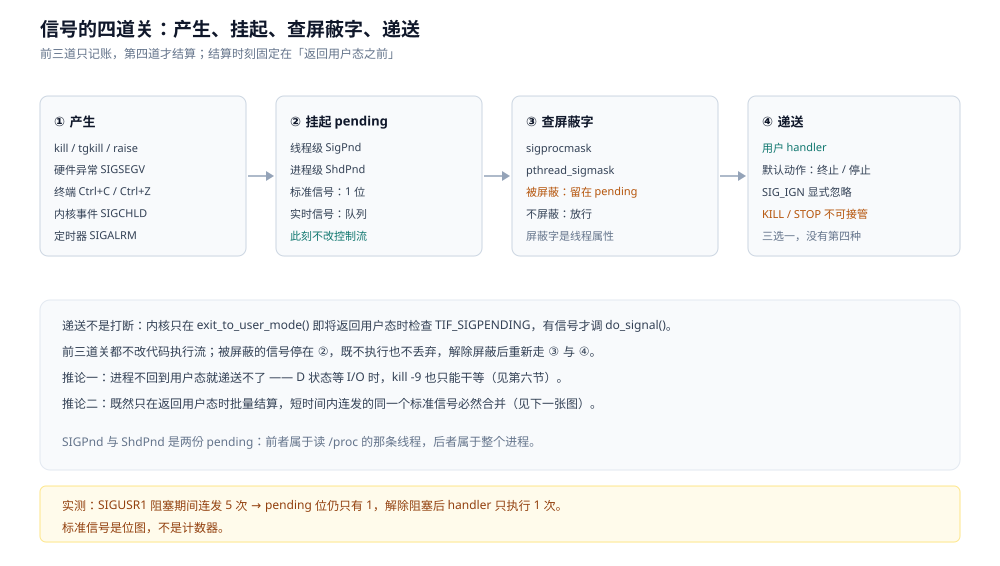
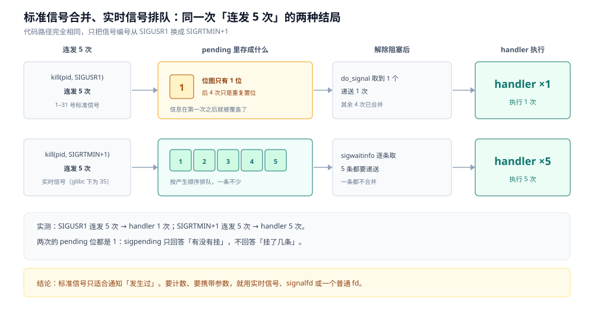
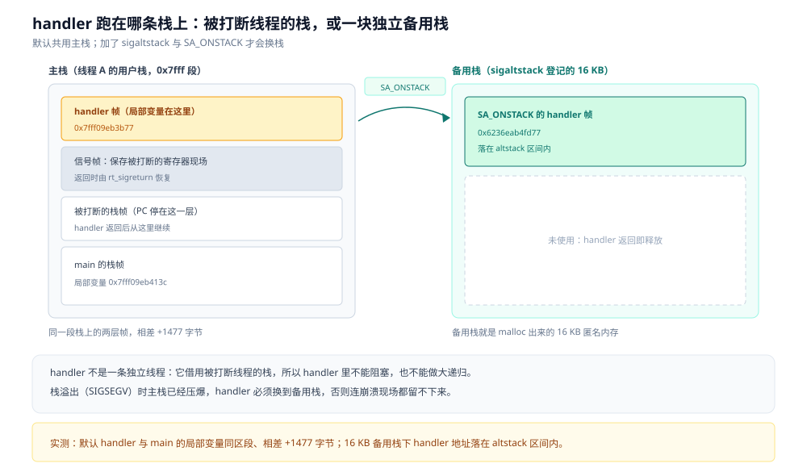
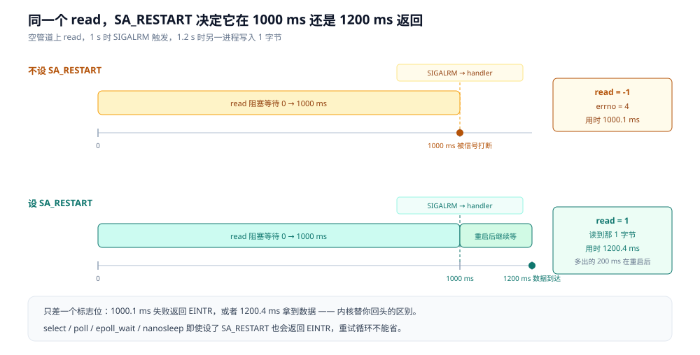

# 信号机制

> 覆盖：一个信号从产生到跑起来的四道关（产生 → pending → 阻塞判断 → 递送）、pending 为什么有两份、
> 标准信号为什么会合并而实时信号会排队、handler 跑在哪条栈上、handler 里为什么只能调 async-signal-safe 函数、
> 系统调用被打断后 `EINTR` 与 `SA_RESTART` 怎么分工、`SIGCHLD` 与 `SIGPIPE` 两个反直觉的默认动作、
> `SIGKILL` / `SIGSTOP` 为什么抓不到，以及 Go 与 Java 运行时各自接管了哪些信号。
>
> 不覆盖：硬件中断、软中断与时钟中断怎么进内核见 [中断机制.md](中断机制.md)；
> 进程的创建、僵尸、孤儿与 `SIGCHLD` 的回收路径见 [进程创建与退出.md](进程创建与退出.md)；
> 信号量 / 条件变量这类「自愿等待」的同步原语见 [并发编程/README.md](../../01-编程语言/go/并发编程/README.md)；
> 语言侧「怎么监听退出信号、怎么优雅停机」见 [子进程与外部命令.md](../../01-编程语言/go/工程实践/子进程与外部命令.md)。
>
> 内容整理自个人学习笔记。**口径**：正文读数在 `golang:1.26-bookworm` 容器内新跑（go1.26.8 / gcc 12 / Debian bookworm，
> Docker Desktop on WSL2，容器限 4 逻辑核 4 GB），C 侧程序 `siglab.c`、Go 侧程序 `forklab.go`。
> Go 运行时侧结论对应 `go1.26.8` 的标准库与 runtime 源码。⚠️ **未实测**：信号投递的微秒级延迟、跨 CPU 内核的信号路径、
> 实时信号队列打满后的丢弃行为、Java 侧 JVM 的信号占用（第七节标注为文档口径）。

---

## 一、一个信号从产生到跑起来，中间要过哪几道关？

**本节要点**：信号不是「打断」，是「记账 + 结算」。产生它的那一刻进程什么都不会发生，真正的处置要等进程下一次从内核返回用户态。

### 1.1 谁在发信号

| 来源 | 典型信号 | 怎么触发 |
|---|---|---|
| 进程自己或另一个进程 | `SIGUSR1` / `SIGTERM` / `SIGHUP` | `kill(pid, sig)`、`tgkill(tid, sig)`、`raise(sig)` |
| 硬件异常（同步信号） | `SIGSEGV` / `SIGFPE` / `SIGBUS` / `SIGILL` | CPU 执行到非法地址 / 除零 / 未对齐访问 |
| 终端（前台进程组） | `SIGINT` / `SIGQUIT` / `SIGTSTP` | `Ctrl+C` / `Ctrl+\` / `Ctrl+Z` |
| 内核事件 | `SIGCHLD` / `SIGPIPE` / `SIGALRM` / `SIGIO` / `SIGURG` | 子进程状态变化 / 写断开的管道 / 定时器到期 / 异步 I/O / 带外数据 |
| 定时器 | `SIGALRM` / `SIGVTALRM` / `SIGPROF` | `alarm()`、`setitimer()`、`timer_create()` |

表中的「同步信号」和「异步信号」是两回事：`SIGSEGV` 是**当前指令自己**触发的，必然发生在出事的那个线程上；
`SIGTERM` 是别人替你发的，落点由内核在这个进程里挑一个没屏蔽它的线程。

### 1.2 四道关：产生 → pending → 阻塞 → 递送



前两道关只做一件事——把信号记到某个进程或线程的 pending 集合里。第三道关看的是屏蔽字：如果这个信号当前被
`sigprocmask` / `pthread_sigmask` 屏蔽，它就**留在 pending 里不动**，既不执行也不丢弃（标准信号就一位，实时信号排队）。
第四道关才是真正的处置，三选一：跑用户装的 handler、执行默认动作（终止 / 终止并 core dump / 停止 / 继续 / 忽略）、忽略。

关键在于**第四道关的时机**：内核不会为了递送信号去打断正在执行的代码，它在 `exit_to_user_mode()` 收尾、
即将返回用户态的那一刻检查 `TIF_SIGPENDING`，有就调 `do_signal()` 就地处理。所以：

- 信号对**正在跑的内核代码**没有影响，它只影响「下一次返回用户态」；
- 一个进程只要不返回用户态，信号就一直挂着——这就是 `kill -9` 杀不掉 `D` 状态进程的原因（6.3）；
- 中断（硬中断）与信号是两层：中断是 CPU 被硬件抢走控制权，信号是「内核在返回用户态前顺手检查的一笔待办」。

### 1.3 pending 有两份，一份在进程上，一份在线程上

`kill(pid, sig)` 产生的是**进程级**信号，挂在 `signal_struct` 的共享 pending 上，任意一个没屏蔽它的线程都可以领；
`tgkill(tid, sig)` / `pthread_kill(thread, sig)` 产生的是**线程级**信号，只挂在那个线程的 pending 上。

`/proc/<pid>/status` 里因此有两个字段：

```
SigPnd: 0000000000000000      ← 该线程自己的 pending（读 /proc 时看到的是主线程的）
ShdPnd: 0000000000000000      ← 整个进程共享的 pending
```

两者都是位图，一位一个信号。实测里阻塞 `SIGUSR1` 后连发 5 次，`sigpending()` 报「有」，但只有一位——
这不是 bug，是标准信号的表达能力就到这里（2.1）。

---

## 二、连发五次，为什么 handler 只跑了一次？

**本节要点**：标准信号是「位」，实时信号是「队列」。标准信号用来通知「发生过」，不能用来计数。

### 2.1 标准信号只有一位

1–31 号信号在 pending 里各占一位。发第一次置位，发第二到第五次只是**再次置同一个位**，信息在第一次之后就丢了。
解除阻塞时内核只看到「这一位是 1」，于是 handler 跑一次。

### 2.2 实时信号有队列

32–64 号（内核口径）是实时信号，每个信号带一个 `sigqueue` 节点，按产生顺序排队。发 5 次就排 5 条，
解除阻塞后逐个递送，handler 跑 5 次。实时信号还额外携带一个 `sigval`（整数或指针），可以传「第几次」。

⚠️ 编号别混：内核从 32 开始算实时信号，但 glibc 把 32（`SIGCANCEL`，线程取消）与 33（`SIGSETXID`）拿去内部用，
所以用户代码里 `SIGRTMIN` 的实际值是 **34**。本篇实测用的 `SIGRTMIN+1` 就是 35。

### 2.3 实测：同一条代码路径，只改信号编号

| 实验 | 阻塞期间发 | pending 位 | 解除阻塞后 handler 执行 |
|---|---|---|---|
| `SIGUSR1`（标准信号） | 5 次 | 1 | **1 次** |
| `SIGRTMIN+1`（实时信号） | 5 次 | 1 | **5 次** |

注意 pending 位那一列两次都是 1：`sigpending()` 只回答「这个信号挂没挂」，不回答「挂了几条」。
实时信号要数条数，得用 `sigwaitinfo` / `sigtimedwait` 一条一条取出来。



同样是五次 `kill`，左边只留下一个「发生过」的标记，右边保留五条可以逐条取出的记录——差别不在代码，而在 pending 的存储形态。

### 2.4 这条结论在工程上意味着什么

| 场景 | 如果用了标准信号 | 后果 |
|---|---|---|
| 用 `SIGCHLD` 数「退出了几个子进程」 | 多个子进程同时退出 → 只递送一次 | 少回收，剩下的变僵尸（5.1） |
| 用 `SIGUSR1` 做「有 N 个任务待处理」 | 合并成一次 | 计数丢失 |
| 做超时打断（`SIGALRM`） | 只需「到点了」这一个事实 | ✅ 合并正是想要的 |
| 需要可靠计数或携带参数 | 应该用实时信号 / `signalfd` / 事件 fd | ✅ 换实现 |

正解不是「想办法让标准信号不合并」，而是**别用标准信号承载计数**：状态放共享内存或 fd，信号只当闹钟。

---

## 三、handler 跑在哪条栈上？里面能做什么？

**本节要点**：handler 不是独立线程，它打断谁就用谁的栈；因此 handler 里既不能阻塞，也不能调大多数库函数。

### 3.1 它就在被打断的那个线程的用户栈上

信号递送时，内核在**当前线程的用户栈**上压一个信号帧（保存被打断处的寄存器现场），把返回地址改成 handler，
handler 返回时走 `rt_sigreturn` 恢复现场。实测：

```
main 局部变量地址      : 0x7fff09eb413c
默认 handler 局部地址  : 0x7fff09eb3b77   相差 +1477 字节（同一条线程栈）
```

两个地址都在 `0x7fff...` 这一段，相差约 1.4 KB——正好是一层 handler 调用帧的深度。也就是说 handler 用的是
**同一条线程栈**，而不是另开一条。

这带来一个必然后果：如果这条栈已经快满了（比如递归过深），handler 压栈时会把栈彻底压爆，然后触发
`SIGSEGV`，而 `SIGSEGV` 的 handler 又要往同一条已经爆掉的栈上压——直接二连崩，连现场都留不下来。

### 3.2 备用栈：`sigaltstack` + `SA_ONSTACK`

`sigaltstack()` 给当前线程登记一块独立内存作为「信号栈」，`sigaction` 加 `SA_ONSTACK` 后，这个 handler
改到备用栈上跑。实测用 16 KB 备用栈：

```
SA_ONSTACK handler 地址: 0x6236eab4fd77   altstack=[0x6236eab4c2a0, +16384)  → 在备用栈上
```

地址落在 `[0x6236eab4c2a0, 0x6236eab502a0)` 区间内，与主栈的 `0x7fff...` 完全不在一个区段——这是堆地址段，
说明了备用栈就是一块普通匿名内存。



必须用备用栈的典型场景：**栈溢出**。这时主栈已经没法用了，只有备用栈还能跑 handler（`SIGSEGV` handler 里
通常只做 `write(2, "stack overflow\n", 15)` 然后 `_exit` 或 `abort`）。

### 3.3 handler 期间，内核自动把当前信号加进屏蔽字

同一种信号在 handler 执行期间会被自动屏蔽，避免递归打断自己；要关掉这个行为用 `SA_NODEFER`。
`sa_mask` 则是**额外的**屏蔽集合，只对 handler 期间生效，可以顺手把「必须和它配对处理」的信号也挡掉。

这个「自动屏蔽」不是可有可无的细节：如果 handler 里对同一个信号做「解除阻塞」，屏蔽字就形成了嵌套，
标准信号不会重入，但实时信号会——连续多条排队信号会在 handler 里逐层压栈。

### 3.4 只有 async-signal-safe 的函数能调

handler 打断的是任意一条指令，包括 `malloc` 正在改堆链表、`printf` 正在持锁写缓冲区的那一瞬间。
这时 handler 再调 `malloc` 或 `printf`，拿到的是一把**已经被自己持有、永远不会释放**的锁——死锁，或者更糟的堆损坏。

POSIX 列了一张 async-signal-safe 清单，常用的只有这些：

| 可以用 | 不能用 |
|---|---|
| `write` / `read` / `close` / `_exit` | `printf` / `fprintf` / `exit` |
| `sigaction` / `sigprocmask` / `kill` | `malloc` / `free` / `realloc` |
| `open` / `unlink` / `rename`（POSIX 2008 起） | `pthread_mutex_lock` 及其它线程同步原语 |
| `time` / `getpid` / `getppid` | `strerror` / `syslog` / `localtime` |

一条经验：**handler 里只做「把事实记下来」这一个动作**——写一字节到 pipe、置一个 `volatile sig_atomic_t`、
或者 `write` 到一个 eventfd，真正的处理放到主循环里做。这也是 signals-as-fd 的动机（4.4）。

还有一条容易漏的：handler 会**破坏 `errno`**（handler 里调用的函数会改写它）。模板里第一件事是保存 `errno`，返回前恢复。

### 3.5 一个能用的 handler 模板

```c
static volatile sig_atomic_t got = 0;
static int notify_fd = -1;

static void on_signal(int sig) {
    int saved = errno;
    char b = (char)sig;
    if (write(notify_fd, &b, 1) < 0) { /* 只能忽略，不能让 handler 失败 */ }
    got = 1;
    errno = saved;
}

int install(int sig, int fd) {
    notify_fd = fd;
    struct sigaction sa;
    memset(&sa, 0, sizeof sa);
    sa.sa_handler = on_signal;
    sigemptyset(&sa.sa_mask);
    sa.sa_flags = SA_RESTART;        // 让可重启的系统调用别断（4.2）
    return sigaction(sig, &sa, NULL);
}
```

「写一字节到 pipe」之所以安全，是因为 `write` 在 async-signal-safe 清单里，且 pipe 的写端在内核里不会阻塞在
用户态锁上——代价是 pipe 满了以后 `write` 也会阻塞，所以要么用 `O_NONBLOCK`，要么用 eventfd。

---

## 四、系统调用被信号打断后，`EINTR` 怎么处理？

**本节要点**：`EINTR` 不是错误，是「你先去处理信号，回头再来」。`SA_RESTART` 让内核替你回头，但有一批系统调用永远不回头。

### 4.1 只有「慢速系统调用」会被打断

快系统调用（`getpid`、`read` 一个已在页缓存里的文件）在内核里不会睡，信号来了也插不进去。
会被打断的是「可能永远等下去」的那批：管道 / socket / 终端的 `read` / `write`、`accept`、`wait`、`pause`、
`nanosleep`、`select` / `poll` / `epoll_wait`、`flock`、`msgrcv`、`semop`。

它们的共同点是：内核在这个调用里进入睡眠，等事件、等锁、等数据。信号到达把线程唤醒，内核发现「不是你等的那个事件」，
于是按 `SA_RESTART` 的设置决定：重启这个调用，还是撤回用户态并返回 `-1 / EINTR`。

### 4.2 `SA_RESTART` 的实测差别

同一段代码，`read` 一个空管道，1 秒时 `SIGALRM` 触发，1.2 秒时另一进程往管道写 1 字节：

| 设置 | `read` 返回 | `errno` | 用时 | handler 执行 |
|---|---|---|---|---|
| 不设 `SA_RESTART` | `-1` | `4` Interrupted system call | **1000.1 ms** | 是 |
| 设 `SA_RESTART` | `1`（读到了那 1 字节） | 残留 `4`，但返回值有效 | **1200.4 ms** | 是 |

两行读数的含义完全不同：第一行是「handler 跑完，`read` 失败了」；第二行是「handler 跑完，`read` 自己接着等，
一直等到 1.2 秒真数据来了才返回」——多出来的 200 ms 就是内核替你重启的那一段。



⚠️ 第二行的 `errno` 仍是 4，是**残留值**：`errno` 只在返回 -1 时才有意义。这是个高频误判点——
「明明成功了 `errno` 却不是 0」不是 bug。

### 4.3 永远不会被重启的那一批

即使设了 `SA_RESTART`，下面这些在 Linux 上仍然会返回 `EINTR`：

| 调用 | 原因 |
|---|---|
| `select` / `poll` / `epoll_wait` | 它们本身就是「等待 + 超时」的抽象，重启会让超时语义没法算 |
| `nanosleep` / `clock_nanosleep` | 同上，且 POSIX 要求剩余时间通过参数带出来 |
| `pause` | 它的唯一语义就是「等一个信号」 |
| 带超时的 `recv` / `send`（`SO_RCVTIMEO` / `SO_SNDTIMEO`） | 超时与信号共用同一条失败返回路径 |

所以网络编程里最常写的一行不是 `if (ret < 0)`，而是 `if (ret < 0 && errno == EINTR) continue;`——
因为 `accept` / `read` 在监听 socket 上的那个 `epoll_wait`，靠 `SA_RESTART` 是救不了的。

### 4.4 三种正确写法

```c
/* 写法一：显式重试，最通用 */
for (;;) {
    n = read(fd, buf, len);
    if (n < 0 && errno == EINTR) continue;
    break;
}

/* 写法二：pselect / ppoll —— 原子地换屏蔽字，消掉「检查完到进入等待」之间的窗口 */
sigset_t empty;
sigemptyset(&empty);
n = pselect(nfds, &rfds, NULL, NULL, &ts, &empty);

/* 写法三：signalfd —— 把信号变成一个可读 fd，和 socket 一起进 epoll */
sigprocmask(SIG_BLOCK, &mask, NULL);      /* 先全部线程屏蔽 */
int sfd = signalfd(-1, &mask, SFD_NONBLOCK | SFD_CLOEXEC);
/* 之后 epoll_wait 返回 sfd 可读，read(sfd, &si, sizeof si) 逐条取 */
```

写法二解决的是一个真实的竞态：`sigprocmask` + `select` 两步之间如果信号到达，`select` 会睡死过去。
`pselect` 把「换屏蔽字」和「进入等待」合成一个原子操作。

写法三是把信号接进事件循环的标准手段，与 [IO多路复用.md](IO多路复用.md) 的 eventfd / timerfd 属同一族：
**信号不再是异步的打断，而是一个普通 fd 上的可读事件**，handler 里那种「什么都干不了」的限制也就消失了。

### 4.5 Go 与 Java 各自怎么兜

Go 的标准库对 `EINTR` 是**静默重试**的，见 `os/file_posix.go`（原文）：

```go
func ignoringEINTR(fn func() error) error {
	for {
		err := fn()
		if err != syscall.EINTR {
			return err
		}
	}
}
```

所以 `os.File.Read`、`os.Chmod` 这些封装层不会把 `EINTR` 漏给业务代码。真正会碰到 `EINTR` 的是直接调
`syscall.Read` / `unix.*` 的场景，那时得自己判。运行时内部的 netpoller 也是同样的循环套路——
`epoll_wait` 返回 `EINTR` 只是重新进去睡，不会被当成连接错误。

Java 侧没有 `EINTR` 这个概念：JVM 把「阻塞调用被信号打断」翻译成 `InterruptedException` 或直接内部重试，
业务代码看到的是异常与 `ClosedByInterruptException`，而不是 errno。代价是**语义被抬高了一层**，
`Thread.interrupt()` 与内核信号并不是一对一关系（⚠️ 本节为文档口径，未在本机实测）。

---

## 五、`SIGCHLD` 与 `SIGPIPE`：两个反直觉的默认动作

**本节要点**：`SIGCHLD` 的默认动作写着「忽略」，但进程照样变僵尸；`SIGPIPE` 的默认动作是「终止」，一次写就能杀掉整个服务。

### 5.1 `SIGCHLD` 默认「忽略」≠ 自动回收

POSIX 里 `SIGCHLD` 的默认动作是 Ignore，但 Linux 把这个「默认 Ignore」做了特殊处理：它**照旧生成僵尸**，
只有显式把处置设成 `SIG_IGN` 时内核才在子进程退出时直接回收。实测两段：

```
SIGCHLD 默认处置   : 子进程 20    state=Z  → 僵尸，等父进程回收
SIGCHLD=SIG_IGN    : 子进程 21    state=?  → 内核已回收
  再 waitpid 它    : 返回 -1  errno=10(No child processes)
```

`state=Z` 与 `state=?`（`/proc/<pid>` 已被删掉，读不到）的差别，就是「默认忽略」和「显式忽略」的差别。
第三行还顺手说明了一件事：`SIG_IGN` 之后 `waitpid` 会返回 `ECHILD`，**不能**再靠它拿退出码——
要退出码就必须老老实实自己 `waitpid`，那就得放弃 `SIG_IGN`。

僵尸本身占什么、为什么不释放，见 [进程创建与退出.md](进程创建与退出.md) 第五节。

### 5.2 `SIGPIPE` 默认会直接杀进程

往一个读端已关闭的管道或已断开的 socket 写数据，内核给写进程发 `SIGPIPE`，默认动作是终止。于是：

- 服务里某个连接被对端 `RST` 之后，下一次 `write` 不是返回错误，而是**进程直接消失**，日志里只有一行 `Broken pipe`；
- 这就是所有服务端程序启动时几乎都会做的一步：`signal(SIGPIPE, SIG_IGN)`，让 `write` 改成返回 `-1 / EPIPE`，由代码处理。

Go 的处理更细：默认（没 `signal.Notify(SIGPIPE)` 时）写 fd 1 / 2 遇到断管会按默认动作退出程序，
写其它 fd 则只返回 `EPIPE` 错误——既保留了「管道命令被下游关闭就退出」的 shell 语义，又不会让服务因为一个连接死掉。

### 5.3 常见信号的默认动作

| 信号 | 默认动作 | 常见触发 | 说明 |
|---|---|---|---|
| `SIGTERM` (15) | 终止 | `kill`、编排系统停机 | 可捕获，优雅退出的标准入口 |
| `SIGINT` (2) | 终止 | `Ctrl+C` | 可捕获 |
| `SIGQUIT` (3) | 终止 + core | `Ctrl+\` | 可捕获；Go / JVM 拿它做栈转储 |
| `SIGKILL` (9) | 终止 | `kill -9` | **不可捕获、不可阻塞** |
| `SIGSTOP` (19) | 停止 | `kill -STOP` | **不可捕获、不可阻塞** |
| `SIGTSTP` (20) | 停止 | `Ctrl+Z` | 可捕获，作业控制 |
| `SIGCONT` (18) | 继续 | `kill -CONT` | — |
| `SIGSEGV` (11) | 终止 + core | 非法内存访问 | 同步信号，落在出错线程 |
| `SIGCHLD` (17) | 忽略（但仍留僵尸） | 子进程状态变化 | 见 5.1 |
| `SIGPIPE` (13) | 终止 | 写断开的管道 / socket | 见 5.2 |
| `SIGALRM` (14) | 终止 | `alarm()` 到期 | 常被改成 handler 做超时 |
| `SIGURG` (23) | 忽略 | 带外数据 | Go 拿它做异步抢占（7.2） |

---

## 六、为什么 `SIGKILL` 和 `SIGSTOP` 抓不到？

**本节要点**：这两个信号是「内核的最终手段」。允许进程接管它们，等于允许进程拒绝管理。

### 6.1 实测：连装都装不上

```
sigaction(SIGKILL, handler) : 返回 -1  errno=22(Invalid argument)
sigaction(SIGSTOP, handler) : 返回 -1  errno=22(Invalid argument)
```

`EINVAL` 来自内核，不是 glibc 的包装——`sigaction` 系统调用本身对这两个信号做白名单检查。
同理，`sigprocmask` 试图屏蔽它们也会被静默忽略（调用返回成功，位却没置上）。

### 6.2 设计原因：不能给进程一个「拒绝退出」的机会

如果 `SIGKILL` 可捕获，一段卡死的代码就能顺手把 handler 装上，运维就彻底失去了最后的强制手段；
如果 `SIGSTOP` 可捕获，被停止的进程可以立刻「继续」，调度器就没法把它挂起。这两个信号存在的意义就是
**不由进程自己决定**，所以它们的处置被内核固定死了。

这也解释了为什么它们连 pending 都不需要讲：递送时不看屏蔽字、不看 handler，直接执行。

### 6.3 `kill -9` 也有杀不掉的时候

| 情况 | 为什么杀不死 |
|---|---|
| 进程处于 `D`（不可中断睡眠） | 内核在这个状态里不检查 `TIF_SIGPENDING`；信号要等它返回用户态才结算（1.2），而它可能永远等不到 I/O |
| 进程是僵尸（`Z`） | 已经死了，只等父进程 `waitpid`；`kill` 对僵尸无意义 |
| 目标在内核里长时间自旋 / 卡死驱动 | 同上，没有返回用户态的检查点 |
| 发给了错误的 pid / 容器 namespace 不对 | `kill` 返回 0 也可能是因为权限不足被静默忽略（`EPERM` 只会出现在某些路径） |

所以「`kill -9` 一定管用」是错的：它绕过了应用的 handler，但绕不过内核里那些根本不回到用户态的代码路径。
对付 `D` 状态，唯一的手段是解决它等的那个 I/O（拔盘、断开网络存储、重启机器）。

---

## 七、Go 与 Java 接管了哪些信号？

**本节要点**：Go 运行时默认给 56 个信号装了自己的 handler；用户能装的 `handler` 与运行时抢同一组信号，所以要用 `os/signal` 而不是 `signal()`。

### 7.1 装了 56 个，缺的 8 个都有明确原因

Go 程序启动后读 `/proc/self/status`：

```
SigPnd: 0000000000000000
ShdPnd: 0000000000000000
SigBlk: 0000000000000000
SigIgn: 0000000000000000
SigCgt: fffffffd7fc1feff
```

`SigCgt` 解码后是 **56 个**已捕获信号，缺 8 个：`9, 18, 19, 20, 21, 22, 32, 34`。

| 缺失信号 | runtime 里的原因 | 依据 |
|---|---|---|
| 9 `SIGKILL`、19 `SIGSTOP` | 内核不允许安装 | 6.1 的 `EINVAL` |
| 18 `SIGCONT`、20 `SIGTSTP`、21 `SIGTTIN`、22 `SIGTTOU` | 标了 `_SigDefault`，`initsig` 里直接 `continue`，作业控制交回系统 | `sigtab_linux_generic.go` 与 `signal_unix.go` 的 `initsig` |
| 32、34 | 标了 `_SigSetStack`，`sigInstallGoHandler` 返回 false | 32 是 glibc 的 `SIGCANCEL`，34 是 musl 的 `SIGSYNCCALL`，都不能被 Go 抢 |
| （33 反而装了） | `sigPerThreadSyscall = _SIGRTMIN + 1`，无 cgo 时 Go 用它把「每线程系统调用」投递到每个 M | `os_linux.go` 的常量与 `signalM` 调用 |

最后一行是个好例子：同一个 `_SigSetStack` 标记下，33 被专门豁免——因为 Go 需要一个「只打断某个 M」的信号，
而 33 在内核里刚好没被用户态占用。读源码时如果只看到「32/33/34 都是 `_SigSetStack`」就下结论「三个都不装」，
会和实测的 `SigCgt` 对不上。

### 7.2 `SIGURG`：一次信号解决「异步抢占」

Go 1.14 起支持非协作抢占：一个死循环的 goroutine 不再能把 P 占死。实现手段就是给 M 发 `SIGURG`，
信号 handler 里检查是否需要切走。为什么偏偏选 `SIGURG`，`runtime/signal_unix.go` 里写得很清楚：

```go
// sigPreempt is the signal used for non-cooperative preemption.
// ...
// 1. It should be a signal that's passed-through by debuggers by default...
// 2. It shouldn't be used internally by libc in mixed Go/C binaries...
// 3. It should be a signal that can happen spuriously without consequences...
// 4. We need to deal with platforms without real-time signals...
const sigPreempt = _SIGURG
```

四条启发式合起来是一个取舍：调试器默认放行、libc 不占用、即使「误发」也无副作用、且在所有平台上都存在。
`SIGURG` 之所以满足第三条，是因为它的原始语义（带外数据）几乎没人用，且不带「哪个 socket」的信息，本来就没什么用。

这条设计顺带说明了一个工程事实：**信号可以被运行时当成调度原语**，不只是「通知」。

### 7.3 `SIGQUIT`：153 行转储、10 段 goroutine、退出码 2

给一个 Go 进程发 `SIGQUIT`（或 `Ctrl+\`），运行时会打印所有 goroutine 的栈并退出。实测一个只有 4 个
`select{}` goroutine 的程序：

```
GOMAXPROCS=4  goroutine=5  Threads=5 → 给自己发 SIGQUIT
SIGQUIT: quit
PC=0x40a64e m=0 sigcode=0
...
退出码=2    总行数=153    goroutine 段数=10
```

153 行、10 段 goroutine（4 个业务 + 运行时自身的几个），退出码 2。这就是线上「卡住了」时最常用的手段：
`kill -QUIT <pid>` 拿到全量栈，比 `SIGTERM` 之后猜测有用得多。

`SIGQUIT` 在多线程程序里不是「一个线程打印完就完」：`signal_unix.go` 里每个收到它的 M 会把信号**转发给下一个 M**
（`raiseproc(_SIGQUIT)`），直到所有 M 都打印完，再由第一个 M 负责退出——所以转储是「所有线程的栈」，而不是「碰巧接住它的那条线程」。

### 7.4 其它被运行时改造过的信号

| 信号 | 默认动作 | Go 运行时改成 |
|---|---|---|
| `SIGSEGV` / `SIGBUS` / `SIGFPE` / `SIGILL` | 终止 + core | 转成 Go panic（`_SigPanic` 标记），带栈信息打印后退出 |
| `SIGPROF` | 终止 | CPU profile 的采样信号（`go tool pprof` 的数据来源） |
| `SIGPIPE` | 终止 | 只对 fd 1 / 2 保留默认行为，其余返回 `EPIPE`（5.2） |
| `SIGURG` | 忽略 | 异步抢占（7.2） |
| `SIGQUIT` | 终止 + core | 打印全量栈后退出（7.3） |

### 7.5 `os/signal` 的语义与三个坑

`signal.Notify(ch, sigs...)` 只是**注册**——运行时保留自己的 handler，把它转发到 channel；此后该信号的
默认动作被禁用（`SIGKILL` / `SIGSTOP` 除外）。三个高频错误：

- **注册太晚**：在 `main` 最后才 `Notify`，而 `SIGTERM` 在初始化阶段就到达，进程直接被默认动作杀掉；
- **channel 缓冲为 0**：`make(chan os.Signal)` 配 `Notify`，如果接收循环正在做耗时清理，后续信号会被**丢弃**（等价于 2.1 的合并），停机信号可能丢；
- **用 `signal.Ignore` 却仍等 channel**：`Ignore` 会让信号直接丢弃，channel 上永远收不到。

正确姿势通常是 `signal.NotifyContext(ctx, syscall.SIGTERM, syscall.SIGINT)`，把「收到信号」变成 `ctx.Done()`，
交给已有的 `ctx` 取消链路（连接池、HTTP server 的 `Shutdown`、后台任务）统一处理。

### 7.6 Java 侧：JVM 把信号当内部设施（文档口径，未实测）

| 信号 | JVM 用途 |
|---|---|
| `SIGQUIT` | 打印 thread dump（`jstack` 本质上就是发这个信号） |
| `SIGTERM` / `SIGINT` | 触发 shutdown hook，正常退出流程 |
| `SIGSEGV` / `SIGBUS` | 隐式空指针检查、safepoint polling 的「缺页」技巧 |
| `SIGUSR2` 等 | 部分版本用于 attach / 诊断 |

推论与应用层写法一致：**不要在 Java 里自己 `sigaction`**，要停就注册 shutdown hook；`-Xrs` 能让 JVM 少占信号，
代价是失去 thread dump 等能力。具体到「Go 怎么起子进程、怎么发信号」见
[子进程与外部命令.md](../../01-编程语言/go/工程实践/子进程与外部命令.md)。

---

## 八、现场怎么查信号？

**本节要点**：先读 `/proc/<pid>/status` 的五个位图字段，再用 `strace` 看系统调用返回 `EINTR`，最后才怀疑 handler。

### 8.1 五个字段怎么读

| 字段 | 含义 | 典型异常 |
|---|---|---|
| `SigPnd` | 当前线程待处理 | 有值但 handler 不跑 → 被屏蔽了 |
| `ShdPnd` | 进程共享待处理 | 同上，但可能是「没有线程愿意领」 |
| `SigBlk` | 当前线程屏蔽字 | 位图上出现业务信号 → 该信号永远不会跑 handler |
| `SigIgn` | 被显式忽略 | `SIGPIPE` 在这一位 → 有人做了 5.2 的事 |
| `SigCgt` | 已安装 handler | Go 程序里 56 位几乎全亮（7.1） |

解码脚本（位图从第 1 位开始，最高位对应 64 号信号）：

```bash
pid=$$; grep -E 'Sig(Pnd|Blk|Ign|Cgt)' /proc/$pid/status
python3 - <<'PY'
mask = int("fffffffd7fc1feff", 16)
print("未捕获:", [i for i in range(1, 65) if not (mask >> (i - 1)) & 1])
PY
```

### 8.2 三条命令

```bash
kill -l                                                  # 信号编号与名字对照
strace -f -e trace=rt_sigaction,rt_sigprocmask,rt_sigreturn,kill,tgkill -p <pid>
cat /proc/<pid>/status | grep -E 'Sig|Threads'            # 五个位图 + 线程数
```

`strace` 那一行里，如果看到 `rt_sigreturn` 频繁出现，说明 handler 被反复调用；如果看到 `read(...) = -1 EINTR`，
就回到第四节对号入座。

### 8.3 症状速查

| 症状 | 先查什么 | 参见 |
|---|---|---|
| 进程无日志突然消失，日志里只有一行 `Broken pipe` | `SIGPIPE` 没忽略 | 5.2 |
| `sleep` 睡不满 / 定时任务提前醒 | `EINTR` 没重试，`nanosleep` 被打断 | 4.1 / 4.3 |
| 子进程大量 `Z` 状态 | `SIGCHLD` 处理不完整，或把「默认忽略」当成会自动回收 | 5.1 |
| handler 里卡死 / 进程挂住 | handler 里调了 `printf` / `malloc` / 加锁 | 3.4 |
| 栈溢出时没有任何现场 | 没有 `sigaltstack` + `SA_ONSTACK` | 3.2 |
| `kill -9` 也杀不掉 | `D` 状态等 I/O，或已经是僵尸 | 6.3 |
| 服务收到 `SIGTERM` 不退出 | 屏蔽字里有 `SIGTERM`，或 `Notify` 注册太晚 | 1.2 / 7.5 |
| 程序打印几十行栈后以 2 退出 | 有人发了 `SIGQUIT`（也可能是 `Ctrl+\`） | 7.3 |

---

## 校验口径

**本节要点**：全部读数来自同一镜像的临时容器，C 侧只用 `sigaction` / `sigprocmask` / `kill` / `pipe` / `read`，Go 侧只用标准库与 `/proc`。

- **运行环境**：`golang:1.26-bookworm`（go1.26.8、gcc 12、Debian bookworm），`docker run --rm --cpus=4 --memory=4g`，Docker Desktop on WSL2，宿主 Intel i7-6700HQ。
- **`EINTR` 与 `SA_RESTART`（4.2）**：`siglab.c eintr`，`alarm(1)` + 1.2 s 后写管道 1 字节，两分支各跑一次。
  - 无 `SA_RESTART`：`read = -1`、`errno = 4`、用时 1000.1 ms、`alarm_hit=1`。
  - `SA_RESTART`：`read = 1`、`errno` 残留 4、用时 1200.4 ms、`alarm_hit=1`。
- **标准信号合并 / 实时信号排队（2.3）**：`siglab.c merge`，先 `SIG_BLOCK` 再连续 `kill` 5 次，`sigpending` 查位，`SIG_SETMASK` 后 `usleep(100ms)` 计数。
  - `SIGUSR1`：pending 位 1、handler 1 次；`SIGRTMIN+1`（glibc 下为 35）：pending 位 1、handler 5 次。
- **不可捕获（6.1）**：`siglab.c uncatchable`，对 `SIGKILL` / `SIGSTOP` 调 `sigaction`，均返回 -1、`errno=22`。
- **handler 栈（3.1 / 3.2）**：`siglab.c stack`，先取 `main` 局部变量与 handler 局部变量地址做差，再 `sigaltstack(16 KB)` + `SA_ONSTACK` 复测。
  - 默认 handler 与 `main` 相差 +1477 字节；`SA_ONSTACK` 下 handler 地址落在 `[alt, alt+16384)` 内。
  - ⚠️ 同一程序在更早一轮跑出过 +1493 字节，差值是栈布局噪声，不影响「同一区段、约一层调用帧」的结论。
- **`SIGCHLD` 两种「忽略」（5.1）**：`siglab.c chld`，`/proc/<pid>/stat` 第 3 字段取状态字母。
  - 默认处置：`state=Z`；`SIG_IGN`：`/proc/<pid>` 已消失（`state=?`），再 `waitpid` 得 -1 / `errno=10`。
- **Go 线程数与信号位图（7.1）**：`forklab.go threads|sigmap`，`GOMAXPROCS=4`、9 个 goroutine → `Threads=5`；`SigCgt=fffffffd7fc1feff`，解码得 56 个，缺失 `[9,18,19,20,21,22,32,34]`。
  - runtime 侧依据为容器内 `/usr/local/go/src/runtime/{signal_unix.go,os_linux.go,sigtab_linux_generic.go}` 原文：`const sigPreempt = _SIGURG`、`const sigPerThreadSyscall = _SIGRTMIN + 1`、`_SIGRTMIN = 0x20`、`initsig` 的 `_SigDefault` 跳过与 `sigInstallGoHandler` 的 `_SigSetStack` 返回 false。
- **`SIGQUIT` 转储（7.3）**：`forklab.go quit`，4 个 `select{}` goroutine 后 `syscall.Kill(os.Getpid(), syscall.SIGQUIT)`；输出重定向后统计：总行数 153、`^goroutine ` 段数 10、退出码 2。
- **`EINTR` 的 Go 封装（4.5）**：`/usr/local/go/src/os/file_posix.go` 的 `ignoringEINTR` / `ignoringEINTR2` 原文引用。
- **⚠️ 未实测**：信号投递延迟、跨核投递路径、实时信号队列打满（`RLIMIT_SIGPENDING`）后的行为、`signalfd` / `sigwait` 与 handler 的耗时对比、Java 与 JVM 侧全部结论（第七节 7.6 已标注文档口径）。

---

## 延伸追问

- **信号能被「排队」到多少个？** → 标准信号每个只有一位，永不排队；实时信号按 `RLIMIT_SIGPENDING` 限额排队，超了 `sigqueue` 返回 `EAGAIN`。这也是别用标准信号做计数的硬理由。
- **`signal()` 和 `sigaction()` 有什么区别？** → `signal()` 在不同 Unix 上的语义（是否自动重启、是否复位）历史上不一致，`sigaction()` 把「flags / 屏蔽字 / handler」一次讲清楚。可移植代码只用 `sigaction`。
- **为什么 `pthread_kill` 有时「没反应」？** → 目标线程把该信号屏蔽了，信号进入 pending 而不是递送；或者线程已经退出，`ESRCH` 被忽略。多线程服务里常见做法是**所有线程统一屏蔽 + 一个专门线程 `sigwait`**。
- **handler 里能不能写日志？** → 不能直接写。`syslog`、`fprintf`、带锁的日志库都不安全（3.4）；要么 `write(2)` 到预先打开的 fd，要么写 eventfd / pipe 交给主循环。
- **`SIGSEGV` 能被恢复执行吗？** → 技术上可以（handler 里改 `ucontext` 的 PC 跳过去），`siglongjmp` 是经典写法；现代代码里这是最后手段，且必须配合 `sigaltstack`，否则栈已坏时 handler 自己就崩了。
- **Go 的 `signal.Notify` 用了之后，默认动作还会执行吗？** → 不会（`SIGKILL` / `SIGSTOP` 除外）。所以「注册了 `SIGTERM` 但 channel 没人读」时进程会**一直活着**，比默认被杀更糟——这正是 7.5 的第一个坑。
- **`Ctrl+C` 为什么会发给整个前台进程组？** → 终端驱动把 `SIGINT` 投给前台进程组的所有进程，所以 `go run` 起的子进程也能收到；而在后台跑的进程组收不到，需要 `kill`。
- **容器里 PID 1 收信号和普通进程一样吗？** → 不一样：内核给 PID 1 装了「忽略未处理信号」的保护，所以容器主进程若不显式处理 `SIGTERM`，`docker stop` 只能等到超时再 `SIGKILL`。见 [进程创建与退出.md](进程创建与退出.md) 第六节。

---

## 关联

- [进程创建与退出.md](进程创建与退出.md) — **上游/互补**。僵尸、孤儿、`SIGCHLD` 的回收路径在那边第五节；本篇 5.1 只讲「默认忽略不等于自动回收」
- [中断机制.md](中断机制.md) — **上游**。硬中断 / 软中断 / 时钟中断是「CPU 被抢走」，信号是「返回用户态前检查的待办」；1.2 的时机靠那边的十二步链条定位
- [IO多路复用.md](IO多路复用.md) — **互补**。`signalfd` 把信号变成 fd，与 eventfd / timerfd 同族；`select` / `epoll_wait` 永不重启的结论在第四节
- [调度与时间片.md](调度与时间片.md) — **对照**。`SIGURG` 抢占（7.2）最终落到「时间片用完要换人」，两者是同一件事的两种触发源
- [用户态内核态与一次IO的内存路径.md](用户态内核态与一次IO的内存路径.md) — **上游**。`rt_sigreturn` 与系统调用五步共用同一套特权切换
- [进程与线程.md](../linux/进程与线程.md) — **上游**。线程组、`tgkill` 与 `pthread_kill` 的落点、信号屏蔽字是线程属性这三点在那边
- [文件系统与IO.md](../linux/文件系统与IO.md) — 慢速系统调用清单与 `EINTR` 的实际来源
- [子进程与外部命令.md](../../01-编程语言/go/工程实践/子进程与外部命令.md) — **下游**。Go 侧 `os/exec`、进程组、向整个进程组发信号
- [子进程与外部命令.md](../../01-编程语言/java/工程实践/子进程与外部命令.md) — **对照**。Java 侧 `Process.destroy` 与 shutdown hook
- [并发编程/README.md](../../01-编程语言/go/并发编程/README.md) — 语言层的「自愿协作」原语（channel / Mutex / Context 取消），与信号这种「外部强制通知」对照
