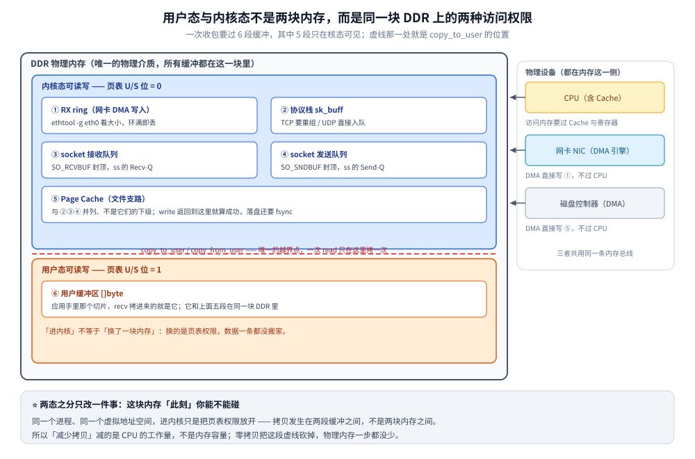
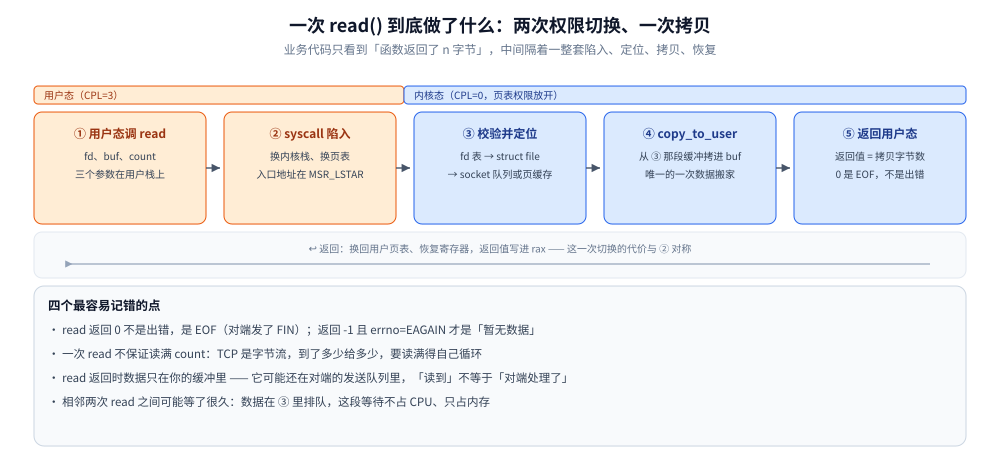
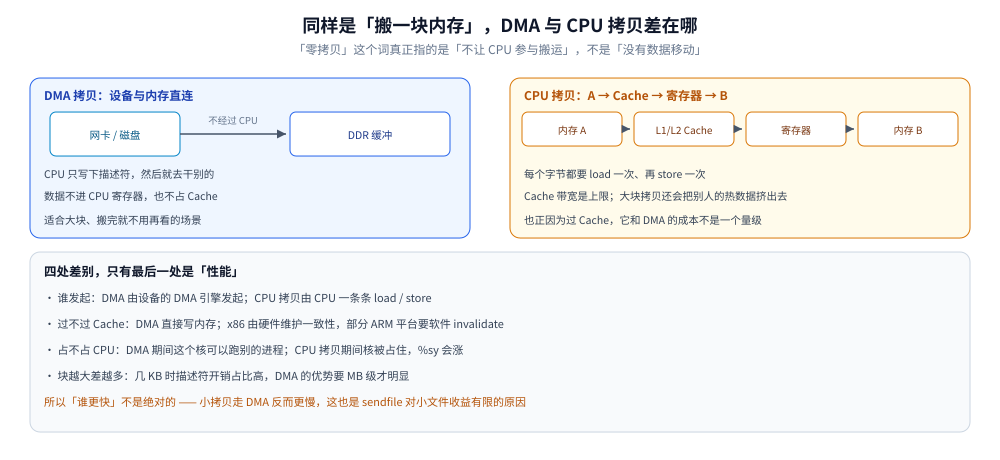

# 用户态、内核态与一次 I/O 的内存路径

> 覆盖：一个进程为什么会有「两个态」、进内核到底改了什么、一次收包要过哪六段缓冲、**发送方向与接收方向的段序列差在哪（同一趟拷贝，读在最后、写在最前）**、系统调用那一下的五步、DMA 与 CPU 拷贝的成本差在哪、`mmap` 省掉的是哪一次、四种典型进程各走哪条路，以及现场怎么从计数看出数据卡在哪一段。
> 
> 不覆盖：零拷贝的五种实现路径与选型见 [零拷贝.md](../操作系统/零拷贝.md)；VFS 与一次 `write` 落盘的完整栈见 [文件系统与IO.md](../linux/文件系统与IO.md)；socket 接口与连接生命周期见 [Socket接口与连接生命周期.md](../网络/传输层/Socket接口与连接生命周期.md)；epoll 等事件机制见 [IO多路复用.md](IO多路复用.md)；Page Cache 的回收与 LRU 见 [内存管理.md](../linux/内存管理.md)。
>
> 内容整理自个人学习笔记。**口径**：本篇是**结构篇** —— 不含本篇新跑的读数。文中所有数字与计数均引自已实测篇目，引用处逐条注明来源；结构部分（六段缓冲的上下限参数、系统调用的五个步骤）按 Linux 内核实现陈述，未做逐项压测。⚠️ **未实测**：`mmap` 与 `read` 的缺页次数／带宽对照、非 x86 平台（ARM）的 Cache 一致性处理、KPTI 开关的耗时差。

---

## 一、同一个进程，为什么会有「两个态」？

**本节要点**：用户态与内核态的区别**不在内存，而在权限**。一个进程只有一个虚拟地址空间，所谓「进内核」，改的是页表里每一页的 U/S 位，以及换用哪一根内核栈 —— 数据一寸都没搬。

### 1.1 切的是权限，不是内存

x86-64 用 `syscall` 指令进内核，入口地址存在 MSR `LSTAR` 里；返回用 `sysret`。这中间发生的三件事，没有一件是「搬家」：

| 发生什么 | 具体是什么 |
|---|---|
| 特权级变了 | `CPL` 从 3 变 0，内核代码里那些只能在高特权级执行的指令才允许出现 |
| 栈换了 | 从用户栈换到**该进程的内核栈**（x86-64 上通常 16 KB，一个进程一根） |
| 页表权限放开了 | 内核页的页表项 `U/S` 位是 0，用户态碰它直接缺页；进了内核就不受这条限制 |

⭐ 最容易被写成「两块内存」的地方就在这里。**同一块 DDR、同一套物理页**，只是在用户态时一部分页的访问位被关掉了。

至于「内核态能不能访问用户态的内存」——能。`copy_from_user` / `copy_to_user` 做的事就是在放开的权限下读写用户地址。反过来则不成立：用户态碰内核页会触发缺页，内核的处理通常就是给你的进程一个 `SIGSEGV`。

### 1.2 一个代价：换页表本身

Meltdown 之后引入的 KPTI 让用户态页表里**干脆不映射内核**（只留极少的跳板页），于是每次系统调用都要换一次 `CR3`，等于把「权限切换」升级成「页表切换」。PCID 特性把这件事的代价压回去一部分，但它没有消失，只是变小了。

这解释了一个常被问到的问题：**为什么 `getpid` 这类「什么都不干」的系统调用也不便宜**——它便宜的部分在逻辑，贵的部分在两次切换。

```bash
# 用户态视角看不到内核地址：最后几段是 vvar / vsyscall 这类跳板
grep -E 'vsyscall|vvar' /proc/$$/maps

# 内核栈用了多少（每个线程一份）
grep -E 'KernelStack|VmRSS' /proc/$$/status
```

⚠️ 第二条命令只能看到**当前线程**的 `KernelStack`；进程里线程一多，这个数加起来才是内核为它花的栈内存。

---

## 二、一次 I/O 要经过几段缓冲？

**本节要点**：从网卡到应用要过六段，其中五段只在内核态可见。这六段**全在同一块 DDR 里**，把它们画成「硬件层 / 内核层 / 用户层」三摞独立的盒子会得出错误结论 —— 真正区分它们的是权限与用途，不是物理位置。



图里最值得盯的是那条红线：它是整张图里**唯一一次数据搬家**，其余连线都是「在同一块内存里换个位置」。下面这张表把六段各自的归属和上限补齐。

| # | 缓冲 | 谁写进去 | 上限卡在哪 | 现场用哪条命令看 |
|---|---|---|---|---|
| ① | RX ring | 网卡 DMA | `ethtool -G` 的 rx 值 | `ethtool -S eth0` 的 drop 计数 |
| ② | 协议栈（`sk_buff`） | 软中断 | `netdev_max_backlog` | `/proc/net/softnet_stat` 第 2 列 |
| ③ | socket 接收队列 | 协议栈 | `SO_RCVBUF` / `net.core.rmem_max` | `ss -tnm` 的 `Recv-Q` |
| ④ | socket 发送队列 | 应用 `send` | `SO_SNDBUF` / `net.core.wmem_max` | `ss -tnm` 的 `Send-Q` |
| ⑤ | Page Cache | 文件 I/O | 脏页水位 `dirty_ratio` | `/proc/meminfo` 的 `Dirty` |
| ⑥ | 用户缓冲区 | 应用自己 | 堆 / GC / RSS | `/proc/<pid>/status` 的 `VmRSS` |

### 2.1 三条必须纠正的说法

这三条在二手资料里流传极广，图画错了整条推理就跟着错：

1. **Page Cache 不是协议栈的下级**。它属于 VFS 与内存管理，和 socket 收发队列是**并列**的两条支路：一条走文件，一条走网络。把它画成「协议栈 → Page Cache」会让人以为文件 I/O 也要过 TCP 栈。
2. **「Ring Buffer」不是一样东西**。Linux 里至少有三个环：网卡硬件的 RX/TX **描述符环**（`ethtool -g`）、驱动的接收 backlog（`netdev_max_backlog`）、socket 的接收队列（`SO_RCVBUF`）。三者丢包原因完全不同，合并成一个框等于把三条排查线揉成一条。
3. **收发是两个队列，不能合成一个**。接收队列满了是「应用读得慢」（`Recv-Q` 涨），发送队列满了是「对端收得慢」（`Send-Q` 涨）。合成一个「socket 缓冲区」就把这个最有用的判据扔掉了。

### 2.2 一段数据走完是哪几段

以一次 `read` 收到 TCP 数据为例：`① → ② → ③ → ⑥`，四段，中间只有 ③ 到 ⑥ 那一次是 CPU 拷贝。以一次 `read` 读文件为例：`磁盘 →DMA→ ⑤ → ⑥`，两段，同样是最后一次拷贝。

⚠️ 所以「收一个包要拷几次」和「读一个文件要拷几次」答案不一样，**不能互相套用**。

### 2.3 写方向的段序列是镜像，但拷贝的位置相反

把方向反过来，用同一套编号看一次 `write`：

```text
⑥ 用户缓冲区（应用已经在这里拼好协议头）
     ↓ write()：copy_from_user，一次 CPU 拷贝
④ socket 发送队列（sk_buff，按 SO_SNDBUF 记账）
     ↓ 协议栈按 MSS 切段、加 TCP/IP 头（改同一块内存，不搬字节）
   TX ring（描述符指向待发数据；关掉 SG 时驱动会先线性化，多一次拷贝）
     ↓ 网卡 DMA 取走
   网卡 → 线缆
```

| 方向 | 段序列 | CPU 拷贝落在哪一段 | 返回时数据在哪 |
|---|---|---|---|
| 读 socket | `① → ② → ③ → ⑥` | **最后一段**（③→⑥，`copy_to_user`） | 已在应用缓冲里，可以直接用 |
| 读文件 | `磁盘 →DMA→ ⑤ → ⑥` | **最后一段**（⑤→⑥） | 同上 |
| 写 socket | `⑥ → ④ → TX ring → 网卡` | **第一段**（⑥→④，`copy_from_user`） | 已在 socket 发送队列，**应用可以立刻复用 buffer** |

⭐ 这张表里最有用的一句：**同一趟拷贝，读在最后、写在最前**。它直接解释两个日常现象：

- `read()` 返回之后，缓冲区里的字节一定已经到位——拷贝在返回前就完成了；
- `write()` 返回之后，**那块 buffer 可以立刻改写**，因为字节已经进了内核。但这不代表对方收到（`write` 返回只到「进了发送队列」这一步）。

⚠️ **一处不对称**：上面的六段表里只有 ① RX ring，没有 **TX ring**。发送方向的硬件环是 TX ring，与 RX ring 是两套独立的描述符环，上限分别看 `ethtool -g eth0` 的 `rx` / `tx`。原表是按接收方向列的，发送方向补它这一段才完整。

⚠️ **写方向的每段耗时不在本篇**：本篇是结构篇，只交代「有哪几段、谁写进去、拷贝落在哪」。各段的实测读数（冷读 376~581 μs、`write` p50 21.4 μs）与实验口径在 [跨城传输全链路-TCP篇.md](../网络/跨城传输全链路-TCP篇.md) 3.1，那里是读数宿主。

---

## 三、系统调用那一下发生了什么？

**本节要点**：一次 `read` 在用户眼里是一次函数调用，在内核里是五个阶段。真正需要记住的不是这五步的名字，而是**返回值的三层语义**：返回 0 是 EOF、返回 -1 要分 `EAGAIN` 和 `EINTR`、返回正数**不代表**对端收到了。



图中 ② 与 ⑤ 是一次调用里仅有的两次切换，④ 是仅有一次的数据搬运。图上那句「0 是 EOF，不是出错」值得单独展开，因为它和下面三条一起构成了排障时最容易走错的分岔口。

### 3.1 返回值的三层语义

| 返回值 | 含义 | 该做什么 |
|---|---|---|
| `> 0` | 读到了这么多字节 | 继续读；**不保证读满 count** |
| `0` | 对端正常关闭（收到 FIN） | 结束循环，这是正常结束 |
| `-1` + `EAGAIN` / `EWOULDBLOCK` | 非阻塞模式下暂无数据 | 交给多路复用等待，**不是错误** |
| `-1` + `EINTR` | 被信号打断 | 直接重试，不要让错误冒泡到业务层 |
| `-1` + 其他 | 真错误 | 按错误类型处理 |

⭐ 「一次 `read` 读满 `count`」是错的。TCP 是字节流，内核手上有多少给多少；要读满得自己循环（Go 里是 `io.ReadFull`）。写侧同理：`write` 返回小于 `n` 是合法的，尤其是非阻塞模式下发送队列快满的时候。

### 3.2 「读到」为什么不是「送达」

`read` 返回时，数据只到了你进程的缓冲里。此刻对端可能刚把数据写进它的发送队列、还没发出去；也可能发了但还没被应用读走。这三件事分别是：

```text
本机 read 返回  ⇄  数据已到对端内核  ⇄  对端应用已处理
```

三者的确认强度依次递增，而 `read` 只保证第一层。要往上走只能靠协议层（TCP 的 ACK 只在第二层）或应用层自己的确认。

---

## 四、为什么「拷贝」比「计算」贵？

**本节要点**：CPU 拷贝是 `load` + `store` 逐字节过一遍 Cache 和寄存器；DMA 是设备引擎直接读写内存，CPU 只写一个描述符。两者的差别不在「快慢」，在**CPU 有没有被占住、Cache 有没有被冲掉**。



这张图的结论只有一句：**「零拷贝」减的是 CPU 的工作量，不是内存的占用**。数据该在哪块 DDR 里还是在哪块，只是不再由 CPU 用手搬。

### 4.1 贵在三处

| 代价 | 说明 | 什么时候最疼 |
|---|---|---|
| 占 CPU 时间 | 拷贝期间这个核不能干别的 | 高并发 + 大响应体 |
| 吃内存带宽 | 一次拷贝等于读一遍写一遍 | 大文件、多副本转发 |
| 冲掉 Cache | 大块数据把别人的热数据挤出 LLC | 同机跑着延迟敏感的进程 |

第三条最容易被忽略：一个进程闷头拷 100 MB，受害的不只是它自己的吞吐，还包括同机其他进程的 `p99`。

### 4.2 一次 `read + write` 的账

传统转发（读文件再写 socket）是 4 次拷贝：2 次 DMA + 2 次 CPU。其中 2 次 CPU 拷贝是「接口契约」的代价 —— `read` 要求数据必须出现在你的 `[]byte` 里。这个账的完整推导与 30%+ CPU 周期的量级，见 [零拷贝.md](../操作系统/零拷贝.md) 第二节（**该数字引自该篇的实测口径，不是本篇读数**）。

---

## 五、`mmap` 省掉的是哪一次拷贝？

**本节要点**：`mmap` 省掉的是 `copy_to_user` 那一次，办法是**把 Page Cache 的物理页直接映射进你的地址空间**，让两条虚拟地址指向同一块物理内存。它不省 DMA，也不省「数据先进 Page Cache」。

常规 `read` 与 `mmap` 的差别可以压成两句话：

| | 常规 `read` | `mmap` |
|---|---|---|
| 数据怎么到用户手里 | 内核拷一份到用户缓冲 | 页表填一条映射，用户直接读同一块物理页 |
| 每次访问要不要进内核 | 要（一次 `read` 一次切换） | 不要（只有缺页时才进） |
| 代价从哪来 | 拷贝的 CPU 与带宽 | **缺页开销**、脏页回写时机不可控、占 RSS |

⭐ 所以 `mmap` 没有消灭代价，它把代价从「拷贝」换成了「缺页」。随机访问密集、同一份数据被多个进程共享的场景它赢；顺序扫一遍大文件、读完全就扔的场景它反而不如 `sendfile`。

```bash
# mmap 占了多少：看 Rss 与 Pss 的差（Pss 才是按份额摊到本进程的那部分）
grep -E '^(Rss|Pss):' /proc/$$/smaps_rollup

# 缺页次数：mmap 路径上这个数会明显更大
perf stat -e minor-faults,major-faults -p <pid> -- sleep 5
```

⚠️ 上面两条命令是**观察口径**，本篇没有跑「同一文件 `read` vs `mmap` 的吞吐对照」，这个数字不在本篇的结论里。

---

## 六、同一台机器上，四种进程各走哪条路？

**本节要点**：判据不是「哪个快」，而是**数据需不需要在用户态被改过**。要改就走「用户缓冲」那条路（多一次拷贝），不需要改就走内核直连（少两次拷贝）。

| 进程类型 | 走的缓冲 | 关键系统调用 | 为什么这么选 |
|---|---|---|---|
| 静态文件服务器 | Page Cache → socket 发送队列 | `sendfile` | 内容不用改，两次 CPU 拷贝都能省 |
| 关系型数据库 | 自带 buffer pool，常配 `O_DIRECT` 绕过 Page Cache | `pread` / `pwrite` + `fsync` | 避免「内核缓存 + 自己缓存」双份，落盘时机自己控 |
| 业务服务（Go / Java） | socket 队列 ↔ 用户堆 | `read` / `send` + epoll | 数据要在用户态反序列化、拼装 |
| 顺序写日志的消息队列 | Page Cache → socket 发送队列 | `sendfile` | 消息体不改，消费端直接读日志段 |

⚠️ 表中「数据库常配 `O_DIRECT`」是**产品级共识**，具体到某个版本要看它的默认值与文档；本篇不给推荐配置。

这张表还解释了一个现象：**同一台机器上 `%sy` 高的进程不一定是「系统调用多」**，也可能是「CPU 拷贝多」。要分清得看它走的是哪条路。

---

## 七、现场怎么看出数据卡在哪一段？

**本节要点**：六个缓冲各有自己的计数器。**先看计数归属，再怀疑网络** —— 绝大多数「网慢」最后都落在某个队列上，而不是链路上。

| 现象 | 落在哪一段 | 命令 |
|---|---|---|
| `Recv-Q` 持续非 0 且不降 | ③ 应用读得慢 | `ss -tnm` |
| `Send-Q` 大且不降 | ④ 对端收得慢或网络堵 | `ss -tnm`；配合 `tc` / `ping` |
| 网卡侧 drop 增长 | ① 环太小或突发 | `ethtool -S eth0` → `ethtool -G` |
| `softnet_stat` 第 2 列增长 | ② 软中断处理不过来 | `/proc/net/softnet_stat`；开 RPS/RFS |
| `Dirty` 长时间很高 | ⑤ 回写跟不上写入 | `/proc/meminfo`；`dirty_ratio` |
| `Rss` 涨但应用没分配 | `mmap` 的页被计入 | `/proc/<pid>/smaps_rollup` |
| `strace -T` 显示某次 `read` 很久 | 在等数据，**不是拷贝慢** | `strace -T -e trace=read -p <pid>` |

⭐ 最后一行是最常见的误判：`read` 耗时 200 ms 不等于「拷贝 200 ms」，而是「等了 200 ms 才凑够数据」。**内核态 CPU 高才可能是拷贝或协议栈，用户态 CPU 高基本与应用逻辑有关。**

### 7.1 一条分界线：`%us` 与 `%sy`

```bash
top -b -n1 -p <pid> | tail -n 2      # 看 %Cpu(s) 的 us / sy 两列
```

- `%us` 高：应用自己在算（序列化、正则、GC）。
- `%sy` 高：在跑内核代码 —— 系统调用密集、拷贝密集、协议栈密集都有可能，需要再往下分（`perf top -g` 看内核符号）。

⚠️ 容器里看 `%sy` 要小心：`top` 在容器内看到的是**宿主机视角**的 CPU 分布，cgroup 限流（`cpu.stat` 的 `nr_throttled`）不会直接体现在这两列里。

---

## 校验口径

| 结论 | 口径 | 说明 |
|---|---|---|
| 两态之分改的是页表权限与内核栈 | ✅ 结构 | 按 Linux 实现陈述；未在本机做页表 dump 验证 |
| 六段缓冲的存在与上下限参数名 | ✅ 结构 | 参数名与所在位置按内核实现；本篇未逐项跑读数 |
| 「收包过四段、读文件过两段」 | ✅ 结构 | 与图 1 一致，可由该图直接读出 |
| 「写方向过四段、CPU 拷贝落在第一段」 | ✅ 结构 | 按 `tcp_sendmsg` 的 `copy_from_user` 与 `sk_stream_wait_memory` 陈述；**每段耗时引 [跨城传输全链路-TCP篇.md](../网络/跨城传输全链路-TCP篇.md) 3.1，不是本篇读数** |
| 三处网络丢包的计数位置 | ✅ 引自他篇实测 | 引 [跨城传输全链路-UDP篇.md](../网络/跨城传输全链路-UDP篇.md) 第六节，容器实测 |
| 「2 次 DMA + 2 次 CPU、大文件 30%+ CPU」 | ⚠️ 引自他篇 | 引 [零拷贝.md](../操作系统/零拷贝.md) 第二节，**不是本篇读数** |
| `write` 返回点与 `fsync` 判据 | ✅ 引自他篇实测 | 引 [文件系统与IO.md](../linux/文件系统与IO.md) 2.2 |
| `mmap` 省掉一次拷贝 | ✅ 结构 / ⚠️ 未实测 | 机制明确，但缺页次数与吞吐对照未跑 |
| ARM 平台的 Cache 一致性处理 | ⚠️ 未实测 | 无 ARM 环境 |
| KPTI 的切换代价 | ⚠️ 未实测 | 只讲机制，不给数字 |

**本篇不含任何新跑的 stdout**；凡带数字的地方都已标注来源，两轮读数不可互相外推。

---

## 延伸追问

- **`sendfile` 为什么能只剩 DMA？** → 它不把数据交给用户态，只在页缓存与 socket 发送队列之间传「引用」；配合网卡的 SG-DMA，连 CPU 拷贝都能省掉。细节见 [零拷贝.md](../操作系统/零拷贝.md) 3.4。
- **既然零拷贝了，为什么还要 CPU？** → 描述符要人写、中断要人处理、协议头要人解析。零拷贝省的是「数据字节的搬运」，不是「控制流的处理」。
- **内核栈为什么不能太大，也不能太小？** → 每个线程一份，大了浪费内存；小了遇上深调用链（多层文件系统、复杂协议处理）会溢出。它和用户栈不是一回事。
- **`splice` 和 `sendfile` 差在哪？** → `splice` 中间要过一个内核管道（pipe），因此能把「文件 → socket」推广到任意两个 fd 之间，代价是多一层管道对象。
- **为什么 `read` 在 KPTI 之后变贵了？** → 每次进出内核要换 `CR3`，PCID 缓解但没消除。这也是 `io_uring` 这类「少进内核」方案的动力之一。

---

## 关联

- **上游/总纲**：[网络分层与数据包旅程.md](../网络/网络分层与数据包旅程.md) — 纵向总纲：一个包怎么被造出来，本篇接的是「它到了机器之后进哪几段内存」
- **上游/总纲**：[文件系统与IO.md](../linux/文件系统与IO.md) — 文件那一条支路的完整栈：VFS、Page Cache、块层、落盘判据
- **对照/互补**：[零拷贝.md](../操作系统/零拷贝.md) — 本篇讲「拷在哪两块内存之间」，那篇讲「怎么把这几拷减掉」
- **对照/互补**：[Socket接口与连接生命周期.md](../网络/传输层/Socket接口与连接生命周期.md) — 同一批对象从「接口与生命周期」看是什么样，从「数据路径」看又是什么样
- **下游机制**：[IO多路复用.md](IO多路复用.md) — 数据在缓冲里等着的时候，谁在盯这些 fd
- **下游机制**：[内存管理.md](../linux/内存管理.md) — Page Cache 的回收、脏页回写与 `mmap` 的缺页从哪来
> 反向引用（本篇被下列文档引到）：[网络IO与netpoll.md](../../01-编程语言/go/运行时/网络IO与netpoll.md)、[JVM启动与参数体系.md](../../01-编程语言/java/运行时/JVM启动与参数体系.md)、[从零实现HTTP服务端.md](../../01-编程语言/php/从零实现HTTP服务端.md)、[从可执行文件到第一条指令.md](../编译原理/从可执行文件到第一条指令.md)、[跨城传输全链路-TCP篇.md](../网络/跨城传输全链路-TCP篇.md)、[CPU怎么执行一条指令.md](../计算机底层原理/微架构/CPU怎么执行一条指令.md)
