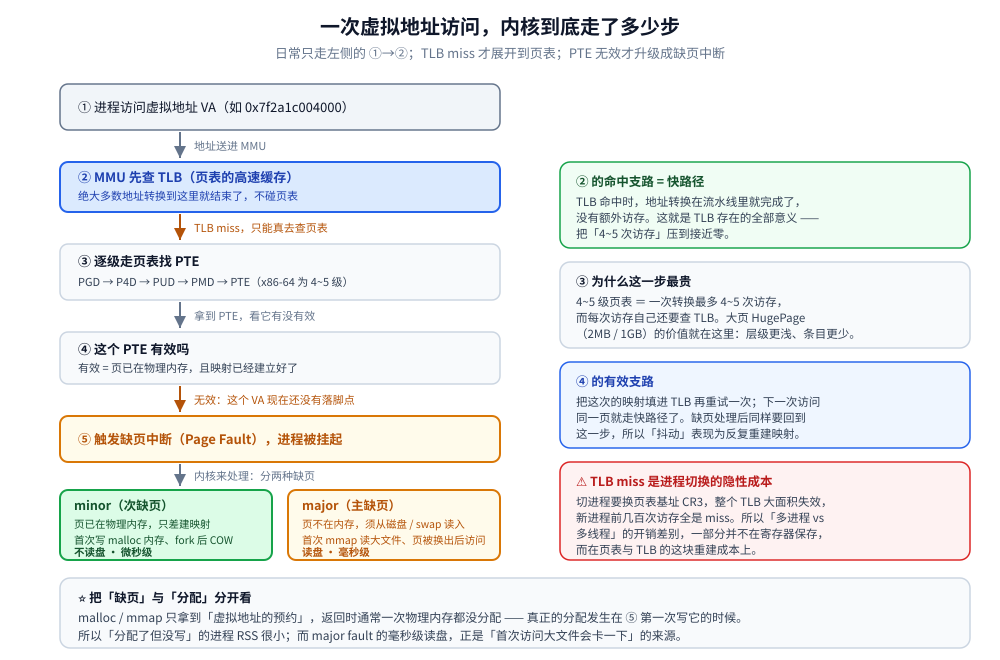
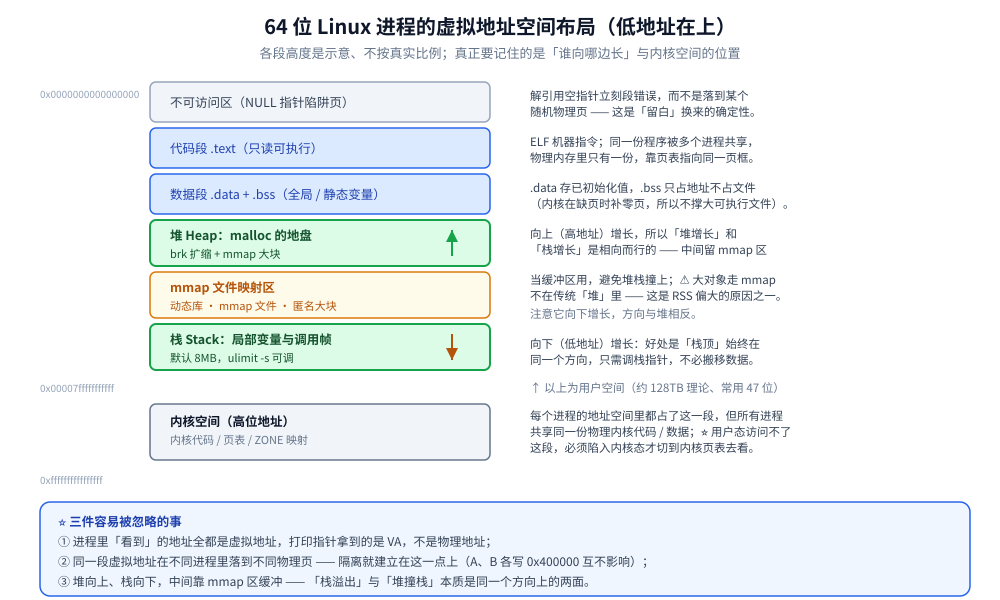
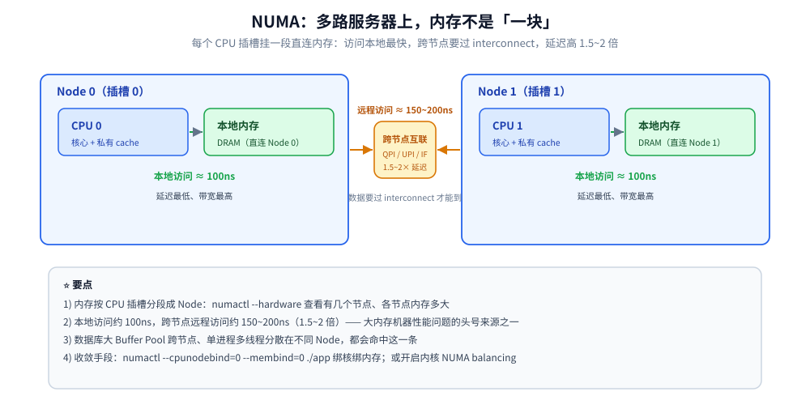

# 虚拟内存与页缓存

> 覆盖：两个程序都从 `0x400000` 开始为什么互不干扰（MMU 与页表）、TLB 与多级页表的账、缺页中断与「物理页第一次写才给」（含 overcommit 三档）、地址空间布局、`mmap` 与共享内存、内核自己的分配器（伙伴系统 + Slab）与两种碎片、NUMA 与 swap；以及后半部分——为什么 `free` 显示「几乎用完」是好事、Page Cache 与回收的三个水位与两条 LRU、脏页回写的两个水位。
>
> 不覆盖：Go 用户态分配器（mheap / mcentral / mcache）见 [内存分配器.md](../../01-编程语言/go/运行时/内存分配器.md)；`MemStats` 与 RSS 的口径差见 [trace与运行时指标.md](../../01-编程语言/go/运行时/trace与运行时指标.md)；JVM 堆内 / 堆外见 [堆外内存与内存映射.md](../../01-编程语言/java/运行时/堆外内存与内存映射.md)；文件系统结构见 [文件系统与VFS.md](../linux/文件系统与VFS.md)；一次 `write` 到落盘见 [落盘路径与fsync代价.md](../linux/落盘路径与fsync代价.md)；内存类指标怎么读见 [性能排查.md](../linux/性能排查.md) 第四节。
>
> 内容整理自个人学习笔记，素材见 [素材清单](../../素材清单.md)。本篇的机器读数**只有一处，是引用**：`dTLB-load-misses` 跨线程 8.5% / 跨进程 9.6%，出自 [调度与时间片.md](调度与时间片.md) 4.3 的同一轮实测（本机 WSL2）。**其余结论都是内核语义**（页表层级、水位、水位触发条件），不需要测也不该编读数；凡是需要「量」的部分都指向被引用的篇目。

---

## 一、两个程序都从 `0x400000` 开始，为什么互不干扰？

**本节要点**：因为 CPU 发出的地址**不是物理地址**。进程手里的每个地址都要先经过 **MMU + 页表**翻译成物理地址，而**每个进程有自己的一张表**——所以同一个 `0x400000` 在两个进程里指向两块不同的物理页。这一节从这句话往下推：翻译一次要读几次内存（多级页表）、怎么把这笔开销压掉（TLB 与大页）、物理页什么时候才真的给（缺页与超售）。

### 1.1 起点：CPU 发出的地址是谁给的

一个程序里写 `int *p = &x;`，`p` 的值是**编译期决定的**（链接器按固定基址排布）。所以两个程序完全可以都从 `0x400000` 开始——**它们在编译时并不知道别人也用了这个地址**。

如果 CPU 直接把这个值当地址发到内存总线上，两者必然撞车。所以中间必须有一层翻译：

```text
进程 A: 0x400000 ──┐
                   ├─ MMU 查「当前页表」→ 物理地址
进程 B: 0x400000 ──┘   （A 的表与 B 的表是两张不同的表）
```

⭐ 判据：**进程里看到的所有地址都是虚拟地址（VA）**。`printf("%p", p)` 打出来的是 VA；同一块内存在两个进程里可以有**不同的 VA**，同一个 VA 在两个进程里是**不同的物理页**。

### 1.2 一次地址翻译要额外读几次内存

页表不是一张平表，是**多级索引**（x86-64 用 4~5 级：PGD → P4D → PUD → PMD → PTE）。一次翻译就是「一级一级查下去」：

| 级 | 拿地址的哪几位 | 查到什么 |
|---|---|---|
| PGD | 高 9 位 | 下一级表的物理地址 |
| PUD | 次 9 位 | 同上 |
| PMD | 再 9 位 | 同上 |
| PTE | 再 9 位 | ⭐ **最终的物理页框号 + 权限位** |
| 页内偏移 | 低 12 位 | 页内位置（4 KB 页 → 12 位） |

⚠️ 这意味着**一次访存最坏要变成 5 次访存**（4 次查表 + 1 次取数据）。如果每级表都不在缓存里，程序会慢到不可用。

为什么还要多级？因为**省空间**：48 位地址空间如果平铺成一张表，光页表就要几 TB；多级表让「没用到的那片地址」**根本不建表**，稀疏地址空间才装得下。

### 1.3 TLB：把 4 次压成 0 次

**TLB 是页表项的高速缓存**（通常几十到几百项），命中就跳过全部查表：

| 情况 | 代价 |
|---|---|
| TLB 命中 | 一次翻译 = 0 次额外访存（硬件并行查） |
| TLB 未命中 | 走完 4 级页表（可能 4 次访存），并把结果填回 TLB |

⭐ 所以「程序有局部性」这件事在地址翻译上也成立：**连续访问同一页、或相邻几页，TLB 命中率极高**；随机跨大片内存（指针追逐、大哈希表探测）就会把 TLB 打穿，这时的瓶颈不是带宽而是**翻译延迟**（详见 [内存带宽与访存并行度.md](../计算机底层原理/缓存与内存/内存带宽与访存并行度.md)）。

⚠️ **「切进程就整表刷 TLB」这条老说法在本机不成立**：实测 `dTLB-load-misses` 占比跨进程 9.6% vs 跨线程 8.5%，只差 **1.1 个百分点**——现代 CPU 的 **PCID** 让 TLB 项带着地址空间标签存活，换 CR3 只是换标签。这条读数与进程切换的 11% 单价是同一件事的两面（见 [进程与线程模型.md](进程与线程模型.md) 1.7）。

⭐ **大页（HugePage）的价值就是减少 TLB 条目数**：一个 2 MB 大页顶 512 个 4 KB 页，同样大小的 TLB 能覆盖 512 倍的地址范围。这一条不受 PCID 影响。

| | **显式大页（hugetlbfs）** | **透明大页（THP）** |
|---|---|---|
| 配置 | 启动时 `hugepages=N` 预留，或运行时写 `/proc/sys/vm/nr_hugepages` | 内核自动决定，`/sys/kernel/mm/transparent_hugepage/enabled` 默认 `always` |
| 页大小 | 2 MB / 1 GB | 2 MB |
| 谁在用 | **数据库显式要**（Oracle、MySQL 8.0+ 的 `large_pages`） | 大部分应用**无意中**用上 |
| 优点 | 确定性强、地址翻译层级更浅 | 免配置、自动生效 |
| ⚠️ 代价 | 预留后别人用不了，容易浪费 | `khugepaged` 后台扫描 / 合并造成抖动；分配大页还可能触发内存规整 |

⭐ 判据：**数据库 / 延迟敏感服务 → 关 THP、按需显式开大页；通用服务 → 保留默认 THP**。

### 1.4 物理页什么时候才真的给：缺页与超售

页表项建好了，不代表物理页已经在了。**第一次访问一个「页表项无效」的地址 → CPU 触发缺页异常 → 内核介入**：

| 类型 | 触发原因 | 要不要读盘 | 代价 |
|---|---|---|---|
| ⭐ **minor fault**（次缺页） | 页**已在物理内存**，只是没建映射：首次写 `malloc` 的内存、`fork` 后写共享页（COW） | ❌ | 微秒级 |
| ⭐ **major fault**（主缺页） | 页**不在物理内存**，要从磁盘 / swap / 文件读入：首次 `mmap` 读大文件、匿名页被换出后再访问 | ✅ | 毫秒级 |



图注：TLB 命中是最短路径，miss 之后才走多级页表；只有页表项无效才会触发缺页——minor fault 只建映射（页已在内存），major fault 才真的要读盘，两者差三个数量级。图中右侧那条「返回重试」的箭头是必要的：缺页处理完要重新执行刚才那条指令，所以缺页次数直接反映在程序的访存行为里。

**「延迟分配」是这一切的前提**：`malloc` / `mmap` 只预约**虚拟地址**，物理页等到第一次**写**才分配（读共享库的只读页则按需从文件映射）。这就引出超售，而超售有开关：

| `vm.overcommit_memory` | 行为 | 适用 |
|---|---|---|
| **0**（默认，启发式） | 按启发式估算，拒绝「明显过分」的申请，其余放行 | 通用服务器 |
| **1**（总是允许） | 从不拒绝 `malloc`，直到真正写时才分配 | 依赖「写了才 OOM」的场景；⚠️ 容易触发 OOM Killer |
| **2**（严格检查） | 按 `CommitLimit`（≈ swap + 物理内存 × `overcommit_ratio`）限制已承诺总量 | 需要「申请时就失败」的场景 |

⭐ 三条判据：

- **模式 0 / 1 下，`malloc` 返回成功不代表物理内存够用**——真正的失败点在首次写入（内核发 `SIGKILL`），不是 `malloc` 那一刻。这解释了「分配 8 GB 成功、写一半被杀」。
- **`fork` 的成本与超售模式绑定**：`fork` 后虚拟内存瞬时翻倍，模式 2 下可能直接被拒；模式 0 / 1 下靠 **COW** 延迟复制，真正膨胀的只是「被写过的那部分」。
- **Redis 的经典教训**：模式 1 下 `fork` 做 RDB 快照，一旦大量写触发 COW，物理内存显著膨胀 → OOM Killer 可能杀掉主进程。所以 Redis 生产建议 `vm.overcommit_memory=1`（避免 `fork` 被拒），⚠️ 但同时必须留够余量。

### 1.5 地址空间长什么样

64 位 Linux 用户进程，**低地址 → 高地址**：

```text
0x0000000000000000
  ├─ 不可访问区（NULL 指针陷阱页）
  ├─ 代码段 text        ELF 机器指令，只读可执行
  ├─ 数据段 data + BSS  已初始化 / 未初始化的全局静态变量
  ├─ 堆 Heap       ─── 向上增长（brk / mmap），malloc 的地盘
  ├─ 文件映射区 mmap ── 向下增长：动态库、mmap 文件、匿名大块内存
  ├─ 栈 Stack      ─── 向下增长：局部变量、调用帧（默认 8MB，ulimit -s）
0x00007fffffffffff ──（其下为环境变量 / argv；再往上是非规范地址空洞）
0xffff800000000000 ── 内核空间：内核代码 / 页表 / 各 ZONE 的映射
0xffffffffffffffff     ⭐ 用户态不可见，访问即段错误
```

- **堆与栈相向生长**，中间的 mmap 区是缓冲区，避免两者撞上。
- ⭐ **内核空间在每个进程的地址空间里都占一份高位地址**，但所有进程共享同一份物理内核代码；只有陷入内核态才能访问。
- ⭐ **大对象走 `mmap` 不在传统「堆」里**——这是「RSS 比 HeapAlloc 大很多」的结构性原因之一。



图注：堆与文件映射区相向生长、栈向下增长，三者之间的空隙就是「大对象走 `mmap` 不进传统堆」的原因；高地址那一段内核空间每个进程都占，但共享同一份物理内核代码。要读出的关键是：**这张图上的一切都是虚拟地址**，每段的物理落点由页表决定、可以完全不连续。

### 1.6 `mmap`：把文件或匿名内存接进地址空间

`mmap` 把**一个文件**或**一段匿名内存**直接映射进进程地址空间，之后读写就像操作普通内存，省掉 `read` / `write` 的那次用户态拷贝。

| 标志 | 语义 | 关键差异 |
|---|---|---|
| **`MAP_SHARED`** | 修改写回文件，或与映射同一文件的其他进程共享 | 多进程共享、会落盘 |
| **`MAP_PRIVATE`** | 修改触发 **COW**，不写回 | 只读共享文件、写时私有副本 |
| **匿名 mmap**（`MAP_ANONYMOUS`） | 不映射文件，映射一段 0 填充的内存 | `malloc` 的大块、Go 的 arena / span 走这条 |

| 场景 | 收益 | ⚠️ 代价 |
|---|---|---|
| 大文件随机读写 | 省掉一次用户态拷贝，按需缺页加载 | 缺页开销、脏页回写时机不可控 |
| 多进程共享内存 | 天然共享，不需要显式 IPC 拷贝 | 必须配 `MAP_SHARED` |
| 零拷贝发送 | 数据不落用户态 | 见 [零拷贝.md](零拷贝.md) |

⭐ **与 RSS 的关系**：mmap 的页在**被访问时**才通过缺页分配物理页，并**直接计入 RSS**——这就是「Go 进程 RSS 远大于 `HeapAlloc`」「Java `MappedByteBuffer` 占很大内存」的物理原因。

⭐ **进程间共享内存的三条路**：

- **`shmget` / `shmat`**（System V IPC）：老派，`IPC_RMID` 标记删除后仍被打开方持有；
- **`shm_open` + `mmap`**（POSIX）：更现代，落在 `/dev/shm`，用 fd 语义；
- **`memfd_create`**（Linux 3.17+）：匿名的内存文件描述符，不需要文件系统路径，容器里「内存文件」的常用形态。

Go / Java 的共享内存库大多走 `memfd` 或 `shm_open`。

### 1.7 内核自己的分配：伙伴系统 + Slab

进程要内存找内核，**内核自己也要内存**（`task_struct`、`inode`、`dentry`、页表本身），它用两套分配器：

| 层次 | 解决什么 | 机制 |
|---|---|---|
| ⭐ **伙伴系统 Buddy** | **外部碎片**：空闲总量够，但没有足够大的**连续**块 | 以 **2^order 个连续页**为单位管理（order 0~10，即 1~1024 页）；找不到合适的就**把大块对半分裂**，释放时若「伙伴」也空闲就**合并回大块** |
| ⭐ **Slab / Slub** | **内部碎片 + 小对象效率**：`task_struct`、`inode`、`dentry` 这类几十~几百字节的对象，给一整页太浪费 | 从伙伴系统批发若干页，切成**同规格的对象缓存池**；释放后**不清零、不归还**，留池里复用 |

⭐ 一句话：**Buddy 管「批发整页」（页级、消外部碎片），Slab 管「零售小件」（字节级、消内部碎片）**。

⭐ **碎片严重时的兜底：内存规整（compaction）**。伙伴系统只能合并**相邻**空闲块；当碎片严重到连一个 2 MB 大页都分不出来时，内核用 **compaction** 把**可移动页**迁走、把空闲块挤到一起再分配。⚠️ **透明大页的分配就依赖它**（这也是 THP 有时引发延迟抖动的一环）。观察：`cat /proc/buddyinfo` 看各 order 的空闲块数量——**高阶 order 全是 0，说明碎片已经很严重**。

### 1.8 NUMA：多路服务器上，内存不是「一块」

**NUMA（Non-Uniform Memory Access）**：多插槽服务器上，每个 CPU 插槽挂一段**直连的本地内存**；访问本地内存快（约 100 ns），访问其他插槽的内存要跨 interconnect，慢 1.5~2 倍。

| 概念 | 说明 |
|---|---|
| **Node（节点）** | 一个 CPU + 它直连的内存，`numactl --hardware` 查看 |
| **本地 / 远程访问** | 本地延迟低；远程延迟高 1.5~2 倍 |
| **NUMA balancing** | 内核自动把页迁到「正在使用它的 CPU」所在节点 |
| **绑核 / 绑内存** | `numactl --cpunodebind=0 --membind=0 ./app` 把进程钉在节点 0 |

⭐ 为什么服务端要注意：**数据库**的大 Buffer Pool 被跨节点访问时带宽与延迟同时变差；**高并发服务**的多个线程分散在不同 Node 上，访存延迟不一致；排查用 `numastat` / `numactl --hardware`，优化用绑核绑内存或开 NUMA balancing。



图注：多路服务器里内存按节点分段，CPU 访问本地节点最快；跨节点的远程访问要过 interconnect，延迟高 1.5~2 倍——这是大内存机器性能问题的头号来源之一。要读出的是：**同一台机器上「内存」不是均质的**，所以「加内存」不一定变快，绑错节点反而更慢。

### 1.9 swap

swap 是**磁盘上的一块空间**（分区或文件），作物理内存的溢出区：内存紧张时把不活跃的匿名页换出。

| 项 | 说明 |
|---|---|
| 作用 | ① 让「总用量 > 物理内存」成为可能；② 把长期不用的匿名页挪走，给 Page Cache 和活跃数据腾地方 |
| ⚠️ **swappiness** | `vm.swappiness`（0~100）：回收时**更倾向回收匿名页还是页缓存**。默认 60；设 **1** = 尽量不 swap、优先回收页缓存 |
| 谁能被换出 | 只有**匿名页**（堆、栈等无文件背景的页）；有文件背景的页直接丢弃 / 回写即可，不需要 swap |

⚠️ **swap 打开的代价**：磁盘比内存慢 **3~4 个数量级**，热点页一旦被换出，延迟数量级恶化，且表现为**周期性抖动、极难定位**；换入换出还占 IO，容易雪崩，故**数据库、延迟敏感服务通常设 `swappiness=1` 或直接 `swapoff`**。⚠️ 但**完全关掉 swap**，内存打满时会直接触发 OOM Killer 杀进程——留一点 swap 相当于给运维留缓冲时间。

## 二、`free` 显示「快用完」了，为什么系统不卡？

**本节要点**：因为 `free` 统计的是「一点没被用的内存」，而 Linux 的哲学是**空闲内存一律拿去做页缓存**。判断内存够不够只看两个量：⭐ **`available`** 与 **swap 是否持续增长**。回收由 **kswapd 异步**做，压到 `min` 水位就转成**直接回收（同步阻塞）**，再不够才 OOM。

### 2.1 Page Cache 与 Buffer Cache 的关系

| | **Page Cache（页缓存）** | **Buffer Cache（块缓冲）** |
|---|---|---|
| 缓存对象 | **文件内容**，以**页（4 KB）**为单位；普通文件的 `read` / `write` | **块设备的裸块**，以**块**为单位；读写裸设备与**文件系统元数据** |
| 关系 | ⚠️ **现代 Linux（2.4+）二者已统一**，它是统合后的主体 | 已并入 Page Cache（一页切成若干 `buffer_head`），`free` 里合称 `buff/cache` |

⭐ Page Cache 的另一个关键用途是「**让数据不落用户态**」：`sendfile` / `splice` 这些零拷贝路径，本质就是让数据在**页缓存与 socket 缓冲区**之间直接搬运。路径与失效边界见 [零拷贝.md](零拷贝.md)。

### 2.2 为什么 `free` 小是好事

| 字段 | 含义 |
|---|---|
| `total` / `used` | 物理内存总量 / 已用量 |
| `free` | ⚠️ **完全空闲、一点没用**的内存，所以它当然很小 |
| ⭐ `buff/cache` | 页缓存 + 块缓存，⚠️ **可回收，不算真正被占用** |
| ⭐ `available` | **真正该看的指标**：≈ free + 大部分可回收缓存 |

```bash
$ free -h
              total        used        free      shared  buff/cache   available
Mem:           15Gi        11Gi       0.5Gi       1.0Gi       4.0Gi        3.4Gi
                            ↑ 别看 free      ↑ 可回收      ↑ 看这个
```

**原理**：内存不用也是浪费。`free` 小、`buff/cache` 大 = **系统把闲置资源用起来了**。⚠️ 判断内存是否吃紧，**只看 `available` 和 swap 是否增长**。

### 2.3 回收：kswapd、直接回收与两条 LRU

| 机制 | 触发时机 | 特点 |
|---|---|---|
| ⭐ **kswapd（后台回收）** | 空闲页低于 **low 水位**时被唤醒，回收到 **high 水位**止 | **异步、不阻塞业务**；健康系统应只看到它工作 |
| ⭐ **直接回收 direct reclaim** | 分配时空闲页低于 **min 水位**，来不及等 kswapd | **同步阻塞**，当前进程自己回收，⚠️ 表现为**请求延迟尖刺** |
| **OOM Killer** | 直接回收也拿不到页 | 按 `oom_score` 挑一个进程杀掉 |

三个水位（`min` / `low` / `high`，见 `/proc/zoneinfo`）就是这套机制的门槛。可回收页挂在**活跃 / 非活跃**两条 LRU 上，**只从 inactive 尾部回收**：`新页 → inactive 头 →（再被访问）→ active →（久未访问降级）→ inactive 尾 → 回收`。

| 页类型 | 可回收 | 回收方式 |
|---|---|---|
| 干净文件页（未修改） | ✅ | **直接丢弃**，下次读盘即可 ⭐ 优先选它：代价最低 |
| 脏文件页（写了没回写） | ✅ | 先 **writeback 回写**再丢弃 |
| 匿名页（堆 / 栈） | ✅（有 swap） | 写入 swap 后释放 |
| 内核 slab / 页表 / 内核栈 / `mlock` / hugetlb | ❌ | — |

⭐ **脏页回写的两个水位**（决定 `write` 什么时候被迫同步等磁盘）：

| 参数 | 默认 | 触发什么 |
|---|---|---|
| `vm.dirty_background_ratio` | 10% | 超过 → 后台 `writeback` 线程开始刷脏页（**异步**） |
| `vm.dirty_ratio` | 20% | 超过 → **发起 `write` 的进程被迫同步刷脏页**，`write` 直接变慢 |

⚠️ 「日志突然变慢」的经典场景就在这里：**写入速率超过回写速率**，脏页比例击穿 `dirty_ratio` 后，`write` 从「写进页缓存即返回」退化成**同步等磁盘**，表现为周期性写入延迟尖刺（落盘链路与 `fsync` 的实测账见 [落盘路径与fsync代价.md](../linux/落盘路径与fsync代价.md)）。

### 2.4 四条判据：分清「缓存占用」与「真紧张」

| 观察项 | 判读 |
|---|---|
| `available` 是否还很大 | 是 → 完全正常，缓存随时可让出 |
| swap 是否**持续增长** | 是 → 真的在往外换，内存确实紧张 |
| `vmstat 1` 的 `si/so` | 长期**非 0** → 正在换入换出，⚠️ 有问题 |
| 单进程 RSS 是否**单调上涨不回落** | ⭐ 这才是泄漏的判据——**看进程，不看全局** |

⚠️ **「cached 很大」不等于内存泄漏**。全局 `cached` 大是特性；只有**单进程 RSS 单调涨、GC 后不降**才是泄漏。

## 三、应用场景

**本节要点**：内核这一层的机制，最终都落在「某个系统为什么这样配、这样慢」上——数据库调 `O_DIRECT`、缓存系统赌 Page Cache、容器被 cgroup 杀掉，根子都在下面这张表里。

| 场景 | 用到内核内存的哪一块 | 为什么值得注意 |
|---|---|---|
| 数据库（InnoDB） | 自建 Buffer Pool + `O_DIRECT` 绕开 Page Cache | 两套缓存叠加会造成「双缓存」，刷盘方式与 `swappiness` 要一起调，见 [参数调优.md](../../03-数据与中间件/数据存储/关系型/MySQL/参数调优.md) 与 [日志与持久化.md](../../03-数据与中间件/数据存储/关系型/MySQL/日志与持久化.md) |
| 缓存中间件（Redis） | RSS 与 `fork` 的 COW 行为 | `fork` 后写触发 COW、页表复制都会推高 RSS，见 [缓存淘汰算法.md](../../03-数据与中间件/数据存储/缓存/缓存淘汰算法.md) |
| 搜索引擎（ES） | 段文件走 Page Cache 加速检索 | 检索快慢常取决于操作系统缓存而不是 JVM 堆，见 [写入流程.md](../../03-数据与中间件/数据存储/搜索与分析/Elasticsearch/写入流程.md) |
| 消息队列（Kafka） | 顺序写 + 页缓存 | 生产路径不落用户态、消费走 `sendfile`，见 [核心概念与架构.md](../../03-数据与中间件/中间件/消息队列/Kafka/核心概念与架构.md) |
| 容器 / K8s | cgroup `memory.max` 触发容器内 OOM | 「宿主机还剩几十 GB、容器却被杀」就是这一条，见 [资源限制与运维.md](../../06-工程实践/部署/docker/资源限制与运维.md) |
| 运行时（Go / JVM） | RSS 与「堆指标」的口径差 | 两份指标对不上时先分清口径再谈泄漏，见 [trace与运行时指标.md](../../01-编程语言/go/运行时/trace与运行时指标.md) 与 [堆外内存与内存映射.md](../../01-编程语言/java/运行时/堆外内存与内存映射.md) |
| 大内存机器（多路 CPU） | NUMA：内存按插槽分段 | 跨节点延迟高 1.5~2 倍，大 Buffer Pool 与单进程多线程最吃亏 |
| 数据库 / 延迟敏感服务 | 显式大页 vs 透明大页 | 大页减少 TLB 条目、延迟更稳；⚠️ 这类服务常关 THP |
| 服务上线前的容量规划 | swap 与 `swappiness` 的取舍 | 关掉 swap 是把「变慢」换成「被杀」，见 [01-安装与磁盘分区.md](../linux/鸟哥基础学习篇/01-安装与磁盘分区.md) |

## 四、具体使用

**本节要点**：机制落到操作上只有两件事——**在容器里读对自己的限额**（别信 `free`），以及**把三个水位与两个回写比调对**。完整命令表在 [常用命令.md](../linux/常用命令.md) 第十节与第十一节，这里只留口径与判据。

### 4.1 容器里读到的内存是「谁的」

⚠️ **容器里 `free` 看到的是宿主机内存**——`free` / `/proc/meminfo` 不做 cgroup 感知。判断自身用量要直接读 cgroup 文件：

```bash
cat /sys/fs/cgroup/memory.max       # cgroup v2：本容器上限
cat /sys/fs/cgroup/memory.current   # cgroup v2：当前用量
cat /sys/fs/cgroup/memory.peak      # 历史峰值（判断有没有贴着 limit 跑）
grep -i oom /sys/fs/cgroup/memory.events   # oom 计数是否非 0
cat /sys/fs/cgroup/memory.stat      # anon / file / slab 的分项
```

| 坑 | 说明 |
|---|---|
| ⚠️ **容器被杀往往是超过自己的 limit** | cgroup 的 `memory.max` 一旦触及，**该容器内进程被 OOM Killer 选中**，即使宿主机还有几十 GB。表现：`exit code 137`、`dmesg` 里 `Memory cgroup out of memory` |
| ⚠️ **`free` 不感知 cgroup** | v1 读 `memory.limit_in_bytes` / `memory.usage_in_bytes`；v2 读 `memory.max` / `memory.current` |
| **Go / JVM 旧版本不感知 cgroup** | Go < 1.19 的 `GOMAXPROCS` 与 GC 目标按宿主机算；JDK 8u191+ / 11+ 才默认开 `UseContainerSupport`。⭐ **`GOMEMLIMIT`（Go 1.19+）** 是软限制，接近时 GC 更激进，**主动避免被 cgroup 杀**，建议设为 limit 的 80%~90% |

⭐ 判据：**「容器 OOM 了但宿主机很闲」永远是先看 cgroup 自己的账**，不要去看 `free`；`memory.peak` 贴着 `memory.max` 就是证据。

### 4.2 三个水位与两个回写比

```bash
grep -E 'min|low|high' /proc/zoneinfo | head -9   # ⭐ 三个水位（每个 zone 一组）
grep -E '^Dirty|^Writeback' /proc/meminfo        # 当前脏页 / 正在回写的量
cat /proc/buddyinfo                              # 各 order 空闲块；高阶全 0 = 碎片严重
```

| 要调的 | 调它的判据 |
|---|---|
| `vm.dirty_ratio` / `dirty_background_ratio` | 出现「周期性写入尖刺」；调低能缓解，代价是回写更频繁 |
| `vm.swappiness` | 想尽量不 swap 又不想 `swapoff` 时设 1（⚠️ 不等于关闭） |
| `transparent_hugepage` | 延迟敏感服务出现不明抖动、且 `khugepaged` 活跃 |
| `vm.overcommit_memory` | Redis `fork` 被拒；⚠️ 设 1 后必须留够余量 |

> 具体命令与参数一句话解释见 [常用命令.md](../linux/常用命令.md) 第十一节；`sysctl` 改完要确认是否持久化（`/etc/sysctl.d/`）。

---

## 延伸追问

- **虚拟内存有什么用？** → 隔离（每进程独立地址空间，同一个 VA 落到不同物理页）、简化链接与加载（都从固定地址开始）、**超售 + 延迟分配**（`malloc` 不立刻拿物理页）、支持内存映射与共享内存（见 1.1）。
- ⭐ **既然能超售，内核什么时候决定不再给？** → 由 `vm.overcommit_memory` 决定：0 启发式、1 总是允许、2 严格按 `CommitLimit`。模式 0 / 1 下 `malloc` 成功**不代表**内存够，真正的失败点在首次写入（见 1.4）。
- **页表与 TLB 是什么？为什么需要 TLB？** → 页表是 VA→PA 的多级映射（x86-64 4~5 级），一次翻译最坏 4 次额外访存；TLB 是页表项的高速缓存，命中则一次完成。⭐ TLB miss 是进程切换的一项成本，但**实测只差 1.1 个百分点**（PCID），不是主因（见 1.3）。
- **大页该不该开？** → 分显式大页（数据库显式要、确定性强但会浪费）与透明大页 THP（默认开但有 `khugepaged` 抖动）。数据库 / 延迟敏感服务 → 关 THP、按需显式开（见 1.3）。
- **缺页有哪两种？** → **minor fault**：页已在物理内存、只是没建映射（首次写 `malloc` 内存、COW），不读盘；**major fault**：页不在内存，须从磁盘 / swap 读入，代价差三个数量级（见 1.4）。
- **为什么申请了内存却没被真正占用？** → 延迟分配：`malloc` / `mmap` 只拿到虚拟地址，首次**写**才触发 minor fault 分配物理页。所以「VIRT 很大、RSS 很小」是正常的（见 1.4）。
- **伙伴系统和 Slab 分别解决什么问题？** → 伙伴系统按 2^order 连续页管理、分裂与合并，消**外部碎片**；Slab 把页切成同规格对象池，消**内部碎片**并加速小对象分配（见 1.7）。
- **碎片严重到连大页都分不出来怎么办？** → **内存规整（compaction）**把可移动页迁走、把空闲块挤到一起；THP 的分配就依赖它。`cat /proc/buddyinfo` 看高阶 order 是否全 0（见 1.7）。
- ⭐ **NUMA 对服务有什么影响？** → 多路机器上内存按节点分段，跨节点访问延迟高 1.5~2 倍；数据库大 Buffer Pool、单进程多线程分散在不同 Node 最吃亏。排查 `numactl --hardware` / `numastat`，优化用绑核绑内存或 NUMA balancing（见 1.8）。
- **`swappiness=0` 就完全不 swap 了吗？** → 不完全是。0 只是**尽量**避免换出匿名页，极度紧张时仍可能换；要彻底不换得 `swapoff`，代价是内存打满直接 OOM（见 1.9）。
- ⭐ **buffer 和 cache 有什么区别？** → 历史上 Cache 缓存文件内容、Buffer 缓存块设备裸块；现代 Linux 两者已统一到 Page Cache，`free` 里的 `buff` 主要是块设备元数据缓存（见 2.1）。
- ⭐ **`free` 显示内存用完了但系统不卡？** → 空闲内存被拿去做 Page Cache 了，⚠️ 这部分随时可回收。看 `available` 而非 `free`；只有 `available` 很小、swap 持续增长、`si/so` 长期非 0 才是真紧张（见 2.2、2.4）。
- **`write` 什么时候会被迫同步等磁盘？** → 脏页比例超过 `vm.dirty_ratio`（默认 20%）时，发起 `write` 的进程被迫同步回写；写入速率超过回写速率就会击穿它，表现为「日志突然变慢」（见 2.3）。
- **容器里 OOM 了，但宿主机还剩很多内存？** → 踩的是自己的 cgroup `memory.max`（`exit code 137`）。读 `memory.max` / `memory.current` / `memory.peak`，别读 `free`（见 4.1）。

## 关联

- **上游/总纲**：[落盘路径与fsync代价.md](../linux/落盘路径与fsync代价.md) — Page Cache 的另一半：写下去以后怎么落盘、`fsync` 多贵
- **上游/总纲**：[文件系统与VFS.md](../linux/文件系统与VFS.md) — inode / dentry 与文件内容在内存里的组织
- **对照/互补**：[进程与线程模型.md](进程与线程模型.md) — 地址空间与上下文切换（那 11% 的成本在这里）
- **对照/互补**：[零拷贝.md](零拷贝.md) — Page Cache 直接作为搬运源（`sendfile` / `splice` 跳过用户态）
- **对照/互补**：[内存带宽与访存并行度.md](../计算机底层原理/缓存与内存/内存带宽与访存并行度.md) — TLB miss 与带宽、延迟三者的关系
- **对照/互补**：[寄存器与栈.md](../计算机底层原理/缓存与内存/寄存器与栈.md) — 栈的物理落点与增长（缺页最频繁的地方）
- **对照/互补**：[trace与运行时指标.md](../../01-编程语言/go/运行时/trace与运行时指标.md) — Go 侧 `MemStats` 与 RSS 的三层口径
- **对照/互补**：[堆外内存与内存映射.md](../../01-编程语言/java/运行时/堆外内存与内存映射.md) — JVM 侧：堆外内存与「RSS > Xmx」
- **对照/互补**：[资源限制与运维.md](../../06-工程实践/部署/docker/资源限制与运维.md) — cgroup 内存限制与容器内 `free` 的坑
- **运维/排查**：[性能排查.md](../linux/性能排查.md) — 内存类指标的判据（`available` / `si-so` / OOM）
> 反向引用（本篇被下列文档引到）：[内存分配器.md](../../01-编程语言/go/运行时/内存分配器.md)、[内存逃逸.md](../../01-编程语言/go/运行时/内存逃逸.md)、[01-编译安装与配置.md](../linux/深入理解Nginx/01-编译安装与配置.md)、[05-内存管理与数据结构.md](../linux/深入理解Nginx/05-内存管理与数据结构.md)、[02-文件系统与XFS.md](../linux/鸟哥基础学习篇/02-文件系统与XFS.md)、[07-日志与journalctl.md](../linux/鸟哥基础学习篇/07-日志与journalctl.md)、[10-系统管理综合.md](../linux/鸟哥基础学习篇/10-系统管理综合.md)、[用户态内核态与一次IO的内存路径.md](用户态内核态与一次IO的内存路径.md)、[参数调优.md](../../03-数据与中间件/数据存储/关系型/MySQL/参数调优.md)、[写入流程.md](../../03-数据与中间件/数据存储/搜索与分析/Elasticsearch/写入流程.md)、[缓存淘汰算法.md](../../03-数据与中间件/数据存储/缓存/缓存淘汰算法.md)
