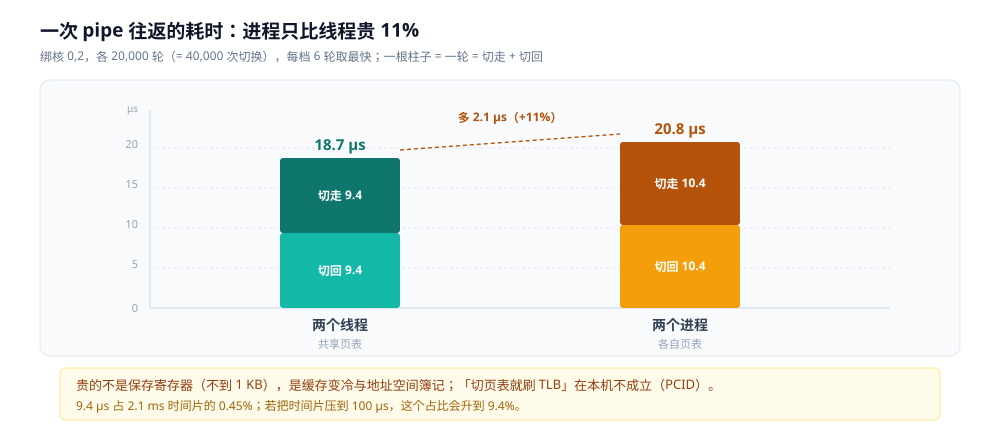
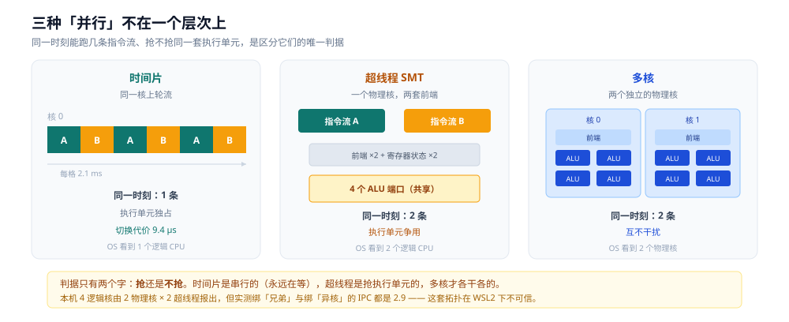
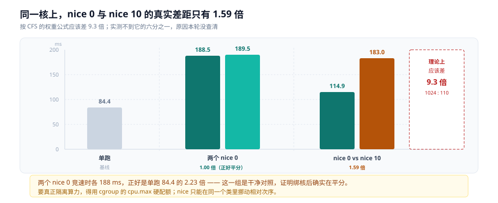

# 调度与时间片

> 覆盖：单核上为什么必须切、时间片到底多长（本机实测 **2.1 ms**）、线程数翻倍后每个线程还能拿多少 CPU、
> 抢占靠什么打断用户态、一次上下文切换的真实单价（**9.4 µs / 10.4 µs**）、
> 「切页表就刷 TLB」这个说法在本机为什么不成立、多核与超线程与时间片的三层区别。
> 
> 不覆盖：进程状态与 PCB 见 [进程与线程.md](../linux/进程与线程.md)；页表与 TLB 机制见 [内存管理.md](../linux/内存管理.md)；
> 时钟中断、软中断与 `ksoftirqd` 见 [中断机制.md](中断机制.md)；现场怎么数切换次数见 [性能排查.md](../linux/性能排查.md) 第三节。
>
> 内容整理自个人学习笔记。**口径**：本篇读数全部为本机新跑（`perf-lab` 容器，gcc 12.2 / perf 6.1 / 4 逻辑核），
> 每档多轮取最快一轮。⚠️ **未实测**：内核时钟节拍 `CONFIG_HZ`（无 `/boot/config-*`）、
> 超线程的执行单元争用（本机拓扑不可信，见 5.2）、`cgroup` CPU 配额下的时间片行为。

---

## 一、单核上，为什么必须有调度？

**本节要点**：物理上一个核在同一时刻只能走一条指令流。所谓「同时跑一百个进程」，是把时间切成极短的片、轮流喂给它们造成的假象 —— 调度器的工作就是**决定下一个片子给谁**。

### 1.1 一个核，一条指令流

流水线再宽，也只是「同一时刻有若干条指令在飞」，它们**来自同一条程序**。真正的并行要求两个独立的指令流各自推进，那必须有第二个核（第五节）。

于是就有了一个绕不开的约束：

```text
4 个逻辑核，200 个进程要跑
→ 平均每个进程拿到 2% 的 CPU
→ 谁先跑、跑多久、什么时候换人，必须有人决定
```

这个「有人」就是调度器。它要回答的问题只有三个：**下一个选谁**（调度策略）、**让它跑多久**（时间片）、**什么时候把它换下来**（抢占时机）。

### 1.2 假象是怎么维持的：切得足够快

人眼与人类的操作节奏是毫秒到百毫秒级。只要每个进程在一秒内被喂上几十次，从用户角度看它就「一直在跑」。

这不只是体感问题，还有硬指标：**交互式程序的响应延迟必须压在人能察觉的阈值以下**。所以时间片不能太长 —— 一个进程占着 CPU 20 ms 不动，同优先级的下一个进程就要等 20 ms 才能响应用户按键。

⭐ 这一节建立的是坐标系：**下面所有数字（2.1 ms 的时间片、9.4 µs 的切换）都在「毫秒切分」这个尺度上**。到了 [CPU流水线与乱序执行.md](../计算机底层原理/微架构/CPU流水线与乱序执行.md) 里那些「纳秒级」的讨论，尺度小了六个数量级，两者不能混着算。

---

## 二、时间片到底有多长？

**本节要点**：本机内核给每个任务的调度时片是 **2.1 ms**（直接从 `/proc/self/sched` 的 `se.slice` 读出，不是猜的）。实测线程数从 8 涨到 16，每个线程拿到的 CPU 占比从 30.5% 降到 17.9% —— **线程数翻倍，占比大致减半**，这就是时间切分在起作用。

### 2.1 直接从内核里读出来

Linux 从 6.6 起默认用 EEVDF 调度器，每个调度实体有一个 `slice` 字段，含义是「这一轮最多让它跑多久」。

```bash
cat /proc/self/sched | grep -E 'se.slice|nr_involuntary'
```

```text
se.slice                 :     2100000
nr_involuntary_switches  :           2
```

`se.slice` 单位是**纳秒**，2,100,000 ns = **2.1 ms**。实测在 4 / 8 / 16 三档线程数下，16 个线程读出来的 `se.slice` 全部是同一个值 —— 它是按权重分给任务的固定额度，不随负载变化。

⚠️ 网上的「5~10 ms」是 CFS 时代 `sched_latency_ns` 的典型值。本机是 EEVDF，`sched_latency_ns` 与 `sched_min_granularity_ns` 在 `/proc/sys/kernel/` 下**已经不存在**了（移到 `debugfs`，容器里看不到），`/proc/sched_debug` 也没编进内核。**要读数只能读 `se.slice`**。

### 2.2 实测：线程数 vs 每线程拿到的 CPU

起 N 个纯 ALU 忙线程（不让出、不阻塞），各跑 2 秒，读每个线程的 `se.sum_exec_runtime` 增量：

| 线程数 | 每线程 CPU 占比（8 个样本） | 均值 | 理论值 |
|---|---|---|---|
| 4 | 45.9% / 62.2% / 45.9% / 53.7% | **53.1%** | 100%（4 核 4 线程） |
| 8 | 42.6 / 35.1 / 29.2 / 30.0 / 29.3 / 24.8 / 24.3 / 28.6% | **30.5%** | 50% |
| 16 | 14.6%~22.3%（16 个样本） | **17.9%** | 25% |


读法：**先看 8 与 16 这一对**。30.5 / 17.9 = **1.70 倍**，接近理论上的 2 倍。这是时间切分的直接证据 —— 核没变多，活多了一倍，每个活分到的时间就少一半。

⚠️ **4 线程那一档只有 53%，不是 100%**，说明这台机器上还有别的负载在抢 CPU（宿主与其它容器）。所以本机实际可用的算力约等于 **2 个核**，而不是 `nproc` 说的 4 个。后面所有读数都带着这个前提。

### 2.3 时间片不能太短的算术

时间片越短，交互越流畅；但每切一次都要付一次切换成本。把这两件事放在一起算：

```text
切换开销占比 = 单次切换代价 ÷ 时间片

时间片 2.1 ms，切换 9.4 µs  →  0.45%
时间片 1.0 ms，切换 9.4 µs  →  0.94%
时间片 100 µs，切换 9.4 µs  →  9.4%     ← 一成 CPU 纯用于切换
```

⭐ 这就是本机为什么选 2.1 ms 而不是 100 µs：**在 2 ms 这个量级上，切换开销已经低到可以忽略（0.45%）**，再往下压时间片只是拿 CPU 换手感。反过来说，如果某个系统的切换代价特别高（例如虚拟机里的嵌套页表切换），它的时间片就必须相应加大。

---

## 三、操作系统凭什么把 CPU 抢回去？

**本节要点**：让出 CPU 有两条完全不同的路 —— **自愿**（进程自己走进内核说「我不要了」）与**非自愿**（进程什么都没做，被外力打断）。只有后者需要硬件介入，而硬件介入的唯一手段是**中断**。

### 3.1 自愿切换：自己走进内核

进程主动让出 CPU 的场景都能归到「它在等一个现在还没有的东西」：

| 场景 | 走到的位置 |
|---|---|
| 读一个还没准备好的 socket | `epoll_wait` / `read` 阻塞 → 挂进等待队列 |
| 等一把被占住的锁 | `futex(FUTEX_WAIT)` 进内核睡下 |
| `sleep` / `nanosleep` | 定时器到期前不参与调度 |
| 显式让出 | `sched_yield()` |

这类切换不需要任何硬件帮忙 —— 进程自己执行了一条会进内核的指令，内核顺手把它从运行队列里摘掉，然后挑下一个。

### 3.2 非自愿切换：硬件打断 + 内核记账

麻烦的是另一种情况：**一个死循环，它永远不会主动让出**。

```c
while (1) { x += 1; }        /* 没有系统调用，没有内存分配，没有任何让出点 */
```

要把它换下来，只能从**外面**打断它。唯一能做到这件事的机制是中断：硬件定时器每隔一段时间发一个信号，CPU 立刻停下手上的活、跳到内核的中断处理程序，内核在那里记一笔「这个进程的时间片用完了」，然后触发调度。

⭐ 那个「硬件定时器」就是**时钟中断**。它是抢占式调度的物理前提 —— 没有它，操作系统对一个不配合的进程毫无办法。机制细节见 [中断机制.md](中断机制.md)。

### 3.3 怎么区分两种切换：看两个计数

内核分别记这两个数，现场一条命令就能分开：

```bash
pidstat -wt 1 -p <pid>          # cswch/s 与 nvcswch/s 两列
grep ctxt_switches /proc/<pid>/status
```

| 计数 | 含义 | 涨得快说明什么 |
|---|---|---|
| 自愿（`cswch/s`） | 主动让出 | 大量 IO 等待，或者**锁竞争**严重 |
| 非自愿（`nvcswch/s`） | 被时间片抢走 | **CPU 真的不够用**（可运行线程数 > 核数） |

本机实测（`slice.c`，16 个忙线程跑 2 秒）：每线程非自愿切换 405~802 次，**自愿切换全部为 0** —— 忙循环里没有任何让出点，它只会被抢，不会主动交。

⚠️ 判据要一起看：自愿切换多而 CPU 不饱和 → 查 IO 与锁；非自愿切换多 → 加核或减线程。只看总数会误判，因为一个高并发服务里自愿切换天然就多（每次等网络都是自愿的）。

---

## 四、上下文切换到底贵在哪？

**本节要点**：本机实测一次切换约 **9.4 µs**（线程间）与 **10.4 µs**（进程间），进程比线程贵 11%。贵的**不是保存寄存器**（那只是十几条指令），而是**缓存变冷**与**地址空间相关的簿记**。但「切页表就刷 TLB」这个教科书说法在本机**不成立** —— 实测跨进程的 TLB miss 率只比跨线程高 1.1 个百分点。

### 4.1 保存与恢复现场：账面成本很小

一个线程被打断时，内核要把它「执行到哪儿了」完整记下来：

| 要保存的 | 大概多少 |
|---|---|
| 16 个通用寄存器 | 128 字节 |
| `RIP` / `RSP` / `RFLAGS` | 24 字节 |
| 浮点 / SIMD 寄存器（按需） | 最多 512 字节 |
| 内核栈指针、页表基址（进程才换） | 16 字节 |

加起来不到 1 KB。按内存带宽算，搬这些数据是**纳秒级**的事 —— 但它不是切换成本的主体。真正贵的三件事在下面。

### 4.2 实测单价

用两个参与者通过 pipe 来回传一个字节，绑核跑 20,000 轮（= 40,000 次切换），每档 6 轮取最快：

| 模式 | 每轮（2 次切换） | 折算单次切换 | 6 轮最小值 |
|---|---|---|---|
| 两个线程（共享页表） | 18.7 ~ 26.9 µs | **9.4 µs** | 18.7 µs |
| 两个进程（各自页表） | 20.8 ~ 29.6 µs | **10.4 µs** | 20.8 µs |



读法：**进程比线程贵约 11%，但没有数量级的差别**。这与「进程切换比线程切换贵得多」的常见说法不符，原因在 4.3。

⚠️ 这个读数包含的不只是切换：一轮里还有 2 次 `write` + 2 次 `read` 系统调用、2 次唤醒。所以 9.4 µs 是**「切换 + 唤醒 + 两次系统调用摊销」**的合计，不是纯粹的切换指令开销。要拆开需要更细的实验，本轮没做。

⭐ 交叉验证：`perf bench sched pipe -l 2000` 给出 49.8~57.0 µs/op。它跑的是两个**独立进程**且 op 定义不同（含进程创建摊销），量级一致、绝对值不可直接比。

### 4.3 TLB 的账：一个反直觉的读数

教科书的标准说法是：进程切换要换 `CR3`，而换 `CR3` 会**清空 TLB**，所以进程切换后一段时间内所有访存都要重新走页表。

这个说法在**没有 PCID 的老机器上**成立。现代 x86 有 **PCID（Process Context Identifier）**：TLB 项带一个 12 位的地址空间标签，切 `CR3` 时只是**换一个标签**，别的进程的 TLB 项原地保留、不清。

实测设计：32 MB 工作集（8192 个页，远超 TLB 容量），每轮随机摸 256 个页，`perf stat` 数 `dTLB-load-misses`：

| 模式 | dTLB-loads | dTLB-misses | **miss 率** |
|---|---|---|---|
| 线程间切换 | 115.2 ~ 117.4 M | 9.66 ~ 9.98 M | **8.5%** |
| 进程间切换 | 125.0 ~ 127.3 M | 12.07 ~ 12.20 M | **9.6%** |

⭐ 判据非常直接：**如果切 `CR3` 真的刷 TLB，进程档的 miss 率应该接近 100%**（每轮 256 个页全是冷启动）。实测只有 9.6%，比线程档高 **1.1 个百分点**。所以本机 PCID 生效，进程切换**没有**把 TLB 打空。

那 11% 的差价从哪来？剩下的几笔：换 `CR3` 本身、内核里换地址空间相关的记账（`mm` 切换、ASID 分配）、以及两个进程的物理页不重叠导致的缓存竞争。这些加起来是微秒级的零头。

⚠️ 这个实验有一处不纯：进程档用 `fork` 之后写工作集造成 COW 分离，两个参与者的物理页布局与线程档不同。所以 8.5% 与 9.6% 的差**不能全部归因于地址空间切换**，只能作为「TLB 没有被清空」的反证。

### 4.4 所以切换贵在哪：三笔账

| 账目 | 代价量级 | 为什么 |
|---|---|---|
| 保存 / 恢复现场 | 百纳秒 | 1 KB 以内的数据搬运 |
| **缓存变冷** | **数微秒** | 新线程用的数据不在 L1/L2 里，要重新从 L3/内存取 |
| 地址空间簿记 | 约 1 µs | 换 `CR3`、`mm` 切换、ASID 分配；TLB 本身不清（PCID） |

⭐ 第二笔是主体，而且它**取决于工作集有多大**：两个线程如果在操作同一份数据，切换后缓存还是热的，几乎无感；如果各干各的、工作集几 MB，切换后前几微秒全在等内存。这直接连回 [CPU缓存与缓存行.md](../计算机底层原理/缓存与内存/CPU缓存与缓存行.md) 的结论 —— **缓存的账永远比寄存器的账大**。

---

## 五、多核、超线程与时间切分

**本节要点**：这三件事经常被混为一谈，其实分属三层 —— **多核是真并行**（各自有完整的执行单元）、**超线程是共享执行单元的并行**（两条指令流抢同一套 ALU）、**时间片是同核上的串行切换**（任何时刻只有一条在跑）。本机的超线程效应**测不出来**，因为 WSL2 报告的兄弟拓扑不反映宿主的真实关系。

### 5.1 三层不是一回事



| 层 | 同一时刻几条指令流在跑 | 执行单元 | 操作系统看到什么 |
|---|---|---|---|
| 时间片 | **1 条** | 独占 | 一个逻辑 CPU 上一个任务 |
| 超线程（SMT） | **2 条**（争用同一套） | 共享 ALU / 缓存 | 一个物理核上报成 2 个逻辑 CPU |
| 多核 | **N 条**（互不干扰） | 各自独立 | N 个物理核 |

### 5.2 超线程在本机为什么测不出

超线程的做法是**把一套执行单元复制两份「前端」与寄存器状态**，让两条指令流都能进入流水线。代价是它们抢同一批 ALU 端口 —— 所以单线程的吞吐会下降，但总吞吐通常还能提高 20%~30%。

要做这个实验需要知道哪两个逻辑 CPU 是「同一个物理核的兄弟」：

```bash
cat /sys/devices/system/cpu/cpu*/topology/thread_siblings_list
```

```text
cpu0: 0-1     cpu1: 0-1     cpu2: 2-3     cpu3: 2-3
```

拓扑说得很清楚：0/1 是兄弟，2/3 是兄弟。于是设计两档对照 —— 绑 `0+1`（同核兄弟，理论上互相拖累）与绑 `0+2`（不同物理核，理论上互不干扰），各跑两个纯 ALU 线程：

| 档 | cycles（3 轮） | instructions | **IPC** |
|---|---|---|---|
| 单线程 solo | 309.5 / 324.0 / 311.3 M | 903.6 M | **2.92** |
| 绑 0+1（兄弟） | 632.0 / 635.6 / 617.6 M | 1805.6 M | **2.92** |
| 绑 0+2（异核） | 627.8 / 659.9 / 637.2 M | 1804.9 M | **2.87** |

⭐ 关键在 `617.6` 与 `627.8` 这一对：**几乎一模一样**。如果 0/1 真是共享执行单元的兄弟，绑 0+1 时两条流抢 4 个 ALU 端口，完成同样的指令必须多花周期 —— 读数应该明显高于绑 0+2。实测差别在 2% 以内，IPC 都是 2.9。

结论：**本机测不出超线程效应**。最可能的解释是 WSL2 的 vCPU 由宿主调度，`thread_siblings_list` 报的拓扑不反映宿主真实的 SMT 关系。所以这一节只能讲机制，**不给本机读数**。

⚠️ 反过来说，这也提醒一件事：**在虚拟机/容器里读 `/proc/cpuinfo` 与 `/sys/.../topology` 得到的拓扑，不能直接当物理事实用**。同一台机器上实测到的两套数字：

| 环境 | 看到几个逻辑 CPU | 报出的物理核 | 来源 |
|---|---|---|---|
| Windows 原生 | **8** | 4（4C8T） | `os.cpu_count()` |
| WSL2 / 容器内 | **4** | 2（2C4T） | `nproc` / `/proc/cpuinfo` |

同一台 `i7-6700HQ`，宿主是 4 核 8 线程，WSL2 只分了一半过来。所以「本机几核」这个问题的答案**取决于你在哪一层问**。要看穿它需要 `perf stat` 的 `-a` 全核模式或者宿主侧数据，本轮都没条件。

### 5.3 操作系统看到的是什么

不管底层是真核还是超线程，内核看到的是**逻辑 CPU**。所以在调度器眼里，「4 个逻辑 CPU」意味着它可以同时把 4 个任务标为「运行中」。

这就是为什么 `nproc` 给出的数字会骗人：

```text
物理核 2 个，开了超线程 → nproc = 4
但两个兄弟核同时跑 ALU 密集任务时，总吞吐只比一个核高 20~30%，不是高 100%
```

⭐ 实用判据：**CPU 密集型的容量规划按物理核算，IO 密集型可以按逻辑 CPU 算**。超线程对 IO 密集任务帮助大（一条流等内存时另一条正好填空），对纯计算帮助小。

---

## 六、谁先跑：调度类与优先级

**本节要点**：调度不是一种算法，是**五个层级的类**，高类永远压着低类。普通进程都在 `fair` 类里，靠 `nice` 值分权重 —— 但本机实测这个权重的作用**远小于教科书的比例**。

### 6.1 五个类叠在一起

Linux 的调度器不是一个队列，而是**五个优先级递减的类**，每个类自己有一套挑人的规则：

| 类 | 谁在这里 | 策略 | 优先级范围 |
|---|---|---|---|
| `stop` | 内核的迁移/停机线程 | 最高，任何任务都得让 | — |
| `deadline`（DL） | 硬实时任务（有截止时间） | EDF，按截止期排 | 0~99（独立区间） |
| `realtime`（RT） | 软实时任务 | `SCHED_FIFO` / `SCHED_RR` | 1~99 |
| **`fair`** | **普通进程、线程** | **EEVDF** | `nice` -20~19 |
| `idle` | 没事干时的填充任务 | 只在 CPU 空转时跑 | 最低 |

⭐ 判据一句话：**只要高类队列里有活，低类就一点 CPU 都拿不到**。所以一台机器上如果有个 `SCHED_FIFO` 的死循环，普通进程会被完全饿死 —— 这也是为什么 RT 任务必须自己限时。

### 6.2 普通进程之间：nice 值换算成权重

`fair` 类里的每个任务有一个权重，由 `nice` 值查表得来：

```text
nice   0 → 权重 1024      （基准）
nice  +1 → 1024 / 1.25 = 819
nice +10 → 1024 / 1.25^10 ≈ 110
nice -20 → 88761           （最高）
```

按 CFS 的老公式，两个任务竞争同一个核时，CPU 时间按权重比例分。所以 `nice 0` 与 `nice 10` 应该拿到 **1024 : 110 ≈ 9.3 : 1**，也就是前者比后者快 9 倍多。

### 6.3 实测：只有 1.59 倍，不是 9 倍

把两个进程都绑到 CPU 0 上让它们真竞争（不绑核时它们各占一个核，根本不竞争，nice 值毫无作用），各做 8000 万次 ALU 迭代：

| 组合 | 进程 A | 进程 B | 比值 |
|---|---|---|---|
| 单跑基线 | 84.4 ms | — | — |
| 两个 `nice 0` | 188.5 / 186.3 / 191.5 ms | 189.5 / 191.1 / 188.1 ms | **1.00**（平分） |
| `nice 0` vs `nice 10` | 140.3 / **114.9** / 117.9 ms | 215.9 / 214.5 / **183.0** ms | **1.59** |



读法：

- **两个 `nice 0` 那一组是干净对照**：三轮都落在 186~191 ms，正好是单跑 84.4 ms 的 **2.23 倍** —— 两个任务把一个核平分了。
- **`nice 0` vs `nice 10` 只有 1.59 倍**（183.0 ÷ 114.9）。按权重应该差 9.3 倍，实测不到它的六分之一。

⚠️ 这个差距**本轮没有查清原因**。最可能的解释是本机用的是 EEVDF（不是老 CFS）：它按「落后多少」排序而不是按「权重比例切时间」，并且给每个任务一个**最小片长**，所以低权重任务的占比会被抬高于纯比例。**这是推断，本轮没有验证**。

⭐ 实践含义很清楚：**`nice` 只能调「相对优先」，调不出「9 倍差距」**。真要隔离算力得用 `cgroup` 的 `cpu.max`（硬配额）或 `cpu.weight`，那是另一套机制。

### 6.4 现场怎么看

```bash
ps -eo pid,cls,rtprio,ni,psr,pcpu,comm --sort=-pcpu | head
#         类    实时优先级 nice 在哪个核 CPU%

chrt -p <pid>              # 查某个进程属于哪个类、优先级多少
chrt -f 50 <cmd>           # 以 SCHED_FIFO 优先级 50 启动（要 root）
nice -n 10 <cmd>           # 普通进程降优先级
taskset -c 0 <cmd>         # 绑核
```

⚠️ 容器里 `chrt -f` 通常会失败（没有 `CAP_SYS_NICE`），`nice` 调低（负数）同理。只能往「更不重要」的方向调。

---

## 七、七组结论

**本节要点**：时间片的量级由「切换代价 ÷ 可接受开销占比」决定；抢占必须靠时钟中断；切换的成本主体是缓存而不是寄存器；超线程不是第二个核。

1. **时间片是 2.1 ms，不是「几毫秒到几十毫秒」的模糊说法**。它可以直接从 `/proc/self/sched` 的 `se.slice` 读出来（纳秒单位）。
2. **线程数翻倍，每线程占比大致减半**。8 线程 30.5% → 16 线程 17.9%，比例 1.70。这是时间切分存在的直接证据。
3. **抢占必须有硬件帮忙**。忙循环不会自己让出（自愿切换恒为 0），把它换下来只能靠时钟中断打断流水线。这就是「微观」与「宏观」的接缝，机制在 [中断机制.md](中断机制.md)。
4. **一次切换约 9.4 µs，进程比线程贵 11%，不是贵几倍**。贵的不是保存寄存器（不到 1 KB），是缓存变冷与地址空间簿记。
5. **「切页表就刷 TLB」在本机不成立**。32 MB 工作集下跨进程 dTLB miss 率 9.6%、跨线程 8.5%，只差 1.1 个百分点 —— PCID 让 TLB 项跨进程共存。
6. **超线程不等于第二个核**。它共享执行单元，只复制前端与寄存器状态；本机因 WSL2 拓扑不可信测不出效应，所以只讲机制不给读数。
7. **调度是五个类的层级，不是一种算法**。高类有活时低类一点 CPU 都拿不到；普通进程在 `fair` 类里靠 `nice` 分权重，但本机实测 `nice 0` 与 `nice 10` 只差 1.59 倍，远低于按权重算的 9.3 倍 —— **`nice` 调不出数量级的差距**，要硬隔离得用 `cgroup`。

---

## 校验口径

**本节要点**：所有读数都在 `perf-lab` 容器里真跑，每档多轮取最快一轮；抖动大的档如实标注区间。

- **时间片（2.1）**：`slice.c` 读 `/proc/self/task/<tid>/sched` 的 `se.slice` 字段，4 / 8 / 16 三档线程数各读一次，16 个样本全部为 `2100000`。
  - ⚠️ `sched_latency_ns` / `sched_min_granularity_ns` 在本机 `/proc/sys/kernel/` 下不存在，`/proc/sched_debug` 未编入内核，所以只能用 `se.slice`。
- **线程数 vs CPU 占比（2.2）**：`slice.c`，每线程跑 2 秒忙循环，读 `se.sum_exec_runtime` 起止差 ÷ 墙钟时间。
  - 4 线程：1011 / 1245 / 917 / 1072 ms ÷ 2000 ms = 50.5% / 62.2% / 45.9% / 53.7%。
  - 8 线程：852 / 703 / 581 / 598 / 582 / 495 / 484 / 572 ms ÷ 约 2000 ms → 均值 30.5%。
  - 16 线程：16 个样本落在 291~446 ms，均值 17.9%。
  - ⚠️ 4 线程档理论应为 100%，实测仅 53%，说明有外部负载占用约一半算力。本机有效算力约 2 核。
- **上下文切换单价（4.2）**：`switch3.c` 用两块 pipe 让两个参与者来回传一个字节，`taskset -c 0,2` 绑核，各 20,000 轮（40,000 次切换），每档 6 轮。
  - 线程：18.7 / 20.0 / 21.4 / 21.9 / 25.8 / 26.9 µs 每轮，最小值 18.7。
  - 进程：20.8 / 24.0 / 24.7 / 25.2 / 28.4 / 29.6 µs 每轮，最小值 20.8。
  - `perf stat` 侧证：线程档 40,442 次切换、进程档 40,674 次，与理论 40,000 吻合。
  - ⚠️ 读数含 2 次 `write` + 2 次 `read` + 2 次唤醒的摊销，不是纯粹的切换指令开销。
- **dTLB miss（4.3）**：`switch3.c thread|proc 32768 256 20000`，工作集 32 MB（8192 页），每轮随机摸 256 页，`perf stat -e dTLB-loads,dTLB-load-misses`，各 3 轮。
  - 线程：9.98 / 9.66 / 9.71 M 次 miss ÷ 117.4 / 115.2 / 116.7 M 次 load。
  - 进程：12.20 / 12.07 / 12.18 M ÷ 125.0 / 126.6 / 127.3 M。
  - ⚠️ 进程档靠 `fork` 后写工作集做 COW 分离，物理页布局与线程档不同，差异不能全部归因于地址空间切换。
- **SMT（5.2）**：`smt.c`，4 条独立 ALU 链、1 亿次迭代，`perf stat -e cycles,instructions`，各档 3 轮。
  - solo 309.5 M cycles / 903.6 M instructions；same 617.6 M / 1805.6 M；diff 627.8 M / 1804.9 M。
  - 拓扑来自 `/sys/devices/system/cpu/cpu*/topology/thread_siblings_list`。
- **机器信息**：Intel i7-6700HQ（WSL2 报告 `cpu cores: 2`、`siblings: 4`），4 逻辑核，gcc 12.2，perf 6.1，内核 6.x（EEVDF）。

---

## 延伸追问

- **时间片为什么是 2.1 ms 这个具体值？** 它由调度器的目标延迟与可运行任务数共同决定；本机没能读到 `sched_latency_ns`，所以只能给出实测值，给不出推导链。
- **切换代价 9.4 µs 里，系统调用占多少？** 本轮没拆开。要拆需要单独测一次 `write`+`read` 往返（不换线程），本轮没做。
- **PCID 之后，进程切换还有什么贵的？** 剩下的是换 `CR3` 本身与 `mm` 相关簿记，约 1 µs 量级，本轮没有单独测。
- **超线程在真机上能测出多少？** 需要在裸机或能开 `-a` 全核模式的环境跑同一组对照，本轮条件不具备。

---

## 关联

- [进程与线程.md](../linux/进程与线程.md) — **上游**。进程/线程的调度实体、五个状态与 PCB，本篇从「切换」那里接着往下讲
- [进程创建与退出.md](进程创建与退出.md) — **更上游**。进程是先被 `fork` / `execve` 造出来、才谈得上被调度；COW、僵尸与 `wait` 都在那篇
- [中断机制.md](中断机制.md) — **下游**。时钟中断怎么进 CPU、软中断怎么把网络包递上去 —— 本篇第三节挖的坑在那里填
- [CPU流水线与乱序执行.md](../计算机底层原理/微架构/CPU流水线与乱序执行.md) — 微观侧。流水线重叠、乱序窗口，本篇第五节第一层的物理基础
- [CPU缓存与缓存行.md](../计算机底层原理/缓存与内存/CPU缓存与缓存行.md) — 缓存为什么会变冷、伪共享为什么比切换还贵
- [内存管理.md](../linux/内存管理.md) — 页表、TLB 与缺页，4.3 那组 dTLB 读数的机制上游
- [性能排查.md](../linux/性能排查.md) — 现场怎么数自愿/非自愿切换、怎么看 `CPU 飙高`
- [用户态内核态与一次IO的内存路径.md](用户态内核态与一次IO的内存路径.md) — 同目录横切篇：进内核改了什么、系统调用五步
