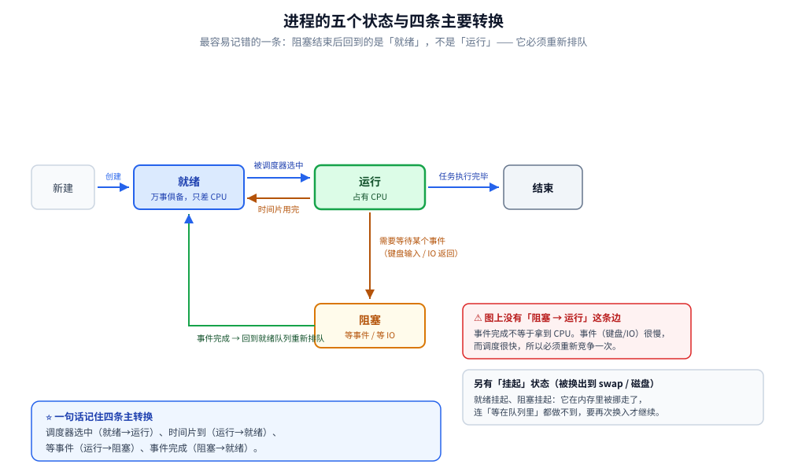
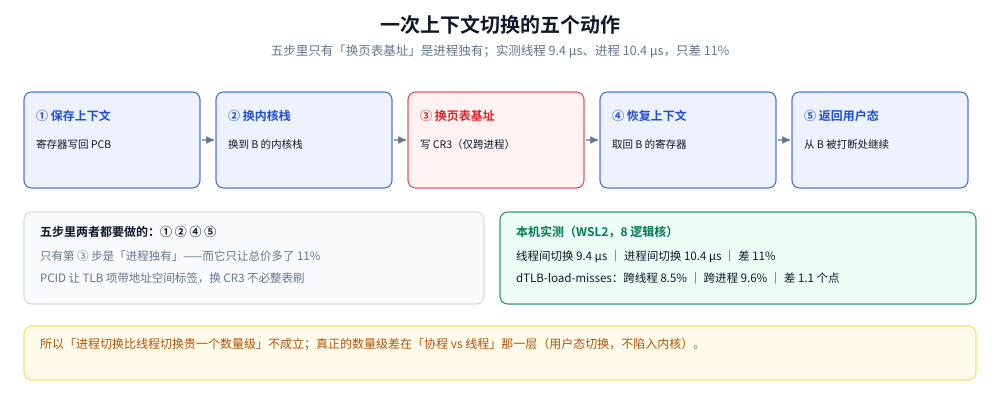
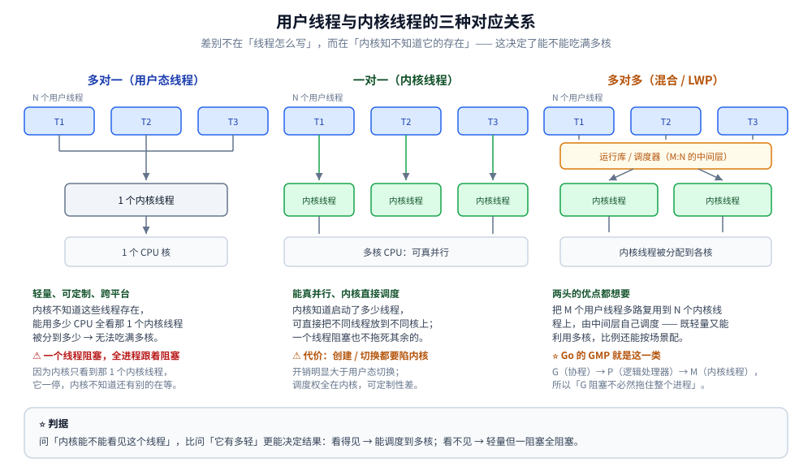

# 进程与线程模型

> 覆盖：为什么单核机器能「同时」跑多个程序（从一次时钟中断推起）、要让被中断的程序能接着跑必须保存什么（PCB 的由来）、五个状态与两个队列是怎么被推出来的、一次上下文切换到底做了什么与多贵、Linux 为什么没有独立的「线程」概念（`clone` 共享了什么）、用户线程 / 内核线程 / LWP 三种映射的取舍，以及「有了进程为什么还需要线程」与它带来的四个代价。
>
> 不覆盖：`fork` / `COW` / `execve` / 僵尸进程的完整生命周期见 [进程创建与退出.md](进程创建与退出.md)；地址空间、页表与 TLB 见 [虚拟内存与页缓存.md](虚拟内存与页缓存.md)；时间片长度与调度类见 [调度与时间片.md](调度与时间片.md)；Go 侧创建成本与协程栈见 [协程与线程成本.md](../../01-编程语言/go/并发编程/协程与线程成本.md)；Java 侧线程开销见 [线程与进程开销.md](../../01-编程语言/java/并发编程/线程与进程开销.md)；观查命令见 [性能排查.md](../linux/性能排查.md) 与 [常用命令.md](../linux/常用命令.md) 第四节。
>
> 内容整理自个人学习笔记，素材见 [素材清单](../../素材清单.md)。本篇的机器读数**只有两处，都是引用**：切换单价线程 **9.4 µs/次**、进程 **10.4 µs/次**，以及 `dTLB-load-misses` 跨线程 8.5% / 跨进程 9.6%，均出自 [调度与时间片.md](调度与时间片.md) 4.2 / 4.3 的同一轮实测（本机 WSL2、8 逻辑核）。**本篇没有自产读数**——状态机与映射关系是内核语义，不需要测；凡是需要「量」的结论都留给了被引用的那两篇。

---

## 一、一颗 CPU 上怎么「同时」跑两个程序？

**本节要点**：CPU 一次只能沿着一条指令流往前走，所谓「同时」全靠**有人能打断它**。打断者只有一个：**时钟中断**。一旦承认「会被打断」，接下来的问题就串起来了——**打断之后现场的存哪儿**（PCB）、**什么时候该轮到谁**（就绪队列）、**正在等 IO 的算不算能跑**（五状态）、**换人时要做多少事**（上下文切换）。

### 1.1 起点：CPU 只会做一件事

CPU 的工作循环只有一句话：**取指 → 译码 → 执行 → 下一条**。它不会自己「跳出去跑另一个程序」，也不知道有几个程序想跑。

```text
while (1) { 取下一条指令; 执行; PC = 下一条; }
```

所以在最朴素的设计里，一个程序一旦开始跑，就一直跑到它自己结束（或主动让出）为止。这就是早期的**批处理**形态：任务之间排队，谁也别想插队。

### 1.2 转折：时钟中断是「同时」的唯一来源

硬件定时器每隔一段时间发一次中断。中断会做一件关键的事：**把控制权从当前指令流手里夺走，交给内核的中断处理入口**。

```text
程序 A 正在执行第 1000 条指令
      ↓ 时钟中断（硬件拉高 CPU 的中断引脚）
CPU 保存当前 PC 与少量状态 → 跳到内核的中断向量
      ↓
内核判断：A 的时间片用完了
      ↓
内核决定下一个跑 B → 恢复 B 的现场 → 从 B 上次停下的地方继续
```

⭐ **这一条链就是「并发」的全部来源**。没有中断，单核上只可能有一个执行流；有了中断，内核才有机会在两条指令流之间换人。这也解释了一个常见误解：**「并发」不是硬件能力，是内核用中断 + 保存现场伪造出来的**。

⚠️ 顺带一个推论：**时间片不能无限小**。中断本身有开销（保存现场、进内核、跑调度器），片太短的时候 CPU 大部分时间在「换人」而不是「干活」，吞吐反而掉下来——具体多长见 [调度与时间片.md](调度与时间片.md)。

### 1.3 要让 A 能接着跑，必须存什么

被打断的 A 下次还要从「第 1000 条指令的中间」继续，所以至少得记住：

| 必须记住的 | 为什么 | 存在哪 |
|---|---|---|
| **程序计数器 PC** | 不知道执行到哪就没法继续 | 内核栈 / PCB |
| **通用寄存器** | 中间结果都在寄存器里 | 同上 |
| **栈指针 SP 与栈内容** | 函数调用链、局部变量 | 用户栈本身，只需记住 SP |
| **页表基址（CR3）** | 换进程时地址空间要跟着换 | PCB（`mm_struct` 指针） |
| **打开的文件、信号处理、优先级、状态** | 「这个任务是什么」的全部身份 | PCB |

**把这些东西装进一个结构体，那个结构体就是 PCB**（Linux 里叫 `task_struct`）。所以 PCB 不是「一个抽象概念」，而是**「为了让被中断的程序能恢复，必须存下来的东西」的最小集合**。

| PCB 里存什么（`task_struct` 的主要字段） |
|---|
| 进程标识符（**PID** / **TGID**）、状态、优先级、调度实体 |
| **CPU 上下文**：寄存器组、PC、栈指针（真正切换时存/取的就是它） |
| 内存描述符（`mm_struct`，即页表）、打开文件表（`files_struct`） |
| 信号处理、凭证（uid / gid）、cgroup、命名空间 |

> **每个执行流有且只有一个 PCB**。这句话在多线程那一侧会变得微妙：Linux 里每个线程都是一个独立 `task_struct`，只是共享 `mm` 与 `files`（见第二节）。

### 1.4 五个状态是「能不能用 CPU」推出来的

一旦承认「内核随时可能换人」，就得回答「现在轮到谁」。把「一个任务此刻的处境」按**能不能上 CPU** 分类，只有三种答案，再加上「还没创建」与「已经结束」，就有了经典的五状态：

| 状态 | 它此刻能不能上 CPU | 怎么进来的 |
|---|---|---|
| **新建（New）** | 不能 | `fork` 刚创建，PCB 有了但还没就绪 |
| **就绪（Ready）** | ⭐ **能，但在排队** | 刚创建完、或时间片用完被换下、或等待的事件完成了 |
| **运行（Running）** | 正在用 CPU | 被调度器选中 |
| **阻塞（Blocked / Waiting）** | ❌ **不能，在等事件** | 发起 IO、等锁、`sleep`、等子进程 |
| **终止（Terminated）** | 不能，也不该再上 | 已 `exit`，等父进程回收（僵尸） |

四条主要迁移边，每条都对应一个**具体的触发者**：

| 迁移 | 谁触发 | 说明 |
|---|---|---|
| 就绪 → 运行 | 调度器 | 被选中，拿到 CPU |
| 运行 → 就绪 | **时钟中断 + 时间片用完** | 不是「它想停」，是被强行换下 |
| 运行 → 阻塞 | 该任务自己 | 发起了一个要等的事（IO / 锁 / `sleep`） |
| 阻塞 → 就绪 | **事件完成（中断）** | ⚠️ 不是直接变「运行」——回到队列**重新排队** |

⭐ **「阻塞 → 就绪」而不是「阻塞 → 运行」是这套模型最容易被答错的一格**。原因是时序：事件（磁盘 IO 完成、键盘输入）相对 CPU 极慢，等它完成时 CPU 早就在跑别人了；内核只能把它标记成就绪、塞回队列，等下一次调度。**只有一种例外：队列里没别人**，调度器可能立刻又选中它，看起来像「直接变运行」。



图注：五状态之间只有四条主要迁移边——就绪 ↔ 运行由调度器与时钟中断驱动，运行 → 阻塞由任务自己发起；⚠️ 阻塞态事件完成后回到**就绪队列**而不是直接占用 CPU，因为事件完成的那一刻 CPU 通常在跑别的任务。

### 1.5 两个队列：内核怎么「记住谁在排队」

五状态回答「它能不能跑」，队列回答「轮到谁」。实现上是两条链表（便于 O(1) 插入删除）：

| 队列 | 装谁 | 谁来取 |
|---|---|---|
| **就绪队列**（runqueue） | 状态为「就绪」的任务，按优先级 / 调度类组织 | 调度器每次选一个 |
| **等待队列**（wait queue） | 状态为「阻塞」的任务，挂在**它等的那件事**上 | 事件发生时由内核唤醒 |

⭐ **关键差别在「谁来找谁」**：就绪队列是**调度器主动挑**，等待队列是**事件主动唤醒**。所以「阻塞的任务」并不在任何「轮转队列」里——它在等的那件事的对象上挂着。这解释了一件事：**阻塞的任务不消耗调度器的时间**，任务再多，只要都在阻塞，CPU 就不受影响。

> 单核只有一个「当前运行的」位置（一个 `current` 指针）；多核是每个核一个 runqueue，各自调度（这也是为什么「8 核机器上一个死循环只吃 100%」）。

### 1.6 一次上下文切换到底做了什么

```text
① 保存当前任务的 CPU 上下文（寄存器、PC、SP）→ 写回它的 PCB / 内核栈
② 切换栈：从当前任务的内核栈换到下一个任务的内核栈
③ 若跨进程，还要换地址空间（写 CR3，即页表基址）
④ 恢复下一个任务的上下文
⑤ 返回用户态，从它上次被打断的指令继续
```



图中五个方格按执行顺序排开，第 ③ 格（换 CR3）单独标色——它是**唯一只在「跨进程」时才发生**的一步；右侧标出实测的总价：线程切换 **9.4 µs**、进程切换 **10.4 µs**。要读出的是：**五步里只有第 ③ 步是「进程独有」的，而它只让总价多了 11%**，所以「进程切换比线程切换贵一个数量级」这个说法在本机不成立。

### 1.7 切一次多贵：11% 的差距，不是一个数量级

教科书常说「进程切换要换页表、TLB 全失效，所以比线程切换贵得多」。本机实测把这个说法修正了两次：

| 量 | 线程间切换 | 进程间切换 | 差距 |
|---|---|---|---|
| 单次切换耗时 | **9.4 µs** | **10.4 µs** | **11%** |
| `dTLB-load-misses` 占比 | 8.5% | 9.6% | **1.1 个百分点** |

⭐ 两条原因：

- **换 CR3 不等于刷 TLB**。现代 CPU 的 **PCID**（Process Context ID）让 TLB 项能带着「属于哪个地址空间」的标签存活下来，换 CR3 只是换标签，不必整表清空。
- **切换的大头是固定的**：进内核、保存/恢复寄存器与栈、跑调度器逻辑，这些**线程与进程一样要做**。换页表只是在这个固定成本上再加一点。

⚠️ 所以真正的数量级差在**下一层**：协程（用户态切换，只存少量寄存器、不陷入内核）vs 线程。这一点在 [协程与线程成本.md](../../01-编程语言/go/并发编程/协程与线程成本.md) 有 Go 侧的读数。**把「协程快」错记成「线程 vs 进程」的差距，是最常见的记混。**

## 二、Linux 为什么没有独立的「线程」概念？

**本节要点**：Linux 内核里**只有一种执行实体**（`task_struct`），「进程」与「线程」的差别不是两种对象，而是**创建时共享了哪些资源**——`clone` 的 flags 决定。三种映射（多对一 / 一对一 / 多对多）回答的不是「线程是啥」，而是**「谁来决定下一个跑哪个」**：用户态库、内核、还是两者协作。

### 2.1 `clone`：进程与线程只差一组 flag

```c
/* 创建「进程」：什么都不共享 */
clone(fn, stack, CLONE_NEWPID | SIGCHLD, arg);

/* 创建「线程」：共享地址空间、文件表、信号处理、fs 信息 */
clone(fn, stack,
      CLONE_VM | CLONE_FS | CLONE_FILES | CLONE_SIGHAND | CLONE_THREAD,
      arg);
```

| flag | 共享什么 | 不共享时的后果 |
|---|---|---|
| `CLONE_VM` | 地址空间（页表） | 不共享 = 各写各的内存，就是「进程」 |
| `CLONE_FILES` | 打开文件表 | 不共享 = 各自 `close` 互不影响 |
| `CLONE_FS` | 当前目录、`umask` | 不共享 = `chdir` 互不影响 |
| `CLONE_SIGHAND` | 信号处理函数表 | 不共享 = 信号各收各的 |
| `CLONE_THREAD` | 同一个线程组（同 TGID） | 决定 `ps` 里显示成一行还是多行 |

⭐ 判据：**「是不是同一个进程」在内核眼里就是「TGID 是否相同」**。同 TGID 的一堆 `task_struct` 就是「一个进程的多个线程」；`ps` 默认按 TGID 聚合，`ps -eLf` / `top -Hp` 才是摊开看每个 `task_struct`（即 LWP，见 [常用命令.md](../linux/常用命令.md) 第四节）。

⚠️ 这条设计带来一个实用后果：**线程与进程在调度器眼里完全平等**。没有「先调度进程再调度线程」的两级结构——每个 `task_struct` 都是独立的调度实体。所以「进程是资源分配单位、线程是调度单位」这句话在 Linux 上是**语义上的分工，不是实现里的两类对象**。

### 2.2 三种映射：谁来决定下一个跑哪个

| 映射 | 用户线程 : 内核线程 | 谁调度 | 代价 |
|---|---|---|---|
| **多对一**（用户态线程） | N : 1 | **用户态库自己**（内核看不见） | 内核只当它是一个任务，**用不上多核**；一个线程阻塞会拖死整组 |
| **一对一**（内核线程） | 1 : 1 | **内核** | 用得上多核、能并行；创建/切换都要进内核 |
| **多对多**（混合） | M : N | 用户态库 + 内核协作 | 兼顾两者，但实现复杂（Go 的 GMP、Java 21 虚拟线程） |



图注：多对一时一个线程阻塞会拖死同进程的全部线程（内核只知道那一个）；一对一让内核直接调度（Java 的 `new Thread()` 就是这一格）；多对多把「轻量调度」交给用户态库、把「真正占核」交给内核，Go 的 GMP 与 Java 21 虚拟线程属于这一类。

### 2.3 用户线程为什么会「一个阻塞全阻塞」

这是「多对一」最硬的一条限制，推导只有两步：

1. 进程只有**一个**内核线程，所以内核的任何调度决策对它都是「整组一起」；
2. 组里某个线程发起了一个**阻塞的系统调用**，阻塞的是**那唯一的内核线程**——而内核根本不知道用户态还有别的线程在等（它看不见它们）。

⭐ 所以「用户态线程做不到真正的异步」不是实现偷懒，是**信息不对称**：内核没有这些线程的 PCB，无法在其中一个阻塞时换另一个上 CPU。要绕开只能把阻塞调用改写成非阻塞 + 事件循环（这正是早期绿色线程库的做法）。

### 2.4 LWP：介于两者之间的那一层

**LWP（轻量级进程）** 的定位是「让内核线程与用户线程之间有个可配置的中间层」：

- LWP 与内核线程是 **1:1**（每个 LWP 对应一个内核调度实体）；
- 上层用户线程到 LWP 的映射可以配成 `1:1`、`N:1`、`M:N`；
- 于是「轻量」与「能用多核」变成**可调参数**，而不是二选一。

> Linux 的 `pthread` 就是 1:1（每个线程一个 LWP / `task_struct`）；Go 运行时在用户态又做了一层 `M:N`（G 到 M 通过 P 复用）。**「LWP」这个词今天更多出现在 `ps -L` 的输出里（LWP 列就是 TID）**，而不是作为一种独立实现。

## 三、有了进程，为什么还需要线程？

**本节要点**：不是「线程更先进」，而是**进程的三个成本在「同一个程序内部并发」这个场景下全是浪费**：地址空间要重建、通信要过内核、切换要多换一次页表。线程把这三种成本各自砍掉一截，代价是把「隔离」换成了「共享」——于是所有多线程问题都来自这一笔交换。

### 3.1 从进程的三个成本反推

| 成本 | 多进程时 | 多线程时 | 省下来的是什么 |
|---|---|---|---|
| **创建** | 新地址空间、新页表、复制父进程的页表项 | 共享已有地址空间，只建一个栈 + PCB | 内存与时间 |
| **通信** | 必须走 IPC（管道 / socket / 共享内存），数据要过内核拷贝 | 直接读写同一块堆内存 | 一次拷贝 + 一次系统调用 |
| **切换** | 换 CR3（多一步） | 不换地址空间 | 11%（本机实测，见 1.7） |

⭐ 注意第三行：**「线程切换便宜」的真实幅度只有 11%**，不是数量级。线程真正的大头收益在前两行——**创建与通信**。

### 3.2 线程付了什么代价

「共享」是这一切收益的来源，也是所有问题的来源：

| 代价 | 机制 | 为什么难 |
|---|---|---|
| **竞态条件** | 多线程读写同一内存，结果取决于调度顺序 | 结果不可预测、难复现，要靠锁 / 原子操作 |
| **死锁** | 各自持有对方要的锁 | 需要靠「固定加锁顺序」这类纪律预防 |
| **栈与内存开销** | 每线程一个栈（默认预留可达 MB 级） | 线程数上千时栈就是主要开销，见 [寄存器与栈.md](../计算机底层原理/缓存与内存/寄存器与栈.md) |
| **调度开销** | 线程数远超核数时频繁切换 | 吞吐不一定掉，但**延迟会变差** |
| **调试复杂度** | 问题与执行顺序绑定 | 断点会改变时序，bug 在调试器里消失 |

⚠️ **「线程数 ≈ 核数时性能最好」这句话要精确化**：本机量下来成立的是「**到核数为止有加速、之后没有加速**」，而不是「超过就变慢」。超过之后**吞吐可能持平（甚至略升，因为能掩盖 IO 等待），但延迟分布会变差**——P99 先坏。完整读数见 [协程与线程成本.md](../../01-编程语言/go/并发编程/协程与线程成本.md) 第三节。

### 3.3 一个必须澄清的说法

> 「操作系统调度的是线程，不是进程。」

这句话是对的，但容易被误解成「有两级调度」。准确的说法是：**Linux 里每个 `task_struct` 都是独立的调度实体**，我们平时说「进程调度」，是因为**默认一个进程只有一个线程**——即使你没写多线程代码，进程内部也至少有一个执行流。

## 四、应用场景

**本节要点**：进程 / 线程模型不是一个抽象概念，它直接决定每个服务**并发写在哪儿**——Nginx 用多进程、Redis 用单进程单线程、Java 用线程池、Go 用 goroutine，取舍都能回到第一节那四件事（谁打断、存什么、怎么排队、换人多贵）。

| 系统 / 组件 | 用了哪种模型 | 为什么值得注意 |
|---|---|---|
| **Nginx** | master 多进程 + 每 worker 单线程事件循环 | worker 数取核数；worker 间靠共享内存通信，见 [02-进程模型与基础架构.md](../linux/深入理解Nginx/02-进程模型与基础架构.md) |
| **Redis** | 单进程 + 单线程命令串行 | 命令天然无竞态；`fork` 做持久化时 COW 会推高内存，见 [虚拟内存与页缓存.md](虚拟内存与页缓存.md) 1.4 |
| **MySQL** | 每连接一个线程（one-thread-per-connection） | 连接数 ≠ 并发度；线程切换成本随连接数上升，见 [参数调优.md](../../03-数据与中间件/数据存储/关系型/MySQL/参数调优.md) |
| **Java 服务** | 一对一内核线程 + 线程池 | 线程数按 CPU / IO 类型分别定；池是进程级单例，见 [线程池.md](../../01-编程语言/java/并发编程/线程池.md) |
| **Go 服务** | M:N（goroutine 复用到内核线程） | 阻塞系统调用不拖死进程（P 会被交给别的 M），见 [GMP调度.md](../../01-编程语言/go/运行时/GMP调度.md) |
| **容器 / K8s** | 容器 = 被 namespace + cgroup 隔离的进程 | 「容器里的 1 号进程」就是进程模型本身，见 [容器原理.md](../../06-工程实践/部署/docker/容器原理.md) |
| **守护进程与服务** | 进程之上的一层生命周期管理 | `SIGHUP` / `SIGTERM` 的语义直接来自进程模型，见 [系统与服务.md](../linux/系统与服务.md) |
| **上下文切换的代价** | 协程 < 线程 < 进程，且三级差距不同量级 | 协程与线程之间是数量级，线程与进程之间只有 11%，见 1.7 |

## 五、具体使用

**本节要点**：机制落到代码上只有三件事——**线程数怎么定**（按 CPU 密集 / IO 密集分）、**要不要超订**（超订换延迟）、**怎么看住它**（切换与队列的观测入口）。观查命令全部在 [常用命令.md](../linux/常用命令.md) 第四节与 [性能排查.md](../linux/性能排查.md) 3.2，这里只留判据与算式。

### 5.1 线程数怎么定

| 负载类型 | 起手式 | 为什么 |
|---|---|---|
| **CPU 密集** | `核数` 或 `核数 + 1` | 多出来的线程只会抢核；`+1` 用来填偶发的缺页等待 |
| **IO 密集** | `核数 × (1 + 平均等待时间 / 平均计算时间)` | 线程大部分在阻塞，多开才能把核喂满 |
| **混合** | 拆成两个池：CPU 池按核数、IO 池按下游并发 | 一个池同时干两种活必然两头不讨好 |

```go
// Go：默认 GOMAXPROCS = 容器可见的核数（Go 1.19+ 认 cgroup 限额）
// ⚠️ Go < 1.19 在容器里按宿主机核数算，会开得过大
runtime.GOMAXPROCS(0)   // 读当前值
```

```java
// Java：CPU 密集型的经典起手式
int n = Runtime.getRuntime().availableProcessors();
ExecutorService pool = Executors.newFixedThreadPool(n);
// ⚠️ JDK 8u191+ / 11+ 才默认 UseContainerSupport（认 cgroup 限额）
```

⭐ 判据：**线程数的上限由「核数 × 单线程能喂饱的并发度」决定，不是由「请求数」决定**。请求再多，超出这个上限的部分只是在排队——而排队该发生在**连接队列 / 信号量**里（可观测、可拒绝），不该发生在**内核 runqueue** 里（不可观测、只是变慢）。

### 5.2 超订：拿延迟换吞吐的地方

超订（线程数 > 核数）不是错误，但要清楚它换的是什么：

| 超订程度 | 吞吐 | P99 延迟 | 适用 |
|---|---|---|---|
| ≈ 核数 | 接近峰值 | 稳 | 延迟敏感（网关、RPC 服务端） |
| 2~4 倍 | 略升或持平 | ⚠️ 明显上翘 | 有大量 IO 等待的服务 |
| 远大于核数 | 可能下降 | 很差 | 只在压测里见过，生产别这么配 |

### 5.3 怎么看住它

| 要看什么 | 命令 / 入口 | 判据 |
|---|---|---|
| 线程数对不对 | `ps -eLf` 的 `NLWP`、`/proc/<pid>/status` 的 `Threads` | 与上面算式对得上；突然涨说明泄漏 |
| 切换是不是太多 | `pidstat -w 1`、`vmstat 1` 的 `cs` | `nvcswch/s` 高 = 核数不够；`cswch/s` 高 = 等锁 / 等 IO |
| 谁在等锁 | Go: `pprof` 的 `block` / `mutex`；Java: `jstack` 看 `BLOCKED` | 见 [pprof性能分析.md](../../01-编程语言/go/运行时/pprof性能分析.md)、[线上问题排查.md](../../01-编程语言/java/运行时/线上问题排查.md) |
| 是不是单核打满 | `mpstat -P ALL 1` | 整体利用率会掩盖单核瓶颈，见 [性能排查.md](../linux/性能排查.md) 3.3 |

---

## 延伸追问

- **进程切换的代价在哪里？** → 保存 / 恢复上下文、换内核栈、换页表基址（CR3）。⚠️ 换页表**不会**让 TLB 整表失效（PCID），本机 `dTLB-load-misses` 跨进程 9.6% vs 跨线程 8.5%，只差 1.1 个百分点，切换单价也只差 11%（9.4 → 10.4 µs），见 1.7。
- **为什么「阻塞 → 就绪」而不是「阻塞 → 运行」？** → 事件完成时 CPU 通常已在跑别的任务，内核只能把它标成就绪塞回队列，等下一次调度；只有队列空时才可能立刻被选中（见 1.4）。
- **并发和并行的区别？** → 并发是「多个任务交替使用同一个 CPU」（靠时钟中断伪造），并行是「多个任务各占一个 CPU 同时跑」（真同时）。单核只有并发（见 1.2）。
- **PCB 里到底存什么？** → 身份（PID / TGID）、状态与优先级、CPU 上下文（寄存器 / PC / SP）、内存描述符（页表）、打开文件表、信号与凭证。**它是「为了让被中断的程序能恢复而必须存的集合」**（见 1.3）。
- **Linux 为什么没有单独的线程结构？** → 只有 `task_struct` 一种执行实体，「进程 / 线程」由 `clone` 的 flags 决定共享哪些资源；`CLONE_THREAD` 让它们同 TGID，`ps` 才显示成一行（见 2.1）。
- **用户线程为什么一个阻塞就全阻塞？** → 整组只对应一个内核线程，阻塞的是那唯一的调度实体，而内核看不到其他用户线程（没有它们的 PCB）（见 2.3）。
- **`pthread` 属于哪种映射？Go 的 goroutine 呢？** → `pthread` 是 1:1（每线程一个 LWP）；goroutine 是 M:N（G 经 P 复用到 M）。见 2.2、2.4。
- **僵尸进程和孤儿进程？** → 子进程已退出但父进程没 `wait` → 僵尸（占 PCB 不占 CPU）；父进程先退而子进程还在 → 孤儿，被 init / 1 号进程收养。详见 [进程创建与退出.md](进程创建与退出.md)。
- **`fork` 之后发生了什么？** → 复制父进程的 PCB 与页表项，内存页用**写时复制（COW）**延迟复制；`fork` 后立刻 `execve` 的场景可用 `vfork` / `posix_spawn` 省掉这次复制。
- **线程栈和进程栈的区别？** → 每个线程**独立的栈**（goroutine 初始栈仅 2 KB 且可增长），但**共享堆**；栈大小与溢出见 [寄存器与栈.md](../计算机底层原理/缓存与内存/寄存器与栈.md)。
- **为什么说「线程切换比进程切换便宜」但只差 11%？** → 五步里只有「换 CR3」是进程独有的，其余四步两者都要做；PCID 又让换 CR3 不必刷 TLB。真正的数量级差在「协程 vs 线程」（见 1.6、1.7）。
- **线程数应该怎么定？** → CPU 密集 ≈ 核数（或 +1）；IO 密集 ≈ 核数 ×(1 + 等待/计算)。超出部分该在连接队列里排队，而不是在内核 runqueue 里（见 5.1）。
- **协程比线程轻在哪？** → 用户态调度（不陷入内核）、栈可动态增长（初始很小）、切换只保存少量寄存器、不需要换地址空间。
- **进程间通信有哪些方式？** → 管道 / FIFO、消息队列、共享内存、信号量、Socket、信号；各自的拷贝账见 [零拷贝.md](零拷贝.md)。

## 关联

- **上游/总纲**：[虚拟内存与页缓存.md](虚拟内存与页缓存.md) — 地址空间、页表与 TLB（切换成本的那 11% 在这里）
- **对照/互补**：[进程创建与退出.md](进程创建与退出.md) — 本篇讲状态与调度实体，那篇讲 `fork` / COW / `execve` / 僵尸的完整生命周期
- **对照/互补**：[调度与时间片.md](调度与时间片.md) — 时间片多长、调度类怎么叠、切换单价那组读数的出处
- **对照/互补**：[寄存器与栈.md](../计算机底层原理/缓存与内存/寄存器与栈.md) — 线程栈的大小、增长与溢出
- **对照/互补**：[协程与线程成本.md](../../01-编程语言/go/并发编程/协程与线程成本.md) — Go 侧：创建成本、协程栈内存、GOMAXPROCS
- **对照/互补**：[线程与进程开销.md](../../01-编程语言/java/并发编程/线程与进程开销.md) — Java 侧：真内核线程超订与线程池
- **下游机制**：[GMP调度.md](../../01-编程语言/go/运行时/GMP调度.md) — 多对多模型在 Go 里的完整结构
- **下游机制**：[线程池.md](../../01-编程语言/java/并发编程/线程池.md) — 一对一模型在 Java 里的池化纪律
- **运维/排查**：[性能排查.md](../linux/性能排查.md) — 上下文切换与超订的观测判据
- **运维/排查**：[系统与服务.md](../linux/系统与服务.md) — 进程之上：1 号进程、信号与服务生命周期
> 反向引用（本篇被下列文档引到）：[goroutine.md](../../01-编程语言/go/并发编程/goroutine.md)、[线程基础与生命周期.md](../../01-编程语言/java/并发编程/线程基础与生命周期.md)、[常用命令.md](../linux/常用命令.md)、[02-进程模型与基础架构.md](../linux/深入理解Nginx/02-进程模型与基础架构.md)、[容器原理.md](../../06-工程实践/部署/docker/容器原理.md)
