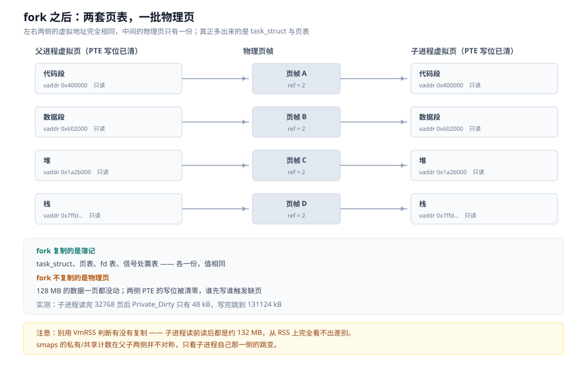
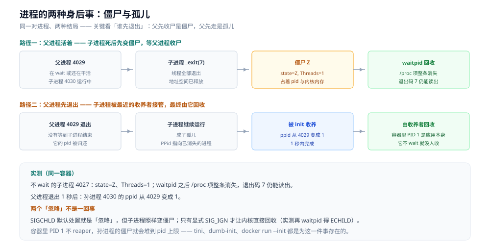

# 进程创建与退出

> 覆盖：`fork` 到底复制了什么、为什么复制的是页表而不是内存、写时复制（COW）的触发点与代价、
> 为什么 `fork` 之后几乎总要跟一个 `execve`、`vfork` / `posix_spawn` / `clone` 各自省掉了什么、
> 子进程退出后内核还保留什么、僵尸与孤儿分别怎么产生、多线程进程 `fork` 出来的子进程为什么只有 1 个线程、
> 以及 fd 表、stdio 缓冲区、`O_CLOEXEC` 这几个「看起来无关、实际会出事」的继承项。
>
> 不覆盖：进程状态与 PCB 的教科书定义见 [进程与线程.md](../linux/进程与线程.md)；
> 页表、缺页中断与 `mmap` 见 [内存管理.md](../linux/内存管理.md)；
> 一次上下文切换的单价见 [调度与时间片.md](调度与时间片.md)；
> 信号（含 `SIGCHLD`）的产生、阻塞与递送见 [信号机制.md](信号机制.md)；
> 语言侧「怎么调外部命令」见 [子进程与外部命令.md](../../01-编程语言/go/工程实践/子进程与外部命令.md)。
>
> 内容整理自个人学习笔记。**口径**：本篇读数全部在 `golang:1.26-bookworm` 容器内新跑（go1.26.8 / gcc 12 / Debian bookworm，
> Docker Desktop on WSL2，容器限 4 逻辑核 4 GB）。⚠️ 容器跑在 WSL2 上，`fork` 与系统调用的绝对耗时会比裸机高，
> 因此**只主张同一容器内的相对关系**；⚠️ **未实测**：裸机 `fork` 的绝对开销、`posix_spawn` 与 `fork + exec` 的直接对拍、
> 内核里 `copy_process` 的逐字段耗时。

---

## 一、一个 `fork()`，为什么会有两个返回值？

**本节要点**：`fork` 复制的是「簿记」，不是「内容」。返回值是父子两个进程拿到手的第一个、也是唯一的第一手区别。

### 1.1 同一个代码位置，两份执行流

```c
pid_t pid = fork();          // 从这一行之后，代码被两个进程各跑一遍
if (pid == 0) {              // 子进程里 pid 是 0
    _exit(0);
}
if (pid > 0) {               // 父进程里 pid 是新进程的 pid
    waitpid(pid, NULL, 0);
}
// pid < 0：只有这一种情况 fork 失败，原因看 errno（EAGAIN / ENOMEM）
```

这不是「返回两次」的魔法，而是内核在 `copy_process` 收尾时把两个不同的返回值分别放进两份寄存器现场：父进程那份里放的是新 `task_struct` 的 pid，子进程那份里放的是 0。于是同一段机器码接着往下跑，走的是两个不同的分支。

`pid == 0` 之所以能用「0」表示「我是子进程」，是因为 0 永远不会被分配给真实进程（1 号是 init，其余从 2 开始）。这个约定沿用自 1970 年代的 Unix，至今没变。

### 1.2 复制清单：哪些各一份，哪些是共享的

| 结构 | `fork` 之后 | 后果 |
|---|---|---|
| `task_struct`（PCB） | 各一份 | pid、状态、优先级、资源统计各自独立 |
| `mm_struct` + 页表 | 各一份，但**指向同一批物理页**，且两侧 PTE 都被清掉写位 | 见第二、三节：这是 COW 的全部前提 |
| fd 表 | 各一份，表项**指向同一个「打开文件描述」** | 父子共享文件偏移（8.1 实测） |
| 信号处置表（handler） | 各一份，值相同 | 子进程改自己的 handler 不影响父 |
| uid / gid / rlimit / cwd / umask / 环境变量 | 各一份，值相同 | 子进程改这些不回流 |
| 内存内容 | **不复制**，COW 共享 | 写才复制，粒度 4 KB |
| 线程 | **不复制**，只留调用 `fork` 的那个 | 第七节：这是多线程裸 fork 的死因 |
| 用户态锁（mutex / cond） | 结构被复制，「谁持有」这件事不复制 | 父进程里被别的线程持有的锁，在子进程里永远锁着 |

最后一行是这张表里最反直觉的一项：锁的**值**被复制了，但「持有者线程」不在子进程里，于是它永远等不到释放。第七节会给出读数。

### 1.3 复制的是「两套地址空间指向同一批物理页」



图中左、右两侧是两个进程各自的虚拟地址空间与页表，中间的物理页只有一份。读法：`fork` 之后真正多出来的是**页表与 task_struct**（图中虚线框），物理页一页都没多；两侧 PTE 的写位都被清掉，这正是「谁先写谁触发缺页」的开关。

---

## 二、`fork` 的代价随什么涨？

**本节要点**：随「地址空间里有多少页」涨，不随「内容有多少字节」涨；但页表簿记也不是免费的，128 MB 常驻内存会把 `fork` 拖慢一个数量级。

### 2.1 两个基线读数

同一容器内，`fork` 之后立刻 `waitpid`，以及 `fork` 之后 `execve("/bin/true")` 再 `waitpid`：

| 操作 | 3 轮读数 | 稳态区间 |
|---|---|---|
| `fork` + `waitpid`（n=1000） | 718.85 / 426.19 / 448.04 µs | 380 ~ 503 µs（另两轮 n=200：400.47 / 380.60 / 503.15） |
| `fork` + `execve` + `waitpid`（n=200） | 1397.63 / 1706.61 / 1716.55 µs | 1.40 ~ 1.72 ms |
| Go 的 `os/exec` + `/bin/true`（n=200） | 1.199 / 1.234 / 1.435 ms | 1.20 ~ 1.44 ms |

首轮 718.85 µs 明显高于后两轮，是容器刚启动时的预热效应（页缓存、动态链接器、CPU 频率）。**报读数时要说明取的是哪一轮**，否则同一台机器能得出 2 倍的差异。

`fork` 与 `fork + exec` 的差就是 `execve` 的价格：1.40 ~ 1.72 ms 减去 0.38 ~ 0.50 ms，约 **1.0 ~ 1.3 ms**。这一笔买的是「装载 ELF、启动动态链接器、重建地址空间」，比 `fork` 本身贵一倍以上——第四节展开。

### 2.2 常驻内存 128 MB 会拖慢多少

同一个程序，先在空进程里测 200 次 `fork + waitpid`，再 `mmap` 128 MB 并逐页写完，再测 200 次：

| 进程状态 | 3 轮读数（n=200） |
|---|---|
| RSS≈0 | 400.47 / 380.60 / 503.15 µs |
| 写入 128 MB 后（32768 页） | 4188.46 / 5414.85 / 4367.89 µs |

差值 3.8 ~ 5.0 ms，摊到 32768 页是 **110 ~ 150 ns/页**。这三四毫秒买的是两件事，都是 O(页数)：

1. 复制 32768 个页表项，并为新页表分配页表页；
2. 子进程 `_exit` 时把自己那 128 MB 的映射全拆掉（`exit_mmap`）。

对照一下量级：同一容器里把 128 MB 通过 COW **真正写一遍**用了 208 ~ 239 ms（3.4 的读数），比 `fork` 本身贵约 50 倍。所以结论要说得准确：

> **`fork` 不复制数据，但复制「指向数据的那张表」；表的大小正比于页数，所以它随内存涨，只是斜率比复制数据低一个数量级以上。**

### 2.3 页表为什么必须各一份

因为 `fork` 之后两个进程可以各自 `munmap` / `mprotect` / 继续 `mmap`，映射关系很快就会分叉。如果共用一张页表，父子任一方改映射都会影响另一方。物理页可以共享（内容相同且暂时只读），映射表不行。

---

## 三、写一个字节时，内核替你做了什么？

**本节要点**：COW 把「复制 128 MB」推迟到「真的写那一页」；读不触发、写才触发，粒度是 4 KB —— 所以写 1 字节也要复制整页。

### 3.1 三步

```text
① fork：父子两侧 PTE 的写位都清零，物理页引用计数 +1
② 任一方写：CPU 触发保护错误 → 缺页异常 → 内核发现是 COW 页
③ 内核：分配一张新物理页 → 复制 4 KB → 把写方 PTE 指向新页并置写位
        另一方仍指向老页，引用计数 -1
```

### 3.2 时序


读法：图中只有第 ③ 步会分配新页。**读不复制、写才复制**，这就是为什么案例里子进程读完 32768 页只花了 13 ~ 16 ms，而写同样多页要 208 ~ 239 ms。

### 3.3 用 `/proc/<pid>/smaps_rollup` 看真相

父进程先写满 128 MB，`fork` 出子进程；子进程先逐页读一遍，再逐页写一遍。每一步都读一次子进程的 `smaps_rollup`：

| 时刻 | VmRSS | Shared_Dirty | Private_Dirty |
|---|---|---|---|
| 父进程写完 128 MB | 132460 kB | 0 kB | 131168 kB |
| 子进程**读**完 32768 页 | 132400 kB | 131124 kB | 48 kB |
| 子进程**写**完 32768 页 | 132440 kB | 52 kB | 131124 kB |
| 父进程全程（三次采样） | 132584 ~ 132596 kB | 0 ~ 48 kB | 131128 kB |

三条能直接读出来的结论：

- **RSS 骗人**。三行 VmRSS 都在 132400 ~ 132460 kB，几乎没有差别——从 RSS 完全看不出「内存有没有被复制」。
- **读不复制**。子进程读完，`Private_Dirty` 只有 48 kB（那是页表和栈），131 MB 全记在 `Shared_Dirty` 上。
- **写才复制**。子进程写完后，`Private_Dirty` 从 48 kB 跳到 131124 kB，`Shared_Dirty` 掉回 52 kB。

⚠️ 一条口径提醒：父进程侧的 `Shared_Dirty` 全程只有 0 ~ 48 kB，与子进程侧记的 131 MB 对不上——smaps 的私有/共享计数在父子两侧并不对称。所以**不要拿单侧数字推全局**，可靠的做法是看子进程自己「写前 `Private_Dirty`≈0 / 写后 `Private_Dirty`≈全文」这个跳变。

### 3.4 单页的账：写比读贵 16 倍

| 操作 | 32768 页耗时 | 每页 |
|---|---|---|
| 只读（COW 共享页） | 13.02 / 15.42 / 16.31 ms | 0.40 ~ 0.50 µs |
| 写（触发 COW 复制） | 208.64 / 238.56 ms | 6.4 ~ 7.3 µs |

写那一栏里，每页要付：一次缺页陷入内核、分配一页、复制 4 KB、改 PTE、让 TLB 失效。所以写比读贵 **16 倍左右**。

还有一笔容易漏的账：**COW 的粒度是整页**。只写 1 个字节，也照样复制整页 4 KB —— 写放大 4096 倍。如果数据结构是「大量小对象零散修改」，`fork` 之后写的那一侧会付得非常不划算。

### 3.5 谁在吃这口 COW

| 场景 | 为什么可以用 |
|---|---|
| shell 执行命令 | fork 完立刻 exec，COW 页全部丢掉，一页都不用复制 |
| Redis `BGSAVE` / `BGREWRITEAOF` | 子进程只读快照，几乎不触发复制（除非写入量大） |
| nginx / Apache prefork | 子进程承父进程的配置与连接池，读多写少 |
| supervisor / systemd | fork 立刻 exec，同 shell |

反过来，**「fork 之后大量写」是反模式**：每个被写的页都要一次缺页 + 4 KB 复制，比从一开始就不用 fork 慢得多。这也是 2.2 那组读数要放在显眼位置的原因——128 MB 的进程 `fork` 一次要 4 ~ 5 ms，如果 fork 完还要写满，总代价接近 250 ms。

---

## 四、为什么 `fork` 之后几乎总要跟一个 `execve`？

**本节要点**：`fork` 复制出一份「我的副本」，`execve` 把这份副本整个换成目标程序；中间那个窗口是重定向、降权、清 fd 唯一能落地的位置，也是这两步不能被简单合并的原因。

### 4.1 两者各改什么

| | `fork` | `execve` |
|---|---|---|
| 进程 pid | 新分配一个 | **不变** |
| 地址空间 | 复制（COW 共享） | 整个替换：代码段、数据段、堆、栈全换 |
| fd 表 | 复制，共享打开文件描述 | 保留，除非打开时带了 `O_CLOEXEC` |
| 信号处置 | 复制 | 恢复默认；**被显式忽略的仍保持忽略** |
| 信号屏蔽字 | 复制 | **保留**（不重置） |
| 线程 | 只留调用 `fork` 的那个 | 只剩一个线程 |
| 返回值 | 两次（父得 pid / 子得 0） | 成功不返回，失败返回 -1 |

### 4.2 中间那个窗口在做什么

```c
pid_t pid = fork();
if (pid == 0) {
    dup2(logfd, 1);                          // 把 stdout 接到文件
    close(logfd);
    setrlimit(RLIMIT_NOFILE, &lim);          // 收紧 fd 上限
    chdir("/var/empty");                     // 换个工作目录
    execlp("nginx", "nginx", "-g", "daemon off;", (char *)NULL);
    _exit(127);                              // ← 只有 exec 失败才会到这里
}
```

三件事值得单独记住：

- **`exec` 成功不返回**，所以 `execlp` 后面那行只在失败时执行；
- 失败必须用 `_exit` 而不是 `exit`，否则子进程会继续跑父进程后面的代码（它现在有**两份**），并且会重复刷新从父进程复制来的 stdio 缓冲区（8.3）；
- **127 是 shell 的约定**：表示「命令找不到」，与程序自己返回的码区分开。

这就是为什么 `fork` 与 `exec` 不能简单合并成一个调用：中间窗口是唯一能「在不影响父进程的前提下改自己」的时刻。`posix_spawn` 之所以要引入 `file_actions` 和一堆 `attr`，正是因为合并之后这个窗口没了，只能把这些动作做成参数。

### 4.3 三条更便宜的替代路线

| 方案 | 省掉了什么 | 代价 / 限制 |
|---|---|---|
| `vfork` / `clone(CLONE_VM \| CLONE_VFORK)` | 不复制页表，子进程直接借用父地址空间 | 子进程不许写内存、父进程被挂起直到 `exec` / `_exit` |
| `posix_spawn` | 一步完成；glibc 内部用 `CLONE_VM \| CLONE_VFORK` + `exec` | 中间窗口只剩 `file_actions` / `attr`，做不了任意逻辑 |
| `clone` | 可以逐项指定共享什么（`CLONE_VM` / `CLONE_FILES` / `CLONE_THREAD`…） | 安全责任全在调用方 |

第三行解释了一个常被当成「独立概念」的事实：

> **线程不是一种新的内核实体，它是 `clone` 少共享了几个字段的结果**：`CLONE_VM | CLONE_FILES | CLONE_THREAD | CLONE_SIGHAND` 一起给，就是 pthread；一个都不给，就是 `fork`。

⚠️ 本机只实测了 `fork` 与 `fork + exec`（2.1）；`posix_spawn`、`vfork` 的绝对耗时**未实测**，上表只给机制。

### 4.4 为什么 Go 与 Java 都只能走 `fork + exec`

- **Go 进程天生是多线程的**：`GOMAXPROCS=8` 时实测 `Threads=5`（第七节）。多线程裸 `fork` 会得到一个既没有 runtime、又可能拿着已死线程锁的子进程（7.3）。
- 所以标准库只提供「fork 完立刻 exec」这一条路：Linux 上是 `forkAndExecInChild`，子进程里只做原始系统调用，不做任何分配。相应地 `os/exec` 实测 **1.20 ~ 1.44 ms/op**，与 C 直接 `fork + exec` 的 1.40 ~ 1.72 ms 同量级——多出来的那点主要是 Go 自己的管道与 goroutine 协调。
- **Java 侧同理**：JVM 有 GC、JIT、编译线程，`ProcessBuilder` 内部一定紧跟 exec。旧版 JDK 在 Linux 上用 `vfork` + `jspawnhelper` 子进程，较新版本优先 `posix_spawn`（**文档口径，本机未实测**）。

语言侧的具体写法（超时、进程树、退出码语义）见 [子进程与外部命令.md](../../01-编程语言/go/工程实践/子进程与外部命令.md) 与 [子进程与外部命令.md](../../01-编程语言/java/工程实践/子进程与外部命令.md)。

---

## 五、子进程退出后，内核还替它保留了什么？

**本节要点**：「已经死了」和「已经回收」是两件事。僵尸就是「已经死了、但 PCB 还被父进程留着」的那个中间态。

### 5.1 `exit` 与 `_exit` 的区别只有一个

| | `exit(status)` | `_exit(status)` |
|---|---|---|
| 刷新 stdio 缓冲区 | 是 | 否 |
| 跑 `atexit` / `on_exit` | 是 | 否 |
| 执行用户态清理 | 是 | 否 |

两者最终都进同一个系统调用。所以 `fork` 出来的子进程一律用 `_exit`：缓冲区和 `atexit` 处理器都是「从父进程复制来的」，不该由子进程再执行一遍。

### 5.2 退出状态只有 8 位

- 退出码范围 **0 ~ 255**，`exit(256)` 实际传出去的是 0；`exit(-1)` 是 255。
- 被信号杀死**没有退出码**，要用 `WIFSIGNALED` / `WTERMSIG` 区分。
- 判断顺序固定：`WIFEXITED` → `WEXITSTATUS`，或 `WIFSIGNALED` → `WTERMSIG`；顺序反了会把信号值当成退出码。

### 5.3 僵尸：实测

```text
不 wait 的子进程 4027 : state=Z  Threads=1  → 僵尸
waitpid 之后同一 pid  : state=?（/proc 项已消失）exit status=7
```

- `state=Z` 就是 `ps` 里的 `<defunct>`；`Threads=1` 说明线程已经全没了，只剩一个空壳 `task_struct`。
- 它活着的时候占两样东西：**一个 pid** 与**一块内核内存**（`task_struct` + 内核栈，约 1~2 KB 量级且不可换出）。
- 里面存着父进程还没读走的退出状态（这里是 7）与资源使用统计——这正是内核不肯立刻释放它的原因。
- 一旦 `waitpid` 拿走状态，`/proc/<pid>` 整个消失，pid 归还。

容器里这条尤其危险：容器的 pid 上限通常远小于宿主机，僵尸堆到几千个就会让新进程创建失败（`fork: Cannot allocate memory` 或 `EAGAIN`）。

### 5.4 `SIGCHLD` 的两个「忽略」不是一回事

这是本节最容易记错的一条：

| 写法 | 子进程退出后 | 会留僵尸吗 |
|---|---|---|
| 默认处置（什么都不写） | 内核照常保留 `task_struct` 等父进程 `wait` | **会** |
| `signal(SIGCHLD, SIG_IGN)` | 内核直接回收 | **不会** |
| 装了 handler | handler 里必须自己 `waitpid` | 不 `wait` 就会 |

`SIGCHLD` 的默认动作在 POSIX 里写的是「ignore」，但它**不等于「自动回收」**；只有应用**显式**把它设成 `SIG_IGN`，才触发「退出即回收」这个特例。实测：

```text
SIGCHLD 默认处置   : 子进程 4046  state=Z  → 僵尸，等父进程回收
SIGCHLD=SIG_IGN    : 子进程 4047  state=?  → 内核已回收
  再 waitpid 它    : 返回 -1  errno=10(No child processes)
```

两条工程结论：

- **把 `SIGCHLD` 当「子进程退出事件」用是危险的**：标准信号会合并（见 [信号机制.md](信号机制.md) 第三节），10 个子进程同时退出可能只收到 1 次信号。所以 handler 里必须写成 `while (waitpid(-1, &st, WNOHANG) > 0) {}` 把能收的全收掉。
- 更稳的做法是**不用信号**：单开一个线程阻塞在 `waitpid(-1, ...)`，或用 `pidfd` / `signalfd`（见 [IO多路复用.md](IO多路复用.md) 的 fd 事件源族）。

---

## 六、父进程先死，子进程去哪了？

**本节要点**：不是「跟着死」，而是被 PPID 1（或最近的 subreaper）收养。容器里 PID 1 就是你自己的程序，所以它必须自己收尸。

### 6.1 实测：PPID 从 4029 变成 1

```text
孙进程刚出生          : pid=4030 ppid=4029
父进程退出 1s 后      : pid=4030 ppid=1（被 init 收养）
```

把两条路径放在一张图上看，区别只在「谁先退出」：



读法：同一个「父 4029 / 子 4030」组合，走上半条路（父先收尸）结果是一个 `state=Z` 的僵尸，走下半条路（父先退出）结果是一个 `ppid=1` 的孤儿。两条路的终点都是「有人 `wait`」，区别只是那个人是谁 —— 这正是容器里 `tini` / `--init` 要补的角色。

### 6.2 「1 号」在不同环境里是谁

| 环境 | PID 1 | 谁负责 reap |
|---|---|---|
| 传统发行版 | init / systemd | init 会 `wait` 所有被收养的孤儿 |
| 容器 | **ENTRYPOINT 那个进程** | 它自己。多数应用不会 reap → 僵尸堆积 |
| systemd --user | 该 user 的 systemd | 通过 `PR_SET_CHILD_SUBREAPER` 成为「最近的收养者」 |

容器那一行解释了 `tini` / `dumb-init` / `docker run --init` 存在的理由：它们唯一的工作就是当 1 号进程并 `waitpid(-1, ...)` 循环收尸。**应用自己在容器里当 1 号时，孙进程的僵尸没人管**——这是「容器里跑着跑着 fork 失败」的常见根因。

`subreaper` 是同一机制的通用版本：`prctl(PR_SET_CHILD_SUBREAPER, 1)` 之后，该进程的子孙里出现的孤儿会被它收养，而不是直接交给 1 号。

### 6.3 双 fork 为什么要 fork 两次

经典 daemon 化流程是 fork 两次，原因与「孤儿」直接相关：

```text
① fork → 父退出 → 子被 init 收养（不再是前台进程组的成员）
② setsid() → 成为新会话首进程，脱离控制终端
③ 再 fork → 孙进程不再是「会话首进程」，永远拿不到控制终端
```

第二次 fork 不是多余的：会话首进程在某些条件下可以重新获得控制终端（打开一个 tty 设备时），再 fork 一层就彻底杜绝了。现代做法是用 systemd 的 `Type=simple` / `Type=notify`，不再需要自己 daemon 化。

---

## 七、多线程进程 `fork` 出来，子进程有几个线程？

**本节要点**：只有 1 个 —— 调用 `fork` 的那个。其他线程连同它们手里的锁一起消失，这就是「多线程进程不能裸 fork」的全部原因。

### 7.1 实测：1 → 4 → 1

```text
单线程进程 Threads    : 1
起 3 个 pthread 后    : 4
fork 出来的子进程     : Threads=1（只复制了调用线程）
```

`fork` 只复制调用它的那个线程。子进程里**没有**另外 3 个线程，但它们退出前正在做的事（改链表、持着锁）被原样复制了过来。

### 7.2 危险在哪：锁的持有者不在子进程里

| 被复制的状态 | 子进程里会怎样 |
|---|---|
| `malloc` 的 arena 锁被别的线程持着 | 子进程第一次 `malloc` 永久阻塞 |
| stdio 的 `FILE` 锁被持着 | 子进程第一次 `printf` 永久阻塞 |
| 你自己的 `pthread_mutex_t` 被持着 | 子进程拿它永久阻塞 |
| 别的线程改到一半的链表 | 子进程看到损坏的结构 |

所以 POSIX 规定：**`fork` 之后、`exec` 之前，子进程只能调用 async-signal-safe 函数**（那张清单与信号 handler 的清单是同一张，见 [信号机制.md](信号机制.md) 第四节）。`malloc`、`printf`、`pthread_mutex_lock` 全都不在清单里。

这也解释了为什么「fork 完立刻 exec」是安全的：exec 会把整份地址空间连同这些锁一起扔掉，子进程从零开始。

### 7.3 Go 为什么不能裸 `fork`

Go 进程天生多线程：实测 `GOMAXPROCS=8`、9 个 goroutine 时 `Threads=5`。除了调度用的 M，还有 netpoller、timer、GC 后台等运行时 goroutine。

裸 `fork` 出来的子进程只有 1 个线程，而 Go 的 runtime 状态（全局锁、P 的本地队列、netpoller 的 epoll fd、堆的 mheap 锁）全被复制成「别人正持有」的样子——子进程一进 runtime 就可能永久卡死。所以：

- 标准库**不提供**「fork 出另一个 Go 进程」的能力；
- 只提供 `os/exec` / `syscall.ForkExec`，子进程里只做原始系统调用然后 exec；
- `runtime.LockOSThread()` **解决不了**这个问题：它锁的是当前 goroutine 绑定的 P，不是别的 M 手里的锁。

### 7.4 Java 侧同理

JVM 有 GC、JIT、编译与信号分发线程，`ProcessBuilder.start()` 内部也一定是「创建子进程 + 立刻 exec」。想在 Java 里「复制当前 JVM 继续跑」没有受支持的路径。

---

## 八、还有哪些继承项会咬人？

**本节要点**：fork 复制 fd 表但共享文件偏移、复制 stdio 缓冲区、exec 默认保留 fd —— 三个都属「看起来无关、实际会出事」。

### 8.1 fd 表被复制了，打开文件描述没有

```text
fork 前父进程读 2 字节 : ab
子进程接着读 2 字节    : cd
父进程再读 2 字节      : ef（偏移跟着子进程走了）
```

机制：`fork` 复制的是**fd 表**（那张「fd 号 → 指针」的数组），表项指向的**打开文件描述**（含偏移、状态标志）只有一份。所以父子读写同一个 fd，偏移是共享的、顺序是交错的。

这三行的区别要分清楚：

| 操作 | 新打开文件描述？ | 共享偏移？ |
|---|---|---|
| `fork` | 否 | **是** |
| `dup` / `dup2` | 否 | **是** |
| `open` | 是 | 否 |

后果：父子各自「读日志读到最后」会互相抢位置；要让两个进程各读各的，必须各自 `open`，或用 `pread` 显式指定偏移。inode 与打开文件描述的分层见 [文件系统与IO.md](../linux/文件系统与IO.md)。

### 8.2 exec 默认不关 fd，除非 `O_CLOEXEC`

```text
父进程 fd: 普通=3  CLOEXEC=4 → exec 后新程序看到：
    lr-x------ 1 root root 64 Oct 31 14:54 3 -> /etc/hostname
    lr-x------ 1 root root 64 Oct 31 14:54 4 -> /proc/16/fd
```

fd 3（普通打开）漏给了新程序，fd 4（带 `O_CLOEXEC`）没有。注意第 4 行出现的 `4 -> /proc/16/fd` 是 `ls` 自己临时打开的目录 fd，与我们的 fd 4 无关——**看 fd 继承时不能只看编号**，要看目标。

工程约定：写 C 服务时**每个 `open` 都加 `O_CLOEXEC`**，否则日志文件、配置 fd、监听 socket 会漏进每一个子进程。Go 的 `os.OpenFile` 默认带 `O_CLOEXEC`，`os/exec` 还会额外处理继承列表——这是它比裸 `fork + exec` 少踩坑的地方。

### 8.3 stdio 缓冲区被整个复制了

```text
这一行只 printf 了一次
这一行只 printf 了一次
--- 行数：2 ---
```

缓冲区不在内核里，而是在 libc 的 `FILE` 结构里、属于用户态地址空间。于是：

```text
父进程：printf("...")  → 数据进父进程的缓冲区，未落盘
fork   → 缓冲区被整份复制，父子各有一份同样的未落盘数据
子进程 exit() → 刷一份（第 1 行）
父进程 exit() → 再刷一份（第 2 行）
```

`stdout` 接终端时是行缓冲，接了文件/管道才变成全缓冲——**这正是「本地跑正常、重定向到文件就出现重复行」的原因**。两个避免方式：子进程用 `_exit`（8.3 的反面），或在 `fork` 前 `fflush(NULL)`。

### 8.4 其余继承项速查

| 继承项 | fork 后 | exec 后 |
|---|---|---|
| 环境变量 | 继承 | 由 `execve` 第三个参数决定 |
| 信号处置（handler） | 复制 | 重置为默认；**被显式忽略的保持忽略** |
| 信号屏蔽字 | 复制 | **保留**（子进程可能一开始就屏蔽着某个信号） |
| rlimit | 继承 | 继承（`RLIMIT_NOFILE` 等） |
| uid / gid / cwd / umask | 继承 | 继承 |
| 退出码 | — | 只有 8 位（5.2） |

信号屏蔽字那一行值得单独记：如果父进程在 fork 前屏蔽了某个信号，子进程 exec 之后仍然屏蔽着它——「新程序收不到信号」的根因经常在这里。

---

## 九、现场：进程相关的症状怎么查？

**本节要点**：先看 `state` 字母，再看 `PPid` 与 `Threads`，最后才用 `strace` 抓 `fork` / `exec`。

### 9.1 `ps` 的 STAT 字母

| 字母 | 含义 | 与本篇的关系 |
|---|---|---|
| `R` | 正在运行或在运行队列里 | — |
| `S` | 可中断睡眠（等事件） | 最常见 |
| `D` | 不可中断睡眠（等 I/O） | 杀不死，见 [文件系统与IO.md](../linux/文件系统与IO.md) |
| `T` | 被停止（`SIGSTOP` / 调试器） | `SIGSTOP` 抓不到，见 [信号机制.md](信号机制.md) 第七节 |
| `Z` | **僵尸** | 5.3 |
| `I` | 空闲的内核线程 | — |

附加字母：`<` 高优先级、`N` 低优先级、`l` 多线程、`s` 会话首进程、`+` 前台进程组。

### 9.2 三个文件

| 文件 | 看什么 |
|---|---|
| `/proc/<pid>/status` | `State` / `PPid` / `Threads` / `SigQ` / `SigPnd` / `ShdPnd` / `SigBlk` / `SigIgn` / `SigCgt` |
| `/proc/<pid>/stat` | 第 3 字段是状态字母，第 4 字段是 ppid（脚本里比 status 好解析） |
| `/proc/<pid>/smaps_rollup` | 判断 COW 到底复制了没有（3.3） |

### 9.3 三条命令

```bash
ps -eo pid,ppid,stat,comm | awk '$3 ~ /^Z/'          # 找僵尸
ls /proc/<pid>/task | wc -l                          # 数线程
strace -f -e trace=clone,clone3,fork,vfork,execve -p <pid>   # 抓进程创建
```

### 9.4 症状速查

| 症状 | 先查什么 | 参见 |
|---|---|---|
| 容器里 pid 一点点耗尽 | 僵尸堆积 → PID 1 不收尸 | 5.3 / 6.2 |
| `fork: Cannot allocate memory` / `EAGAIN` | pid 上限、内存、cgroup pids 限制 | 5.3 |
| 服务 fork 后偶发死锁 | 多线程裸 fork，子进程拿到已锁的锁 | 7.2 |
| 子进程退出码总是 0 或异常小 | 退出码只有 8 位 | 5.2 |
| 重定向到文件后日志出现重复行 | stdio 缓冲区被 fork 复制 | 8.3 |
| 两个进程读同一文件读到一半 | 共享文件偏移 | 8.1 |
| 子进程留着不该有的 socket / 日志 fd | 缺 `O_CLOEXEC` | 8.2 |
| `fork` 延迟偶发抖动 | 地址空间页数、COW 写放大 | 2.2 / 3.4 |
| 新程序收不到本来能收到的信号 | 信号屏蔽字被继承 | 8.4 |

---

## 校验口径

**本节要点**：全部读数来自同一镜像的临时容器，程序只用 `getpid` / `fork` / `execve` / `waitpid` / `read` / `write` / `mmap`，计数一律读 `/proc`。

- **运行环境**：`golang:1.26-bookworm`（go1.26.8、gcc 12、Debian bookworm），`docker run --rm --cpus=4 --memory=4g`，Docker Desktop on WSL2，宿主 Intel i7-6700HQ。
- **`fork` 与 `exec` 单价（2.1）**：`proclab.c fork|exec`，`n=1000` / `200`，各 3 轮取全部读数；首轮含预热，已在正文标注。
  - `fork + waitpid`：718.85 / 426.19 / 448.04 µs（n=1000）；400.47 / 380.60 / 503.15 µs（n=200）。
  - `fork + execve + waitpid`：1397.63 / 1706.61 / 1716.55 µs（n=200）。
  - Go 侧 `forklab.go exec`：1.199 / 1.234 / 1.435 ms（n=200，`/bin/true`）。
- **`fork` 与常驻内存（2.2）**：`proclab.c forkmem`，`n=200`；先空进程测，再 `mmap` 128 MB 并 `memset` 写完再测，共 3 轮。
  - RSS≈0：400.47 / 380.60 / 503.15 µs；128 MB RSS：4188.46 / 5414.85 / 4367.89 µs。
  - 每页摊销 = 差值 ÷ 32768，落在 110 ~ 150 ns。
- **COW（3.3 / 3.4）**：`proclab.c cow`，父子用管道同步，每步读一次 `/proc/self/smaps_rollup` 与 `/proc/self/status`，共 3 轮。
  - 子进程只读 32768 页：13.02 / 15.42 / 16.31 ms；写 32768 页：238.56 / 208.64 ms（第三轮未跑写）。
  - smaps：父进程写后 `Private_Dirty=131168 kB`；子进程读后 `Shared_Dirty=131124 kB` / `Private_Dirty=48 kB`；写后 `Private_Dirty=131124 kB`。
- **僵尸与孤儿（5.3 / 6.1）**：`proclab.c zombie|orphan`；状态字母读 `/proc/<pid>/stat` 第 3 字段，`Threads` 读 `/proc/<pid>/status`。
- **多线程 fork（7.1）**：`proclab.c threads`，起 3 个 `pthread` 后 `fork`，子进程内读自己的 `Threads`。
- **fd 与 CLOEXEC（8.1 / 8.2）**：`proclab.c fdshare|cloexec`；后者 `exec` 一个 `/bin/sh -c 'ls -l /proc/self/fd'`。
- **stdio 复制（8.3）**：`proclab.c stdio`，程序自己 `setvbuf(_IOFBF, 4096)` 强制全缓冲（否则接终端是行缓冲、复现不出来），`printf` 后 `fork`，父子各 `exit`，输出计 2 行。
- **Go 线程数（4.4 / 7.3）**：`forklab.go threads`，`GOMAXPROCS=8`、9 个 goroutine，`Threads=5`。
- **⚠️ 未实测**：裸机 `fork` 绝对开销、`posix_spawn` / `vfork` 的耗时、Java 的 `jspawnhelper` 与 `posix_spawn` 路径、`subreaper` 的实际收养顺序、cgroup pids 上限下的 `fork` 失败原文。

---

## 延伸追问

- **`fork` 为什么会失败？** → 常见三个原因：pid 耗尽（含僵尸占着的 pid）、内存不足、cgroup 的 `pids.max` 到顶。`errno` 分别为 `EAGAIN` 与 `ENOMEM`。
- **COW 页什么时候被真正释放？** → 当最后一个指向它的进程退出、或 `munmap` 掉最后一段映射时，引用计数归零即回收；`fork` 后立刻 exec 的那条路径上，页表整个被丢掉，引用计数一次性减完，一页都不用复制。
- **有没有办法让某个区间「不参与 COW」？** → 有，`madvise(MADV_DONTFORK)` 让该区间不出现在子进程里（典型用途：网卡 DMA 缓冲区），`MADV_WIPEONFORK` 则让子进程看到零页。
- **`fork` 之后子进程的 `errno` 是什么？** → 继承父进程当时的值，没有任何意义；任何新逻辑都必须在调用后自己重置 `errno` 再看。
- **为什么 `exec` 之后信号屏蔽字还留着？** → 屏蔽字属于「线程属性」，`exec` 只重置 handler，不重置 mask。这是「新程序收不到 SIGTERM」的经典根因。
- **`vfork` 的现代形态是什么？** → `clone(CLONE_VM | CLONE_VFORK)`。glibc 的 `posix_spawn` 与 Go 的 `forkAndExecInChild` 都走这条路，好处是根本不复制页表。
- **容器里为什么 fork 更贵？** → 本机是 WSL2，系统调用要穿过虚拟化边界。本篇 380 ~ 503 µs 的 `fork` 单价明显高于裸机（通常几十 µs），所以**只能用来比较同一容器内的两个方案**，不能外推绝对值。

---

## 关联

- [进程与线程.md](../linux/进程与线程.md) — **上游**。进程的定义、PCB、五状态与线程模型在这里；本篇从「进程是怎么被造出来的」接着讲
- [内存管理.md](../linux/内存管理.md) — **上游**。页表、缺页中断、`mmap` 的机制，是第二、三节 COW 的底座
- [调度与时间片.md](调度与时间片.md) — 同目录。切换单价 9.4 / 10.4 µs，本篇的 `fork` 单价是「创建」的账，两者不要混
- [信号机制.md](信号机制.md) — 同目录。`SIGCHLD` 为什么会合并、`SIGKILL` 为什么抓不到、handler 里为什么只能调 async-signal-safe 函数
- [用户态内核态与一次IO的内存路径.md](用户态内核态与一次IO的内存路径.md) — 同目录横切篇：`fork` / `exec` 都是系统调用，本篇 2.1 的微秒数就是那五步的价格
- [文件系统与IO.md](../linux/文件系统与IO.md) — inode 与「打开文件描述」的分层，8.1 偏移共享的机制上游
- [子进程与外部命令.md](../../01-编程语言/go/工程实践/子进程与外部命令.md) — **下游**。Go 侧怎么写 `os/exec`、怎么防注入、怎么杀进程树
- [子进程与外部命令.md](../../01-编程语言/java/工程实践/子进程与外部命令.md) — **对照**。Java 侧 `ProcessBuilder` 的同一批语义
- [docker/](../../06-工程实践/部署/docker/) — 容器里 PID 1 是谁、为什么需要 `--init`（6.2）
