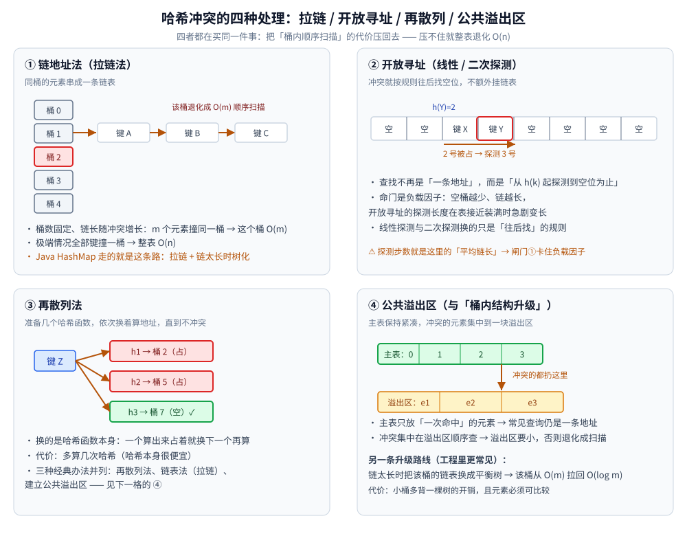
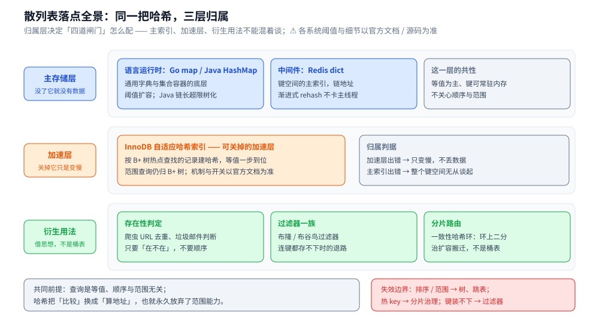

# 散列表

> 覆盖散列表（哈希表）的原理：**等值查找为什么快、怎么退化、工程上用哪四道闸门挡住退化**。
>
> 素材来源：博客 [数据结构](https://blog.csdn.net/weixin_43837229/article/details/103222660)（2019-11-24）——
> 本篇取该文的「散列表」一节；「工程推导」为本次整理补充。
>
> 全目录的判据与选型总表见 [README.md](../README.md)。

---

## 一、散列表为什么能不等值查找就 O(1)？

**本节要点**：它把"比较"换成了"算地址"——代价是**永远无法排序、无法按范围查**。

散列表源自**散列函数**（Hash function），其思想是：如果在结构中存在关键字和 T 相等的记录，那么必定在 F(T) 的存储位置可以找到该记录，这样就可以不用进行比较操作而直接取得所查记录。

| 维度 | 说明                                                                                                          |
|---|-------------------------------------------------------------------------------------------------------------|
| **优点** | 查找速度快，不考虑冲突时时间复杂度 **O(1)**，即使有冲突也很快                                                                         |
| **缺点** | ① 存在**哈希冲突**，解决方法有再散列法、链表法（拉链法）、建立公共溢出区； ② 关键字分布无规律，**无法排序、无法按范围查询**； ③ 删除慢（不知道关键字时存取很慢），对存储空间使用不充分 |
| **应用** | 数据库索引；适用**等值查找**的场景，如爬虫 URL 去重、垃圾邮件判断、判断集合中是否存在某数据                                                          |

## 二、散列表怎么退化？工程上拿哪几道闸门挡住？

**本节要点**：退化只有两条路径——**桶内冲突堆积**与**负载因子过高**；四道闸门各自用一类成本换回 O(1)。

**退化的两条路径**： 
① **冲突堆积**——同一桶挂了 m 个元素，这个桶就退化成 O(m) 顺序扫描，极端情况全部键撞一桶 → 整表 O(n)； 
② **负载因子（元素数/桶数）过高**——空桶越少、链越长，开放寻址法的探测长度在表接近装满时急剧变长。

**冲突能被"故意制造"吗？能。** 构造大量哈希值相同的键灌进服务端，就能把 O(1) 打成 O(n)（历史上真实发生过的一类攻击）。防御方向是给哈希引入扰动/随机种子，让攻击者无法预先算出碰撞键——**具体机制各语言实现不同，以官方文档/源码为准**。

**四道闸门**：

| 闸门 | 做法 | 代价 |
|---|---|---|
| 控制负载因子 | 超过阈值就触发扩容（常见零点几到 1 之间） | 用一部分空间换查找长度 |
| 扩容 + 再哈希 | 桶数变大（常按 2 的幂，好把取模换成掩码），**所有元素重新哈希搬迁** | 单次 O(n)，瞬时内存接近翻倍 |
| 渐进式 rehash | 新旧两张表并存，每次操作顺手搬几个桶，直到旧表清空 | 期间**查找要查两张表**、写入只写新表 |
| 桶内结构升级 | 链太长时把链表换成平衡树，该桶从 O(m) 拉回 O(log m) | 小桶多背开销；元素需可比较 |

> 落地例子：**Redis 的 dict** 是渐进式 rehash 的代表——`ht[0]`/`ht[1]` 并存，读写命令各推进一小步、后台定时任务补做，避免"一次 rehash 卡住主线程"；Java 的 `HashMap` 走的是"拉链 + 链太长时树化"。**阈值与每轮搬迁量以官方文档/源码为准。**

>
> ⚠️ 什么时候这些闸门都救不了你：键本身分布不均（热点全压在一个桶/一个分片）——那时问题已经不是数据结构，而是分片与热点治理（见 [缓存问题与方案.md](../../../03-数据与中间件/数据存储/缓存/缓存问题与方案.md) 的热 key 一节）。

### 2.1 渐进式 rehash 在各操作下怎么推进？

**本节要点**：闸门③的完整形态是一个三状态循环——**正常单表 → 双表并存搬迁 → 旧表清空恢复单表**；搬迁期间变的是「每个操作面对哪张表」。

| 阶段 | 查找 | 写入 | 搬迁怎么推进 |
|---|---|---|---|
| 正常（单表） | 查当前表 | 写当前表 | 无搬迁（Redis dict 此时只有 `ht[0]`） |
| 双表并存（搬迁中） | **两张表都要查**——桶数变了，同一个键的取模基数变了，新桶位置就变了 | **只写新表** | **每次操作顺手搬几个桶**：读写命令各推进一小步，后台定时任务补做，直到旧表清空 |
| 收尾（旧表清空） | 只查新表 | 只写新表 | 旧表整张释放，恢复单表常态 |

![渐进式 rehash 状态流转图：正常单表到 ht[0]/ht[1] 双表并存搬迁，再到旧表清空恢复单表，含搬迁期间查找与写入的规则](images/散列表渐进式rehash状态流转.svg)

把三个状态拆开写，是为了说清闸门②与闸门③的分工：一次性扩容 + 再哈希是**单次 O(n)、瞬时内存接近翻倍**（本节闸门②行）；渐进式把这笔账摊进每次操作与后台任务，代价就是搬迁期间**查找要查两张表**。**阈值与每轮搬迁量以官方文档 / 源码为准。**

---

## 三、应用场景

**本节要点**：散列的落点分三层归属——**语言运行时容器**、**中间件 / 存储引擎的主索引或加速层**、**衍生用法（去重、分片路由）**；层级不同，第二节四道闸门的配法就不同。

### 3.1 应用场景总表

| 场景 | 具体产品 / 系统 | 怎么用这个结构 | 为什么合适 |
|---|---|---|---|
| 通用字典容器 | Go map（[map.md](../../../01-编程语言/go/类型与语法/map.md)）、Java HashMap（[集合容器.md](../../../01-编程语言/java/集合容器.md)） | 哈希函数算桶位，冲突走拉链或探测，超阈值扩容 | 语言级容器的底层需求就是**常驻内存的等值查找** |
| KV 存储主索引 | Redis dict（[底层结构.md](../../../03-数据与中间件/数据存储/NoSQL/Redis/底层结构.md)） | 链地址 + 渐进式 rehash | 单线程事件循环卡不起一次 O(n) 搬迁——闸门里的「渐进式」在这里是刚需 |
| 存储引擎加速层 | MySQL InnoDB 自适应哈希索引（[索引设计与EXPLAIN.md](../../../03-数据与中间件/数据存储/关系型/MySQL/索引设计与EXPLAIN.md)） | 给热点 B+ 树等值查找建哈希，一步命中 | 只加速等值、可随时关闭，不改变 B+ 树主位。⚠️ 机制以官方文档为准 |
| 去重 / 存在性判定 | 爬虫 URL 去重、垃圾邮件判断（第一节的「应用」来源） | 插前查一次：桶里没有 → 收录 | 只要「在不在」、不要顺序——恰好绕开散列的两大短板 |
| 分片路由 | 一致性哈希环（[一致性哈希.md](../../../04-架构与系统/分布式/服务治理/一致性哈希.md)） | 「哈希后取模」换成「哈希后环上二分」 | 治的是「桶数一变就全表 rehash」的分片搬迁痛——同一把哈希，不同落地形态 |

### 3.2 深入辨析：「映射类」与「存在性判定类」不要混谈

- 散列表回答的是「**键 → 值 / 在不在**」且**答案精确**；[布隆过滤器.md](../概率与统计/位图与布隆过滤器.md) 与 [布谷鸟过滤器.md](../概率与统计/布谷鸟过滤器.md) 只回答「**可能有 / 一定没有**」，不返回值。
- 去重场景从散列表起步没问题，真正分水岭在**规模**：大到连键本身都装不下内存时，才轮到过滤器一族上场（用假阳性换体积）。
- ⚠️ 反过来也成立：**需要返回值的场景永远别用过滤器**——它给不出「映射到什么」，这是形态决定的，不是调参能救的。

### 3.3 收尾判据

> 共同前提：**查询是等值、顺序与范围无关、键空间（至少单层）可常驻内存**——散列把「比较」换成「算地址」，也就永久放弃了排序与范围能力。

失效边界：要排序 / 范围 → 换 B+ 树、跳表（[B树与B+树.md](../树/磁盘存储树/B树与B+树.md)、[跳跃表.md](../高级数据结构/跳跃表.md)）；键分布有热点 → 分片与治理问题（[缓存问题与方案.md](../../../03-数据与中间件/数据存储/缓存/缓存问题与方案.md)）；规模到装不下键 → 过滤器一族。冲突解决的具体路线（拉链 / 开放寻址 / Cuckoo 怎么选）见 [开放寻址与冲突解决.md](开放寻址与冲突解决.md)。

---

## 延伸追问

- **哈希冲突有哪些解决办法？** → 开放寻址（线性/二次探测、再散列）、链地址法（拉链）、公共溢出区；Java HashMap 用拉链 + 红黑树化。
- **为什么散列表不能做范围查询？** → 散列函数把语义相近的键打到相距极远的桶，桶序与键序无关；要范围只能全表扫或另建有序结构（树 / 跳表）。
- **负载因子为什么必须卡住？** → 它决定"平均链长/探测步数"，是 O(1) 成立的前提；卡住它就是在用空间买时间。
- **rehash 为什么要搬所有元素？** → 桶数变了，同一个键的新桶位置就变了（取模基数变了）；这也是渐进式 rehash 存在的理由。

---

## 关联

- [数组与链表.md](../线性结构/数组与链表.md) — 桶数组与拉链法的两个底层零件
- [平衡树.md](../树/内存平衡树/平衡树.md) — 桶内"链太长换平衡树"的实现层
- [位图与布隆过滤器.md](../概率与统计/位图与布隆过滤器.md) — 不用桶、只用位数组的另一种"集合存在性"方案
- [一致性哈希.md](../../../04-架构与系统/分布式/服务治理/一致性哈希.md) — 一致性哈希环：把「取模」换成「环上二分」
- [查找与排序对比.md](../../算法/基础算法/查找与排序对比.md) — 各查找结构的对照与选型
- [索引设计与EXPLAIN.md](../../../03-数据与中间件/数据存储/关系型/MySQL/索引设计与EXPLAIN.md) — 哈希索引与 B+ 树索引的分工
- [map.md](../../../01-编程语言/go/类型与语法/map.md) — Go map 的哈希实现与扩容
- [README.md](../README.md) — 选型总表（操作 × 隐藏代价 × 场景）
- [开放寻址与冲突解决.md](开放寻址与冲突解决.md) — **冲突解决的实现层**（本篇的下一站）：三种探测序列、装填因子与期望探测长度、删除的墓碑、Robin Hood 与 Cuckoo Hashing
> 反向引用（本篇被下列文档引到）：[集合容器.md](../../../01-编程语言/java/集合容器.md)、[Trie.md](../树/空间与字符串树/Trie.md)、[二叉搜索树.md](../树/二叉搜索树.md)、[树的形态与选型.md](../树/树的形态与选型.md)、[红黑树.md](../树/内存平衡树/红黑树.md)、[倒排索引.md](../高级数据结构/倒排索引.md)、[数论基础.md](../../算法/数学基础/数论基础.md)、[底层结构.md](../../../03-数据与中间件/数据存储/NoSQL/Redis/底层结构.md)、[Go算法题.md](../../../07-面试/Go算法题.md)
