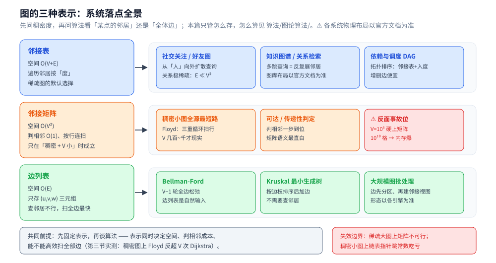

# 图的表示与存储

> 覆盖图这一族**多对多**结构的**存储形态**：顶点与边、三种表示（邻接表 / 邻接矩阵 / 边列表）的空间代价，
> 以及「稠密用矩阵、稀疏用链表」这条判据在本机实测里的真实体量。
>
> 素材来源：博客 [数据结构](https://blog.csdn.net/weixin_43837229/article/details/103222660)（2019-11-24）——
> 本篇取该文的「图」一节；三种表示的对照表与稠密度实测判据原在
> [README.md](../../算法/图论算法/README.md)，按「**数据怎么存归数据结构、数据怎么算归算法**」的边界搬到本篇。
>
> 全目录的判据与选型总表见 [README.md](../README.md)。

---

## 一、图与线性结构、树的根本差别是什么？

**本节要点**：顶点之间的关系是**多对多**，所以图没有"根"、没有天然遍历顺序，必须先固定一种存储表示才谈得上算法。

图是另一种非线性数据结构。数据结点一般称为**顶点**，**边**是顶点的有序偶对；若两个顶点之间存在一条边，就表示这两个顶点具有相邻关系。

- 线性结构是一对一、树是一对多、**图是多对多**；
- 因此图里"下一个去哪"不像数组那样由地址决定，而完全取决于**你用哪种表示把边存下来**。

## 二、三种表示怎么选？各自的空间与能力差别？

**本节要点**：表示决定了算法的一半——它同时决定**空间**、**判相邻的成本**与**能不能高效扫全部边**。

⭐ **图的表示决定了算法的一半**：

| 表示 | 空间 | 适合 | 注意 |
|---|---|---|---|
| **邻接表** | `O(V + E)` | **稀疏图**（`E ≪ V²`） | 遍历某点的邻居是 `O(度)`；判「两点是否相邻」要扫一遍 |
| **邻接矩阵** | `O(V²)` | **稠密图**（`E ≈ V²`） | 判相邻 `O(1)`；⚠️ `V = 10⁵` 时内存就爆了 |
| **边列表** | `O(E)` | 需要**反复扫描所有边**的算法（Bellman-Ford、Kruskal） | 无法快速查邻居 |

⚠️ 这条判据的真实体量已在**带权算法**上实测过：**稠密图（300 点、22819 条边）上 Floyd 反而比跑 V 次 Dijkstra 快 1.5～1.8 倍**，而稀疏图上 Dijkstra 快 1.5～2.2 倍（[Floyd.md](../../算法/图论算法/最短路/Floyd.md) 第五节）—— **「稠密用矩阵、稀疏用链表」不是空话**。

> ⚠️ 最常见的表示类事故：**稀疏图用邻接矩阵**导致内存超限（`V = 10⁵` 时是 10¹⁰ 个格子）。
> 带权图的"边"还要多存一个权值，具体类型声明与容器选型见
> [DFS与BFS遍历.md](../../算法/图论算法/图的遍历/DFS与BFS遍历.md) 末节（**共用代码只写在这一篇**）。

## 三、图上的常见算法在哪几篇？

**本节要点**：本篇只管"怎么存"；"怎么算"按母题分在 `算法/图论算法/` 下。

图上的经典问题：**深度优先搜索（DFS）、广度优先搜索（BFS）、最短路径、关键路径、拓扑排序**。归属与展开位置：

- **遍历**：[DFS与BFS遍历.md](../../算法/图论算法/图的遍历/DFS与BFS遍历.md)（**总纲**：策略区别与选型、内存画像实测），零件篇
  [DFS深度优先遍历.md](../../算法/图论算法/图的遍历/DFS深度优先遍历.md)（`tin`/`tout` 时间线、生成树与四类边、`visited` 标记时机、**三色判环**、后序反转拓扑）与
  [BFS广度优先遍历.md](../../算法/图论算法/图的遍历/BFS广度优先遍历.md)（队列快照、最短路反证、层序、Kahn 拓扑、三个进阶变体），两篇均含 Go / Java 双实现。
- **最短路 / 关键路径**：属**带权图**算法（Dijkstra、Bellman-Ford、Floyd、CPM），见 [最短路/](../../算法/图论算法/最短路/)。
- **最小生成树、拓扑排序**：见 [最小生成树/](../../算法/图论算法/最小生成树/)、[拓扑排序.md](../../算法/图论算法/拓扑排序.md)。
- 母题归类与算法选择的整体地图见 [README.md](../../算法/图论算法/README.md)。

---

## 四、应用场景

**本节要点**：三种表示的落点由「**稠密度 × 算法看点还是边**」决定；另外要分清——**图数据库的物理存储、关系库的中间表，都不是教科书意义上的邻接表**，归属层级不同。

### 4.1 应用场景总表

| 场景 | 具体产品 / 系统 | 怎么用这个结构 | 为什么合适 |
|---|---|---|---|
| 社交关注 / 好友关系 | Neo4j、自建关注图（见 [关注粉丝设计.md](../../../04-架构与系统/系统设计/社交互动系统/关注粉丝设计.md)） | 用户 = 顶点、关注 = 边，查询从一个「人」向外扩散 | 关系图极稀疏（`E ≪ V²`），按「度」遍历邻居正是邻接表的强项 |
| 知识图谱 / 多跳关系查询 | Neo4j（见 [架构与存储引擎.md](../../../03-数据与中间件/数据存储/图数据库/Neo4j/架构与存储引擎.md)） | 多跳查询 = 反复枚举邻居，关系是一等公民 | 邻居枚举是这类查询的自然原语。⚠️ 图库的物理布局不是教科书邻接表，以官方文档为准 |
| 路网 / 路径规划 | 导航与路由计算引擎（配套 Dijkstra，见 [Dijkstra.md](../../算法/图论算法/最短路/Dijkstra.md)） | 稀疏邻接表存路口与路段权值 | 路口数百万级、每个只连几条边——矩阵根本存不起 |
| 稠密小图全源最短路 | 规划 / 编译期工具里的 Floyd 类 DP（见 [Floyd.md](../../算法/图论算法/最短路/Floyd.md)） | 邻接矩阵 + 三重循环按行扫 | V 几百~几千：判相邻 O(1)、整行连续访问缓存友好——第二节实测它反超 V 次 Dijkstra |
| 成批处理边 | Bellman-Ford、Kruskal（见 [Bellman-Ford.md](../../算法/图论算法/最短路/Bellman-Ford.md)、[Kruskal.md](../../算法/图论算法/最小生成树/Kruskal.md)） | 边列表：逐轮全边松弛 / 按边权排序加边 | 这两个母题不需要「查邻居」，只要 `(u,v,w)` 三元组 |
| 依赖与调度拓扑 | 构建工具 / 工作流引擎的 DAG，拓扑排序（见 [拓扑排序.md](../../算法/图论算法/拓扑排序.md)） | 稀疏邻接表 + 入度计数 | 加边删边频繁、Kahn 队列从入度 0 起步——邻接表增删便宜 |

### 4.2 深入辨析：三种容易混的「图的存法」

1. **关系库的中间表是「逻辑邻接表」**：多对多用 `(a_id, b_id)` 中间表表达，给 `a_id` 建索引后就是「按点找邻居」——但它**物理上是 B+ 树**（见 [索引设计与EXPLAIN.md](../../../03-数据与中间件/数据存储/关系型/MySQL/索引设计与EXPLAIN.md)）。所以「好友列表查得慢」通常是 B+ 树回表的问题，不是图表示选错。
2. **图数据库 ≠ 邻接表**：原生图库的卖点是把「关系遍历」下推进存储引擎（store-and-navigate 一类的指针式布局），语义上贴近邻接表，**物理格式各实现不同，以官方文档为准**，别在方案评审里写成「就是邻接表」。
3. **大规模离线图计算往往从边列表起步**：先把边按分区存成边集合、再在计算时建邻接视图——「扫全部边」在超大规模下先赢。⚠️ 本仓库暂无对应专篇，此处只给粗粒度结论。

### 4.3 收尾判据

> 共同前提：表示选择 = **稠密度 × 算法看什么**——看「某点的邻居」倾向邻接表、看「全体边」倾向边列表、稠密且要 O(1) 判边才轮到矩阵。固定表示再谈算法，否则复杂度全对不上。

失效边界：`V = 10⁵` 时邻接矩阵是 10¹⁰ 个格子，直接内存爆（第二节埋的事故位）；反过来，稠密小图硬用邻接表，指针跳的常数会让 Floyd 反超 V 次 Dijkstra——**「稠密用矩阵、稀疏用链表」两头都会失效，分水岭是实测的稠密度**。

---

## 延伸追问

- **同样是"一张图"，邻接表和邻接矩阵的能力差别是什么？** → 邻接矩阵判两点相邻 O(1)、但空间 O(V²)；邻接表空间 O(V+E)、遍历邻居按度，判相邻要扫一遍该点的表。
- **什么时候必须用边列表？** → 算法要反复扫全部边而不关心邻居（Bellman-Ford 的 V−1 轮全边松弛、Kruskal 的按边权排序）——边列表就是它们的自然输入。
- **为什么图的表示会"决定算法的一半"？** → 表示决定了随机访问能力与内存画像：同一算法在矩阵上是顺序扫行、在表上要跳指针，稠密/稀疏下二者的常数差一个量级，甚至让 Floyd 反超 V 次 Dijkstra。
- **无向图在存储上怎么表示？** → 每条边在两个顶点的邻接表里各存一次（矩阵则对称），所以无向图的边数与存储条目数是两倍关系——判环、算度数时最容易在这里出错。

---

## 关联

- [README.md](../README.md) — 选型总表（操作 × 隐藏代价 × 场景）
- [README.md](../../算法/图论算法/README.md) — 图论母题地图（表示一节指向本篇）
- [DFS与BFS遍历.md](../../算法/图论算法/图的遍历/DFS与BFS遍历.md) — 遍历总纲 + 共用 `type Graph` 的单一来源
- [Dijkstra.md](../../算法/图论算法/最短路/Dijkstra.md) — 带权邻接表 + 小顶堆的组合用法
- [并查集.md](../高级数据结构/并查集.md) — 并查集：另一条"判连通"的路线
- [栈与队列.md](../线性结构/栈与队列.md) — DFS 用栈、BFS 用队列的底层形态
> 反向引用（本篇被下列文档引到）：[树与图的边界.md](../树/树与图的边界.md)、[割点与桥.md](../../算法/图论算法/割点与桥.md)、[BFS广度优先遍历.md](../../算法/图论算法/图的遍历/BFS广度优先遍历.md)、[DFS深度优先遍历.md](../../算法/图论算法/图的遍历/DFS深度优先遍历.md)、[强连通分量.md](../../算法/图论算法/强连通分量.md)、[拓扑排序.md](../../算法/图论算法/拓扑排序.md)、[Kruskal.md](../../算法/图论算法/最小生成树/Kruskal.md)、[Prim.md](../../算法/图论算法/最小生成树/Prim.md)、[Bellman-Ford.md](../../算法/图论算法/最短路/Bellman-Ford.md)、[Floyd.md](../../算法/图论算法/最短路/Floyd.md)、[欧拉路径与欧拉回路.md](../../算法/图论算法/欧拉路径与欧拉回路.md)、[递归与分治.md](../../算法/基础算法/递归与分治.md)、[层级与树形数据存储.md](../../../03-数据与中间件/数据存储/存储架构与场景/形态篇/层级与树形数据存储.md)
