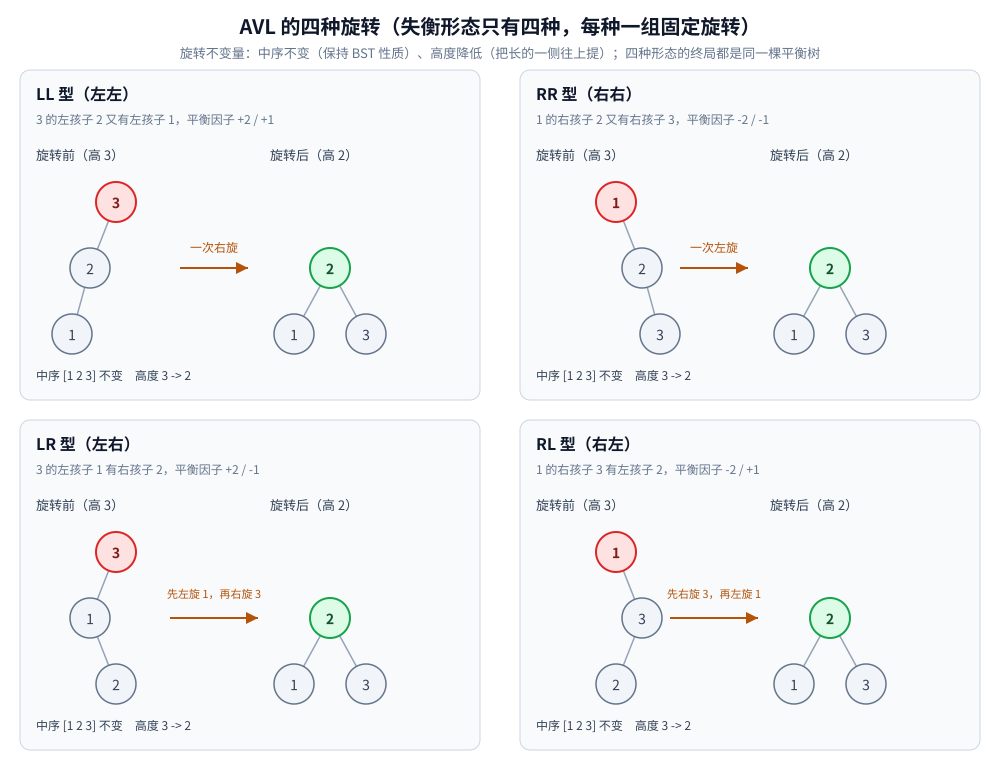
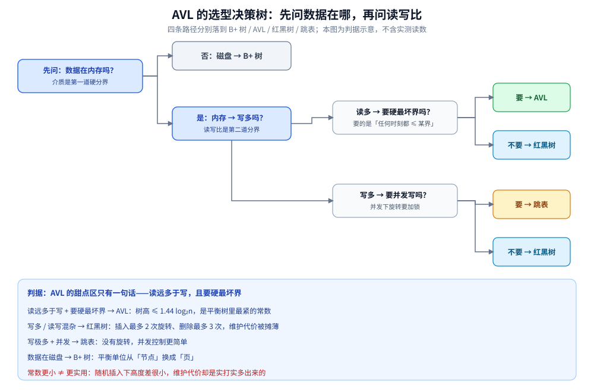

# AVL 树

> 最早的**自平衡二叉搜索树**：给每个节点记一个**平衡因子**（左右子树的高度差），
> 一旦它变成 `±2` 就用**旋转**修回去 —— 用「每次插删多做一点维护」换「任何时刻树高 ≤ `1.44 log2 n`」这个**最坏保证**。
>
> ⭐ 边界先说清：**AVL 在平衡树族里的定位、「AVL 与红黑树怎么选」**见 [平衡树.md](平衡树.md) 第二节；
> **BST 为什么会退化**（AVL 要修的就是它）见 [平衡树.md](平衡树.md) 第一节与 [二叉搜索树.md](二叉搜索树.md)；
> **红黑树那一支**见 [红黑树.md](红黑树.md)；全家族的选型总纲见 [树的形态与选型.md](树的形态与选型.md)。
> 本篇只讲 **AVL 本身**：四种旋转怎么转、代码里只动哪几个指针与高度、以及 `1.44` 这个界怎么算出来。
>
> 内容整理自个人学习笔记，素材见 [素材清单](../../../素材清单.md)。复杂度口径见 [复杂度分析.md](../../算法/基础算法/复杂度分析.md)。
>
> 📎 第一节的输出为本机实跑逐字抄录：**Go 1.26.5（windows/amd64）** 与 **JDK 1.8.0_321** 各实现一份，
> 四种旋转的层序 / 中序 / 高度两侧**逐行对齐**（`diff` 为空）。第二节是**按定义精确递推计算**的结果，不是运行读数。

---

## 一、AVL 的四种旋转分别怎么转？

**本节要点**：AVL 失衡的形态**只有四种**，每种对应一组固定的旋转。旋转的本质是「**在保持中序不变的前提下，把高的那侧往上提**」。

### 1.1 平衡因子与失衡的四种形态

**平衡因子（BF） = 左子树高 − 右子树高**。AVL 要求 `BF ∈ {-1, 0, 1}`；一旦变成 `+2` 或 `-2`，就要旋转。

按「新节点插在哪」分四种（`+` 表示左重）：

| 形态 | 失衡节点 | 插在哪 | 修法 |
|---|---|---|---|
| **LL** | BF = `+2` | 左孩子的**左**子树 | 一次**右旋** |
| **RR** | BF = `-2` | 右孩子的**右**子树 | 一次**左旋** |
| **LR** | BF = `+2` | 左孩子的**右**子树 | **先左旋再右旋** |
| **RL** | BF = `-2` | 右孩子的**左**子树 | **先右旋再左旋** |

⭐ **记法**：**前一个字母是「哪边高」，后一个字母是「插在哪」**。LL / RR 是同侧（一次旋转）；LR / RL 是异侧（两次旋转）。

### 1.2 旋转的核心代码

右旋与左旋是一对**镜像操作**，都只动**三个指针 + 两个高度**：

```go
func rotateRight(x *AVLNode) *AVLNode { // x 是失衡节点，其左孩子 y 将上位
	y := x.left
	x.left = y.right // ① y 的右子树交给 x 当左子树
	y.right = x      // ② x 变成 y 的右孩子
	upd(x)           // ③ 先更新 x（新的孩子），再更新 y（新的根）
	upd(y)
	return y
}

func rotateLeft(x *AVLNode) *AVLNode { // 镜像
	y := x.right
	x.right = y.left
	y.left = x
	upd(x)
	upd(y)
	return y
}
```

⚠️ **顺序不能反**：`upd(x)` 必须在 `upd(y)` 之前 —— `y` 的高度依赖 `x` 的新高度。

插入后的修复（沿递归回退路径，自底向上找到第一个失衡点，按四种形态处理）：

```go
func avlInsert(n *AVLNode, v int) *AVLNode {
	if n == nil {
		return newAVL(v)
	}
	if v < n.val {
		n.left = avlInsert(n.left, v)
	} else if v > n.val {
		n.right = avlInsert(n.right, v)
	} else {
		return n
	}
	upd(n)
	bf := hOf(n.left) - hOf(n.right)
	if bf > 1 && v < n.left.val { // LL → 右旋
		return rotateRight(n)
	}
	if bf < -1 && v > n.right.val { // RR → 左旋
		return rotateLeft(n)
	}
	if bf > 1 && v > n.left.val { // LR → 先左旋左孩子，再右旋自己
		n.left = rotateLeft(n.left)
		return rotateRight(n)
	}
	if bf < -1 && v < n.right.val { // RL → 先右旋右孩子，再左旋自己
		n.right = rotateRight(n.right)
		return rotateLeft(n)
	}
	return n
}
```

⭐ **LR / RL 为什么要转两次**：异侧插入时，**第一次旋转把「异侧」变成「同侧」**（把 `LR` 转成 `LL`），第二次才是真正的修复。见下一节的实测。

### 1.3 四种旋转的实测（中序不变、高度降低）

本机实跑，每种形态打印**旋转前后的层序 / 中序 / 高度**：

```text
===== 实验二：AVL 的四种旋转 =====
【LL 型】3 的左孩子 2 又有左孩子 1（平衡因子 +2 / +1）→ 一次右旋
  旋转前：层序 [3 2 1]  中序 [1 2 3]  高度 3
  右旋（以 3 为轴）：[3 2 1] → [2 1 3]
  旋转后：层序 [2 1 3]  中序 [1 2 3]  高度 2
  中序不变: true   高度降低: true

【RR 型】1 的右孩子 2 又有右孩子 3（平衡因子 -2 / -1）→ 一次左旋
  旋转前：层序 [1 2 3]  中序 [1 2 3]  高度 3
  左旋（以 1 为轴）：[1 2 3] → [2 1 3]
  旋转后：层序 [2 1 3]  中序 [1 2 3]  高度 2
  中序不变: true   高度降低: true

【LR 型】3 的左孩子 1 有右孩子 2（平衡因子 +2 / -1）→ 先左旋再右旋
  旋转前：层序 [3 1 2]  中序 [1 2 3]  高度 3
  左旋（以 1 为轴）：[1 2] → [2 1]
  右旋（以 3 为轴）：[3 2 1] → [2 1 3]
  旋转后：层序 [2 1 3]  中序 [1 2 3]  高度 2
  中序不变: true   高度降低: true

【RL 型】1 的右孩子 3 有左孩子 2（平衡因子 -2 / +1）→ 先右旋再左旋
  旋转前：层序 [1 3 2]  中序 [1 2 3]  高度 3
  右旋（以 3 为轴）：[3 2] → [2 3]
  左旋（以 1 为轴）：[1 2 3] → [2 1 3]
  旋转后：层序 [2 1 3]  中序 [1 2 3]  高度 2
  中序不变: true   高度降低: true
```

⭐ **四种形态的终局都是 `[2 1 3]`**（中序 `[1 2 3]`、高度 2）—— 这不是巧合：**同一组键 `{1,2,3}` 的唯一平衡二叉搜索树就是它**，四种旋转只是从不同起点走到同一个终点。

⭐⭐ **实测证实了两条旋转不变量**：

| 不变量 | 含义 | 为什么必须成立 |
|---|---|---|
| **中序不变** | 旋转前后中序遍历完全一样（都是 `[1 2 3]`） | 旋转只改**父子指向**，不改**左右相对次序** —— 所以 BST 的「左 < 根 < 右」性质不被破坏 |
| **高度降低** | 从 3 降到 2 | 这正是旋转的目的：**把长的一侧往上提**，把树高拉回来 |

⚠️ **「中序不变」是旋转合法性的唯一判据** —— 任何会改变中序的「旋转」都不是旋转，只是重排。**实测中四种形态都满足，这是实现正确的最强证据。**



⭐ 图里四格的「旋转前 → 旋转后」是同一组键 `{1,2,3}` 的四种失衡起点 —— **起点不同、终点相同**，正说明旋转是在「修复形态」，而不是「重新排序」。

### 1.4 为什么「自底向上找第一个失衡点」就够

⭐ 关键结论：**AVL 插入后，只需在「插入点到根」的路径上修复最靠下的那个失衡点，一次旋转就让整棵树重新平衡。**

理由：插入只可能让**路径上节点的高度**变化，而失衡表现为高度差 `±2`。修复最靠下的失衡节点后，该子树的高度**恢复到插入前的高度**，于是它的祖先们的高度差也随之复原 —— **不需要再往上修**。（⚠️ 这条对**插入**成立；**删除**可能引发多处失衡，要沿路径继续回溯。）

---

## 二、`1.44` 这个高度界是怎么来的？

**本节要点**：AVL 的树高上界不是一个「大概 `log n`」的说法，而是一个**能算出来的常数 `1.4405`**。它来自一个很朴素的递推：**在「高度差 ≤ 1」的约束下，凑出高度 `h` 最少需要多少节点**。

### 2.1 先算「最瘦的合法 AVL 树」有多少节点

要让高度尽量大而节点尽量少，就把树构造得**越瘦越好**：根的两个孩子高度差正好取到允许的最大值 `1`，而这两个孩子本身也必须是**最瘦的合法 AVL 树**。于是

`N(h) = N(h-1) + N(h-2) + 1`（左右子树高度分别为 `h-1` 与 `h-2`，再加根节点）

按定义精确递推（这是计算值，不是运行读数）：

```text
h        0    1    2    3    4    5    6    7    8    9   10   11   12   13   14
N(h)     0    1    2    4    7   12   20   33   54   88  143  232  376  609  986
```

⭐ 这条数列就是**斐波那契**：`N(h) = F(h+2) − 1`（`F(1)=F(2)=1`）。它长得像指数，**只因为约束太松** —— 允许高度差 1，就等于允许「一边比另一边矮一层」层层累积。

### 2.2 反解出上界：`1.4405` 的出处

斐波那契以**黄金比** `φ = (1+√5)/2 ≈ 1.618034` 为增长率，即 `N(h) ≈ φ^h / √5`。把它当成 `h` 的指数反解：

`h ≈ log_φ n = log2 n / log2 φ`，而 `1 / log2 φ = 1.44042…`

于是 **`h ≤ 1.4405 · log2 n`** —— 教材里那个 `1.44` 就是这么来的：**它是斐波那契增长率 `φ` 的对数倒数**（常数 `√5` 被 `log` 吸收掉了）。

⭐ 更紧的写法是 `h ≤ 1.4405 · log2(n+2) − 0.3277`，它对整数 `n` 取整后**恰好取到**（左列由 `N(h) ≤ n` 反解，右列代入公式）：

```text
n = 10^3 : h_max = 14，上界公式取整 = 14
n = 10^4 : h_max = 18，上界公式取整 = 18
n = 10^5 : h_max = 23，上界公式取整 = 23
n = 10^6 : h_max = 28，上界公式取整 = 28
n = 10^7 : h_max = 33，上界公式取整 = 33
```

⚠️ 这里的 `h_max` 衡量的是**最坏情况**（刻意构造出最瘦的 AVL 树）。真实随机插入下 AVL 要矮得多：本机实测 `n = 10^5` 时 AVL 高 `20`，而上面的最坏界是 `23` —— 对照见 [平衡树.md](平衡树.md) 第二节。

### 2.3 和红黑树、随机 BST 放在一起看

| 结构 | 高度上界 | 关键常数从哪来 |
|---|---|---|
| **AVL** | `1.44 log2(n+2)` | 斐波那契递推（高度差 ≤ 1 ⇒ 最瘦树的节点数按 `φ` 增长） |
| **红黑树** | `2 log2(n+1)` | 黑高一致 + 红色不连续（见 [红黑树.md](红黑树.md) 第一节） |
| 随机 BST | 期望 `≈ 4.311 ln n ≈ 2.99 log2 n` | 随机排列下的期望树高（见 [二叉搜索树.md](二叉搜索树.md) 第七节） |
| 普通 BST | `n`（退化） | 没有任何约束 |

⭐ **一句话**：`1.44` 与 `2` 都只是**上界常数**；谁更划算要看常数之外的读写代价 —— 这才是「工程上更常用红黑树」的真正原因，见 [平衡树.md](平衡树.md) 第二节。

---

## 三、应用场景

**本节要点**：AVL 的甜点区是**读远多于写、数据基本静态**；写密集场景红黑树更划算 —— 这不是「AVL 不好」，而是它的删除维护代价（可能沿路径 `O(log n)` 次旋转）在通用容器里不划算。

### 3.1 应用场景总表

| 场景特征 | 为什么 AVL 合适 |
|---|---|
| **读远多于写** | 查询路径长度直接受树高支配，`1.44 log₂n` 是平衡树里**最紧的常数**，读延迟最有优势 |
| **数据相对静态 / 批量建好后只读** | 一次性建树、之后几乎不增删 → 完全避开「删除多次旋转」这个软肋 |
| **要求严格的最坏界** | 实时 / 时延敏感场景要的是「任何时刻树高 ≤ 某界」的**硬保证**，AVL 的界比红黑树的 `2 log₂(n+1)` 更紧 |

### 3.2 深入辨析：AVL 在工程里到底用在哪

**1. 先承认：通用库与内核为什么多选红黑树**

红黑树的插入最多 2 次旋转、删除最多 3 次旋转（见 [红黑树.md](红黑树.md)），**变色虽可能 `O(log n)` 次但代价极小**；AVL 为把高度钉在 `1.44 log₂n`，代价是**每次增删都可能沿路径旋转多次**。通用容器（`TreeMap`、`std::map`）读写混杂，**写侧的摊薄成本更被看重**，于是红黑树成了默认答案（选型细节见 [平衡树.md](平衡树.md) 第二节）。

⭐ **`1.44` 这个「更紧的界」在真实系统里换不来明显收益**：随机插入下 AVL 与红黑树的实测高度差很小（本篇 2.2 记的本机读数：`n = 10^5` 时 AVL 高 `20`，最坏界 `23`），而**维护代价却是实打实多出来的**。这正是「常数更小 ≠ 更实用」的典型案例。

**2. 按特征可推导的落点**（只写到「公开资料里常见」这一层）

去掉「通用容器」这个前提，AVL 的适用面就清楚了 —— **当「写」不是主要矛盾时，它最紧的高度界才值钱**：


- **内存中的只读 / 准只读有序索引**：需要有序 + 快查、且几乎不改动时，AVL 更矮的树可以直接兑现成更少的比较次数；
- **平衡树的教学与算法竞赛实现**：AVL 的「平衡因子 + 四种旋转」语义清晰、不变量好验证（本篇第一节就有四种旋转的逐行实测），是讲清「自平衡」最容易的入口；
- **需要严格最坏界的实时场景**：`1.44 log₂n` 是能算出来的硬上界，比「大概率 `O(log n)`」更适合做实时性论证。

⚠️ **不硬点名**：公开资料里**较少见到**「某知名系统明确采用 AVL 作为核心索引」这种说法。**与其编一个「某某系统用了 AVL」，不如老实承认「通用库与内核更多用红黑树」。** 上面的落点是**按场景特征推导出的适用面**，不是对具体产品的断言 —— 这是本篇最想守住的诚实。

**3. AVL 留下的思想，可能比它自己被用得更多**

即便 AVL 不是主流选择，**它的两个思想已被广泛借鉴**：

- **平衡因子 / 高度缓存**：在节点里存一个「高度差或高度」，让「是否失衡」变成 `O(1)` 判据 —— 后来所有自平衡树都延续了「用少量额外信息换判据便宜」这条路子。
- **旋转**：**「只动三个指针 + 保持中序不变」**这套操作，是所有平衡树（红黑树、Treap、Splay 乃至 AVL 自己）共用的基本动作；AVL 是最早把它系统化的那一个。

⭐ 一句话收尾：**AVL 是「最紧高度界」的答案，红黑树是「最省维护代价」的答案** —— 通用场景选后者；**读极多、写极少，或需要硬最坏界**时，前者才有位置。

### 3.3 收尾判据

**判据**：**读远多于写、要求最坏树高更矮** → AVL。
**不适用**：写多（删除可能 `O(log n)` 次旋转）→ 红黑树；数据在磁盘 → B+ 树；写极多 + 并发 → 跳表。

### 3.4 选型决策树：先问数据在哪，再问读写比

把前三节的判据串成一棵树，落点只有四个：

- **数据在磁盘** → B+ 树：平衡单位从「节点」换成「页」，把树高压到能落在几次磁盘 IO 里；
- **内存 + 读远多于写 + 要硬最坏界** → AVL：树高 ≤ `1.44 log₂n`，是平衡树里最紧的常数；
- **内存 + 写多 / 读写混杂** → 红黑树：插入最多 2 次旋转、删除最多 3 次，维护代价被摊薄；
- **内存 + 写极多 + 并发** → 跳表：没有旋转，并发控制比树简单。

⭐ 判据：**先排除「数据在哪」这条硬分界，再按读写比走**——`1.44` 更小只在「写不是主要矛盾」时才值钱；常数更小 ≠ 更实用。



图怎么读：从左上「数据在内存吗」出发，先按存储介质分叉；进入内存后，上面一条是「读多 → 要不要硬最坏界」（要就 AVL、不要就红黑树），下面一条是「写多 → 要不要并发写」（要就跳表、不要就红黑树）。红黑树出现两次，是因为它同时接住「读多但不追求最紧上界」和「写多但不要求无锁并发」两类场景。底部判据说明为什么 AVL 的 `1.44` 没有让它成为通用默认。

---

## 延伸追问

- **AVL 的 LR / RL 为什么要转两次？** → 异侧插入时，一次旋转**转不成平衡**（会把问题从「左重」变成「另一种左重」）。做法是**先转成同侧（LL / RR），再做一次真正的旋转**：LR = 先对左孩子左旋、再对自己右旋。实测 LR 型的终局与 LL 型完全一致（都是 `[2 1 3]`）。
- **旋转为什么不会破坏 BST 的性质？** → 因为**旋转只改父子指向，不改中序**。实测四种旋转的中序遍历都是 `[1 2 3]`，与旋转前一致 —— **「中序不变」就是旋转合法性的判据**。
- **AVL 插入要修几处失衡、删除呢？** → **插入只修最靠下的那一处**（旋转后该子树高度复原，祖先的平衡因子随之恢复）；**删除可能引发沿途多处失衡**，要沿路径回溯继续修 —— 这是 AVL 删除代价高的根本原因。
- **`1.44` 这个界是怎么来的？** → 反解最瘦 AVL 树的节点数递推 `N(h) = N(h-1) + N(h-2) + 1`（斐波那契），得到 `h ≈ log_φ n`，而 `1/log2 φ = 1.44042…`（本节 2.1、2.2）。⚠️ 它是**最坏情况**的界；随机插入下实测的高度远低于它。
- **AVL 的节点为什么比红黑树多存一个整数（高度 / 平衡因子）？** → 因为旋转的判据是「左右子树高度差」，不存就每次都要重新算。红黑树把这份信息压缩成一个**颜色 bit**（还能塞进指针低位）—— 见 [平衡树.md](平衡树.md) 第二节的取舍表。
- **AVL 为什么没被标准库 / 内核广泛采用？** → 不是因为它错，而是因为**删除可能沿路径做 `O(log n)` 次旋转**，在「频繁增删」的通用容器里不划算；通用库与内核的默认选择是红黑树。AVL 的位置在**读极多、写极少，或需要硬最坏界**的场景（见本节「AVL 在工程里到底用在哪」）。
- **既然 `1.44` 比 `2` 小，为什么工程上还是红黑树更常用？** → 因为**常数更小 ≠ 更实用**：随机插入下两者实测高度差很小（`n = 10^5` 时 AVL 高 `20`、最坏界 `23`），而 AVL 为守住这个更紧的界，付出的**维护代价是实打实多出来的**。查询优势只是常数因子，写侧开销却是每次都发生。

---

## 关联

- [平衡树.md](平衡树.md) — ⭐ **总纲与选型**：为什么需要平衡、AVL 与红黑树怎么选、B+ 树与跳表两条路线的判据
- [红黑树.md](红黑树.md) — 另一棵内存平衡树：靠**颜色**而不是**高度差**维持平衡
- [二叉搜索树.md](二叉搜索树.md) — AVL 要修的源头：BST 的定义、四个核心操作与退化实测
- [树的形态与选型.md](树的形态与选型.md) — 全家族选型总纲：十族成员全景与「隐藏代价总表」
- [B树与B+树.md](B树与B+树.md) — 对照：AVL 的平衡单位是「一个节点」，B 树把它换成了「一个页」
- [二叉树结构与性质.md](二叉树结构与性质.md) — 地基篇：术语、深度与高度、`n0 = n2 + 1` 的边数法证明
- [复杂度分析.md](../../算法/基础算法/复杂度分析.md) — `O(log n)` 的推导口径与「递归树 / 主定理」
- [查找与排序对比.md](../../算法/基础算法/查找与排序对比.md) — 查找结构对照表：AVL / 红黑树 / B+ 树各适合什么读写比例
- [堆与优先队列.md](../堆/堆与优先队列.md) — 对照：堆只保证**偏序**，AVL 保证**全序 + 最坏高度界**
- [霍夫曼树.md](霍夫曼树.md) — 对照：霍夫曼树是一棵**不维护平衡**的二叉树（按频率定码长，不追求查找）
- [树的缓存局部性对比.md](树的缓存局部性对比.md) — 对照：AVL 的树更矮，但指针化节点在缓存行上一样吃亏（「平衡救不了局部性」）
