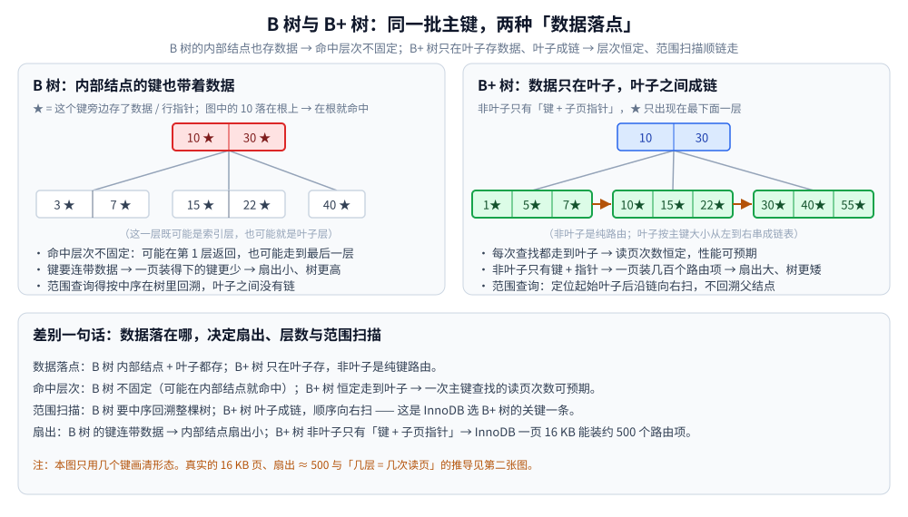
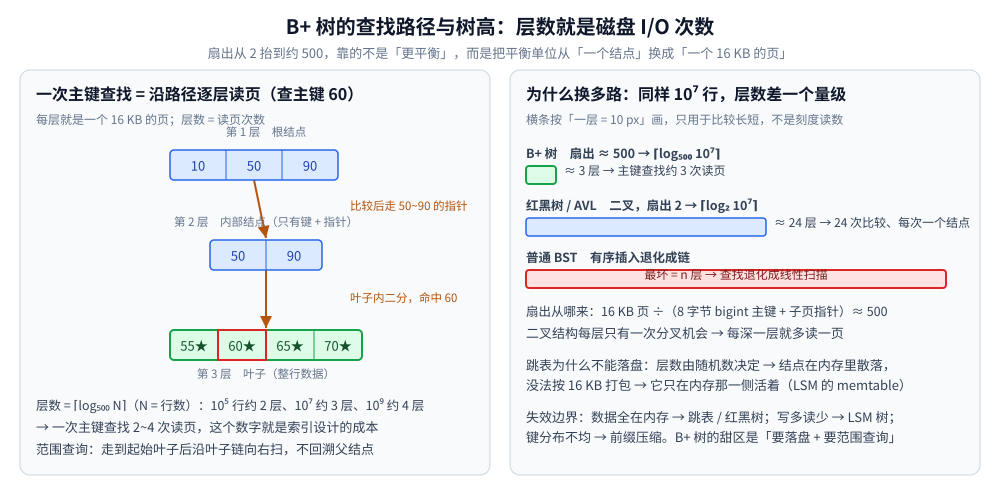
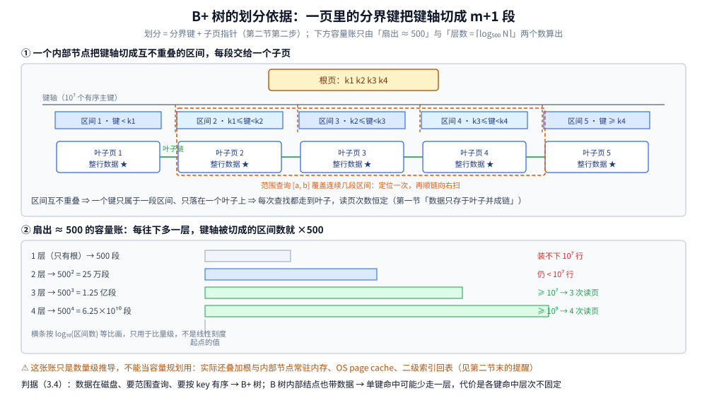

# B树与B+树

> 覆盖**多路平衡查找树**（B 树 / B+ 树）的结构差别，以及「为什么数据库索引用 B+ 树而不是红黑树或跳表」
> 这条推导的**每一步前提与失效边界**。
>
> 素材来源：博客 [数据结构](https://blog.csdn.net/weixin_43837229/article/details/103222660)（2019-11-24）——
> 本篇取该文的「树」一节中 B 树 / B+ 树部分；「工程推导」为本次整理补充。
> **分裂与合并的实现细节**见同目录 [平衡树.md](平衡树.md) 第三节，本篇不重复。
>
> 全目录的判据与选型总表见 [README.md](../README.md)。

---

## 一、B 树与 B+ 树的结构差别在哪？

**本节要点**：两者都是为"一次读一页"设计的——**高扇出（fan-out，即子节点数量）把层数压成近乎常数**；B+ 树额外把数据全放叶子并用链表串起来。

**B 树**是**平衡多路查找树**（m 叉）。它的查找分两种：一种是从一个结点查找另一结点的地址时需要**定位磁盘地址**，查找代价极高；另一种是把结点内的有序关键字序列放入内存优化查找（可用折半），代价极低。**B 树高度很小**，因此在这一背景下比任何二叉查找树效率都要高得多。

**B+ 树**是 B 树的变种，是一棵 n 叉树，包含根节点、内部节点和叶子节点；数据只存于叶子节点且叶子节点间用链表相连，因此**范围查询和顺序遍历效率更高**。

- **应用**：数据库索引、操作系统的文件系统
- ⭐ 记法：**B-树读作 "B 树"，中间的 `-` 只是连接符，不是"B 减树"**

## 二、为什么 InnoDB 索引用 B+ 树，而不是红黑树或跳表？

**本节要点**：磁盘上的树要优化的自变量不是"比较次数"而是"**读了几页**"——扇出决定层数，层数决定 I/O 次数。

先把**代价在哪**说清楚：内存里的树，一次比较几乎免费；磁盘上的树，**一次节点访问 ≈ 一次 I/O**。所以磁盘索引真正要优化的自变量不是"比较次数"，而是"**读了几页**"。

**第一步：磁盘按块读，所以"一页塞更多查找信息"是免费的红利。** InnoDB 的页默认 16 KB（`innodb_page_size` 可配，以官方文档为准），读 100 字节和读满一页成本几乎一样 → 最优策略是**一个节点恰好占一页，一页放尽量多的 `(键, 子页指针)`，把扇出（fan-out）做大**。

**第二步：扇出决定层数，层数决定 I/O 次数。** 用 8 字节 `bigint` 主键粗估，一页能放几百～上千个路由项；取扇出 ≈ 500，树高 = ⌈log₅₀₀N⌉ → 10⁵ 行约 2 层、10⁷ 行约 3 层、10⁹ 行约 4 层，**一次主键查找就是 2～4 次读页**。

> ⚠️ 这里只推导"数量级怎么来的"：实际还叠加根/内部节点常驻内存、OS page cache、二级索引回表，**不能当容量规划用**。

**第三步：换成红黑树会怎样？** 它二叉、一结点一键，树高 = ⌈log₂N⌉，1000 万行约 24 层；且节点地址彼此离散，一次 I/O 顺带读不到"邻居"。**层数就是 I/O 次数**——B+ 树用高扇出把层数压成近乎常数，红黑树做不到。

**第四步：换成跳表行不行？** 不行，原因不在磁盘而在"打包"：跳表每层都是链表，**没法把"下一步该看谁"预先排进同一页**，也没法在磁盘上做随机指针改写。所以跳表只出现在**纯内存**位置（LSM 的 memtable），结构细节见 [平衡树.md](平衡树.md) 第四节。

**第五步：叶子之间的链表为什么关键？** 数据只放叶子、叶子用链表串起来，于是 ① 范围查询 `WHERE id BETWEEN a AND b` 只需走树定位到 `a` 的叶子（层数次 I/O），然后**顺链表顺序读**，可预读可批量——二叉树的中序遍历在磁盘上是来回折返的随机读；② 所有键都走到叶子层，**查询成本一致**，而红黑树最长路径可达最短路径 2 倍，尾延迟更抖。

**图怎么读**：上半张画的是**划分**——一个内部节点的 m 个分界键把键轴切成 m+1 段，每段交给一个子页，
区间**互不重叠**，所以一个键只可能落在一个叶子上（这正是第一节「数据只存于叶子、叶子成链」与第五步「所有键都走到叶子层」的几何说法）；
橙色虚线框是第五步的范围查询 `[a, b]`，它覆盖的区间是**连续**的，于是一次定位 + 顺链右扫就够。
下半张是**容量账**：只用第二节给出的两个数（扇出 ≈ 500、层数 = ⌈log₅₀₀N⌉）——
`500² = 25 万 < 10⁷` 说明 2 层不够，`500³ = 1.25 亿 ≥ 10⁷` 说明 3 层正好，`500⁴ = 6.25×10¹⁰ ≥ 10⁹` 对应「10⁹ 行约 4 层」。
⚠️ 横条按 `log₁₀(区间数)` 等比画，只用于比量级；这张账和第二节一样只是数量级推导，不能当容量规划用（就是上面那条 ⚠️ 提醒说的同一件事）。

### 这张推导的失效边界

| 场景 | 结论为什么会翻转 |
|---|---|
| 数据全在内存（缓存、内存库） | I/O 不再是瓶颈，跳表/红黑树实现更简单，页管理反成负担 |
| 写多读少、要极致吞吐 | B+ 树"原地改页"带来随机写 + 页分裂，于是改用 LSM 树（顺序写换读放大） |
| 键分布极度不均 / 前缀高度重复 | 扇出塌陷，需要前缀压缩或换别的结构 |

> 索引在 MySQL 里的具体落地（回表、覆盖索引、索引失效）见 [索引设计与EXPLAIN.md](../../../03-数据与中间件/数据存储/关系型/MySQL/索引设计与EXPLAIN.md)。

---

## 三、应用场景

**本节要点**：B+ 树是**磁盘索引的默认结构**；B 树在嵌入式数据库与文件系统里也有落地，但不同系统对它的用法有**层级差异**，不能一概而论。

### 3.1 应用场景总表

| 场景 | 具体产品 / 系统 | 用 B 树还是 B+ 树 | 为什么 |
|---|---|---|---|
| **关系型数据库索引** | MySQL InnoDB（聚簇索引 + 二级索引）、PostgreSQL、Oracle、SQL Server | **B+ 树** | 数据全在叶子、叶子成链 → 范围查询顺链扫；层数少 → I/O 次数少 |
| **文件系统** | NTFS、XFS、Btrfs、ext4 的目录索引（htree） | **B+ 树变种** | 目录项与元数据要按 key 有序、支持范围扫描。⚠️ 数据块的分配通常走 **extent**，不是 B 树 |
| **嵌入式数据库** | SQLite | **B 树变种**（表与索引都在 B 树家族里） | 单文件、页式管理；内部节点带数据，单键查找可能少走一层 |
| **LSM 引擎内部** | RocksDB / LevelDB 的 SSTable 块索引 | **B 树索引** | 每个数据块内部仍需按 key 定位 —— 块索引本身就是一棵小 B 树 |
| **文档数据库** | MongoDB 的 WiredTiger（默认） | **B+ 树变种** | 索引要支持范围查询与排序 |

### 3.2 深入辨析：不同系统的层级差异

**1. 数据库引擎：都落在「索引层」**

- **InnoDB（MySQL 默认引擎）**：**聚簇索引**（主键索引，叶子节点直接存整行）与**二级索引**（叶子存主键值，命中后需回表）都用 B+ 树。默认页 **16 KB**（`innodb_page_size` 可配，以官方文档为准），**树高 = 一次主键查找的读页次数** —— 这正是第二节「层数 = I/O」推导的落点。
- **PostgreSQL**：索引类型里的 `btree` 是对 B 树的经典改进 —— **所有键都放在叶子**、**叶子之间成链**，实践上比标准 B 树更接近 B+ 树形态。⚠️ **别简单写成「PG 用 B+ 树」**：它本质是「B 树家族里偏向 B+ 形态的实现」，承认这个细节比套一个名词更准确。
- **SQLite**：表数据用 **B 树**组织，**索引**使用 **B+ 树的变体**（公开文档的说法），叶子成链以支持范围扫描。
- **MongoDB**：默认存储引擎 **WiredTiger** 的索引同样属于 B 树 / B+ 树家族（具体实现细节以官方文档为准，不在此写死）。

⭐ **共同点**：它们都落在「**索引层**」—— 要回答的是「键 → 位置」的映射，而不是「数据本身长什么样」。键有序、要范围扫、要按页读，正好是 B+ 树的强项。

**2. 文件系统：分清「元数据索引」与「数据块分配」**

文件系统的元数据查找也普遍借 B 树家族，但这里**必须区分两件事**：

- **元数据索引**（文件名 → inode、逻辑块 → 物理块）：用 **B+ 树家族**；
- **数据块的分配**：用的是 **extent（连续块区间）**，本质是「起始块 + 长度」的区间记录 —— **不是把每个块都塞进 B+ 树**。

公开资料里常见的对应关系（**粗粒度陈述，不写具体表名**）：

- **ext4**：目录索引用 **htree**（B 树风格的哈希树）来避免大目录的线性扫描。
- **XFS**：用 B+ 树索引管理分配组、空闲空间与扩展属性等元数据。
- **NTFS**：用 B+ 树组织目录与部分元数据。
- **Btrfs**：用 B 树家族结构管理元数据与 extent。
- **HFS+**：用 B+ 树管理目录与文件分配信息。

⚠️ **不确定就不要写死**：以上只断言「X 系使用 B+ 树 / B 树家族索引」这一层；**具体是哪个变体、哪些表**各家实现有差异，别把博客里的具体名字当成事实搬运。

**3. LSM 引擎里也藏着 B+ 树**

LSM 树的**写路径**（MemTable + 分层 SSTable）走的是顺序写，与 B+ 树关系不大；但 **SSTable 内部**并非一整块无序数据 —— 它按 key 排序后切成若干 **block（数据块）**，并维护一份 **块索引（block index）**，记录「某个 key 大概落在哪个 block」。**这份块索引本身就是一棵小型的 B+ 树 / B 树索引**：查询时先在块索引里定位 block，再在 block 内查找。

⭐ 所以 **LSM 树并没有「抛弃」B 树家族** —— 它只在「整库的组织方式」上换成了顺序写，**叶子块级的定位**依然借用 B 树索引的思想。

### 3.3 收尾判据：为什么这些位置的共同点是「读一页的成本 ≈ 读一个节点」

把这些落点放在一起，会发现它们共享同一个前提：

> **数据的读入单位是「一页」（磁盘页 / 内存页 / block），而读一页与读一个节点的成本几乎一样。**

于是 B+ 树的设计目标就顺理成章：

| 设计 | 它对上的成本项 |
|---|---|
| **一个节点 = 一页** | 让「读一个节点」恰好用满一次 I/O，不浪费带宽 |
| **高扇出（一页塞几百～上千个路由项）** | 把层数压成近乎常数 → **读页次数 ≈ 树高** |
| **数据全在叶子 + 叶子成链** | 范围查询只需「定位 + 顺链扫」，顺序读可预读 |

⚠️ **反过来也能推出失效边界**：一旦「读一页」不再是瓶颈（数据全在内存、或改用顺序写的 LSM），B+ 树这套「按页打包」的设计就不再划算 —— 这正是上面「失效边界」表里那几行的来源。对照指针化二叉树的缓存表现见 [树的缓存局部性对比.md](树的缓存局部性对比.md)。

### 3.4 本节小结：选型判据

**数据在磁盘、要范围查询、要按 key 有序** → B+ 树。

**B 树更优的少数场景**：单键查找为主、希望内部节点命中就立刻返回（少走一层）；但 B+ 树因范围查询顺链、且所有键都在同一层（查询代价一致），仍是主流。

---

## 延伸追问

- **为什么数据库索引用 B+ 树而不是红黑树？** → 红黑树是二叉、树高随数据量对数增长，磁盘 I/O 次数多；B+ 树单结点存多个关键字、树高极低，且叶子链表利于范围查询，能一次读入一个磁盘页。
- **同样是 O(log n)，B+ 树和跳表谁能当磁盘索引？** → 只有 B+ 树：它能按页打包路由信息、一次 I/O 换高扇出；跳表的节点是离散链表，无法打包，只能待在内存里。
- **B 树与 B+ 树的取舍差在哪一步？** → B 树内部结点也带数据，命中内部结点即可返回（单键查找可能少走一层）；B+ 树数据全在叶子且叶子成链，层数一致、范围查询顺链扫，代价是任何查找都要走到叶子。
- **B+ 树什么时候反而不如 LSM 树？** → 写多读少时：B+ 树原地改页 = 随机写 + 页分裂，LSM 用顺序写换读放大，吞吐更高。
- **PostgreSQL 的 `btree` 到底是 B 树还是 B+ 树？** → 都不是教科书的标准形态：它是 **B 树的经典改进**——所有键都放在叶子、叶子之间成链，实践上更接近 B+ 树。⚠️ 与其贴一个名词，不如记住「键全在叶子 + 叶子成链」这两个特征（见本节「数据库引擎」）。
- **文件系统是不是把索引和数据都塞进了 B+ 树？** → **不是**。要分清两层：**元数据索引**（文件名 → inode、逻辑块 → 物理块）用 B+ 树家族；**数据块分配**用的是 **extent（起始块 + 长度的区间记录）**，不是把每个块都塞进树里（见本节「文件系统」）。
- **LSM 树既然用顺序写，为什么还离不开 B 树索引？** → LSM 只在「整库组织」上换了顺序写；**SSTable 内部**按 key 切块并维护一份 **block index**，这份块索引本身就是一棵小型 B+ 树 / B 树索引 —— 顺序写与块级 B 树定位是两件事（见本节「LSM 引擎」）。

---

## 关联

- [平衡树.md](平衡树.md) — 实现与性质层：分裂/合并发生在哪、为什么「一个节点 = 一页」
- [树的形态与选型.md](树的形态与选型.md) — ⭐ **选型总纲**：各类树的分工与「隐藏代价总表」
- [LSM树.md](LSM树.md) — **本篇失效边界的展开**：写多读少改用 LSM 的实测代价（写放大 7.04 vs 原地改页模型 ≈ 151.7）
- [README.md](../README.md) — 选型总表（操作 × 隐藏代价 × 场景）
- [索引设计与EXPLAIN.md](../../../03-数据与中间件/数据存储/关系型/MySQL/索引设计与EXPLAIN.md) — B+ 树索引的 MySQL 落地
- [索引原理.md](../../../03-数据与中间件/数据存储/搜索与分析/Elasticsearch/索引原理.md) — 另一条路线：倒排索引与 FST
- [复杂度分析.md](../../算法/基础算法/复杂度分析.md) — 对数与扇出的口径
- [AVL树.md](AVL树.md) — 对照：内存平衡树把「一个节点」当平衡单位，B 树把它换成了「一个页」
- [树的缓存局部性对比.md](树的缓存局部性对比.md) — 对照：把「一次搬运」的单位从缓存行放大到页，局部性序列里 B+ 树为什么靠前
> 反向引用（本篇被下列文档引到）：[集合容器.md](../../../01-编程语言/java/集合容器.md)、[AVL树.md](AVL树.md)、[二叉搜索树.md](二叉搜索树.md)、[二叉树结构与性质.md](二叉树结构与性质.md)、[区间与索引树.md](区间与索引树.md)、[空间索引与R树.md](空间索引与R树.md)、[倒排索引.md](../高级数据结构/倒排索引.md)、[跳跃表.md](../高级数据结构/跳跃表.md)、[二分查找.md](../../算法/基础算法/二分查找.md)、[索引原理.md](../../../03-数据与中间件/数据存储/NoSQL/MongoDB/索引原理.md)、[关系型选型对比.md](../../../03-数据与中间件/数据存储/关系型/关系型选型对比.md)
