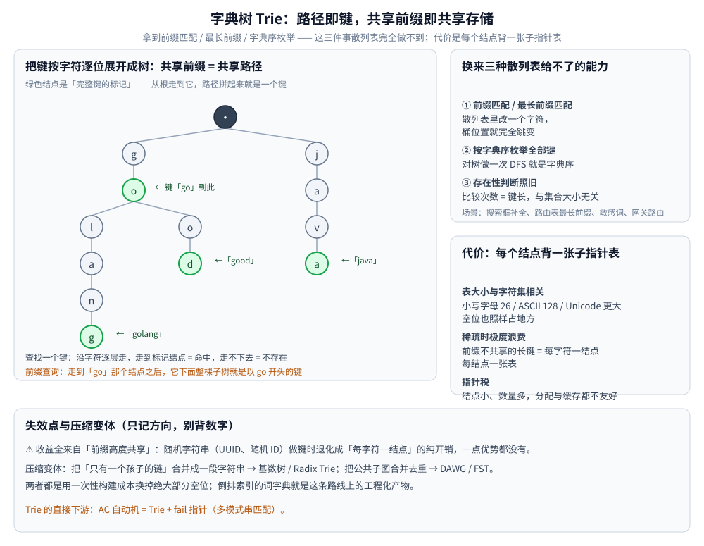

# Trie

> 覆盖「把键按字符逐位展开成树、共享前缀即共享路径」的结构：换来**前缀匹配 / 最长前缀 / 字典序枚举**，
> 这是散列表完全给不了的；代价是**每个节点都背一张子指针表**，稀疏时极度浪费。
>
> ⭐ 本篇是**结构篇**：讲形态、能力边界与内存代价。两个直接下游 ——
> [AC自动机.md](../../算法/字符串匹配/AC自动机.md)（Trie + fail 指针做多模式匹配）与
> [区间与索引树.md](区间与索引树.md) 第五节（压成 Radix 后替网关做路由的最长前缀匹配）。
>
> 素材来源：博客 [数据结构](https://blog.csdn.net/weixin_43837229/article/details/103222660)（2019-11-24）——
> 本篇取该文「补充结构」一节的字典树部分；**工程动机**为本次整理补充，
> 参考《数据结构和算法图解》（杰伊·温格罗）与《算法图解》（巴尔加瓦）。逐篇登记见 [素材清单](../../../素材清单.md)。
>
> 全目录的判据与选型总表见 [README.md](../README.md)；树的选型总纲见 [树的形态与选型.md](树的形态与选型.md)。

---

## 一、字典树（Trie）与前缀匹配换来什么能力？

**本节要点**：把键按字符逐位展开成树，共享前缀即共享路径——于是拿到**前缀匹配 / 最长前缀 / 字典序枚举**，这是散列表完全给不了的。

**结构**：把键按字符逐位展开成树，从根到某个标记节点的路径就是一个完整键；共享前缀自然共享路径。



**它换来什么能力**：**前缀匹配 / 最长前缀匹配 / 按字典序枚举**——这些是散列表完全做不到的（散列表里改一个字符，桶位置就完全跳变）。典型场景：搜索框自动补全、IP 路由表最长前缀匹配、敏感词匹配、网关按 path 前缀路由。

**内存代价在哪**（定性讲，别背数字）：

| 成本项 | 说明 |
|---|---|
| 每节点一个"子指针表" | 表大小与**字符集**相关（小写字母 26 / ASCII 128 / Unicode 更大），空位也占地方 |
| 稀疏时极度浪费 | 前缀不共享的长键，等于每个字符一个节点、每个节点背一张表 |
| 指针税 | 节点小、数量多，分配与缓存都不友好 |

**压缩变体（只记方向）**：把"只有一个孩子的链"合并成一段字符串（**基数树 / Radix Trie**），或把公共子图合并去重做成 **DAWG/FST**——用一次性构建成本换掉绝大部分空位。倒排索引的词字典就是这条路线上的工程化产物（见 [索引原理.md](../../../03-数据与中间件/数据存储/搜索与分析/Elasticsearch/索引原理.md)）。

> ⚠️ 失效点：Trie 的收益来自**前缀高度共享**。随机字符串（如 UUID、随机 ID）做键时它退化成"每字符一节点"的纯开销，一点优势都没有。

## 二、应用场景

**本节要点**：Trie 的不可替代性在于**前缀共享**与**按字符逐层查找**。

### 2.1 应用场景总表

| 场景 | 具体产品 / 系统 | 为什么用 Trie |
|---|---|---|
| **自动补全 / 输入法** | 搜索引擎搜索框、手机输入法 | 按前缀逐层查，天然支持「以某前缀开头的所有词」 |
| **拼写检查** | 文本编辑器、词典工具 | 按字符走树，快速判断词是否存在（配有限编辑距离剪枝） |
| **IP 路由（最长前缀匹配）** | 路由器转发表、Linux 内核 `FIB` 的 **LC-trie** | 按 bit 逐层匹配，找最长前缀 |
| **敏感词过滤** | 内容审核系统 | 多模式匹配 —— **AC 自动机就是 Trie + 失败指针** |
| **T9 输入法** | 老式手机键盘 | 数字序列映射到字母组合 |
| **词典 / 词频统计** | 搜索引擎倒排索引的词典（**FST** 进一步压缩） | 前缀共享省空间 |

### 2.2 深入辨析：Trie 在你的系统里以什么形式出现

**1. 搜索框的自动补全**

用户输入 `/api` 要立刻列出「以它开头的所有键」—— 这正是 Trie 的定义域。⚠️ 真正难的不是遍历，而是**给结果排序**（按热度 / 频率），所以工程实现通常是「Trie 定前缀 + 每个节点挂 Top-K 候选」。

**2. 网关与 IP 路由表的「最长前缀匹配」**

路由要的从来不是等值命中，而是「走得越深越优先」，所以底层用的是 Trie 的压缩形态 Radix（比较次数 = **路径段数**而非字符数，几千条路由也不会慢）。机制与实测见 [区间与索引树.md](区间与索引树.md) 第五节；Linux 内核的 FIB（转发信息库）用的是 **LC-trie**（level-compressed trie，在路径压缩基础上再做层级压缩）—— `ip route` 里成千上万条路由，正是靠「比较次数 = 路径段数」才不至于每次转发都扫一遍表。⚠️ 路由协议与选路语义见 [IP与路由基础.md](../../网络/网络层与寻址/IP与路由基础.md)，这里只讲「用什么结构把表查得快」。

**3. 敏感词与多模式匹配**

Trie 是 AC 自动机的底座 —— 把 Trie 的失配跳转补成 fail 指针，就得到「一次扫描命中全部模式」的能力（见 [AC自动机.md](../../算法/字符串匹配/AC自动机.md)）。⚠️ **这两篇不重复**：Trie 讲结构与代价，AC 自动机讲 fail 怎么算。

**4. `git` 与编译器的字符串去重**

把公共子串合并成有向无环图的 DAWG / FST，是「词典省内存」的通用手段 —— 判据是**这份词典要被反复加载几次**，一次构建成本要靠多次加载摊回来。

**5. 拼写检查、词典与 IDE 代码补全**

- **拼写检查与词典**：词典天然是「一组短字符串 + 前缀高度共享」，正落在 Trie 的舒适区。工程上有两条常见路线 —— ① **Trie + 有限编辑距离剪枝**：沿树下行时同步维护「已用掉的编辑次数」，超出阈值就剪枝，避免对全词典逐个算编辑距离；② 用按编辑距离分层的检索树（公开资料里常称 **BK 树**，Burkhard-Keller tree），查询只访问与目标词编辑距离相近的分支。⚠️ 只判「拼写合不合法」时，只需要 Trie 的存在性查询，用不上上面任何一条。
- **IDE 的代码补全**：本质和搜索框补全是同一件事 —— 把当前作用域的标识符（符号表）建一份前缀索引，敲几个字符就枚举候选，再按「作用域优先级 / 最近使用频率」排序。⚠️ 差别只在**候选来源**：搜索框的候选来自用户历史与热度，IDE 的候选来自语言服务（编译器解析出的符号表）。

**6. Trie 在内存里真正贵在哪（指针税）**

Trie 的成本不在键本身，而在**每个节点都要为「可能出现的所有子字符」预留位置**。设字符集大小为 `C`、指针宽 8 字节：

```text
每节点开销 ≈ C × 8 字节
  小写字母  C = 26  →  208 字节
  ASCII     C = 128 →  1024 字节
  Unicode   C 更大  →  更离谱
```

⭐ **要命的是这个开销与「实际有几个孩子」无关** —— 一个只有 1 个孩子的节点，照样背着一整张空表。键越长、前缀越不共享，节点越多，空位就越多。

工程上三条省内存的路线（都只是「把空位压掉」的不同姿势）：

| 路线 | 做法 | 代价 |
|---|---|---|
| **换掉定长子表** | 子表在小数组 / 哈希 / 有序数组里按节点稀疏程度动态切换 | 查找常数变大、实现复杂 |
| **压缩边**（Radix） | 把「只有一个孩子的链」合成一条边，消掉独苗节点 | 插入 / 删除要拆并边 |
| **双数组 Trie** | 用 `base` / `check` 两个整数数组表达整棵树，指针全换成下标 | 更新不灵活，构建 / 重建成本高 |

⭐ **判据**：**词典一次构建、反复加载**（输入法词库、稳定词表）→ 优先双数组 / DAWG-FST；**词典要频繁增删**（用户自定义词、动态路由）→ 用压缩边的 Radix 或哈希节点，别硬上定长数组。

### 2.3 收尾判据

**判据**：**问题涉及「前缀」「逐字符匹配」「多模式匹配」** → Trie。
**不适用**：精确查找单个 key → 哈希表；**有序范围查询 → 平衡树**（Trie 的「有序」只是字符串字典序意义上的）。

---

## 延伸追问

- **Trie 和散列表都能做"存在性判断"，差别在哪？** → 散列表只能等值；Trie 天生支持**前缀匹配 / 最长前缀**，代价是每个节点都背一组子指针，内存开销大。
- **Trie 的内存在什么情况下会爆？** → 键长且前缀不共享时（随机串、UUID）：节点数 ≈ 字符总数，每个节点还各背一张子表。解法是缩小字符集（把 `[26]int` 换成哈希 / 压缩边）、或用基数树 / DAWG 合并独苗链与公共子图。
- **Trie 和 Radix Tree 该怎么选？** → 要**逐字符**的细粒度操作（如敏感词逐位回退）用 Trie；只要**最长前缀匹配**且路径是长字符串（URL、IP）用 Radix —— 比较次数从"字符个数"降到"路径段数"。⚠️ 代价是插入 / 删除要处理**边的分裂与合并**。
- **为什么网关路由不用哈希表？** → 哈希命中即结束，回答不了"哪个候选前缀最长"；Radix 必须走到走不动为止，最后记下的那个才是最长前缀（详见 [区间与索引树.md](区间与索引树.md) 第五节）。
- **Trie 能替代 B+ 树做磁盘索引吗？** → 不能。Trie 的节点小而多、指针追逐，**无法按页打包**，磁盘上每次下探就是一次随机 I/O；磁盘索引的活归 [B树与B+树.md](B树与B+树.md)。
- **Trie 的内存到底贵在哪，怎么省？** → 贵在**每个节点都为整个字符集预留指针位**，且与“实际有几个孩子”无关（字符集 `C` 越大越离谱）。省法是三条：换掉定长子表（小数组 / 哈希）、压缩独苗链（Radix）、换成双数组 Trie。⭐ 选哪条看**词典要不要频繁增删**。
- **拼写纠错为什么不在 Trie 上把全词典枚举一遍？** → 全枚举就是“对词典里每个词各算一次编辑距离”。做法是**带着编辑距离预算下行**：沿 Trie 走时同步记录已用掉的编辑次数，超预算即剪枝；另一条路线是按编辑距离分层的 BK 树。两者都把“全枚举”降成“只看可能相近的分支”。

---

## 关联

- [区间与索引树.md](区间与索引树.md) — Radix 压缩（同一组词节点数 9 → 6）与网关最长前缀匹配的完整推演
- [AC自动机.md](../../算法/字符串匹配/AC自动机.md) — Trie + fail 指针（多模式匹配），Trie 的直接下游
- [KMP.md](../../算法/字符串匹配/KMP.md) — 单模式匹配的对应物（前缀函数），与 fail 指针同源
- [散列表.md](../哈希表/散列表.md) — Trie 要替代的那个「等值命中」
- [树的形态与选型.md](树的形态与选型.md) — 本目录（树）的**选型总纲**：各类树的分工与隐藏代价
- [索引原理.md](../../../03-数据与中间件/数据存储/搜索与分析/Elasticsearch/索引原理.md) — 词典 FST 的工程落地
- [README.md](../README.md) — 数据结构目录的选型总表（操作 × 隐藏代价 × 场景）
- [倒排索引.md](../高级数据结构/倒排索引.md) — 词词典的前缀枚举与省内存（与本篇压缩变体同一族问题）
- [网关路由匹配.md](../../../01-编程语言/go/网络编程/网关路由匹配.md) — 「最长前缀匹配」在网关里的工程实现
> 反向引用（本篇被下列文档引到）：[可持久化数据结构.md](可持久化数据结构.md)、[空间索引与R树.md](空间索引与R树.md)、[倒排索引.md](../高级数据结构/倒排索引.md)、[内容审核与合规.md](../../../04-架构与系统/系统设计/IM系统/内容审核与合规.md)、[搜索与历史.md](../../../04-架构与系统/系统设计/IM系统/搜索与历史.md)
