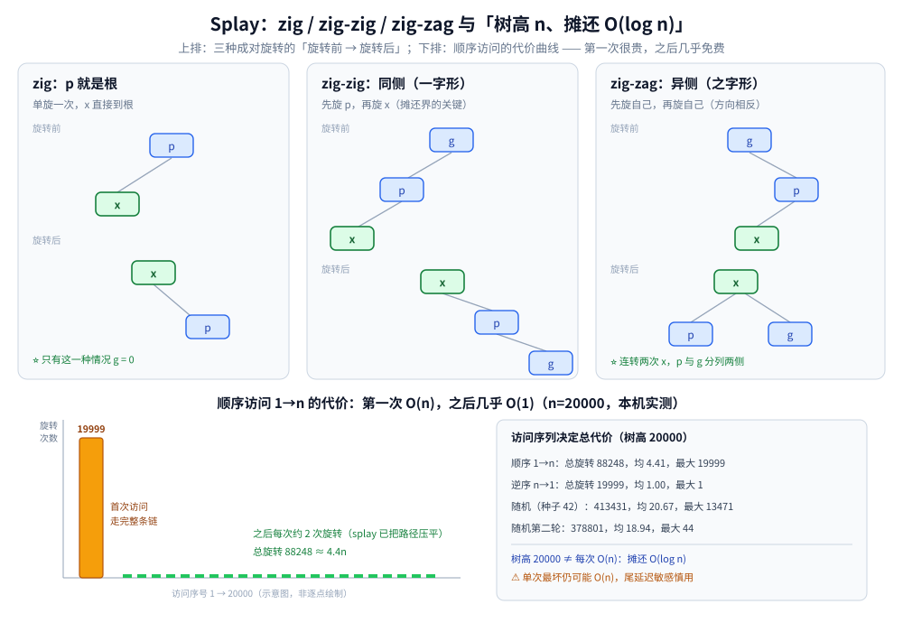

# Splay

> 覆盖：Splay（伸展树）这条**不存任何平衡信息**的路线 —— 每次访问都把节点通过旋转提到根，
> 树形随访问模式自适应；单次操作可能 `O(n)`，但一串操作的**摊还**代价是 `O(log n)`。
> 本篇给出 zig / zig-zig / zig-zag 三种旋转、摊还势能论证、顺序访问与随机访问的实测对照，以及适用边界。
>
> 不覆盖：AVL / 红黑树的确定性平衡见 [AVL树.md](AVL树.md)、[红黑树.md](红黑树.md)；
> 随机优先级路线见 [Treap.md](Treap.md)；
> 平衡树族总纲与选型见 [平衡树.md](平衡树.md)；
> 摊还分析的一般口径见 [复杂度分析.md](../../../算法/基础算法/复杂度分析.md)。
>
> 内容整理自个人学习笔记，素材见 [素材清单](../../../../素材清单.md)。
>
> 📎 本篇实测为本机容器实跑逐字抄录：**Go 1.26.8（linux/amd64）**，访问序列固定，输出可复现。

---

## 一、Splay 为什么不需要存任何平衡信息？

**本节要点**：AVL 存高度、红黑树存颜色、Treap 存随机优先级；Splay **什么都不存**，只存 BST 的 key 与左右孩子指针。它的「平衡」不是某个时刻的结构性质，而是**一串操作的摊还性质** —— 每次访问都把节点提到根，贵的操作会顺手把树改得更适合后面的访问。

### 1.1 唯一的规则：访问即提到根

Splay 树的核心动作叫 **splay(x)**：通过一系列旋转把节点 `x` 变成根。查找、插入、删除都以 `splay` 收尾：

| 操作 | 做法 |
|---|---|
| 查找 `key` | 按 BST 找到节点（或走到空），对最后一个访问到的节点 `splay` |
| 插入 `key` | 按 BST 挂到叶子，对新节点 `splay` |
| 删除 `key` | 先 `splay(key)` 到根，再合并左右子树（把左子树的最大节点 `splay` 到左子树根，接上右子树） |

⭐ **没有平衡因子、没有颜色、没有优先级**：每个节点只需要 `key`、`left`、`right`、`parent`。树的形状完全由「访问了谁」决定。

### 1.2 它保证的是什么

| 性质 | Splay | AVL / 红黑树 | Treap |
|---|---|---|---|
| 单次最坏 | **`O(n)`**（可能是一条链） | `O(log n)` | 期望 `O(log n)` |
| 一串操作 | **摊还 `O(log n)`** | 最坏 `O(log n)` | 期望 `O(log n)` |
| 额外元数据 | 无（只要父指针） | 高度 / 颜色 | 随机优先级 |
| 自适应访问模式 | **强**（热数据被提到根附近） | 无 | 无 |

⚠️ **不要把「摊还 `O(log n)`」误读成「每次 `O(log n)`」**：Splay 允许某一次访问走完整条链（本机实测最大 `19999` 次旋转），只是它会把后续访问变便宜。对尾延迟敏感的系统，这个「偶发长尾」是硬伤。

---

## 二、zig / zig-zig / zig-zag 三种旋转怎么组合？

**本节要点**：`splay(x)` 不是「一路单旋到根」，而是看 `x`、父 `p`、祖父 `g` 的相对位置，分三种情况成对旋转。成对旋转是摊还界成立的关键 —— 一路单旋（move-to-root）不能保证 `O(log n)` 摊还。

### 2.1 三种情况

设 `x` 的父节点为 `p`，祖父为 `g`：

| 情况 | 形态 | 动作 |
|---|---|---|
| **zig** | `p` 就是根 | 对 `x` 旋转一次，`x` 到根 |
| **zig-zig** | `x` 与 `p` 同为左孩子，或同为右孩子（一字形） | **先旋 `p`，再旋 `x`** |
| **zig-zag** | `x` 是左孩子、`p` 是右孩子（或反过来，之字形） | **先旋 `x`，再旋 `x`**（两次方向相反） |

⭐ 记忆：**同侧先父后子，异侧连转两次自己**。zig-zig 先转 `p` 是它与「一路单旋」的唯一区别，也是摊还分析里势能下降的来源。



**图怎么读**：上排三种形态各画「旋转前 → 旋转后」，节点旁标出旋转顺序；下排是第三节实测的顺序访问代价 —— 第一次访问深节点很贵，之后每次只花常数次旋转。

### 2.2 代码

```go
func rotate(x int) { // 把 x 向上转一层
	p := s[x].parent
	g := s[p].parent
	if s[p].left == x {
		b := s[x].right
		s[p].left = b
		if b != 0 {
			s[b].parent = p
		}
		s[x].right = p
	} else {
		b := s[x].left
		s[p].right = b
		if b != 0 {
			s[b].parent = p
		}
		s[x].left = p
	}
	s[p].parent = x
	s[x].parent = g
	if g != 0 {
		if s[g].left == p {
			s[g].left = x
		} else {
			s[g].right = x
		}
	} else {
		root = x
	}
}

func splay(x int) {
	for s[x].parent != 0 {
		p := s[x].parent
		g := s[p].parent
		if g != 0 {
			if (s[g].left == p) == (s[p].left == x) {
				rotate(p) // zig-zig：先父
			} else {
				rotate(x) // zig-zag：先自己
			}
		}
		rotate(x) // 最后总是转自己；zig 情况 g == 0，只转这一次
	}
}
```

⚠️ **父指针必须同步维护**：Splay 没有额外的平衡信息，`parent` 是唯一能往上走的线索；旋转里漏掉任何一处 `parent` 赋值，`splay` 会死循环或把树拆坏。

---

## 三、摊还 `O(log n)` 是怎么来的？

**本节要点**：用势能法。定义 `Φ = Σ log₂(size(v))`（`size(v)` 是子树节点数），一次 `splay(x)` 的旋转次数记为 `r`，可以证明 `r ≤ 3(log₂n − depth(x)) + 常数`，于是把 `Φ` 的变化算进去后，每次访问的摊还代价是 `O(log n)`。

### 3.1 直觉版

- 把节点 `x` 提到根，会**降低**它路径上那些「大子树」的深度，`Φ` 下降；
- 旋转本身最多让 `Φ` 上升一个常数；
- 贵的访问（`x` 很深）恰好对应 `Φ` 的大幅下降 —— **贵操作自己付了账**，后面的操作因此变便宜。

⭐ 这就是「摊还」的含义：不是每次都快，而是**一串操作的总额**有界。顺序扫描、局部性强的访问模式，实际代价远低于最坏值（见第四节）。

### 3.2 为什么不能「一路单旋到根」

如果每次只做 zig（单旋），一串操作的总代价可能达到 `O(n log n)` 甚至更差；zig-zig 的「先父后子」会把路径上的结构成对压平，才能把势能下降与旋转次数绑定。⚠️ **这是 Splay 实现里最容易写错的地方**：代码看起来只差一行，摊还界就没了。

---

## 四、实测：树高可以等于 `n`，顺序访问仍然很便宜

**本节要点**：`n=20000` 个升序键连续插入后，Splay 的树高就是 **20000**（一条左链）—— 单看树高，它比普通 BST 还糟。但紧接着的顺序访问总旋转只有 **88248**（约 `4.4n`），逆序访问只要 **19999**（约 `1.0n`）；随机访问则升到约 **20n**。**树高不是 Splay 的成本指标，访问序列才是。**

### 4.1 插入：升序键把树拉成一条链

```text
===== Splay：20000 个升序键连续插入 =====
插入总旋转=19999，插入后树高=20000
```

⭐ 原因很直接：每次插入的新 key 都是当前最大值，挂在最右侧，然后被 `splay` 到根。一次旋转后，新根带着一条向左的长链 —— **树高线性增长**，但下一次插入仍然只访问最右侧，代价是 `O(1)`。

### 4.2 访问序列决定总代价（本机实测）

```text
访问序列              树高      平均比较   总旋转    平均旋转   单次最大旋转
顺序访问 1→n          20000     5.41       88248     4.41       19999
逆序访问 n→1          20000     2.00       19999     1.00       1
随机访问（种子 42）    36        21.67      413431    20.67      13471
随机访问（第二轮）     36        19.94      378801    18.94      44
```

⭐ **三组读数各自说明一件事**：

- **顺序访问**：第一次访问 `1` 要走完整条左链，`maxRot = 19999`；但这次 `splay` 把树压成了「根 + 右链」，之后每个 key 只花约 `2` 次旋转，**总额约 `4.4n`**。最坏单次 `O(n)`，摊还仍然 `O(log n)`。
- **逆序访问**：上一轮结束时根是 `n`（顺序访问的最后一个），逆序正好从根开始，每次访问深度 1，**总旋转约 `n`、单次最大 1**。
- **随机访问**：树高回落到 `36`，平均比较 `21.67`、平均旋转 `20.67`，接近 `O(log n)`；但**单次最大 `13471`** —— 一次冷访问仍可能走很远。第二轮因为树已被第一轮「预热」，平均旋转降到 `18.94`、最大只有 `44`。

⚠️ **这张表最该记住的是「树高 20000 但顺序访问很便宜」**：如果用 AVL / 红黑树的「树高」思维去评价 Splay，会得出完全错误的结论；它的成本必须按**访问序列**结算。

---

## 五、应用场景

**本节要点**：Splay 适合「**访问有局部性、能接受偶发长尾**」的场景；要求硬实时或最坏延迟时，选 AVL / 红黑树。

| 场景 | 为什么适合 / 不适合 |
|---|---|
| **缓存 / 工作集自适应** | 热数据被提到根附近，冷数据沉下去；访问局部性越强，效果越好 |
| **文本编辑器 / 序列结构** | 按位置访问、拼接、分裂；Splay 的「提到根 + 合并子树」很自然 |
| **Link-Cut Tree 的基础** | LCT 的每条偏好路径是一棵 Splay，`access` 操作依赖 `splay` 与父子路径切换 |
| **内存分配器 / 区间管理** | 按地址查找相邻空闲块，访问模式有局部性；但长尾要评估 |
| **硬实时 / 尾延迟敏感系统** | ❌ 单次可能 `O(n)`，不适合；选红黑树或 AVL |
| **纯随机访问的通用 Map** | ⚠️ 没有明显优势；标准库通常选红黑树 |

⭐ **判据一句话**：**访问有局部性、且能接受「偶尔一次很慢」→ Splay；要求每次都有上界 → AVL / 红黑树。**

---

## 六、具体使用：Go 里怎么落地

**本节要点**：Splay 的实现难点不在旋转，而在**父指针的维护**与**删除时的子树合并**；如果只是要一个有序容器，优先用标准库或成熟第三方库，不要为了「自适应」自己写 Splay。

### 6.1 最小接口

```go
type Splay struct {
	root int
	s    []snode
}

func (t *Splay) Find(key int) bool // 找到后 splay 到根
func (t *Splay) Insert(key int)    // BST 插入后 splay 新节点
func (t *Splay) Delete(key int)    // splay 到根后合并左右子树
func (t *Splay) Split(key int) (a, b *Splay)
```

### 6.2 删除的正确顺序

1. `splay(key)` 把目标提到根；
2. 若左子树为空，根 = 右子树；
3. 否则在左子树中找最大节点并 `splay` 到左子树根；
4. 让这个最大节点接管右子树。

⚠️ **第 3 步不能省**：直接把左子树挂到右子树下面会破坏 BST 序；必须先把左子树的最大节点提到根，它才没有右孩子，可以安全接上右子树。

---

## 延伸追问

- **Splay 的树高为什么会到 `n`？** → 升序插入时每个新节点都在最右侧，`splay` 后形成一条向左的长链；本机 `n=20000` 实测树高 `20000`。树高不是它的成本指标。
- **既然树高能到 `n`，为什么还说 `O(log n)`？** → 那是**摊还**界：一次深访问会把路径压平，后续访问变便宜。本机顺序访问第一次 `19999` 次旋转，之后每次约 `2` 次，总额约 `4.4n`。
- **Splay 和 Treap 怎么选？** → 要「随访问模式自适应」→ Splay；要「期望 `O(log n)` 且实现更简单、支持 `split` / `merge`」→ Treap（[Treap.md](Treap.md)）；要「最坏 `O(log n)`」→ 红黑树。
- **Splay 能做区间操作吗？** → 能：把「位置」当 key，`splay(l-1)` 与 `splay(r+1)`，中间子树就是区间；这也是 LCT 与文艺平衡树的基础。
- **为什么删除必须先 `splay` 到根？** → 只有目标在根时，左右子树才天然满足「左 < 根 < 右」，可以直接合并；否则要先处理 BST 序。
- **Splay 适合并发吗？** → ❌ 不适合：每次访问都可能沿整条路径旋转，影响范围大，锁的粒度很难缩小；并发有序结构通常选跳表（[跳跃表.md](../../高级数据结构/跳跃表.md)）。

## 关联

- **上游/总纲**：[平衡树.md](平衡树.md) — 平衡树族总纲与四条路线对照
- **对照/互补**：[Treap.md](Treap.md) — 随机优先级路线：期望 `O(log n)`、支持 `split` / `merge`
- **对照/互补**：[AVL树.md](AVL树.md) — 严格高度平衡，单次与最坏都是 `O(log n)`
- **对照/互补**：[红黑树.md](红黑树.md) — 颜色不变量，工程标准库的默认有序容器
- **上游基础**：[二叉搜索树.md](../二叉搜索树.md) — BST 序与旋转保序
- **下游机制**：[树链剖分.md](../../../算法/高级技巧/树链剖分.md) — 另一条「把树上路径拆成序列」的路线；LCT 的偏好路径用 Splay 维护
- **度量口径**：[复杂度分析.md](../../../算法/基础算法/复杂度分析.md) — 摊还分析、势能法的通用口径
> 反向引用（本篇被下列文档引到）：[树的形态与选型.md](../树的形态与选型.md)
