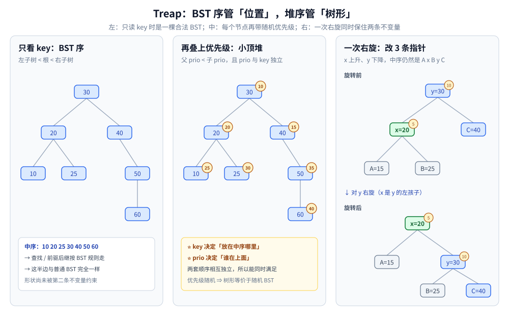

# Treap

> 覆盖：Treap（树堆）这条**随机化平衡路线** —— 它给每个节点再发一个**随机优先级**，
> 用「BST 按 key 有序 + 堆按优先级有序」两条不变量同时约束树形；插入靠旋转修复，
> 删除与区间操作靠 `split` / `merge`。本篇给出双不变量的论证、两套操作、与 AVL / 红黑树 / 跳表的边界，以及本机实测。
>
> 不覆盖：BST 本身的查找 / 插入 / 删除与退化见 [二叉搜索树.md](../二叉搜索树.md)；
> 平衡树族的横向选型见 [平衡树.md](平衡树.md)；
> AVL 与红黑树的旋转细节见 [AVL树.md](AVL树.md)、[红黑树.md](红黑树.md)；
> 「用随机层数代替旋转」的另一条路线见 [跳跃表.md](../../高级数据结构/跳跃表.md)。
>
> 内容整理自个人学习笔记，素材见 [素材清单](../../../../素材清单.md)。复杂度口径见 [复杂度分析.md](../../../算法/基础算法/复杂度分析.md)。
>
> 📎 本篇实测为本机容器实跑逐字抄录：**Go 1.26.8（linux/amd64）**，随机种子固定，输出可复现。

---

## 一、Treap 为什么能同时满足「BST 有序」和「堆序」？

**本节要点**：Treap 在普通 BST 的 key 之外，再给每个节点一个**与 key 无关的随机优先级**；key 满足 BST 序、优先级满足堆序。两条不变量各自管一件事 —— **中序决定有序输出，堆序决定树形**。

### 1.1 双不变量

| 不变量 | 约束什么 | 保证了什么 |
|---|---|---|
| **BST 序** | 左子树 key < 根 key < 右子树 key | 中序遍历 = 升序；查找 / 前驱后继的走法与普通 BST 相同 |
| **堆序**（以小顶堆为例） | 父节点优先级 < 两个孩子的优先级 | 优先级最小的节点在根；树形由优先级的相对大小决定 |

⭐ 关键在**「优先级随机且与 key 独立」**：key 决定节点放在中序的哪个位置，优先级决定谁在上面。
把节点按优先级从小到大依次插入一棵 BST，得到的树形就是 Treap 的树形 —— 这正是「**随机顺序建 BST**」，
所以 Treap 的期望高度与随机 BST 相同，约为 `4.311 ln n`（约 `2.99 log₂ n`）。

⚠️ 这是**期望**界，不是最坏保证：随机优先级恰好单调时，Treap 仍会退化成链（概率极低）。
需要「任何输入下都有硬上界」时，选 AVL / 红黑树，不是 Treap。



**图怎么读**：左面板只画 key，中序读出 `10 20 25 30 40 50 60`；中面板在节点角上标优先级，父节点优先级始终更小；右面板是一次右旋 —— 指针改了，但中序仍然是同一条序列。

### 1.2 和「随机插入的 BST」差在哪

普通 BST 的树形由**插入顺序**决定，而插入顺序往往接近有序（自增主键、时间戳），于是退化。
Treap 把「顺序」从**外部输入**搬到了**内部随机数**：即使 key 按升序到达，优先级仍是随机的，树形不再跟着 key 的到达顺序走。

⭐ 一句话：**Treap 不是让输入变随机，而是让「平衡」只依赖一个与输入无关的随机源。**

---

## 二、插入为什么只需要旋转？

**本节要点**：先按 BST 规则把新节点挂到叶子，再沿着回溯路径**向上旋转**，直到父节点优先级更小为止。旋转不改变中序，所以 BST 序始终成立；旋转次数等于新节点「向上冒泡」的层数。

### 2.1 上浮修复

以小顶堆为例，插入 `x` 后只有一种违反堆序的可能：`x` 的优先级比父节点小。此时对 `x` 与父节点做一次旋转：

- 若 `x` 是父节点的左孩子 → **右旋**；
- 若 `x` 是父节点的右孩子 → **左旋**。

旋转后 `x` 上升一层，原来的父节点成为它的孩子；继续比较新的父节点，直到堆序恢复或 `x` 到达根。由于每次旋转只改三个指针，**单次插入的旋转次数 ≤ 树高**，期望 `O(log n)`。

### 2.2 代码

```go
type node struct {
	key, prio, left, right int
}

func rotateRight(y int) int { // y 的左孩子上升
	x := tr[y].left
	tr[y].left = tr[x].right
	tr[x].right = y
	return x
}

func rotateLeft(x int) int { // x 的右孩子上升
	y := tr[x].right
	tr[x].right = tr[y].left
	tr[y].left = x
	return y
}

func insert(root, idx int) int {
	if root == 0 {
		return idx
	}
	if tr[idx].key < tr[root].key {
		tr[root].left = insert(tr[root].left, idx)
		if tr[tr[root].left].prio < tr[root].prio {
			root = rotateRight(root)
		}
	} else {
		tr[root].right = insert(tr[root].right, idx)
		if tr[tr[root].right].prio < tr[root].prio {
			root = rotateLeft(root)
		}
	}
	return root
}
```

⚠️ 递归版写法短，但栈深 = 树高；树高期望 `O(log n)` 时没问题，极端退化时需要改成迭代或加栈保护。

### 2.3 删除的两条路

| 做法 | 步骤 | 代价 | 适合 |
|---|---|---|---|
| **旋转下沉** | 把待删节点与优先级更小的孩子旋转，直到它变成叶子，再摘掉 | 期望 `O(log n)` 次旋转 | 只需要单点删除 |
| **`split` + `merge`** | `split(root, key)` 拆成 `< key` 与 `≥ key` 两棵，丢弃目标节点后 `merge` 回来 | 期望 `O(log n)` | 区间删除、区间操作、可持久化 |

---

## 三、`split` / `merge` 为什么是 Treap 的「第二套接口」？

**本节要点**：`split` 按 key 把一棵 Treap 拆成两棵，`merge` 把两棵**键区间不重叠且左小右大**的 Treap 合成一棵；两者都只沿一条根到叶的路径递归，期望 `O(log n)`。有了它们，插入 = `split` + `merge`，区间操作 = 三次 `split`。

### 3.1 两个操作的定义

```text
split(root, key)  →  (A, B)
  A 中所有 key <  key
  B 中所有 key ≥ key

merge(A, B)       →  root
  前提：A 中所有 key < B 中所有 key
  结果：保留两棵树的节点与优先级，满足双不变量
```

### 3.2 递归规则

- `split(root, key)`：若 `root.key < key`，则 `root` 与它的左子树整体属于 `A`；递归拆右子树，把拆出的左半挂回 `root.right`。否则 `root` 属于 `B`，递归拆左子树。
- `merge(A, B)`：比较两个根的优先级，优先级更小的当新根；若 `A` 的根更小，递归 `merge(A.right, B)` 挂到 `A.right`；否则对称。

⭐ **这两个操作是 Treap 比 AVL / 红黑树多出来的一维能力**：旋转版平衡树也能删除，但「按 key 把树拆开、再拼回去」在 Treap 上是原生操作。可持久化 Treap、序列区间翻转（文艺平衡树）、按名次访问都建立在这套接口上。

---

## 四、实测：随机优先级把有序输入拉回 `O(log n)` 了吗？

**本节要点**：是。升序插入 10 万个 key 时，普通 BST 的树高 = `100000`，Treap 的树高只有 **39**；随机插入 10 万个 key 的平均查找比较 **21.16** 次，与随机 BST 的理论值 `2 ln n ≈ 23.0` 同量级。

### 4.1 树高、旋转与查找比较（本机实测）

同一套实现，分别按「随机顺序」与「升序」插入 `1..n`，再查找全部 key：

```text
n        mode    height  rotations  avgCmp  maxCmp  sorted
1024     random  21      1982       11.74   21      true
4096     random  28      8088       15.02   28      true
16384    random  32      32572      17.81   32      true
65536    random  38      130995     19.77   38      true
100000   random  41      199636     21.16   41      true
1024     sorted  23      1019       12.25   23      true
4096     sorted  26      4088       13.92   26      true
16384    sorted  35      16379      17.31   35      true
65536    sorted  39      65525      20.15   39      true
100000   sorted  39      99988      21.03   39      true
```

⭐ **三组读数各自说明一件事**：

- **升序不再退化**：`n=100000` 时树高 `39`，而普通 BST 是 `100000`（见 [平衡树.md](平衡树.md) 1.1）。Treap 把「输入有序」这个最坏条件消掉了。
- **随机插入的查找常数**：平均 `21.16` 次比较，`2 ln 100000 ≈ 23.03`；最坏 `41` 次 = 树高，说明单次查找就是「从根走到叶」。
- **旋转次数**：随机插入约 `2.00n`（`199636/100000`），升序插入约 `1.00n`（`99988/100000`）—— 升序时新节点总是挂在最右侧，冒泡路径短，反而旋转更少。

### 4.2 波动范围（同一规模、3 个随机种子）

```text
n=65536  random  height=41  rotations=130703  avgCmp=20.83
n=65536  random  height=44  rotations=130587  avgCmp=22.36
n=65536  random  height=39  rotations=130989  avgCmp=21.78
```

⭐ 三个种子的树高落在 `39~44`，旋转数几乎不变（`130.6k~131.0k`）。**随机优先级带来的波动存在，但量级稳定**；报告性能时应给范围，不要只抄一个种子。

⚠️ 这套实验没有测「对手构造优先级」的情况：`math/rand` 固定种子在对抗环境下可被预测，生产实现应使用不可预测的随机源，或把优先级派生自带密钥的哈希。

---

## 五、应用场景

**本节要点**：Treap 的落点集中在「**需要有序 + 区间拆分 + 实现简单**」的场景；要求硬最坏界或磁盘索引时，它不是第一选择。

| 场景 | 为什么用 Treap | 边界 / 替代 |
|---|---|---|
| **竞赛与教学中的有序容器** | 双不变量好证明、旋转只有两种、代码短 | 工程标准库更常选红黑树（[红黑树.md](红黑树.md)） |
| **可持久化序列** | `split` / `merge` 只沿路径复制，天然适合「版本化数组」 | 可持久化线段树的区间能力更强，见 [可持久化数据结构.md](../进阶与总结/可持久化数据结构.md) |
| **区间翻转 / 按名次访问** | 以「位置」为隐式 key，`split` 出区间后打翻转标记 | 需要按值查找时仍要 BST 序 |
| **内存中的轻量有序索引** | 比 AVL / 红黑树的删除 case 少，容易写对 | 要「任何输入都有 `O(log n)` 最坏界」→ AVL / 红黑树 |
| **并发写** | 旋转只动局部指针，但仍有父路径回溯 | 无锁实现通常选跳表（[跳跃表.md](../../高级数据结构/跳跃表.md)） |

⚠️ **不要把 Treap 当「更快的红黑树」**：两者的期望 / 最坏界不同。Treap 的 `O(log n)` 是**期望**，红黑树是**最坏**；对尾延迟敏感的系统，红黑树更稳。

---

## 六、具体使用：Go 里怎么落地

**本节要点**：工程里通常不直接手写 Treap，而是用「有序 map」或第三方库；如果确实要自己实现，优先把 `split` / `merge` 作为核心接口，插入删除都建立在它们之上。

### 6.1 最小可用接口

```go
type Treap struct {
	root int
	tr   []node
}

func (t *Treap) Insert(key, prio int) // 先按 BST 插入，再上浮
func (t *Treap) Delete(key int)       // 旋转下沉到叶子后摘除，或 split + merge
func (t *Treap) Find(key int) bool
func (t *Treap) Split(key int) (a, b *Treap)
func (t *Treap) Merge(other *Treap) *Treap
```

### 6.2 使用判据

| 你的需求 | 建议 |
|---|---|
| 只是要一个有序 Map / Set | 用语言标准库（Java `TreeMap`、C++ `std::map`、Go 用第三方有序容器） |
| 需要按 key 拆区间、再拼回去 | Treap 的 `split` / `merge` 是最短路径 |
| 需要版本化 | 可持久化 Treap；先读 [可持久化数据结构.md](../进阶与总结/可持久化数据结构.md) 的路径复制 |
| 需要严格最坏延迟 | 红黑树 / AVL，不用 Treap |

---

## 延伸追问

- **Treap 的优先级为什么必须与 key 独立？** → 若优先级可由 key 预测，输入就能构造出单调优先级，使树退化成链。优先级是「独立的随机源」时，树形才等价于随机 BST。
- **Treap 的期望高度是多少？** → 与随机 BST 相同，约 `4.311 ln n ≈ 2.99 log₂ n`。本机 `n=100000` 实测 `41`，`log₂n ≈ 16.6`，比值约 `2.47`。
- **为什么升序插入反而旋转更少？** → 新节点总在最右侧，向上冒泡的路径短；随机插入的落点分布在树中，平均冒泡层数更高（实测约 `2.00n` vs 升序 `1.00n`）。
- **Treap 和跳表都是「随机化平衡」，怎么选？** → Treap 是二叉树、支持 `split` / `merge` 与可持久化；跳表是链表、并发写和无锁实现更容易，但不能像 Treap 那样按 key 拆树（[跳跃表.md](../../高级数据结构/跳跃表.md)）。
- **`split` / `merge` 和旋转是什么关系？** → 两套等价接口：旋转版插入删除；`split` / `merge` 版把插入写成 `merge(A, merge(new, B))`、删除写成三次 `split`。后者更适合区间与持久化。
- **Treap 能做区间最值吗？** → 能，但要把「位置」当 key 并在节点上维护聚合值（子树最值 / 和），本质是「平衡 BST + 聚合信息」；静态区间查询用线段树更直接（[区间与索引树.md](../进阶与总结/区间与索引树.md)）。

## 关联

- **上游/总纲**：[平衡树.md](平衡树.md) — 平衡树族总纲：AVL / 红黑 / B+ / 跳表四条路线与选型
- **对照/互补**：[Splay.md](Splay.md) — 另一条摊还路线：不用随机优先级，靠「访问即提到根」摊还，单次最坏可到 `O(n)`
- **对照/互补**：[AVL树.md](AVL树.md) — 旋转修复 + 严格高度差 ≤ 1 的确定性路线
- **对照/互补**：[红黑树.md](红黑树.md) — 颜色不变量 + 最坏 `O(log n)`，工程标准库更常用
- **对照/互补**：[跳跃表.md](../../高级数据结构/跳跃表.md) — 随机层数代替旋转；并发写更友好
- **下游机制**：[可持久化数据结构.md](../进阶与总结/可持久化数据结构.md) — 路径复制与版本化；Treap 的 `split` / `merge` 是常见载体
- **上游基础**：[二叉搜索树.md](../二叉搜索树.md) — BST 序、查找与退化（Treap 的前半部分不变量）
- **度量口径**：[复杂度分析.md](../../../算法/基础算法/复杂度分析.md) — 期望复杂度与最坏复杂度的区别

> 反向引用（本篇被下列文档引到）：[树的形态与选型.md](../树的形态与选型.md)、[笛卡尔树.md](../进阶与总结/笛卡尔树.md)
