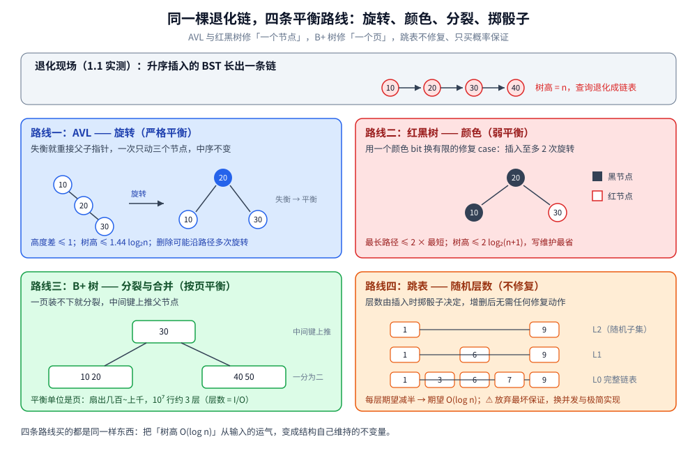

# 平衡树

> 从「BST 退化成一条链」这一个问题出发：**AVL 靠旋转、红黑树靠颜色、B+ 树靠多路、跳表靠掷骰子** ——
> 四条「维持 `O(log n)` 高度」的路线，以及**它们之间怎么选**。
>
> ⭐ 本篇是**平衡树族的「总纲 + 选型」**：为什么需要平衡（第一节）、AVL 与红黑树怎么选（第二节），
> 外加另外两条路线的判据（第三节 B+ 树怎么把平衡搬到磁盘、第四节跳表为什么不用旋转）。
> **两棵内存平衡树的实现细节已各自独立成篇**：[AVL树.md](AVL树.md)（四种旋转逐个怎么转、`1.44` 界怎么来）与
> [红黑树.md](红黑树.md)（五条性质、高度界推导、性质校验器、插入修复的三种情况）——
> 本篇只保留**对照与判据**，不再重复它们的旋转与变色过程。
>
> ⭐ 更外层的「AVL / 红黑树 / B 树 / B+ 树 / 跳表分别是什么」概述见同目录 [树的形态与选型.md](树的形态与选型.md)；
> **「InnoDB 为什么用 B+ 树」的完整推导**见 [B树与B+树.md](B树与B+树.md)，另有
> [索引设计与EXPLAIN.md](../../../03-数据与中间件/数据存储/关系型/MySQL/索引设计与EXPLAIN.md)（MySQL 侧的落地）。
> **BST 本身的操作（查找 / 插入 / 删除 / 前驱后继）与退化机制**见 [二叉搜索树.md](二叉搜索树.md)，
> 其中**第七节**给出「随机插入也不等于 `log n`」的实测 —— 本篇从**「怎么把高度修回去」**接着讲。
>
> 内容整理自个人学习笔记，素材见 [素材清单](../../../素材清单.md)。复杂度口径见 [复杂度分析.md](../../算法/基础算法/复杂度分析.md)。
>
> 📎 本篇第一节的退化实测为本机实跑逐字抄录：**Go 1.26.5（windows/amd64）** 与 **JDK 1.8.0_321** 两侧输出**逐行对齐**（`diff` 为空）。

---

## 一、为什么需要平衡树？

**本节要点**：二叉查找树的 `O(log n)` 有一个**默认前提 —— 它是平衡的**。一旦插入顺序不友好，它退化成链表、查询变成 `O(n)`。平衡树就是**用额外的维护操作把这个前提强行维持住**。

### 1.1 BST 的退化（实测）

BST 的查找成本 = **树高**。插入顺序决定树高（本机实跑）：

```text
===== 实验一：BST 有序插入的退化 =====
n       log2(n)  有序插入树高  随机插入树高(5 次平均)
1024    10        1024          21.0
4096    12        4096          27.0
16384   14        16384         33.2
65536   16        65536         40.2
```

⭐ **两个数字对比触目惊心**：

- **有序插入**（`1, 2, 3, …`）：每个新元素都往右挂 → 树高 = `n`。`n = 65536` 时树高 **65536**，而 `log2(n)` 只有 **16** —— **差了 4096 倍**。此时 BST **就是一条链表**，查找退化成线性扫描。
- **随机插入**：树高落在 `40` 左右，和 `2~3 × log2(n)` 同量级 —— 随机顺序下 BST 表现得**不错**，但这是**概率上的**，没法保证。

⚠️ **「随机插入就没事」是个危险的安慰**：真实数据常常**接近有序**（自增主键、时间戳、日志序号、按 ID 批量导入），恰好是最坏情况。**所以工程上不能依赖「输入是随机的」。**

### 1.2 平衡的定义与代价

| 结构 | 平衡条件 | 树高上界 |
|---|---|---|
| **AVL** | 任一节点左右子树**高度差 ≤ 1** | ≤ `1.44 log2(n)`（推导见 [AVL树.md](AVL树.md) 第二节） |
| **红黑树** | 五条颜色性质（见 [红黑树.md](红黑树.md) 第一节） | ≤ `2 log2(n+1)` |
| 普通 BST | 无 | `n`（退化） |

⭐ **核心取舍**：平衡树在每次插删后花一点代价**修复结构**，换取「**任何时刻树高都是 `O(log n)`**」这个**最坏保证**。AVL 修得**更严**（高度差 ≤ 1）、查询更快；红黑树修得**更松**（允许 2 倍高度差）、写更省。



**图怎么读**：上带是 1.1 退化实验的现场（升序插入长出右斜链）；下面四个面板对应本篇的四条路线 —— AVL 与红黑树修的是**一个节点**（第二节），B+ 树修的是**一个页**（第三节），跳表干脆不修复、只买概率保证（第四节）。旋转与变色的逐步过程不在本篇，见 [AVL树.md](AVL树.md) 与 [红黑树.md](红黑树.md)。

---

## 二、AVL 与红黑树怎么选？

**本节要点**：AVL 更严格、查询更快；红黑树更松、写更省。**工程上红黑树更常用**，原因不在「谁更快」，而在「**维护成本 × 读写比例**」。

### 2.1 两者的取舍

| 维度 | AVL | 红黑树 |
|---|---|---|
| 平衡条件 | 高度差 ≤ 1（**严格**） | 最长 ≤ 2 × 最短（**弱**） |
| 树高上界 | `≤ 1.44 log2(n)` | `≤ 2 log2(n+1)` |
| **查询** | **更快**（树更矮） | 略慢（常数因子内） |
| **插入旋转** | 最多 **1 次**（见 [AVL树.md](AVL树.md) 1.4） | 最多 **2 次** |
| **删除旋转** | ⚠️ 可能 **`O(log n)` 次**（要沿路径回溯） | 最多 **3 次** |
| 维护信息 | 高度 / 平衡因子（**存一个整数**） | 颜色位（**存一个 bit**） |
| 实现难度 | 删除的再平衡**复杂** | 插入删除 case **有限且对称** |

⭐ **一句话**：**AVL 用「更严的平衡」换「更短的查询路径」，红黑树用「更松的平衡」换「更少的写维护」。**

### 2.2 ⭐ 为什么工程上更常用红黑树

四个理由，**没有一条是「红黑树查询更快」**（它其实略慢）：

1. **删除代价差一个量级**。AVL 删除后可能**沿途多处失衡**，要一路回溯旋转，最坏 `O(log n)` 次；红黑树删除**最多 3 次旋转**。真实系统里「删」和「增」一样频繁（会话过期、索引维护、TTL 清理）。
2. **写多读少的场景占多数**。`TreeMap`、`std::map`、Linux 内核的 `CFS` 调度器与 `epoll` 的 fd 管理、Nginx 的定时器 —— 这些都是**持续写入**的结构。**红黑树把「平衡」放松到刚好够用，省下的维护成本是实打实的。**
3. **维护信息更省、实现更稳**。红黑树只需要**一个颜色 bit**（可以塞进指针的低位），AVL 要存**高度/平衡因子**（一个整数）；红黑树的插入删除 case 是**有限且对称**的有限状态机，写对了就基本不会错。
4. **性能差距是常数因子**。AVL 的高度优势（`1.44` vs `2`）在 `log` 里放大后，**实测常常只差一层**（见 2.3），但写的代价差一个量级。

⚠️ **AVL 什么时候反而更好**：**读远多于写、数据基本静态**（例如一次构建、长期只读的查找表、内存索引），此时 AVL 更矮的树带来的查询优势能兑现，而旋转少这一点不重要。

### 2.3 随机插入下的高度对照（实测）

同一份随机排列下（本机实跑）：

```text
===== 实验三：随机插入下 BST vs AVL 的高度对照 =====
n       BST 高度   AVL 高度   2*log2(n)
1000    22        12         18
10000   29        16         26
100000  46        20         32
```

⭐ **三点结论**：

- **BST 在随机输入下也明显高于平衡树**（n=100000 时 `46` vs `20`）—— 因为随机 BST 的期望高度约 `4.3 ln(n)`，常数比平衡树的 `log2(n)` 大得多；
- **AVL 高度紧贴 `log2`**（n=100000 时 `20`，而 `log2(100000) ≈ 16.6`），**远低于 `2*log2(n) = 32`** —— 说明红黑树的**最坏界**很松，实际表现好得多；
- **同一份输入下，红黑树与 AVL 的高度同量级**（n=10000 时：AVL 高 16、红黑树高 16，BST 高 29）—— 印证 4.2 第 4 条：**查询差距是常数因子，写代价差距是量级**。

---

## 三、B 树与 B+ 树怎么把平衡搬到磁盘上？

**本节要点**：内存里的平衡单位是「**一个节点**」，磁盘上的平衡单位是「**一个页**」。这一个小改动，让 B 树用**分裂与合并**替代旋转，把树高压到几乎常数。

### 3.1 多路 + 分裂/合并

⭐ **B 树的节点不是二元的，而是「多路」的**（一个节点存多个有序键 + 多个孩子指针）。它的平衡维护和旋转不同：

| 操作 | 内存平衡树 | B 树 / B+ 树 |
|---|---|---|
| 节点太「胖」 | 旋转 | **分裂（split）**：把一个页一分为二，中间键**上推到父节点** |
| 节点太「瘦」 | 旋转 | **合并（merge）**：从兄弟借一个键，或与兄弟合并、把父节点的一个键**拉下来** |
| 平衡单位 | 一个节点 | **一个页** |

⭐ **「上推 / 下拉」是 B 树与二叉平衡树的实质区别**：旋转改的是**父子指向**，分裂/合并改的是**「键在哪些页上」** —— 因为磁盘上的目标是**让一次 I/O 读满一页**，而不是让指针最少。

### 3.2 为什么「一个节点 = 一页」

**磁盘按块读**，读 100 字节和读满一页（InnoDB 默认 16 KB）成本几乎一样。于是最优策略是让**一个节点恰好占一页、一页塞尽量多的 `(键, 子页指针)`**，把**扇出**做大：

- 扇出越大 → 层数越少 → **一次查找的 I/O 次数越少**；
- 用 8 字节主键粗估，一页能放几百~上千个路由项，`10⁷` 行约 3 层、`10⁹` 行约 4 层。

⭐ **这解释了「为什么磁盘索引用 B+ 树而不是红黑树」**：红黑树二叉、一结点一键，`10⁷` 行约 24 层，**层数就是 I/O 次数**。完整推导（含「跳表为什么也不行」）见 [B树与B+树.md](B树与B+树.md) 第二节与 [索引设计与EXPLAIN.md](../../../03-数据与中间件/数据存储/关系型/MySQL/索引设计与EXPLAIN.md)。

⚠️ **B 树 / B+ 树的取舍**：写多读少时，「原地改页」会带来随机写 + 页分裂，于是改用 LSM 树（顺序写换读放大）—— 这是另一个话题，见 [B树与B+树.md](B树与B+树.md) 的失效边界表。

---

## 四、跳表为什么不需要旋转？

**本节要点**：跳表**完全不维护结构不变量**，而是靠「**随机层数**」让树（其实是多层链表）**大概率均匀**。把「维护不变量的成本」换成「掷一次骰子的成本」。

### 4.1 结构

在有序链表上叠多层「快速通道」：第 0 层是完整链表，往上每层是下层的**随机子集**（每个节点以概率 `p`，常取 `0.5`，「晋升」一层）。查找从最高层最左端出发，**能往右就往右、不能往右就掉一层**。

```text
L2:  1 ─────────────→ 9 ─────────────→ 25
L1:  1 ──────→ 6 ───→ 9 ──────→ 18 ─→ 25
L0:  1 → 3 → 6 → 7 → 9 → 12 → 18 → 21 → 25     （查找 12：L2→9 掉层，L1→9 掉层，L0 命中）
```

### 4.2 随机层数为什么能替代旋转

⭐ **平衡树靠「结构不变量」保证任意时刻平衡；跳表只要求「大概率均匀」**。

- 平衡树的旋转：**插入后必须修复**，修复操作牵动祖先路径（红黑树要变色 + 旋转，AVL 要沿路径回溯）；
- 跳表的层数：**由插入时掷的随机数决定、与插入顺序无关** —— 所以**增删之后不需要任何修复动作**。

**期望 `O(log n)` 的直觉**：每往上一层节点按比例变少（期望减半），所以层数 ≈ `log n`；每层横向最多走**常数期望步**。⚠️ 注意这是**期望**不是最坏保证 —— 极端随机结果下它就是一条普通链表（概率极低但存在）。

### 4.3 放弃了什么（换来什么）

| 放弃 | 换来 |
|---|---|
| **最坏情况保证**（只有概率性保证） | **增删只动局部指针**：定位到前后邻居即可，影响范围是常数个节点 |
| 精确的高度控制 | **并发友好**：无锁实现远比平衡树的旋转容易（不牵动祖先） |
| 可打包性（不能按块组织 → **不能当磁盘索引**） | **实现极简**：几十行代码，没有旋转的多种情形 |

⭐ **一句话**：跳表**把「结构平衡」从「必须维持」降级为「大概率成立」** —— 省下的就是旋转的全部成本。这也是 LSM 的 memtable 常用跳表的原因（写多、并发写、要遍历、只在内存）；「为什么磁盘上换成 B+ 树」见 [B树与B+树.md](B树与B+树.md) 第二节。

---

## 五、应用场景

**本节要点**：平衡树族整体的落点是一句话 —— **「在持续写入下维持有序查找」的那一层**。具体产品的细节都已在零件篇展开（红黑树、B+ 树、AVL、LSM 各有一节应用场景），本节只登记**四条路线各自的系统落点路由**，以及「平衡树」这一层自己拍板的事。

### 5.1 应用场景总表

| 场景 | 具体产品 / 系统 | 走哪条路线 | 细节在哪篇 |
|---|---|---|---|
| **标准库有序容器** | Java `TreeMap` / `TreeSet`、C++ `std::map`（常见实现）、.NET `SortedDictionary`；Rust `BTreeMap` 走 B 树（Java 侧容器体系见 [集合容器.md](../../../01-编程语言/java/集合容器.md)） | 红黑树 | [红黑树.md](红黑树.md) 第二节 |
| **哈希桶退化兜底** | Java `HashMap` 桶内链表过长时树化 | 红黑树 | [红黑树.md](红黑树.md) 第二节 |
| **内核高频插删** | Linux CFS 调度、`epoll` fd 管理（见 [IO多路复用.md](../../网络/传输层/IO多路复用.md)）、高精度定时器（对照 [时间轮.md](../高级数据结构/时间轮.md)）、进程 VMA（见 [内存管理.md](../../linux/内存管理.md)）；Nginx 定时器（见 [05-内存管理与数据结构.md](../../linux/深入理解Nginx/05-内存管理与数据结构.md)） | 红黑树 | [红黑树.md](红黑树.md) 第二节 |
| **磁盘索引** | MySQL InnoDB、PostgreSQL `btree`、文件系统目录索引等 | B+ 树（平衡单位是页） | [B树与B+树.md](B树与B+树.md) 第三节 |
| **内存有序 + 并发写** | Redis ZSet、LevelDB / RocksDB 的 MemTable | 跳表 | [跳跃表.md](../高级数据结构/跳跃表.md)、[LSM树.md](LSM树.md) |
| **读远多于写 / 硬最坏界** | 一次构建、长期只读的内存查找表 | AVL | [AVL树.md](AVL树.md) 第三节（该篇按场景特征给落点，不硬点名产品） |


🔗 这三问在同目录还有一张**放大版**：[树形态选型三问决策树.svg](images/树形态选型三问决策树.svg)（在 [树的形态与选型.md](树的形态与选型.md) 第二节），
把「介质 → 读写比 → 要不要序」的答案一路铺到全树族（B+ 树 / AVL / 红黑树 / 跳表 / 哈希 / Trie / 线段树 / R 树 / 可并堆）。
本篇上方那张只画平衡树族内部的四个落点，**两张不重复**：那张回答「上哪一棵树」，这张回答「平衡这一族里走哪条路线」。

### 5.2 深入辨析：平衡树在你的系统里以什么形式出现

平衡树是 **「被用」远多于「自己写」** 的结构 —— 而且用得最多的地方，你根本看不到它的名字：

**第一层：语言的标准容器**。Java 的 `TreeMap` / `TreeSet`、C++ 的 `std::map` / `std::set` 都是红黑树；`.NET` 的 `SortedDictionary`、Rust 的 `BTreeMap`（用 B 树）同理。你写的 `map` 一旦需要**有序遍历或范围查询**，底层就从哈希表换成了平衡树。

**第二层：操作系统与内核**。Linux 的 `CFS` 调度器用红黑树管理「按虚拟运行时间排序的就绪任务」；`epoll` 用红黑树管理 fd 集合；`Nginx` 的定时器、`libuv` 的 `timer heap` —— **它们都要「快速找最小 + 频繁增删」，正好是红黑树的甜点区**。

**第三层：数据库与存储引擎**。磁盘索引用 **B+ 树**（InnoDB）、内存表 / LSM 的 memtable 用**跳表**（Redis ZSet、LevelDB memtable）—— **同一个「有序 + 快速查找」的需求，在「磁盘」和「内存」两种介质上，落成了两种不同的结构**。

⭐ **归纳成一条选型判据**（沿「介质 → 读写比 → 是否需要范围」问三个问题）：

| 问题 | 答案 → 选择 |
|---|---|
| 数据在**内存**还是**磁盘**？ | 磁盘 → **B+ 树**（一页一节点、高扇出）；内存 → 红黑树 / AVL / 跳表 |
| **读多**还是**写多**？ | 读远多于写 → **AVL**；写也不少 → **红黑树**；写极多 + 并发 → **跳表**（LSM memtable） |
| 要不要**范围查询 / 按序枚举**？ | 要 → 平衡树；不要 → 哈希表（见 [堆与优先队列.md](../堆/堆与优先队列.md) 的对照） |

### 5.3 深入辨析：「平衡树」这一层自己保证什么

总表每一行看似是「哪个产品用了哪种结构」，但平衡树这一层自己的职责只有一条判据：**把「树高是 `O(log n)`」从输入的运气，变成结构自己维持的责任** —— 1.1 的退化实测（有序插入 `65536` 个键 → 树高 `65536`）说明不付维护费的 BST 不承担这个责任。

四条路线只是**付费方式**不同：旋转（AVL / 红黑）改父子指向、分裂合并（B+ 树）改「键在哪些页上」、随机层数（跳表）干脆不修复、只买概率保证 —— 因此唯独跳表交不出最坏界（4.2）。产品级的选型（为什么容器用红黑而不是 AVL、为什么 memtable 用跳表）已在各零件篇的场景节展开，本篇不复述。

### 5.4 收尾判据

共同前提：**按键访问、要「序」（范围 / 排序 / 前驱后继）、且增删持续发生** —— 三条缺一，平衡树族就不是第一答案。

⚠️ **失效边界**：只要等值命中 → 哈希表；数据几乎不变 → 排序数组 + 二分（见 [树的典型反模式.md](树的典型反模式.md) 1.3）；写多到「原地改页」吃不消 → 换 LSM 的顺序写（见 [LSM树.md](LSM树.md)）；同为 `O(log n)` 时布局这一笔另算账（见 [树的缓存局部性对比.md](树的缓存局部性对比.md)）。

---

## 延伸追问

- **BST 为什么会退化成链表？** → 插入顺序接近有序时，每个新元素都挂到最右边，树高 = `n`。本机实测：有序插入 `65536` 个键，树高 `65536`（`log2(n)` 只有 `16`），查询从 `O(log n)` 退化成 `O(n)`。
- **工程上为什么更常用红黑树而不是 AVL？** → **不是因为它查询更快**（它略慢）。四条理由：① AVL 删除可能 `O(log n)` 次旋转，红黑树最多 3 次；② 真实系统写多；③ 红黑树只存一个颜色 bit、case 有限；④ 查询差距只是常数因子（实测常常只差一层）。
- **AVL 什么时候反而更好？** → **读远多于写、数据基本静态**时：AVL 更矮的树带来的查询优势能兑现，而「插入只转 1 次」这一点在只读场景里用不上。
- **B 树为什么不用旋转？** → 因为它的平衡单位是**一个页**而不是一个节点。磁盘优化的目标是「一次 I/O 读满一页」，所以「一个节点塞尽量多的键」比「指针最少」重要得多。分裂/合并调整的是「键在哪些页上」，与旋转调整「父子指向」是两种不同的重平衡手段。
- **跳表为什么不需要旋转？** → 它的层数由**插入时的随机数**决定，**与插入顺序无关**，所以增删之后不用做任何修复。它是把平衡树的「**结构不变量**」换成了「**大概率均匀**」—— 代价是失去最坏情况保证。
- **红黑树和跳表都是「内存里维护有序」，怎么选？** → 要**最坏保证 + 单线程** → 红黑树；要**并发写（无锁实现容易）+ 实现简单** → 跳表（这也是 LSM memtable 的选择）。

---

## 关联

- [AVL树.md](AVL树.md) — 零件篇（AVL）：四种旋转逐个怎么转、只动三个指针与两个高度、`1.44` 界的递推来历
- [红黑树.md](红黑树.md) — 零件篇（红黑树）：五条性质、`最长 < 2 × 最短` 的推导、性质校验器、插入修复的三种情况
- [树的形态与选型.md](树的形态与选型.md) — ⭐ **选型总纲**：八族成员的全景、选型三问与「隐藏代价总表」（本篇是它下面「平衡」这一族的对照与判据，实现细节见上面两篇零件篇）
- [二叉搜索树.md](二叉搜索树.md) — BST 的定义、四个核心操作与退化实测（平衡树要修的就是它）
- [二叉树结构与性质.md](二叉树结构与性质.md) — 地基篇：术语、深度与高度、`n0 = n2 + 1` 的边数法证明
- [B树与B+树.md](B树与B+树.md) — 「InnoDB 为什么用 B+ 树」的五步推导与失效边界
- [跳跃表.md](../高级数据结构/跳跃表.md) — 本篇第四节只论证「为什么不需要旋转」；跳表的**形态、查找 / 插入实测轨迹、期望 O(log n) 推导与选型判据**已独立成篇
- [LSM树.md](LSM树.md) — 跳表在工程里最著名的落点（LSM 的 MemTable）与本机实测的写放大
- [README.md](../README.md) — 数据结构目录总纲：判据与选型总表（操作 × 隐藏代价 × 场景）
- [复杂度分析.md](../../算法/基础算法/复杂度分析.md) — `O(log n)` 的推导口径与「递归树 / 主定理」
- [查找与排序对比.md](../../算法/基础算法/查找与排序对比.md) — 查找结构对照表：AVL / 红黑树 / B+ 树各适合什么读写比例
- [堆与优先队列.md](../堆/堆与优先队列.md) — 与平衡树的对照：堆只保证**偏序**、平衡树保证**全序**；取极值用堆、范围/排名用平衡树
- [单调栈与单调队列.md](../高级数据结构/单调栈与单调队列.md) — 需要「区间第 K 大 / 按序删除」时，单调队列的替代方案就是平衡树
- [索引设计与EXPLAIN.md](../../../03-数据与中间件/数据存储/关系型/MySQL/索引设计与EXPLAIN.md) — InnoDB 的 B+ 树落地：回表、覆盖索引、页分裂与合并
- [索引原理.md](../../../03-数据与中间件/数据存储/搜索与分析/Elasticsearch/索引原理.md) — 倒排索引里的词典（FST）与跳表式跳转：另一条「有序 + 前缀」的路线
- [霍夫曼编码.md](../../算法/贪心/霍夫曼编码.md) — 对照：霍夫曼树是一棵**不维护平衡**的二叉树，因为它的用途是「按频率定码长」而不是「快速查找」
> 反向引用（本篇被下列文档引到）：[开放寻址与冲突解决.md](../哈希表/开放寻址与冲突解决.md)、[散列表.md](../哈希表/散列表.md)、[KD树与高维索引.md](KD树与高维索引.md)、[区间与索引树.md](区间与索引树.md)、[可并堆与堆的变体.md](../堆/可并堆与堆的变体.md)、[可持久化数据结构.md](可持久化数据结构.md)、[树的遍历.md](树的遍历.md)、[霍夫曼树.md](霍夫曼树.md)、[树与二叉搜索树算法.md](../../算法/基础算法/树与二叉搜索树算法.md)
