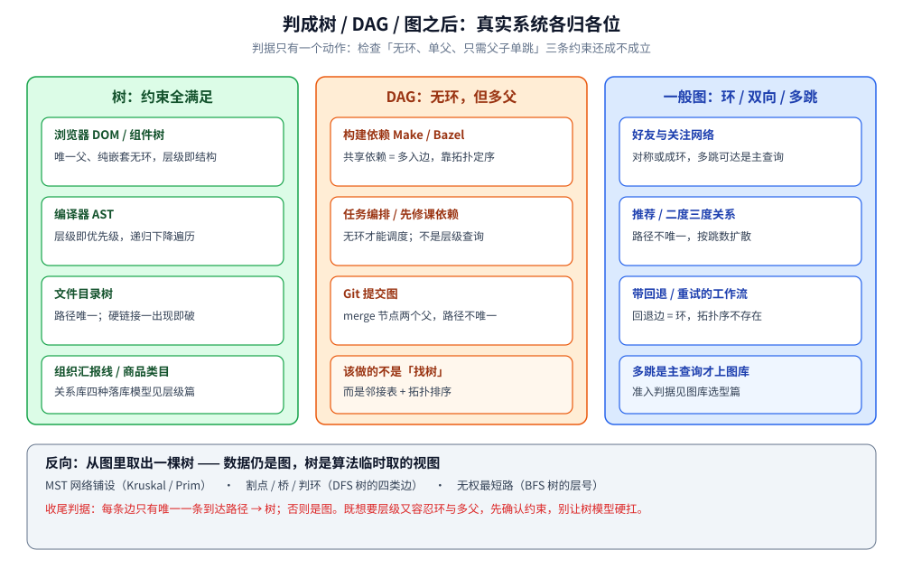
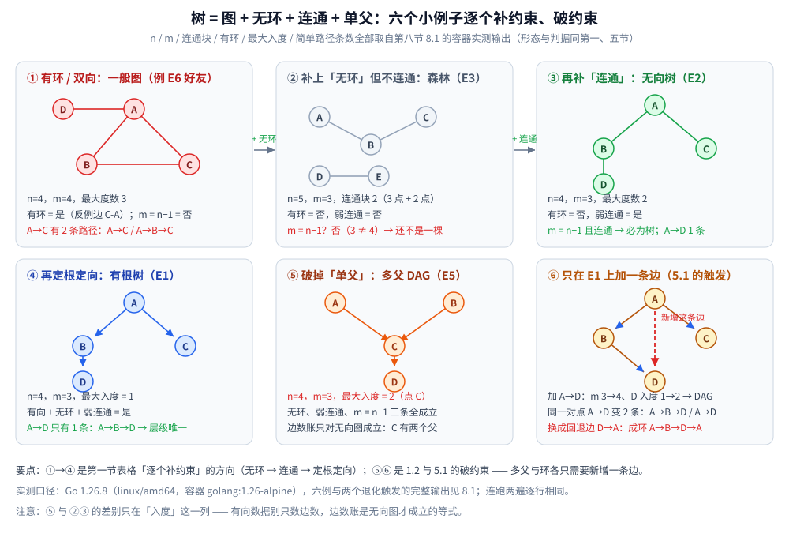

# 树与图的边界

> 同一份数据，什么时候该建模成**树**、什么时候必须建模成**图** —— 从图论的三个约束，到一组能依次筛的岔路口判据。
>
> ⭐ 边界先说清：本篇只判**「树还是图」这一步**，不展开任何结构的实现。
> 树各形态的选型见 [树的形态与选型.md](树的形态与选型.md)；图的三种存储见 [图的表示与存储.md](../图/图的表示与存储.md)；
> 层级数据在关系库里的四种落库模型见 [层级与树形数据存储.md](../../../03-数据与中间件/数据存储/存储架构与场景/形态篇/层级与树形数据存储.md)。
>
> 内容整理自个人学习笔记，素材见 [素材清单](../../../素材清单.md)。

---

## 一、树在图论里到底处在什么位置？

**本节要点**：树**不是**「另一种结构」，而是**图被加上约束后的特例** —— 它是图论的一个子集，不是与图并列的东西。

图由**顶点集**与**边集**构成，约束极少：可以有环、可以双向、一个点可以被很多条边连着。
树是在这张通用图上**逐个补约束**补出来的：补上「无环」，再补上「连通」，就得到无向树；再补上「指定根 / 定方向」，就得到有根树。

| 约束 | 加上它之后 | 效果 |
|---|---|---|
| （裸图） | 一般图 | 有环、多父、双向都允许 |
| + **无环** | 森林 | 每个连通块内部没有回路 |
| + **连通** | **无向树** | 全图缩成一棵，无向、无环、连通 |
| + **定根 / 定向** | **有根树** | 每个点**唯一父**，层级与「父-子」方向出现 |

### 1.1 三条说法其实在讲同一件事

无向树有三个**等价刻画**，做题与写代码时按哪个方便用哪个：

- **无环连通**：连通、且没有任何回路 —— 这是定义；
- **边数恰好 `n − 1`**：`n` 个顶点、`n − 1` 条边，且连通 ⇒ 必为树（少一条就断开，多一条就有环）；
- **任意两点唯一路径**：任意两个顶点之间**有且仅有一条**简单路径。

⭐ 判据：**「唯一路径」是树的灵魂**。它意味着「从 A 到 B 怎么走」这个问题**没有歧义** ——
不用问「哪条路更短 / 更合理」，因为只有一条。这条性质省掉的是整类「路径选择」的复杂度。
一旦某对点之间出现**第二条路**，就意味着出现了环（或遇到了多父），树立刻失效。

### 1.2 少一个约束，会变成什么

反过来看更清楚：**每去掉一个约束，就退化成另一类结构**。

| 去掉 | 变成 | 后果 |
|---|---|---|
| 去掉**无环** | 一般图 | 两点间可能有多条路径，「唯一路径」没了 |
| 去掉**连通** | 森林 | 变成若干棵互不相连的树，不再是一棵 |
| 去掉**单父** | **DAG / 一般有向图** | 一个点可以被多个父到达，层级不再唯一 |

⚠️ 这三条也是后面**所有判据的原型**：所谓「判断该不该用树」，本质就是逐条检查**这三个约束还成不成立**。

---

## 二、岔路口怎么判？依次筛哪五个问题？

**本节要点**：不要背结构名，按**一组问题依次问**。第一个答在「非树」一侧的问题，就把边界定死了，后面的问题不用再问。

### 2.1 五问判据

| # | 依次追问 | 答在「非树」一侧 → 落到哪 | 答在「树」一侧 → 下一步 |
|---|---|---|---|
| ① | 有没有**环**？ | 有环 → **一般图**（环是「图」的门票） | 无环 → 问第 ② |
| ② | 每个节点是不是**只有一个父**？ | 多父 → **DAG**（有向无环图，已不是树） | 单父 → 问第 ③ |
| ③ | 需不需要**任意两点间多跳**？ | 要任意两点可达 → **图**（靠跳数索引） | 只要父子单跳 → 问第 ④ |
| ④ | 关系是有向还是**对称**的？ | 对称 / 双向 → **图** | 有向且单父无环 → 问第 ⑤ |
| ⑤ | 要不要**「层级 + 分治剪枝」**？ | 不要（只要任意连通） → **图** 或哈希 | 要 → **树**（层级索引） |

⭐ 一句话记法：**「环、多父、多跳、对称」这四个词里只要中一个，就告别树；四个都没有，还要「层级 + 剪枝」才有必要上树。**

### 2.2 为什么顺序不能乱

前四问是**否决性问题**（命中就不能是树），第 ⑤ 问才是**增益性问题**（要不要为层级付费）。

- 先问①②，是因为它们**破坏树的定义**，答案错了整个模型就错；
- 再问③④，是因为它们**破坏树的使用价值**（没有唯一路径、没有方向，树模型的廉价方案用不上）；
- 最后问⑤，是因为**逻辑上它是可有可无的** —— 一份无环单父的有向数据，既可以用树存，也可以当普通 DAG 存，**只有当「层级 + 分治剪枝」能带来收益时才值得上树**。


**图怎么读**：上半部分是从①到⑤的五道闸门，每道闸门左侧写「答在非树一侧会落到哪」，命中任意一个就出局；下半部分对应三个落点 —— **树**（三个约束都满足）、**DAG**（无环但允许多父）、**一般图**（约束被打破）。第 ⑤ 问是绿色的，因为它是唯一一道「答是才回到树」的增益性问题。

---

## 三、树能给的保证，图能给的，差在哪？

**本节要点**：树与图的能力差，本质是**「路径唯一」这条约束换来的确定性**。树拿确定性换了能力上限，图拿能力换了确定性。

### 3.1 能力对照

| 维度 | 树能给的保证 | 图能给的 |
|---|---|---|
| **路径** | 任意两点**唯一路径** —— 不必选择 | 两点间可能多条路径，多跳可达 |
| **层级** | 天然有「深度 / 层号」，可逐层处理 | 无天然层级（需另算分层） |
| **剪枝** | 可**分治**：只看一支，其余整支跳过 | 一般不能整支跳过（可能有旁路） |
| **有序** | 中序可有序输出（BST 系） | 无序概念（顶点无自然全序） |
| **拓扑** | 只能是树形、链式等受限形态 | 任意拓扑：双向、多父、环都行 |
| **关系方向** | 单一父 → 方向唯一 | 双向 / 多向 / 不对称，任意 |
| **循环** | 结构上**不允许**环 | 环是常态（强连通、回路） |

⭐ 概括成一句：**树用「不能有环、不能多父」换来了「唯一路径 + 层级 + 可剪枝」；图放弃这几条保证，换来「任意拓扑 + 多跳 + 双向关系」。**

### 3.2 「`O(log n)`」不是树自带的

一个常被混淆的点：**`O(log n)` 不是「树」这个形状白送的**，它是**额外约束（有序 + 平衡）**换来的。

- 一棵没排序、没平衡的普通二叉树，查找仍是 `O(n)`；
- 只有 BST（有序）+ 平衡约束（AVL / 红黑树），树高才被钉在 `O(log n)`；
- 到了磁盘上，还要换成高扇出的 B+ 树，才能把「层数 = I/O 次数」压到 2~4 层。

⚠️ 所以「要 `O(log n)`」这个诉求**推不出「用树」** —— 它推到的是「用**有序且平衡**的检索结构」，至于这结构是不是树，是后话。
（完整推导见 [二叉搜索树.md](二叉搜索树.md) 与 [B树与B+树.md](B树与B+树.md)。）

---

## 四、边界案例：哪些「树」其实是图？哪些「图」其实是树？

**本节要点**：每一类都要给**判据**（看哪个词、查哪条约束），而不是背例子。判据落在哪一侧，模型就跟着定。

### 4.1 该建模成树的

判据：**存在唯一根、每个节点恰好一个父、无环、只需沿父子上下走。**

| 场景 | 为什么是树（判据） |
|---|---|
| **组织架构** | 每个员工只有一个汇报上级（单父）、汇报链无环、只需上溯/下钻 |
| **目录树 / 文件系统** | 每个文件只属于一个目录（单父）、路径唯一、移动子树是确定操作 |
| **DOM 树** | 元素只有唯一父节点、结构天然嵌套、无环 |
| **语法树（AST）** | 每个语法节点由唯一产生式派生（单父）、层级即优先级，可递归下降 |

### 4.2 看着像树、其实是 DAG（有向无环图，不是树）

判据：**无环，但出现了「一个节点被多个父到达」—— 唯一路径被打破，树模型失效。**

| 场景 | 为什么是 DAG 而不是树 |
|---|---|
| **多父继承**（`class C(A, B)` / mixin） | C 同时继承 A、B → C 有两个父，单父约束破了 |
| **构建依赖**（Make / Bazel / 包依赖） | 一个目标可被多个目标依赖（多入边）；无环才能定序，但共享依赖即多父 |
| **任务调度 / 课程先修** | 同一门课可被多门课先修（多父）；有环即无解，无环即 DAG |

⭐ 判据一句话：**「无环 + 多父」= DAG**。它能做拓扑排序（线性化成序），但**没有唯一路径、没有层级唯一性**，所以不能当树用。

### 4.3 必须建模成图的

判据：**出现环、或出现对称/双向关系、或需要任意两点多跳。**

| 场景 | 为什么必须是图 |
|---|---|
| **好友关系** | 对称（A 是 B 的好友 ⇔ B 是 A 的好友），且互相可达，成环是常态 |
| **关注关系** | 有向，但可有环（A 关注 B、B 关注 A），且要算多跳可达 |
| **推荐关系** | 多跳传播（二度、三度好友），路径不唯一 |
| **有环工作流** | 出现回退 / 重试边即有环，拓扑序不存在，树模型直接崩 |

### 4.4 两个方向的识别信号

**看似树、实为图**（别再套树模型）：
1. **写入时出现「一个节点指向两个父」**（子类多继承、模块被多目标依赖）→ 单父约束已破，是 DAG；
2. **从 A 到 B 能找出两条不同路径** → 唯一路径已破，出现了环或多父，是图。

**看似图、实为树**（可以白拿树的所有便宜）：
1. **整张图的边数恰好 = 点数 − 1，且连通** → 按 1.1 的等价刻画，它必然是树；
2. **从任一点出发 DFS 一遍能走遍所有点、且不遇到回边**（无环连通）→ 是树。

⭐ 收尾判据：**「每条边是否只有唯一一条到达路径」—— 有唯一路径是树，没有就是图。**

---

## 五、什么时候会从树退化成图？反过来又怎么取回一棵树？

**本节要点**：退化只有两个触发点 —— **多父**与**环**；反过来，图也能**取出**一棵树（生成树 / DFS 树 / BFS 树），这对理解「树是图的特例」是关键一环。

### 5.1 退化成图的两个典型时刻

| 触发 | 从 | 变成 | 为什么 |
|---|---|---|---|
| **出现多父** | 树 | **DAG** | 一个点被两条边指入 ⇒ 任意两点不再唯一路径，层级不再唯一 |
| **出现环** | 树 / DAG | **一般图** | 环上两点有两条不同走法 ⇒ 树定义中「无环」直接不成立 |

⚠️ 现实里这两件事**经常悄悄发生**：加一条「共享依赖」的边是多父，加一条「互相依赖 / 回退」的边是环。
**判据**：每当数据结构要新增一条边，先问「它会不会让某个点有两个父？会不会构成回路？」—— 会，就要换模型，而不是让树模型硬扛。

### 5.2 反向：从图里取出一棵树

既然树是图的特例，那么**任意连通图都含有树** —— 这就是「生成树」：

| 取法 | 得到什么 | 用途 |
|---|---|---|
| **生成树（MST 等）** | 保留全部顶点、用最少的边保持连通的那棵子树 | 网络铺设、聚类（MST 删最长边即聚类） |
| **DFS 树** | 按深度优先的访问次序，把「首次到达某点的边」挑出来 | 割点与桥、强连通分量、判环（回边 = 环） |
| **BFS 树** | 按层扩展，每个点由「首次发现它的邻居」挂上 | 无权图最短路、按层处理 |

⭐ 判据：**在这些场景里，「树」不是数据本身的形状，而是「算法从图上取出来的一个视图」**。
所以看到「生成树、DFS 树、BFS 树」这些词时，要知道底下的数据**仍然是一张图**，只是**被临时当树来用**。
（DFS 树的四类边、BFS 树的层号语义见 [DFS与BFS遍历.md](../../算法/图论算法/图的遍历/DFS与BFS遍历.md)；
生成树算法的取舍见 [Kruskal.md](../../算法/图论算法/最小生成树/Kruskal.md) 与 [Prim.md](../../算法/图论算法/最小生成树/Prim.md)。）

---

## 六、落到存储层，树和图各自怎么选？

**本节要点**：本节**只指路不展开** —— 一句话：**树的问题用「层级索引」，图的问题用「邻接表 / 图库」**，具体展开在各零件篇。

| 判据结果 | 存储形态 | 指路 |
|---|---|---|
| **树**（单父 + 无环 + 要层级） | 内存：BST / 平衡树 / B+ 树；关系库：邻接表 / 路径枚举 / 嵌套集 / 闭包表 | [树的形态与选型.md](树的形态与选型.md)、[B树与B+树.md](B树与B+树.md)、[层级与树形数据存储.md](../../../03-数据与中间件/数据存储/存储架构与场景/形态篇/层级与树形数据存储.md) |
| **DAG**（无环 + 多父） | 邻接表 + 拓扑排序；依赖图按 DAG 存并定序 | [拓扑排序.md](../../算法/图论算法/拓扑排序.md) |
| **一般图**（有环 / 双向 / 多跳） | 邻接表 / 邻接矩阵 / 边列表；关系复杂且多跳时上图数据库 | [图的表示与存储.md](../图/图的表示与存储.md)、[关系数据存储.md](../../../03-数据与中间件/数据存储/存储架构与场景/形态篇/关系数据存储.md)、[图数据库选型对比.md](../../../03-数据与中间件/数据存储/图数据库/图数据库选型对比.md) |
| **不是任一种**（只要等值命中） | 哈希表 —— 既不要层级也不要多跳时，树和图都不划算 | [散列表.md](../哈希表/散列表.md) |

⭐ **最后一道自检**：如果一份数据你既想要「树模型的层级与剪枝」、又容忍「环与多父」，
那不是要找一个「更强的树」，而是**先确认约束到底成不成立** —— 不成立就退回图模型，别让树模型硬扛。

---

## 七、应用场景

**本节要点**：本篇的产出不是一个结构，而是一个**动作** —— 按三个约束把数据判成树 / DAG / 图。下表按判定结果把真实系统登记落点（只到粗粒度），落库与图库的选型细节在各零件篇。

### 7.1 应用场景总表

| 判定结果 | 场景 | 具体系统 / 例子 | 判据怎么落 |
|---|---|---|---|
| **树** | 页面结构 | 浏览器 DOM / 前端组件树 | 元素唯一父节点、纯嵌套无环 → 层级查询白拿树的廉价（4.1） |
| **树** | 编译期语法结构 | 各语言编译器与静态检查器的 AST | 单父派生、层级即优先级，递归下降即遍历（顺序机制见 [树的遍历.md](树的遍历.md)） |
| **树** | 文件目录 | `find` / 目录树展示类命令与 API | 一个文件只属于一个目录、路径唯一；⚠️ **硬链接**一出现就是多父 → 落 DAG |
| **树** | 组织与分类层级 | 企业汇报线、商品类目 | 单父 + 无环 + 只需上溯下钻；关系库里的四种落库模型见 [层级与树形数据存储.md](../../../03-数据与中间件/数据存储/存储架构与场景/形态篇/层级与树形数据存储.md) |
| **DAG** | 构建与任务编排 | Make / Bazel 依赖图、工作流调度类系统 | 一个产物可被多个目标依赖（多父）、但必须无环才能定序 —— 要做的是拓扑排序，不是层级查询 |
| **DAG** | 版本历史 | Git 提交图（merge 节点有两个父） | 「主干 / 分支」只是可视化习惯，数据结构上是 DAG：同一提交可被多路到达，路径不唯一 |
| **图** | 社交与风控关系 | 好友 / 关注网络、多跳关系排查 | 对称或有环、要多跳可达；⚠️ 是否上专用图库的准入判据是「**三跳以上是不是主查询**」，见 [图数据库选型对比.md](../../../03-数据与中间件/数据存储/图数据库/图数据库选型对比.md) |
| **图** | 带回退的流程 | 有重试 / 回退边的状态机 | 回退边一出现就是环，拓扑序不存在，树 / DAG 模型直接失效（4.3） |
| **图里取树** | 连通与铺设 | MST 网络铺设、割点 / 桥、无权最短路 | 底层仍是图：生成树 / DFS 树 / BFS 树只是算法临时取出的视图（5.2） |



### 7.2 深入辨析：拿到一份数据，怎么问这五问

**第一层：先定约束，再谈结构。** 不要问「我想用树还是图」，要问「**这份数据到底满不满足树的三条约束**」：
单父吗？无环吗？只需要父子单跳吗？—— 三问全「是」，才轮到挑具体树种。

**第二层：把「唯一路径」当试金石。** 拿任意一对相关实体，问「从 A 到 B 是不是只有一条走法」。
答「只有一条」→ 树的廉价方案都成立；答「不止一条 / 说不清」→ 已经进入图的地界。

**第三层：改动时回看约束。** 树模型最脆弱的地方在**新增一条边的时刻** ——
共享一条边可能引入多父（→ DAG），回退一条边可能引入环（→ 图）。
**每次数据模型演进，都重跑一遍第二节的五问。**

### 7.3 收尾判据

这些落点共享的前提：**先验约束，再谈结构** —— 无环、单父、只需父子单跳三条全成立，树的免费午餐（唯一路径、层级、整支剪枝）才端得上桌；任何一条断了就换模型，别让树硬扛（5.1）。

⚠️ **失效边界**：既不要层级也不要多跳、只要等值命中 → 哈希表（见 [散列表.md](../哈希表/散列表.md)）；只问「连不连通」、不关心路径形状 → 并查集比树和图都省（见 [并查集.md](../高级数据结构/并查集.md)）。

---

## 八、具体使用：那三条约束能写成可运行的判据吗？

**本节要点**：能。判「树 / DAG / 图」不需要感觉，五个量就够 —— **点数 `n`、边数 `m`、连通块数、有没有环、最大入度**，
再加一项抽查「同一对点之间有几条简单路径」。下面六份小例子在容器里逐条跑出来，8.3 的形态图画的就是这些读数。

### 8.1 六个例子与两个退化触发的实测输出

**✅ 实测口径**：容器 `golang:1.26-alpine`，Go 1.26.8（linux/amd64），纯标准库、无随机源；
脚本 `.workbuddy/tmp/round495/w2treeA_boundary.go`，连跑两遍 `diff` 为空。
例子的语义取自 4.1（组织架构、目录树）、4.2（`class C(A, B)` 式多父依赖）、4.3（好友关系）与 5.1（新增一条边的两个触发点）。

```text
== 树 / DAG / 一般图：三个约束在六个例子上的逐条判定 ==
（Go 容器实测；节点名沿用正文例子的语义）

E1｜组织架构：A→B、A→C、B→D（有向、单父、无环）
   点 n=4，边 m=3，有向；弱连通=是（连通块 1：块1 4 点），有环=否（反例边 无）
   m == n−1？是（n−1=3，m=3）；最大入度=1；结论：有根树
   A→D 的简单路径 1 条：A→B→D

E2｜同一批边改判无向：A-B、A-C、B-D（无向树）
   点 n=4，边 m=3，无向；弱连通=是（连通块 1：块1 4 点），有环=否（反例边 无）
   m == n−1？是（n−1=3，m=3）；最大度数=2；结论：无向树
   A→D 的简单路径 1 条：A→B→D

E3｜两个独立目录树：A-B、B-C、D-E（无环但不连通 = 森林）
   点 n=5，边 m=3，无向；弱连通=否（连通块 2：块1 3 点，块2 2 点），有环=否（反例边 无）
   m == n−1？否（n−1=4，m=3）；最大度数=2；结论：森林

E4｜n 点 n−1 边但不连通：A-B、B-C、C-A + 孤立点 D（必含环）
   点 n=4，边 m=3，无向；弱连通=否（连通块 2：块1 3 点，块2 1 点），有环=是（反例边 C-A）
   m == n−1？是（n−1=3，m=3）；最大度数=2；结论：一般图
   A→B 的简单路径 2 条：A→B / A→C→B

E5｜构建依赖 class C(A,B) + D 依赖 C：A→C、B→C、C→D（多父 DAG）
   点 n=4，边 m=3，有向；弱连通=是（连通块 1：块1 4 点），有环=否（反例边 无）
   m == n−1？是（n−1=3，m=3）；最大入度=2（点 C 被 2 个父指入）；结论：DAG（多父，非树）
   A→C 的简单路径 1 条：A→C
   B→C 的简单路径 1 条：B→C
   A→D 的简单路径 1 条：A→C→D

E6｜好友关系：A-B、B-C、C-A、A-D（无向、有环）
   点 n=4，边 m=4，无向；弱连通=是（连通块 1：块1 4 点），有环=是（反例边 C-A）
   m == n−1？否（n−1=3，m=4）；最大度数=3；结论：一般图
   A→C 的简单路径 2 条：A→B→C / A→C

== 退化触发：在 E1（有根树，n=4、m=3）上只加一条边 ==
E1+x｜加一条 A→D：D 出现第二个父（多父，仍无环）
   点 n=4，边 m=4，有向；弱连通=是（连通块 1：块1 4 点），有环=否（反例边 无）
   m == n−1？否（n−1=3，m=4）；最大入度=2（点 D 被 2 个父指入）；结论：DAG（多父，非树）
   A→D 的简单路径 2 条：A→B→D / A→D

E1+y｜加一条 D→A：出现回退边（成环）
   点 n=4，边 m=4，有向；弱连通=是（连通块 1：块1 4 点），有环=是（反例边 A→B→D→A）
   m == n−1？否（n−1=3，m=4）；最大入度=1；结论：一般图
   A→D 的简单路径 1 条：A→B→D

对照：E1 的 n=4、m=3、最大入度 1、有环=否、m==n−1=是；上面两例只多了一条边，判据立刻翻到 DAG / 一般图。
```

### 8.2 这份输出里能读走的四条判据

| # | 读数 | 判据 |
|---|---|---|
| ① | E5：`n=4、m=3` 满足 `m = n − 1`，弱连通、无环，结论仍是 **DAG**（点 C 入度 `2`） | ⚠️ **边数这笔账只对无向图成立**。有向数据必须再查一条「**最大入度 ≤ 1**」，否则 4.4 的「看似图、实为树」自检会误判 |
| ② | E4：`n=4、m=3` 但**不连通**（3 点块 + 1 点孤立），程序直接找到反例边 `C-A` | 印证延伸追问：**`m = n − 1` 与「连通」两条要一起看**，缺一就漏掉环 |
| ③ | E1 / E2 的 `A→D` 各 **1 条**路径；E6 的 `A→C` **2 条**（`A→C`、`A→B→C`） | 「唯一路径」是可以**直接数**的：同一对点数出第二条路，树当场失效（1.1 的灵魂判据） |
| ④ | E1 → E1+x 只多一条 `A→D`（`m` 3→4、D 入度 1→2）；把这条换成回退边 `D→A` 则找到环 `A→B→D→A` | 5.1 的两个退化触发**各只需要一条边**：一条指入已有节点 = 多父 → DAG，一条指回祖先 = 环 → 一般图 |

### 8.3 六份小图的形态对照



**图怎么读**：上排 ①→③ 是第一节那张表「逐个补约束」的方向（裸图 → 无环 → 连通），下排 ④→⑥ 是 1.2 与 5.1
「逐个破约束」的方向（定根成树 → 破单父成 DAG → 加一条边立刻退化）；每个面板里的 `n` / `m` / 连通块 / 有环 / 最大入度 / 路径条数
都逐字来自 8.1 的容器输出。

---

## 延伸追问

- **树到底算不算图？** → 算。树是图论里的**连通无环图**，即「图 + 无环 + 连通」的特例；有根树再加「定根 / 定向」。所以树能用的遍历（DFS / BFS）本质上就是图的遍历，只是在树上路径唯一，很多问题会自动简化。
- **`n` 个节点 `n − 1` 条边就一定是树吗？** → 不一定，还要**连通**。`n` 个点、`n − 1` 条边而**不连通**时，必含一个环（另一处断开），此时是「森林 + 环」，不是树。判据是**两条一起看**：边数 `n − 1` **且** 连通。
- **DAG 和树的差别到底在哪一句？** → 就差**「唯一路径」**这一句。二者都无环，但 DAG 允许一个点被多个父到达 ⇒ 两点间可能多条路径、层级可有多解；树强制单父 ⇒ 路径唯一、层级唯一。
- **既然树是图的特例，为什么工程上要单独为树做优化？** → 因为**唯一路径 + 层级**让整类问题变简单：不必为「任意两点是否可达」付费、可整支剪枝、可有序输出。这些优化在一般图上不成立，所以树值得单独一整套结构（BST / B+ 树 / Trie / 线段树）。
- **怎么发现一份「本来是树」的数据已经退化成图了？** → 两个信号：**新增边时某点出现了第二个父**（→ DAG）、**新增边构成回路**（→ 一般图）。工程上靠**约束校验**（入度 ≤ 1、无环检测）兜底，而不是靠模型自觉。
- **「生成树」和「树」是一回事吗？** → 不是。「生成树」是**算法从一张图上取出的一棵子树**，底下的数据仍是一张图；它只是被临时当作树来用（MST 求最小连通代价、DFS 树用来判环与求 SCC）。

---

## 关联

- [树的形态与选型.md](树的形态与选型.md) — **树族选型总纲**：本篇判完「是不是树」，接着由它判「是哪一种树」
- [二叉树结构与性质.md](二叉树结构与性质.md) — 树的地基：术语、深度与高度、两种存储结构、四条公式
- [二叉搜索树.md](二叉搜索树.md) — 「有序 + 平衡」才换来 `O(log n)`，而不是树形本身自带
- [B树与B+树.md](B树与B+树.md) — 树落到磁盘上的形态：高扇出把层数压到 2~4 层
- [Trie.md](Trie.md) — 另一类「路径唯一」的树：路径即键，撑起前缀能力
- [堆与优先队列.md](../堆/堆与优先队列.md) — 完全二叉树 + 偏序：树形但不为「层级查询」服务的一个反例
- [README.md](../README.md) — 数据结构目录总纲：哈希表 / 图 / 树 / 线性结构 / 高级数据结构
- [图的表示与存储.md](../图/图的表示与存储.md) — 判成图之后的存储：邻接表 / 邻接矩阵 / 边列表怎么选
- [散列表.md](../哈希表/散列表.md) — 既不要层级也不要多跳时的最优解，以及它退化的两条路径
- [并查集.md](../高级数据结构/并查集.md) — 「只判连通、不要路径」时比树与图都省的第三条路线
- [DFS与BFS遍历.md](../../算法/图论算法/图的遍历/DFS与BFS遍历.md) — DFS 树 / BFS 树从图里取树的过程与四类边
- [拓扑排序.md](../../算法/图论算法/拓扑排序.md) — DAG 的线性化：无环但多父时该做什么
- [Kruskal.md](../../算法/图论算法/最小生成树/Kruskal.md) — 从图上取出「一棵连通所有点的树」：按边贪心 + 并查集
- [Prim.md](../../算法/图论算法/最小生成树/Prim.md) — 同为目标：按点贪心，稠密图上另一条取树的路线
- [树上问题.md](../../算法/图论算法/树上问题.md) — 树是特殊的图：路径唯一带来的 LCA、树上差分、点分治
- [层级与树形数据存储.md](../../../03-数据与中间件/数据存储/存储架构与场景/形态篇/层级与树形数据存储.md) — 判成树之后，层级数据在关系库里的四种落库模型
- [关系数据存储.md](../../../03-数据与中间件/数据存储/存储架构与场景/形态篇/关系数据存储.md) — 判成图之后，「边」怎么落库：方向、分片、多跳
- [图数据库选型对比.md](../../../03-数据与中间件/数据存储/图数据库/图数据库选型对比.md) — 多跳关系复杂到什么程度才值得上专用图存储
