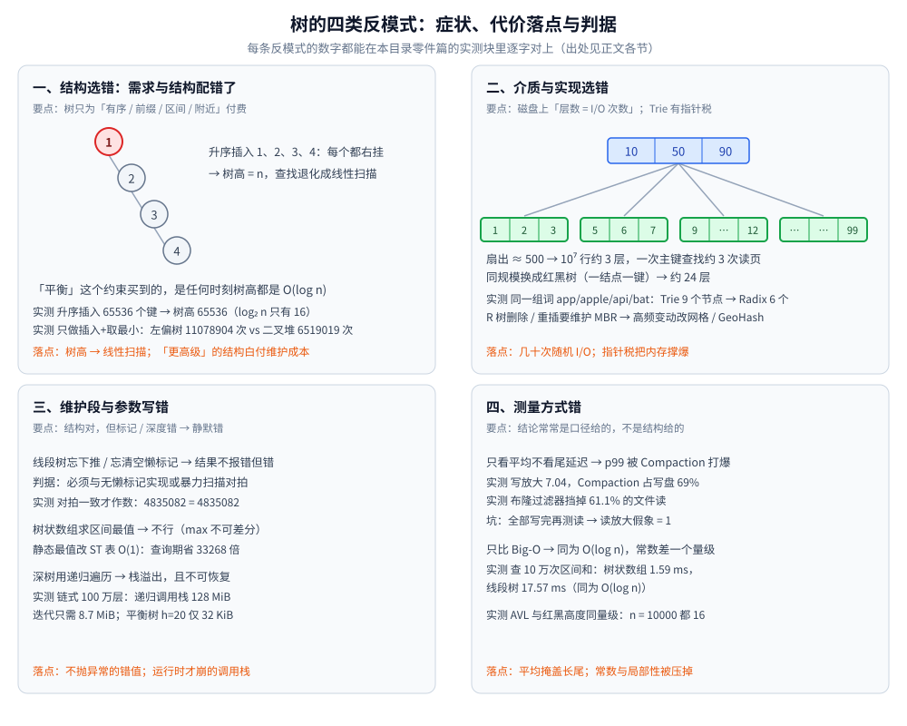

# 树的典型反模式

> 一份树结构的**错误用法排查清单**：12 条「症状 → 为什么错 → 正确做法 → 判据」，
> 覆盖结构选错 / 介质选错 / 维护段写错 / 测量方式错四类，每条都落到一个可执行的判据上。
>
> ⭐ 边界先说清：本篇讲**错误用法**，不是代价表。每个结构「客观付什么代价」见
> [树的形态与选型.md](树的形态与选型.md) 第三节的隐藏代价总表（含「最会骗你的时刻」一列）；
> 本篇只在它之上回答**「什么时候这么用是错的」**。各结构的形态与实现细节见对应零件篇，此处不重复。
>
> 内容整理自个人学习笔记，素材见 [素材清单](../../../素材清单.md)

---

## 一、结构选错：有没有把需求配错结构？

**本节要点**：树这一族只回答四类需求 —— **有序 / 前缀 / 区间 / 附近**。
需求里没有这四个词却上树，或者把「有序」的活派给了不自平衡的 BST，是最常见的两类错。

**图怎么读**：四个面板对应下面四节 —— 每个面板第一行是症状，第二行是「代价落在哪」，第三行是判据；
面板里的数字都能在对应零件篇的实测块里逐字对上。

### 1.1 用未平衡的 BST 存有序或递增数据

**症状**：插入键接近有序（自增主键、时间戳、按字典序导入、日志序号），查询越用越慢，
最后退化成线性扫描。

**为什么错**：BST 自己**保证不了平衡** —— 树高由**插入顺序**决定，结构合法性判不出性能问题。
升序插入时每个新键都往右挂，长出一条右斜链。

**正确做法**：让「维持高度」变成结构的职责 —— 旋转（AVL / 红黑树）、掷骰子（跳表）、
分裂合并（B 树 / B+ 树）；或者先在入口处打散插入顺序。

**判据**：只要插入键**存在单调或近单调的可能**，就不要让「平衡」这件事无主。
实测见 [二叉搜索树.md](二叉搜索树.md) 第七节：升序插入 `65536` 个键 → 树高 `65536`，
而 `log₂ n = 16`，**差 4096 倍**；同一读数在 [平衡树.md](平衡树.md) 1.1 完全一致。
⚠️ 别拿「随机插入就没事」当挡箭牌：随机 BST 的高度也**不是** `log₂ n` —— 见
[平衡树.md](平衡树.md) 2.3，`n = 100000` 时随机 BST 高 `46`，同一批 AVL 只有 `20`。

### 1.2 用树做等值查找

**症状**：需求只是「这个 key 在不在 / 取出它对应的值」，却上了红黑树、B+ 树或 Trie。

**为什么错**：树是在为「**序**」付费 —— 中序有序、前驱后继、范围剪枝。
没有序需求时，这些维护成本**全是白付**，而哈希表在同等工作量下更快、更省。

**正确做法**：只要等值命中就去用哈希表；只有出现「区间 / 顺序 / 前缀 / 附近」时才回来找树。

**判据**：**需求里出现「区间 / 顺序 / 前缀 / 附近」中任意一个词，哈希才出局** ——
这是 [树的形态与选型.md](树的形态与选型.md) 2.1 的第 ③ 问。逐项对照见
[二叉搜索树.md](二叉搜索树.md) 第八节（等值 / 范围 / 有序输出 / 前驱后继四项能力表）。

### 1.3 数据小且静态还上树

**症状**：几十到几千条、几乎不变的配置表、字典、白名单，也专门建一棵树。

**为什么错**：「上结构」本身有**维护成本**（建树、平衡、指针、缓存不友好）。
树的价值在**动态插入**；数据不变时这部分价值兑现不了。

**正确做法**：排序数组 + 二分 —— 查询同样 `O(log n)`，插入才是 `O(n)`（而这里没有插入），
代码短、内存连续。

**判据**：先问一句**「这份数据还会变吗」** —— 几乎不变就走数组 + 二分；
会变就再往下问读写比与「序」（见 [树的形态与选型.md](树的形态与选型.md) 延伸追问「什么时候不用树才是对的答案」，
以及 [二叉搜索树.md](二叉搜索树.md) 第八节末的第三条路线）。

### 1.4 不涉及合并时上可并堆

**症状**：只需要「插入 + 取最小」，却选了左偏树 / 配对堆，理由是「可并堆更高级」。

**为什么错**：可并堆是**为「合并」这一维付费**的结构 —— 每次插入都要沿右脊柱走下去维护 `dist`。
不涉及合并时，这笔维护费换不来任何收益。

**正确做法**：二叉堆就够（数组化、缓存友好、`push` / `pop` 都是 `O(log n)`）。

**判据**：判据只有一条 —— **「两个堆需要被合并」且这个动作会发生多次**。
实测反例见 [可并堆与堆的变体.md](可并堆与堆的变体.md) 第七节（`n = 200000`，只做插入 + 取最小）：
二叉堆合计 `6519019` 次操作、**左偏树 `11078904` 次（反而慢 1.7 倍）**、配对堆 `4338601` 次。
⭐ 「可并堆更高级所以更快」是错的。

---

## 二、介质与实现选错：内存里的结构直接搬上磁盘了吗？

**本节要点**：同一需求在不同介质上会落成不同结构。**把内存结构搬到磁盘、或把「共享前缀」的假设套在随机键上，代价都是量级级的。**

### 2.1 在磁盘上用红黑树 / 跳表当索引

**症状**：把内存里的平衡树或跳表当成落盘索引，点查一次要几十次随机 I/O，延迟抖动。

**为什么错**：磁盘上要优化的自变量**不是比较次数，而是读了几页**。红黑树二叉、一结点一键、
节点地址彼此离散；跳表每层是链表，**没法把「下一步看谁」预先排进同一页**。

**正确做法**：B+ 树 —— 一个节点恰好占一页，一页塞尽量多的 `(键, 子页指针)`，把扇出做大。

**判据**：**层数 = I/O 次数**。实测推导见 [B树与B+树.md](B树与B+树.md) 第二、三、四步：
扇出 ≈ `500` 时 `10⁷` 行约 `3` 层；换成红黑树同样是 `10⁷` 行、约 `24` 层（一结点一键）；
跳表则因无法按页打包，只能待在内存。同一组数字见 [平衡树.md](平衡树.md) 3.2。

### 2.2 用 Trie 存长键或键长差异极大的集合

**症状**：键是 UUID、随机 ID，或长度差几个数量级，Trie 建起来内存直接爆。

**为什么错**：Trie 的收益来自**前缀高度共享**。共享度低时它退化成
「每字符一个节点 + 每节点背一张子指针表」—— 节点小而多，**指针税**极重。

**正确做法**：把「只有一个孩子的链」压成一段字符串（Radix 压缩）、缩小字符集、
或直接把键换掉（用哈希）。

**判据**：**先问前缀共享度高不高**。实测见 [区间与索引树.md](区间与索引树.md) 第五节：
同一组词 `app / apple / api / bat`，Trie 需要 `9` 个节点，Radix 压缩后只要 `6` 个；
随机串场景见 [Trie.md](Trie.md) 的失效点（UUID 之类做键时一点优势都没有）。

### 2.3 对频繁更新的空间对象用 R 树

**症状**：网约车位置、订单轨迹这类每秒都在变的对象，用 R 树存，写着写着更新越来越贵。

**为什么错**：R 树的删除 / 重插要**维护 MBR（最小包围盒）**，位置一动就得改包围盒、
可能触发分裂或重插 —— **更新代价高**，而这一点常常被「查询很香」掩盖。

**正确做法**：高频变动的空间对象改用网格 / GeoHash，更新是 `O(1)`；R 树留给
「对象基本不动、但要通用几何查询」的场景。

**判据**：**对象位置变得勤不勤** —— 勤就网格。见 [树的形态与选型.md](树的形态与选型.md) 2.2
对照表（高频变动的空间对象 → 网格 / GeoHash：「R 树的删除重插要维护 MBR」）。
⚠️ 本目录实测只覆盖了**查询侧**剪枝：[空间索引与R树.md](空间索引与R树.md) 3.3 实测
R 树检查 `1099` 个候选点、四叉树 `424` 个；**更新侧未实测**，这里只给判据。

---

## 三、维护段写错：结构对了，更新与深度管住了吗？

**本节要点**：结构选对只是及格线。**懒标记、可差分性、递归深度**这三处一写错，
结果往往**不报错但是错的** —— 比崩溃更难查。

### 3.1 线段树忘下推或忘清空懒标记

**症状**：区间修改 + 区间查询，程序跑得好好的，数值却是错的。

**为什么错**：懒标记的意义是「**先记账，访问时再下推**」。
忘记下推 → 子区间漏掉本轮更新；忘记清空 → 标记被重复作用。两者都**不抛异常**。

**正确做法**：把 `pushdown` 写进每个递归入口；递归返回前把当前节点的标记清零；
先把「标记的语义」写清楚再写代码。

**判据**：**必须有对拍** —— 用一份无懒标记的实现、或暴力扫描交叉验证。
见 [区间与索引树.md](区间与索引树.md) 3.3：线段树与树状数组两份独立实现给出**同一个结果 `4835082`**，
才谈得上「算对了」；⚠️ 只看耗时**判断不了正确性**。

### 3.2 用树状数组做区间最值

**症状**：拿树状数组求区间 `max`，改一处就悄悄出错。

**为什么错**：树状数组的区间查询依赖 `prefix(r) − prefix(l−1)`，**只能做可差分（可逆）的运算**；
`max` 不可逆，两个前缀相减没有意义。

**正确做法**：涉及区间最值、多种懒标记、动态开点 → 线段树；**静态**的区间最值 → ST 表（`O(1)` 查询）。

**判据**：**看运算可不可减**。能力边界表见 [区间与索引树.md](区间与索引树.md) 3.4
（区间最值：线段树 ✅ / 树状数组 ❌）。ST 表实测（`n = 200000`、`q = 200000`）：
查询期 `400000` 次比较，暴力扫描 `13307078422` 次，**查询期省 33268 倍**，且与暴力逐次一致。

### 3.3 深树用递归遍历

**症状**：数据近序导致树退化成链，用递归遍历，运行到一半 `stack overflow`。

**为什么错**：递归把成本放在**调用栈** —— 不在 GC 管理范围，超限**直接崩、不可恢复**，
每层一个栈帧；迭代把成本放在**堆** —— 可回收、还能预分配。

**正确做法**：换迭代 / 显式栈；想两全就上 Morris（额外空间 `O(1)`）。

**判据**：**深度可预测吗** —— 平衡树 `h = log n`，递归怎么写都行；
深度不可控（数据近序 → 退化成链）就换迭代。实测见 [树的遍历.md](树的遍历.md) 2.6：
链式 `100` 万层，递归调用栈 `+128 MiB`（每层 ≈ `134 B`），迭代常驻指针数组只要 `8.7 MiB`；
平衡形态 `h = 20` 时递归 `32 KiB`、迭代 `464 B`。⚠️ C / Java 的固定几 MB 线程栈
按 `134 B` / 层估算，**10 万层（≈13 MB）就崩**。

---

## 四、测量方式错：结论是结构给的，还是口径给的？

**本节要点**：结构选对、代码写对，**测量口径错了照样得出错误结论** ——
平均掩盖长尾，Big-O 掩盖常数与局部性。

### 4.1 只看平均延迟、不看尾延迟

**症状**：本地只测「写得多快」，上线后请求被 `p99` 打爆。

**为什么错**：平均值**掩盖长尾**；写优化的结构常在后台做整理（Compaction），
它一启动就抢 I/O，把尾延迟顶上去 —— 而这笔成本不出现在「平均写」里。

**正确做法**：报表报**分位数**（`p50 / p95 / p99`），并且**叠加后台负载**一起测。

**判据**：**报的是哪个分位、有没有叠加后台负载**。实测见 [LSM树.md](LSM树.md) 4.1 / 4.2：
写放大 `7.04`，其中 **Compaction 一项占写盘量的 69%**；布隆过滤器挡掉 `61.1%` 的文件读。
⚠️ 还有一个**实验设计坑**（4.2）：全部写完再测读时，Compaction 已把 L0 并空，
「读放大」看起来等于 `1` —— 结论完全失真，**必须边写边读采样**。

### 4.2 盲目比 Big-O、忽略常数与缓存局部性

**症状**：一句「都是 `O(log n)`，差不多」，就给方案定了。

**为什么错**：Big-O 把**常数与缓存局部性**都压掉了，而工程里做决定的常常正是它们。
同样是指针结构，谁跳得更少、谁的数据更连续，实测能差一个量级。

**正确做法**：同复杂度下比实测常数、比缓存友好度、比最坏情况（而不只比渐近式）。

**判据**：**同复杂度必须看实测常数**。三处实证都在本目录：
[区间与索引树.md](区间与索引树.md) 3.3 —— 同为 `O(log n)`，查询 `100000` 次区间和，
树状数组 `1.59 ms`、线段树 `17.57 ms`（⚠️ 毫秒数随机器波动，只断言「常数差一个量级」）；
[平衡树.md](平衡树.md) 2.3 —— `n = 10000` 时 AVL 与红黑树高度同为 `16`，查询只差常数因子；
[红黑树.md](红黑树.md) 1.3 —— 实测最长 / 最短路径 `16 / 11 = 1.45`，落在推导的 `[1, 2)` 区间内。
**指针结构的共同弱点是缓存不友好**（[二叉搜索树.md](二叉搜索树.md) 第八节），
常数与局部性的系统对照留给同批的《树的缓存局部性对比》一篇展开。

---

## 五、应用场景

**本节要点**：本篇是清单型文件，它的「应用场景」就是**什么时候把这份清单掏出来** —— 设计评审、线上事故复盘、性能定案三道关口；下表只做「现场 → 用哪几条」的路由，每条判据的细节与实测都在对应零件篇。

### 5.1 应用场景总表

| 场景 | 具体触发场合 | 怎么用这份清单 | 为什么在这里用它 |
|---|---|---|---|
| **新索引 / 新结构设计评审** | 上树之前的架构自查 | 按 5.2 十二问全过一遍：需求有没有「序」→ 介质 → 会不会变 → 深度可不可控 | 反模式全是「看起来合理」的选择，上线前拦一条比事后复盘一条便宜 |
| **上线后查询越用越慢** | 自增主键、时间戳、批量导入类写入路径 | 查 1.1 + 清单③：插入键近单调时不能让「平衡」无主 | 退化就潜伏在这类「合法但不平衡」的写入里（升序 `65536` 键 → 树高 `65536`） |
| **结果悄悄错了、不抛异常** | 线段树区间改 + 区间查；拿树状数组做最值 | 查 3.1 / 3.2 + 清单⑦⑧：懒标记下推与清零、运算可不可减、有没有对拍 | 「合法但错误」的数值只能被独立实现交叉验证暴露，看耗时判断不了正确性 |
| **均值正常、p99 被打爆** | LSM 类带后台整理的引擎压测与调参 | 查 4.1 + 清单⑪：报分位数、叠加后台负载、边写边读采样 | Compaction 这类后台成本不出现在「平均写」里，写放大 7.04 中它占 69% |
| **同为 `O(log n)` 的方案定案** | 选型尾声「都是对数级，差不多」 | 查 4.2 + 清单⑫：补实测常数与局部性再拍板 | 常数与布局才是做决定的项（区间和实测 1.59 ms vs 17.57 ms） |
| **深链式数据的递归遍历** | 层级递归、可能退化成链的树 | 查 3.3 + 清单⑨：深度不可控就换显式栈 / Morris | 调用栈超限不可恢复，堆可回收可预分配（128 MiB vs 8.7 MiB 实测在遍历篇 2.6） |

### 5.2 深入辨析：上结构之前的自查清单

按顺序问完，任何一问答错都对应上面一条反模式。

| # | 自查问题 | 答错 → 反模式 |
|---|---|---|
| ① | 需求里有没有「**区间 / 顺序 / 前缀 / 附近**」？一个都没有 → 哈希表 | 1.2 |
| ② | 数据**还会变吗**？几乎不变 → 排序数组 + 二分 | 1.3 |
| ③ | 插入键**可能单调 / 近序**吗？可能 → 别用裸 BST | 1.1 |
| ④ | 这个「有序查找」在**内存还是磁盘**？磁盘 → B+ 树 | 2.1 |
| ⑤ | 键的**前缀共享度高**吗？不高 → 别用 Trie（或先压缩） | 2.2 |
| ⑥ | 空间对象**位置变得勤**吗？勤 → 网格 / GeoHash，别用 R 树 | 2.3 |
| ⑦ | 有**懒标记**的路径吗？有 → 是否写了 `pushdown`、是否清空、**有没有对拍** | 3.1 |
| ⑧ | 区间运算**可差分**吗？不可 → 别用树状数组 | 3.2 |
| ⑨ | 树**深度可预测**吗？不可控（可能退化成链）→ 迭代 / Morris | 3.3 |
| ⑩ | 那两个堆会被**反复合并**吗？不会 → 二叉堆就够 | 1.4 |
| ⑪ | 报的是**分位数**吗？有没有**叠加后台负载**？ | 4.1 |
| ⑫ | 方案是**只比 Big-O** 定的吗？是 → 补实测常数与局部性 | 4.2 |

⭐ **一句话**：先问「需求 → 介质 → 会不会变 → 深度可不可控」，再问「怎么测」；每一问的答案都对应一条判据，而不是一句「它更快」。

### 5.3 收尾判据

共同前提：本篇所有判据都认「**可复现的读数**」—— 固定 seed、两份独立实现对拍、分位数口径；拿不出这三样的结论，本身就还停在 4.2 那类「看起来对」里。

⚠️ **失效边界**：本篇只管「**这么用是错的**」，不管「这个结构客观付什么代价」—— 后者是 [树的形态与选型.md](树的形态与选型.md) 第三节隐藏代价总表的地盘，两份对照着用：先读代价表建立认知，再拿本篇做上线前排查。

---

## 延伸追问

- **「代价表」和「反模式」有什么区别？** → 代价表是**客观描述**（这个结构付什么代价），
  反模式是**错误用法**（什么情况下这么用是错的），且每条都要给出**可执行的判据**。
  ⭐ 两者互补：先读代价表建立认知，再用反模式做上线前的排查。见
  [树的形态与选型.md](树的形态与选型.md) 第三节。
- **为什么「上树」之前要先问有没有「序」？** → 因为「序」是树相对哈希表唯一不可替代的价值
  （范围、有序枚举、前驱后继、前缀）。没有序需求时，树的维护成本换不来收益 ——
  这一条能把方案整体从树换回哈希表。见 1.2。
- **同一份「有序查找」为什么在内存和磁盘上落成不同结构？** → 优化目标不同：
  内存里一次比较几乎免费，优化**比较次数**（红黑树 / AVL）；
  磁盘上一次节点访问 ≈ 一次 I/O，优化**读了几页**（B+ 树）。
  ⭐ **先问介质，再问结构**。见 2.1。
- **懒标记写错为什么特别难查？** → 因为它**不抛异常**，产出的是一个「合法但错误」的数值，
  只能在**对拍**里暴露。所以判据不是「看着对」，而是「与一份独立实现结果相同」。见 3.1。
- **只看 `O(log n)` 会漏掉什么？** → 漏掉**常数与缓存局部性**这两项真正做决定的东西：
  同为 `O(log n)`，实测可以差一个量级（1.59 ms vs 17.57 ms）；同为平衡树，
  高度也可能只差一层。见 4.2。
- **什么情况下「不上树」才是对的答案？** → 三种：① 只要等值命中 → 哈希表（1.2）；
  ② 数据小且几乎不变 → 排序数组 + 二分（1.3）；③ 不涉及合并 → 二叉堆（1.4）。
  ⭐ **「上结构」本身有成本，判据是「维护开销能不能被收益覆盖」。**

---

## 关联

- [树的形态与选型.md](树的形态与选型.md) — **本篇的另一半**：隐藏代价总表（客观描述「付什么代价」，含「最会骗你的时刻」一列）
- [二叉搜索树.md](二叉搜索树.md) — 退化实测出处（升序 65536 → 树高 65536）与 BST / 哈希选型表
- [平衡树.md](平衡树.md) — BST 退化与 AVL / 红黑高度对照实测；「一个节点 = 一页」的层数推导
- [树的遍历.md](树的遍历.md) — 递归与迭代的内存实测出处（128 MiB vs 8.7 MiB）
- [B树与B+树.md](B树与B+树.md) — 磁盘索引「层数 = I/O 次数」的五步推导与失效边界
- [区间与索引树.md](区间与索引树.md) — 线段树 / 树状数组 / ST 表的能力边界与对拍实测
- [可并堆与堆的变体.md](可并堆与堆的变体.md) — 「合并」这一维的实测：不合并时左偏树反而更慢
- [LSM树.md](LSM树.md) — 写放大 7.04、Compaction 占 69%、边写边读的测量口径
- [空间索引与R树.md](空间索引与R树.md) — MBR 剪枝实测，以及「更新代价」为什么是命门
- [Trie.md](Trie.md) — 指针税、前缀共享的失效点与压缩变体
- [README.md](README.md) — 本目录导读：文件清单、阅读路径与选型判据
