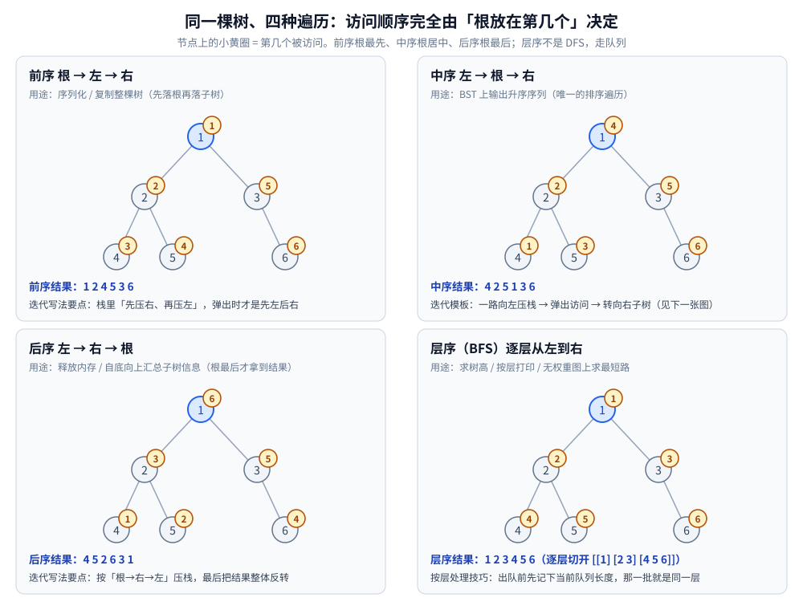
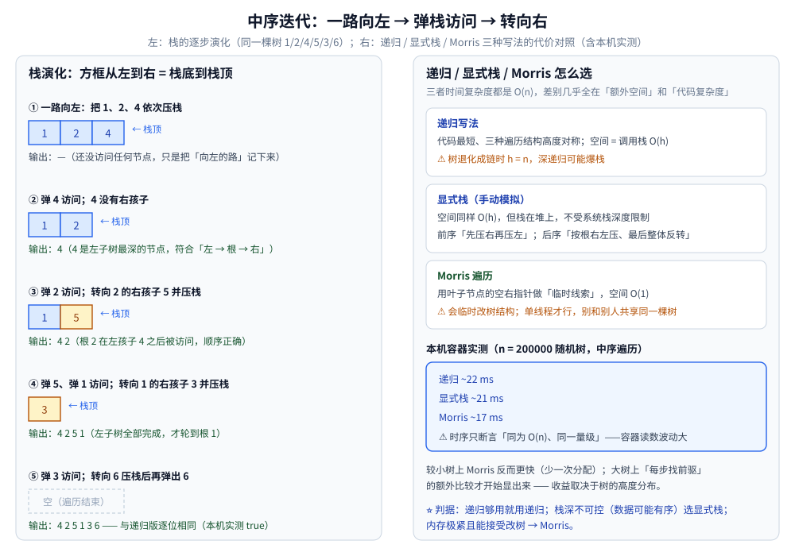
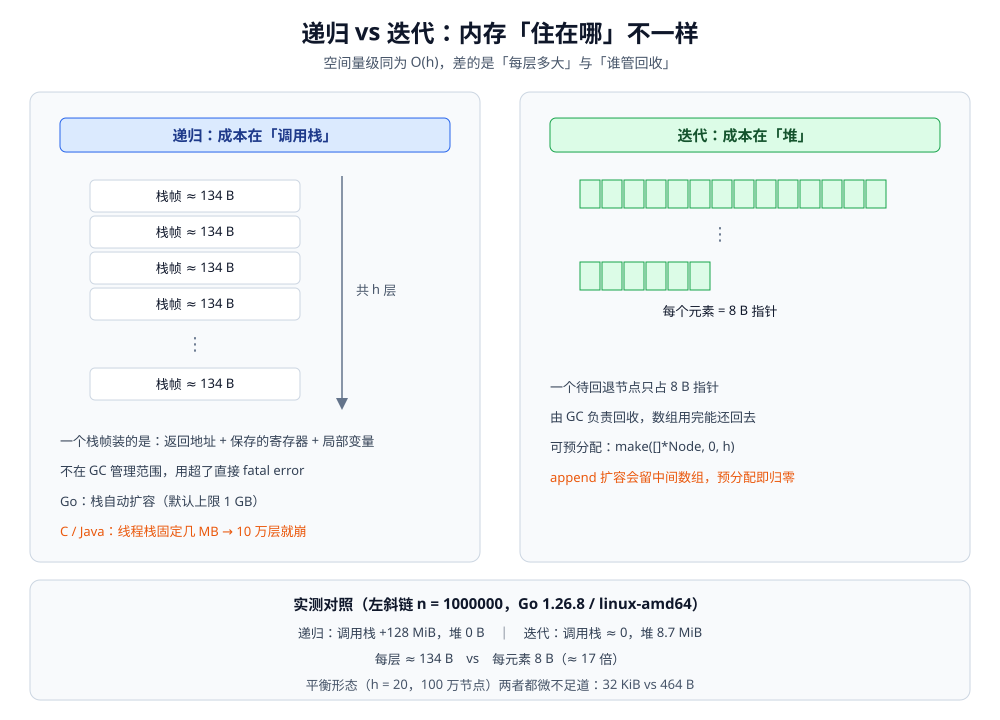
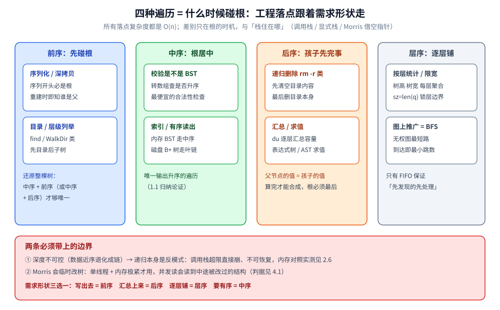

# 树的遍历

> 二叉树的四种遍历：前 / 中 / 后 / 层序的**定义、递归写法、迭代写法与 Morris**，
> 以及「同一棵树为什么能有四种顺序、它们各自不可替代在哪」。
>
> ⭐ 边界先说清：本篇只讲**遍历机制与实现**。用遍历去解的题（验证 BST、LCA、树形 DP）
> 见 [树与二叉搜索树算法.md](../../算法/基础算法/树与二叉搜索树算法.md)；
> 结构本身（术语、存储、公式）见 [二叉树结构与性质.md](二叉树结构与性质.md)。
>
> 内容整理自个人学习笔记，素材见 [素材清单](../../../素材清单.md)。
>
> 📎 本篇输出均为本机**容器**实跑逐字抄录：**Go 1.26.8（linux/amd64，`golang:1.26-alpine`）**。
> 
> ⚠️ **随机数据一律来自「固定 seed 的本地随机源」**（`rand.New(rand.NewSource(...))`）——Go ≥ 1.24 的 `rand.Seed` 已**不再影响全局随机源**，用它写实验会「看起来可复现、其实每次都不同」（实测踩过）；本篇结构性数字整篇重跑**逐字相同**。
> **遍历顺序与「递归 == 迭代」、以及 2.6 的内存对照都是确定性结论**，可整篇重跑复现（内存读数连跑 3 次逐字相同，栈字节数按 4 KiB 页对齐，会有 ±1 页波动）；⚠️ 耗时数字随机器与容器波动，只作量级参考。

---

## 一、三种深度优先遍历凭什么只差"根放第几个"？

**本节要点**：前 / 中 / 后序的**唯一区别**是「根在左子树、右子树之间被访问的时机」——`根左右 / 左根右 / 左右根`。
左与右的相对次序**永远不变**，变的只有根。

| 遍历 | 顺序 | 为什么需要它 |
|---|---|---|
| **前序** | 根 → 左 → 右 | 序列化 / 复制整棵树（先落根，重建时才知道谁是父） |
| **中序** | 左 → 根 → 右 | BST 上输出**升序**序列（唯一的排序遍历） |
| **后序** | 左 → 右 → 根 | 释放内存 / 自底向上汇总子树信息（根最后才拿到结果） |

⭐ **一句话记住**：**前序"根最先"、中序"根居中"、后序"根最后"**。
三者在结构上只差「访问根」那一行代码的位置 —— 这正是它们递归写法高度对称的原因（见第二节）。

同一棵树（本机实测）：

```text
        1
      /   \
     2     3
    / \     \
   4   5     6

前序 根→左→右 : [1 2 4 5 3 6]
中序 左→根→右 : [4 2 5 1 3 6]
后序 左→右→根 : [4 5 2 6 3 1]
层序 逐层     : [1 2 3 4 5 6]（逐层切开 [[1] [2 3] [4 5 6]]）
```



### 1.1 为什么中序在 BST 上一定有序

**论证（归纳）**：BST 的定义是「左子树所有键 < 根 < 右子树所有键」。
中序遍历的次序是「左子树（递归）→ 根 → 右子树（递归）」。

- 归纳假设：对更小的子树，中序输出升序；
- 那么整体输出 = 「升序的左子树」+ 根 + 「升序的右子树」，且左子树全部 < 根 < 右子树全部；
- 拼接后必然整体升序。

⭐ **推论**：反过来也成立 —— 中序遍历**不是升序**，这棵树就不是 BST。这条被大量用来做校验（见 [树与二叉搜索树算法.md](../../算法/基础算法/树与二叉搜索树算法.md) 第一节）。

### 1.2 三种遍历各自的"不可替代性"

| 遍历 | 不可替代的场景 | 原因 |
|---|---|---|
| 前序 | **序列化 / 反序列化** | 序列里第一个一定是根，重建时能立刻切分左右子树 |
| 中序 | **BST 有序输出 / 校验** | 只有它的输出天然有序 |
| 后序 | **依赖子树的汇总**（树高、路径和、释放） | 用子节点的结果算父节点，必须孩子先算完 |

⚠️ **常见误解**：「知道任意一种遍历就能还原二叉树」——**错**。
只有「**中序 + 前序**」或「**中序 + 后序**」能唯一还原；只给前序或只给后序信息不够（不同形态的树可能输出相同）。

---

## 二、递归写得那么对称，为什么还要学迭代？

**本节要点**：递归的**代价是调用栈**（空间 `O(h)`，树退化成链时 `h = n`，可能爆栈）。
迭代把同一份栈搬到**堆**上自己管 —— 空间量级相同，但**不受系统栈深度限制**，而且三种遍历的迭代写法各有套路。

三种遍历的递归骨架（注意只有「访问」那一行的位置不同）：

```go
func preorder(r *Node, out *[]int) {
	if r == nil {
		return
	}
	*out = append(*out, r.Val) // 前序：根在最先
	preorder(r.Left, out)
	preorder(r.Right, out)
}

func inorder(r *Node, out *[]int) {
	if r == nil {
		return
	}
	inorder(r.Left, out)
	*out = append(*out, r.Val) // 中序：根在中间
	inorder(r.Right, out)
}

func postorder(r *Node, out *[]int) {
	if r == nil {
		return
	}
	postorder(r.Left, out)
	postorder(r.Right, out)
	*out = append(*out, r.Val) // 后序：根在最后
}
```

⭐ 后序这一份是**基准**：2.1 反转法、2.2 双栈法、2.3 单栈 + `pre` 指针三种迭代写法都要与它**逐位对齐**（见 2.4）——
因为它正是第一节表格里「依赖子树的汇总」那一档，子节点的结果齐了才轮到根。

### 2.1 迭代写法的三套模板

**前序**：栈里**先压右、再压左** → 弹出时才是「先左后右」。

```go
func preIter(root *Node) []int {
	var out []int
	if root == nil {
		return out
	}
	st := []*Node{root}
	for len(st) > 0 {
		n := st[len(st)-1]
		st = st[:len(st)-1]
		out = append(out, n.Val)
		if n.Right != nil { // ⭐ 先右
			st = append(st, n.Right)
		}
		if n.Left != nil { // ⭐ 后左 → 弹出时左先出
			st = append(st, n.Left)
		}
	}
	return out
}
```

**中序**（面试最高频）：**一路向左压栈 → 弹栈访问 → 转向右子树**。

```go
func inIter(root *Node) []int {
	var out []int
	cur := root
	var st []*Node
	for cur != nil || len(st) > 0 {
		for cur != nil { // 一路向左
			st = append(st, cur)
			cur = cur.Left
		}
		cur = st[len(st)-1] // 弹栈访问
		st = st[:len(st)-1]
		out = append(out, cur.Val)
		cur = cur.Right // 转向右子树
	}
	return out
}
```

**后序**：按「根 → 右 → 左」入栈，最后把结果**整体反转**（`左→右→根` 的反转正好是 `根→右→左`）。

```go
func postIter(root *Node) []int {
	var out []int
	if root == nil {
		return out
	}
	st := []*Node{root}
	for len(st) > 0 {
		n := st[len(st)-1]
		st = st[:len(st)-1]
		out = append(out, n.Val)
		if n.Left != nil { // 与 preIter 相反
			st = append(st, n.Left)
		}
		if n.Right != nil {
			st = append(st, n.Right)
		}
	}
	for i, j := 0, len(out)-1; i < j; i, j = i+1, j-1 {
		out[i], out[j] = out[j], out[i]
	}
	return out
}
```



### 2.2 后序还能用双栈法：把"反转"交给第二个栈

**本节要点**：2.1 的后序靠**最后整体反转**绕开了难点。**双栈法**换一种写法做同一件事 ——
把 `s1` 弹出来的节点依次压进 `s2`（弹出顺序是「根 → 右 → 左」），最后**倒着读 `s2`**，正好是「左 → 右 → 根」。

```go
func postTwoStack(root *Node) []int {
	if root == nil {
		return []int{}
	}
	s1 := []*Node{root}
	var s2 []*Node
	for len(s1) > 0 {
		x := s1[len(s1)-1]
		s1 = s1[:len(s1)-1]
		s2 = append(s2, x) // s1 的弹出顺序 = 根 → 右 → 左
		if x.Left != nil { // ⭐ 先压左
			s1 = append(s1, x.Left)
		}
		if x.Right != nil { // ⭐ 后压右 → 弹出时右先出
			s1 = append(s1, x.Right)
		}
	}
	out := make([]int, 0, len(s2))
	for i := len(s2) - 1; i >= 0; i-- { // 倒着读 s2 = 左 → 右 → 根
		out = append(out, s2[i].Val)
	}
	return out
}
```

⚠️ **它不是"更好的后序"，只是另一种表述**：`s2` 会收满**整棵树**的节点
（实测 n = 100 万时 `s2` 峰值 = 1 000 000 个指针），**两个栈同时存在** → 额外多一份 `O(n)` 的指针数组。
它的价值只是**代码里没有那个原地交换循环**，顺序关系一眼可见。

⭐ **实测**：样本树与满二叉树上，双栈法的输出与递归**逐位相同**（见 2.4）。

### 2.3 单栈 + 指针：用游标替代"压两个孩子"

**本节要点**：「单栈 + 指针」是一种通用形态 —— 一个 `cur`（或 `pre`）游标负责**往下走**，
栈只用来记**还没处理完的祖先**。栈里因此只剩"路径"，而不是"所有待处理的孩子"。

**前序（栈里只压右孩子）**：左链靠 `cur` 一路走，只有遇到右孩子才入栈 —— 比 2.1 的前序少压一半。

```go
func preIterPtr(root *Node) []int {
	out := []int{}
	var st []*Node
	cur := root
	for cur != nil || len(st) > 0 {
		for cur != nil { // 一路向左，边走边输出
			out = append(out, cur.Val)
			if cur.Right != nil { // ⭐ 栈里只存"待回来的右孩子"
				st = append(st, cur.Right)
			}
			cur = cur.Left
		}
		if len(st) == 0 { // ⚠️ 栈空 = 整棵树处理完
			break
		}
		cur = st[len(st)-1] // 左链走完了，弹一个右孩子继续
		st = st[:len(st)-1]
	}
	return out
}
```

⚠️ **这一版比 2.1 的前序多一个坑**：内层「一路向左」结束时 `cur` 已经是 `nil`，此时若栈也空，说明整棵树已经走完 ——
**少了这个 `break`，下一行的 `st[len(st)-1]` 会直接 panic（`index out of range [-1]`）**，实测样本树跑到最后一个节点就崩。
2.1 的前序没这个问题，因为它的循环条件本来就是「栈空即止」。

**后序（用 `pre` 指针判断"右边处理完了吗"）**：这是唯一**按 `左→右→根` 顺序直接输出**的写法 —— 不反转、不借第二栈。

```go
func postOneStackPtr(root *Node) []int {
	out := []int{}
	var st []*Node
	var pre *Node // 上一个"已访问完"的节点
	cur := root
	for cur != nil || len(st) > 0 {
		for cur != nil { // 一路向左
			st = append(st, cur)
			cur = cur.Left
		}
		top := st[len(st)-1]
		if top.Right == nil || top.Right == pre { // 右边没东西、或右子树刚处理完
			out = append(out, top.Val)
			pre = top // ⭐ 更新"上一个访问完的"
			st = st[:len(st)-1]
		} else {
			cur = top.Right // 右边还没处理 → 转过去
		}
	}
	return out
}
```

⭐ **判据只有一行**：`top.Right == nil || top.Right == pre`。
为什么 `pre` 能判"右子树处理完了"？因为**后序里右子树的根是最后被访问的节点** ——
只要"上一个访问完的"就是 `top.Right`，说明 `top` 的右子树已全部输出，轮到 `top` 自己。

⚠️ 中序的 2.1 模板**本来就是「单栈 + 指针」**（`cur` 一路向左、栈记祖先），只是当时没这么叫。

**六种写法的形态对照**：

| 遍历 | 写法 | 栈个数 | 需要反转 | 栈里放什么 |
|---|---|---|---|---|
| 前序 | 先压右再压左 | 1 | 否 | 两个孩子都压 |
| 前序 | **单栈 + 指针** | 1 | 否 | **只压右孩子** |
| 中序 | **单栈 + 指针** | 1 | 否 | 祖先路径 |
| 后序 | 反转法 | 1 | ✅ 原地交换 | 待处理的子树根 |
| 后序 | **双栈法** | 2 | ✅ 倒读 `s2` | `s2` 收满整棵树 |
| 后序 | **单栈 + 指针** | 1 | 否 | 祖先路径 + `pre` |

⭐ **怎么选**：要**最短** → 2.1 的三套模板；要**后序真正按 `左→右→根` 输出** → 单栈 + 指针；
要**代码里不出现交换循环** → 双栈法（代价是多一份 `O(n)` 指针数组）。

### 2.4 迭代必须与递归逐位一致（本机实测）

**本节要点**：同一棵树上，「递归输出」与**每一种**「迭代输出」必须**逐位相同**。
这是迭代写法最容易错的地方（前序压栈顺序、后序反转），而它**不会报错、只会静默给出另一种顺序**。

```text
[自检] 各迭代写法 必须与递归输出逐位相同（样本树 6 节点 / 满二叉树 h=10 共 1023 节点）
  前序  递归==先压右后压左 : true   递归==单栈指针(只压右孩子) : true
  中序  递归==单栈指针(一路向左) : true
  后序  递归==反转法 : true   递归==双栈法 : true   递归==单栈指针(pre) : true
```

### 2.5 三种写法的耗时对照（只作量级参考）

```text
[耗时对照] n=200000 随机树，中序遍历
  递归      ~22 ms
  显式栈    ~21 ms
  Morris    ~17 ms（额外空间 O(1)，但每步都要找前驱）
```

⚠️ 时序数字随机器与容器波动，**只断言「同为 `O(n)`、同一量级」**，不要引用具体数值做结论。
Morris 更快不代表它更好 —— 见第四节它的三条硬代价。

### 2.6 递归和迭代的内存到底差在哪？（本机实测）

**本节要点**：两者的**空间复杂度同为 `O(h)`**，但「住在哪、每层多大、谁管回收」完全不同 ——
**递归把成本放在调用栈（不在 GC 管理范围，用超了直接崩），迭代把它放在堆（可回收、还能预分配）**。

| | 递归 | 迭代（显式栈） |
|---|---|---|
| 存在哪 | **调用栈**（goroutine / 线程栈） | **堆**（一个切片） |
| 每层多大 | 一个**栈帧**：返回地址 + 保存的寄存器 + 局部变量 | 一个 **8 B 指针** |
| 谁管回收 | 调用返回自动弹栈；Go 会按需**扩容**，C / Java 是**固定大小** | **GC** 负责，数组用完可回收 |
| 超限后果 | 触到栈上限（Go 默认 1 GB）→ `fatal error: stack overflow`，**不可恢复** | 只有堆不够才 OOM（一般远够） |
| 能否预分配 | 不能（帧数由递归深度决定） | **能**（`make([]*Node, 0, h)`） |

实测（同一容器，Go 1.26.8 linux/amd64）：

```text
[内存对照·链式] 左斜链 n=1000000（树高 = 递归深度 = 显式栈深度 = 1000000）
  递归 inRec      调用栈 +134217728 B (128 MiB)     堆分配 0 B      → 每层 ≈ 134 B
  迭代 inIter     调用栈 ≈ 0                        堆: 常驻数组 9084928 B (8.7 MiB)
                  append 扩容的累计分配 44948544 B (42.9 MiB)；预分配后归零

[内存对照·平衡] 满二叉树 h=20，节点数 1048575
  递归 inRec      调用栈 +32768 B (32 KiB)          堆分配 0 B（深度 20）
  迭代 inIter     调用栈 ≈ 0                        堆 +464 B（显式栈长度 20）
```



⭐ **读出来的三件事**：

1. **每层成本差约 17 倍**：递归一个帧 ≈ 134 B，迭代一个待回退节点 = 8 B 指针。
   直观解释 —— 帧里装的不只是"回来的地址"，还有**保存的寄存器与局部变量**；而显式栈只装一个指针。
2. **同深度下的总量**：链式 100 万层，递归要 **128 MiB 栈**，迭代只要 **8 MB 指针数组**（≈16 倍）。
3. **平衡形态两者都微不足道**（32 KiB vs 464 B）—— 差距**只在退化成链时才被放大**。

⚠️ **两条必须说清的边界**：

- **迭代的 `append` 扩容有额外垃圾**：Go 切片按约 1.25 倍增长，累计分配（42.9 MiB）约为最终数组的 5 倍，
  这些中间数组要等 GC 回收。**提前 `make([]*Node, 0, h)` 就归零**（实测预分配后遍历期间零新增分配）。
- **"会不会爆栈"取决于运行时，不取决于代码**：本实验 Go 的 goroutine 栈**自动扩容**，100 万层照跑；
  换成 C / Java 的**固定几 MB 线程栈**，按 134 B/层估算，**10 万层（≈13 MB）就崩**。
  同一份递归代码"能不能跑"，答案是运行时给的。

⭐ **一句话**：**深度可预测（平衡树 `h = log n`）→ 递归怎么写都行；深度不可控（数据接近有序 → 退化成链）→ 换迭代**，
把"不可控的调用栈"换成"可回收、可预分配的堆"。想两全 → Morris（第四节）。

---

## 三、层序遍历为什么必须用队列？

**本节要点**：深度优先用**栈**（后进先出）才能"一条路走到黑"；层序要**先来先服务**，只能靠**队列**。
「按层处理」的关键动作是 —— **出队前先记下当前队列长度**。
```go
type TreeNode struct {
	Val   int
	Left  *TreeNode
	Right *TreeNode
}

// 迭代 BFS：层序遍历
func bfsIter(root *TreeNode) []int {
	var res []int
	if root == nil {
		return res
	}

	queue := []*TreeNode{root} // 队列，先进先出

	for len(queue) > 0 {
		node := queue[0]       // 出队
		queue = queue[1:]
		res = append(res, node.Val)

		if node.Left != nil {
			queue = append(queue, node.Left) // 左孩子入队
		}
		if node.Right != nil {
			queue = append(queue, node.Right) // 右孩子入队
		}
	}
	return res
}
```
或按层输出
```go
func levelOrder(root *Node) [][]int {
	var res [][]int
	if root == nil {
		return res
	}
	q := []*Node{root}
	for len(q) > 0 {
		sz := len(q) // ⭐ 先锁住「这一层有几个节点」
		var layer []int
		for i := 0; i < sz; i++ {
			n := q[0]
			q = q[1:]
			layer = append(layer, n.Val)
			if n.Left != nil {
				q = append(q, n.Left)
			}
			if n.Right != nil {
				q = append(q, n.Right)
			}
		}
		res = append(res, layer)
	}
	return res
}
```

⭐ **`sz := len(q)` 这一行是全部技巧所在**：队列在循环中会不断被追加孩子，
若不先锁住长度，就分不清「本层还剩几个」。这也是「按层打印 / 求树宽 / 求树高」的通用骨架。

### 3.1 层序的三个直接用途

| 用途 | 做法 |
|---|---|
| **求树高** | 每处理完一层计数 +1；不用递归 |
| **按层打印** | 直接就是上面的 `res` 结构 |
| **无权图最短路** | 在图上做层序 = BFS，第一次到达某节点即最短距离（见 [BFS广度优先遍历.md](../../算法/图论算法/图的遍历/BFS广度优先遍历.md)） |

### 3.2 栈与队列的分工

| 容器 | 取元素的次序 | 用在 | 结果 |
|---|---|---|---|
| **栈**（LIFO） | 最后进去的先出来 | DFS（前 / 中 / 后序） | 一条分支走到底 |
| **队列**（FIFO） | 最早进去的先出来 | BFS（层序） | 一层一层扩散 |

⚠️ **只改动一行**（把栈换成队列）就得到完全不同的遍历次序 —— 这也是「树的遍历」与「图的遍历」共用同一套骨架的原因。

---

## 四、Morris 怎么把空间压到 O(1)？

**本节要点**：递归与显式栈都要 `O(h)` 额外空间。Morris 的思路是**借树自己的空指针**当"临时线索"，
从而在**不改内存布局**的前提下做到 `O(1)`。

**核心思路**：中序遍历的"下一个要访问的节点"是**当前节点左子树的「最右节点」**（中序前驱）。
Morris 把这个前驱的**空右指针**临时指向当前节点 —— 这样访问完左子树后能顺着线索"爬回来"，不必依靠栈。

```go
func morrisInorder(root *Node) ([]int, int) {
	var out []int
	cur := root
	threads := 0
	for cur != nil {
		if cur.Left == nil {
			out = append(out, cur.Val) // 无左子树 → 直接访问，转向右
			cur = cur.Right
			continue
		}
		prev := cur.Left // 找左子树的最右节点（中序前驱）
		for prev.Right != nil && prev.Right != cur {
			prev = prev.Right
		}
		if prev.Right == nil {
			prev.Right = cur // 建临时线索，往左走
			threads++
			cur = cur.Left
		} else {
			prev.Right = nil // 拆掉线索，恢复原树
			out = append(out, cur.Val)
			cur = cur.Right
		}
	}
	return out, threads
}
```

**本机实测（同一棵树）**：

```text
[Morris 中序] 结果 [4 2 5 1 3 6]  与递归相同: true  建立/拆除线索 2 次
```

⭐ `建立/拆除线索 2 次` 与树里「有左子树的节点数」一致（本树是节点 1 与节点 2）—— 这就是 `O(1)` 空间的来源：
**只借用了本来就存在的空指针，没有新开任何容器**。

### 4.1 Morris 的三条硬代价

| 代价 | 说明 |
|---|---|
| **会临时改树** | 遍历中途树结构被改（`prev.Right` 被指向祖先）；**单线程才行**，并发读会读到错误结构 |
| **常数更大** | 每个有左子树的节点都要"找一次前驱"，多一层内层循环（见 2.5 实测） |
| **出错难以察觉** | 若中途 `return` / `panic`，**线索不会被拆掉**，树就真的坏了 |

⚠️ **判据**：**内存极紧 + 能接受改树 + 单线程**才用 Morris。绝大多数业务代码用递归或显式栈即可。

---

## 五、应用场景

**本节要点**：遍历是树形数据的**公共骨架** —— 工程需求只有「写出去 / 汇总上来 / 逐层铺 / 要有序」四类形状，四种顺序只是「什么时候碰根」的差别；真实系统里它常被封装进命令与库函数，看不见名字。

### 5.1 应用场景总表

| 场景 | 具体产品 / 系统 | 怎么用这个结构 | 为什么合适 |
|---|---|---|---|
| **序列化 / 深拷贝** | JSON 与消息里的树形载荷、前端组件树拷贝（JSON / Protobuf 的格式取舍见 [数据序列化.md](../../网络/选型/数据序列化.md)） | 前序 + 空位占位写出，重建时序列首元素即根（1.2） | 只有前序保证「开头是根」，能立刻切分左右子树 |
| **目录 / 层级列举** | `find`、Go `filepath.WalkDir` 一类目录遍历 API（形态描述取粗粒度，以官方文档为准；命令口径见 [常用命令.md](../../linux/常用命令.md)，层级数据落库见 [层级与树形数据存储.md](../../../03-数据与中间件/数据存储/存储架构与场景/形态篇/层级与树形数据存储.md)） | 先处理目录本身、再进子树 = 前序形态 | 父先于子：拿到路径就能先做过滤 / 建结构 |
| **递归删除 / 资源释放** | `rm -r` 类递归删除、对象树销毁 | 先清空目录内内容、最后删目录本身 = 后序形态 | 父先删就再也找不到孩子；「孩子先完事」只有后序 |
| **自底向上汇总与求值** | `du` 类磁盘用量统计、表达式树求值 / AST 语义分析 | 子节点结果齐了才算父节点 = 后序形态 | 汇总类计算的依赖方向天然自底向上（5.2 第二层） |
| **有序读出与合法性校验** | BST 内存索引的顺序扫描；校验「是不是 BST」 | 中序天然升序（1.1）；磁盘上的有序读出落成 B+ 树叶子链（见 [B树与B+树.md](磁盘存储树/B树与B+树.md)） | 「转数组查升序」是最便宜的 BST 检查（另见 [树与二叉搜索树算法.md](../../算法/基础算法/树与二叉搜索树算法.md)） |
| **逐层统计 / 图上推广** | 组织架构逐层聚合、树高树宽、无权图最短路 | 层序 + `sz := len(q)` 锁层（第三节）；图上即 BFS（见 [BFS广度优先遍历.md](../../算法/图论算法/图的遍历/BFS广度优先遍历.md)） | 只有 FIFO 保证「先发现的先处理」，到达即最小跳数 |
| **内存极紧的单线程扫描** | 大对象树 / 嵌入式场景的只读遍历（判据见 4.1） | Morris 借空指针做线索，额外空间 O(1) | 拿不到栈、也不开堆容器时的唯一选项；⚠️ 会临时改树 |



### 5.2 深入辨析：遍历在工程里以什么形式出现

**第一层：序列化与深拷贝。** 前序遍历是「写出去」的标准顺序（先写根，再递归子树）；反序列化时配合中序或占位符切分。JSON / 消息队列里的树形结构、前端组件树的 diff 都基于它。

**第二层：写编译期 / 运行期的"求值"。** 表达式树求值、语法树的语义分析、AST 遍历 —— 都是后序（先算子节点再算父节点）。你在任何语言的编译器前端都会看到它。

**第三层：校验与取值。** 中序是 BST 的"照妖镜"：转成数组看是否升序，是最省事的合法性检查。范围查询也可以先中序得到有序序列再二分。

**第四层：按层处理与限宽。** 层序遍历在「树的宽度 / 深度 / 每层聚合」这类需求里是唯一自然的写法；在图上它退化成 BFS，是最短路的标准解法。

⭐ **一条选择判据**：**问"父节点要不要等孩子"** → 要等（自底向上）→ 后序；**问"父节点要不要先处理"** → 前序；
**问"要不要有序"** → 中序；**问"要不要按层"** → 层序。

### 5.3 收尾判据

共同前提：所有落点的复杂度都是 `O(n)` —— **选的从来不是快慢，是「根的时机」和「栈住在哪」**。深度可预测用递归，不可预测换显式栈（2.6），单线程 + 极限内存才考虑 Morris（4.1）。

⚠️ **失效边界**：数据在**图**上时「四种顺序」塌缩成 DFS / BFS 两种语义（顺序不唯一的成因见 [DFS深度优先遍历.md](../../算法/图论算法/图的遍历/DFS深度优先遍历.md)）；**并发读**的树禁用 Morris —— 遍历中途树结构是被改过的（4.1）。

---

## 延伸追问

- **递归遍历和迭代遍历的区别？** → 遍历**顺序相同**（实测各迭代写法都与递归逐位一致），差别在**空间与可控性**：递归用调用栈（`O(h)`，**每层 ≈134 B**，实测链式 100 万层要 **128 MiB** 栈），迭代用堆上的显式栈（同样 `O(h)`，**每元素 8 B 指针**，实测 8 MB）。⚠️ 关键差别是**谁管回收**：调用栈不在 GC 管理范围、超了直接 `fatal error`，堆可回收、还能 `make([]*Node, 0, h)` 预分配。写代码时「栈深不可控」（例如数据可能接近有序）就该换迭代 —— 见 2.6。
- **中序遍历为什么能保证 BST 有序？** → 因为 BST 的定义是「左子树全 < 根 < 右子树全」，而中序的输出次序恰好是「左子树（递归）+ 根 + 右子树（递归）」；归纳可得整体升序。反过来也成立 —— 中序不是升序就不是 BST，这条被用作校验。
- **Morris 遍历为什么能做到 O(1) 空间？** → 它不新增容器，而是**临时借用叶子的空右指针**指向祖先（线索）。访问完左子树顺着线索爬回来，之后再把指针还原。本机实测「建立/拆除线索 2 次」，正好等于「有左子树的节点数」。⚠️ 代价是遍历期间树被改过，必须单线程，且异常退出会留下坏线索。
- **为什么层序遍历要用队列而不是栈？** → 栈是后进先出，会让"最后发现的孩子"先被处理，退化成深度优先；层序要求"先发现的先处理"，只有 FIFO 能满足。⚠️ 换成队列时还要配合 `sz := len(q)` 锁住层长度，否则分不清层边界。
- **知道一种遍历能不能还原二叉树？** → 不能。必须「**中序 + 前序**」或「**中序 + 后序**」；只有前序或只有后序信息不足（不同形态的树可能输出相同序列）。原因是中序提供了"根把左右子树切成两半"的分界信息，而前/后序只提供根的位置。
- **后序迭代为什么要反转？** → 后序是「左→右→根」。若把入栈顺序改成「根→右→左」，输出就变成 `根→右→左` 的逆序 = `左→右→根`，正好是后序。所以写成"按相反顺序入栈 + 最后整体反转"，比手动模拟两次访问（标记法）更短。**不想反转**有两条替代路线：双栈法（把逆序显式放进 `s2`）或单栈 + `pre` 指针（唯一按后序顺序直接输出的写法）。
- **双栈法和反转法有什么区别？** → 两者输出**逐位相同**（实测）。反转法是「按 `根→右→左` 入栈 + 最后原地交换 `out`」；双栈法把这次"反转"显式放进第二个栈 —— `s2` 收满整棵树（实测 n = 100 万时峰值 = 1 000 000 个指针），倒读即后序。双栈法多一份 `O(n)` 指针数组，换来"代码里没有交换循环"。
- **后序的「单栈 + 指针」判据是什么？** → `top.Right == nil || top.Right == pre`。`pre` 记"上一个已访问完的节点"；因为后序里**右子树的根最后才被访问**，所以 `top.Right == pre` 就意味着右子树已全部输出，轮到 `top` 自己。
- **为什么递归的每层比显式栈贵这么多？** → 栈帧里装的是**返回地址 + 保存的寄存器 + 局部变量**（实测 ≈134 B/层），而显式栈每个元素只是一个 8 B 指针 —— 差的约 17 倍全在这里。而且帧数由递归深度决定，**不是你能预分配的**。

---

## 关联

- [二叉树结构与性质.md](二叉树结构与性质.md) — **地基篇**：术语、深度与高度、两种存储结构、四条高频公式
- [树与二叉搜索树算法.md](../../算法/基础算法/树与二叉搜索树算法.md) — 用遍历解题：验证 BST、LCA、树形 DP
- [平衡树.md](内存平衡树/平衡树.md) — 遍历在 BST 上的应用（中序有序）与「退化」为什么破坏 `O(log n)`
- [树的形态与选型.md](树的形态与选型.md) — 全目录选型总纲
- [堆与优先队列.md](../堆/堆与优先队列.md) — 层序遍历与「数组存完全二叉树」的配合
- [BFS广度优先遍历.md](../../算法/图论算法/图的遍历/BFS广度优先遍历.md) — 层序遍历在图上推广成 BFS 与无权最短路
- [DFS深度优先遍历.md](../../算法/图论算法/图的遍历/DFS深度优先遍历.md) — 栈与递归在图上推广（含「遍历顺序不唯一」的成因）
- [递归与分治.md](../../算法/基础算法/递归与分治.md) — 递归三要素与「递归转迭代（显式栈）」的一般方法
- [README.md](../README.md) — 数据结构目录总纲
- [树链剖分.md](../../算法/高级技巧/树链剖分.md) — **给节点编个「好编号」**：重链优先的 dfs 序让路径与子树都变成连续区间
> 反向引用（本篇被下列文档引到）：[二叉搜索树.md](二叉搜索树.md)、[树形DP.md](../../算法/动态规划/组合与树形/树形DP.md)、[树上问题.md](../../算法/图论算法/树上问题.md)
