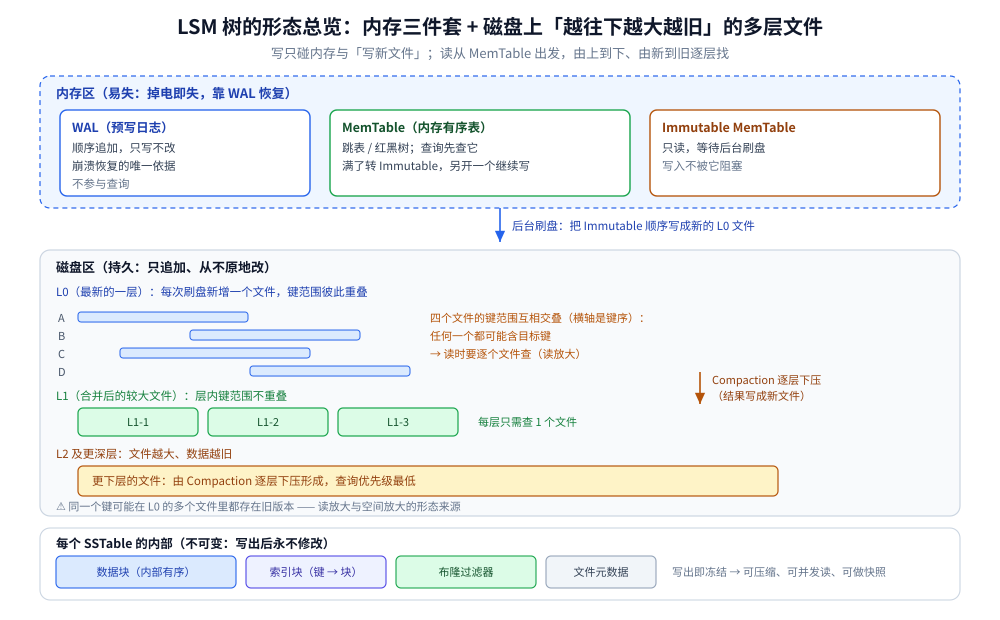
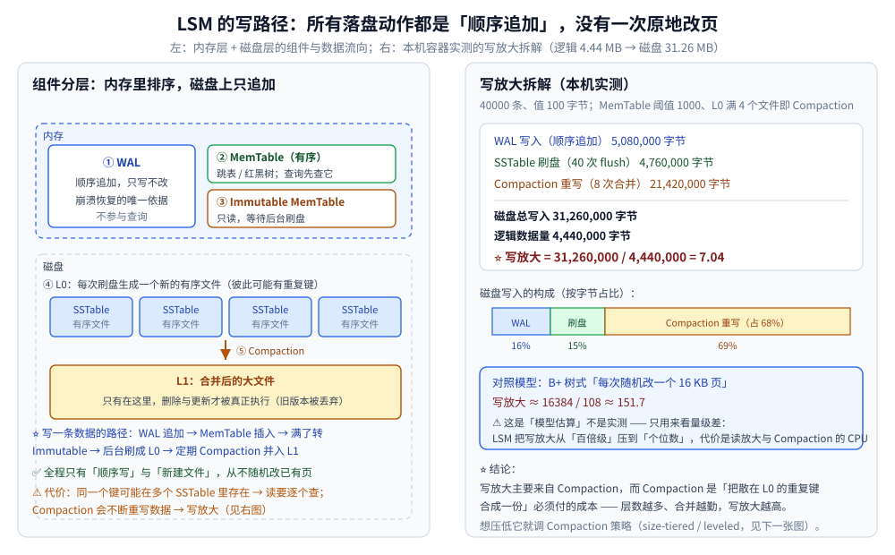
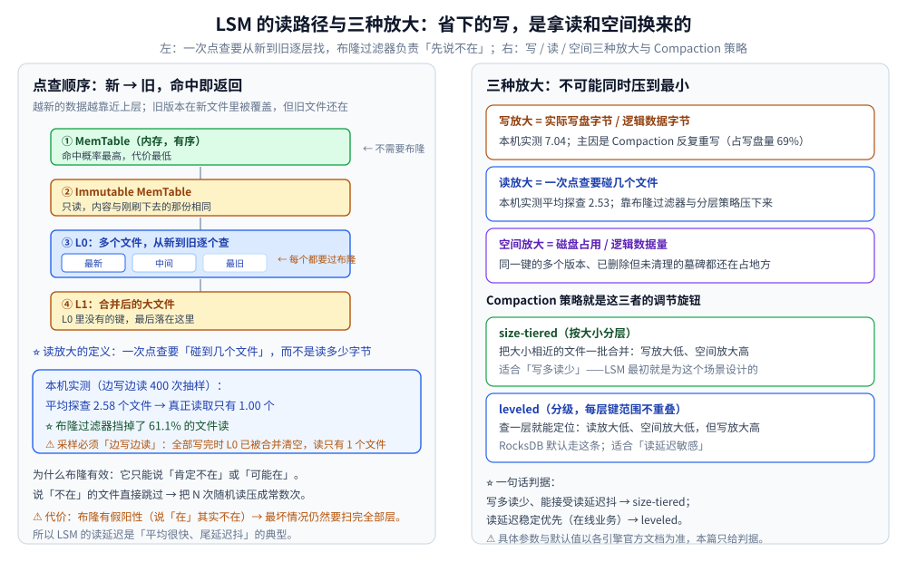
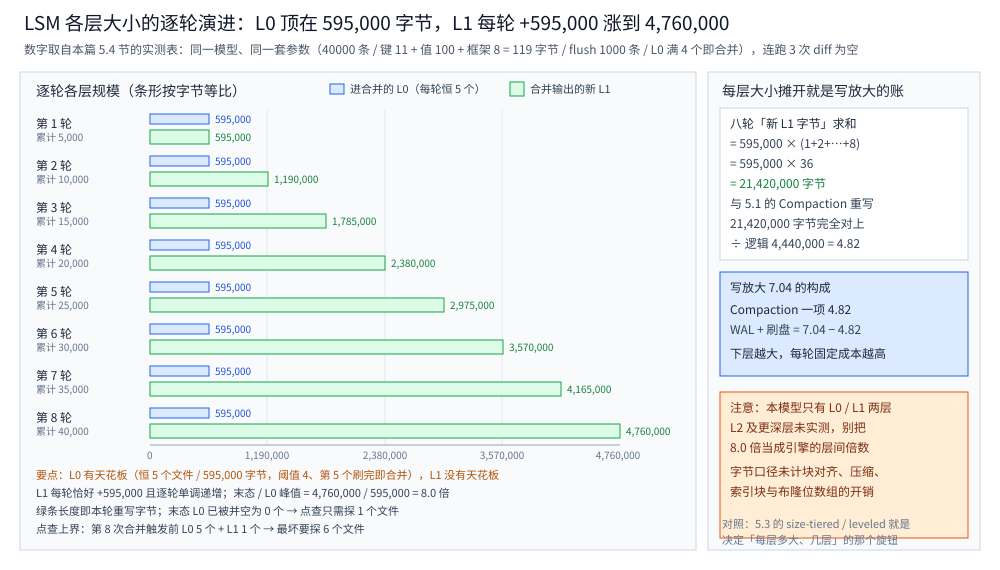

# LSM 树

> Log-Structured Merge Tree：**用「顺序写」换「读放大」** 的存储引擎核心，
> 回答「B+ 树在写多读少的场景为什么会输、LSM 为此付出了什么代价」。
>
> ⭐ 边界先说清：本篇讲**存储引擎层的结构与代价**（整体形态 / MemTable / SSTable / Compaction / 三种放大）。
> 
> 「B+ 树为什么是磁盘索引首选」的完整推导见 [B树与B+树.md](B树与B+树.md)；
> 全目录选型总纲见 [树的形态与选型.md](../树的形态与选型.md)。
>
> 内容整理自个人学习笔记，素材见 [素材清单](../../../../素材清单.md)。
>
> 📎 本篇读数来自**自写的极简 LSM 实现**（MemTable + WAL + 两级 SSTable + Compaction），在本机**容器**里实跑逐字抄录：**Go 1.26.8（linux/amd64，`golang:1.26-alpine`）**。
> ⚠️ 读路径抽样依赖随机数 → 一律用「固定 seed 的本地随机源」（Go ≥ 1.24 的 `rand.Seed` 已不再影响全局随机源，用它写实验会「看起来可复现、其实每次都不同」）；**两个确定性数字（写放大 7.04 / 字节数）整篇重跑逐字相同**。
>
> ✅ **实测口径**：写 40000 条，键 `key%08d`（11 字节）、值 100 字节 → 逻辑数据 4,440,000 字节；
> MemTable 阈值 1000 条；L0 超过 4 个文件触发 Compaction。可整篇重跑，数字不变。
> ⚠️ **仍未实测**：真实引擎（RocksDB / LevelDB）的具体参数、真实布隆位数组的误判率、真实磁盘 I/O 时序。

---

## 一、LSM 树是什么、长什么样？

**本节要点**：先建立全貌 —— 内存里「WAL / MemTable / Immutable」三件套，磁盘上「越往下越大越旧」的多层有序文件；写入从头到尾只做两件事：**顺序追加、后台合并**。

### 1.1 名字里的三个词分别指什么？

把 `Log-Structured Merge Tree` 拆开看，每个词都对应一条设计决定：

| 名字里的词 | 字面意思 | 对应的设计决定 |
|---|---|---|
| **Log-Structured** | 像写日志一样写数据 | 只**追加**（append-only），永不原地改已有数据 |
| **Merge** | 合并 | 「整理」不在写的时候做，**推迟到后台批量做** |
| **Tree** | 树 | 多层文件在**逻辑上**构成一棵有序结构：L0 → L1 → L2 … |

⭐ **溯源**：这套结构最早出自 1996 年的 LSM-Tree 论文（公开资料公认的说法）；但今天说「LSM 引擎」，都特指这套落地形态：**WAL + MemTable + 分层 SSTable + Compaction**（组件分工见第三节）。

⚠️ 别把「树」读成指针树：LSM 的文件之间没有父子指针，它是**按层组织、层内有序** —— 查询靠「逐层找」，不靠「从根往下走」。

### 1.2 长什么样？



读图要点（这张看**形态**，逐步的写路径拆解见第三节的图）：

- **内存区 —— 一份数据的三态**：WAL 只追加、不参与查询；MemTable 是有序内存表，查询先查它；满了转成 Immutable（只读）等后台刷盘，新开一个 MemTable 继续接写入；
- **磁盘区 —— 分层文件**：L0 是最新的一层，每次刷盘新增一个文件，**文件之间键范围互相重叠**；从 L1 往下，Compaction 已把键重排，**层内键范围不重叠**（每层只需查 1 个文件），且**越往下文件越大、数据越旧**；
- **每个 SSTable 的内部**：有序的数据块（先定位块、再块内二分）+ 索引块 + 布隆过滤器（挡掉「肯定不含目标键」的文件）+ 元数据；整个文件**不可变**；
- **读写方向相反**：写只碰内存与「写新文件」；读从 MemTable 出发，**由上到下、由新到旧**逐层找。

### 1.3 一次写入要经过哪几步？

| 步骤 | 动作 | 落点 |
|---|---|---|
| ① | 追加 **WAL** | 顺序写，只写不改 |
| ② | 插入 **MemTable** | 内存有序结构 |
| ③ | 满了 → 转 **Immutable** | 内存，只读 |
| ④ | 后台刷成新的 **L0** 文件 | **顺序写新文件** |
| ⑤ | L0 文件数超阈值 → **Compaction** 并入下层 | 后台顺序重写 |

⭐ 五步里**只有 ⑤ 会重写数据** —— 它是写放大的唯一来源。读写路径的逐步对照见第四节。

### 1.4 它为什么快？

一句话：**它把「写」的每一步都变成了顺序操作，而且写的时候不需要读磁盘。**

| 一次写入要做的动作 | B+ 树（原地改页） | LSM |
|---|---|---|
| 找到「要改的地方」 | 随机读 1 页 | 不需要 —— 只追加 |
| 落盘 | 随机写 1 页（页满再分裂） | 顺序追加日志 + 顺序写新文件 |
| 「整理」什么时候付 | 当场付（分裂 / 合并） | 攒起来，后台批量付（Compaction） |

⭐ 三条具体机制：

1. **全程无随机改页**：改一个键既不用先把页读进来，也不用原地写回（对照见第二节）；
2. **文件不可变**：写出即冻结 → 可压缩、可被多个读者并发读、可直接拿去做快照与副本同步（分布式场景很看重这点，见 7.2）；
3. **成本批量摊薄**：一次 Compaction 整理的是**一大批**写入，而不是每条都付一次「整理费」—— 本机实测写放大 7.04，对照「每次随机改 16 KB 页」的模型 ≈ 151.7（见第五节）。

⚠️ 快的是**写**：读放大、空间放大与尾延迟抖动是它付的账（见第五节）。

---

## 二、B+ 树的痛点是"原地改页"，为什么这会致命？

**本节要点**：B+ 树为「读」优化 —— 一页放满路由项、一次 I/O 命中一层。但这套优化对**写**是不利的：
**改一个键，就要把整页读进来、改、再写回去。**

B+ 树的写路径（细节见 [B树与B+树.md](B树与B+树.md) 第二节）：

1. 定位键所在的叶子页 → **随机读 1 页**；
2. 改页内内容 → **随机写 1 页**；
3. 页满了要**分裂** → 再多写 1~2 页 + 更新父页。

⭐ **三个结构性问题**：

| 问题 | 后果 |
|---|---|
| **写入顺序 = 键顺序**，业务上键往往是随机的 | 每次写都是**随机 I/O**（机械盘时代致命，SSD 上表现为写放大与寿命） |
| **最小写入单位是一页**（InnoDB 默认 16 KB） | 改 100 字节也要写 16 KB → 天然写放大 |
| **分裂 + 空间碎片** | 页利用率降到 ~50% 是常态，空间放大跟着上来 |

⚠️ 顺带一个常被忽略的点：**改 100 字节写 16 KB** 这件事本身就把写放大推到了百倍级。
下面的「对照模型」把它算成一个参考量级（**是模型估算，不是实测**）。

**LSM 的破局点**：既然「随机改」贵，那就**永远不原地改** ——
所有写都变成**顺序追加**（写到日志、写到新文件），把"整理"这件事**推迟到后台批量做**。

---

## 三、LSM 的五个组件各自解决什么？

**本节要点**：五个组件不是并列的，而是沿「内存 → 磁盘」的一条流水线，每个组件解决**上一环留下的一个问题**。

| 组件 | 位置 | 解决什么问题 |
|---|---|---|
| **WAL**（Write-Ahead Log） | 内存（追加写文件） | 内存数据**还没落盘就崩了**怎么办 → 先顺序写日志，重启回放 |
| **MemTable** | 内存 | 需要**有序**才能刷成有序文件 → 用跳表 / 红黑树（见 [平衡树.md](../内存平衡树/平衡树.md) 第四节为什么跳表合适） |
| **Immutable MemTable** | 内存 | MemTable 刷盘时**不能阻塞写入** → 满了转成只读，新开一个继续写 |
| **SSTable** | 磁盘 | 内存放不下的数据 → 刷成**内部有序**的文件，永不修改 |
| **Compaction** | 磁盘（后台） | 同一个键散在多个文件里 + 旧版本没清 → **合并**成更大的有序文件 |

⭐ **一条贯穿全篇的设计原则**：**"不变"是效率的来源**。
SSTable 一旦写出就**永不修改**（immutable），因此可以顺序写、可以压缩、可以由多个读者并发读。
所有"更新"与"删除"都只是**写一条新的记录**（删除是墓碑 `tombstone`），靠 Compaction 在后台真正生效。



### 3.1 MemTable 为什么要"有序"

因为刷盘时要写成**内部有序**的 SSTable（这样后续才能二分查找、才能顺序合并）。
如果 MemTable 是无序的哈希表，刷盘前还得整体排序一次 → 内存峰值与延迟都会变差。

⭐ **跳表比红黑树更适合 MemTable** 的两条理由（对照见 [平衡树.md](../内存平衡树/平衡树.md) 第四节）：

1. **写多**：跳表增删只动局部指针，不像红黑树要变色 + 旋转；
2. **并发友好**：跳表的无锁实现远比平衡树的旋转容易做。

### 3.2 删除为什么是"写一条墓碑"

既然 SSTable 不可修改，就**没有地方能"擦掉"一个键**。所以删除只能写成一条特殊记录：
「`key` 被删除了」。查询时若先遇到墓碑，就返回"不存在"，即使更旧的文件里还有这个键。

⚠️ 墓碑会一直占地方，直到 Compaction 把它和它遮蔽的旧值一起清掉 —— 这是**空间放大**的主要来源之一。

---

## 四、写路径与读路径分别是怎样的？

**本节要点**：写路径**全是顺序操作**（这是 LSM 的全部价值）；读路径**要从新到旧逐层找**（这是它付出的代价）。

### 4.1 写路径（六步）

| 步骤 | 动作 | 特点 |
|---|---|---|
| ① | 追加到 **WAL** | 顺序写，只写不改 |
| ② | 插入 **MemTable** | 内存操作，有序结构 |
| ③ | MemTable 满了 → 转成 **Immutable** | 只读，等待刷盘 |
| ④ | 后台线程把它刷成 **L0 SSTable** | 顺序写一个新文件 |
| ⑤ | L0 文件数超阈值 → **Compaction** | 合并 + 去重 + 丢旧版本 |
| ⑥ | 合并结果写入更下一层（**L1**） | 依然是顺序写新文件 |

⭐ **第 ⑤ 步是唯一"重写数据"的地方** —— 也是 LSM 全部写放大的来源（见第五节实测）。

### 4.2 读路径（从新到旧）

| 顺序 | 位置 | 说明 |
|---|---|---|
| ① | **MemTable** | 最新数据，命中率最高 |
| ② | **Immutable MemTable** | 内容与刚刷下去的那份重复 |
| ③ | **L0 SSTable**（新 → 旧） | 每个文件都可能含目标键，要逐个查 |
| ④ | **L1**（及更下层） | L0 都没有才轮到 |

⭐ **两个关键优化**：

- **布隆过滤器**：每个 SSTable 配一个位数组，查询前先问「这个键**肯定不在**吗」；
  答"不在"就跳过整个文件（本机实测挡掉了 **61.1%** 的文件读，见第五节）；
- **分层有序**（leveled）：让每一层的键范围**互不重叠** → 每层只需查 1 个文件。代价是写放大变高。

⚠️ **读延迟的形态**：LSM 的平均读很快，但**尾延迟会抖**（最坏情况要扫完全部层）。
这是它做在线业务的硬伤，也是数据库（如 TiDB、MyRocks）把它与 B+ 树混用的原因。

### 4.3 核心实现的骨架

⭐ 下面是本机实测所用**极简 LSM** 的写路径核心（自写、约 200 行；此处只摘「写 / 刷盘 / 合并」三段）：

```go
func (l *LSM) Put(k, v string) {
	l.walBytes += int64(len(k) + len(v) + 16) // ① WAL：顺序追加，只累加不回头改
	l.disk.bytesWritten += int64(len(k) + len(v) + 16)
	l.logicalBytes += int64(len(k) + len(v))

	l.mem[k] = v // ② MemTable：内存中有序结构
	if len(l.mem) >= l.memLimit {
		l.flush() // ③ 满了就刷
	}
}

// 把 MemTable 排好序刷成一个 L0 SSTable（④）
func (l *LSM) flush() {
	keys := make([]string, 0, len(l.mem))
	for k := range l.mem {
		keys = append(keys, k)
	}
	sort.Strings(keys)
	entries := make([]kv, 0, len(keys))
	bf := newBloom(len(keys), 0.01) // ⭐ 每个文件配一个布隆过滤器
	for _, k := range keys {
		entries = append(entries, kv{k, l.mem[k]})
		bf.Add(k)
	}
	l.disk.WriteSSTable(entries) // 顺序写一个**新**文件，不碰旧文件
	l.mem = map[string]string{}

	if len(l.disk.files) > l.l0MaxFiles {
		l.compact() // ⑤⑥ L0 满了就合并
	}
}

// 合并：把所有 L0 + 旧 L1 归并成一个新 L1，旧的整批丢弃（⑤⑥）
func (l *LSM) compact() {
	merged := map[string]string{}
	for i := 0; i < len(l.disk.files); i++ {
		for _, e := range l.disk.files[i] {
			merged[e.k] = e.v // 越新越优先：后读到的覆盖先读到的
		}
	}
	// ... 排序、写成新的 L1、把 l.disk.files 置空（旧文件被丢弃）
}
```

⚠️ 这段是**教学用简化实现**：真实引擎要处理「层内有序 + 层间 keyspace 划分」、并发 Compaction、
限速（Compaction 抢 I/O 会拖慢前台）、崩溃一致性（MANIFEST / 版本编辑）。**它只用来量代价，不要照抄上线。**

---

## 五、三种放大怎么权衡？

**本节要点**：写放大、读放大、空间放大**不可能同时压到最小**。Compaction 策略就是那个旋钮。

### 5.1 本机实测：写放大 7.04

```text
===== 极简 LSM 的写放大与读放大 =====
写入 40000 条，值长 100 字节，MemTable 阈值 1000 条，L0 超过 4 个文件触发 Compaction

[写路径]
  WAL 写入            : 5080000 字节（顺序追加）
  SSTable 刷盘         : 4760000 字节（40 次 flush）
  Compaction 重写      : 21420000 字节（8 次合并）
  ── 磁盘总写入        : 31260000 字节
  ── 逻辑数据量        : 4440000 字节
  ⭐ 写放大            : 7.04  （= 磁盘总写入 / 逻辑数据量）
```

**读法**：

- 逻辑上只写了 **4.44 MB**，磁盘上却实写了 **31.26 MB** → 写放大 **7.04**；
- 其中 **Compaction 一项就占了 21.42 MB（写盘量的 69%）** —— 写放大的主因非常明确；
- WAL 与刷盘各只占 16% / 15%，**而且全是顺序写**。

**对照模型（⚠️ 模型不是实测）**：若改成「每次随机改一个 16 KB 页」（B+ 树式原地改），
写放大 ≈ `16384 / 108 ≈ 151.7`。⭐ 量级差在 **20 倍以上** —— 这就是 LSM 存在的理由。

### 5.2 本机实测：读放大与布隆过滤

```text
[读路径] 边写边读：全程每 500 条抽 5 次点查，共 400 次
  每次点查平均要「探查」2.58 个文件（MemTable 命中记 0）
  其中真正发生读取的只有 1.00 个（布隆说「肯定不在」的直接跳过）
  ⭐ 布隆过滤器挡掉了 61.1% 的文件读
```

⚠️ **一个实验设计上的坑（本机踩过）**：如果**全部写完再测读**，此时 Compaction 已把 L0 并空，
读只会碰到 1 个文件、"读放大"看起来等于 1 —— 结论完全失真。
⭐ **必须「边写边读」采样**，才能覆盖「L0 里堆着好几个文件」的真实状态。

### 5.3 三种放大的三角

| 放大 | 定义 | 本机实测 | 主要来源 |
|---|---|---|---|
| **写放大** | 实际写盘字节 / 逻辑数据字节 | **7.04** | Compaction 反复重写（占 69%） |
| **读放大** | 一次点查要碰几个文件 | 平均**探查 2.58**、实读 1.00 | 同一个键散在多层多个文件里 |
| **空间放大** | 磁盘占用 / 逻辑数据量 | 未单独度量 | 多版本未合并 + 墓碑未清理 |

**Compaction 策略就是旋钮**：

| 策略 | 做法 | 换来什么 / 付出什么 |
|---|---|---|
| **size-tiered**（按大小分层） | 把大小相近的文件成批合并 | 写放大**低**、空间放大**高**；适合写多读少 |
| **leveled**（分级、每层键范围不重叠） | 每层内键范围不重叠，逐层下压 | 读放大**低**、空间放大**低**，但写放大**高**；RocksDB 默认，适合读延迟敏感 |

⭐ **一句话判据**：**写多读少、能接受读延迟抖 → size-tiered；读延迟稳定优先（在线业务）→ leveled。**
⚠️ 各引擎的具体参数与默认值以官方文档为准，本篇只给判据。



### 5.4 本机实测：每层到底多大、逐轮怎么长

**本节要点**：5.1 那个 7.04 不是凭空来的 —— 它就是「每层大小」逐轮累加的结果。把每一层的条数与字节量出来，写放大才有出处。

⚠️ 先声明口径：本节用**同一个模型、同一套参数**（40000 条、键 11 字节、值 100 字节、MemTable 阈值 1000 条、L0 文件数超过 4 即触发合并，所以峰值停在 5 个文件），脚本 `.workbuddy/tmp/round495/w4t1_lsm_layers.go`，在 `golang:1.26-alpine`（`go1.26.8 linux/amd64`）实跑。量的是**条数与字节**这类确定性计数，**连跑 3 次输出 `diff` 为空**（三份读数存于 `.workbuddy/tmp/round495/w4t1_lsm_run1..3.txt`，本节表格里每个数都能在其中原样找到）；脚本开头的写路径自检 6 行与 5.1 逐字相同（WAL 5,080,000 / 刷盘 4,760,000 / Compaction 21,420,000 / 总写入 31,260,000 / 逻辑 4,440,000 / 7.04），所以「每层大小」和「写放大」是同一本账的两种看法。

**记账口径**：单条记录进 SSTable 算 `键 11 + 值 100 + 框架 8 = 119` 字节；一次 flush 固定 1000 条 → **一个 L0 文件恒为 119,000 字节**；L0 攒到第 5 个文件就触发合并，所以进合并的 L0 输入侧**永远是 `5 个文件 / 595,000 字节`**。

| 合并序号 | 累计写入条数 | 输入 L0 | 旧 L1 条数 | 旧 L1 字节 | 输出新 L1 条数 | 输出新 L1 字节 | 本次重写字节 |
|---|---|---|---|---|---|---|---|
| 1 | 5,000 | 5 个 / 595,000 | 0 | 0 | 5,000 | 595,000 | 595,000 |
| 2 | 10,000 | 5 个 / 595,000 | 5,000 | 595,000 | 10,000 | 1,190,000 | 1,190,000 |
| 3 | 15,000 | 5 个 / 595,000 | 10,000 | 1,190,000 | 15,000 | 1,785,000 | 1,785,000 |
| 4 | 20,000 | 5 个 / 595,000 | 15,000 | 1,785,000 | 20,000 | 2,380,000 | 2,380,000 |
| 5 | 25,000 | 5 个 / 595,000 | 20,000 | 2,380,000 | 25,000 | 2,975,000 | 2,975,000 |
| 6 | 30,000 | 5 个 / 595,000 | 25,000 | 2,975,000 | 30,000 | 3,570,000 | 3,570,000 |
| 7 | 35,000 | 5 个 / 595,000 | 30,000 | 3,570,000 | 35,000 | 4,165,000 | 4,165,000 |
| 8 | 40,000 | 5 个 / 595,000 | 35,000 | 4,165,000 | 40,000 | 4,760,000 | 4,760,000 |



**读数一：L0 有天花板，L1 没有。** L0 恒被压在 `5 个文件 / 595,000 字节`（0.57 MB）—— 这是阈值直接定死的；L1 从 595,000 一路涨到 4,760,000 字节（4.54 MB），每轮**恰好 +595,000**（就是这一轮新来的那 5 个 L0 文件的量），逐轮单调递增。第 1.2 节那句「越往下文件越大」在本模型里的实测倍数是 **L1 末态 / L0 峰值 = 8.0 倍**。

**读数二：把每层大小加起来，就是 5.1 的写放大。** 八轮「输出新 L1 字节」求和 = `595,000 × (1+2+…+8) = 595,000 × 36 = 21,420,000 字节`，与 5.1 表里「Compaction 重写 21,420,000 字节」完全对上；再除以逻辑数据量 4,440,000 → **仅 Compaction 一项就贡献 4.82 的写放大**（7.04 里的 4.82）。⭐ 为什么每轮都得重写整层：本模型的 L1 只有一个文件，合并必须把它整个读出来、和新 L0 归并、再整个写回去 —— **下层越大，每次合并的固定成本越高**，这正是 5.3 说「Compaction 策略就是旋钮」的算术根据。

**读数三：各层规模决定一次点查最坏要碰几个文件。**

| 时刻 | L0 | L1 | 点查最坏探查 |
|---|---|---|---|
| 稳态峰值（第 8 次合并触发前一刻） | 5 个 / 595,000 字节 | 1 个 / 4,165,000 字节 | **6 个文件** |
| L0 天花板（每一轮都一样） | 5 个 / 595,000 字节 | —— | —— |
| 末态（第 8 次合并完成后） | **0 个 / 0 字节** | 1 个 / 4,760,000 字节 | **1 个文件** |

⭐ 末态那一行就是 5.2 那条 ⚠️「全部写完再测读会失真」的读数依据：L0 已被并空、只剩 L1 一个文件，这时测出来的「读放大」必然等于 1。稳态峰值那行的 **6** 则是 5.2 实测「平均探查 2.58 个文件」的上界口径 —— 平均值只可能 ≤ 6。

⚠️ **边界（本节没测的部分）**：① 这个模型**只有 L0 / L1 两层**，第 1.2 节画的 L2 及更深层没有实测数据，**别把上面的 8.0 倍当成引擎的层间 fanout 参数**；② 每层字节按「键 + 值 + 8 字节框架」计，**未计**块对齐、压缩、索引块与布隆位数组的真实开销；③ 空间放大仍按 5.3 的口径标为未单独度量 —— 本模型每键只写一次、不产生多版本与墓碑，量出来没有代表性。

---

## 六、LSM 会取代 B+ 树吗？

**本节要点**：不会。两者的取舍是**读写比例 + 延迟要求**，不是"新旧"。真实系统越来越倾向于**两者混用**。

| 维度 | B+ 树 | LSM 树 |
|---|---|---|
| **写** | 原地改页，随机写，页分裂 | 顺序追加，吞吐高 |
| **读** | 稳定 `O(log n)`，层数即 I/O 次数 | 可能扫多个 SSTable；平均好、**尾延迟抖** |
| **空间** | 页利用率约 50%（分裂造成） | 多版本 + 墓碑，但可压缩（同层文件易压） |
| **写放大** | 改 100 字节写 16 KB（**模型 ≈ 151.7**） | 本机实测 **7.04** |
| **实现复杂度** | 成熟、并发控制方案固定 | Compaction 策略 / 限速 / 崩溃恢复，**调参空间大、坑也多** |
| **典型产品** | MySQL InnoDB、PostgreSQL | RocksDB、LevelDB、Cassandra、HBase 的底层 |

⭐ **两条选型判据**：

1. **看读写比**：写远多于读（日志、时序、消息、KV 写入密集）→ LSM；读写均衡或读多 → B+ 树；
2. **看延迟要求**：在线业务要**可预测的 P99** → 优先 B+ 树；能接受尾延迟抖动、要极高写吞吐 → LSM。

⚠️ **"取代"这个问法本身有问题**：两者都是**为不同工作负载优化**的引擎。
近年的方向是**融合**：MySQL 上的 MyRocks（LSM）、TiDB 的 TiKV（RocksDB）与 TiFlash（列存）并存、
以及 B+ 树引擎引入 LSM 式的「写缓冲 + 批量刷」来减少随机写。

🔗 上面两条判据在同目录有一张家族级分岔图：[树形态选型三问决策树.svg](../images/树形态选型三问决策树.svg)
（在 [树的形态与选型.md](../树的形态与选型.md) 第二节）—— 它的第一问「内存还是磁盘」在磁盘分支上就分成
「读为主 → B+ 树」「写极多 → LSM 树（括号里的 7.04 是本文第五节实测的写放大）」。
本篇不重画那张决策树，只补一句家族图里看不到的话：**选完 LSM 之后还有第二个旋钮**（size-tiered / leveled，见 5.3 与读路径那张图）。

---

## 七、应用场景

**本节要点**：LSM 树的甜点区是**写多读少、写吞吐要求高**；代价是读放大与 Compaction 抢 I/O —— 它把「写」的成本压到最低，把整理推迟到后台。

### 7.1 应用场景总表

| 场景 | 具体产品 / 系统 | 为什么用 LSM |
|---|---|---|
| **嵌入式 / 单机 KV** | LevelDB、RocksDB | 顺序写换随机写，写吞吐远高于 B+ 树 |
| **分布式 KV** | TiKV、ScyllaDB | 写多读少 + 水平扩展；RocksDB 之上再做人造分片 |
| **分布式数据库** | Apache HBase、Apache Cassandra、TiDB（存储层 TiKV）、CockroachDB | 高写吞吐 + 分布式事务 |
| **时序数据** | InfluxDB 的 **TSM** 引擎 | 时序数据只追加，天然适合「顺序写 + 后台合并」 |
| **列式分析引擎** | ClickHouse 的 **MergeTree** 家族（⚠️ 是**思想上的近亲**，不是 LSM） | 批量写入 + 后台合并 |

### 7.2 深入辨析：LSM 在你的系统里以什么形式出现

**1. 你用的数据库可能已经是 LSM**

Cassandra / HBase / ScyllaDB / RocksDB 系的嵌入式存储（TiKV、CockroachDB、MyRocks）都是。判断方式很直接：**看它有没有「墓碑删除」和「Compaction」这两个概念**。

**2. 你可以直接用它当本地存储引擎**

RocksDB 有大量语言的绑定，适合「写多、需要范围扫描、单机」的场景 —— 例如时序数据、日志索引、消息队列的持久化层（RocketMQ 把全部消息混写进一条顺序 CommitLog，就是这条路线的落地，见 [核心概念与架构.md](../../../../03-数据与中间件/中间件/消息队列/RocketMQ/核心概念与架构.md)）。

**3. 参数调优的三件事**

见到 LSM 引擎，值得先看三个旋钮：**MemTable 大小**（影响刷盘频率）、**Compaction 策略与并发度**（影响写放大与读尾延迟）、**布隆过滤器开关**（影响读放大，结构本身的代价见 [位图与布隆过滤器.md](../../概率与统计/位图与布隆过滤器.md)）。本节给的是判据方向，具体默认值以各引擎官方文档为准。

**4. 它的教训可以外推**

LSM 的核心思想 —— **「把随机写变成顺序写，把整理推迟到后台批量做」** —— 在任何写入密集的系统里都值得借用（例如：先写日志再异步整理 —— MySQL 侧 redo log / binlog 的落盘与刷盘见 [日志与持久化.md](../../../../03-数据与中间件/数据存储/关系型/MySQL/日志与持久化.md)；批量提交代替逐条更新）。这与 [平衡树.md](../内存平衡树/平衡树.md) 里「跳表用概率换掉旋转」是同一种思维方式：**把「必须维持的不变量」换成「代价更低的近似或延后」**。

**5. 真实系统里长什么样（按「经典程度」排）**

- **LevelDB / RocksDB —— 最经典的两块拼图。** LevelDB 是 Google 的嵌入式 KV，基本就是「教材版 LSM」；RocksDB 由它 fork 而来，把 Compaction 策略（leveled / universal 等）、并发与调优参数补齐，是工业界用得最广的 LSM 库。⭐ **想「亲眼看到」本篇讲的每一层，读这两个的代码是最短路径。**
- **Apache Cassandra / HBase —— 分布式 KV 的 LSM 代表。** 两者都把「内存表 + 顺序落盘 + 后台合并」当作写路径骨架（Cassandra 的 Commitlog / SSTable、HBase 的 WAL / MemStore / HFile）。⚠️ 本篇只讲**单机引擎的结构**，这两者的分布式部分（分区、副本、共识）不在本篇范围。
- **TiKV / TiDB —— LSM 站在分布式共识之下。** TiKV 的单机存储引擎就是 RocksDB，TiDB 的 SQL 层把请求交给 TiKV。⚠️ 这也是第六节说的「融合」实例：TiKV（行存、LSM）与 TiFlash（列存）并存，各管一类负载。
- **MongoDB 的 WiredTiger —— 可选，但默认不是 LSM。** WiredTiger 引擎本身支持 LSM 表配置，但 MongoDB **默认走 B 树**。「MongoDB 是 LSM 数据库」是**公开资料里常见的误解** —— 判断时先看它的默认存储引擎，别把「支持」当成「默认」；MongoDB 侧的索引与存储落地见 [索引原理.md](../../../../03-数据与中间件/数据存储/NoSQL/MongoDB/索引原理.md)。
- **ClickHouse 的 MergeTree 家族 —— 思想上的近亲，不是 LSM。** 它同样有「后台把多个数据分片合并成更大分片」的 Merge 机制，**合并这件事的动机与 LSM 的 Compaction 相通**；但它没有 LSM 的 WAL + MemTable + 分层点查那套结构，是为**列存 + 分析查询**设计的。⚠️ 直接说成「ClickHouse 就是 LSM」是错的。

**6. 为什么「分布式 KV」格外偏爱 LSM**

在分布式存储里，LSM 的几条优点会被**放大**，这是它常被选作默认存储引擎的现实原因：

1. **写吞吐是分布式 KV 的门面。** 这类系统的写入多是**追加**而不是原地改（日志、消息、时序、副本同步），顺序写能把磁盘带宽吃满 —— 正是 LSM 的强项。
2. **顺序写出的有序文件更好复制。** 副本同步、快照、分片迁移传的是**一批有序文件**，比「一堆随机页」更容易批量传输与校验。
3. **不可变文件利于并发与快照。** SSTable 一旦写出就不可变，备份 / 读副本 / 一致性快照可以直接引用同一批文件，不必和「正在被改的页」抢锁。
4. ⚠️ **代价没有消失，只是被搬到了别处**：读尾延迟抖动、Compaction 抢 I/O，在分布式里还会叠加**跨节点带宽**。所以这类系统普遍把读缓存、读副本、限速当标配。

⭐ 一句话：**分布式 KV 偏爱 LSM，是因为它把「写」的成本压到最低，而分布式场景里「写」恰恰是最需要被摊薄的一环。**

### 7.3 收尾判据

**判据**：**写多读少、写吞吐优先** → LSM。
**不适用**：读多写少、要求低读延迟 → B+ 树。
⚠️ **三处常见误写**：① **Kafka 不是 LSM**（它是顺序日志 + 稀疏索引文件，段文件与索引的布局见 [核心概念与架构.md](../../../../03-数据与中间件/中间件/消息队列/Kafka/核心概念与架构.md)）；② **TimescaleDB 不是 LSM**（它是 PostgreSQL 扩展，主索引是 B+ 树 + 时间分区）；③ **MongoDB 默认不是 LSM**（WiredTiger 默认 B 树，LSM 只是可选引擎）。

---

## 延伸追问

- **LSM 树的读放大怎么优化？** → 三条一起上：① **布隆过滤器**（本机实测挡掉 61.1% 的文件读）；② **leveled 分层**让每层键范围不重叠，每层只查 1 个文件；③ **Compaction 控制层数**（层数越少，最坏情况要碰的文件越少）。⚠️ 前两条都会推高写放大或实现复杂度。
- **Compaction 策略有哪些？** → 主流两类：**size-tiered**（把大小相近的文件成批合并，写放大低、空间放大高）与 **leveled**（每层键范围不重叠，读放大低、写放大高，RocksDB 默认）。此外还有 tiered+leveled 的混合策略。⭐ 判据是「写多读少 → size-tiered；读延迟敏感 → leveled」。
- **为什么 LSM 树适合写多读少？** → 因为它把写路径上的所有动作都变成了**顺序写**（WAL 追加 + 刷成新文件），彻底避开了 B+ 树「随机改页」的随机 I/O；而它为此付的代价（读放大、空间放大）正好是"读多"场景才会踩到的痛点。**代价与场景错位，所以它在写多的场景赢。**
- **为什么 LSM 的删除是"写一条墓碑"，不能直接删？** → 因为 SSTable **不可修改**（这是它能顺序写、能压缩、能被多读并发读的前提）。所以删除只能表现为「写一条新记录」；查询时墓碑遮蔽更旧文件里的同键值，直到 Compaction 把它们一起清掉。⚠️ 代价是墓碑会长期占用空间。
- **LSM 会取代 B+ 树吗？** → 不会。两者是为**不同读写比与延迟要求**优化的引擎：LSM 赢在写吞吐（实测写放大 7.04 vs 模型 151.7），B+ 树赢在读延迟可预测与实现成熟。真实趋势是**混用**（如 MyRocks / TiKV 用 LSM，TiFlash 用列存），而不是替代。
- **MemTable 为什么常用跳表而不是红黑树？** → 两个理由都在「写」上：① 跳表增删只动局部指针，不需要像红黑树那样变色 + 旋转；② 跳表的无锁并发实现远比平衡树的旋转容易做。⚠️ 但它牺牲了最坏情况保证 —— 这在内存、写多的 MemTable 场景是可以接受的（详见 [平衡树.md](../内存平衡树/平衡树.md) 第四节）。
- **LevelDB 和 RocksDB 是什么关系？** → 公开资料里的常见说法：RocksDB 由 LevelDB fork 而来，把 Compaction 策略（leveled / universal 等）、多线程与调优参数补齐，更适合生产；LevelDB 更小、更接近教学实现。⚠️ 具体差异以两者官方文档为准。
- **MongoDB 是 LSM 数据库吗？** → 不是默认。WiredTiger 引擎本身支持 LSM 表配置，而 MongoDB **默认走 B 树**；「支持 LSM」不等于「默认 LSM」，这是公开资料里常见的混淆。

---

## 关联

- [B树与B+树.md](B树与B+树.md) — **本篇的直接对照面**：B+ 树的五步推导与「写多读少改用 LSM」这条失效边界的展开
- [平衡树.md](../内存平衡树/平衡树.md) — MemTable 为什么用跳表：四节的「用概率代替旋转」与跳表的并发优势
- [跳跃表.md](../../高级数据结构/跳跃表.md) — MemTable 那个「跳表」的本体篇：多层链表形态、随机层数分布实测、插入只改局部指针的完整机制
- [树的形态与选型.md](../树的形态与选型.md) — 全目录**选型总纲**：各类树的分工与隐藏代价总表
- [二叉树结构与性质.md](../二叉树结构与性质.md) — 基础篇：树高、层数与 `O(log n)` 的前提
- [索引设计与EXPLAIN.md](../../../../03-数据与中间件/数据存储/关系型/MySQL/索引设计与EXPLAIN.md) — B+ 树索引在 MySQL 的落地（回表、覆盖索引、页分裂与合并）
- [数据库选型对比.md](../../../../03-数据与中间件/数据存储/数据库选型对比.md) — 存储引擎层的横向选型（LSM 在其中的位置）
- [索引原理.md](../../../../03-数据与中间件/数据存储/搜索与分析/Elasticsearch/索引原理.md) — 另一条路线：倒排索引与 FST（同样是"不可变段 + 合并"的思路）
- [淘汰策略.md](../../../../03-数据与中间件/数据存储/NoSQL/Redis/淘汰策略.md) — 内存侧的对照：LRU / LFU 与 LSM 的"延迟整理"是同一类权衡
- [README.md](../../README.md) — 数据结构目录总纲：选型总表（操作 × 隐藏代价 × 场景）
- [架构与存储引擎.md](../../../../03-数据与中间件/数据存储/列式数据库/ClickHouse/架构与存储引擎.md) — ClickHouse 的 MergeTree 与本篇 Compaction 是「思想近亲、结构不同」：合并动机相通，但它不是 LSM
> 反向引用（本篇被下列文档引到）：[堆与优先队列.md](../../堆/堆与优先队列.md)、[红黑树.md](../内存平衡树/红黑树.md)、[空间索引与R树.md](../空间与字符串树/空间索引与R树.md)、[树的典型反模式.md](../进阶与总结/树的典型反模式.md)、[树的缓存局部性对比.md](../进阶与总结/树的缓存局部性对比.md)、[布谷鸟过滤器.md](../../概率与统计/布谷鸟过滤器.md)、[B树与B+树查找.md](../../../算法/基础算法/查找/B树与B+树查找.md)、[二分查找.md](../../../算法/基础算法/查找/二分查找.md)、[列式数据库选型对比.md](../../../../03-数据与中间件/数据存储/列式数据库/列式数据库选型对比.md)、[搜索与分析数据存储.md](../../../../03-数据与中间件/数据存储/存储架构与场景/形态篇/搜索与分析数据存储.md)、[时序数据库选型对比.md](../../../../03-数据与中间件/数据存储/时序数据库/时序数据库选型对比.md)
