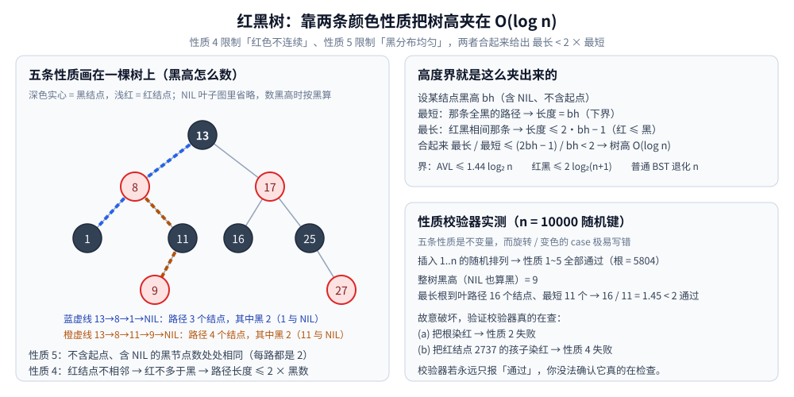
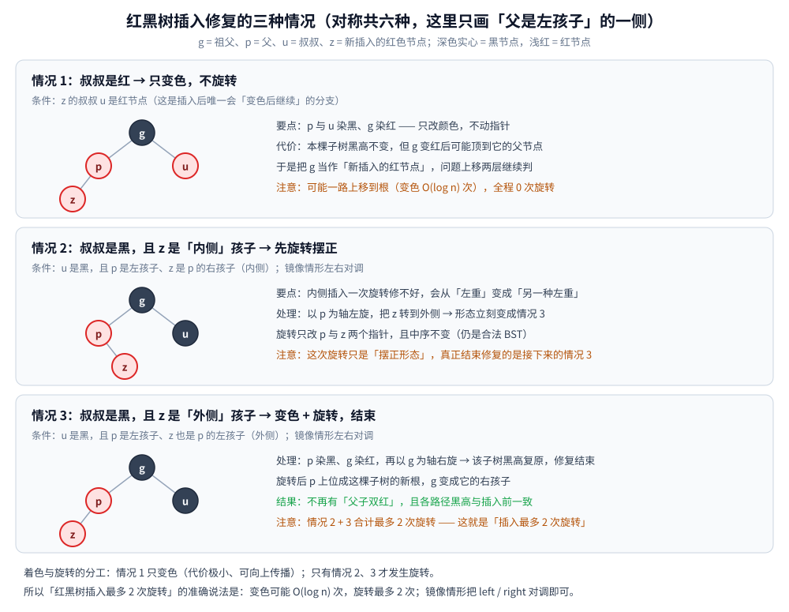

# 红黑树

> 不用「高度差」而用「**颜色**」约束平衡：五条性质共同推出「最长路径 < 2 × 最短路径」，
> 于是树高被钉在 `O(log n)`；插入修复只有三种情况 —— **变色可能 `O(log n)` 次，但旋转最多 2 次**。
>
> ⭐ 边界先说清：**红黑树与 AVL 怎么选、为什么工程上更常用红黑树**见 [平衡树.md](平衡树.md) 第二节；
> **AVL 的旋转**见 [AVL树.md](AVL树.md)；全家族的选型总纲见 [树的形态与选型.md](树的形态与选型.md)。
> 本篇只讲**红黑树本身**：五条性质、`最长 < 2 × 最短` 的推导、性质校验器、插入修复的三种情况。
>
> 内容整理自个人学习笔记，素材见 [素材清单](../../../素材清单.md)。复杂度口径见 [复杂度分析.md](../../算法/基础算法/复杂度分析.md)。
>
> 📎 本篇输出的 `text` 块为本机实跑逐字抄录：**Go 1.26.5（windows/amd64）** 手写插入 + 五条性质校验器，
> 以及 **JDK 1.8.0_321** 的 `TreeMap`。⚠️ `TreeMap` 不暴露颜色与旋转次数，红黑树的性质只能靠**自写校验器**验证。

---

## 一、红黑树的五条性质是什么？

**本节要点**：红黑树不用「高度差」约束，而用**颜色约束**。五条性质共同推出「最长路径 ≤ 2 × 最短路径」，从而保证 `O(log n)`。

### 1.1 五条性质

| # | 性质 | 作用 |
|---|---|---|
| **1** | 每个节点**非红即黑** | 定义域（颜色是一个 bit） |
| **2** | **根节点是黑** | 消除边界特判，便于归纳 |
| **3** | 所有 **NIL 叶子是黑** | 让「空孩子」也有颜色，路径长度才好对齐 |
| **4** | **红节点的两个孩子都是黑** | 禁止「父子双红」→ 红色不能连续 |
| **5** | 从任一节点到其所有 NIL 叶子的路径上，**黑节点数相同** | 核心：各路径的「黑高」一致 |

⭐ **性质 4 与 5 是主角**：**4 限制「红色不能连续」，5 限制「黑色分布均匀」** —— 两者合起来把树高夹住。

红黑树里，真正存储数据的节点叫内部节点。<br/>
如果一个内部节点没有左孩子或右孩子，那个“空位置”在算法上不当作真正的空，而是看作一个叶子节点，记作 NIL。
- NIL 不存数据，只是一个逻辑上的哨兵。
- 所有空指针都指向它，或者直接表示为 nil / null。
- 红黑树规定：这些 NIL 叶子的颜色是黑色。

### 1.2 「最长路径 ≤ 2 × 最短路径」的推导

设某节点的**黑高为 `bh`**（到 NIL 的路径上黑节点数，含 NIL 不含起点）。

**第一：最短路径 = `bh`（全黑）。** 由性质 5，每条路径的黑节点数都相同 = `bh`；路径上可能还有红节点，所以路径长度 ≥ `bh`。**取到 `bh` 的那条路（全黑）就是最短路径。**

**第二：最长路径 ≤ `2·bh − 1`。** 由性质 4，**红节点不能相邻** → 任一路径上「红节点数 ≤ 黑节点数」→ 路径上总节点数 ≤ `2 × 黑节点数 = 2·bh`。再抠掉端点细节，得到 `≤ 2·bh − 1`。

**第三：合起来** `最长 / 最短 ≤ (2·bh − 1) / bh < 2`。∎

⭐ **一句话直觉版**：**最短的那条路全黑，最长的那条路「红黑相间」** —— 红黑相间最多是「全黑」的两倍长，所以高度被夹在 `[bh, 2bh]` 里。



⭐ 图里三块分别回答三个问题：**黑高怎么数**（左）、**最长 / 最短怎么夹出来**（右上）、**校验器跑出来是什么样**（右下，就是 1.3 的读数）。

### 1.3 性质校验器实测

⚠️ **红黑树最值得写一个校验器**：五条性质是「不变量」，而旋转/变色的 case 极易写错（少一个变色、转错方向，树可能「看起来正常」但性质已破）。本机用 Go 手写插入 + 校验器，n = 10000 随机键（实跑）：

```text
===== 红黑树：插入 + 五条性质校验器 =====
n = 10000，插入 1..n 的随机排列
性质 1（节点非红即黑）      : 通过（颜色只有红/黑两种取值）
性质 2（根节点是黑）        : 通过（根 = 5804）
性质 3（所有 NIL 叶子是黑） : 通过（nil 一律按黑处理，无红叶子）
性质 4（红节点的孩子都是黑）: 通过
性质 5（各条路径黑高相同）  : 通过
整树黑高（把 NIL 也算作黑） : 9
最长根到叶路径（节点数）    : 16
最短根到叶路径（节点数）    : 11
最长 / 最短 = 1.45 ≤ 2       : 通过

===== 附：故意破坏性质，验证校验器真的在检查 =====
(a) 把根染红              → 性质 2 = 失败
(b) 把红节点 2737 的孩子染红 → 性质 4 = 失败
```

⭐ **最后两行是关键的自检**：**校验器如果永远只报「通过」，你没法确认它真的在查。** 故意把根染红、把一个红节点的孩子染红，校验器**立刻分别报出性质 2、性质 4 失败** —— 这才证明校验逻辑有效（这是「实验设计要自检」的一个具体例子）。

⭐ 顺带验证 1.2 的推导：`黑高 9`、`最长 16`、`最短 11`，`16 / 11 = 1.45 < 2` ✅ —— **实测的比值落在推导给出的 `[1, 2)` 区间内**。

### 1.4 插入修复的三种情况

红黑树的插入修复（`fixInsert`）只有三种情况（对称算六种）：

| 情况 | 条件 | 处理 |
|---|---|---|
| **1** | 叔叔是**红** | 父与叔叔染黑、祖父染红，**问题上移两层**继续 |
| **2** | 叔叔是黑，且新节点是「内侧」孩子 | 先**旋转**转成情况 3 |
| **3** | 叔叔是黑，且新节点是「外侧」孩子 | 父染黑、祖父染红，**绕祖父旋转**，结束 |

⭐ **注意「变色」与「旋转」的分工**：**情况 1 只变色、不旋转**（代价极小，且会往上传播）；**只有情况 2、3 才旋转**。这正是「红黑树插入最多 2 次旋转」的来源 —— **变色可能发生 `O(log n)` 次，但旋转最多 2 次**。



⚠️ 三种情况的**前提都是「父是红」**（否则本来就不违反性质 4、无需修复）；修复循环结束后别忘了**把根染黑**（性质 2）。

---

## 使用：标准库里的红黑树（Java TreeMap）

Java 直接把红黑树做成了 `TreeMap` / `TreeSet`（实跑）：

```text
===== Java TreeMap：标准库里的红黑树 =====
插入 5 3 8 1 9 2 7 后按序遍历:
  [1, 2, 3, 5, 7, 8, 9]
firstKey = 1   lastKey = 9
floorKey(6) = 5   ceilingKey(6) = 7
lowerKey(6) = 5   higherKey(6) = 7
subMap(3, true, 8, true) = [3, 5, 7, 8]
headMap(5) = [1, 2, 3]   tailMap(5) = [5, 7, 8, 9]
descendingMap = [9, 8, 7, 5, 3, 2, 1]
size = 7
```

⚠️ **一个诚实提醒**：`TreeMap` **不暴露节点颜色与旋转次数** —— 「它是一棵红黑树」是**文档保证**，不是能在 API 上验证的。**想验证五条性质，只能像 1.3 那样自己手写一棵。** 但它的**有序性 API**（`floorKey` / `ceilingKey` / `subMap`）正是「平衡 + 有序」能提供、而哈希表给不出的能力。

```text
有序插入 1..100000 耗时 : 56 ms（朴素 BST 会退化成 100000 高的链）
全部命中查询          : 100000/100000  耗时 28 ms
```

⭐ **对照 [平衡树.md](平衡树.md) 第一节的实测**：同样「有序插入 10 万键」，朴素 BST 会退化成 `100000` 高的链（查询 `O(n)`），而 `TreeMap` 依然维持 `O(log n)` —— **这就是「平衡」二字的全部价值**。（时序数字随机器波动，只断言「不退化」这个定性结论。）

---

## 延伸追问

- **红黑树为什么能保证 `O(log n)`？** → 性质 4（红不连续）⇒ 红节点数 ≤ 黑节点数 ⇒ 路径长 ≤ `2 × 黑高`；性质 5（各路径黑高相同）⇒ 最短路径就是全黑的那条 = 黑高。两者合起来 `最长 / 最短 < 2`，树高被夹在 `O(log n)` 内（本节 1.2）。
- **怎么确认红黑树实现是对的？** → 写一个**五条性质的校验器**，且**故意破坏性质验证校验器真的在查**（本机实测：把根染红 → 报性质 2 失败；把红节点的孩子染红 → 报性质 4 失败）。⚠️ 「校验器永远只报通过」说明不了任何事。
- **红黑树插入为什么要「变色 + 旋转」两步？** → 变色处理「叔叔是红」的情况（代价极小、可往上传播），旋转处理「叔叔是黑」的情况。**变色可能 `O(log n)` 次、旋转最多 2 次** —— 这就是「红黑树插入最多 2 次旋转」的来源（本节 1.4）。
- **红黑树的删除呢？** → 删除修复的 case 比插入多，但**旋转仍然最多 3 次**；变色同样可能 `O(log n)` 次。对照 AVL 删除要沿路径回溯、最坏可能 `O(log n)` 次旋转 —— 这个量级差正是工程上更常用红黑树的第一条理由（见 [平衡树.md](平衡树.md) 第二节）。
- **为什么要求「根是黑」「NIL 是黑」？** → 根是黑消除边界特判、便于归纳；给「空孩子」也定成黑，是为了让**每条路径的黑节点数可对齐**（性质 5 才有统一口径）。这两条不是装饰，是让性质 5 能写成「处处相等」的前提。

---

## 关联

- [平衡树.md](平衡树.md) — ⭐ **总纲与选型**：AVL 与红黑树怎么选、为什么工程上更常用红黑树
- [AVL树.md](AVL树.md) — 另一棵内存平衡树：靠**高度差 + 旋转**，删除代价比红黑树高一个量级
- [二叉搜索树.md](二叉搜索树.md) — BST 的定义、四个核心操作与退化实测
- [跳跃表.md](../高级数据结构/跳跃表.md) — 对照：跳表用**随机层数**换掉旋转（结构不变量 vs 大概率均匀）
- [LSM树.md](LSM树.md) — MemTable 为什么常用跳表而不是红黑树（写多、并发写、只在内存）
- [树的形态与选型.md](树的形态与选型.md) — 全家族选型总纲：十族成员全景与「隐藏代价总表」
- [复杂度分析.md](../../算法/基础算法/复杂度分析.md) — `O(log n)` 的推导口径与「递归树 / 主定理」
- [区间与索引树.md](区间与索引树.md) — 「按序删除 / 第 K 大 / 在线区间」时要换的正是这族有序结构
- [散列表.md](../哈希表/散列表.md) — 哈希桶「链太长就树化」，树化成的就是红黑树
- [索引设计与EXPLAIN.md](../../../03-数据与中间件/数据存储/关系型/MySQL/索引设计与EXPLAIN.md) — 对照：磁盘索引为什么换成 B+ 树
> 反向引用（本篇被下列文档引到）：[二叉树结构与性质.md](二叉树结构与性质.md)
