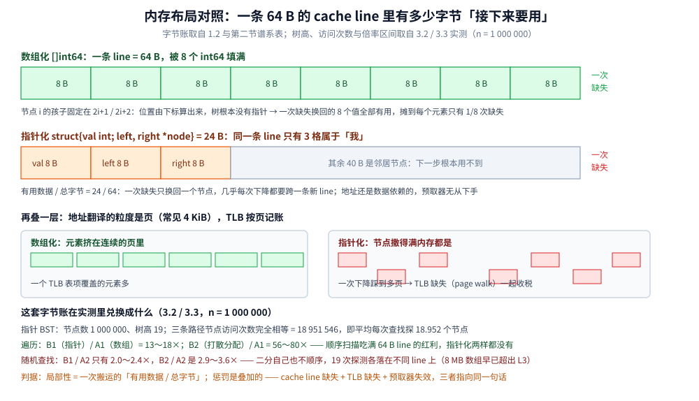
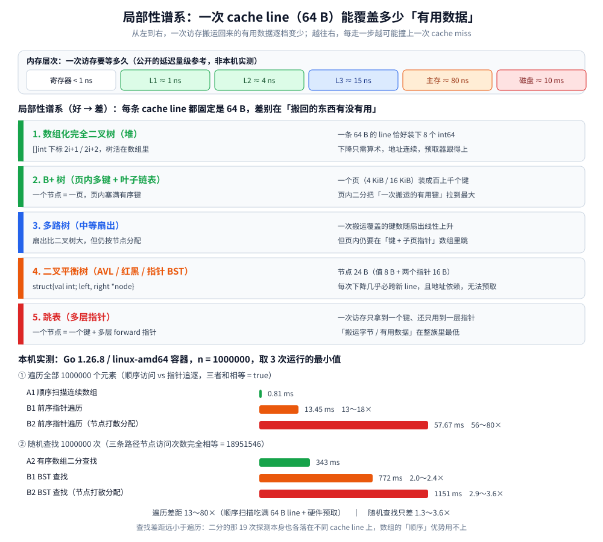

# 树的缓存局部性对比

> 覆盖**同一批键、同一套 Big-O** 的前提下，树的**物理布局**（数组化 vs 指针化）能拉开多大差距：
> cache line、TLB、硬件预取器，以及「一次访存搬回多少**有用数据**」这条判据。
>
> ⭐ 边界先说清：本篇只讲**内存层次上的局部性**（cache line / TLB / 预取器 / 数组化 vs 指针化）。
> **磁盘 I/O 那一层**（「层数 = I/O 次数」、扇出、页分裂）见 [B树与B+树.md](../磁盘存储树/B树与B+树.md) 第二节 ——
> 本篇只在需要处做一句指路，**不重复那段推导**。各种结构的选型与「隐藏代价总表」见
> [树的形态与选型.md](../树的形态与选型.md) 第三节。
>
> 内容整理自个人学习笔记，素材见 [素材清单](../../../../素材清单.md)。
>
> 📎 本篇的 `text` 块为本机实跑逐字抄录：**Go 1.26（Docker `golang:1.26-alpine`，go1.26.8 / linux-amd64）**，
> 连跑 3 次。其中**只有带 `[耗时]` 标记的行会波动**，其余行逐行一致（`diff` 已验证，见 3.1）。

---

## 一、为什么「树高」不是唯一的自变量？

**本节要点**：Big-O 数的是**访问次数**；真机上每次访问的**代价**并不相等 —— 它取决于数据此刻住在哪一层、
以及一次搬运能带回多少**你接下来真的要用的**数据。

### 1.1 内存层次：同样是一次「读」，代价差几个数量级

| 层次 | 量级 | 说明 |
|---|---|---|
| 寄存器 | < 1 ns | 无所谓「缺失」，就在核心里 |
| L1 | ≈ 1 ns | 每核心独享，几十 KB |
| L2 | ≈ 4 ns | 每核心独享，几百 KB ~ 1 MB |
| L3 | ≈ 15 ns | 多核共享，几 MB ~ 几十 MB |
| 主存 | ≈ 80 ns | 一次「缺失」就是这一档 |
| 磁盘 | ≈ 10 ms | 差 10⁵ 倍量级，换了一整个模型 |

⭐ 读法：内存层次每向下一层，延迟大约差 **3～20 倍**；从 L1 到磁盘是 **7 个数量级**。
⚠️ 这些是**公开的量级参考，不是本机实测** —— 单次延迟根本跑不稳。
本机能稳定跑出来的，是**两种结构的相对差距**（见第三节）。

### 1.2 cache line = 64 B：搬运按「行」不按「字节」

CPU 不会只搬你要的那 8 个字节，而是把**包含它的整条 cache line（典型 64 B）**搬进缓存。于是：

- 一条 64 B 的 line 装得下 **8 个 `int64`**（或 16 个 `int32`）；
- **顺序扫描**时，一次缺失换回来的 8 个值**全部有用** → 摊到每个元素只有 1/8 次缺失；
- **指针追逐**时，一次缺失只换回**一个节点** —— `struct{val int; left,right *node}` 是 24 B，
  一条 line 装了它还富余 40 B，而富余的邻居节**下一步根本用不到** → 几乎每次下降都是一次缺失。

⭐ 一句话判据：**局部性 = 一次搬运的「有用数据 / 总字节」。**

### 1.3 硬件预取器只吃「顺序」和「固定步长」

预取器在**观察到规律地址序列**时，才提前把下一条 line 拉进来。它认得两种模式：

- **顺序**：`a[0], a[1], a[2], …`
- **固定步长**：`a[0], a[8], a[16], …`

⚠️ 而**指针追逐天生是数据依赖的**：下一条地址要等上一条读回来才知道，没有可观测的规律 → 预取器无从下手。
这正是「数组化」在**遍历**场景碾压「指针化」的根本原因（3.3 的读数会非常直白）。

### 1.4 TLB 与页：4 KiB 的粒度再叠一层

地址翻译要走 **TLB**，粒度是**页**（常见 4 KiB）。数组化把结构压进尽量连续的页里，**一个 TLB 表项覆盖的元素多**；
指针化把节点撒得满内存都是 → **TLB 缺失（page walk）**也来一起收税。

⭐ 所以惩罚是**叠加**的：cache line 缺失 + TLB 缺失 + 预取器失效，三者都指向同一个结论 ——
**让「接下来要用的东西」在物理上挨着**。

### 1.5 把上面三问画成一张字节图

**本节要点**：1.2 / 1.3 / 1.4 说的其实是同一张图上的三层 —— **字节层（line）**、**指针层（节点 24 B）**、
**页层（TLB）**。画出来之后，第三节的实测倍数就是这张图的「兑换率」。



**图怎么读**：上两条带是**同一条 line 的两种命运** —— 格宽一律 8 B，左边 8 格全是有用值（1/8 次缺失），
右边只有 3 格属于当前节点（`val` 8 B + `left`/`right` 各 8 B = 24 B），剩下 5 格（40 B）装的是**这一步用不到的邻居**。
中间那两个框是**页 / TLB 这一层**：数组把元素挤在连续的页里，一个 TLB 表项覆盖很多元素；
指针化的节点撒在多页上，于是 cache line 缺失之外还要多付一次 page walk。
⚠️ 右侧那三行倍率是**实测结论**（13～18×、56～80× 是遍历；2.0～2.4×、2.9～3.6× 是随机查找），
其中「随机查找只差 2～3 倍」正好是**这张图自己解释不了的部分** —— 二分查找探的那 19 个点也各落在不同 line 上，
「连续」帮不上忙，原因见 3.3 结论 2。
🔗 另一张 [局部性谱系与缓存行的覆盖面.svg](images/局部性谱系与缓存行的覆盖面.svg) 画的是**五档谱系排序**，
本图只画**字节层面为什么会有这个排序**，两者互补、不重复。

---

## 二、局部性从好到差的谱系是怎么排出来的？

**本节要点**：不看名字，看一句话 —— **一次 cache line（或一次页搬运）带回的「有用数据」有多少**。
按这条排，谱系从好到差是：**数组化完全二叉树（堆）> B+ 树 > 多路树 > 二叉平衡树 > 跳表**。

| 档 | 结构 | 一次搬运覆盖什么 | 为什么排在这 |
|---|---|---|---|
| ① | **数组化完全二叉树（堆）** | 一条 64 B line 装 8 个 `int64` | 下降只要下标算术，地址连续、可预取 |
| ② | **B+ 树**（页内多键 + 叶子链表） | 一个页（4 KiB / 16 KiB）装成百上千个键 | 页内二分把「一次搬运的有用键」拉到最大；叶子链表让范围扫描变顺序读 |
| ③ | **多路树**（中等扇出） | 一页几十个键 | 覆盖量随扇出线性上升，但页内仍要在「键 + 子页指针」数组里跳 |
| ④ | **二叉平衡树**（AVL / 红黑 / 指针 BST） | 一条 line 只覆盖 1～2 个节点（24 B/节点） | 每次下降几乎必跨新 line，且地址依赖、无法预取 |
| ⑤ | **跳表**（多层指针） | 一次访存只拿到 1 个节点、还只用到一层指针 | 节点更大、指针更多，「搬运字节 / 有用数据」最低 |

### 2.1 ① 数组化完全二叉树（堆）

`[]int` 里，节点 `i` 的孩子固定在 `2i+1` / `2i+2`（见 [堆与优先队列.md](../../堆/堆与优先队列.md)）。
树**根本没有指针**：**位置由下标算出来**。于是整个结构是一段**连续内存**，遍历就是线性扫描 ——
一次 line 换回 8 个有用值，预取器全程跟得上。⭐ 这是「顺序存储 vs 链式存储」在教学里最常见的两种形态，
见 [二叉树结构与性质.md](../二叉树结构与性质.md)。

### 2.2 ②③ B+ 树 / 多路树：把「一次搬运」的单位从 line 放大到页

B+ 树的关键一步不是「树」，而是**一个节点恰好占一页**：页内塞满有序的 `(键, 子页指针)`，
页内再用二分找 —— 一次搬运带回**成百上千个候选键**，扇出因此极高、层数因此极低。
⚠️ 这一档的收益**同时**发生在两个层次：它既减少了**内存**上的缺失，也减少了**磁盘**上的读页次数。
磁盘侧「层数 = I/O 次数」的完整推导见 [B树与B+树.md](../磁盘存储树/B树与B+树.md) 第二节，本篇不重复。

**多路树**是同一思路的弱化版：扇出比二叉树大，但节点仍按「对象」分配、不按「页」铺满，
页内容量没被榨干，所以排在 B+ 树之后。

### 2.3 ④ 二叉平衡树：为什么「平衡」救不了局部性

AVL / 红黑树 / 指针 BST 都把树高钉在 `O(log n)`，**比较次数确实少**；但它们每个节点都是
`new`/`malloc` 出来的独立对象，节点大小 24 B，地址由分配器决定。于是：

- 每下降一层，几乎必然落到**另一条 cache line**；
- 下一条地址**依赖**上一条的读结果 → **预取器失效**；
- 节点撒得越散，TLB 也越难受。

⚠️ 注意：**平衡与否和局部性是两回事**。平衡决定「要走多少步」，布局决定「每一步多贵」。
3.1 的实验把两者**刻意分离**（两个 BST 与二分查找的**节点访问次数完全相同**），
所以 3.2 里看到的时间差**只能来自内存布局**。

### 2.4 ⑤ 跳表：为什么排在最后

跳表的多层指针让「期望 `O(log n)`」很好实现，但**每个节点只服务一个键**，而且节点里那一排 `forward` 指针
指向的往往是**距离很远的**下一个节点：

- 一次访存只拿到**一个键**，且只用得上它**某一层**的指针，其余指针白搬；
- 层与层之间的跳跃让「顺序」彻底消失，预取器同样失效；
- 节点尺寸还比 BST 大（要多存几层指针）。

⭐ 所以跳表的定位是**「写优化的内存索引」**（并发写、局部改指针），而不是**「读最快的结构」**
（Redis ZSet、LSM MemTable 用它，见 [LSM树.md](../磁盘存储树/LSM树.md)、[平衡树.md](../内存平衡树/平衡树.md)）。



**图怎么读**：上半部分按「一次 64 B 的 cache line 能覆盖多少有用数据」把五个结构从绿（覆盖最多）排到红（覆盖最少）；
下半部分是本机实测的横条 —— **遍历**这一组的条长差出两个量级（0.81 ms → 57.67 ms），
而**随机查找**这一组只差 2～3 倍，两组的反差正是本篇最该记住的结论。

---

## 三、数组化和指针化实测差多少？

**本节要点**：同一批键、同一套 `O(log n)`、**节点访问次数严格相等**的两个结构，实测差距：
**遍历 13～80 倍，随机查找只有 1.3～3.6 倍**。

### 3.1 实验设计（可复现）

程序：`.workbuddy/tmp/tree-cache-lab/main.go`（单文件、零依赖）。四个实现、**同一键集** `0..n-1`：

| 代号 | 结构 | 说明 |
|---|---|---|
| **A1** | `[]int` 完全二叉树（最大堆），下标 `2i+1`/`2i+2` | 数组化，用于「顺序扫描」 |
| **A2** | 同一键集的有序数组 | 数组化，用于「二分查找」 |
| **B1** | 指针 BST，节点**按 key 顺序**分配 | 指针化对照 |
| **B2** | 指针 BST，节点**按固定 seed 打散**分配 | 指针化 + 真实插入顺序 |

关键设计：两个 BST 都用**与二分查找完全一致的 `mid = (lo+hi)/2` 中点分割**递归连接，
所以 **A2 二分、B1 查找、B2 查找的「节点访问次数」逐次严格相等** ——
比较次数被钉死，剩下能解释时间差的只有**内存布局**。规模 `n = 1e5 / 1e6`，每项测 5 轮，随机查找 1e6 次（seed 固定）。

运行命令（宿主机 Git Bash，Windows）：

```bash
MSYS_NO_PATHCONV=1 docker run --rm \
  -v D:/www/dev-notes/.workbuddy/tmp/tree-cache-lab:/lab \
  -w /lab golang:1.26-alpine go run main.go
```

⚠️ **可复现判据**：连跑两遍，`diff run1.txt run2.txt` 只出现带 `[耗时]` 的行；
`grep -v '\[耗时\]' run1.txt | diff - <(grep -v '\[耗时\]' run2.txt)` **无任何输出**（退出码 0）。

### 3.2 逐字读数（第 1 遍运行，完整 stdout）

```text
== 树的缓存局部性对比 · 本机实测 ==
Go: go1.26.8 | GOOS/GOARCH: linux/amd64 | NumCPU: 4
容器: golang:1.26-alpine | 每项测量轮次 K = 5 | 随机查找次数 = 1000000 | 随机源 seed = 20261012

------------------------------------------------------------
规模 n = 100000
------------------------------------------------------------
[结构构建]
  键集: 0..99999（稠密升序，A / B 完全相同）
  A1 堆数组 heapArr: 长度 100000, 最大堆性质校验 = true
  A2 有序数组 sorted: 长度 100000
  B1 指针 BST: 节点数 100000, 树高 16（节点按 key 顺序分配）
  B2 指针 BST: 节点数 100000, 树高 16（节点打散分配，seed=20261012）

[① 遍历全部 n 个元素]（顺序访问 vs 指针追逐）
  A1 顺序扫描连续数组   : 元素和 = 4999950000
  B1 前序递归遍历指针树 : 元素和 = 4999950000
  B2 前序递归遍历指针树 : 元素和 = 4999950000
  自检: 三个和相等（都访问了全部 n 个元素）= true
  A1 顺序扫描   [耗时] 122.534µs .. 213.36µs（5 轮）
  B1 前序遍历   [耗时] 1.64286ms .. 2.726564ms（5 轮）
  B2 前序遍历   [耗时] 5.196756ms .. 8.877988ms（5 轮）
  倍率(B1/A1)   [耗时] 13.4 x
  倍率(B2/A1)   [耗时] 42.4 x

[② 随机查找 1000000 次]（数组化二分 vs 指针化 BST）
  A2 有序数组二分 : 命中 1000000, 节点访问次数 15690003
  B1 BST 查找     : 命中 1000000, 节点访问次数 15690003
  B2 BST 查找     : 命中 1000000, 节点访问次数 15690003
  自检: 三条路径节点访问次数完全相等 = true（平均每次查找访问 15.690 个节点）
  A2 二分查找   [耗时] 171.48849ms .. 196.221967ms（5 轮）
  B1 BST 查找   [耗时] 288.161933ms .. 361.342911ms（5 轮）
  B2 BST 查找   [耗时] 362.125727ms .. 395.954055ms（5 轮）
  倍率(B1/A2)   [耗时] 1.7 x
  倍率(B2/A2)   [耗时] 2.1 x

------------------------------------------------------------
规模 n = 1000000
------------------------------------------------------------
[结构构建]
  键集: 0..999999（稠密升序，A / B 完全相同）
  A1 堆数组 heapArr: 长度 1000000, 最大堆性质校验 = true
  A2 有序数组 sorted: 长度 1000000
  B1 指针 BST: 节点数 1000000, 树高 19（节点按 key 顺序分配）
  B2 指针 BST: 节点数 1000000, 树高 19（节点打散分配，seed=20261012）

[① 遍历全部 n 个元素]（顺序访问 vs 指针追逐）
  A1 顺序扫描连续数组   : 元素和 = 499999500000
  B1 前序递归遍历指针树 : 元素和 = 499999500000
  B2 前序递归遍历指针树 : 元素和 = 499999500000
  自检: 三个和相等（都访问了全部 n 个元素）= true
  A1 顺序扫描   [耗时] 1.033553ms .. 1.653446ms（5 轮）
  B1 前序遍历   [耗时] 13.451699ms .. 14.683683ms（5 轮）
  B2 前序遍历   [耗时] 57.668472ms .. 63.9099ms（5 轮）
  倍率(B1/A1)   [耗时] 13.0 x
  倍率(B2/A1)   [耗时] 55.8 x

[② 随机查找 1000000 次]（数组化二分 vs 指针化 BST）
  A2 有序数组二分 : 命中 1000000, 节点访问次数 18951546
  B1 BST 查找     : 命中 1000000, 节点访问次数 18951546
  B2 BST 查找     : 命中 1000000, 节点访问次数 18951546
  自检: 三条路径节点访问次数完全相等 = true（平均每次查找访问 18.952 个节点）
  A2 二分查找   [耗时] 395.430668ms .. 959.805766ms（5 轮）
  B1 BST 查找   [耗时] 771.513667ms .. 830.872372ms（5 轮）
  B2 BST 查找   [耗时] 1.150789474s .. 1.847339417s（5 轮）
  倍率(B1/A2)   [耗时] 2.0 x
  倍率(B2/A2)   [耗时] 2.9 x

------------------------------------------------------------
sink = 9090643647882（防止基准被优化掉；连跑两遍此值相同）
[总] [耗时] 程序整体时长见外层计时
```

### 3.3 三次运行的区间（只断言趋势）

取三次运行各自的**最小值**，区间如下：

| 规模 | 遍历 A1 顺序 | 遍历 B1 指针 | 遍历 B2 打散 | 查找 A2 二分 | 查找 B1 BST | 查找 B2 BST |
|---|---|---|---|---|---|---|
| `n = 1e5` | 53～123 µs | 1.36～1.64 ms | 1.13～5.20 ms ⚠️ | 171～206 ms | 273～288 ms | 358～371 ms |
| `n = 1e6` | 0.81～1.03 ms | 13.5～14.3 ms | 57.7～67.1 ms | 343～395 ms | 772～826 ms | 1151～1265 ms |

倍率区间（每次运行用自己的最小值算）：

| 对比 | `n = 1e5` | `n = 1e6` |
|---|---|---|
| **遍历** B1（指针）/ A1（数组） | 13～28× | **13～18×** |
| **遍历** B2（打散）/ A1 | 14～42× | **56～80×** |
| **查找** B1（BST）/ A2（二分） | 1.3～1.7× | **2.0～2.4×** |
| **查找** B2（打散）/ A2 | 1.7～2.1× | **2.9～3.6×** |

⭐ 三条结论（都从上面的读数直读得来）：

1. **遍历**：数组化碾压指针化，`n = 1e6` 稳定在 **13～18×**（打散分配后 **56～80×**）。
   与预期**一致** —— 顺序扫描吃满 64 B line 的红利 + 预取器全程有效，指针前序遍历两样都没有。
2. **随机查找**：差距只有 **1.3～3.6×**，**比「每个节点一次 cache miss」的朴素预期小得多**。
   与预期**不一致**，如实记下 —— 原因是**二分查找自己也不顺序**：`n = 1e6` 时它每次要探 18.95 个节点，
   这 19 次探测各落在不同的 cache line 上（数组 8 MB 早已超出 L3），**数组的「顺序」优势在随机查找里用不上**。
   真正的差距来自**指针解引用的依赖链无法预取**、**节点更大（24 B vs 8 B）**、以及**分配散乱带来的 TLB 压力**。
3. **分配顺序会改变结论**：同一棵 BST，只把节点的分配顺序**打散**（B2），
   遍历从 13～18× 掉到 56～80×、查找从 2.0～2.4× 掉到 2.9～3.6×。
   ⚠️ 这说明「指针化有多慢」**很大程度取决于分配器把节点放在哪** —— 所谓「指针树慢」不是必然，是**通常如此**。

⚠️ **两条如实标注的不确定性**：

- `n = 1e5` 的 **B2 遍历**（1.13～5.20 ms）在三次运行间跳了近 5 倍 —— 该量级只有几毫秒、又被容器调度打断，
  **这一行不稳定，只作量级参考**；`n = 1e6` 的同一行（57.7～67.1 ms）稳定得多。
- 所有 `[耗时]` 数字随机器与负载波动（本机是 4 核容器），**只断言「数组化在遍历上优势巨大、在随机查找上优势有限」这个趋势**，
  **不要引用具体毫秒做结论**。

---

## 四、同样是 O(log n)，常数能差多少？

**本节要点**：Big-O 相同的两个结构，常数差出**一个数量级**是常态 —— 本篇的 1.3～3.6× 只是**内存布局**这一项。

同一目录的 [区间与索引树.md](区间与索引树.md) 3.3 有一组完全同源的读数（`n = 100000`、10⁵ 次区间和查询）：

```text
[查询] 100000 次区间和 [1234..98765]  线段树 17.57 ms   树状数组 1.59 ms
```

线段树与树状数组**同为 `O(log n)`**，实测却差 **约 11 倍**。两者的差别也不是「算法」而是「常数与实现」：
树状数组**无递归、循环体极轻、数组连续**；线段树要递归下探、开 `4n` 空间、访问不连续。

⭐ 把两处读数放在一起看，能得到本节最该带走的一句：

> **Big-O 决定的是「步数怎么随 n 增长」；常数与局部性决定的是「每一步多贵」。**
> 当 `n` 不大、或每次比较很贵时，常数才是真正的自变量。

⚠️ 口径提醒：17.57 ms vs 1.59 ms 出自 [区间与索引树.md](区间与索引树.md) 的**另一次实测**（不同程序、不同日期），
**不要与本篇的毫秒数混算**，只把它们当作「同 O(log n) 常数可以差一个量级」的旁证。

---

## 五、应用场景

**本节要点**：局部性判据在工程里只被使用一次机会 —— **设计期把「一次搬运带回的有用数据」当成本位**。语言标准库的堆、数据库的页、LSM 的顺序写、Redis 的小对象紧凑编码，是同一条判据在不同介质上的实现。

### 5.1 应用场景总表

| 场景 | 具体产品 / 系统 | 怎么用这个判据 | 为什么合适 |
|---|---|---|---|
| **标准库优先队列** | Go `container/heap`、Java `PriorityQueue`（数组化堆，见 [堆与优先队列.md](../../堆/堆与优先队列.md)） | 干脆不存指针，父子关系用下标算术现算 | 谱系第①档：一条 64 B line 装 8 个值，上浮下沉全程可预取 |
| **缓冲池与页设计** | InnoDB 的 16 KB 页等「按页打包」的实现（推导见 [B树与B+树.md](../磁盘存储树/B树与B+树.md)） | 一个节点占满一页，页内二分榨干一次搬运 | 谱系第②档：把搬运单位从 line 放大到页，同一判据的放大版 |
| **写路径顺序化** | LSM 引擎的 SSTable 与块索引（见 [LSM树.md](../磁盘存储树/LSM树.md)） | 把随机改动攒成归并后的顺序写 / 顺序读 | 「让接下来要用的东西物理相邻」换到磁盘层的同名实现 |
| **小对象紧凑存储** | Redis 的 listpack / intset、quicklist 的「块内连续 + 块间离散」（见 [底层结构.md](../../../../03-数据与中间件/数据存储/NoSQL/Redis/底层结构.md)、[数组与链表.md](../../线性结构/数组与链表.md)） | 节点内部连续编码，指针税按块付一次而不是按元素付 | 指针化的离散无法避免，但可以把「离散的单位」从元素放大到块 —— 与本谱系同一把尺子 |
| **静态小数据的查找布局** | 排序数组 + 二分（对照 [树的典型反模式.md](树的典型反模式.md) 1.3） | 放弃「可插」换连续内存与预取 | 3.3 实测：遍历口径数组化碾压指针化 13～80 倍 |
| **指针结构的分配策略** | arena / 内存池类分配（粗粒度陈述，各引擎实现以官方文档为准；Go 运行时的 arena / span 分配见 [内存分配器.md](../../../../01-编程语言/go/运行时/内存分配器.md)） | 按访问顺序整批分配节点，让兄弟节点挨着放 | 3.3 结论 3：同一棵 BST 只打散分配顺序，实测就差 3～4 倍 —— 布局本身可调 |

### 5.2 深入辨析：什么时候该关心局部性

**第一层：什么时候「局部性」比 Big-O 更重要。**
判据是**「步数已经够少，贵的是每一步」**：`n` 足够大（数据超出 cache）、**每个元素的操作很便宜**（几个整数比较）、
且访问**没有可预测的顺序**时，一次 cache miss 的几十纳秒会**盖过** `log n` 的差异。
典型信号：「两个结构 Big-O 一样，但实测就是差几倍」—— 这时先怀疑局部性，而不是算法。

**第二层：什么时候它不重要。**
① `n` 很小（整个结构装得进 L1/L2）→ 缺失根本不会发生；
② **每次比较很贵**（长字符串比较、对象 `equals`、远程调用）→ 比较代价盖过访存代价；
③ 数据在**磁盘**上 → 局面整个换掉，优化的是**读了几页**而不是 cache line，见 [B树与B+树.md](../磁盘存储树/B树与B+树.md)。

**第三层：你可以在设计里直接用它。**
① 能**数组化**就别指针化（堆、线段树、树状数组都靠这一条）；
② 读写路径上**尽量顺序**（B+ 树叶子链表、LSM 的 SSTable 都是把随机变顺序，见 [LSM树.md](../磁盘存储树/LSM树.md)）；
③ 指针结构要**控制节点大小**并与访问顺序对齐（同一棵 BST，只改分配顺序就差 3～4 倍，见 3.3）。

**第四层：别把它当唯一指标。**
局部性只是**四种代价**（查询 / 写入 / 空间 / 实现复杂度）里的一项，且常常与其它项**冲突**：
「高扇出压层数」要求一页装多个键，就与「写时只改一个键」相冲突；
「数组化」要求连续，就与「频繁中间插入」相冲突。⭐ 完整权衡见 [树的形态与选型.md](../树的形态与选型.md) 第三节的隐藏代价总表。

### 5.3 收尾判据

共同前提：**同量级 Big-O、数据超出 cache、单元素操作很便宜** —— 三条同时成立，局部性才是真正的自变量（5.2 第一层的信号）。

⚠️ **失效边界**：数据在磁盘 → 优化的是「读了几页」而不是 line（见 [B树与B+树.md](../磁盘存储树/B树与B+树.md)）；每次比较很贵（长字符串 / 远程调用）→ 访存成本被比较成本吞掉；频繁中间插删 → 数组化的「连续」要用 O(n) 移动去换，反成负资产。⭐ 局部性只是四种代价里的一项，总账见 [树的形态与选型.md](../树的形态与选型.md) 第三节。

---

## 延伸追问

- **为什么数组化遍历能快 10 倍以上？** → 因为两件事同时发生：① 一次 64 B 的 cache line 换回 **8 个有用值**（摊薄到 1/8 次缺失）；② 地址序列是**顺序**的，**硬件预取器**全程有效。指针前序遍历两个都拿不到：一次缺失只换回一个节点，且下一条地址**依赖**上一次读，预取器失效。见 1.2、1.3 与 3.3。
- **都是 `O(log n)`，为什么二分查找没比指针 BST 快多少（只 2～3 倍）？** → 因为**二分自己也不顺序**。`n = 1e6` 时它每次要探约 19 个节点，这 19 次探测**各自落在不同的 cache line** 上（8 MB 的数组早就超出 L3），数组的「连续」优势用不上；省下的主要是「指针解引用的依赖链」和「节点 24 B vs 8 B」这两笔。⭐ 这条**与朴素预期不一致**，是本次实测最值得记的意外。
- **「指针树一定慢」吗？** → 不一定，**取决于分配器把节点放在哪**。同一棵 BST，只把节点分配顺序打散（B2 vs B1），遍历从 13～18× 掉到 56～80×。真实系统里插入顺序随机，所以「通常慢」；但如果你的节点恰好按访问顺序分配，差距会显著缩小。
- **平衡树的「平衡」能改善局部性吗？** → **不能**，这是两件事。平衡决定「要走**多少步**」，布局决定「**每一步**多贵」。可以把它们分离来看：两个 BST 与二分查找的**节点访问次数完全相同**（3.2 的三个 `15690003` / `18951546`），时间差**只来自内存布局**。
- **cache line 是 64 B，那我该怎么用它？** → 记住它是**搬运的最小单位**：一条 line 装 8 个 `int64`。所以「让接下来要用的元素落在同一条（或相邻的）line 上」就是局部性优化的全部内容 —— 数组化、大节点（B+ 树）、叶子链表，都是这条判据的不同实现。
- **跳表为什么排在局部性谱系最后，却还被大量使用？** → 因为它买的是**别的东西**：多层指针改动局部、**并发写容易做无锁**、实现简单。这是典型的「代价转移」：用局部性换写并发性。Redis ZSet、LSM MemTable 都在用，见 [平衡树.md](../内存平衡树/平衡树.md)、[LSM树.md](../磁盘存储树/LSM树.md)。
- **什么时候我不该关心局部性？** → 三种：① `n` 小到能整个装进 L2；② **每次比较很贵**（长字符串 / 对象比较 / 远程调用）—— 比较代价盖过访存；③ 数据在磁盘上 —— 那时优化的是「读了几页」，属于 [B树与B+树.md](../磁盘存储树/B树与B+树.md) 的地盘。

---

## 关联

- [B树与B+树.md](../磁盘存储树/B树与B+树.md) — ⭐ **本篇的边界**：磁盘那一层「层数 = I/O 次数」的完整推导（本篇不重复）
- [树的形态与选型.md](../树的形态与选型.md) — ⭐ **选型总纲**：第三节「隐藏代价总表」把局部性放进四种代价里权衡
- [平衡树.md](../内存平衡树/平衡树.md) — 指针化平衡树的实现层：AVL / 红黑树 / 跳表的旋转与多层指针
- [区间与索引树.md](区间与索引树.md) — 第四节引用的同 O(log n) 常数对照（线段树 17.57 ms vs 树状数组 1.59 ms）
- [堆与优先队列.md](../../堆/堆与优先队列.md) — 数组化完全二叉树的落地：下标 `2i+1`/`2i+2`、上浮与下沉
- [二叉搜索树.md](../二叉搜索树.md) — 指针 BST 的插入、查找与删除（本篇的 B1 / B2 就是它）
- [二叉树结构与性质.md](../二叉树结构与性质.md) — 「顺序存储 vs 链式存储」两种形态的对照，局部性差异的起点
- [LSM树.md](../磁盘存储树/LSM树.md) — 另一条局部性路线：**把随机写改成顺序写**，用顺序 I/O 换吞吐
- [KD树与高维索引.md](../空间与字符串树/KD树与高维索引.md) — 高维下局部性会进一步失效（维度灾难与剪枝率崩塌）
- [复杂度分析.md](../../../算法/基础算法/复杂度分析.md) — 本篇反复引用的「Big-O 与常数」口径
> 反向引用（本篇被下列文档引到）：[AVL树.md](../内存平衡树/AVL树.md)、[红黑树.md](../内存平衡树/红黑树.md)、[B树与B+树查找.md](../../../算法/基础算法/查找/B树与B+树查找.md)
