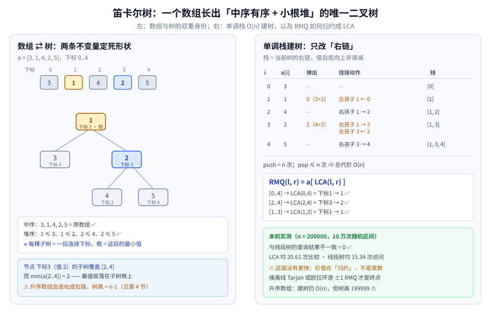

# 笛卡尔树

> 覆盖：**一棵由数组唯一确定的二叉树** —— 中序就是原数组、值满足小根堆；
> 单调栈 `O(n)` 建树、`RMQ = LCA` 的归约、以及它为什么会退化成一条链。
>
> 不覆盖：线段树 / 树状数组 / ST 表的实现见 [区间与索引树.md](区间与索引树.md)；
> 单调栈本身（下一个更大元素、直方图最大矩形）见 [单调栈与单调队列.md](../../高级数据结构/单调栈与单调队列.md)；
> 倍增 LCA 的通用写法见 [树上问题.md](../../../算法/图论算法/树上问题.md)。
>
> 内容整理自个人学习笔记，素材见 [素材清单](../../../../素材清单.md)。
>
> 📎 本篇输出为本机**容器**实跑逐字抄录：**Go 1.26.8（linux/amd64，`golang:1.26-alpine`）**，
> 随机序列来自固定种子 `42`。**结果值（建树计数、树高、不一致数）可整篇重跑复现**，耗时未记录。

---

## 一、笛卡尔树是什么？为什么它能同时是「数组」和「堆」？

**本节要点**：给一个数组，笛卡尔树是**唯一**一棵满足两件事的二叉树 —— **中序遍历 = 数组顺序**，**父节点的值 ≤ 子节点的值**。前者管「位置」，后者管「最值」，两个不变量合起来就把「区间最小值」变成了「树上最近公共祖先」。

### 1.1 两条不变量

以最小堆为例（最大堆只需把不等号反过来）：

| 不变量 | 含义 | 它换来了什么 |
|---|---|---|
| **中序 = 数组顺序** | 节点按原下标从左到右排列 | 任一棵子树对应**一段连续区间** |
| **小根堆** | `a[父] ≤ a[子]` | 子树里的最小值就在**根**上 |

⭐ **元素互不相同时，这两条不变量确定的树是唯一的**。可以用归纳法看：整个数组的最小值必须是根（否则它压在某个祖先下面，就违反小根堆）；它左边的元素全落在左子树、右边的全落在右子树，于是递归唯一。

⚠️ **有重复值时**，单看值不再唯一。工程上统一按 `(值, 下标)` 比较（本篇代码用「值相等时不弹栈」，等价于按下标升序打破平局），树就又唯一了。这个细节会影响「相等元素谁当谁的祖先」，做贡献计数类题目时必须与题意对齐。

### 1.2 一个具体例子

数组 `a = [3, 1, 4, 2, 5]`（下标 `0..4`）的笛卡尔树：

```text
              1 (idx 1)
            /           \
       3 (idx 0)      2 (idx 3)
                     /         \
                4 (idx 2)    5 (idx 4)

中序：idx 0 → 1 → 2 → 3 → 4   ⇒ 值 3, 1, 4, 2, 5  ✅ 等于原数组
堆序：1 ≤ 3、1 ≤ 2、2 ≤ 4、2 ≤ 5                    ✅ 小根堆
```

⭐ **一眼要能看出的性质**：任取一个节点，它的**子树覆盖的下标区间**就是「以它为最小值的最大区间」。例如节点 `idx 3`（值 `2`）的子树覆盖 `[2, 4]`，而 `min(a[2..4]) = 2` 正好落在它身上 —— 这就是第五节「子数组最小值之和」那类题的钥匙。

---

## 二、为什么单调栈能 `O(n)` 把它建出来？

**本节要点**：建树过程中**只有「右链」会被改动** —— 也就是从根一直往右走的那条路径。而这条右链的值恰好是**单调递增**的，于是用一个单调栈维护它，每个下标**进栈一次、出栈至多一次**，总代价 `O(n)`。

### 2.1 右链就是单调栈

按 `i = 0, 1, …, n-1` 依次插入。插入 `i` 时：

1. 从栈顶开始，把所有**值大于 `a[i]`** 的节点弹出（它们都比 `a[i]` 大，必须沉到 `i` 的左子树里）；
2. 最后一个被弹出的节点成为 `i` 的**左孩子**（它代表的是一段连续的、紧挨在 `i` 左边的下标）；
3. 弹完之后栈顶（如果存在）的值 ≤ `a[i]`，于是 `i` 成为它的**右孩子**；
4. `i` 入栈。

⭐ **栈里存的就是当前树的右链，且值自底向上非递减** —— 这正好是一条单调栈。第 2 步把「被弹出的那一整段」一次性挂到左子树，第 3 步把 `i` 接到新的右链末尾，两次挂接就把树修好了。

### 2.2 逐步推演（上面那棵树）

| `i` | `a[i]` | 弹出 | 挂接动作 | 栈（自底向上） |
|---|---|---|---|---|
| 0 | 3 | — | — | `[0]` |
| 1 | 1 | `0`（3 > 1） | 左孩子 `1 ← 0`；栈空，无父节点 | `[1]` |
| 2 | 4 | — | 右孩子 `1 → 2` | `[1, 2]` |
| 3 | 2 | `2`（4 > 2） | 右孩子 `1 → 3`；左孩子 `3 ← 2` | `[1, 3]` |
| 4 | 5 | — | 右孩子 `3 → 4` | `[1, 3, 4]` |

最后 `stack[0] = 1` 就是根。⭐ **每次挂接都只改常数条边** —— 这就是「建树不需要比较、不需要重排」的原因。



### 2.3 为什么总代价是 `O(n)`

| 动作 | 总次数 | 说明 |
|---|---|---|
| 入栈 | 恰好 `n` 次 | 每个下标插入一次 |
| 出栈 | **至多 `n` 次** | 每个下标只会被弹出一次，弹出后不再回来 |
| 比较 | 入栈 + 出栈 ≈ `2n` | 每次循环判断一次栈顶 |

本机实测（`n = 200000` 随机排列）与这笔账逐项对上：

```text
建树：push=200000 pop=199993 比较=399983 树高=41 inorderOK=true heapOK=true
```

⭐ `push = n`、`pop ≈ n`、`比较 ≈ 2n`，三项都是线性的 —— **不是「平均快」，而是最坏也只做这么多次**。相比之下，如果按定义每次找区间最小值来递归建树，最坏是 `O(n²)`（有序数组每次只砍掉一个元素）。

---

## 三、`RMQ` 为什么等于 `LCA`？

**本节要点**：区间 `[l, r]` 的最小值，就落在**下标 `l` 与 `r` 两个节点的最近公共祖先**上。原因只有一句话：**LCA 的子树是「同时包含 `l` 和 `r` 的最小连续区间」，而小根堆保证子树最小值在根上**。

### 3.1 证明的两半

设 `x = LCA(l, r)`。

- **`x` 的下标一定落在 `[l, r]` 内**：若 `x` 的下标在区间外，那么 `l` 和 `r` 会同时落在 `x` 的同一棵子树里（中序把左右子树分在下标两侧），这与 `x` 是 LCA 矛盾。
- **`a[x]` 就是 `[l, r]` 的最小值**：`x` 的子树覆盖一段包含 `[l, r]` 的连续区间，小根堆保证 `a[x]` 是这整段的最小值；既然 `x` 本身也在 `[l, r]` 内，它就是 `[l, r]` 的最小值。反过来，`[l, r]` 里的最小值节点 `m` 也在这棵子树里，故 `a[x] ≤ a[m]`；两者只能相等。

⭐ 于是 **`RMQ(l, r) = a[LCA(l, r)]`**：一次区间最值查询被完整归约成一次 LCA 查询。这两个问题原本看起来毫无关系，靠的就是「中序连续 + 小根堆」这两条不变量。

### 3.2 实测：与线段树逐次对齐

本机对 `n = 200000` 的数组做 `100000` 次随机区间查询，分别用「笛卡尔树 + 倍增 LCA」和「线段树」各算一遍：

```text
随机排列
  RMQ 100000 次：LCA 比较=2060944（均 20.61），线段树访问=1533596（均 15.34），不一致=0
升序数组（最坏形态）
  RMQ 100000 次：LCA 比较=829152（均 8.29），线段树访问=1533596（均 15.34），不一致=0
```

⭐ **`不一致=0` 是正确性证据**：两套完全不同的实现给出同一个最小值，说明建树、LCA 与归约都没写错。

⚠️ **这里必须诚实**：**这版笛卡尔树方案并没有比线段树更快**（`20.61` 次比较 vs `15.34` 次访问）。原因是倍增 LCA 本身是 `O(log n)`，常数还不小。笛卡尔树的真正价值是**把 RMQ 归约成 LCA**，从而可以接上更快的 LCA 方案：

| 接法 | 预处理 | 单次查询 | 说明 |
|---|---|---|---|
| 线段树直接查 RMQ | `O(n)` | `O(log n)` | 本篇对照基线 |
| 笛卡尔树 + 倍增 LCA | `O(n log n)` | `O(log n)` | 本篇实测这一版 |
| 笛卡尔树 + 离线 Tarjan LCA | `O(n α(n))` | `O(α(n))` | 查询可离线时最优 |
| 笛卡尔树 + 欧拉环游 + ±1 RMQ | `O(n)` | **`O(1)`** | 深度相邻差恒为 ±1，是 RMQ 归约的经典终点 |

---

## 四、⚠️ 最坏形态：升序数组为什么长成一条链？

**本节要点**：笛卡尔树的形状**完全由数据决定**，没有任何平衡机制。升序数组的每个元素都大于等于前一个，于是每次入栈**一次都不弹**，新节点永远挂在右链末尾 —— 树高等于 `n - 1`。

本机实测：

```text
升序数组（最坏形态） n=200000
  建树：push=200000 pop=0 比较=199999 树高=199999 inorderOK=true heapOK=true
  RMQ 100000 次：LCA 比较=829152（均 8.29），线段树访问=1533596，不一致=0
```

⭐ **三个结论要分开看**：

1. **建树仍是 `O(n)`**：`pop = 0`，每个元素只比较一次（`199999` 次），**最坏形态不会让建树退化**。
2. **树高退化成 `n`**：任何「沿父指针往上走」或「按深度递归」的算法都会退化到 `O(n)`；递归建树 / 递归遍历会**爆栈**，必须用本篇这样的迭代写法。
3. **RMQ 仍然正确且不慢**：升序链上 `LCA` 的比较次数反而降到 `8.29`，因为两个节点中较浅的那个就是 LCA，倍增只做深度对齐。⚠️ 这是**这一个算法在这一个形态下的特例**，不能推广成「链状更好」—— 换成朴素父指针爬升就是 `O(n)` 一次。

⚠️ **与平衡树的对比**：AVL / 红黑树会主动旋转把高度修回 `O(log n)`（见 [平衡树.md](../内存平衡树/平衡树.md)），而笛卡尔树**不能旋转** —— 转一下中序或堆序就破了。它要的是「唯一性」，不是「平衡性」。所以：

- 只关心**一次建树 + 多次静态查询** → 笛卡尔树可以；
- 要**随时插入 / 删除 / 修改** → 回到线段树或平衡树，笛卡尔树不支持动态更新。

---

## 五、应用场景

**本节要点**：笛卡尔树不是一个「日常容器」，而是一个**归约工具** —— 把「区间最值」转成「树上 LCA」，把「以某元素为最值的区间」转成「子树范围」。

| 场景 | 用到哪条性质 | 具体做法 |
|---|---|---|
| **静态 RMQ** | `RMQ = LCA` | 建树后接 Tarjan 离线 LCA 或欧拉环游 ±1 RMQ（第三节对照表） |
| **直方图最大矩形 / 最大子矩阵** | 子树 = 以该值为最小值的最大区间 | 对每个节点取 `a[x] × 子树宽度`，取最大；与单调栈是同一件事的两种写法 |
| **子数组最小值之和** | 同上 | 节点 `x` 的贡献 = `a[x] × (x - L + 1) × (R - x + 1)`，`[L, R]` 是子树覆盖的下标范围 |
| **按最值分治的区间问题** | 根是区间最小值，天然把区间切成两半 | 在笛卡尔树上做树形 DP，把「枚举分割点」的区间 DP 降成一次遍历 |
| **Treap 的形状** | 随机优先级 + 键 = 笛卡尔树 | Treap 就是「优先级数组的笛卡尔树」，见 [Treap.md](../内存平衡树/Treap.md) |

⭐ **判据一句话**：题目里出现「**区间最小值的位置**」「**以某个元素为最值向两边扩**」时，先想笛卡尔树或单调栈；出现「**动态修改 + 区间查询**」时，笛卡尔树直接出局。

⚠️ **和 ST 表的分工**：ST 表也是「静态 RMQ」，预处理 `O(n log n)`、查询 `O(1)`，实现比笛卡尔树短得多（见 [区间与索引树.md](区间与索引树.md) 第六节）。**只要查最值，优先 ST 表**；只有在「需要用到树形结构本身」（子数组贡献、按最值分治、接 LCA 算法）时，笛卡尔树才值得建。

---

## 六、具体使用：Go 里怎么建树、怎么查 RMQ？

**本节要点**：建树用单调栈（`O(n)`，迭代，不递归），查询用倍增 LCA（`O(log n)`）。两段代码都来自本篇的实测程序，输出见 3.2 与第四节。

### 6.1 单调栈建树

```go
type cart struct {
	a          []int
	left, right []int // 1-based 节点编号，0 表示空
	root       int
}

func buildCart(a []int) *cart {
	n := len(a)
	c := &cart{a: a, left: make([]int, n+1), right: make([]int, n+1)}
	stack := make([]int, 0, n) // 存下标，值自底向上非递减
	for i := 0; i < n; i++ {
		last := 0
		for len(stack) > 0 && a[stack[len(stack)-1]] > a[i] {
			last = stack[len(stack)-1] + 1 // 最后一个被弹出的，成为 i 的左孩子
			stack = stack[:len(stack)-1]
		}
		if len(stack) > 0 {
			c.right[stack[len(stack)-1]+1] = i + 1
		}
		if last != 0 {
			c.left[i+1] = last
		}
		stack = append(stack, i)
	}
	c.root = stack[0] + 1
	return c
}
```

⚠️ **相等元素不弹栈**（条件写成 `>` 而不是 `>=`）：这样相同值里下标小的留在上面，等价于按 `(值, 下标)` 排序，树才唯一。若题目要求相等时相反的顺序，把条件改成 `>=` 即可 —— 但**必须全篇一致**。

### 6.2 倍增 LCA 与 RMQ 查询

```go
func prepare(c *cart) ([][]int, []int) {
	n := len(c.a)
	LOG := bits.Len(uint(n)) + 1
	up := make([][]int, LOG)
	for k := range up {
		up[k] = make([]int, n+1)
	}
	depth := make([]int, n+1)
	stack := []int{c.root}
	for len(stack) > 0 {
		x := stack[len(stack)-1]
		stack = stack[:len(stack)-1]
		for _, y := range []int{c.left[x], c.right[x]} {
			if y != 0 {
				up[0][y] = x
				depth[y] = depth[x] + 1
				stack = append(stack, y)
			}
		}
	}
	for k := 1; k < LOG; k++ {
		for v := 1; v <= n; v++ {
			up[k][v] = up[k-1][up[k-1][v]]
		}
	}
	return up, depth
}

func lca(up [][]int, depth []int, u, v int) int {
	if depth[u] < depth[v] {
		u, v = v, u
	}
	diff := depth[u] - depth[v]
	for k := 0; diff > 0; k++ {
		if diff&1 == 1 {
			u = up[k][u]
		}
		diff >>= 1
	}
	if u == v {
		return u
	}
	for k := len(up) - 1; k >= 0; k-- {
		if up[k][u] != up[k][v] {
			u, v = up[k][u], up[k][v]
		}
	}
	return up[0][u]
}

func rmq(c *cart, up [][]int, depth []int, l, r int) int {
	return c.a[lca(up, depth, l+1, r+1)-1] // 输入 0-based 下标，节点 1-based
}
```

⭐ **`prepare` 必须用迭代遍历**：第四节测到升序数组的树高是 `199999`，递归 DFS 在默认栈上必然爆掉。同理，任何在笛卡尔树上跑的树形 DP 也要用迭代后序或显式栈。

### 6.3 校验输出

```text
随机排列 n=200000
  建树：push=200000 pop=199993 比较=399983 树高=41 inorderOK=true heapOK=true
  RMQ 100000 次：LCA 比较=2060944（均 20.61），线段树访问=1533596（均 15.34），不一致=0
  预处理空间：up 表 19 层 × 200001 = 3800019 个 int
升序数组 n=200000
  建树：push=200000 pop=0 比较=199999 树高=199999 inorderOK=true heapOK=true
  RMQ 100000 次：LCA 比较=829152（均 8.29），线段树访问=1533596，不一致=0
```

校验分三层：**`inorderOK`** 验证中序还原、**`heapOK`** 验证堆序、**`不一致=0`** 验证 RMQ 与线段树逐次一致。三层各自独立，任何一层出错都说明某条不变量被破坏。

---

## 延伸追问

- **笛卡尔树和堆有什么区别？** → 堆只要求「父 ≤ 子」，形状可以任意；笛卡尔树**额外要求中序等于原数组**，因此给定数组后形状唯一。堆是「只保偏序」，笛卡尔树是「偏序 + 位置都保」。
- **为什么建树是 `O(n)`，而按定义递归找最小值是 `O(n²)`？** → 单调栈让每个下标只进栈、出栈各一次，挂接只改常数条边（2.3 的账）；按定义每次都要扫一遍区间找最小值，有序数组每次只砍掉一个元素。
- **`RMQ` 和 `LCA` 为什么能互转？** → 本篇是 `RMQ → LCA`（建笛卡尔树）；反向也有经典构造（欧拉环游把树变成数组，深度相邻差 ±1）。两边的桥都是「连续区间 ↔ 子树」。
- **升序数组让树高变成 `n`，会影响正确性吗？** → **不影响建树与查询结果**，只影响依赖树高的操作。建树仍是 `O(n)`，倍增 LCA 仍正确；但递归会爆栈，朴素父指针爬升会退化成 `O(n)`（第四节）。
- **有重复元素怎么办？** → 按 `(值, 下标)` 比较打破平局，树才唯一。本篇代码用「相等不弹栈」实现下标升序；换成 `>=` 会得到镜像的相等元素顺序，两者都自洽但不能混用。
- **笛卡尔树能支持修改吗？** → **不能高效支持**。插入 / 删除 / 改值都可能改变大量父子关系，重建是 `O(n)`。动态区间最值请回线段树或平衡树。
- **它和 Treap 是什么关系？** → **Treap 就是「优先级数组的笛卡尔树」**：键满足 BST 序（对应中序）、随机优先级满足堆序（对应小根堆）。Treap 的旋转插入，本质上是在线维护这棵笛卡尔树（见 [Treap.md](../内存平衡树/Treap.md)）。

## 关联

- [区间与索引树.md](区间与索引树.md) — 对照：线段树 / 树状数组 / ST 表是「直接查区间」，笛卡尔树是「把区间最值归约成 LCA」；静态 RMQ 优先用那篇的 ST 表
- [单调栈与单调队列.md](../../高级数据结构/单调栈与单调队列.md) — 建树用的单调栈、以及「直方图最大矩形」「子数组最小值之和」的另一种写法
- [Treap.md](../内存平衡树/Treap.md) — 随机优先级下的笛卡尔树就是 Treap；本篇讲静态建树，那篇讲在线旋转维护
- [树上问题.md](../../../算法/图论算法/树上问题.md) — 倍增 LCA 的通用模板与树上问题的整体路线
- [树的遍历.md](../树的遍历.md) — 中序 / 后序的迭代写法；本篇的 `prepare` 与树形 DP 都依赖迭代遍历避免爆栈
- [树的形态与选型.md](../树的形态与选型.md) — 笛卡尔树在选型框架里的位置：形状由数据决定、不维护平衡
- [复杂度分析.md](../../../算法/基础算法/复杂度分析.md) — 「每个元素进出栈各一次」的均摊计数口径
- [素材清单.md](../../../../素材清单.md) — 本篇素材登记
