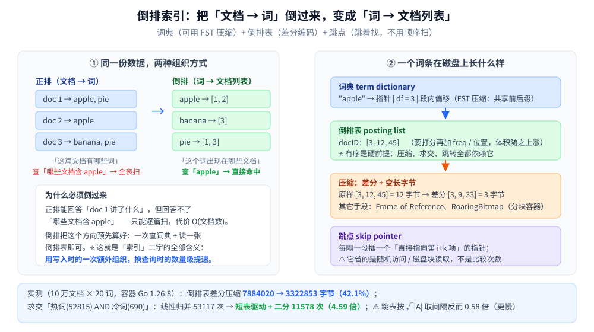
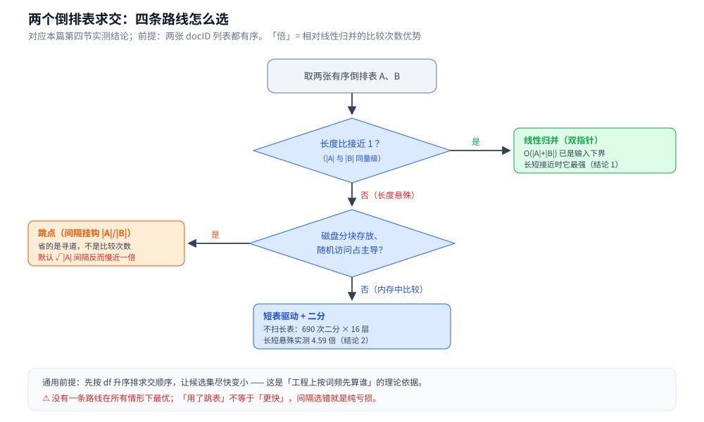
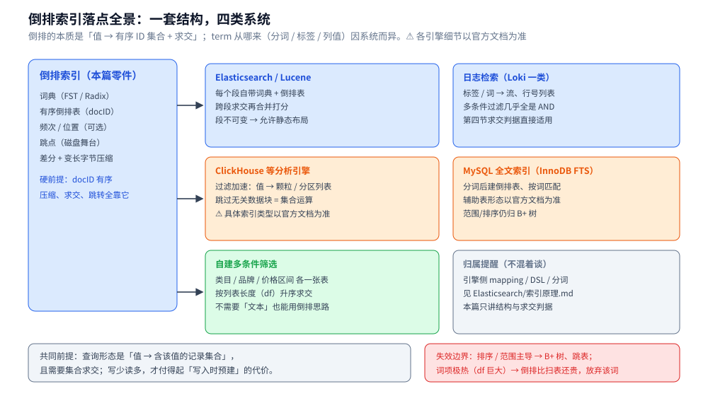

# 倒排索引

> 覆盖搜索引擎的**地基结构**：把「文档 → 词」倒成「**词 → 文档列表**」，于是"哪些文档含这个词"
> 从**全表扫**变成**一次词典命中 + 读一张有序表**。
>
> ⭐ 本篇是**结构篇**：讲词典 / 倒排表 / 位置信息 / 跳点四件组成、压缩手段，以及**求交的四条路线实测**。
> 引擎侧的 mapping / DSL / 分片 / 段合并见 [索引原理.md](../../../03-数据与中间件/数据存储/搜索与分析/Elasticsearch/索引原理.md) —— 两篇不重复。
>
> 内容整理自个人学习笔记，素材见 [素材清单](../../../素材清单.md)。
> 📎 本篇所有读数均为**容器实跑逐字抄录**：**Go 1.26.8（linux/amd64，`golang:1.26-alpine`）**；
> 语料由固定哈希生成，跑两遍输出**逐行相同**。
>
> 全目录的判据与选型总表见 [README.md](../README.md)；本目录的导读见 [README.md](README.md)。

---

## 一、正排与倒排差在哪？为什么搜索非用倒排不可？

**本节要点**：正排回答「**这篇文档里有哪些词**」，倒排回答「**哪些文档里有这个词**」—— 搜索要的是后者，而它没法从前者现算。

| | 正排（forward index） | 倒排（inverted index） |
|---|---|---|
| 键 | 文档 ID | **词项 term** |
| 值 | 该文档里的词列表 | **出现该词的文档列表**（posting list） |
| 回答 | 「这篇讲了什么」 | 「**哪些文档含这个词**」 |
| 查询代价 | 找词要**逐篇扫**：`O(文档数)` | 一次词典定位 + 读一张表：`O(df)` |

⚠️ 关键在于**方向不能现算**：正排里想找"含 apple 的文档"，只能把每篇文档的词表翻一遍 —— 文档到千万级时这条路直接不可用。
倒排把这件事**在写入时预先算好**，查询时就只剩"查词典 + 读表"。⭐ 这也是所有索引的通用逻辑：**把查询时的困难前移到写入时解决**（对照 B+ 树把"找行"前移成"维护一棵有序树"，见 [B树与B+树.md](../树/B树与B+树.md)）。



## 二、一个词条由哪几部分组成？

**本节要点**：四件 —— **词典**（词 → 倒排表在哪）、**倒排表**（docID，有序）、**位置/频次**（可选，决定能支持什么查询）、**跳点**（跳着找）。

| 组成 | 内容 | 少了它会怎样 |
|---|---|---|
| **词典** term dictionary | 全部词项 + 每个词的 `df`（doc freq）与倒排表偏移 | 找不到表；`df` 还决定查询时"先算谁" |
| **倒排表** posting list | **有序**的 docID 列表 `[3, 12, 45, …]` | ⚠️ **有序是硬前提**：压缩、求交、跳转全都靠它 |
| **频次 / 位置** freq & positions | 词在文档里出现几次、出现在第几个位置 | 支持不了 TF-IDF 打分、短语查询 `"apple pie"`（要求位置相邻） |
| **跳点** skip pointer | 每隔一段直接指向第 `i+k` 项 | 长表只能顺序扫（但见第四节的实测：跳点省的不是比较次数） |

**词典本身也要省内存**：把词项按字典序排好、共享公共前后缀，就得到 **FST / Trie** 一族的压缩表示 ——
它同时满足"前缀枚举"与"按序可比"，正是 [Trie.md](../树/Trie.md) 讲的那条路线。⚠️ **词典与倒排表是两个独立的压缩对象**：前者压的是"词",后者压的是"docID"。

## 三、倒排表怎么压？为什么压缩是必需的？

**本节要点**：**差分 + 变长字节**一句话即可解释 —— docID 有序，所以**差值小**；差值小，所以**一个字节装得下**。

```text
原始 docID： 3, 12, 45           → 每个 uint32 占 4 字节，共 12 字节
差分：       3,  9, 33           → 差值都在 [0, 127] 内
变长字节：   1 + 1 + 1 = 3 字节  → 压到 25%
```

⭐ 能压的根源是**有序性**：越长的表、越密的文档分布，差分越小，压缩收益越大。
⚠️ 反过来说，**高频词的表压不动**：它的相邻 docID 差本来就只有 1~2，差分后仍是 1~2 字节，且表本身极长。

**实测（全词表，10 万文档 × 20 词）**：

```text
== 场景三：倒排表的物理体积（全词表）==
原样 uint32：7884020 字节
差分 + 变长字节：3322853 字节，压到 42.1%
热词 t=0 单表：52815 个文档 → 原样 211260 字节，压缩后 52815 字节
```

注意**热词那行更值得看**：52815 个 docID 压到 **52815 字节**，正好**每个 docID 1 字节** —— 因为热词几乎每篇都出现，差分恒为 1。
⭐ 所以"压缩率"要分开看：**全局 42.1%**（受长尾词带动）vs **单个热词 25%**。工程上还会叠 **Frame-of-Reference**（每块减去块内最小值）或 **RoaringBitmap**（把大块拆成"稠密位图 / 稀疏数组"两种容器）。

## 四、两个倒排表怎么求交？四条路线实测

**本节要点**：**没有一条路线在所有情形下都最优** —— 长度接近时**线性归并**已是最优；长度悬殊时**短表驱动 + 二分**大赢；而**跳表跳转省的不是比较次数**。

**语料**（场景一）：10 万文档、每篇 20 个词、词表 20000，词频按三次方偏斜（模拟齐普夫的头部集中）：

```text
最高频词 t=0：df = 52815
中低频词 t=196：df = 690
次高频词 t=1：df = 17573
```

**四条求交路线**：① 线性归并（双指针）；② 跳表（堆点间隔取 `√|A|`）；③ 跳表（间隔按长度比调）；④ 短表驱动 + 二分。

```text
== 场景二 A：热词 AND 冷词（长短悬殊） ==
|A|=52815，|B|=690（比 76.5 : 1）
线性归并：             交集 351 个，比较 53117 次（≈ |A| + |B| = 53505）
跳表（间隔 √|A|=229）：  交集 351 个，比较 91115 次（0.58 倍）
跳表（间隔按长度比调）：交集 351 个，比较 44468 次（1.19 倍）[间隔 A=76 / B=1]
短表驱动 + 二分：      交集 351 个，比较 11578 次（4.59 倍）
⭐ 四条路线交集一致：true

== 场景二 B：热词 AND 次热词（两个长表） ==
|A|=52815，|B|=17573（比 3.0 : 1）
线性归并：             交集 9020 个，比较 61352 次（≈ |A| + |B| = 70388）
跳表（间隔 √|A|=229）：  交集 9020 个，比较 113444 次（0.54 倍）
跳表（间隔按长度比调）：交集 9020 个，比较 83208 次（0.74 倍）[间隔 A=3 / B=1]
短表驱动 + 二分：      交集 9020 个，比较 294507 次（0.21 倍）
⭐ 四条路线交集一致：true
```

⭐ **四条结论，一条比一条反直觉**：

1. **长度接近时线性归并最强**（场景二 B：61352 次）。原因很朴素：`O(|A|+|B|)` 是**输入规模的下界** —— 你要读完全部元素，不可能比线性更少。二分反而 0.21 倍（每次二分 `log|A|` 次比较，乘上 17573 个驱动元素就爆了）。
2. **长度悬殊时换成短表驱动 + 二分，直接 4.59 倍**（11578 次）。因为**不必扫完长表**：690 次二分 × 16 层 = 1 万多次就够。⭐ 这条正是工程上"**按 df 升序求交**"的理论依据。
3. ⚠️ **跳表按教科书默认间隔 `√|A|` 取，反而比线性归并慢近一倍**（0.58 / 0.54 倍）。根因：`√|A| = 229`，而"每处理一个 B 元素需要推进 A 的距离"只有 `|A|/|B|`（场景二 A 是 76、场景二 B 只有 3）—— **跳点几乎从不触发，而每次判断都要花一次比较**。
4. ⭐ **调对间隔后跳表也只到 1.19 / 0.74 倍**，仍不及对应的最优路线。所以"跳表跳转"的真正价值不在比较次数，而在**随机访问次数**：跳 `√|A|` 只要一次寻道，线性归并要顺序扫过这 `√|A|` 个元素所在的全部磁盘块。**它的舞台是磁盘上的 posting list，不是内存里的比较次数。**

> 🔧 **实测踩到的两个坑（都已修）**：
> ① 第一版跳表**每一步都做一次跳点判断**（跳不动也判），结果 91087 次 vs 线性 53117 次 —— 修法是"**跳不动才走一步**"；
> ② 修完仍慢，才定位到**间隔选错**：`√|A|` 必须与 `|A|/|B|` 挂钩。⭐ 这提醒一件事：**「用了跳表」不等于「更快」，间隔选错就是纯亏损。**



---

## 五、应用场景

**本节要点**：本节落到**具体系统**——每类系统对倒排的用法差异只在「term 从哪来」，结构与求交判据是同一套；按「层级」看形态的四层叙述见 5.1 总表与 5.3 辨析。

### 5.1 应用场景总表

| 场景 | 具体产品 / 系统 | 怎么用倒排 | 为什么合适 |
|---|---|---|---|
| 全文检索 | Elasticsearch / OpenSearch（Lucene 段，见 [索引原理.md](../../../03-数据与中间件/数据存储/搜索与分析/Elasticsearch/索引原理.md)） | 每段自带词典（FST）+ 倒排表，跨段求交再合并打分 | 段不可变 → 差分压缩与跳点能静态布局（第三、四节的舞台） |
| 日志检索 | Loki 一类、基于 ES 的日志系统 | 标签 / 词 → 流、行号列表，多条件过滤 = 求交 | 日志查询几乎全是 AND——第四节判据直接适用 |
| 分析库过滤加速 | ClickHouse（见 [索引原理与查询优化.md](../../../03-数据与中间件/数据存储/列式数据库/ClickHouse/索引原理与查询优化.md)） | 过滤加速结构是「值 → 颗粒 / 分区集合」的倒排形态，跳过无关数据块 | 多条件扫描 = 有序 ID 列表求交。⚠️ 具体索引类型与适用面以官方文档为准 |
| 数据库全文索引 | MySQL InnoDB 全文索引（对照 [索引设计与EXPLAIN.md](../../../03-数据与中间件/数据存储/关系型/MySQL/索引设计与EXPLAIN.md)） | 分词后建倒排表，按词匹配行 | 「哪些行含这个短语」全表扫不可行——把困难前移到写入 |
| 自建多条件筛选 | 商品筛选、标签库、内容池 | 类目 / 品牌 / 价格区间各一张有序 ID 倒排表，按 df 升序求交 | 不需要「文本」：倒排的本质是「值 → 集合 + 求交」，分词只是 term 的来源之一 |



### 5.2 深入辨析：倒排在索引家族里占哪一格

- **与 B+ 树分工**：B+ 树答「键 → 位置」且保序，范围与排序归它；倒排答「值 → 含该值的记录集合」，等值与集合运算归它。同一张表两者常并存（见 [B树与B+树.md](../树/B树与B+树.md) 的失效边界一节）。
- **与散列表分工**：散列的桶里挂的是「这个键映射到什么」；倒排多出来的是**有序性 + 集合运算**——无序的 posting list 连最简单的 AND 都做不了（延伸追问第一条）。词典那层才轮到散列 / Trie 出场（见 [散列表.md](../哈希表/散列表.md)、[Trie.md](../树/Trie.md)）。
- ⚠️ **term 来源不同，df 形态就不同**：英文按词、中文分词质量、n-gram 粒度、还是直接拿列值当 term——结构相同、长短表比例完全不同，第四节的四条判据**不能跨语料直接搬**。各引擎的分词与打分是**引擎侧**的事，见 [索引原理.md](../../../03-数据与中间件/数据存储/搜索与分析/Elasticsearch/索引原理.md)，本篇不重复。

### 5.3 深入辨析：四层落点速览

四层叙述中，第二层（日志检索与可观测性）与第三层（多条件筛选）的用法与出处已逐行收录在 5.1 总表，此处保留总表之外的原文表达：

**第一层：搜索引擎的段（segment）。** 写入先进内存缓冲，刷盘成一个不可变的段；每个段自带一份词典 + 倒排表，查询在多个段上分别求交再合并。⚠️ **段不可变**是压缩与跳点能静态布局的前提（见 [索引原理.md](../../../03-数据与中间件/数据存储/搜索与分析/Elasticsearch/索引原理.md)）。

**第四层：你可以借用它的思路。** 倒排的通用形态是"**预先建好「值 → 主键集合」的映射，用空间换掉全表扫**"；
而"**长度小的先算**"则是任何多路求交的通用优化 —— 先算交集小的，后面每一路都能在更小的候选集上做。

### 5.4 收尾判据

> 共同前提：**查询形态是「值 → 含该值的记录集合」且需要集合求交（AND / 短语 / 多条件）**；数据读多写少，才付得起「写入时预建映射」的成本——这与 B+ 树「把找行前移成维护一棵有序树」是同一个逻辑（第一节）。

失效边界：排序 / 范围主导 → B+ 树、跳表（[跳跃表.md](跳跃表.md)）；词项极热（df 巨大）→ 倒排表比扫表还贵，按第四节的 df 判据引擎应直接放弃该词；基数小、等值单列 → 普通二级索引就够，不必动用倒排。

---

## 延伸追问

- **为什么倒排表必须有序？** → 三件事都依赖它：**差分压缩**（差值小才能压）、**求交**（归并/二分/跳转都要求有序）、**跳点**（"跳到第 i+k 项"必须有确定顺序）。无序的倒排表连最简单的 AND 都做不了。
- **词典为什么常用 FST？** → 词项按字典序排好后可以共享前后缀，同时保留"前缀枚举"与"按序可比"两种能力 —— 正是 [Trie.md](../树/Trie.md) 里 Radix / DAWG 那条压缩路线。⚠️ 词典压的是"词"，倒排表压的是"docID"，是两个独立对象。
- **求交到底该用哪条路线？** → 先看**长度比**：接近时**线性归并**（已是最优下界）；悬殊时**短表驱动 + 二分**（实测 4.59 倍）。工程上更稳的做法是**按 df 升序排好求交顺序**，让候选集尽快变小。
- **「跳表跳转」为什么实测反而更慢？** → 两个原因：**间隔**（`√|A|` 远大于 `|A|/|B|` 时跳点从不触发，白付判断费）与**判据**（它省的是随机访问/磁盘块读取，不是比较次数）。⭐ 磁盘上 posting list 分块存放时才轮到它上场。
- **`df` 为什么这么重要？** → 它是"这张表有多长"的唯一指标：决定**求交顺序**（小表先行）、决定**是否值得读这张表**（`df` 过大时直接放弃该词）、也决定**压缩策略**（长表用 FOR / RoaringBitmap）。
- **加了位置信息会怎样？** → 倒排表从 `[docID]` 变成 `[docID, pos…]`，体积显著上涨，但换来**短语查询**（`"apple pie"` 要求位置相邻）与**邻近度打分**。⚠️ 这是典型的"**用索引体积换查询能力**"，不是免费的。

---

## 关联

- [索引原理.md](../../../03-数据与中间件/数据存储/搜索与分析/Elasticsearch/索引原理.md) — 引擎侧：段合并、mapping、DSL、分词与打分（本篇讲结构，那篇讲落地）
- [Trie.md](../树/Trie.md) — 词典的 FST / Radix 压缩来源（前缀共享 + 按序可比）
- [B树与B+树.md](../树/B树与B+树.md) — 另一条索引路线：有序 + 范围，与倒排的「精确词项 + 集合求交」互补
- [散列表.md](../哈希表/散列表.md) — 「键 → 值列表」的最朴素形态；倒排比它多的是**有序**与**集合运算**
- [位图与布隆过滤器.md](位图与布隆过滤器.md) — RoaringBitmap 的位图一侧（大块稠密时容器退化成位图）
- [搜索与分析选型对比.md](../../../03-数据与中间件/数据存储/搜索与分析/搜索与分析选型对比.md) — 检索族四路 + 分析族四路的域内横评
- [README.md](../README.md) — 数据结构目录的选型总表（操作 × 隐藏代价 × 场景）
- [README.md](README.md) — 本目录（高级数据结构）的导读
