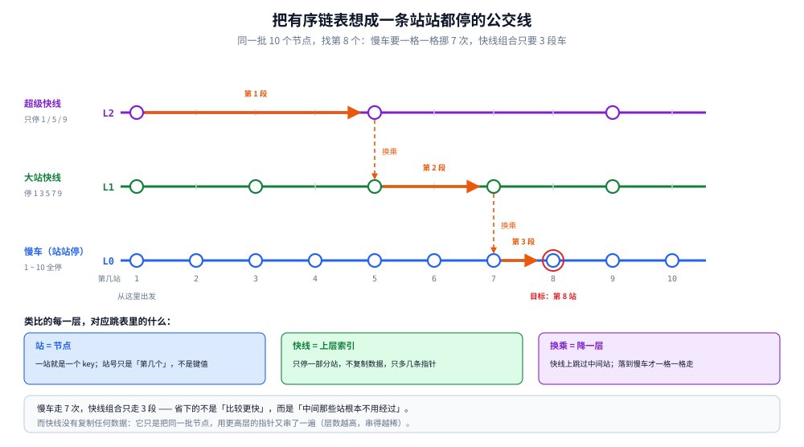
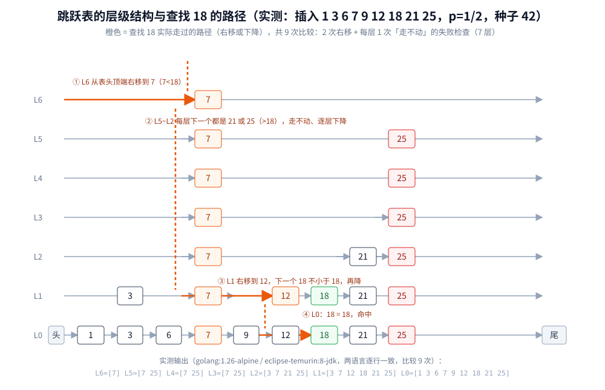
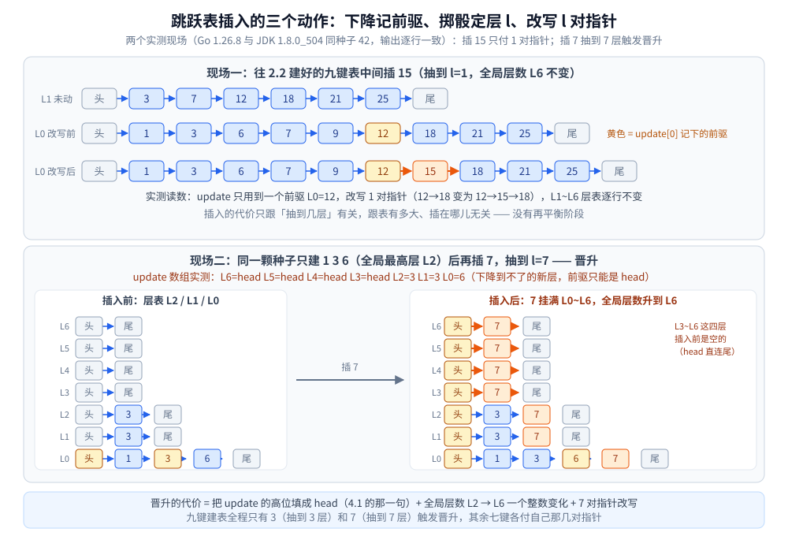
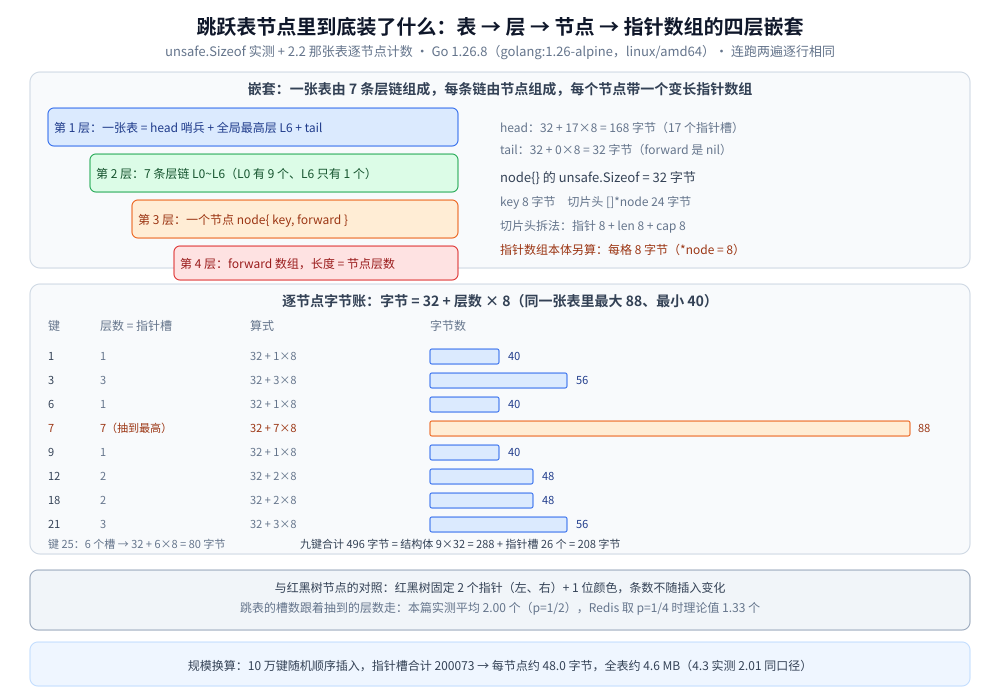
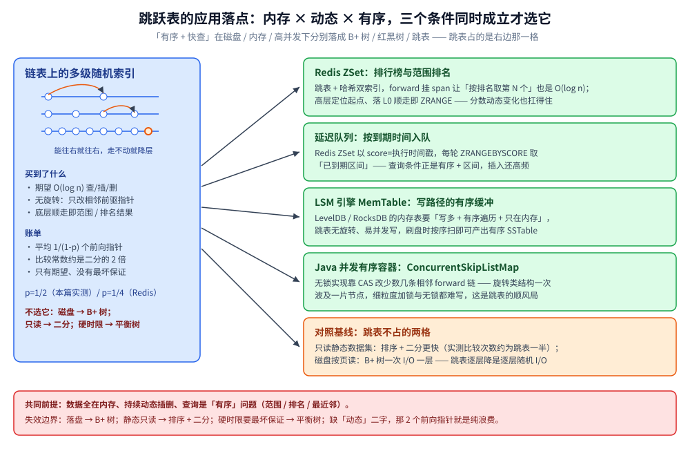

# 跳跃表（Skip List）

> 一条有序链表，查找只能从头往后走；一棵平衡树查得快，但每次插入都可能左旋右旋、变色。
> 跳跃表给出第三条路：**在上层叠几条「快线」，每个节点上不上快线由掷骰子决定** ——
> 期望 O(log n)，实现却只有几十行。
>
> 本篇按「先直觉、再机制、再数学、最后工程」的顺序走：
> 第一节用公交快线建立直觉，第二、三节拆结构与操作，第四节回答「凭什么掷骰子就行」，第五节算账，第六节落到 Redis / RocksDB / Java。
>
> ⭐ 边界先说清：本篇讲**跳跃表本身的结构、操作与工程取舍**。
> 「平衡树怎么旋转」见 [平衡树.md](../树/内存平衡树/平衡树.md)；
> 「B+ 树为什么是磁盘索引首选」见 [B树与B+树.md](../树/磁盘存储树/B树与B+树.md)；
> Redis 中 ZSet 的完整实现见 [底层结构.md](../../../03-数据与中间件/数据存储/NoSQL/Redis/底层结构.md)。
>
> 内容整理自个人学习笔记，素材见 [素材清单](../../../素材清单.md)。
>
> 📎 本篇所有输出均为容器实跑逐字抄录：**Go 1.26.8（golang:1.26-alpine）** 与 **JDK 1.8.0_504（eclipse-temurin:8-jdk）**
> 各实现一份，同一随机数发生器（64 位 LCG、同种子），非耗时行**逐行一致**；随机层数与实测读数同源于该程序。

---

## 一、从零开始：为什么我们需要跳跃表？

**本节要点**：有序数组查得快、插得慢；有序链表插得快、查得慢；平衡树两头都快，但难写。
跳跃表要同时拿到「链表的插入」与「树的对数查找」，办法是把「维护平衡」从必答题改成概率题。

### 1.1 三种结构，三种死法

先把需求说死：**要一个有序集合，能快速找到某个值，也能随时插入新值。**

三种现成答案，每一种都有硬伤：

| 结构 | 查找 | 插入 / 删除 | 平衡手段 | 实现复杂度 |
|---|---|---|---|---|
| 有序数组 | O(log n)（二分） | O(n)（搬移） | 无 | 极低 |
| 有序链表 | O(n) | O(1)（已知前驱） | 无 | 极低 |
| 平衡树（AVL / 红黑树） | O(log n) | O(log n) | 旋转 + 变色 | 高 |
| **跳跃表** | **期望 O(log n)** | **期望 O(log n)** | **随机层数** | **低** |

- **有序数组**：二分查找 O(log n)，但往中间插一个值要把它后面所有元素往后挪 —— 平均 n/2 次移动。
- **有序链表**：插入只要改两根指针（前驱已知时），代价是查找必须从头一个个比，O(n)。
- **平衡树**：查和插都压到 O(log n)，但这份对数级的查找能力是**拿「必须维持平衡」换来的**。
  AVL 插入后要判四种失衡、做单旋或双旋；红黑树要判三种情况、变色、最多两次旋转（见 [红黑树.md](../树/内存平衡树/红黑树.md) 1.4）。

⭐ 关键洞察：**平衡树的成本不在「树」上，在「维持不变量」上**。
每插一个节点，都可能触发一串向远处传播的修复动作；而修复动作要改的是树的结构，不是几根相邻指针。

### 1.2 ⭐ 换个视角：有序链表就是一条站站都停的公交线

先别管指针和层。想象一条公交线，10 个站依次排开：

- **L0 = 慢车**：1、2、3、4、5、6、7、8、9、10，**站站都停**；
- **L1 = 大站快线**：只停 1、3、5、7、9 —— 隔一站停一站；
- **L2 = 超级快线**：只停 1、5、9 —— 隔三站停一站。

现在你要去**第 8 站**。

- 只坐慢车：1→2→3→4→5→6→7→8，**7 次停靠**，一格都不能跳。
- 会换乘：**L2 从 1 坐到 5**（一步跨过 2、3、4 三个中间站）→ **换 L1 从 5 到 7** → **换 L0 从 7 到 8**。
  一共 **3 段车**，中间的 2、3、4、6 四个站根本没经过。



图里三条线的站点是同一批节点，快线并没有复制数据；实心橙色的三段箭头就是查找时「右移」的三步，竖直的橙色虚线是「换乘」，也就是降一层。

⭐ 类比的三个映射，就是跳跃表的全部：

| 公交 | 跳跃表 | 说明 |
|---|---|---|
| 一个站 | 一个节点（一个 key） | 站号只是「第几个」，真正的顺序由 key 决定 |
| 快线只在部分站停 | 上层索引只含下层的**随机子集** | 层数越高，串得越稀 |
| 换乘 = 降一层 | 上层走不动了，落回下层继续走 | 不是换数据结构，是同一条链的下一层指针 |

⚠️ 类比有两处会骗人，先戳破：
- ① **快线的站不是选出来的，是掷骰子掷出来的**。现实里的快线停哪站由公交公司规划；跳表里每个节点在**插入那一刻**自己掷骰子决定能上几层，
所以真实形态**不均匀**（下一节 2.2 就是实测的不均匀形态）。这正是第四节要解释的设计。
- ② **换乘时你没下车，从头到尾是同一批节点**。跳表里没有「快线专用副本」，一个节点同时被几层的指针串着 ——
这一点在 2.4「四层嵌套」里落地。

### 1.3 一句话：把「必须平衡」降级为「大概率平衡」

⭐ **跳跃表把「维护平衡」从「必须做」降级为「大概率发生」**，省下的就是旋转的全部成本。

这条取舍贯穿全篇：第二、三节讲它长什么样、怎么查怎么插；第四节回答「凭什么随机也够用」；
第五节算清它到底多花多少时间和空间；第六节回答什么场景该选它。

---

## 二、探秘结构：L0 到 Lk 层是怎么叠起来的？

**本节要点**：底层是完整有序链表，往上一层是下层的随机子集，层数越高节点越少。
查找时从最高层出发，**能往右就往右，不能往右就掉一层**。

### 2.1 形态：下层是全集，上层是稀疏子集

把 1.2 那种「上层只留一部分站」的做法落到键值上，就是教学用的理想形态（每 2 个升 1 个，层数逐级减半）：

```text
L3:  1 ──────────────────────────────→ 25
L2:  1 ─────────────→ 9 ─────────────→ 25
L1:  1 ──────→ 6 ───→ 9 ──────→ 18 ─→ 25
L0:  1 → 3 → 6 → 7 → 9 → 12 → 18 → 21 → 25
```



图里是实测落出来的 7 层形态，橙色是查找 18 实际走过的路径：两次右移（L6 到 7、L1 到 12），其余步数都在「降层」，共 9 次比较。

⚠️ 实际实现**不是**「每 2 个升 1 个」的确定性规则，而是每个节点插入时**掷骰子决定层数** ——
所以上图只是直觉模型，真实形态见 2.2 的实测输出（那份输出里 L3~L5 内容完全相同，就很能说明「不均匀」）。
头尾各有一个哨兵（head 层高 = 全局最高层、tail 键 = +∞），查找与插入都不用特判空表 ——
这与 [数组与链表.md](../线性结构/数组与链表.md) 里「哨兵节点省掉边界分支」是同一手法。

### 2.2 实测：谁被提升，由插入那一刻的随机数决定

同一批键 `1 3 6 7 9 12 18 21 25` 按序插入（`p=1/2`、固定种子、容器实跑），落出来的层是：

```text
===== 实验一：结构与查找轨迹 =====
插入顺序: 1 3 6 7 9 12 18 21 25
L6: [7]
L5: [7 25]
L4: [7 25]
L3: [7 25]
L2: [3 7 21 25]
L1: [3 7 12 18 21 25]
L0: [1 3 6 7 9 12 18 21 25]
```

⭐ 读三件事：
- ① 每层都是 L0 的**保序子集**（同层内键递增，这是查找能「走不动就降」的前提）；
- ② `7` 运气好连抽到 7 层，`1 6 9` 只在底层 —— **层数与键值无关**，只与插入时掷的随机数有关；
- ③ 分布并不严格「逐级减半」（L3~L5 内容完全相同），小样本下就是这样，规模上去后才收敛（见 4.3）。

### 2.3 节点结构：一个 key + 一个变长指针数组

```go
type node struct {
	key     int64
	forward []*node // forward[i] 是本层第 i 个后继；len(forward) 即节点层数
}
```

层数生成规则一句话：**从 1 层起，每次以概率 `p` 再加一层，封顶 `Lmax`**：

```go
func (s *skipList) randomLevel() int {
	l := 1
	for l < maxLevel && s.rnd.underHalf() {
		l++
	}
	return l
}
```

| 实现 | p | 层数上限 | 平均前向指针 = 1/(1-p) |
|---|---|---|---|
| 本篇实测 | 1/2 | 16 | 2.00（实测 2.01，见 4.3） |
| Redis 跳表 | 1/4 | 32 | 1.33 —— 用更少的指针换更高的扇出 |

⚠️ Redis 那行的「32 层」不是随手写的：源码里 `ZSKIPLIST_MAXLEVEL` 的注释就是
`/* Should be enough for 2^32 elements */`，配合 `p = 0.25` 正好支撑 2^32 ≈ 43 亿个元素。

Redis 选 1/4 的理由（含 `span` 排名字段的结构体全文）见 [底层结构.md](../../../03-数据与中间件/数据存储/NoSQL/Redis/底层结构.md) 第四节，本篇不重复；
「为什么是 1.33 个指针、这算不算省内存」在 5.3 单独算一遍。

### 2.4 一张表其实是四层嵌套

`skipList` 这个结构体只有四个字段（`head` / `tail` / `lvl` / `rnd`），但它在内存里是四层套着的：

```text
一张表 (skipList)
├─ head.forward[0] ─► 节点 ─► 节点 ─► … ─► tail     ← L0 这条链，9 个节点
├─ head.forward[1] ─► 节点 ─► … ─► tail             ← L1 这条链，6 个节点
├─ …
└─ head.forward[6] ─► 节点 ─► tail                  ← L6 这条链，1 个节点
                        └─ forward []*node          ← 每个节点自己那截变长数组
```

⭐ 三件事要分清：

① **「层」不是独立容器**。没有「L0 链表」「L1 链表」这样的对象，只有 `head.forward[i]` 这 17 条链（`maxLevel+1`，实测只用到前 7 条）；
② **同一条链上的节点是同一批对象**。`7` 同时出现在 L0~L6 的链里，不是复制了 7 份 —— 这就是 1.2 那句「换乘时你还在同一辆车上」的落地；
③ **差异只在每个节点 `forward` 的长度**。节点抽到几层，就挂几个指针；没抽到的层根本没有那个槽。

⚠️ **哨兵要单独说**：`head` 固定挂满 `maxLevel+1 = 17` 个槽，因为它是**所有**层链的起点；
`tail` 的 `forward` 是 nil，只当「右边没有节点了」的终止标记。所以节点数很少时，这两个哨兵在总内存里占比并不小（字节账见 5.2）。

---

## 三、核心算法：查找、插入、删除各走哪几步？

**本节要点**：三个操作共用同一个下降循环 —— 查找只用它，插入在下降途中把每层前驱记下来，删除把指针改写反过来做。
**没有任何需要向远处传播的修复动作**，这是与平衡树最大的成本差别。

### 3.1 查找：能往右就往右，不能往右就降层

规则三句话：

1. 从 head 的最高层开始；
2. 本层能往右就往右（`forward[lvl].key < 目标` 时前进）；
3. 走不动就降一层重复 2；降到 L0 后看当前后继**等不等**目标 —— 等则命中，不等（或撞上 tail）则不存在。

换成伪代码只有这几行，灵魂全在这里：

```text
x = head
for lvl = 最高层 downto 0:
     while x.forward[lvl] != tail and x.forward[lvl].key < 目标:
         x = x.forward[lvl]        # 右移
     # 走不动了，什么都不做，自动进入下一层
return x.forward[0]                # 降到底层再看一格
```

⭐ 注意这个循环里**没有回退分支**：右移只往右，降层只往下，全程单调。这是它能做到 O(log n) 的形式化基础（3.3 证明）。

### 3.2 实测轨迹：找 18 走了哪几步

对 2.2 的那张表查找 `18`（同一程序打印的真实 trace）：

```text
查找 18 的逐层轨迹:
  L6 右移经过: [7]
  L1 右移经过: [12]
本次查找比较次数: 9
```

⭐ 全程只有**两次右移**（L6 到 `7`、L1 到 `12`），其余都在「下降」：L6 之后每层（L5~L2）的下一个都是 `21` 或 `25`，
都比 18 大，于是一路下降到 L1；在 L1 `12` 后面是 `18`（不小于），降到 L0 才能撞上相等的 `18`。
比较次数 9 = 2 次成功右移 + 7 次「走不动」的失败检查（L6~L0 每层恰好 1 次）—— **每层至多失败 1 次**，
这就是「比较次数 ≤ 层数 + 右移总次数」的来源（5.1 用期望算它）。
⚠️ 9 次比较不是「固定 9 次」：同一张表换目标、换种子都会变，层数是随机的。

### 3.3 为什么「走不动就降」不会漏掉目标

关键性质：**高层是低层的子集**。设本层 `x.forward[lvl].key ≥ 目标`，那么目标若在表里，
它的位置只可能在 `x` 与 `x.forward[lvl]` 之间 —— 这个开区间在下一层可能多出若干节点，但**不会少**，
更不可能在 `x` 左边（本层左边都 ≤ x < 目标）。所以降到下一层时**从 x 原地继续往右**即可，无需回头。

这条「区间被逐层细分」的直觉与 [二分查找.md](../../算法/基础算法/查找/二分查找.md) 完全同构：
二分靠「取中点」把一个区间劈成两个，跳表靠「降层」在两个高层锚点之间插入低层锚点。
差别只在：二分的劈点要求**数组随机访问**，跳表的劈点要求**子集恰好稀疏均匀** —— 后者用随机数免费得到。

### 3.4 插入：下降时顺手记下每层前驱

插入 = 把 3.1 的下降循环走一遍，**途中把每一层「该插在哪」记进 `update` 数组**，然后一次性改指针：

```go
func (s *skipList) insert(key int64) {
	update := make([]*node, maxLevel+1)
	x := s.head
	for lvl := s.lvl; lvl >= 0; lvl-- {
		for x.forward[lvl] != s.tail && x.forward[lvl].key < key {
			x = x.forward[lvl]
		}
		update[lvl] = x
	}
	l := s.randomLevel()
	if l > s.lvl+1 {
		for lvl := s.lvl + 1; lvl < l; lvl++ {
			update[lvl] = s.head // 新高层的「前驱」只能是 head
		}
		s.lvl = l - 1
	}
	n := &node{key: key, forward: make([]*node, l)}
	for i := 0; i < l; i++ {
		n.forward[i] = update[i].forward[i]
		update[i].forward[i] = n
	}
}
```

⭐ 一次 `O(期望 log n)` 下降拿到每层前驱，之后是 `l` 对指针的**纯局部改写**；
若抽到超高层还顺手抬高全局层数，也**不需要拆任何结构**。对比红黑树插入后的「变色 + 最多两次旋转」
（见 [红黑树.md](../树/内存平衡树/红黑树.md) 1.4），跳表这一侧**没有再平衡阶段**。

`update` 数组是这个算法的全部记忆：它记的不是「树的结构」，只是「这一层从谁后面插进去」。

### 3.5 实测插入现场：每键抽到几层、晋升改写了哪几对指针

「谁被提升到哪一层」「插一个中间键要付几对指针」都是跑起来才知道的量。用 2.3 的 `node` / `randomLevel`
加 3.4 的 `insert`（同一颗种子 42）逐键打印 `update[]` 的实际取值，
**Go 1.26.8（`golang:1.26-alpine`）与 JDK 1.8.0_504（`eclipse-temurin:8-jdk`）两份实现输出逐行一致**。

先回答 2.2 那句「`7` 运气好连抽到 7 层」的现场 —— 九次插入各自的掷骰结果：

```text
插入  1 抽到 1 层，不晋升，全局最高层 L0 → L0
插入  3 抽到 3 层，晋升：抬高全局层数，全局最高层 L0 → L2
插入  6 抽到 1 层，不晋升，全局最高层 L2 → L2
插入  7 抽到 7 层，晋升：抬高全局层数，全局最高层 L2 → L6
插入  9 抽到 1 层，不晋升，全局最高层 L6 → L6
插入 12 抽到 2 层，不晋升，全局最高层 L6 → L6
插入 18 抽到 2 层，不晋升，全局最高层 L6 → L6
插入 21 抽到 3 层，不晋升，全局最高层 L6 → L6
插入 25 抽到 6 层，不晋升，全局最高层 L6 → L6
```

⭐ 三件事：① 九次里**只有 `3` 和 `7` 触发晋升**，其余七键只付自己那几对指针；
② `25` 抽到 6 层，但全局已经在 L6，所以是「挂满 6 层」而**不算晋升** —— 这正是 2.2 里 L3~L5 内容完全相同（都是 `[7 25]`）的直接原因；
③ 层数与键值无关（`7` 抽 7 层、紧跟着的 `9` 抽 1 层），与 2.2 的结论同源。

**往表中间插一个键**（对 2.2 建好的那张表插 `15`）：

```text
插入 15 抽到 1 层，不晋升，全局最高层 L6 → L6
    下降得到的每层前驱：L0=12
    改写 1 对指针：L0 12→18 改为 12→15→18
    15 实际挂到的层数 = 1
```

插入后的层表除了 L0 多出 `15`，L1~L6 **逐行与 2.2 一模一样** —— 代价只跟「抽到几层」有关，跟表多大、插在哪无关。

**晋升的完整现场**：同一颗种子只建 `1 3 6` 三个键（此时全局最高层才 L2），再插 `7`：

```text
插完 1 3 6 时的层表：
L2: [3]
L1: [3]
L0: [1 3 6]
插入 7 抽到 7 层，晋升：抬高全局层数，全局最高层 L2 → L6
    下降得到的每层前驱：L6=head L5=head L4=head L3=head L2=3 L1=3 L0=6
    改写 7 对指针：L6 head→tail 改为 head→7→tail；L5 head→tail 改为 head→7→tail；L4 head→tail 改为 head→7→tail；L3 head→tail 改为 head→7→tail；L2 3→tail 改为 3→7→tail；L1 3→tail 改为 3→7→tail；L0 6→tail 改为 6→7→tail
晋升后层表：
L6: [7]
L5: [7]
L4: [7]
L3: [7]
L2: [3 7]
L1: [3 7]
L0: [1 3 6 7]
```

⭐ 关键在 `L6=head L5=head L4=head L3=head` 这半行：抽到 L3~L6 时，下降循环从当时的全局最高层 L2 起步，
**根本走不到这四层**，所以 3.4 里的 `update[lvl] = s.head` 不是防御性代码，而是晋升分支的必经动作 ——
新层插入后的全部形态就是 `head → 7 → tail`。**晋升的总代价 = 7 对指针 + 全局层数这一个整数**，仍然没有任何向远处传播的修复。



图左是「往中间插一个低层节点」，只改一对指针；图右是「抽到 7 层触发晋升」，四层从空链直接变成 head→7→tail。

⚠️ 与 2.1 那张图分工：那张画的是**建成后的静态形态 + 查找走位**，本图画的是**一次插入付了哪几对指针**；
删除侧（3.6）是同构动作，但本篇实测未覆盖删除，故不画。

### 3.6 删除：把同一招反过来

删除把同一招反过来用：下降时同样收集 `update` 数组，把每个 `update[lvl].forward[lvl]` 从目标节点「跳过去」，
最后若最高层空了就把全局层数下调。

代价与插入同构，但少一次随机：**不用掷骰子，改写的指针数就是被删节点原来的层数**。
⚠️ **本节删除只有机制描述，实测代码未包含删除**（实验只覆盖插入与查找）。

---

## 四、灵魂一问：层数为什么要「掷骰子」？

**本节要点**：确定性比率会让「谁该升级」随每次插入而变号，改一个节点等于重建整条上层链；
随机层数把这个维护义务一次性买断 —— 代价是只给期望、不给最坏保证。

### 4.1 如果规定「每 2 个升 1 个」会怎样？

直觉上最自然的规则是：**第 2、4、6… 个节点升到 L1，每 4 个升到 L2**。层数严格减半，比随机还整齐。
试一次就知道为什么不行。

设当前有序链表是 `1 3 6 9 12`，按「偶数位升 L1」的规则，L1 上是 `[3, 9]`（第 2、4 个）。

现在插入 `7`，它落在 `6` 与 `9` 之间，也就是第 4 位：

```text
# 插入前
idx  1  2  3  4  5
key  1  3  6  9  12
        ↑     ↑              L1 = [3, 9]（第 2、4 位）

# 插入 7 之后
idx  1  2  3  4  5  6
key  1  3  6  7  9  12
        ↑     ↑     ↑        L1 = [3, 7, 12]（第 2、4、6 位）
```

⭐ 插入点**之后**的节点序号整体 +1、奇偶性全部翻转：`9` 从第 4 位变第 5 位（该下台）、
`12` 从第 5 位变第 6 位（该上台），新来的 `7` 占了第 4 位（也该上台）。
**一个节点进表，动的是它右边的整条 L1 链**；L2 的「每 4 个」同理跟着连锁变化，
插得越靠前，要重排的人越多。

⭐ 这不是「跳表的毛病」，而是**确定性比率规则的固有代价**：它要求每个节点知道「我在全体里排第几」。
可插入是流式的、并发的 —— 新节点进来时，谁也不知道后面还会来多少，更不可能让已在表里的节点让位。
真按这个规则做，就是另一场再平衡，只是从「旋转」换成了「整链重排」。

**随机层数恰好绕开了这个问题**：

| 关心的事 | 确定性比率（每 2 个升 1 个） | 随机层数（掷骰子） |
|---|---|---|
| 层数在哪一刻确定 | 每次插入都要重算全体 | **插入那一刻定死，之后永不改** |
| 插一个节点动几条指针 | 整条上层链 + 连锁 | 只动自己那 `l` 对 |
| 需要知道「我排第几」吗 | 需要（要算奇偶） | 不需要 |
| 层间比例 | 严格 1/2 | 期望 1/2，小样本会偏 |

⚠️ 换来的代价写在第 3 列最后一行：**随机只保证「期望比例」，不保证「严格比例」**。
2.2 里 L3~L5 内容完全相同、4.3 里 10 万键的实测比率是 0.497~0.504 而不是精确 0.500，都是同一件事的两面。
下一节就回答：这个「期望」到底靠不靠得住。

### 4.2 掷骰子的规则：一个几何分布

规则是：**先给 1 层，然后每次以概率 `p` 再加一层，直到掷失败或撞上 `Lmax`**。
`p=1/2` 时，等价于「抛硬币，正面就升一层」：

| 层数 k | 概率 | 累计（≥ k 层） | 100 万个节点里约有几个 |
|---|---|---|---|
| 1 | 1/2 | 1 | 500000 |
| 2 | 1/4 | 1/2 | 250000 |
| 3 | 1/8 | 1/4 | 125000 |
| 10 | 1/1024 | 1/512 | 977 |
| 20 | 约 1/100 万 | 约 1/50 万 | 约 1 |
| 40 | 约 1/1.1 万亿 | 约 1/5500 亿 | 0 |

⭐ 这张表回答了初学者最自然的两个追问：

- **「万一我运气极差，全抽到 1 层，岂不是退化成链表？」**
  n 个节点全部只抽到 1 层的概率是 `(1/2)^n`。n=10 万时这个数字小到没有语言能形容 ——
  所以实际保证比「期望 O(log n)」强得多：它其实是「**以极高概率** O(log n)」（4.4 详述）。
- **「那最高能到几层？」**
  数学上随 n 涨：n=100 万时最高层的期望就在 `log₂(10⁶) ≈ 19.9` 层附近；
  想要一个 40 层的节点，期望需要 `2⁴⁰ ≈ 1.1 万亿` 个节点。所以实现里都用 `Lmax` 封顶（本篇 16、Redis 32）。

⚠️ 封顶的作用要说准：它限制的是**单个节点的指针槽数**（内存上界），不是查找的最坏复杂度 ——
最坏情况仍然是「所有节点都只有 1 层」，只是那个概率已经小到不成其为风险。

### 4.3 实测：10 万键真的逐级减半

10 万个不同键随机顺序插入（`p=1/2`，容器实跑）：

```text
===== 实验二：层数分布与复杂度 =====
元素数: 100000, 最高层: L15
平均每节点前向指针数: 2.01 (理论 1/(1-p)=2.00)
每层节点数: L0=100000 L1=50339 L2=25348 L3=12589 L4=6311 L5=3232 L6=1635 L7=843 L8=448 L9=216 L10=109 L11=43 L12=17 L13=10 L14=4 L15=2
随机查找 10000 次: 跳表平均比较 30.1 最大 53 | 数组二分平均 15.7 最大 17
```

⭐ 逐级比率 `50339/100000 = 0.503`、`25348/50339 = 0.504`、`12589/25348 = 0.497` —— 收敛到理论值 1/2；
平均前向指针 2.01 也压着理论值 `1/(1-p) = 2`。最高层 L15 与 `log₂(10⁵) = 16.6` 同量级（差一层是正常的随机波动）。

⭐ 这条读数同时把 4.1 那张表的最后一列验了：**概率规则不需要知道「谁排第几」，落出来的比例照样贴着 1/2**。

### 4.4 「期望」不是「最坏」

平衡树在**任何时刻**都满足结构不变量，所以**最坏** O(log n)；跳表只是**大概率**均匀，
理论上存在「所有高层掷骰子都失败」的退化形态（退化成一条有序链表）。

⚠️ 该退化概率随 n 指数级小（`(1-p)^n` 量级），所以工程上完全接受，
但**要最坏保证的场景不该选它**（判据在 6.1）。
「用概率代替不变量」的完整论证见 [平衡树.md](../树/内存平衡树/平衡树.md) 第四节。

⭐ 一句话区分：**红黑树的 O(log n) 是承诺，跳表的 O(log n) 是赌注** —— 只不过这个赌注的赔率是 `2^-n`。

---

## 五、复杂度与内存账：空间到底换来了什么？

**本节要点**：时间账 ≈ `2·log₂n` 次比较（实测 30.1，约数组二分两倍）；空间账是平均 `1/(1-p)` 个前向指针，
而**每个节点的字节数并不相同**（本篇实现 40~88 字节）。⚠️ 但要小心：省的是「指针条数」，不是「总字节」。

### 5.1 期望比较次数怎么算出来

两层论证。**第一层：层数本身有限。** 掷到 `k` 层的概率 = `p^(k-1) · (1-p)`（前 k-1 次都掷中、第 k 次不中），
期望层数 = `1/(1-p)`。`p=1/2` 时平均 2 层 —— 这就是 4.3 里 2.01 的来历。

**第二层：每层「至多失败一次」。** 从高层看低层：相邻高层锚点之间的低层片段长度是**独立同分布**的随机变量，
期望步数 `(1-p)/p`（`p=1/2` 时为 1）。所以一趟查找 ≈ 下降 `log_{1/p}(n)` 层（每层 1 次失败比较）
\+ 右移总步数期望 `((1-p)/p)·log_{1/p}(n)`。
`p=1/2`、n=100000 时：约 `16.6 + 16.6 ≈ 33` 次比较，**实测平均 30.1、最大 53**（同一实验）。

⚠️ 对照数组二分的**实测平均 15.7**：跳表的**常数约是二分的 2 倍** —— 拿相同键集、相同查找次数在两个结构上跑，
跳表 30.1 次、二分 15.7 次（7.2 有耗时对照）。「跳表也是 O(log n)」不假，
但**它比最坏意义上的最优静态查找多花一倍比较**，这是概率平衡的账单。
那它图什么？—— 图的是**插入 O(log n)**：二分查找所在的有序数组插一个元素要 `O(n)` 搬移，跳表不用（1.1 表）。

### 5.2 每节点的字节账：40 到 88 不等

`node` 只有 `key` 与 `forward` 两个字段，但**每个节点的大小不一样** ——
`forward` 是变长切片，节点抽到几层就挂几个指针，所以**同一张表里的节点字节数从 40 到 88 不等**。
把 2.2 那张表逐节点打印 `unsafe.Sizeof` 与 `len(forward)`（**Go 1.26.8，linux/amd64，`golang:1.26-alpine`**，
确定性读数、不依赖计时，**连跑两遍逐行相同**）：

```text
== 一、类型尺寸（unsafe.Sizeof，64 位 linux/amd64）==
unsafe.Sizeof(node{{}})      = 32 字节（key 8 + forward 切片头 24）
unsafe.Sizeof([]*node)       = 24 字节（指针 8 + len 8 + cap 8）
unsafe.Sizeof(*node)         = 8 字节
unsafe.Sizeof(int64)         = 8 字节

== 三、逐节点的内存账（struct 32 字节 + len(forward) 个指针 × 8）==
  key=1   层数=1 指针槽=1 字节=40（32 + 1×8）
  key=3   层数=3 指针槽=3 字节=56（32 + 3×8）
  key=6   层数=1 指针槽=1 字节=40（32 + 1×8）
  key=7   层数=7 指针槽=7 字节=88（32 + 7×8）
  key=9   层数=1 指针槽=1 字节=40（32 + 1×8）
  key=12  层数=2 指针槽=2 字节=48（32 + 2×8）
  key=18  层数=2 指针槽=2 字节=48（32 + 2×8）
  key=21  层数=3 指针槽=3 字节=56（32 + 3×8）
  key=25  层数=6 指针槽=6 字节=80（32 + 6×8）
  九键合计：结构体 9×32 = 288 字节，指针槽 26 个 = 208 字节，合计 496 字节
  平均每个节点 2 个指针槽 → 平均 55.1 字节
  哨兵 head：32 + 17×8 = 168 字节；tail：32 + 0×8 = 32 字节

== 四、随机顺序 10 万键（4.3 口径）的指针槽与字节 ==
  元素数 100000，指针槽合计 200073，平均每节点 2.00 个
  节点内存 ≈ 100000×32 + 200073×8 = 4800584 字节（4.6 MB），平均每节点 48.0 字节
```

⭐ **读三件事**：

① **最贵的节点是运气最好的那个**：`7` 抽到 7 层 → **88 字节**，而 `1 6 9` 只抽到 1 层 → **40 字节**，
差 2.2 倍 —— 这就是 4.3 那句「空间代价就是多出来的一份指针」的逐节点长相；
② **规模一上来就收敛**：10 万键随机顺序实测平均 **2.00 个槽 / 节点**（与 4.3 那颗种子的 **2.01** 同口径、同一量级），
于是平均 **48.0 字节 / 节点**、全表 **≈ 4.6 MB**；小样本的 55.1 字节只是 `7` 那个长节点把平均数抬上去的；
③ ⚠️ **哨兵也要算进内存**：`head` 因为固定挂满 `maxLevel+1 = 17` 个槽，是**全表最大的单个对象（168 字节）**，
`tail` 的 `forward` 是 nil，只占 32 字节 —— 节点数少的时候，这两个哨兵在总内存里的占比并不小。



图上半是四层嵌套（表 → 7 条层链 → 节点 → `forward` 数组）加 `head` / `tail` / `node` 的尺寸拆解；中间是 2.2 那 9 个键逐个的字节条，`7` 那条 88 字节最长；下半是红黑树 2 指针的对照与 10 万键的规模换算。

⚠️ **四张图的分工**：本图画**节点内部与字节**（嵌套 + 逐节点账），
[层级结构与查找路径](images/跳跃表的层级结构与查找路径.svg) 画**建成后的逻辑形态与查找走位**，
[插入的逐层前驱与指针改写](images/跳跃表插入的逐层前驱与指针改写.svg)（3.5）画**一次插入付了哪几对指针**，
[公交快线类比](images/跳跃表的公交快线类比.svg) 只负责**建立直觉**、不含任何实现细节。
⚠️ 本节字节账是**本篇 Go 实现**的口径：Redis 的 `zskiplistNode` 另有 `score` / `backward` / `span` 三件字段，
它的结构体全文与「为什么选 `p=1/4`」在 [底层结构.md](../../../03-数据与中间件/数据存储/NoSQL/Redis/底层结构.md) 第四节，本篇不重复 ——
本图只借 2.3 表那句「平均前向指针 = 1/(1-p)」（1.33 vs 2.00）做**指针条数**的对照，不做字节对照。

### 5.3 这笔空间账到底划不划算

⚠️ 有个常见的说法要先纠正：**「Redis 用 p=1/4，平均指针 1.33，比红黑树的 2 个指针还省内存」—— 前半句对，后半句不成立。**

| 口径 | 跳表（p=1/2） | 跳表（p=1/4，Redis） | 红黑树 |
|---|---|---|---|
| 指针**条数** | 2.00 | **1.33** | 2（left / right），带 parent 的实现在 3 |
| 每个指针槽的**成本** | 8 字节（纯指针） | **16 字节**（forward 8 + span 8） | 8 字节 |
| 折成指针字节 | 约 16 字节 | 约 **21.3 字节**（1.33 × 16） | 16（无 parent）/ 24（有 parent） |
| 节点固定开销 | 切片头 24 字节 + key 8 | score 8 + backward 8 + ele 指针 = 24 | 1 位颜色（通常被填充吃掉 8 字节） |
| **节点结构体合计** | **48 字节**（5.2 实测均值，key 内联） | 约 **45 字节**（24 + 21.3，key 在 sds 里） | 约 **40~48 字节**（有无 parent 而定） |

⭐ 读法：`1.33 × 16 ≈ 21.3` 只是把「前向指针」折成字节，**还没算** `score`、`backward`、`ele` 和切片头。
把这些补齐，Redis 的 `zskiplistNode`（约 45 字节）和红黑树节点（40~48 字节）、本篇的 Go 节点（48 字节）
落在**同一个量级** —— 谁也没有压倒性优势。

⚠️ 这一行三个数字的**口径并不完全一样**（差异在 key 放哪）：本篇的 key 是 `int64` 内联在节点里，
Redis 的 key 在 `ele` 指向的 sds 里，红黑树那列按「key / value 都是指针」估。
差的就是这 8 字节，不足以改变「同量级」这个结论，但**别拿它当精确账**。

所以「空间换时间」这句要说得诚实：

- 跳表**不是**省内存的结构：它省的是**指针条数**（1.33 < 2），付的是**每个槽更贵**（16 > 8），两下抵平；
- 它真正买到的是**三样东西**：插入只改相邻指针（免旋转）、L0 是一条连好的链表（范围查询顺走）、
  改动能缩到几根指针上（并发用 CAS 就够）—— 这三样在第六节各有落点；
- 反过来说，**只读数据上叠跳表是纯亏**：花掉 2 个指针 / 节点，换来的「动态」根本用不上（6.5）。

⚠️ 口径补一句：上表都是**节点结构体**，不含 key / value 本体（`ele` 指向的 sds、Go 里的字符串头）。
真实内存还要加上这些，以及分配器的对齐与碎片 —— 所以别拿这张表去估某个集合的总内存。

---

## 六、工程实战：为什么 Redis、RocksDB、Java 并发包都选它？

**本节要点**：判据三条 —— 数据在不在内存、要不要并发写、要不要最坏保证。
「有序 + 快查」这个需求在磁盘 / 内存 / 高并发三种场景下，分别落成 B+ 树 / 红黑树 / 跳表。
而三个著名落点，各自只取走跳表的一条长处。

### 6.1 判据表

| 问自己 | 答「是」→ | 答「否」→ |
|---|---|---|
| 数据在磁盘按页读？ | **B+ 树**（跳表逐层降就是逐层随机 I/O，无法按页打包，见 [B树与B+树.md](../树/磁盘存储树/B树与B+树.md) 第二节） | 继续问下一条 |
| 写多 / 并发写，且可接受概率平衡？ | **跳表**（无旋转、改局部指针、易做无锁，LSM memtable 与 `ConcurrentSkipListMap` 都选它） | 继续问下一条 |
| 要**最坏情况**保证（时限硬约束）？ | **红黑树 / AVL**（跳表只给期望，4.4） | 跳表或红黑树皆可，看团队更熟哪个 |

### 6.2 Redis：为什么不用红黑树，用 p=1/4 的跳表？

ZSet 要的是「按分数排序 + 随时改分数 + 取一段 + 取第 K 名」。三条理由把红黑树排除掉：

| 理由 | 跳表 | 红黑树 |
|---|---|---|
| **范围查询** | 定位起点后，顺着 L0 这条**已经连好的链表**往右走，取 100 个就是走 100 步 | 要中序遍历：先找到起点，再反复找「中序后继」（回溯到某个祖先），边界处理别扭 |
| **并发友好** | 一次插入只改 `l` 对**相邻**前驱指针，CAS 这几条链即可 | 旋转一次波及一片节点，细粒度加锁很难不漏，无锁更难写对 |
| **实现简单** | 结构体 + 几十行插入删除，C 里写清楚不难 | 插入修复三种情况 + 删除修复四种情况，写对要很久 |

⭐ 第三条在 Redis 这种「单文件 C 实现」的工程里权重很大：跳表的增删查在 `t_zset.c` 里就是几段直接可读的循环，
没有「插入后修复」这一类分支；而一个正确的红黑树实现要额外处理修复的多种情况。

**Redis 独有的 `span`：把跳表改造成「能按排名索引」**

普通跳表只能回答「这个分数在不在」，**答不出「第 10 名是谁」**（只能从头数，O(n)）。
Redis 在每一层的指针旁边加了一个 `span`，记录这一步跨过了多少个底层节点：

```text
每层指针 = { forward, span }
          forward：下一个同层节点
          span   ：跨过多少个 L0 节点（= 1 表示 forward 就是自己的直接后继）
```

查找时把沿途的 `span` 累加，就得到当前节点的**排名**；`ZRANK` 就是一次 `O(log n)` 的下降 + 累加。
`ZRANGE key 0 9` 取前 10 名同理：先按 rank 定位到第 0 名那个节点，再沿 L0 走 9 步。

⚠️ 代价是插入/删除时**每一层的 span 都要跟着算**（源码里的算式是
`新节点.span = 前驱.span - (rank[0] - rank[i])`、`前驱.span = (rank[0] - rank[i]) + 1`），
也就是 5.3 那张表里「每个指针槽 16 字节」的由来。完整的 `zskiplistNode` 定义与 `p=1/4` 的另一层理由见
[底层结构.md](../../../03-数据与中间件/数据存储/NoSQL/Redis/底层结构.md) 第四节。

### 6.3 另外两个落点：RocksDB 的 MemTable 与 Java 的并发容器

- **LSM 树的 MemTable**：LevelDB / RocksDB 的内存表要「写多 + 有序列出 + 只在内存」——
  写多所以不能有旋转，有序列出所以刷盘能按 key 顺序扫出有序 SSTable，只在内存所以不用考虑页。
  三点全部命中跳表（[LSM树.md](../树/磁盘存储树/LSM树.md) 第三节）。
- **Java 的 `ConcurrentSkipListMap / Set`**：并发有序容器的默认答案。
  它的无锁实现正是 6.2 第二条的落地 —— 只需要对少数几条 `forward` 做 CAS，不用锁整棵树
  （[集合容器.md](../../../01-编程语言/java/集合容器.md)）。
- **Go 标准库没有跳表** —— 需要时自己写（3.4 + 7.1 合起来即完整核心）或用第三方实现。

⭐ 三个落点各取走一条：Redis 取「范围 + 排名」，RocksDB 取「写多无旋转」，Java 取「并发改局部」。

### 6.4 应用场景总表

| 场景 | 具体产品 / 系统 | 怎么用跳表 | 为什么合适 |
|---|---|---|---|
| **排行榜与范围排名** | Redis ZSet：跳表 + 哈希双索引，`span` 让按排名取数也是 O(log n)（[底层结构.md](../../../03-数据与中间件/数据存储/NoSQL/Redis/底层结构.md) 第四节；实战性能见 [排行榜设计.md](../../../04-架构与系统/系统设计/社交互动系统/排行榜设计.md)） | 高层定位起点，落到 L0 沿底层链顺走即 `ZRANGE` 结果 | 分数动态变化 + 要范围 / 排名：数组搬不动，磁盘结构用不上 |
| **延迟队列** | Redis ZSet，score = 执行时间戳，每轮捞「已到期区间」（`ZRANGEBYSCORE delay:queue 0 <now>`，见 [数据类型.md](../../../03-数据与中间件/数据存储/NoSQL/Redis/数据类型.md)） | 按到期时间排序入表，轮询取分数区间 | 查询条件正是「有序 + 区间」，且插入高频 —— 两个都对上 |
| **LSM 写路径** | LevelDB / RocksDB 的 MemTable（本仓库口径「内存表要有序 → 跳表 / 红黑树」见 [LSM树.md](../树/磁盘存储树/LSM树.md) 第三节） | 内存里保持键有序，刷盘时按 key 顺序扫出，产出有序 SSTable | 写多、无旋转、只改局部指针易并发 —— 三点全在跳表强项上 |
| **并发有序容器** | Java `ConcurrentSkipListMap / Set`（[集合容器.md](../../../01-编程语言/java/集合容器.md)） | 无锁实现 = 对少数相邻 forward 指针做 CAS | 旋转类结构一次改动波及一片节点，细粒度加锁 / 无锁都难写 |
| **对照（该换结构）** | 只读静态数据集；磁盘索引 | 排序 + 二分；B+ 树按页打包 | 二分比较常数约为跳表一半（5.1 实测）；逐层下降在磁盘 = 逐层随机 I/O（6.1 判据表） |



图把「内存 / 动态 / 有序」画成三个门槛，三条都过才轮到跳表；任缺一条就滑向排序数组或 B+ 树那两个对照落点。

### 6.5 什么时候不该选它

⚠️ **别把「期望 O(log n)」说成「最坏 O(log n)」** —— 时序敏感的系统（如硬实时调度）要的是最坏界，该用平衡树（4.4）。
⚠️ **只读数据集别用跳表**：静态不插入了就排序 + 二分（实测它比跳表还快，见 7.2 的耗时表），
跳表的存在意义是「**动态** + 有序」，缺「动态」就不值得那 2 个指针。
⚠️ **磁盘索引别用跳表**：跳表的每一步都是指针追逐，一次下降可能触发一次随机 I/O；
B+ 树把「一个节点」做成 16 KB 的一页，一次 I/O 拿回几百个键（6.1 判据表第一条）。

⭐ 收尾判据：**数据在内存、持续动态插删、查询是「有序」问题（范围 / 排名 / 最近邻）** —— 三条缺一，就不值得为它付 `1/(1-p)` 个前向指针的空间。

---

## 七、具体实现与压测：它到底比谁快、快多少？

**本节要点**：把 2.2、3.2、4.3 拼成最小可用实现（结构体 + randomLevel + search + insert 均已容器实跑），
再回答「比谁快、比谁慢」。

### 7.1 最小实现（与实测同构）

```go
type skipList struct {
	head *node // 哨兵：key 最小，forward 长度 = maxLevel+1
	tail *node // 哨兵：key = +∞
	lvl  int   // 当前全局最高层（从 0 数）
	rnd  *randGen
}

func newSkipList(rnd *randGen) *skipList {
	head := &node{key: -(1 << 62), forward: make([]*node, maxLevel+1)}
	tail := &node{key: 1 << 62}
	for i := range head.forward {
		head.forward[i] = tail
	}
	return &skipList{head: head, tail: tail, lvl: 0, rnd: rnd}
}

func (s *skipList) searchFound(key int64) bool {
	x := s.head
	for lvl := s.lvl; lvl >= 0; lvl-- {
		for x.forward[lvl] != s.tail && x.forward[lvl].key < key {
			x = x.forward[lvl]
		}
	}
	return x.forward[0] != s.tail && x.forward[0].key == key
}
```

（`node` 见 2.3，`insert` 见 3.4，`randomLevel` 见 2.3 —— 四段合起来即完整可运行核心；
Java 版为同一算法的镜像实现，输出逐行一致，此处不重复贴。）

### 7.2 耗时实测（n=100000，各 10000 次随机命中查找，连跑 3 次取区间）

| 结构 | Go 1.26.8 容器 | JDK 1.8.0_504 容器 | 单次查找量级 |
|---|---|---|---|
| 跳表 | 8~11ms | 18~23ms | 约 30 次比较 + 30 次**指针追逐** |
| 有序链表 | 909~1148ms | 1273~1546ms | 平均 5 万次比较 |
| 有序数组二分 | 1ms | 2~5ms | 约 16 次比较，全部顺序访问 |

⭐ 读数只断言单调趋势：**链表比跳表慢约两个数量级**（正是 O(n) vs O(log n) 的差距，
但比值不是理论的 n/log n ≈ 6000 倍 —— 跳表每步都在指针追逐、缓存命中差，实测常数被拉高）；
**数组二分最快** —— 跳表赢二分的不在查找，在**动态插入**（二分所在的数组插一个要搬 n 个）。
⚠️ 耗时行受宿主机负载影响有波动，两次运行的数字不可混用；比较次数（确定性计数）无波动。

---

## 延伸追问

- **跳跃表为什么能做到查找 O(log n)？** → 每降一层，搜索区间至少折半一次（高层子集稀疏度 ~p），降到 L0 时区间只剩局部常数长；总比较 ≈ 层数 + 右移数 ≈ 2·log₂n（实测 30.1，理论 33）。
- **它和红黑树的本质差别是什么？** → 红黑树维持**结构不变量**（任何时刻黑高一致），代价是每次插入都可能触发旋转；跳表只要求**大概率均匀**（层数与插入顺序无关），代价是失去最坏保证、多花指针内存。见 [平衡树.md](../树/内存平衡树/平衡树.md) 第四节。
- **为什么不能规定「每 2 个升 1 个」，非要用随机数？** → 确定性比率要求每个节点知道「我排第几」，插一个节点后面全体序号偏移，等于重建整条上层链，又变回再平衡（4.1 有推演）；随机层数在插入那一刻定死、与邻居无关。
- **为什么 Redis 用 p=1/4 而不是 1/2？** → p 越小平均指针越少（1.33 vs 2.0）、单条「下降」跨过的键区间越大；上限 32 层配合 p=1/4 正好覆盖 2^32 元素。权衡见 [底层结构.md](../../../03-数据与中间件/数据存储/NoSQL/Redis/底层结构.md) 第四节与 2.3 对照表。
- **跳表比红黑树省内存吗？** → 按**指针条数**算省（1.33 vs 2~3），按**字节**算不省：Redis 每个指针槽还带 span，折成字节约 21.3，再算上 score / backward / ele，节点合计约 45 字节，与红黑树的 40~48、本篇 Go 节点的 48 同量级（5.3）。它的优势是实现、范围查询与并发，不是内存。
- **跳表为什么适合并发写？** → 一次插入只改 `l` 对**相邻**前驱指针，不动远处结构 —— 无锁实现只需对这几条链 CAS；旋转类结构一次改动波及一片节点，细粒度加锁/无锁都难写。Java 的 `ConcurrentSkipListMap` 即此路线（[集合容器.md](../../../01-编程语言/java/集合容器.md)）。
- **范围查询 `ZRANGE` 为什么在跳表上顺手？** → 先高层定位起点，落到 L0 后**沿底层链表顺序走**就是有序结果；红黑树要中序遍历，边界定位还得多一轮。
- **跳表能不能支持「按排名取第 K 个」？** → 能，但 forward 指针要额外挂 `span`（Redis 的做法，6.2）；本篇的最小实现没做，代价说明见 [底层结构.md](../../../03-数据与中间件/数据存储/NoSQL/Redis/底层结构.md) 第四节。
- **最坏能不能退化成 O(n)？** → 理论能（所有节点都只抽到 1 层），但概率是 `(1-p)^n` 量级；实测 10 万键最高层 L15、各级减半率 0.497~0.504，没有可见偏离。硬时限场景仍该用平衡树。
- **为什么每个节点的层数不同，内存还能整齐分配？** → 不能「整齐」：`forward` 是变长切片，40~88 字节不等（5.2）；但这只影响分配器的行为，不影响算法 —— 层数在节点创建时就定了，之后不再变。

---

## 关联

- [平衡树.md](../树/内存平衡树/平衡树.md) — 第四节「跳表为什么不需要旋转」：概率平衡 vs 结构不变量的完整论证
- [红黑树.md](../树/内存平衡树/红黑树.md) — 1.4 插入修复的三种情况，正是跳表省掉的那一步
- [B树与B+树.md](../树/磁盘存储树/B树与B+树.md) — 第二节：磁盘上为什么换成多路 B+ 树（跳表无法按页打包）
- [LSM树.md](../树/磁盘存储树/LSM树.md) — 跳表在工程里最著名的落点：MemTable
- [底层结构.md](../../../03-数据与中间件/数据存储/NoSQL/Redis/底层结构.md) — 第四节：Redis ZSet 的跳表（C 结构体、p=1/4、span）
- [排行榜设计.md](../../../04-架构与系统/系统设计/社交互动系统/排行榜设计.md) — ZSet 跳表的实战性能实测
- [集合容器.md](../../../01-编程语言/java/集合容器.md) — Java `ConcurrentSkipListMap` 的语言实现层
- [数组与链表.md](../线性结构/数组与链表.md) — 底层有序链表基线 + 哨兵手法
- [二分查找.md](../../算法/基础算法/查找/二分查找.md) — 同构直觉：劈区间 vs 降层细分
- [复杂度分析.md](../../算法/基础算法/复杂度分析.md) — 「期望复杂度」与摊还分析的口径
- [README.md](README.md) — 本目录导读（「用额外假设换更快操作」的总表）

> 反向引用（本篇被下列文档引到）：[可并堆与堆的变体.md](../堆/可并堆与堆的变体.md)、[Treap.md](../树/内存平衡树/Treap.md)、[红黑树.md](../树/内存平衡树/红黑树.md)
