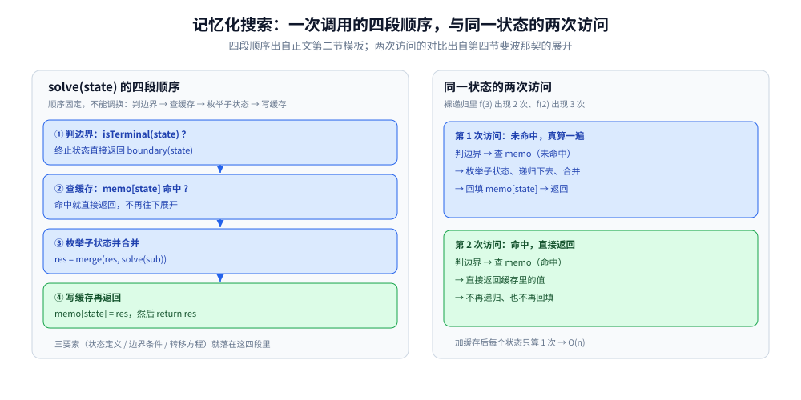
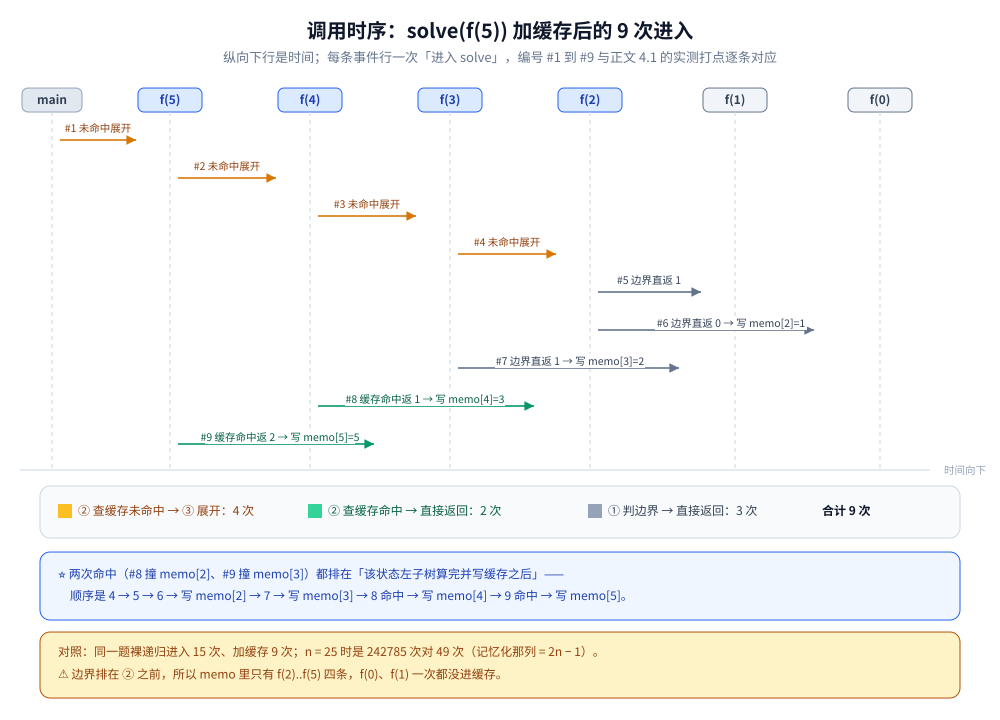

# 记忆化搜索

> 自顶向下的 DP：用递归枚举状态，遇到已算过的状态直接返回缓存 —— 它是「递推 DP」的等价形式，但更贴近自然思维。
>
> ⭐ 边界先说清：本篇讲记忆化搜索的写法、与递推 DP / 回溯 / 分治的边界。
> 递推 DP 见 [线性DP.md](线性与序列/线性DP.md)、[区间DP.md](线性与序列/区间DP.md)；
> 回溯见 [回溯模板与剪枝.md](../回溯/回溯模板与剪枝.md)。
>
> 内容整理自个人学习笔记，素材见 [素材清单](../../../素材清单.md)。复杂度口径见 [复杂度分析.md](../基础算法/复杂度分析.md)。

---

## 一、核心思想

**本节要点**：三句话 —— 从原问题递归、算过的存表、再撞上直接返回；它和递推 DP 是**同一个 DP 的两个方向**，不是第三种算法。

- **自顶向下**：从原问题出发，递归求解子问题
- **记忆化**：用一个表（数组 / 哈希）缓存已算过的状态
- **等价性**：记忆化搜索 + 递推 = 同一种 DP，只是方向不同

⭐ **判据**：**状态转移方程容易用递归写、状态数有限 → 记忆化搜索。**

---

## 二、模板

**本节要点**：四段的顺序固定 —— 先判边界、再查缓存、然后枚举子状态合并、最后写缓存返回；「三要素」就是把转移方程直接抄进递归。

```go
func solve(state State) int {
	if isTerminal(state) {
		return boundary(state) // 边界条件：终止状态直接给边界值
	}
	if v, ok := memo[state]; ok {
		return v // 命中缓存
	}
	res := initValue(state)
	for _, sub := range subStates(state) {
		res = merge(res, solve(sub)) // 从子状态合并（转移方程）
	}
	memo[state] = res // 写缓存
	return res
}
```

⭐ `State`、`memo` 与几个辅助函数（`isTerminal` / `boundary` / `initValue` / `subStates` / `merge`）都按题目实例化，模板只固定**四段的顺序**。

**三要素**：

1. **状态定义**：state 是什么
2. **边界条件**：终止状态返回什么
3. **转移方程**：如何从子状态合并



solve 的四段顺序固定为 判边界 → 查缓存 → 枚举子状态合并 → 写缓存返回，三要素就落在四段里；右栏对比同一状态「第 1 次未命中」与「第 2 次命中」两条路径，加缓存后每个状态只算 1 次。

---

## 三、与递推 DP 的对比

**本节要点**：两者是同一副转移方程的两种驱动方式 —— 递推要自己想明白遍历顺序，记忆化让递归自己找；递推全表都算，记忆化只算"从答案可达"的状态。

| 维度 | 记忆化搜索 | 递推 DP |
|---|---|---|
| 方向 | 自顶向下 | 自底向上 |
| 实现 | 递归 + 缓存 | 循环 + 数组 |
| 可读性 | ⭐ 更直观 | 需要想清楚遍历顺序 |
| 复杂度 | 只算用到的状态 | 全部状态都要算 |
| 栈深度 | 可能爆栈 | 无栈风险 |
| 适用 | 状态稀疏、转移复杂 | 状态密集、转移规律 |

⭐ **判据**：

- 状态稀疏（很多状态用不到）→ 记忆化搜索
- 状态密集、转移规律 → 递推 DP
- 递归深度可能很大 → 用递推避免爆栈

拿本目录的三篇零件对照，这笔账更具体：

- [背包问题.md](组合与树形/背包问题.md) 2.2 的「拿 / 不拿」两分支就是记忆化的原型写法；但它第三节的核心坑 —— **一维滚动的遍历方向**（0-1 逆序、完全正序）—— 在记忆化版里**不存在**：缓存各算各的格子，不就地复用同一个数组，自然没有"新值旧值互相污染"。代价是放弃了滚动，空间回不到 O(W)。
- [LCS.md](线性与序列/LCS.md) 反过来是递推更划算的例子：二维表**每一格都可能被答案用到**（状态密集），正序双重循环一趟填完，还能留表回溯（第二节）；记忆化版要额外背一个 `(i, j)` 的缓存键，省不下什么。
- [区间DP.md](线性与序列/区间DP.md) 是记忆化省脑力的典型：递推必须「按长度从小到大」填表才能不踩空格子，记忆化直接 `solve(i, j)` 递归下去，依赖顺序由调用栈自动保证。


六行对照逐条抄自第三节的对比表：方向、实现、可读性、复杂度、栈深度、适用；底部判据补上「一维滚动的方向坑在记忆化版里不存在（背包问题.md 第三节），代价是放弃滚动、空间回不到 O(W)」。

---

## 四、典型题有哪些？

**本节要点**：状态空间小、递归定义自然的题（路径计数、单词拆分、网格最长递增路径）都适合直接写成带缓存的 dfs。

| 题 | 状态 |
|---|---|
| 斐波那契 | `f(n)` |
| 爬楼梯 | `f(n)` |
| 不同路径 | `f(i, j)` |
| 单词拆分 | `f(i)` = 前 i 个字符能否拆分 |
| 分割回文串 | `f(i)` = 前 i 个字符的最少分割数 |
| 矩阵中的最长递增路径 | `f(i, j)` = 从 (i,j) 出发的最长路径 |
| 零钱兑换 | `f(amount)` |
| 正则表达式匹配 | `f(i, j)` |

```text
斐波那契的递归展开（左行）与加缓存后的实际计算量（右行）：
  f(5)                          f(5)
  ├─ f(4)                       ├─ f(4)
  │   ├─ f(3)                   │   ├─ f(3)
  │   │   ├─ f(2)               │   │   └─ f(1)
  │   │   └─ f(1)               │   └─ f(2)
  │   └─ f(2)   ← 第二次展开    │       （f(3) 的后续在缓存里，直接返回）
  └─ f(3)       ← 第三次展开
  裸递归里 f(3) 出现 2 次、f(2) 出现 3 次；加缓存后每个状态只算 1 次 → O(n)
```

⚠️ 表里两道题已有"正主"，本篇只给递归视角：**零钱兑换**是完全背包（[背包问题.md](组合与树形/背包问题.md) 第四节），**正则表达式匹配**是「前缀 vs 前缀」的二维样板（同 [LCS.md](线性与序列/LCS.md) 1.2 的状态形状）—— 它们的递推版推导在那两篇里，别在这里重做一遍。

### 4.1 实测：一次调用究竟走了哪几段？

**✅ 实测口径**：容器 `golang:1.26-alpine`，`go version go1.26.8 linux/amd64`，纯标准库、无第三方依赖；**连跑 3 遍输出逐行相同**（调用次数是确定性数据，本篇不涉及耗时统计）。把第二节的模板实例化为斐波那契：`isTerminal(n)` 取 `n <= 1`、`boundary(n)` 取 `n`、`subStates(n)` 取 `{n-1, n-2}`、`merge` 取加法，在每次进入 `solve` 时打一条事件。

```go
func solve(n int) int {
	if isTerminal(n) {              // ① 判边界：n <= 1
		return boundary(n)
	}
	if v, ok := memo[n]; ok {       // ② 查缓存
		return v
	}
	res := solve(n-1) + solve(n-2)  // ③ 枚举子状态并合并
	memo[n] = res                   // ④ 写缓存
	return res
}
```

```text
  裸递归（无缓存）f(5)：调用总次数 = 15，返回值 = 5
  按「作为子调用出现」计数：f(3) 出现 2 次、f(2) 出现 3 次

  加缓存后 f(5) 的调用序列（#N 是「进入 solve」的顺序号，退出行复用当时最新的进入号）：
    #1  进入 f(5)：① 边界否 → ② 查缓存【未命中】→ ③ 枚举子状态 f(4)、f(3) 并合并
    #2  进入 f(4)：① 边界否 → ② 查缓存【未命中】→ ③ 枚举子状态 f(3)、f(2) 并合并
    #3  进入 f(3)：① 边界否 → ② 查缓存【未命中】→ ③ 枚举子状态 f(2)、f(1) 并合并
    #4  进入 f(2)：① 边界否 → ② 查缓存【未命中】→ ③ 枚举子状态 f(1)、f(0) 并合并
    #5  进入 f(1)：① 判边界命中 → 直接返回 1（不查缓存、不写缓存）
    #6  进入 f(0)：① 判边界命中 → 直接返回 0（不查缓存、不写缓存）
    #6  退出 f(2)：④ 写缓存 memo[2] = 1 后返回
    #7  进入 f(1)：① 判边界命中 → 直接返回 1（不查缓存、不写缓存）
    #7  退出 f(3)：④ 写缓存 memo[3] = 2 后返回
    #8  进入 f(2)：① 边界否 → ② 查缓存【命中】→ 返回 1（③④ 都没执行）
    #8  退出 f(4)：④ 写缓存 memo[4] = 3 后返回
    #9  进入 f(3)：① 边界否 → ② 查缓存【命中】→ 返回 2（③④ 都没执行）
    #9  退出 f(5)：④ 写缓存 memo[5] = 5 后返回
  返回值 = 5
  统计：进入 solve 共 9 次 = 边界直返 3 次 + 缓存命中 2 次 + 未命中展开 4 次
  实际展开计算的状态 = 4 个（f(2)..f(5)），未命中展开次数与之相等 = true
  缓存里的条目 = 4 个：memo[2] = 1  memo[3] = 2  memo[4] = 3  memo[5] = 5
```

⭐ 四个读数，正好把第二节「四段顺序」坐实：

- **15 → 9**：同一个 `f(5)`，裸递归进入 15 次、加缓存只进入 9 次；
- **9 次的去向是 3 + 2 + 4**：`f(1)`、`f(0)`、`f(1)` 三次走 ① 就返回，`f(2)`、`f(3)` 两次停在 ②（命中即返回，③④ 完全没执行），剩下 4 次才是真正展开的；
- **边界状态根本不碰缓存**：`memo` 里只有 `f(2)..f(5)` 四条，**一条边界都没有** —— 因为模板把 ① 判边界排在 ② 查缓存之前；把两段顺序写反，缓存里就会多出 `f(0)`、`f(1)` 这种永远用不到的条目；
- **命中发生在「左子树算完之后」**：#8 撞上 `memo[2]`、#9 撞上 `memo[3]`，两个命中都出现在对应状态**写缓存之后** —— 这就是「无后效性 + 自顶向下」拼出来的实际效果。

把同一份代码换 `n` 再跑，两边的差距是这样分开的：

| n | 裸递归调用 | 记忆化调用 | 其中缓存命中 | 边界 + 未命中展开 |
|---|---|---|---|---|
| 5 | 15 | 9 | 2 | 3 + 4 |
| 8 | 67 | 15 | 5 | 3 + 7 |
| 10 | 177 | 19 | 7 | 3 + 9 |
| 15 | 1973 | 29 | 12 | 3 + 14 |
| 20 | 21891 | 39 | 17 | 3 + 19 |
| 25 | 242785 | 49 | 22 | 3 + 24 |

⭐ 只断言趋势：**裸递归那一列成倍涨（`15 → 242785`，约 1.6 万倍）**，**记忆化那一列每加一个 `n` 只多 2 次进入**（9、15、19、29、39、49，即 `2n − 1`），其中「未命中展开」正好是 `n − 1` —— 每个状态只算一次的承诺在数字上兑现了。⚠️ 「边界」恒为 3：`f(1)` 被 `f(2)` 和 `f(3)` 各要一次、`f(0)` 被 `f(2)` 要一次，边界不写缓存，所以这 3 次永远要重走 ①。



图怎么读：横轴是**进入 `solve` 的顺序**（#1 到 #9），每条竖线是一个状态的生命线；橙色格 = ② 未命中并展开，绿色格 = ② 命中直接返回，灰色格 = ① 判边界直返；虚线箭头是子调用去向，右侧 `memo` 栏按输出里的「退出」顺序记下四条写入。对照 #8、#9：这两格没有向下箭头，因为命中后 ③④ 都不执行。

---

## 五、与回溯的区别

**本节要点**：同一副递归骨架，分水的判据是「有没有重复子问题」—— 能缓存复用就是 DP，必须沿路径枚举所有方案就是回溯。

| 维度 | 记忆化搜索 | 回溯 |
|---|---|---|
| 重复子问题 | 缓存复用 | 不处理 |
| 求最优解 | 天然求 | 需要剪枝 |
| 求所有解 | 不适合 | ⭐ 适合 |
| 状态 | 有限、可哈希 | 路径本身 |

⭐ **判据**：**有重复子问题 → 记忆化；枚举所有方案 → 回溯。** 回溯的模板与剪枝手法见 [回溯模板与剪枝.md](../回溯/回溯模板与剪枝.md)。

⚠️ 与**分治**的边界也钉一下：子问题互不重叠时缓存毫无收益，直接分治（归并、快排）—— 这条判据在 [README.md](README.md) 第一节「重叠子问题」里已经给全，本篇不重复。

---

## 延伸追问

- **记忆化搜索和 DP 是一回事吗？** → 本质相同，只是方向不同：记忆化自顶向下，递推 DP 自底向上。⚠️ 等价的前提是状态满足无后效性（三性质见 [README.md](README.md) 第一节）。
- **记忆化搜索什么时候会慢？** → 递归调用开销大、哈希表操作频繁时；状态密集的 DP（如 LCS 全表）用循环数组更快（第三节的对照）。
- **记忆化的 key 怎么设计？** → 要能唯一确定一个状态；常见用「状态元组」编码成一个整数或结构体。⚠️ [数位DP.md](优化与高级/数位DP.md) 第三节还有一层口径：带「贴界 / 前导零」旗标的状态**不能进缓存**。
- **记忆化搜索能改成递推吗？** → 能，只要能确定状态之间的依赖顺序（拓扑序）—— [区间DP.md](线性与序列/区间DP.md) 的「按长度从小到大」就是现成的拓扑序。
- **记忆化搜索会爆栈吗？** → 会。递归深度等于状态依赖链的长度，Go 的 goroutine 栈会增长但仍有限。迭代化（如按拓扑序循环）是出路，树上的迭代后序见 [树形DP.md](组合与树形/树形DP.md) 的延伸追问。

## 关联

- [线性DP.md](线性与序列/线性DP.md) — 递推式一类的总览与速查
- [区间DP.md](线性与序列/区间DP.md) — 第三节：记忆化免掉「按长度填表」的脑力
- [背包问题.md](组合与树形/背包问题.md) — 第三节：一维滚动的方向坑在记忆化版里不存在，但滚动省下的空间也拿不回来
- [LCS.md](线性与序列/LCS.md) — 状态密集、还要留表回溯的例子：递推更划算
- [数位DP.md](优化与高级/数位DP.md) — 模板的完整落地例题（四参数 dfs）
- [回溯模板与剪枝.md](../回溯/回溯模板与剪枝.md) — 第五节的分界对象：枚举所有方案的写法
- [树形DP.md](组合与树形/树形DP.md) — 「子树天然不重叠、不需要缓存」的反面对照
- [README.md](README.md) — 动态规划导读（重叠子问题是"值不值得缓存"的判据出处）
> 反向引用（本篇被下列文档引到）：[编辑距离.md](线性与序列/编辑距离.md)、[递归与分治.md](../基础算法/递归与分治.md)
