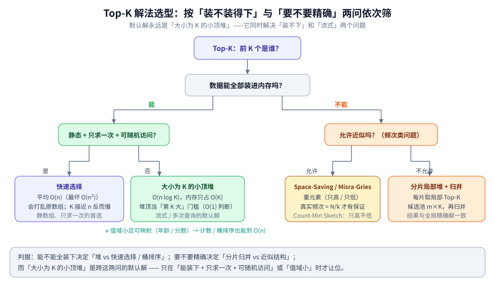
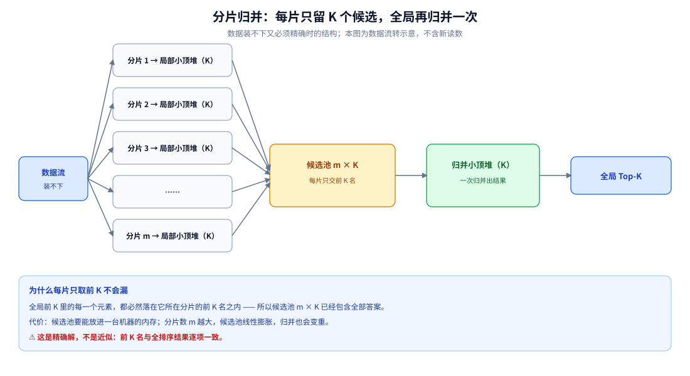

# Top-K 问题

> 覆盖：Top-K（求「前 K 个极值」与「前 K 个高频键」）这一族问题的**选型骨架** —— 默认解「大小为 K 的小顶堆」
> 为什么成立、什么时候让位给快速选择或计数 / 桶排序、海量数据下「分片局部堆 + 归并」为什么能与精确解一致，
> 以及允许近似时 Space-Saving / Misra-Gries / Count-Min Sketch 各自保什么、丢什么。
>
> 不覆盖：堆的实现细节（数组下标、上浮 / 下沉、`O(n)` 建堆、`container/heap`）见
> [堆与优先队列.md](../../数据结构/堆/堆与优先队列.md)；快速选择的分区推导见 [快速选择.md](排序/快速选择.md)；
> 计数 / 基数 / 桶排序的代码与实测见 [非比较排序.md](排序/非比较排序.md)；
> 「Top-K 该用多大的堆」与平衡树的对照见 [查找与排序对比.md](查找与排序对比.md) 第四节。
>
> 内容整理自个人学习笔记，素材见 [素材清单.md](../../../素材清单.md)。
>
> 📎 本篇实测：`golang:1.26-alpine`（Go 1.26.x），数据由固定 LCG 生成、**输出不含耗时**，
> 两遍运行**逐行相同**（`diff` 为空）。第四节与第五节的读数全部来自本机容器实跑、逐字抄录；
> ⚠️ 未实测的部分在正文中单独标注。

---

## 一、Top-K 到底在问什么？

**本节要点**：Top-K 只问「**前 K 个是谁**」——**不问它们的内部顺序**，也不问「第 K 名之外的排名」。

### 1.1 与三个近亲的边界

| 问法 | 要什么 | 规模 | 典型解法 |
|---|---|---|---|
| 排序 | 全部元素有序 | 全部 | 全排序 `O(n log n)` |
| 第 K 大 / 第 K 小 | **一个**元素 | 1 | 快速选择（平均 `O(n)`）/ 堆 |
| **Top-K** | **前 K 个**（通常无序） | K | 大小为 K 的堆 `O(n log K)` |
| Top-K 频次（Heavy Hitters） | 出现次数最多的 K 个**键** | K | 哈希计数 / 近似结构 |

⭐ **两个最容易混的点**：

- **「无序」是 Top-K 的默认语义**。堆只保证偏序，选出的 K 个内部**无序**；要「前 K 且内部有序」，得再排一次 `O(K log K)`（`K` 很小时可忽略）。
- **「Top-K 元素」与「Top-K 频次」是两个问题**。前者取最大的 K 个**数**，后者统计「谁出现得最多」—— 后者在流式 / 海量场景常改用概率结构（见第五节）。

### 1.2 K 的两种量级决定选型

| K 的量级 | 说明 | 首选 |
|---|---|---|
| `K ≪ n`（典型） | 排行榜、推荐召回截断 | 大小为 K 的堆 |
| `K ≈ n` | 「取前 90%」这类 | **直接全排序**更简单 —— 堆的 `log K` 已接近 `log n`，还多了维护成本 |

---



这张决策树是第一节到第五节的**总纲**：先问「数据能不能全装进内存」，再问「要不要精确」，两问定下四类解法；中间那格「大小为 K 的小顶堆」是跨两问的默认解。

---

## 二、为什么「大小为 K 的小顶堆」是默认解？

**本节要点**：`O(n log K)` 相比全排序 `O(n log n)` 的价值**不只是快**，更在于**内存从 `O(n)` 降到 `O(K)`** —— 数据是流、根本装不下时，堆是唯一能做的。

### 2.1 一个反直觉的选型：求最大，却用最小堆

⚠️ 求**最大**的 K 个，用的却是**小顶堆**：

- 堆顶是「当前 K 个候选里**最小**的那个」，也就是**当前的第 K 大**；
- 新元素 `v` 到来时**只和堆顶比一次**（`O(1)`）：`v > 堆顶` 才够格；
- 够格就替换堆顶并下沉（`O(log K)`）。

⭐ **堆顶要当「门槛」用，所以门槛必须是当前候选里最小的那个**。若改用大顶堆，堆顶是最大值，「够不够格进来」就得把 K 个元素扫一遍 —— 这正是「求最大用最小堆」的来处。完整推导与 `container/heap` 用法见 [堆与优先队列.md](../../数据结构/堆/堆与优先队列.md) 第七节。

### 2.2 为什么「内存只占 K」才是关键

| 方案 | 时间 | 内存 | 能流式吗 | 拿到什么 |
|---|---|---|---|---|
| 全排序取前 K | `O(n log n)` | `O(n)`（必须装下全部） | ❌ | 前 K，**内部有序** |
| **大小为 K 的小顶堆** | **`O(n log K)`** | **`O(K)`** | ✅ | 前 K，内部无序 |
| 快速选择（分区） | 平均 `O(n)` | `O(1)`~`O(log n)` | ❌ 需随机访问全量 | 前 K 的集合 |

⭐ 本仓 [堆与优先队列.md](../../数据结构/堆/堆与优先队列.md) 第七节的实测：`n = 100` 万、`K = 10` 时，全排序 **295 ms**、大小为 K 的小顶堆 **1 ms**（结果逐项一致）—— 差两个数量级，因为 `log n ≈ 20` 而 `log K ≈ 3.3`，且排序要动整个数组、堆只维护 K 个元素。

⚠️ **比耗时更关键的是内存**：数据是日志 / 传感器 / 消息流时，全排序要求「先把 n 条全读进来」，而堆只保留 K 个 —— 这已经不是快慢问题，而是**能不能做**的问题。

### 2.3 什么时候「不该」用堆

- **`K ≈ n`**：直接全排序更简单，堆没有优势；
- **`K = 1`**：一个变量遍历一遍即可（`O(n)`、`O(1)` 空间），上堆纯属浪费；
- **静态数组 + 只求一次 + 可随机访问**：快速选择平均 `O(n)` 更快（见第三节）。

---

## 三、内存装得下、还能随机访问时，有没有更快的路？

**本节要点**：**静态数组 + 只求一次**时，快速选择平均 `O(n)` 比 `O(n log K)` 更快；**键值域小**时，计数 / 桶排序能到线性。

### 3.1 快速选择：借分区只递归一侧

快速选择（quickselect）用快排的 `partition`，但**只递归「含第 K 名的那一侧」**，所以平均 `O(n)`、最坏 `O(n²)`（随机枢轴可把最坏概率压到极低）。

- ⚠️ 它**要求整个数组可随机访问**，并且**会打乱原数组**；
- ✅ 只求一次第 K 大 / 前 K 个时，它是比堆更快的那条路。
完整推导见 [快速选择.md](排序/快速选择.md)。

### 3.2 计数 / 桶排序：值域受限时的线性解

当元素值域 `k` 不大（年龄、分数、状态、IP 段）时，**计数排序**用「值当数组下标」直接做到 `O(n + k)`；**桶排序**把值域切成若干区间、桶内各排各的。

- ⚠️ 前提是**值域不能远大于 n**，且浮点 / 变长键要先做序保持的映射；
- 取 Top-K 时只需从**最高位桶**往低扫，不必排完整个数据集。
代码与实测见 [非比较排序.md](排序/非比较排序.md) 第五节。

### 3.3 三条路的判据

| 解法 | 时间 | 前提 | 会打乱原数组 |
|---|---|---|---|
| 大小为 K 的堆 | `O(n log K)` | 无（可流式、可多次查询） | ❌ |
| 快速选择 | 平均 `O(n)` | 静态 + 可随机访问 + 只求一次 | ✅ |
| 计数 / 桶排序 | `O(n)` | 值域小且可映射 | 视实现 |

---

## 四、数据装不下、又必须精确，怎么算？

**本节要点**：**每个分片各取局部 Top-K，再把「分片数 × K」个候选归并** —— 全局只需一次 `O(m·K·log(m·K))` 的归并，结果与全局精确解**逐项一致**。

### 4.1 分片局部堆 + 归并

```text
数据流 → 分片1 ─ 局部小顶堆(K) ┐
         分片2 ─ 局部小顶堆(K) ┤
         分片3 ─ 局部小顶堆(K) ┼→ 候选池 (m×K) → 归并小顶堆(K) → 全局 Top-K
         ...                    ┤
         分片m ─ 局部小顶堆(K) ┘
```

⭐ **正确性的根据**：全局前 K 名中的每一个，必然落在**它所在分片的前 K 名**之内。所以「每片只取前 K」不会漏掉任何全局候选 —— 这是分片可行的关键，而不是近似。

### 4.2 实测：分片归并 vs 全局精确（本机容器实跑）

`n = 100` 万、`K = 100`、分片数 `m = 8`（数据由固定 LCG 生成）：

```text
===== 实验一：分布式（分片）Top-K vs 全局精确 =====
n = 1000000，K = 100，分片数 = 8，每片局部 Top-K = 100，归并候选池 = 800
全局精确（全排序）Top-10 : [9999998 9999986 9999984 9999979 9999964 9999963 9999959 9999957 9999947 9999947]
分片归并（局部堆）Top-10 : [9999998 9999986 9999984 9999979 9999964 9999963 9999959 9999957 9999947 9999947]
前 100 名逐项一致           : true
```

⭐ 读数：分片归并的前 100 名与「全排序取前 100」**逐项一致**（`true`）。归并阶段只处理 `m × K = 800` 个候选，而不是 100 万条原始数据。

### 4.3 把分片归并画成数据流

4.1 的 ASCII 图换成结构图后，三个环节的边界更清楚：**每个分片只在自己的数据上维护大小为 K 的小顶堆** → **候选池收拢 m × K 个元素** → **归并小顶堆再选出全局前 K**。注意候选池不是「抽样」，它包含每片的全部前 K 名，所以结果是精确的。

⭐ 代价也在这张图上：**候选池随分片数线性膨胀**，分片越多归并越重。这正是 4.2 的实测里归并阶段只处理 `m × K` 个候选、而不是原始数据量的原因。



图怎么读：从左到右是「数据流 → 各分片局部小顶堆 → 候选池 → 归并小顶堆 → 全局 Top-K」；下方蓝框写的是每片只取前 K 的正确性根据与代价，**候选池包含全部答案，不是近似**。

---

## 五、允许近似呢？（Top-K 频次 / 重元素）

**本节要点**：当问题是「**哪些元素出现得最多**」且允许误差时，**固定内存的结构**能把 `O(键域)` 的精确计数表压到 `O(k)` —— 代价是**误差方向固定**，且只保证「超过某条线的重元素一定被找到」。

### 5.1 三种结构的口径

| 结构 | 回答什么 | 误差方向 | 保证 |
|---|---|---|---|
| **Space-Saving** | 重元素 + 频次估计 | **只高不低** | 真实频次 `> N/k` 的必被报告 |
| **Misra-Gries** | 重元素 + 频次估计 | **只低不高** | 真实频次偏差 `≤ N/k` |
| **Count-Min Sketch** | 任意键的频次估计（不维护候选集） | **只高不低** | 误差 `≤ εN`，空间 `O(1/ε)` |

⭐ 记忆点：**Space-Saving 与 CMS 高估、Misra-Gries 低估**；要「谁最频繁」（自带候选集）用 Space-Saving，要「某个键大概多少次」用 CMS。三者与 [基数与频率估计.md](../../数据结构/概率与统计/基数与频率估计.md) 里的 HyperLogLog / 布隆过滤器同属「用空间换近似」这一族。

### 5.2 实测：k = 20 时两个近似结构各丢 1 个（本机容器实跑）

流长 100 万、键域 1 万、10 个热键（权重递减），计数器 `k = 20`：

```text
===== 实验二：近似重元素（Space-Saving / Misra-Gries）vs 精确计数 =====
流长 = 1000000，键域 = 10000，热键 10 个（权重 [100 80 60 40 30 25 20 15 10 5]），其余为冷键均匀
计数器数 k = 20
精确 Top-10（键:次数）   : 0:207111 1:166667 2:124778 3:83172 4:62365 5:51693 6:41518 7:31200 8:20809 9:10457
Space-Saving 报出 Top-10 : 0:207111 1:166667 2:124778 3:83172 4:62365 5:51693 6:41518 7:31200 8:20812 102:19154
Space-Saving 命中精确 Top-10 : 9/10（计数只高不低，最大高估 = 3）
Misra-Gries 命中精确 Top-10  : 9/10（计数只低不高，最大低估 = 17557，漏掉 1 个）
Misra-Gries 保留键数         : 11（≤ k = 20）
```

⭐ **关键读数**：`N/k = 1000000 / 20 = 50000`。按理论，**只有真实频次 > 50000 的热键才被保证找到** —— 实测里只有前 8 个（207111 … 31200）过线，第 9、10 名（20809、10457）落在保证线外，于是 **Space-Saving 与 Misra-Gries 各丢 1 个**。

- Space-Saving 甚至把冷键 `102` 抬到 `19154`（高估把长尾键顶进了 Top-10）—— 这正是「只高不低」在长尾上的副作用；
- Misra-Gries 保留键数 `11 ≤ k = 20`，且计数全线低估（最大低估 17557）。

⚠️ **这组读数的意思是**：「近似 Top-K」不是免费的 —— 想稳定拿到第 9、10 名，要么把 `k` 开大到让 `N/k` 低于它们的真实频次，要么干脆用精确哈希计数（内存换准确）。

---

## 六、应用场景

**本节要点**：Top-K 的工程落点集中在四类 —— 流式榜单、静态截断、海量分片、允许误差的频次统计。

| 现象 / 需求 | 先看什么 | 本仓篇目 |
|---|---|---|
| 「热榜 / 热搜，每来一条更新前 K」 | 流式 → 大小为 K 的小顶堆 | [堆与优先队列.md](../../数据结构/堆/堆与优先队列.md) 第七节；工程上换成 Redis ZSET 的实时榜见 [排行榜设计.md](../../../04-架构与系统/系统设计/社交互动系统/排行榜设计.md) 第一节 |
| 「给一份数据集取前 100 个最大数」 | 静态可随机访问 → 快速选择 | [快速选择.md](排序/快速选择.md) |
| 「按分数分桶、取高分段」 | 值域受限 → 计数 / 桶排序 | [非比较排序.md](排序/非比较排序.md) 第五节 |
| 「上百亿条日志找 Top-100 来源 IP」 | 海量 → 分片局部堆 + 归并（第四节） | [海量数据存储设计.md](../../../04-架构与系统/系统设计/海量数据存储设计.md) |
| 「找出访问最频繁的 key」（允许误差） | 近似 → Space-Saving / CMS | [基数与频率估计.md](../../数据结构/概率与统计/基数与频率估计.md) |
| 「推荐召回后截断到 Top-K」 | 流式截断 → 大小为 K 的堆，再排序 | [堆与优先队列.md](../../数据结构/堆/堆与优先队列.md) 8.2；多路召回结果的合并与截断见 [召回与排序.md](../../../04-架构与系统/系统设计/推荐系统/召回与排序.md) 1.2 |

---

## 七、具体使用

**本节要点**：三种形态各给一段最小 Go 骨架 —— 流式 Top-K、分片归并、近似重元素。

### 7.1 大小为 K 的小顶堆（流式 Top-K 的最简形态）

```go
// topK：遍历一遍，维护大小为 K 的小顶堆 —— 内存只占 O(K)，天然可流式
func topK(nums []int, k int) []int {
	h := make(IntHeap, 0, k)
	for _, v := range nums {
		if h.Len() < k {
			heap.Push(&h, v)
		} else if v > h[0] { // 只和堆顶（当前第 K 大）比一次，O(1) 门槛判断
			h[0] = v
			heap.Fix(&h, 0) // O(log K) 下沉
		}
	}
	out := []int(h)
	sort.Sort(sort.Reverse(sort.IntSlice(out))) // 要内部有序再排一次 O(K log K)
	return out
}
```

`IntHeap` 的五个方法与 `heap.Fix` 的用法见 [堆与优先队列.md](../../数据结构/堆/堆与优先队列.md) 4.1 / 4.3。

### 7.2 分片归并（分布式 Top-K）

```go
// 每片先出局部 Top-K，再归并 m×K 个候选 —— 即第四节的实测做法
var pool []int
for _, shard := range shards {
	pool = append(pool, topK(shard, k)...) // 每片贡献 K 个，共 m×K
}
merged := topK(pool, k) // 归并阶段只处理 m×K 个元素，不是全量
```

### 7.3 Space-Saving（近似重元素）

```go
// k 个计数器：满了就把「计数最小」的那个替换掉，新键继承旧计数 +1（只高不低的来源）
type ent struct{ key, cnt int }
idx := map[int]int{}
es := make([]ent, 0, k)
for _, x := range stream {
	if p, ok := idx[x]; ok { // 已跟踪：直接累加
		es[p].cnt++
		continue
	}
	if len(es) < k { // 还有空槽：占一个
		idx[x] = len(es)
		es = append(es, ent{x, 1})
		continue
	}
	m := 0 // 满了：淘汰计数最小的槽
	for i := 1; i < len(es); i++ {
		if es[i].cnt < es[m].cnt {
			m = i
		}
	}
	delete(idx, es[m].key)
	es[m] = ent{x, es[m].cnt + 1} // ⚠️ 新键的估计从旧计数起跳，所以只会高估
	idx[x] = m
}
```

---

## 延伸追问

- **Top-K 为什么用大小为 K 的小顶堆？** → 堆顶是「当前第 K 大」的门槛，新元素只比一次（`O(1)`）就知道够不够格；用大顶堆则要扫遍 K 个元素才能判断。
- **堆和快速选择怎么选？** → 静态数组 + 只求一次 + 可随机访问 → 快速选择平均 `O(n)`；流式 / 要多次查询 / 根本装不下 → 大小为 K 的堆。
- **海量数据（上百亿条）怎么取 Top-K？** → 分区各取局部 Top-K，候选池只有 `m×K`，再归并。正确性靠「全局前 K 必在各片前 K 之内」，不是近似（第四节实测与全局精确解逐项一致）。
- **近似 Top-K 能不能用？** → 能，但要看理论保证线：真实频次 `> N/k` 的元素才必被找到。实测 `k = 20`、`N = 100` 万时 `N/k = 5` 万，第 9、10 名就丢了。
- **要「Top-K 且内部有序」怎么办？** → 堆只能先选出 K 个、再排一次 `O(K log K)`；若下游还要**按分数范围查询 / 动态删除**，则换平衡树（见 [查找与排序对比.md](查找与排序对比.md) 第四节）。
- **`K = 1` 也要上堆吗？** → 不用。一个变量遍历一遍就是 `O(n)`、`O(1)` 空间，堆反而更慢。

---

## 关联

- **上游/总纲**：[堆与优先队列.md](../../数据结构/堆/堆与优先队列.md) — 大小为 K 的堆的实现层：上浮 / 下沉、`O(n)` 建堆、`container/heap` 与第七节 Top-K 实测
- **上游/总纲**：[查找与排序对比.md](查找与排序对比.md) — 第四节：Top-K 的堆 vs 全排序 vs 平衡树的选型判据
- **对照/互补**：[快速选择.md](排序/快速选择.md) — 静态数组第 K 大的平均 `O(n)` 路线（流式才轮到堆）
- **对照/互补**：[非比较排序.md](排序/非比较排序.md) — 计数 / 基数 / 桶排序：值域受限时的线性解
- **对照/互补**：[基数与频率估计.md](../../数据结构/概率与统计/基数与频率估计.md) — Count-Min Sketch / Space-Saving / HyperLogLog 三种概率结构
- **下游机制**：[海量数据存储设计.md](../../../04-架构与系统/系统设计/海量数据存储设计.md) — 分片与集群：分布式 Top-K 的存储层前提
> 反向引用（本篇被下列文档引到）：[比较排序.md](排序/比较排序.md)
