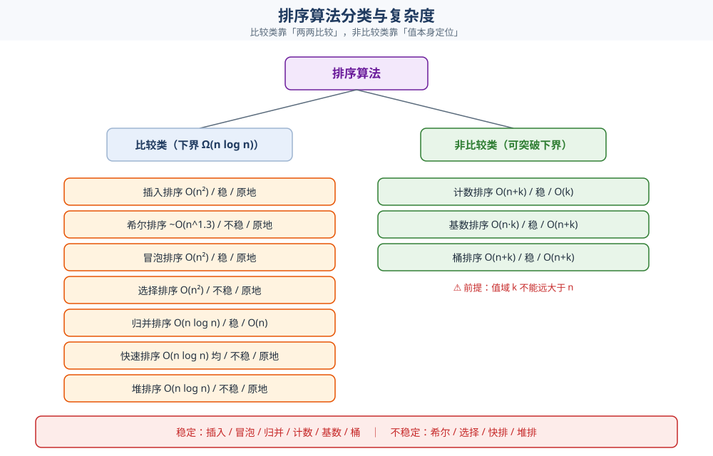

# 排序

> 本目录（`算法/基础算法/排序/`）收**排序族的零件篇**：比较类七种见 [比较排序.md](比较排序.md)、
> 非比较类三种见 [非比较排序.md](非比较排序.md)、借分区求第 K 小见 [快速选择.md](快速选择.md)。
>
> 本篇是**入口总纲** —— 回答「排序分几类、十种算法按什么选、稳定性和最坏退化怎么判」，
> 并给出**一张对比表**（复杂度 / 原地 / 稳定性）。各算法的推导、代码与实测不在这里重复；
> 工程选型（标准库为什么各选不同、Top-K 的堆怎么选）见上一层的 [查找与排序对比.md](../查找与排序对比.md)。
>
> 内容整理自个人学习笔记，素材见 [素材清单](../../../../素材清单.md)。复杂度口径见 [复杂度分析.md](../复杂度分析.md)。

---

## 一、核心思想

**本节要点**：排序族只有**一条分界线** —— 定序到底**靠不靠元素之间的比较**。比较类守住 `Ω(n log n)` 下界；非比较类绕开比较、直接拿**值本身**定位，换来线性时间，代价是**值域必须可控**。

| 族 | 定序依据 | 下界 | 成立前提 | 零件篇 |
|---|---|---|---|---|
| **比较类** | 元素两两比较 | `Ω(n log n)` | 元素只要能比大小 | [比较排序.md](比较排序.md) |
| **非比较类** | 值本身（值域做下标 / 按位分解） | 可到 `O(n + k)` | ⚠️ **值域可控**（`k ≈ n`） | [非比较排序.md](非比较排序.md) |



⭐ **一句话**：**比较类买「通用」，非比较类买「线性」** —— 值域一旦失控（ID 号、浮点、变长键），非比较类立刻不划算。

---

## 二、适用条件

**本节要点**：排序的「适用条件」其实是**三个约束** —— 要不要稳定、能不能接受最坏退化、数据装不装得下内存。三者定了，方案也就定了。

### 2.1 一张总对比表

| 算法 | 族 | 最好 | 平均 | 最坏 | 额外空间 | 原地 | 稳定 |
|---|---|---|---|---|---|---|---|
| 插入排序 | 比较 | `O(n)` | `O(n²)` | `O(n²)` | `O(1)` | ✅ | ✅ |
| 希尔排序 | 比较 | `O(n log n)` | `~O(n^1.3)` | `O(n log² n)` | `O(1)` | ✅ | ❌ |
| 冒泡排序 | 比较 | `O(n)` | `O(n²)` | `O(n²)` | `O(1)` | ✅ | ✅ |
| 选择排序 | 比较 | `O(n²)` | `O(n²)` | `O(n²)` | `O(1)` | ✅ | ❌ |
| 归并排序 | 比较 | `O(n log n)` | `O(n log n)` | `O(n log n)` | `O(n)` | ❌ | ✅ |
| 快速排序 | 比较 | `O(n log n)` | `O(n log n)` | `O(n²)` | `O(log n)` | ≈✅ | ❌ |
| 堆排序 | 比较 | `O(n log n)` | `O(n log n)` | `O(n log n)` | `O(1)` | ✅ | ❌ |
| 计数排序 | 非比较 | `O(n + k)` | `O(n + k)` | `O(n + k)` | `O(k)` | ❌ | ✅ |
| 基数排序 | 非比较 | `O(d(n + k))` | `O(d(n + k))` | `O(d(n + k))` | `O(n + k)` | ❌ | ✅ |
| 桶排序 | 非比较 | `O(n + k)` | `O(n + k)` | `O(n²)` | `O(n + k)` | ❌ | ✅ |

> 表中 `k` 是值域或桶数，`d` 是位数。希尔排序的复杂度**依赖增量序列**，表中给的是常见口径。
>
> ⚠️ **「原地」要说得精确**：快排的 `O(log n)` 是**递归栈**，严格说不算原地；一旦划分退化，栈深可达 `O(n)`（见 [复杂度分析.md](../复杂度分析.md) 第六节）。这在「小栈线程 / 嵌入式」里是真实故障源。

### 2.2 稳定性：逐算法说清「为什么稳 / 为什么不稳」

| 算法 | 稳定 | 为什么 |
|---|---|---|
| **插入排序** | ✅ | `a[j] > v` 才移动，相等不动 → 相对次序不变 |
| **希尔排序** | ❌ | 跨 `gap` 的分组交换会打乱相等元素的次序 |
| **冒泡排序** | ✅ | 只在 `a[j] > a[j+1]` 时交换，相等不换 |
| **选择排序** | ❌ | 长距离交换可能跨过相等元素 |
| **归并排序** | ✅ | merge 时 `a[i] <= a[j]` 优先取左段 |
| **快速排序** | ❌ | 分区交换是长距离的，相等元素会被跨越 |
| **堆排序** | ❌ | 堆顶与末尾的长距离交换 |
| **计数排序** | ✅ | 按值倒出，同值按原顺序（需设计好写回方式） |
| **基数排序** | ✅ | 每轮用稳定排序 + 从后往前写回 |
| **桶排序** | ✅ | 桶内用稳定排序、桶间按值域有序 |

⭐ **记忆口径（比背结论可靠）**：

1. **凡是「相邻交换」的都稳定**（插入、冒泡）；
2. **凡是「长距离交换」的都不稳定**（选择、快排、堆排）；
3. **归并稳定是因为它不交换，只做有序合并**；
4. **希尔不稳定是因为它跨步交换**（介于相邻与长距离之间）。

⚠️ **稳定性是对下游的承诺，不是学术性质**：多关键字排序（先按 A 排、再按 B 排）要求第二轮稳定，否则第一轮的次序会被打乱。本机实测保序 3 个、不保序 5 个，逐算法读数见 [比较排序.md](比较排序.md) 第五节。

---

## 三、解题模板

**本节要点**：三步 —— **先定三个约束，再选族，最后按数据形态选算法**。跳过第一步直接背算法名，是排序选型翻车的根源。

| 步骤 | 问什么 | 定什么 |
|---|---|---|
| **1. 定约束** | 要稳定吗？能接受最坏退化吗？装得下内存吗？ | 把候选压到一两种 |
| **2. 选族** | 值域可控吗（`k ≈ n`）？ | 可控 → 非比较类；否则 → 比较类 |
| **3. 选算法** | 数据已有序吗？重复多吗？要第 K 小吗？ | 具体算法 + 防护措施（见下） |

三条约束各自的落点：

| 约束 | 满足它的选择 | 代价 |
|---|---|---|
| **要稳定** | 归并 / 插入 / 冒泡 / 计数 / 基数 / 桶（或库里的稳定版：Go `sort.SliceStable`、Java `Arrays.sort(Object[])`） | 归并多 `O(n)` 空间；库函数稳定版通常更慢 |
| **要最坏不退化** | 归并 / 堆排（都是 `O(n log n)` 最坏） | 归并费空间，堆排常数大、缓存不友好 |
| **要原地 / 省内存** | 堆排、插入（小数组）、快排（≈原地） | 快排有 `O(log n)` 栈且最坏退化 |
| **要线性** | 计数 / 基数 / 桶 | ⚠️ 值域必须可控 |

⭐ **决策树（第 2、3 步展开）**：

```text
要排序 / 要第 K / 要 Top-K
  ├─ 只是「排个序」→ 用标准库（Go slices.Sort / Java Arrays.sort）
  │     └─ 要稳定 → Go sort.SliceStable / Java Arrays.sort(Object[])   [../查找与排序对比.md]
  ├─ 值域可控吗（k ≈ n）？
  │     ├─ 是 → 非比较类：整数小值域→计数、定长键→基数、分布均匀→桶   [非比较排序.md]
  │     └─ 否 → 比较类（默认快排族）
  ├─ 输入可能已有序 / 有大量重复？
  │     ├─ 已有序 → ⚠️ 绝不固定取首尾枢轴（三数取中 / 随机化）
  │     └─ 大量重复 → 三路划分                                        [比较排序.md]
  ├─ 要稳定 + 最坏有保证 → 归并（代价 O(n) 空间）
  ├─ 要原地 + 最坏有保证 → 堆排
  └─ 只求第 K 小（静态可随机访问）→ 快速选择（平均 O(n)）             [快速选择.md]
        └─ 流式 Top-K → 大小为 K 的堆；动态第 K 大 → 平衡树
```

---

## 四、经典问题

**本节要点**：下表按「问题形状」列出 —— 每行给算法与落点，可逐条对照零件篇的推导与实测。

| 问题 | 关键算法 | 在哪 |
|---|---|---|
| **一般排序（工程起见）** | 标准库的混合排序（Timsort / introsort / pdqsort） | [查找与排序对比.md](../查找与排序对比.md) |
| **小数组 / 近乎有序** | 插入排序（自适应到 `O(n)`） | [比较排序.md](比较排序.md) |
| **要稳定 + 最坏有保证** | 归并排序 | [比较排序.md](比较排序.md) |
| **原地 + 平均最快** | 快速排序（三数取中 / 随机枢轴；重复多走三路划分） | [比较排序.md](比较排序.md) |
| **要原地 + 最坏有保证** | 堆排序 | [比较排序.md](比较排序.md) |
| **小值域整数**（年龄 / 分数 / 状态码） | 计数排序 | [非比较排序.md](非比较排序.md) |
| **定长键**（整数 / 定长字符串） | 基数排序（LSD，逐位稳定计数排序） | [非比较排序.md](非比较排序.md) |
| **值域均匀的浮点 / 大整数** | 桶排序 | [非比较排序.md](非比较排序.md) |
| **静态数组求第 K 小 / 中位数** | 快速选择（平均 `O(n)`） | [快速选择.md](快速选择.md) |
| **流式 Top-K** | 大小为 `K` 的小顶堆 | [Top-K问题.md](../Top-K问题.md) |

---

## 五、正确性证明

**本节要点**：三类排序的证明工具**各不相同** —— 简单排序用**循环不变式**、分治类用**归纳 + 划分性质**、非比较类用**计数与前缀和**。

| 算法 | 工具 | 核心论据 |
|---|---|---|
| 插入 | 循环不变式 | 第 `i` 轮开始前 `[0, i)` 已有序；把 `a[i]` 插进去，区间扩大到 `[0, i+1)` 仍有序 |
| 冒泡 | 循环不变式 | 第 `i` 轮结束 ⇒ **最大的 `i+1` 个元素已就位**在尾部 |
| 选择 | 循环不变式 | 第 `i` 轮开始前 `[0, i)` 已装全局最小的 `i` 个 |
| 归并 | 数学归纳 | 递归正确 ⇒ 两个有序段；`a[i] <= a[j]` 取左段 ⇒ 合并后有序**且稳定** |
| 快排 | 划分性质 + 归纳 | 分区后 `≤ pivot` 全在 `p` 左侧、`≥ pivot` 全在右侧，且 `p` 已归位 ⇒ 递归两侧即完成 |
| 堆排 | 循环不变式 | 建堆后每个节点都 ≥ 孩子；每轮把堆顶换到末尾再下沉 ⇒ **已就位区**单调扩大 |
| 计数 | 计数 | 每个值被连续写进它的计数区间 ⇒ 输出按值有序 |
| 基数 | 归纳（按位） | 第 `d` 轮后「低 `d` 位」整体有序；**每轮稳定**是这步归纳成立的前提 |
| 桶 | 分桶 + 桶内有序 | 值域的单调划分 ⇒ 桶间有序；桶内有序 ⇒ 整体有序 |

⚠️ **基数排序的归纳有一个不能省的前提**：如果第 `k` 轮不稳定，第 `k-1` 轮确定的高低关系就被打乱，归纳直接断掉——这也是「基数排序必须稳定」的证明来源，不只是经验规则。

---

## 六、常见陷阱

**本节要点**：排序的坑**几乎都藏在「最坏输入」和「静默失效」上** —— 随机数据上测不出来，线上来一批特定数据才炸。

| 陷阱 | 症状 | 怎么避免 |
|---|---|---|
| **快排固定取首尾枢轴 + 已排序输入** | 退化成 `O(n²)`（实测 `n=4000` 比较 7 998 000 次），**随机数据上完全正常** | 三数取中 / 随机枢轴 / 深度上限转堆排（[比较排序.md](比较排序.md)） |
| **全等数组 + Lomuto** | 每层只切下 1 个元素，同样退化 `O(n²)` | 三路划分把 `== pivot` 整段一次归位 |
| **稳定性验证做成假阳性** | 把 `key` 与 `seq` 编进同一个整数再比较 —— 连不稳定的算法也「看起来稳定」 | 只按 `key` 比较，`seq` 单独检查保序性 |
| **把「原地」当成「空间 `O(1)`」** | 递归版快排被当原地，栈深退化到 `O(n)` 时不设防 | 按 `O(log n)` 栈预算，或改迭代版 |
| **计数排序的 `k` 当成 `n`** | 值域远大于 `n`（如 ID 号）时 `O(k)` 的空间与初始化吞掉全部收益 | 先确认 `k ≈ n` 是否成立 |
| **基数排序某一轮用了不稳定排序** | 上一轮排好的高位顺序被悄悄打乱，**结果错但不报错** | 每轮都用稳定排序 + **从后往前**写回 |
| **桶排序遇到分布倾斜** | 元素全挤进一个桶，退化成桶内排序的 `O(n²)` | 值域均匀才用桶，否则回比较类 |
| **以为 Hoare 分区稳定** | 相等元素被均分到两侧看似无害，递归时仍会跨元素交换 | 稳定性只看「有没有长距离交换」，Hoare 一样不稳（[比较排序.md](比较排序.md)） |
| **多关键字排序第二轮用了不稳定算法** | 第一轮排好的次序被打乱，且**不报错** | 先排次要键、再用**稳定**排序排主键（基数排序的同一原理） |

---

## 七、与其他思想对比

**本节要点**：排序是其他所有套路的**前置步骤** —— 二分要「有序」、贪心要「按某个键排」、双指针要「有序才能单调排除」、Top-K 是「排序的降级版」。

### 排序 vs 查找

| | 排序 | 查找 |
|---|---|---|
| 目的 | 把**全部**元素按序安置 | 只确定**某个值**的位置 / 是否存在 |
| 最低代价 | `Ω(n log n)`（比较模型） | 有序数组上 `O(log n)`，无序只能 `O(n)` |
| 关系 | **排序是二分的前置**：一次 `O(n log n)` 换多次 `O(log n)` 查询划算 | [二分查找.md](../查找/二分查找.md)、[查找与排序对比.md](../查找与排序对比.md) |

### 排序 vs 分治

归并与快排**就是分治的两个样板**：归并的重心在「合」（`merge`），快排的重心在「分」（`partition`）。分治「必须能合并 / 必须能划分」的判据见 [递归与分治.md](../递归与分治.md)，本篇只讲这两处的实现与复杂度。

### 排序 vs 堆与快速选择

| 需求 | 用排序 | 用堆 | 用快速选择 |
|---|---|---|---|
| 全序 | ✅ 必须 | ❌ 只给我最值 | ❌ 只给我第 K 个 |
| 第 K 小（静态数组） | `O(n log n)` | `O(n log k)` | ⭐ **平均 `O(n)`** |
| 流式 Top-K | ❌ 装不下 | ⭐ `O(k)` 内存 | ❌ 需要随机访问 |
| 会打乱原数组 | 视算法 | 否 | ✅ 会 |

⭐ **判据**：**只要「部分有序」就够，就别付全排序的代价** —— 这是堆与快速选择存在的全部理由（[快速选择.md](快速选择.md)、[Top-K问题.md](../Top-K问题.md)）。

### 排序 vs 贪心

活动选择按**结束时间**排序、Kruskal 按**边权**排序、霍夫曼按**频率**排序 —— 排序在这些贪心里**只是铺垫**：它把「选哪个」变成「扫一遍按顺序选」，但**贪心选择性质本身不由排序提供**。排序作为前置的三种姿态见 [活动选择.md](../../贪心/活动选择.md)、[Kruskal.md](../../图论算法/最小生成树/Kruskal.md)、[霍夫曼编码.md](../../贪心/霍夫曼编码.md)。

---

## 关联

- [比较排序.md](比较排序.md) — 比较类七种的原理、代码与本机实测（快排最坏 / 稳定性验证 / 耗时对照）
- [非比较排序.md](非比较排序.md) — 计数 / 基数 / 桶：突破下界的依据、失效边界与实测
- [快速选择.md](快速选择.md) — 借分区求第 K 小，平均 `O(n)`
- [查找与排序对比.md](../查找与排序对比.md) — **选型层**：工程怎么选、标准库为什么各选不同、Top-K 的堆怎么选
- [递归与分治.md](../递归与分治.md) — 归并 / 快排的**分治方法论**：分-治-合、为什么必须能合并
- [复杂度分析.md](../复杂度分析.md) — 复杂度口径、摊还、递归树与主定理、稳定性与空间代价
- [Top-K问题.md](../Top-K问题.md) — 取前 K 个的横切选型总纲：堆 / 快速选择 / 计数排序 / 分片归并 / 近似结构
- [README.md](../../README.md) — 算法目录总导读（本目录在其中的位置与收录门槛）
- [素材清单.md](../../../../素材清单.md) — 素材来源登记
