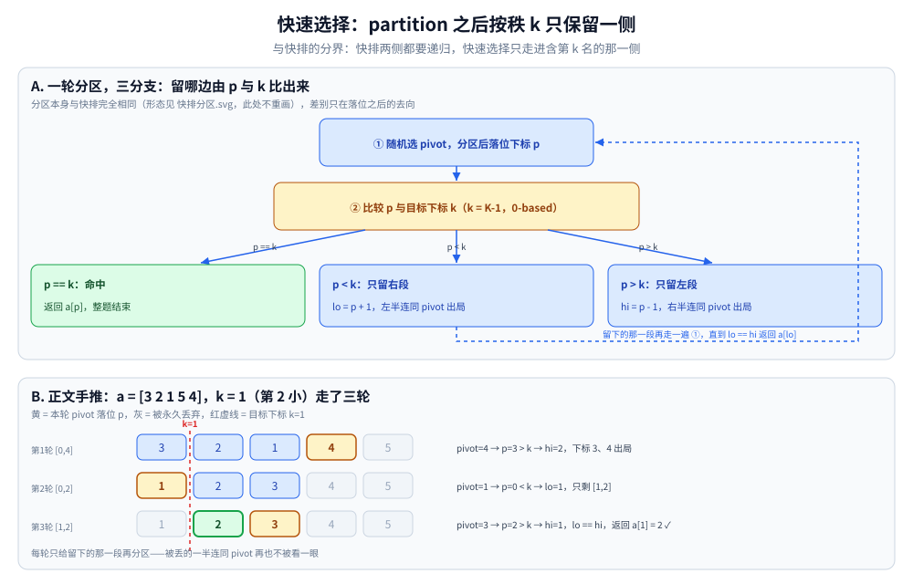
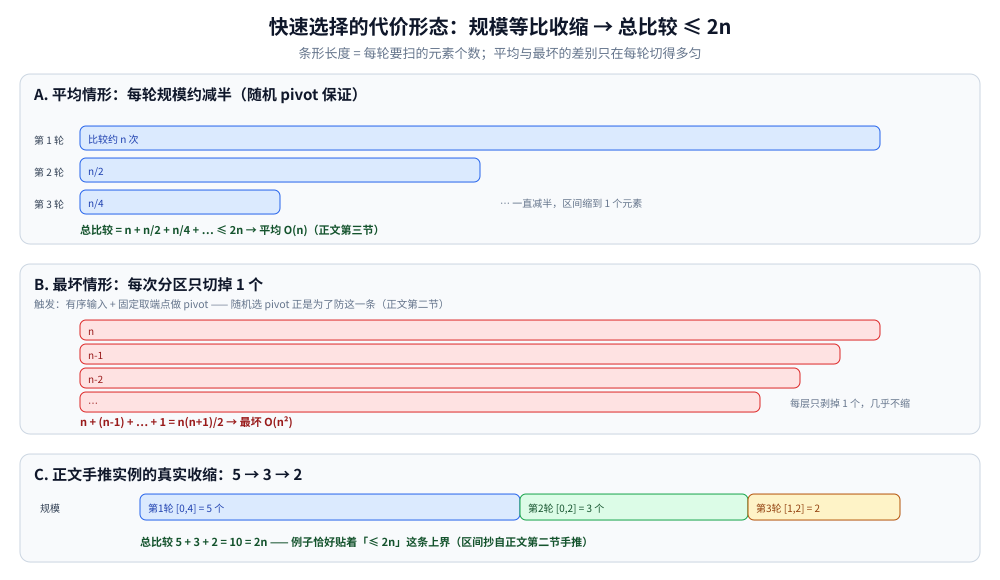

# 快速选择

> 覆盖：求第 K 小 / 第 K 大时的**平均 `O(n)`** 解法 —— 借快排的分区**只递归一侧**，不需要把整个数组排好序；
> 含分区落位后的三条分支、等比收缩的复杂度推导，以及它与全排序 / 堆 / 平衡树的选型对照。
>
> 不覆盖：分区自身的实现与快排的其它优化见 [比较排序.md](比较排序.md)（本篇只借它的 `partition`）；
> 排序族的分类与对比表见 [README.md](README.md)。
> ⭐ 边界先说清：本篇只讲**静态、可随机访问**的数组求第 K 小。
> 流式数据求 Top-K 用 [堆与优先队列.md](../../../数据结构/堆/堆与优先队列.md)；
> 需要「增删 + 第 K 大」用平衡树（见 [平衡树.md](../../../数据结构/树/平衡树.md)）。
>
> 内容整理自个人学习笔记，素材见 [素材清单](../../../../素材清单.md)。复杂度口径见 [复杂度分析.md](../复杂度分析.md)。
>
> 📎 实测口径：本篇**没有实测读数** —— 第二节的三轮走位是**手工推演**、第三节的规模条数是按公式画的；
> 本机实跑的排序读数在 [比较排序.md](比较排序.md) 第五节，本篇「为什么必须随机化枢轴」直接引用那里的退化对照。

---

## 一、为什么不能用全排序？

**本节要点**：求第 K 小只需要确定「位置 K 上是谁」而不需要全局有序，分区一次就能排除一半候选，所以不必付全排序的代价。

- 全排序 `O(n log n)`，但求第 K 小只需找到「位置 K 的元素」，不需要有序
- 快排每次分区后，**只要 K 落在哪一侧，就只递归那一侧** → 平均 `O(n)`
- 与 [二分查找.md](../查找/二分查找.md) 同源：都是「每次排除一半」

---

## 二、算法流程是怎么走的？

**本节要点**：随机选 pivot → 分区落位得下标 `p` → 拿 `p` 与目标下标比较，只递归命中的一侧，直到区间收缩到一个元素。

1. 选一个 pivot（通常用随机化避免最坏情况）
2. 对数组分区，pivot 落位后下标为 `p`
3. 比较 `p` 与 `K-1`（K 是 1-based 的第 K 小；下面的代码直接用 0-based 目标下标 `k = K-1`）：
   - `p == K-1` → 命中，返回
   - `p < K-1` → 只递归右半部分
   - `p > K-1` → 只递归左半部分

```go
func quickSelect(a []int, k int) int {
	lo, hi := 0, len(a)-1
	for lo < hi {
		p := partition(a, lo, hi)
		switch {
		case p == k:
			return a[p]
		case p < k:
			lo = p + 1
		default:
			hi = p - 1
		}
	}
	return a[lo]
}
```

拿 `a = [3 2 1 5 4]`、`k = 1`（求第 2 小）逐步走一遍（分区取 Lomuto，每轮 pivot 随机选中）：

```text
初始   a = [3 2 1 5 4]   lo=0 hi=4   目标 k=1
第1轮  pivot=4  分区后 a = [3 2 1 4 5]  p=3   p > k  → 只留左段，hi = 2
第2轮  pivot=1  分区后 a = [1 2 3 4 5]  p=0   p < k  → 只留右段，lo = 1
第3轮  pivot=3  分区后 a = [1 2 3 4 5]  p=2   p > k  → hi = 1，此时 lo == hi
退出   返回 a[1] = 2 ✓（2 确实是 [3 2 1 5 4] 中第 2 小的数）
```

⭐ 随机选 pivot 是关键：**避免有序输入退化成 `O(n²)`**。



流程三步：① 随机选 pivot 分区、落位得下标 `p`（分区本身与快排完全相同，形态见 [比较排序.md](比较排序.md) 3.3 的分区图，此处只画落位之后的去向）；② 比较 `p` 与目标下标 `k = K-1`；③ `p == k` 直接返回，`p < k` 只留右段（`lo = p + 1`），`p > k` 只留左段（`hi = p - 1`）——被丢的一半连同 pivot 永久出局。下图就是正文手推的三轮：`[0,4]` 上 `p=3 > k` 丢下标 3、4；`[0,2]` 上 `p=0 < k` 只剩 `[1,2]`；`p=2 > k` 收完 `lo == hi`，返回 `a[1] = 2`。

---

## 三、复杂度是多少？

**本节要点**：平均 `O(n)` 来自「每轮规模减半」的等比求和（`n + n/2 + n/4 + … ≤ 2n`）；最坏 `O(n²)` 取决于 pivot 选得极不均匀。

| 维度 | 值 | 说明 |
|---|---|---|
| 平均时间 | **`O(n)`** | `n + n/2 + n/4 + … = 2n` |
| 最坏时间 | `O(n²)` | 每次分区极不均匀 |
| 空间 | `O(1)` | 原地迭代版本 |
| 是否稳定 | ❌ | 与快排同源 |



三组条形读复杂度：**平均**每轮只扫上一轮约一半的段，总比较 `n + n/2 + n/4 + … ≤ 2n`，所以 `O(n)`；**最坏**每次分区只剥掉 1 个元素（有序输入 + 固定取端点做 pivot，随机化正是防它），规模几乎不缩，总比较 `n + (n-1) + … + 1 = n(n+1)/2`；第三组是本例手推的真实规模 `5 → 3 → 2`，总比较 `5 + 3 + 2 = 10`，恰好贴着 `2n = 10` 这条上界。

---

## 四、和全排序 / 堆 / 平衡树怎么选？

**本节要点**：同一个「第 K 小」问题有四种解法，差别在**能否流式**与**会不会打乱原数组**两条轴上。

| 方案 | 时间 | 空间 | 能流式吗 | 会打乱原数组吗 |
|---|---|---|---|---|
| 全排序取第 K | `O(n log n)` | `O(log n)` | ❌ | 视排序算法 |
| **快速选择** | 平均 **`O(n)`** | `O(1)` | ❌ | ✅ 会 |
| 大小为 K 的堆 | `O(n log k)` | `O(k)` | ✅ | 否 |
| 平衡树 | `O(n log k)` | `O(k)` | ✅ | 否 |

⭐ **判据**：

- 静态数组、要 `O(n)` → 快速选择
- 流式数据、要 Top-K → 堆
- 需要增删 + 第 K 大 → 平衡树

---

## 五、应用场景

**本节要点**：快速选择的落点都长一个样 —— **数据一次性拿得到、只要某个位置上的值、允许原地改写**。

| 场景 | 形态 | 为什么是它 |
|---|---|---|
| **中位数 / 分位数**（P50、P99、长尾延迟） | 采完样本求某个百分位 | 要的是「某个位置上的值」而不是全序，样本越大，`O(n)` 与 `O(n log n)` 的差距越明显；「看分位不看均值」这条判据在 [性能排查.md](../../../linux/性能排查.md) 与 [观测与诊断.md](../../../../03-数据与中间件/数据存储/关系型/MySQL/观测与诊断.md) 里是同一笔账 |
| **一次性 Top-K**（静态数组） | 取前 K 个（`K ≪ n`） | 比全排序省；⚠️ **会打乱原数组**；与堆 / 分桶三条路线的对照见 [Top-K问题.md](../Top-K问题.md) |
| **随机化算法的选主元步骤** | k-d 树 / 四叉树选分裂点（分裂点取中位的原因见 [KD树与高维索引.md](../../../数据结构/树/KD树与高维索引.md)）、快排自身的三数取中 | 把「取中位」从 `O(n log n)` 降到平均 `O(n)` |
| **离群值筛查** | 先取 P1 / P99 再比较 | 分位数本身就是判据 |
| ⚠️ **流式 / 多次查询 / 要增删** | 数据持续到达、反复问「当前第 K 大」 | **不适用**：换 [堆与优先队列.md](../../../数据结构/堆/堆与优先队列.md) 或 [平衡树.md](../../../数据结构/树/平衡树.md) |

⭐ 先问两件事：**数据能不能一次性全拿到**、**原数组能不能动** —— 两个都「能」才轮到快速选择。

## 六、具体使用

**本节要点**：现成 API 只有 C++ 有；Go / Java 要么排完取下标、要么照第二节手写 —— 手写时**唯一不能省的是随机化枢轴**。

### 6.1 各语言现成能力

| 语言 | 现成 API | 说明 |
|---|---|---|
| C++ | `std::nth_element(a.begin(), a.begin() + k, a.end())` | 工程版快选，平均 `O(n)`；返回后**下标 `k` 上就是排好序时该在 `k` 位置的那个元素**，但两侧不保证有序 |
| Go | ❌ 无 | `slices.Sort` 后取 `a[k]`（等价于全排序），或改用大小 K 的小顶堆 |
| Java | ❌ 无 | `Arrays.sort` 后取下标；数据在流里就用 `PriorityQueue` |
| Python | ❌ 无 | `sorted(a)[k]`，或 `heapq.nsmallest(k, a)` 走堆 |

### 6.2 手写时的三个落点

| 落点 | 怎么做 | 不做会怎样 |
|---|---|---|
| **枢轴必须随机化** | 随机下标与 `hi` 交换后再走普通分区 | 已排序输入下重蹈 [比较排序.md](比较排序.md) 5.2 的 `O(n²)` |
| **要留原数组** | 先 `copy` 一份再传进去 | 调用方拿到的数组被打乱，且**不报错** |
| **K 的边界** | 统一成 0-based 目标下标 `k = K − 1`，入口先判 `0 ≤ k < n` | 越界 panic，或返回错误的「第 K 小」 |

```go
// 随机枢轴：把随机位置的元素换到 hi，再走普通 Lomuto 分区
j := lo + rnd.Intn(hi-lo+1)
a[j], a[hi] = a[hi], a[j]
p := partition(a, lo, hi) // partition 本体见 比较排序.md 3.1
```

⭐ **要的分位数越多，它的优势越小**：`m` 个分位数要跑 `m` 次快选（约 `m·n`），`m` 接近 `log n` 时就该直接排一遍。

> ⚠️ 本节是**落地写法骨架**：各语言 API 的语义按标准库文档描述，代码片段**未在本篇单独编译**；本篇无实测读数（见引语的实测口径）。

---

## 延伸追问

- **快速选择为什么是 `O(n)`？** → 每次分区只递归一侧，总代价 `n + n/2 + n/4 + … ≤ 2n`。
- **最坏情况怎么避免？** → 随机化 pivot；或用 BFPRT 算法（中位数的中位数）保证最坏 `O(n)`。
- **快速选择会改变原数组吗？** → 会。分区是原地交换；需要保留原数组时先拷贝。
- **和堆求 Top-K 怎么选？** → 数组可随机访问且只求一次 → 快速选择；流式或多次查询 → 堆。
- **凭什么敢把丢掉的那一半整段无视？** → 分区的定义保证 `p` 左侧全 `≤ a[p]` `≤` 右侧，第 `k` 小必然在命中的一侧里；另一侧连同已归位的 pivot 与答案无关，所以每轮只递归一侧。

---

## 关联

- **上游/总纲**：[README.md](README.md) — 排序族**入口总纲**：两族分界、对比表与选型决策树（快速选择是其中「只求第 K」的那条支路）
- **上游机制**：[比较排序.md](比较排序.md) — 快速排序：本篇借用的 `partition` 与三路划分写在那里，快排最坏退化的实测也在那里
- **对照/互补**：[非比较排序.md](非比较排序.md) — 值域受限时的另一条线性路线（计数 / 桶直接给出前 K）
- **对照/互补**：[堆与优先队列.md](../../../数据结构/堆/堆与优先队列.md) — Top-K 的堆解法（流式、不动原数组）
- **对照/互补**：[平衡树.md](../../../数据结构/树/平衡树.md) — 需要「增删 + 第 K 大」时的路线
- **对照/互补**：[二分查找.md](../查找/二分查找.md) — 同为「每次排除一半」的思路
- **对照/互补**：[二分答案.md](../二分答案.md) — 第 K 小的另一条路：分区排除 vs 二分值域
- **下游应用**：[Top-K问题.md](../Top-K问题.md) — Top-K 全族选型：快速选择与堆 / 计数排序 / 分片归并的分工
- [素材清单.md](../../../../素材清单.md) — 素材来源登记
