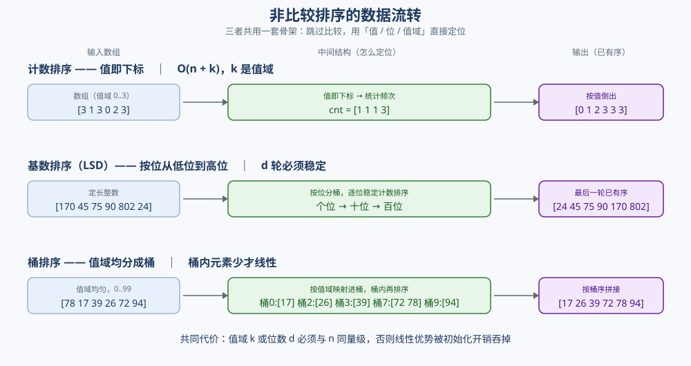
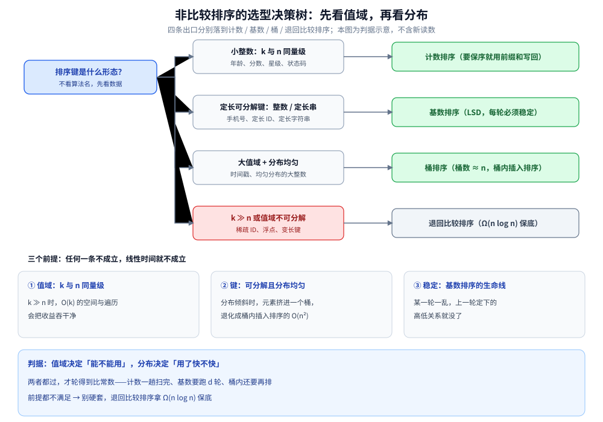

# 非比较排序

> 覆盖：非比较类排序（计数 / 基数 / 桶）**为什么不比较也能排、为什么能突破 `Ω(n log n)` 下界**，
> 三者的前提、代码与失效边界，以及它们在**同一组随机数据上的实测耗时**。
>
> 不覆盖：比较类七种见 [比较排序.md](比较排序.md)；排序族的分类、对比表与选型判据见 [README.md](README.md)；
> 工程上什么时候值得放弃比较类见 [查找与排序对比.md](../查找与排序对比.md)。
>
> 内容整理自个人学习笔记，素材见 [素材清单](../../../../素材清单.md)。复杂度口径见 [复杂度分析.md](../复杂度分析.md)。
>
> 📎 本篇的实测输出逐字抄录自与 [比较排序.md](比较排序.md) **同一次**运行（`n = 20000`，两族共用同一组 LCG 数据）。

---

## 一、非比较类为什么能突破 `Ω(n log n)` 下界？

**本节要点**：比较排序的下界来自**信息论** —— `n` 个元素有 `n!` 种排列，一次比较只给出一个二值结果（最多把可能性分两半），所以至少要 `log₂(n!) ≈ n log n` 次比较。非比较类**根本不做比较**：它拿「值本身」当坐标直接定位，因此不受这个模型约束。**代价是必须预先知道值域。**

- **下界怎么来的**：判定树有 `n!` 个叶子，树高 ≥ `log₂(n!) = Θ(n log n)`；
- **绕开的方式**：值 → 下标（计数）、值 → 各位数字（基数）、值 → 区间（桶）；
- ⚠️ **代价**：`k`（值域）与 `d`（位数）必须和 `n` 同量级，否则 `O(k)` 与 `O(d(n+k))` 里的常数项会把收益吞干净。



⭐ **一句话**：**比较类用「比较」换通用性，非比较类用「值域前提」换线性时间。**

---

## 二、计数排序怎么把「值」直接当成下标？

**本节要点**：值即下标 —— 扫一遍统计每个值出现几次，再按值从小到大倒出来。`O(n + k)` 里的 `k` 是**值域**不是 `n`，这是它唯一的、也是最容易被忽略的前提。

**前提**：值域 `[0, k]`，且 `k` 不能远大于 `n`。

```go
func countingSort(a []int, maxVal int) {
	cnt := make([]int, maxVal+1)
	for _, v := range a {
		cnt[v]++ // 值即下标
	}
	idx := 0
	for v, c := range cnt {
		for ; c > 0; c-- {
			a[idx] = v
			idx++
		}
	}
}
```

⭐ **`O(n + k)`**：扫一遍统计 `n`，扫一遍值域 `k`。**适合年龄、分数、状态码**这类小值域数据。⚠️ `k` 巨大时（如 ID 号）`O(k)` 的空间与初始化直接吞掉收益。

⭐ **它天生稳定**：写回时**同一个值按原数组顺序连续落位**（先用计数前缀和算出每个值的起点），同值的相对次序就保住了 —— 这正是基数排序敢拿它当子过程的原因（第三节）。

---

## 三、基数排序（LSD）：为什么每一轮都必须稳定？

**本节要点**：把「比较整个键」拆成「逐位处理」—— 对十进制从**最低位**开始，每一位做一次**稳定**的计数排序，`d` 位就做 `d` 轮。**稳定性是它的生命线**：某一轮一乱，上一轮确定的高低关系就没了。

```go
func radixSortLSD(a []int) {
	// 取最大值决定位数
	max := a[0]
	for _, v := range a {
		if v > max {
			max = v
		}
	}
	buf := make([]int, len(a))
	for exp := 1; max/exp > 0; exp *= 10 {
		cnt := make([]int, 10)
		for _, v := range a {
			cnt[(v/exp)%10]++
		}
		for i := 1; i < 10; i++ {
			cnt[i] += cnt[i-1] // 前缀和 → 每个桶的结束位置
		}
		for i := len(a) - 1; i >= 0; i-- { // ⭐ 从后往前扫，保证稳定
			d := (a[i] / exp) % 10
			cnt[d]--
			buf[cnt[d]] = a[i]
		}
		copy(a, buf)
	}
}
```

⭐ **两个「必须」**：

- **必须是稳定排序**（这里的计数排序），否则上一轮的高位顺序会被打乱；
- **必须从后往前扫**写回，配合前缀和，才能让同一桶内保持原顺序。

⚠️ **基数排序只对「定长可分解的键」有效**：整数、定长字符串。浮点数、变长字符串要先做**序保持的转换**。

⭐ **为什么从最低位开始（LSD）？** 高位放在最后一轮，才能对低位的结果做**最终裁决**；而低位的次序只在高位相同的组内起作用 —— 这一步成立的前提，正是「每一轮都稳定地把上一轮的组内次序保留下来」。反过来从高位开始（MSD）要按桶分治递归，实现复杂得多。

---

## 四、桶排序：值域倾斜时会怎样？

**本节要点**：把值域均分成 `k` 个桶，元素按值落到对应桶，**桶内再单独排序**（常用插入排序），最后按桶序拼接。它的线性来自「**每桶元素足够少**」，一旦分布倾斜就退化成桶内排序。

```go
func bucketSort(a []int) {
	max := a[0]
	for _, v := range a {
		if v > max {
			max = v
		}
	}
	buckets := make([][]int, bucketCount)
	for _, v := range a {
		idx := v * bucketCount / (max + 1) // 值域均分到桶
		buckets[idx] = append(buckets[idx], v)
	}
	idx := 0
	for _, b := range buckets {
		insertionSort(b) // 桶内排序
		for _, v := range b {
			a[idx] = v
			idx++
		}
	}
}
```

⭐ **`O(n + k)` 的前提是「桶内元素少」**：值域均匀时每桶约 `n/k` 个，桶内插入排序 `O((n/k)²)` → 总体接近线性。⚠️ **值分布极度倾斜**时（元素全挤在一个桶），退化成桶内插入排序的 `O(n²)`。

> 上面调用的 `insertionSort` 就是 [比较排序.md](比较排序.md) 1.1 那个插入排序 —— 桶内排序要选**对短数组高效**的算法，所以小数组用插入排序而不是快排。

---

## 五、非比较类实测：耗时与稳定性

**本节要点**：非比较类在**合适值域**下确实是另一个量级 —— 同一组随机数据上，计数排序比最快的比较排序还快约 3 倍。

**方法**：与 [比较排序.md](比较排序.md) 第五节**同一次运行** —— `n = 20000`，同一个 LCG 种子生成同一组数据，每个算法循环跑多轮直到累计超过 150 ms 再取平均。下面只摘出非比较类三行，逐字抄录：

```text
  计数排序             轮次=257   总耗时=   151.0ms 平均=   0.5875ms
  基数排序(LSD)        轮次=52    总耗时=   151.5ms 平均=   2.9127ms
  桶排序              轮次=89    总耗时=   150.5ms 平均=   1.6909ms
```

⭐ **连跑 3 次只断言单调趋势**（单位 ms，给出 min~max 波动范围）：

| 算法 | min~max（3 次） | 读法 |
|---|---|---|
| 计数排序 | 0.67 ~ 0.72 | 最快（值域仅 10 万、线性） |
| 桶排序 | 1.69 ~ 2.83 | 值域均匀，接近线性 |
| 基数排序(LSD) | 3.28 ~ 5.11 | 5 轮计数排序，常数大 |

⭐ **两条结论**：

1. **非比较类在合适值域下是另一个量级** —— 计数排序（0.67~0.72 ms）比最快的比较排序（快排 1.96~2.32 ms）还快约 3 倍；
2. **同为线性解，常数差很多** —— 计数一趟扫完，基数要跑 `d` 轮，桶还要在桶内做插入排序。

⚠️ **Java 侧**（同一次运行，Java 8）：计数 0.72 ms、基数 2.29 ms、桶 2.98 ms —— **计数依旧最快、基数依旧最慢**，与 Go 的排序关系一致。完整的 Go / Java 读数见 [比较排序.md](比较排序.md) 5.1。

⚠️ **稳定性口径**：计数 / 基数 / 桶的稳定性是**理论结论**（每轮稳定 + 从后往前写回）。本次实测的稳定性验证程序只覆盖了 8 个比较类算法，**这三者未单独实测**，验证方法与假阳性陷阱见 [比较排序.md](比较排序.md) 5.3。

---

## 六、应用场景

**本节要点**：非比较类的落点一句话就能说清 —— **数据带「小整数」或「定长键」语义时，先想想能不能不做比较**。

| 场景 | 值域形态 | 用哪个 |
|---|---|---|
| 年龄 / 分数 / 星级 / 状态码统计 | 小整数（`k` 几百以内） | 计数排序 |
| 直方图 / 频次统计（只要计数、不要顺序） | 值当下标 | 计数数组（连倒出都可以省） |
| 按分数段取高分段（Top-K 的分桶版） | 小值域 | 计数 / 桶 + **从最高位桶往低扫**，不必排完 |
| 手机号 / 定长 ID / 定长字符串 | 定长键（`d` 位） | 基数排序（LSD） |
| 字符串匹配里的后缀数组倍增法 | 每轮的「位」= 上一轮的名次对 | 基数排序当子过程（见 [后缀数组.md](../../字符串匹配/后缀数组.md)） |
| 时间戳 / 均匀分布的大整数 / 浮点分位数 | 值域大但**分布均匀** | 桶排序 |
| 数据库 / 中间件的 `GROUP BY`、直方图指标 | 值当下标 | 同一套计数思想，由执行引擎实现（你写的是 SQL，不是循环） |

⚠️ **两个反向判据**（这时别用非比较类）：

- **`k ≫ n`**：给一批稀疏 ID 排序，计数数组的 `O(k)` 初始化与遍历会把收益吞干净；
- **值域不可分解**：浮点、变长字符串要先做**序保持的转换**，转换本身可能比排序还贵。

⭐ 归纳成一条：**先看值域，再看分布，最后才看算法** —— 非比较类的性能全押在这两条前提上。

### 6.1 选型决策树：先看值域，再看分布

把上面的表压成一次判断：根节点问的不是「用哪个算法」，而是「**排序键是什么形态**」。四条出口正好对应本篇的三节 —— **小整数且 `k` 与 `n` 同量级** → 计数（第二节）；**定长可分解键** → 基数 LSD（第三节）；**大值域但分布均匀** → 桶（第四节）；**`k ≫ n` 或值域不可分解** → 退回比较排序（[比较排序.md](比较排序.md)），拿 `Ω(n log n)` 保底。

⭐ **三个前提任何一条不成立，线性时间就不成立**：值域（`k` 与 `n` 同量级）、键（可分解且分布均匀）、稳定（基数排序的生命线）。⭐ 判据可以压成一句：**值域决定「能不能用」，分布决定「用了快不快」** —— 两者都过，才轮得到比常数。



图怎么读：左列是判断条件（键的形态），中列是每种形态的典型数据，右列是出口算法；下半部分三张卡片是「线性时间能否成立」的三个前提，底部是判据 —— **先过值域与分布两道闸，再比常数**。

## 七、具体使用

**本节要点**：三段落地写法各差一行就是错的 —— 计数要**前缀和写回**才保序、基数要**从后往前**、桶要**桶内排完再拼**。

### 7.1 计数排序的稳定写回（给基数排序当子过程时必需）

```go
// 稳定版：前缀和算出每个值的「结束位置」，再从后往前写回
func countingSortStable(a []int, maxVal int) []int {
	cnt := make([]int, maxVal+1)
	for _, v := range a {
		cnt[v]++ // ① 统计频次
	}
	for v := 1; v <= maxVal; v++ {
		cnt[v] += cnt[v-1] // ② 前缀和 → 每个值的结束位置
	}
	out := make([]int, len(a))
	for i := len(a) - 1; i >= 0; i-- { // ③ 从后往前：同值保持原次序
		v := a[i]
		cnt[v]--
		out[cnt[v]] = v
	}
	return out
}
```

⚠️ 第二节那个「按值倒出」的写法**只写出值、不携带元素身份**，所以它**只能单独使用**；一旦给基数排序当子过程，下一轮要靠上一轮的组内次序，必须换成上面这个稳定版。

### 7.2 基数排序：负数与定长键怎么处理

| 情况 | 处理 |
|---|---|
| 有负数 | 全体加偏移量映射到非负（`v + offset`），排完再减回去；⚠️ 偏移量本身不能溢出 |
| 定长字符串 | 「位」从数字换成字符下标（`s[i]`），位数取最长串长度，短串补最小字符 |
| 变长键 / 浮点 | 先做**序保持的编码**（IEEE 754 的常用做法：非负数翻转符号位、负数整体取反），再按位排 |
| 基数 `r` 怎么取 | `r = 10` 直观；`r = 256` 让轮数 `d` 变小、桶数 `k` 变大，按实测取舍 |

### 7.3 桶排序：桶数与桶内排序

```go
// 桶数经验值：值域均匀时 k ≈ n 线性最好；桶少了桶内排序变贵，桶多了空桶开销变大
bucketCount := len(a)
idx := v * bucketCount / (maxVal + 1) // 映射公式要保证 idx ∈ [0, bucketCount)
```

```go
// 桶内用插入排序（短数组最快，实现见 比较排序.md 1.1）；桶间按值域天然有序，拼起来就有序
insertionSort(buckets[i])
```

⭐ 桶排序是这三者里唯一「没有硬前提也能跑、只是跑不快」的：分布均匀时线性，分布倾斜时退化成桶内插入排序（第四节）。

> ⚠️ 本节是**落地写法骨架**：7.1 是第二节写法的稳定版改写（**未在本篇单独编译**），7.2 / 7.3 是编码与参数经验；本篇的实测读数只在第五节（与 [比较排序.md](比较排序.md) 同一次运行）。

---

## 延伸追问

- **计数排序 `O(k)` 的 `k` 为什么是陷阱？** → `k` 是**值域**不是 `n`。值域远大于 `n`（如 ID 号）时，初始化与遍历 `k` 个桶的成本会吞掉全部收益（第二节）。
- **基数排序为什么必须稳定？** → 每一位排完之后，**下一位不能打乱上一位确定的高低关系**。若某轮不稳定，上一轮排好的顺序就丢了（第三节）。
- **基数排序为什么从最低位开始，而不是最高位？** → LSD 让**高位在最后一轮做最终裁决**，低位的次序只在高位相同的组内起作用 —— 而这要求低位的组内次序被完整保留，正是「每轮稳定」在保证。MSD 从高位开始则要按桶分治递归，复杂得多。
- **桶排序什么时候退化？** → 分布倾斜时元素全挤进一个桶，退化成桶内插入排序的 `O(n²)`（第四节）。
- **非比较类为什么可以不受 `Ω(n log n)` 约束？** → 那个下界的前提是「只能靠比较来获取信息」。非比较类直接**读值本身**（把值当坐标用），信息不是比较来的，模型不适用（第一节）。
- **为什么实测要「多轮累加取平均」？** → 本机 `time.Now()` 分辨率约 1 ms，**取最小值会系统性低估**；必须多轮累加撑过 100 ms 再平均（方法与完整输出见 [比较排序.md](比较排序.md) 5.1）。

## 关联

- **上游/总纲**：[README.md](README.md) — 排序族**入口总纲**：两族的分界、一张复杂度/稳定性对比表与选型决策树
- **上游/总纲**：[复杂度分析.md](../复杂度分析.md) — `O(n + k)` 与 `O(d(n + k))` 的读法与量级直觉、`Ω(n log n)` 下界的出处
- **上游/总纲**：[README.md](../../README.md) — 算法目录总导读（本目录在其中的位置与收录门槛）
- **对照/互补**：[比较排序.md](比较排序.md) — 比较类七种；与本篇**共用同一次实测运行**
- **对照/互补**：[Top-K问题.md](../Top-K问题.md) — 值域受限时，Top-K 也能用计数 / 桶排序拿到线性解
- **对照/互补**：[查找与排序对比.md](../查找与排序对比.md) — 工程选型：什么时候值得放弃比较类
- **下游机制**：[后缀数组.md](../../字符串匹配/后缀数组.md) — 倍增法每一轮都用基数排序当子过程（第六节那张表里的落点）
- [素材清单.md](../../../../素材清单.md) — 素材来源登记
> 反向引用（本篇被下列文档引到）：[快速选择.md](快速选择.md)
