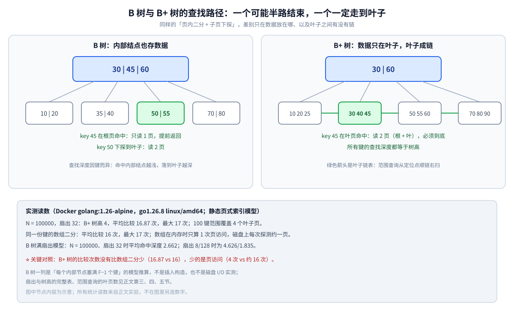
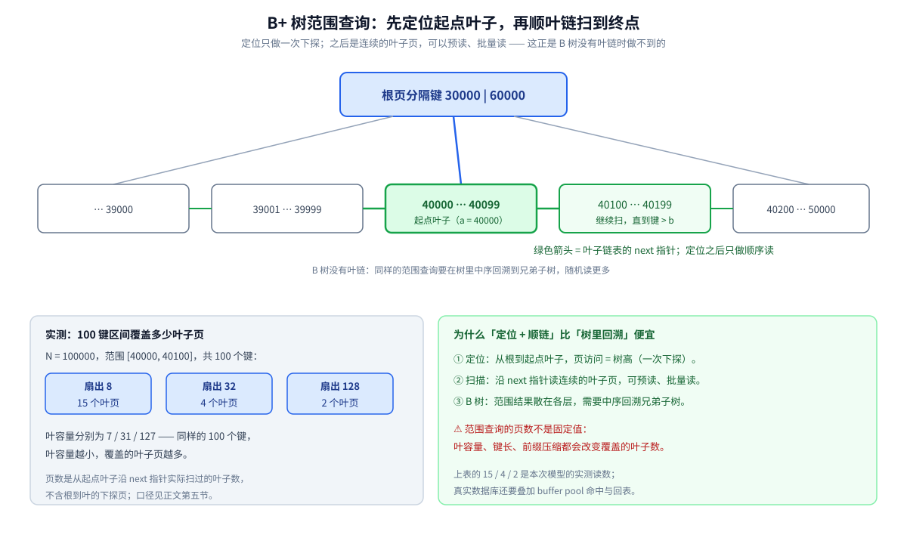

# B树与B+树查找

> 覆盖：一次查找在 B 树 / B+ 树上的**下探路径**——节点内有序键二分定位、按子页指针下探、B 树可能提前命中而 B+ 树必到叶子；范围查询如何变成「定位 + 叶链扫描」；查找代价为什么按**页访问**而不是比较次数计。
>
> 不覆盖：B 树 / B+ 树的结构定义、分裂与合并、为什么 InnoDB 用 B+ 树而不是红黑树或跳表 → [B树与B+树.md](../../../数据结构/树/B树与B+树.md)、[平衡树.md](../../../数据结构/树/平衡树.md)；
> 页内二分的边界写法 → [二分查找.md](二分查找.md)；哈希等值查找 → [哈希查找.md](哈希查找.md)；横向选型表 → [查找与排序对比.md](../查找与排序对比.md) 第一节。
>
> 内容整理自个人学习笔记，素材见 [素材清单](../../../../素材清单.md)。
>
> 📎 **实测口径**：本篇的页访问、页内比较、范围查询叶页数来自 **Docker `golang:1.26-alpine`（go1.26.8 linux/amd64）** 实跑的**静态页式索引模型**：
> 固定扇出、固定叶容量、页面不分裂，键为 `0..N-1` 的连续整数；所有读数是对每个键逐一查找后统计的平均值。
> 「B 树平均深度」是**满扇出模型**的推算（每个内部节点塞满 `F-1` 个键），不是 B 树插入构造，也不是磁盘 I/O 实测；
> MySQL 的实际页读、缓存命中与回表未在本篇实测。

---

## 一、一次 B 树 / B+ 树查找走哪几步？

**本节要点**：两种树的查找都是「**页内定位 → 按子页指针下探 → 重复**」；差别只在**数据放在哪**——B 树内部结点也存数据，B+ 树只把数据放叶子。

一次查找的通用骨架：

```text
从根页开始
  └─ 在当前页的有序分隔键里，找到 key 应该落在哪个子页
       ├─ B 树：命中当前页的键 → 直接返回（可能提前结束）
       └─ 不是叶子 → 读子页，重复
  └─ 到叶子后，在叶内有序键里定位
       ├─ B+ 树：命中则返回，未命中则确认不存在
       └─ B 树：叶子同样可命中
```



⭐ **一句话记差别**：**B 树的查找可能在半路结束，B+ 树的查找一定走满树高**。前者省一次下探，后者换来「所有键同一深度 + 叶子成链」。

---

## 二、页内定位为什么还是二分？

**本节要点**：一个页里的分隔键是**有序数组**，找「key 该进哪个子页」就是找**最后一个 ≤ key 的分隔键**——这正是 `upperBound` 的语义。

设某内部页的分隔键为 `seps`（第 `i` 个分隔键是第 `i+1` 个子页的最小键），页内定位写成：

```go
func childIndex(seps []int, key int) int {
	lo, hi := 0, len(seps)
	for lo < hi {
		mid := lo + (hi-lo)/2
		if seps[mid] <= key {
			lo = mid + 1
		} else {
			hi = mid
		}
	}
	return lo
}
```

`childIndex` 返回的是「第一个大于 key 的分隔键下标」，也就是 key 应进入的子页下标。整棵树的查找就是把它套进下探循环：

```go
for !n.leaf {
	n = n.children[childIndex(n.keys, key)]
}
```

⭐ **为什么不是顺序扫**：一个页能放几百～上千个路由项（扇出 `F`），顺序扫一页要 `O(F)` 次比较；页内二分只要 `O(log₂F)` 次。扇出 500 时，顺序 500 次 vs 二分约 9 次——**页内定位的常数差来自这里**。二分的边界细节（闭区间 / 半开区间、`lowerBound` / `upperBound`）见 [二分查找.md](二分查找.md) 第一、三节。

⚠️ **页内比较廉价，页间下探昂贵**：页内比较是内存操作，读子页在磁盘上是 I/O。所以整棵树的代价不能把所有比较简单相加，下一节起按「页访问」重新记账。

---

## 三、B+ 树为什么每次都必须走到叶子？

**本节要点**：B+ 树的数据只在叶子，内部页只做路由——**所有键的查找深度相同**；代价是多走一层，收益是范围查询可以顺着叶链扫。

| 维度 | B 树 | B+ 树 |
|---|---|---|
| 数据存放 | 内部结点 + 叶子结点 | **只在叶子** |
| 单键查找 | 可能在内部结点命中，**提前结束** | 必须下探到叶子 |
| 查找深度 | 因键而异（内部命中更浅） | **所有键一致**（等于树高） |
| 范围查询 | 需要中序遍历 / 回溯到兄弟子树 | **定位到起点叶子 + 顺叶链扫** |
| 叶子链表 | 无 | 有 |

固定 `N = 100000`、扇出 `F`，实测 B+ 树的树高与「满扇出模型」下 B 树的平均命中深度：

| 扇出 `F` | B+ 树高（= 页访问） | B 树平均深度（模型） | 差 |
|---|---|---|---|
| 8 | 6 | 4.626 | 少 1.374 页 |
| 32 | 4 | 2.662 | 少 1.338 页 |
| 128 | 3 | 1.835 | 少 1.165 页 |

⭐ **读法**：B 树确实平均少走一页多，但这是「**内部结点也带数据**」换来的——代价是范围查询要在树里回溯，且所有键的查找成本不一致（内部命中的尾延迟更浅、叶子命中的更深）。B+ 树把「数据全放叶子」作为交换，换来统一的查找深度和可顺序扫描的叶链。

> ⚠️ 上表的 B 树一列是**满扇出模型**：假设每个内部节点都塞满 `F-1` 个键、按层从上往下填充。真实 B 树的填充率取决于插入与删除历史，不能拿这个数当实际页读。

---

## 四、查找代价为什么按页访问算，不按比较次数算？

**本节要点**：B+ 树把「比较次数」压到和数组二分几乎一样，真正省下的是**页访问次数**——`4` 次对 `≈16` 次，这才是磁盘索引的价值。

固定 `N = 100000`，同一份有序键分别用 B+ 树与数组二分查找，实测：

| 结构 | 页访问（树高） | 平均比较 | 最大比较 |
|---|---|---|---|
| 数组二分（常驻内存） | 1（整块数组） | 16 | 17 |
| 数组二分（磁盘，每次探测算一页） | ≈16 | 16 | 17 |
| B+ 树，扇出 8 | 6 | 16.86 | 17 |
| B+ 树，扇出 32 | 4 | 16.87 | 17 |
| B+ 树，扇出 128 | 3 | 16.91 | 17 |

⭐⭐ **最重要的一行对照**：B+ 树的**比较次数并没有比数组二分少**（16.87 vs 16），但它的**页访问是 4 次**（扇出 32）而不是 16 次。原因：

- 数组二分每次探测都可能落在不同页 → 磁盘上约 `log₂N` 次页读；
- B+ 树把「下一页该看谁」预先打包进同一页，一页做 `log₂F` 次比较，层数只有 `log_F N`。

**扇出与树高的实测关系**（`N = 100000`）：

| 扇出 | 树高 / 页访问 | 平均比较 | 100 键范围的叶页数 |
|---|---|---|---|
| 8 | 6 | 16.86 | 15 |
| 32 | 4 | 16.87 | 4 |
| 128 | 3 | 16.91 | 2 |

⭐ **三层账**：扇出 `F` 越大 → 树高 `log_F N` 越小 → 页访问越少；但页内比较是 `log₂F`，扇出太大又会把「一页」撑大，受页大小限制。实测中比较次数几乎不变（16.86～16.91），说明**真正随扇出变化的是页访问，而不是比较**。

> ⚠️ 这只是模型读数：真实数据库的根页 / 内部页常驻内存，`buffer pool` 命中时不会产生磁盘 I/O；表也不能只按「树高」做容量规划。结构侧的页大小与扇出推导见 [B树与B+树.md](../../../数据结构/树/B树与B+树.md) 第二节。

---

## 五、范围查询怎么从树查找变成顺序扫描？

**本节要点**：B+ 树的范围查询分两段——先用一次树查找定位到**起点所在的叶子**，再沿叶子链表**顺序右扫**到终点；B 树没有叶链，必须在树里中序回溯。

```text
范围 [a, b]
  ① 从根下探：每层找「最后一个 ≤ a 的分隔键」→ 子页
  ② 到叶子后，从第一个 ≥ a 的键开始
  ③ 顺着 next 指针扫叶子，直到键 > b
```



实测范围 `[40000, 40100]`（100 个键）在 `N = 100000` 时：

| 扇出 | 叶容量 | 覆盖的叶页数 |
|---|---|---|
| 8 | 7 | 15 |
| 32 | 31 | 4 |
| 128 | 127 | 2 |

⭐ **为什么 B+ 树的范围查询快在「顺序」而不是「比较」**：定位只做一次下探（树高次页访问），之后是**连续的叶子页**，可以预读、批量读；B 树没有叶链，范围查询要在树里来回折返（中序回溯到兄弟子树），随机读更多。结构侧的推导（叶子链表为什么关键）见 [B树与B+树.md](../../../数据结构/树/B树与B+树.md) 第二节第五步。

⚠️ **范围查询的页数取决于「覆盖多少叶子」**，不是固定值：同样的 100 个键，叶容量 7 时要扫 15 页，叶容量 127 时 1～2 页就够。页大小 / 键长 / 前缀压缩都会改变叶容量。

---

## 六、和数组二分、哈希、二叉搜索树比，差在哪？

**本节要点**：比较这几种查找，必须把**代价单位**分开——内存里比「比较次数」，磁盘上比「页访问次数」；混着比会得出错误结论。

| 结构 | 等值查找 | 范围 / 排序 | 代价单位 | 典型介质 |
|---|---|---|---|---|
| **哈希查找** | 平均 `O(1)` | ❌ | 桶内比较 | 内存 |
| **有序数组 + 二分** | `O(log n)` | ✅ | 比较次数；磁盘上每次探测 ≈ 一页 | 内存 / 静态数据 |
| **二叉搜索树 / 红黑树** | `O(log n)` | ✅（中序） | 比较次数 + 指针跳转 | 内存 |
| **跳表** | 期望 `O(log n)` | ✅ | 比较次数 + 指针跳转 | 内存 |
| **B+ 树** | `O(log_F n)` 次页访问 | ✅（定位 + 叶链） | **页访问** | 磁盘 / 页式存储 |

⭐ **三条判据**：

1. **只要等值、数据在内存** → 哈希查找（[哈希查找.md](哈希查找.md)）；
2. **要范围 / 排序、数据在内存** → 有序数组 + 二分（[二分查找.md](二分查找.md)）；
3. **要范围 / 排序、数据在磁盘** → B+ 树；红黑树 / 跳表的节点是离散指针，没法把路由信息按页打包（[B树与B+树.md](../../../数据结构/树/B树与B+树.md) 第二节）。

---

## 七、常见坑

**本节要点**：B+ 树查找的坑集中在「**代价单位**」和「**索引列顺序**」——把比较次数当页读、把 B 树当 B+ 树、跳过最左列，都会得到错误结论。

| 坑 | 症状 | 修法 |
|---|---|---|
| **把 `O(log n)` 比较当成 `O(log n)` 页读** | 以为 B+ 树和数组二分「都是 log n」，忽略页读 | 分开记：比较 ≈ `log₂n`，页读 ≈ `log_F n`；实测 16.87 次比较 vs 4 次页访问 |
| **把 B 树当 B+ 树讲** | 说「数据只在叶子」却画了内部数据 | B 树内部结点也存数据，可能提前命中；B+ 树才只在叶子 |
| **以为 B+ 树能提前命中内部结点** | 期待单键查找少于树高 | B+ 树内部只有路由键，必须到叶子 |
| **用 B 树做范围查询** | 以为和 B+ 树一样顺链扫 | B 树没有叶链，范围查询要中序回溯 |
| **联合索引跳过最左列** | 第二列单独查走不了索引 | 按最左前缀构造查找条件；范围列之后的列通常只用于过滤 |
| **忽略回表** | 二级索引查询比预期慢 | 二级索引叶子存主键，命中后还要查聚簇索引；能覆盖就覆盖 |
| **把树高当固定值** | 容量规划算错 | 树高由页大小、键长、填充率共同决定；实测扇出 8/32/128 → 6/4/3 层 |
| **忽略缓存** | 把「页访问」直接当磁盘 I/O | 根页 / 内部页常驻 `buffer pool`，实际 I/O 可能远少于树高 |

⭐ **一条总判据**：**先问「这次查找的成本单位是什么」**——内存里数比较，磁盘上数页读；B+ 树的优势在后者，不在前者。

---

## 八、应用场景

**本节要点**：B+ 树的查找是**数据库与页式存储的默认路径**；应用代码通常不直接实现它，而是通过 SQL / 存储引擎间接使用。

| 场景 | 查找形态 | 为什么要 B+ 树 |
|---|---|---|
| **MySQL InnoDB 聚簇索引** | 主键等值 / 范围 → 定位到叶子直接拿整行 | 数据在叶子，一次下探到底；叶子成链支持范围 |
| **MySQL 二级索引** | 先查二级索引拿主键，再回聚簇索引 | 二级索引叶子存主键；命中后可能多一次树查找（回表） |
| **联合索引** | 按最左前缀定位；范围列之后的列无法继续用于定位 | 键按「列顺序」排序，树只能沿前缀下探 |
| **覆盖索引** | 查询列都在索引里 → 不回表 | 叶子已含所需列，省掉第二次查找 |
| **文件系统元数据** | 文件名 → inode、逻辑块 → 物理块 | 元数据按 key 有序、要范围扫描 |
| **LSM 的 SSTable 块索引** | 先在块索引定位 block，再块内查找 | 块索引本身就是小型 B 树 / B+ 树索引 |

> 结构层与选型层的完整对照见 [B树与B+树.md](../../../数据结构/树/B树与B+树.md) 第三、四节；MySQL 的索引落地（回表、覆盖索引、索引失效）见 [索引设计与EXPLAIN.md](../../../../03-数据与中间件/数据存储/关系型/MySQL/索引设计与EXPLAIN.md)。

---

## 九、具体使用

**本节要点**：应用层最常见的「使用 B+ 树查找」就是写 SQL；真正需要手写的是**页内二分**，整棵树的下探由存储引擎完成。

**SQL 形态**（仅示查找路径，未在本篇执行）：

```sql
SELECT * FROM orders WHERE id = 123;                 -- 聚簇索引：等值定位到叶子
SELECT * FROM orders WHERE id BETWEEN 100 AND 200;   -- 范围：定位 + 叶链扫
SELECT id, created_at FROM orders WHERE user_id = 7; -- 二级索引：命中后可能回表
```

对应到查找路径：

| SQL 条件 | 走的查找 | 额外代价 |
|---|---|---|
| `id = 123` | 聚簇索引一次下探 | 无（叶子即整行） |
| `id BETWEEN 100 AND 200` | 聚簇索引定位 + 叶链扫 | 扫描覆盖的叶子页 |
| `user_id = 7` | 二级索引定位 + 回表 | 第二次聚簇索引查找 |
| `user_id = 7 AND created_at > '...'` | 联合索引按最左前缀定位 | 范围列之后通常不能再用于索引定位 |

**如果要自己实现页内定位**，核心就是第二节的 `childIndex`；整棵树的构造、分裂与合并不在本篇范围（见 [平衡树.md](../../../数据结构/树/平衡树.md) 第三节）。下面的内核摘自本篇实验程序，已随实验一起编译运行：

```go
func searchInPage(keys []int, key int) (int, bool) {
	lo, hi := 0, len(keys)
	for lo < hi {
		mid := (lo + hi) / 2
		if keys[mid] < key {
			lo = mid + 1
		} else {
			hi = mid
		}
	}
	return lo, lo < len(keys) && keys[lo] == key
}
```

> ⚠️ `searchInPage` 返回的是「第一个 ≥ key 的下标」，与 `lowerBound` 同义；页内用 `lowerBound` 还是 `upperBound` 取决于你要找「键」还是「子页边界」，两者只差一个比较符号（[二分查找.md](二分查找.md) 第三节）。

---

## 延伸追问

- **B 树和 B+ 树的查找路径差在哪？** → B 树内部结点也存数据，命中内部结点可以提前返回；B+ 树内部只有路由键，**一定走到叶子**。实测 10 万键、扇出 32：B+ 树高 4，B 树满扇出模型平均深度 2.662（第三节）。
- **为什么 B+ 树的比较次数没比数组二分少？** → 因为两者都在做 `log₂` 级别的比较；B+ 树把比较分散到「每层 `log₂F` 次 × 层数」，总数仍是 `log₂N` 量级。实测 16.87 vs 16（第四节）。
- **一次 B+ 树查找读几页？** → 等于树高（根到叶的页数）。实测 10 万键：扇出 8 → 6 页，32 → 4 页，128 → 3 页；根页 / 内部页常驻缓存时实际 I/O 更少（第四节）。
- **范围查询为什么快？** → 「一次定位 + 顺叶链顺序扫」把随机读变成连续读；实测 100 键区间在扇出 8/32/128 下分别扫 15/4/2 个叶子页（第五节）。
- **数据库为什么不用红黑树或跳表？** → 磁盘上要优化的是「读了几页」而不是「比较几次」；红黑树二叉、层数多，跳表节点离散、无法按页打包。完整推导见 [B树与B+树.md](../../../数据结构/树/B树与B+树.md) 第二节。
- **B+ 树查找能提前命中内部结点吗？** → 不能。内部结点只存路由键，数据全在叶子，所有键都走满树高。
- **页内为什么用二分而不是顺序扫？** → 扇出可能是几百～上千，顺序扫是 `O(F)`，二分是 `O(log₂F)`；扇出 500 时约 500 次 vs 9 次（第二节）。
- **联合索引为什么必须最左前缀？** → 键按索引列顺序排序，树只能沿前缀下探；跳过最左列就没有可用的有序前缀，通常退化为扫描或全索引扫描（第八、九节）。
- **B 树在什么场景反而更优？** → 单键查找为主、希望内部结点命中就返回（少走一层），如某些嵌入式数据库；但范围查询与统一查找深度上 B+ 树更占优（第三节）。
- **B+ 树查找的 `O(log n)` 和数组二分的 `O(log n)` 是一回事吗？** → 不是同一个成本单位：前者是**页访问**，后者是**比较**（内存）或**页探测**（磁盘）。混着比会得出「B+ 树没优势」或「B+ 树快 16 倍」两种错误结论（第四、六节）。

## 关联

- **上游/总纲**：[README.md](../README.md) — **上级目录（基础算法）总纲**：查找族与十个通用技巧的分工
- **上游/总纲**：[README.md](../../README.md) — **全仓算法地图**：算法篇目的分类索引与阅读路线
- **上游/总纲**：[查找与排序对比.md](../查找与排序对比.md) — B 树 / B+ 树在**查找算法选型**里的位置
- **上游/总纲**：[复杂度分析.md](../复杂度分析.md) — `O(log n)` 的递推式与「比较次数 ≠ 页访问」的度量口径
- **原理/结构**：[B树与B+树.md](../../../数据结构/树/B树与B+树.md) — 结构定义、分裂合并、为什么 InnoDB 用 B+ 树、文件系统与 LSM 的落点
- **原理/结构**：[平衡树.md](../../../数据结构/树/平衡树.md) — 分裂 / 合并的实现层，B 树「一个节点 = 一页」的由来
- **原理/结构**：[树的形态与选型.md](../../../数据结构/树/树的形态与选型.md) — ⭐ 树结构选型总纲：B+ 树与红黑树 / 跳表 / LSM 的分工
- **对照/互补**：[二分查找.md](二分查找.md) — 页内定位用的 `lowerBound` / `upperBound` 与边界不变式
- **对照/互补**：[哈希查找.md](哈希查找.md) — 等值查找的另一条路：平均 `O(1)`，但不能范围
- **对照/互补**：[树的缓存局部性对比.md](../../../数据结构/树/树的缓存局部性对比.md) — 把「一次搬运」的单位从缓存行放大到页
- **下游机制**：[LSM树.md](../../../数据结构/树/LSM树.md) — 写多读少时用 LSM；SSTable 内部仍靠块索引定位
- **下游机制**：[索引设计与EXPLAIN.md](../../../../03-数据与中间件/数据存储/关系型/MySQL/索引设计与EXPLAIN.md) — 聚簇索引、二级索引、回表、覆盖索引与联合索引的落地
