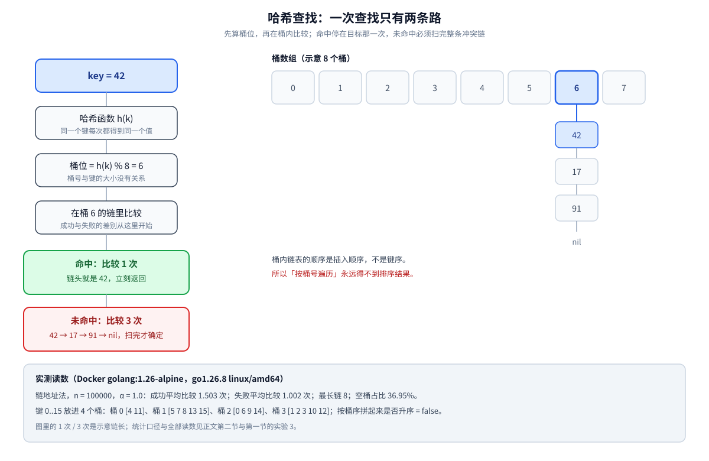
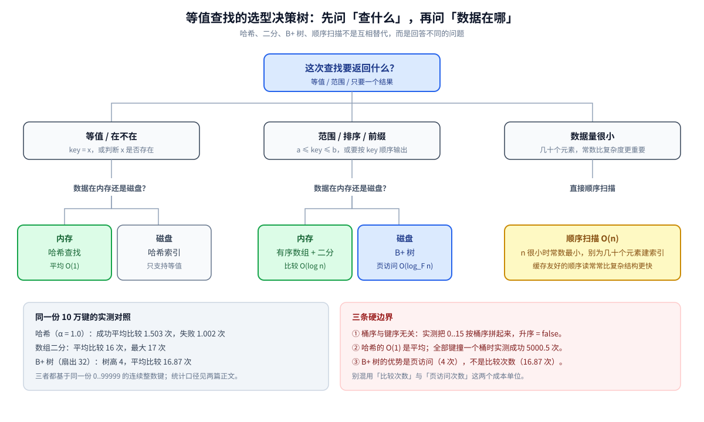

# 哈希查找

> 覆盖：哈希查找的**查找过程**——建表时把键算成桶位、查找时只在对应桶内比较；平均 `O(1)` 的成立条件、冲突与负载因子如何把成本拉回 `O(n)`、等值查找的选型边界。
>
> 不覆盖：散列表的结构形态、扩容与渐进式 rehash、冲突解决的实现细节 → [散列表.md](../../../数据结构/哈希表/散列表.md)、[开放寻址与冲突解决.md](../../../数据结构/哈希表/开放寻址与冲突解决.md)；
> 二分与 B+ 树的查找路径 → [二分查找.md](二分查找.md)、[B树与B+树查找.md](B树与B+树查找.md)；横向选型表 → [查找与排序对比.md](../查找与排序对比.md) 第一节。
>
> 内容整理自个人学习笔记，素材见 [素材清单](../../../../素材清单.md)。
>
> 📎 **实测口径**：本篇的桶内比较次数、最长链、桶序读数来自 **Docker `golang:1.26-alpine`（go1.26.8 linux/amd64）** 实跑：
> 链地址法，`n = 100000` 个整数键，哈希函数为 MurmurHash3 finalizer 风格的整数混合，桶数为 `int(n/α)`。
> Java 片段只作调用形态示例，**未单独编译**；本篇不含任何耗时读数。

---

## 一、哈希查找到底在「查」什么？

**本节要点**：它把「逐个比较」换成「**先算地址、只在桶内比较**」——查找成本 = 一次哈希 + 桶内冲突链的长度。

哈希查找分两个阶段，两个阶段的代价要分开算：

| 阶段 | 做什么 | 代价 |
|---|---|---|
| **建表** | 对每个键算 `h(k)`，把键放进对应桶 | 一次 `O(n)` |
| **查找** | 对目标算**同一个** `h(k)`，只在那个桶里比较 | 平均 `O(1)`，最坏 `O(m)`（桶内元素数） |



图里两条路径就是一次查找的全部：**命中**停在目标那一次比较，**未命中**必须把整条冲突链扫完才知道「不在」。这也解释了第二节为什么成功与失败的成本公式不一样。

最小的查找内核只有两行：

```go
h := hashKey(k)
bucket := h % uint32(m)
```

⚠️ 这里没有「有序」这个前提，所以哈希查找**不要求数据有序**，也**不能**因此获得任何顺序能力——桶号与键的大小没有关系。实测把键 `0..15` 放进 4 个桶，按桶序拼起来是：

```text
桶 0: [4 11]
桶 1: [5 7 8 13 15]
桶 2: [0 6 9 14]
桶 3: [1 2 3 10 12]
按桶序拼起来是否升序: false
```

---

## 二、平均 `O(1)` 靠什么成立？

**本节要点**：平均比较次数由**负载因子 `α = n / m`** 决定——成功查找约 `1 + α/2` 次，失败查找约 `α` 次；α 越大，链越长。

固定 `n = 100000`，只改桶数，实测链地址法的平均比较次数：

| `α` | 桶数 | 成功平均比较 | 失败平均比较 | 最长链 | 空桶占比 |
|---|---|---|---|---|---|
| 0.5 | 200000 | 1.252 | 0.500 | 6 | 60.75% |
| 1.0 | 100000 | 1.503 | 1.002 | 8 | 36.95% |
| 2.0 | 50000 | 2.004 | 2.001 | 10 | 13.73% |
| 4.0 | 25000 | 3.004 | 3.999 | 14 | 1.85% |

**成功和失败为什么不是同一个公式？**

- **成功**：目标一定在链上，比较次数 = 目标在链中的位置。链头就命中是 1 次，所以**至少 1 次**；平均约 `1 + α/2`。
- **失败**：目标不在链上，必须把整条链扫完。桶为空时**一次都不用比**（0 次），所以平均是 `α`。

⭐ 这解释了一个反直觉读数：`α = 1.0` 时成功查找（1.503）反而比失败查找（1.002）贵——成功要付「至少 1 次」的底价，失败可以撞上空桶直接返回 0。只有 α 大到「空桶几乎消失」（如 α = 4）时，失败才稳定地比成功贵。

⚠️ 表里的 `α` 是**名义值**（元素数 / 桶数），实际链长还受哈希均匀性影响；「空桶占比」一列就是证据：`α = 0.5` 时仍有 60.75% 的桶是空的，说明键并没有严格按平均分布落桶。

---

## 三、冲突会把查找成本拉到多高？

**本节要点**：只要哈希函数把键集中到少数桶，平均 `O(1)` 立刻失效；最坏情况退化为**顺序查找**。

把哈希函数换成「永远返回 0」，`n = 10000`、桶数 100（名义 `α = 100`），实测：

```text
成功平均比较 5000.5 次；失败平均比较 10000.0 次；最长链 10000
```

- **成功 5000.5 次**：目标在长度 10000 的链上，平均要走一半；
- **失败 10000 次**：必须扫完整条链；
- 此时哈希查找与「逐个扫描」没有区别，`O(1)` 只剩名义上的桶数。

这正是 **hash flooding** 类攻击的机制：攻击者故意构造大量同桶键灌进来，把服务端的 `O(1)` 打成 `O(n)`。防御方向是给哈希加**随机种子 / 扰动**，让攻击者无法预先算出碰撞键；Java `HashMap` 还在链过长时把桶内结构升级为红黑树。具体阈值与实现以官方文档 / 源码为准，结构细节见 [散列表.md](../../../数据结构/哈希表/散列表.md)。

---

## 四、哈希函数与桶数怎么定？

**本节要点**：目标只有一个——让键在桶间**均匀**，同时让计算足够便宜；桶数只需跟元素量保持同一量级。

| 决策 | 常见做法 | 代价 / 前提 |
|---|---|---|
| **取模** | `h % m`，`m` 取素数或与键分布互质的数 | 通用，但取模比位运算慢；`m` 选得不好会放大低位规律 |
| **掩码** | `h & (m-1)`，要求 `m` 是 2 的幂 | 最快；但**低位必须已经混合均匀**，否则低位相同就全撞 |
| **混合函数** | 乘法散列、MurmurHash finalizer、`h ^ (h >>> 16)` | 把高位熵扩散到低位；Java `HashMap` 就做了一次扰动 |
| **随机种子** | 进程启动时生成种子，参与哈希 | 防 hash flooding；同一进程内必须**保持一致**，否则查不到已插入的键 |
| **复合键** | 把多个字段组合成一个哈希 | 别用简单拼接：`("ab","c")` 与 `("a","bc")` 会撞成同一个串 |

⭐ **一条工程判据**：**桶数与元素数同量级**（α 控制在 1 附近或更低）就能把平均链长压在常数级；桶数远大于元素数是浪费内存，远小于元素数则链长线性增长。扩容与 rehash 的时机、渐进式搬迁的细节不在本篇，见 [散列表.md](../../../数据结构/哈希表/散列表.md) 第二节。

---

## 五、什么时候能用哈希查找，什么时候不能？

**本节要点**：判据只有两条——查询是不是**等值**、数据在不在**内存**；一旦要范围 / 排序 / 前缀，哈希的桶序帮不上忙。



| 需求 | 哈希查找 | 有序数组 + 二分 | B+ 树 |
|---|---|---|---|
| **等值**（`key = x`） | ✅ 平均 `O(1)` | ✅ `O(log n)` | ✅ `O(log_F n)` 次页访问 |
| **范围**（`a ≤ key ≤ b`） | ❌ 桶序与键序无关 | ✅ 定位 + 顺序扫 | ✅ 定位 + 叶链扫 |
| **排序 / 顺序遍历** | ❌ | ✅ | ✅ |
| **前缀匹配** | ❌ | ✅（有序串） | ✅（有序键） |
| **典型介质** | 内存 | 内存 | 磁盘 |

⭐⭐ **和二分的关键差别不在「谁更快」，而在「前提是什么」**：二分要求**有序**，哈希要求**同一个键每次算出同一个桶**。同一份 10 万键的实测里，哈希在 `α = 1.0` 时平均比较 1.503 次，有序数组二分平均 16 次——但哈希拿这 10 倍的优势，代价是**永久放弃顺序**。数组二分的 16 次读数见 [B树与B+树查找.md](B树与B+树查找.md) 第四节，二分本身的写法见 [二分查找.md](二分查找.md)。

⚠️ 三个常见误判：

1. **「哈希查找 O(1)，所以任何查找都用哈希」**——范围、排序、第 K 小、前缀匹配全都做不了；
2. **「哈希表能去重，所以能找 Top-K」**——去重只回答「在不在」，Top-K 要维护候选集，见 [Top-K问题.md](../Top-K问题.md)；
3. **「数据大到装不下还能用哈希」**——键本身装不下时，要换布隆过滤器一族（只回答「可能有 / 一定没有」），见 [位图与布隆过滤器.md](../../../数据结构/概率与统计/位图与布隆过滤器.md)。

---

## 六、常见坑

**本节要点**：哈希查找的坑几乎都出在「**键的身份变了**」或「**成本模型用错了**」，而不是查找循环本身。

| 坑 | 症状 | 修法 |
|---|---|---|
| **可变键** | 插入后修改键内容，再查就查不到 | 用不可变值（字符串、数值）或插入时复制一份 |
| **`equals` / `hashCode` 不一致** | `containsKey` 为假，或两个「相等」对象进不同桶 | 两个方法必须基于同一组字段，且字段不可变 |
| **负数取模** | 桶下标为负，数组越界 | 用无符号类型，或 `((h % m) + m) % m` / `Math.floorMod` |
| **浮点特殊值** | `NaN` 查不到自己；`-0.0` 与 `0.0` 哈希不同 | 避免用浮点做键；必要时规范化 |
| **依赖迭代顺序** | 同一份数据两次遍历结果不同 | 显式排序；或用保持插入 / 排序顺序的容器 |
| **负载因子失控** | 插入越多越慢，最后退化成线性 | 按元素量扩容，把 α 控制在常数级 |
| **对抗性碰撞** | 特定输入下 QPS 骤降 | 哈希加随机种子；桶内结构升级（如红黑树） |

⭐ **一条总判据**：哈希查找的正确性依赖「**同一个键永远算出同一个桶，且桶里的比较能认出它**」——键的可变性、`equals` / `hashCode`、浮点特殊值，破坏的都是这一条。

---

## 七、应用场景

**本节要点**：哈希查找的落点集中在「**等值 + 精确答案**」；一旦需求里出现「顺序」或「范围」，就该换结构。

| 场景 | 怎么用 | 为什么合适 |
|---|---|---|
| **去重 / 存在性判定** | 插入前查一次：桶里没有才收录 | 只要「在不在」，不要顺序；规模大到存不下原值时换近似判定（[位图与布隆过滤器.md](../../../数据结构/概率与统计/位图与布隆过滤器.md)） |
| **缓存键查找** | `cache[key]` 直接定位 | 等值查询占绝对多数；Redis 键空间那层 dict（两张表 + 渐进式 rehash）见 [底层结构.md](../../../../03-数据与中间件/数据存储/NoSQL/Redis/底层结构.md) 第三节 |
| **计数 / 分组** | `count[key]++`、`group[key] = append(...)` | 一次哈希完成聚合；交给引擎做就是 `GROUP BY` 与 bucket 聚合（见 [分页与聚合.md](../../../../03-数据与中间件/数据存储/搜索与分析/Elasticsearch/分页与聚合.md) 第三节） |
| **两数之和** | 扫到 `x` 时查 `target - x` 是否出现过 | 把「找补数」从 `O(n)` 降到 `O(1)` |
| **数据库哈希索引** | MySQL 的哈希索引 / InnoDB 自适应哈希索引 | 只加速等值查询，不改变 B+ 树主位；`USING HASH` 在 InnoDB 上被静默换成 BTREE 的实测见 [索引设计与EXPLAIN.md](../../../../03-数据与中间件/数据存储/关系型/MySQL/索引设计与EXPLAIN.md) 第十节 |
| **分片路由** | `hash(key) % 分片数`；一致性哈希把取模换成环上二分 | 同一键稳定落到同一分片；取模扩容与一致性哈希的搬迁量对照见 [分表与路由.md](../../../../03-数据与中间件/数据存储/关系型/MySQL/分表与路由.md) 与 [一致性哈希.md](../../../../04-架构与系统/分布式/数据分布/一致性哈希.md) |

> 结构层的落地（Redis dict、Java HashMap、InnoDB 自适应哈希索引）见 [散列表.md](../../../数据结构/哈希表/散列表.md) 第三节；本篇只保留「作为查找算法怎么用」的部分。

---

## 八、具体使用

**本节要点**：应用代码里几乎不会手写哈希表，而是用语言内置的 map；要记住的只有「缺失键返回什么」和「迭代顺序不可依赖」。

**Go：`map` 的查询是 `v, ok := m[k]` 两值形式。**

```go
hits := make(map[string]int)
hits["GET /api/user"]++
hits["GET /api/user"]++
hits["POST /api/order"]++
v, ok := hits["GET /api/user"]
_, missing := hits["DELETE /api/user"]
delete(hits, "POST /api/order")
```

```text
GET /api/user = 2, ok = true
DELETE /api/user 存在 = false
删除后 POST /api/order 存在 = false
```

**Java：`HashMap` 用 `get` / `containsKey` / `merge`。**

```java
Map<String, Integer> hits = new HashMap<>();
hits.merge("GET /api/user", 1, Integer::sum);
Integer v = hits.get("GET /api/user");
boolean present = hits.containsKey("GET /api/user");
```

⚠️ `get` 返回 `null` 有两种含义——**键不存在**，或**键存在但值就是 `null`**；要区分必须用 `containsKey`。

**三条使用约束**：

1. **迭代顺序不可依赖**：Go 刻意打乱 map 遍历顺序，Java `HashMap` 不保证顺序；要顺序输出必须显式排序或换 `LinkedHashMap` / 有序结构。
2. **键必须是「插入后不再变」的值**：键的内容一变，`hash` 就变，原来的桶再也找不到它。
3. **Java 必须同时正确实现 `equals` 与 `hashCode`**：只重写一个，`containsKey` 会在「哈希相同但 `equals` 为假」时返回 `false`。

> Java 片段的底层结构（懒分配、扩容、树化）见 [集合容器.md](../../../../01-编程语言/java/集合容器.md) 第三节；Go map 的实现见 [map.md](../../../../01-编程语言/go/类型与语法/map.md)。两段 Java 代码只作调用形态示例，本篇未单独编译。

---

## 延伸追问

- **哈希查找平均 `O(1)`，最坏是多少？** → `O(n)`。把全部键打到同一个桶，实测成功查找平均 5000.5 次、失败 10000 次（第三节）。
- **为什么 `α = 1` 时成功查找反而比失败查找贵？** → 成功至少要比较 1 次（目标在链上），失败可能撞上空桶直接返回 0；实测成功 1.503 次、失败 1.002 次（第二节）。
- **负载因子为什么通常控制在 1 附近或更低？** → 成功约 `1 + α/2`、失败约 `α`；α 越大链越长，查找从常数级滑向线性，扩容就是用空间换回常数。
- **哈希查找能做范围查询吗？** → 不能。桶号与键序无关，实测把 `0..15` 按桶序拼起来不是升序（第一节）；范围查询要换有序数组二分或 B+ 树。
- **哈希查找和二分查找该怎么选？** → 只要等值、且不需要顺序 → 哈希；要范围 / 排序 / 前缀 → 有序结构 + 二分（[二分查找.md](二分查找.md)）；磁盘上的有序查找 → B+ 树（[B树与B+树查找.md](B树与B+树查找.md)）。
- **为什么桶数常取 2 的幂？** → 可以用 `h & (m-1)` 代替取模，速度快；代价是只用到哈希的低位，所以哈希函数必须先把高位熵混到低位（Java `HashMap` 的 `h ^ (h >>> 16)` 就是干这个）。
- **哈希冲突攻击怎么防？** → 给哈希加进程级随机种子，让攻击者无法离线构造同桶键；桶过长时升级桶内结构。阈值与实现以官方文档 / 源码为准。
- **去重为什么常用哈希而不是排序？** → 哈希去重是 `O(n)` 且不需要保留顺序；排序去重是 `O(n log n)`，但结果有序。数据大到键装不下时，换布隆过滤器一族（[位图与布隆过滤器.md](../../../数据结构/概率与统计/位图与布隆过滤器.md)）。
- **一致性哈希和普通哈希查找是什么关系？** → 用的是同一把哈希，但**落点规则**从「取模」换成「环上找第一个 ≥ hash 的节点」，于是节点增减只影响邻近区间（[一致性哈希.md](../../../../04-架构与系统/分布式/数据分布/一致性哈希.md)）。
- **数据库既有哈希索引又有 B+ 树索引，怎么选？** → 等值查询用哈希索引；范围、排序、最左前缀用 B+ 树。InnoDB 的自适应哈希索引只是给热点等值查询加速，不改变主索引形态（[索引设计与EXPLAIN.md](../../../../03-数据与中间件/数据存储/关系型/MySQL/索引设计与EXPLAIN.md)）。

## 关联

- **上游/总纲**：[README.md](../README.md) — **上级目录（基础算法）总纲**：查找族在十个通用技巧里的位置
- **上游/总纲**：[README.md](../../README.md) — **全仓算法地图**：算法篇目的分类索引与阅读路线
- **上游/总纲**：[查找与排序对比.md](../查找与排序对比.md) — 哈希查找在**查找算法选型**里的位置：与顺序 / 二分 / 插值 / 树结构的横向对照
- **上游/总纲**：[复杂度分析.md](../复杂度分析.md) — 平均 `O(1)` 与最坏 `O(n)` 的口径：为什么「平均」必须带负载因子
- **原理/结构**：[散列表.md](../../../数据结构/哈希表/散列表.md) — 结构形态、四道防退化闸门、渐进式 rehash、工程落点
- **原理/结构**：[开放寻址与冲突解决.md](../../../数据结构/哈希表/开放寻址与冲突解决.md) — 链地址 / 开放寻址 / Cuckoo 的探测序列与装填因子实测
- **对照/互补**：[二分查找.md](二分查找.md) — 有序数组上的 `O(log n)`：边界写法、`lowerBound` / `upperBound`
- **对照/互补**：[B树与B+树查找.md](B树与B+树查找.md) — 磁盘上的有序查找：页内二分 + 逐层下探 + 叶链范围扫
- **对照/互补**：[位图与布隆过滤器.md](../../../数据结构/概率与统计/位图与布隆过滤器.md) — 只回答「可能有 / 一定没有」的存在性结构
- **下游机制**：[map.md](../../../../01-编程语言/go/类型与语法/map.md) — Go map 的哈希实现与扩容
- **下游机制**：[集合容器.md](../../../../01-编程语言/java/集合容器.md) — Java `HashMap` 的数组 + 链表 + 红黑树
- **下游机制**：[一致性哈希.md](../../../../04-架构与系统/分布式/数据分布/一致性哈希.md) — 同一把哈希，落点从取模换成环上二分
- **下游机制**：[索引设计与EXPLAIN.md](../../../../03-数据与中间件/数据存储/关系型/MySQL/索引设计与EXPLAIN.md) — 哈希索引与 B+ 树索引的分工
- **总纲**：[Top-K问题.md](../Top-K问题.md) — 哈希只做去重 / 计数，取前 K 个要换堆或快速选择
