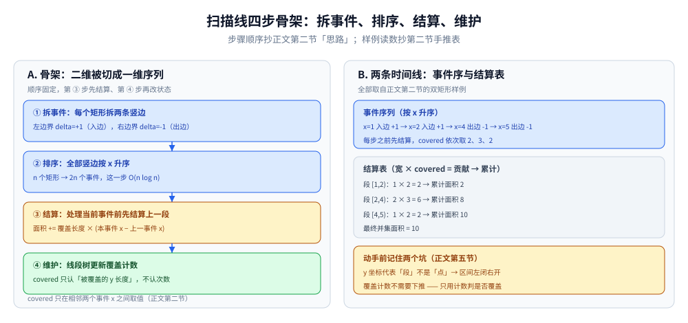
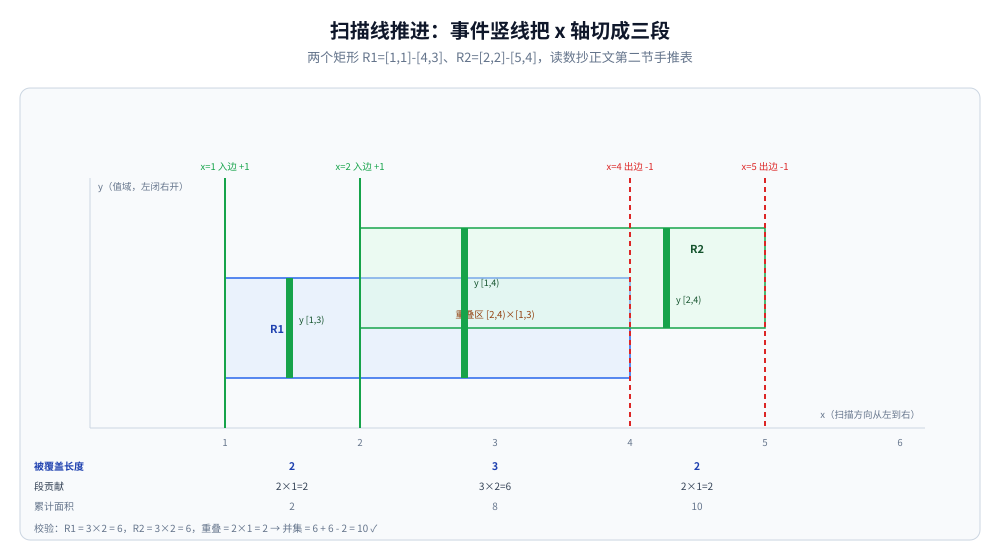
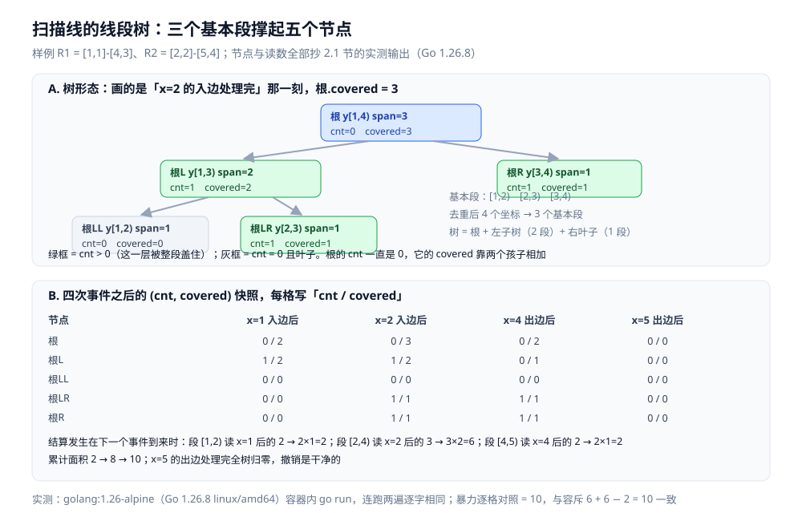

# 扫描线

> 把二维问题通过「一条线扫过去」降成一维：矩形面积并、区间覆盖、
> 最近点对 —— 是计算几何与线段树的经典配合。
>
> ⭐ 边界先说清：本篇讲扫描线的基本思想与典型应用。
> 线段树见 [区间与索引树.md](../../数据结构/树/区间与索引树.md)；
> 离散化见 [离散化.md](离散化.md)。
>
> 内容整理自个人学习笔记，素材见 [素材清单](../../../素材清单.md)。复杂度口径见 [复杂度分析.md](../基础算法/复杂度分析.md)。

---

## 一、核心思想

**本节要点**：固定一维、按事件推进，另一维交给数据结构动态维护，逐段累加贡献。

- 把问题按某一维（如 x 轴）拆成「事件」
- 用一条线从左到右扫描
- 每次事件发生时，用数据结构（线段树/树状数组）维护当前状态
- 累加每一步的贡献

⭐ **判据**：**二维区间问题 + 需要求并/交/覆盖 → 扫描线。**

---

## 二、典型应用：矩形面积并

**本节要点**：竖边拆事件、按 x 排序、线段树维护被覆盖的 y 长度，逐段累加面积。

**问题**：给 n 个矩形，求它们的并集面积。

**思路**：

1. 把每个矩形拆成两条竖边：左边界（入边）、右边界（出边）
2. 把所有竖边按 x 排序
3. 从左到右扫描，维护当前 y 轴被覆盖的总长度
4. 每两个相邻 x 之间，`面积 += 覆盖长度 × 宽度`



左栏把上面四步思路按**执行时序**重排（每个事件先结算、后维护）：第 ③ 步处理当前事件之前先结算上一段——面积 += 覆盖长度 × (本事件 x − 上一事件 x)，再进第 ④ 步让线段树更新覆盖计数。右栏是样例的两条时间线：四个事件按 x 升序入列，covered 依次取 2、3、2，结算表 1×2、2×3、1×2 逐段累计成 2 → 8 → 10。

两个矩形 `R1 = [1,1]-[4,3]`、`R2 = [2,2]-[5,4]` 的手推过程（坐标为 `(x, y)`，y 区间按左闭右开处理）：

```text
拆事件（按 x 排序）:
  x=1  入边 R1  覆盖 y [1,3)   delta = +1
  x=2  入边 R2  覆盖 y [2,4)   delta = +1
  x=4  出边 R1  移除   [1,3)   delta = -1
  x=5  出边 R2  移除   [2,4)   delta = -1

逐段累加（covered = 当前 y 被覆盖总长度）:
  x     1────────2──────────────4────────5
  段        [1,2)      [2,4)         [4,5)
  covered     2           3             2      ← [1,3)=2；[1,4)=3；[2,4)=2
  贡献        2×1       3×2           2×1
  累计面积    2           8            10

校验：R1 面积 3×2=6，R2 面积 3×2=6，重叠 2×1=2 → 并 = 6+6-2 = 10 ✓
```



图把上面手推表画进了坐标：x=1、x=2 是入边（绿实线），x=4、x=5 是出边（红虚线），四条竖线把扫描轴切成三段；每段中央的绿粗竖条是当前 y 轴上被覆盖的区间（[1,3)、[1,4)、[2,4)），覆盖长度读数 2、3、2 与段贡献 2×1、3×2、2×1 一一对应，累计面积 2 → 8 → 10，收尾校验 6 + 6 - 2 = 10 与正文手推一致。

```go
type Event struct {
	x, y1, y2 int
	delta     int // +1 进入，-1 离开
}

func rectangleArea(rects [][]int) int {
	var events []Event
	var ys []int
	for _, r := range rects {
		events = append(events, Event{r[0], r[1], r[3], 1})
		events = append(events, Event{r[2], r[1], r[3], -1})
		ys = append(ys, r[1], r[3])
	}
	// 离散化 y 坐标
	// 排序事件
	// 线段树维护覆盖长度
	// 扫描累加面积
	return area
}
```

⭐ **线段树维护的是「被覆盖的 y 长度」**，而不是具体的覆盖次数。

### 2.1 树里到底存了什么？

「被覆盖的 y 长度」落到实处是**每个节点两个整数**：`cnt`（本子树被**完整**覆盖了几次，**不下推**）与 `covered`（本子树内被覆盖的 y 长度，打印时标作 `len=`）。`covered` 只有三条分支 —— `cnt > 0` 直接取整个跨度 `span`；`cnt == 0` 且是叶子取 0；否则取左右孩子的 `covered` 之和。

```go
type node struct {
	lo, hi  int   // 覆盖的基本段下标区间（1-indexed）
	span    int   // 该节点的 y 跨度 = 所含基本段长度之和
	cnt     int   // 覆盖次数，不下推
	covered int   // 本子树内被覆盖的 y 长度（打印时标作 len=）
	lc, rc  int
}

func build(lo, hi int) int { // 基本段 [lo, hi] 建树，返回节点下标
	idx := len(tree)
	tree = append(tree, node{lo: lo, hi: hi, lc: -1, rc: -1})
	tot := 0
	for i := lo; i <= hi; i++ {
		tot += ys[i+1] - ys[i] // ys 是 1-indexed 的去重 y 坐标
	}
	tree[idx].span = tot
	if lo < hi {
		mid := (lo + hi) / 2
		tree[idx].lc, tree[idx].rc = build(lo, mid), build(mid+1, hi)
	}
	return idx
}

func pull(i int) { // 三条分支：cnt > 0 → span；叶子且 cnt == 0 → 0；否则孩子相加
	n := &tree[i]
	switch {
	case n.cnt > 0:
		n.covered = n.span
	case n.lc == -1:
		n.covered = 0
	default:
		n.covered = tree[n.lc].covered + tree[n.rc].covered
	}
}

func update(i, ql, qr, delta int) {
	n := &tree[i]
	if ql <= n.lo && n.hi <= qr { // 整段被覆盖到，只动这一层的 cnt，不下推
		n.cnt += delta
		pull(i)
		return
	}
	mid := (n.lo + n.hi) / 2
	if ql <= mid {
		update(n.lc, ql, qr, delta)
	}
	if qr > mid {
		update(n.rc, ql, qr, delta)
	}
	pull(i)
}
```

主流程就是「离散化 y → 事件按 x 升序 → 每个事件先结算上一段、再 `update` → 打印五个节点」。样例仍是上面那两个矩形，输出**逐行原样**抄录：

```text
离散化后的 y 坐标（1-indexed）： [1 2 3 4]
基本段：[1,2) [2,3) [3,4)
事件按 x 排序后：x=1(+1) x=2(+1) x=4(-1) x=5(-1)

逐事件推进（每个事件先结算上一段，再更新线段树）：
  x=1 入边 y[1,3) -> 段下标 [1,2]，delta=+1
    根   y[1,4) span=3 cnt=0 len=2
    根L  y[1,3) span=2 cnt=1 len=2
    根LL y[1,2) span=1 cnt=0 len=0
    根LR y[2,3) span=1 cnt=0 len=0
    根R  y[3,4) span=1 cnt=0 len=0
  x=2 结算上一段 [1,2)：covered=2 × 宽 1 = 2
      累计面积 = 2
  x=2 入边 y[2,4) -> 段下标 [2,3]，delta=+1
    根   y[1,4) span=3 cnt=0 len=3
    根L  y[1,3) span=2 cnt=1 len=2
    根LL y[1,2) span=1 cnt=0 len=0
    根LR y[2,3) span=1 cnt=1 len=1
    根R  y[3,4) span=1 cnt=1 len=1
  x=4 结算上一段 [2,4)：covered=3 × 宽 2 = 6
      累计面积 = 8
  x=4 出边 y[1,3) -> 段下标 [1,2]，delta=-1
    根   y[1,4) span=3 cnt=0 len=2
    根L  y[1,3) span=2 cnt=0 len=1
    根LL y[1,2) span=1 cnt=0 len=0
    根LR y[2,3) span=1 cnt=1 len=1
    根R  y[3,4) span=1 cnt=1 len=1
  x=5 结算上一段 [4,5)：covered=2 × 宽 1 = 2
      累计面积 = 10
  x=5 出边 y[2,4) -> 段下标 [2,3]，delta=-1
    根   y[1,4) span=3 cnt=0 len=0
    根L  y[1,3) span=2 cnt=0 len=0
    根LL y[1,2) span=1 cnt=0 len=0
    根LR y[2,3) span=1 cnt=0 len=0
    根R  y[3,4) span=1 cnt=0 len=0

扫描线求得并集面积 = 10
暴力逐格对照 = 10 | 两法一致： true
```

**实测口径**：`golang:1.26-alpine`（Go 1.26.8 linux/amd64）容器内 `go run`，连跑两遍逐字相同。最后一行的暴力对照是逐单位格数出来的，与扫描线一致，也和上面手推块里的容斥校验 `6 + 6 - 2 = 10` 一致。

三点读法：

- **树只有 5 个节点**：y 去重后是 `[1,2,3,4]`，基本段个数 = 坐标个数 − 1 = 3，所以树是「根 + 左子树（2 段）+ 右叶子（1 段）」；
- ⭐ **`cnt` 不下推**：`x=1` 之后 `根L.cnt = 1`，可它的两个孩子 `根LL`、`根LR` 的 `cnt` 仍是 0 —— 覆盖记在「被整段盖住的那个节点」上，只靠 `len` 往上传。这正是第五节「覆盖计数不需要下推」那条坑的实测形态；
- **结算只读根节点的 `covered`**：三段读到的依次是 2、3、2，与手推表的 `covered` 逐段对齐；`x=5` 的出边处理完，全树归零，说明撤销是干净的。



读法：左栏是树的形状 —— 三个基本段撑起五个节点，每个节点标着自己的 y 跨度与 `span`；右栏是四次事件之后的 `(cnt, len)` 快照，四列分别对应 `x=1`、`x=2`、`x=4`、`x=5` 处理完的时刻，最底下两行才是结算读数（`covered × 宽` 与累计面积）。注意 `x=2` 那一列：`根.cnt = 0` 而 `根.len = 3`，这个「计数为 0、长度却不为 0」的组合就是「`len` 由孩子上传」的证据。

---

## 三、其他应用

**本节要点**：同一套「拆事件—排序—扫描—累加」骨架能换成不同的维护结构，覆盖一堆二维问题。

| 场景 | 说明 |
|---|---|
| 矩形面积并 | 上述经典 |
| 矩形周长并 | 扫描线 + 边界计数 |
| 区间覆盖问题 | 数轴上的区间覆盖；静态可先看全量时走排序 + 贪心，在线维护才用线段树记覆盖计数（两类对照见 [区间与索引树.md](../../数据结构/树/区间与索引树.md)） |
| 最近点对 | 按 x 排序 + 扫描线维护 y；分治解法与「窄带 + 划格」的账见 [计算几何.md](../数学基础/计算几何.md) |
| 窗口内的最值 | 配合单调队列（结构本体见 [单调栈与单调队列.md](../../数据结构/高级数据结构/单调栈与单调队列.md)，窗口形态的判据见 [滑动窗口.md](../基础算法/滑动窗口.md)） |
| 多维偏序计数 | CDQ 分治的思想同源（见 [CDQ分治与整体二分.md](CDQ分治与整体二分.md)） |
| 面积交 | 类似面积并，改判定条件 |

---

## 四、复杂度

**本节要点**：排序与线段树操作各占一个 log，整体 O(n log n)。

| 维度 | 值 |
|---|---|
| 时间 | O(n log n)（排序 + 线段树操作） |
| 空间 | O(n) |

---

## 五、常见坑

**本节要点**：y 轴上「段」与「点」的区别，是离散化下标与边界处理所有坑的根源。

| 坑 | 说明 |
|---|---|
| **线段树区间是左闭右开** | y 坐标代表「段」不是「点」 |
| **离散化后的下标** | 要保证相邻 y 之间的段被正确映射 |
| **边界重叠** | 矩形的边要严格处理（半开区间） |
| **线段树懒标记** | 覆盖计数不需要下推（只用计数决定是否覆盖） |
| **坐标是浮点数** | 要先离散化或转整数 |

---

## 延伸追问

- **扫描线为什么能降维？** → 固定一维，另一维的问题用数据结构动态维护。
- **线段树维护的是什么？** → 当前被覆盖的 y 长度。
- **扫描线和 CDQ 分治什么关系？** → 都是「按一维排序，另一维用数据结构处理」的思路。
- **矩形面积交怎么求？** → 用扫描线 + 覆盖次数 ≥ 2 的长度。
- **扫描线能处理 3D 问题吗？** → 能，但要嵌套扫描线或配合更复杂的数据结构。

---

## 关联

- [离散化.md](离散化.md) — 坐标压缩
- [区间与索引树.md](../../数据结构/树/区间与索引树.md) — 线段树
- [比较排序.md](../基础算法/排序/比较排序.md) — 事件排序
- [README.md](README.md) — 高级技巧目录导读
> 反向引用（本篇被下列文档引到）：[计算几何.md](../数学基础/计算几何.md)、[CDQ分治与整体二分.md](CDQ分治与整体二分.md)、[分块.md](分块.md)
