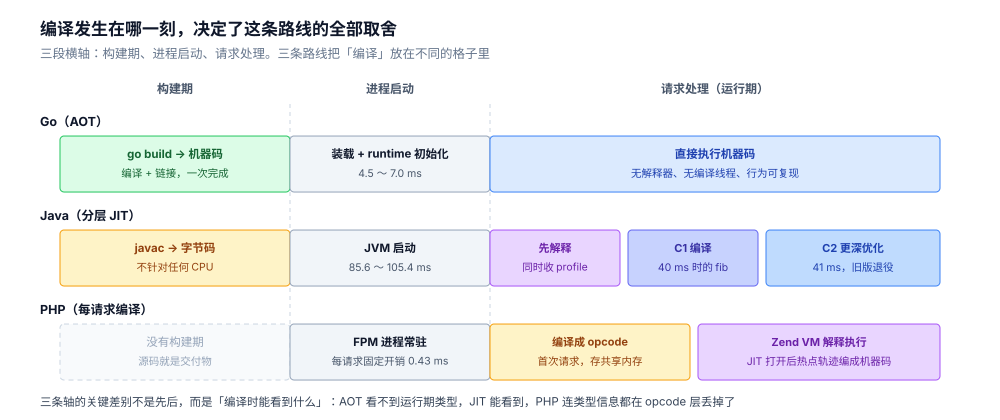
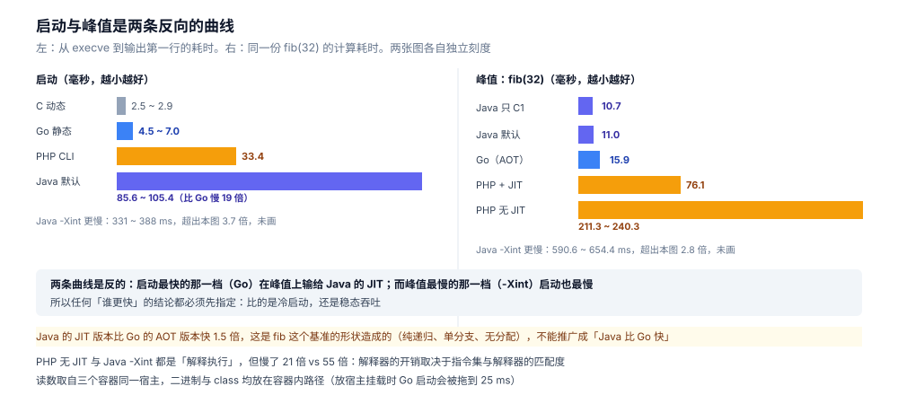
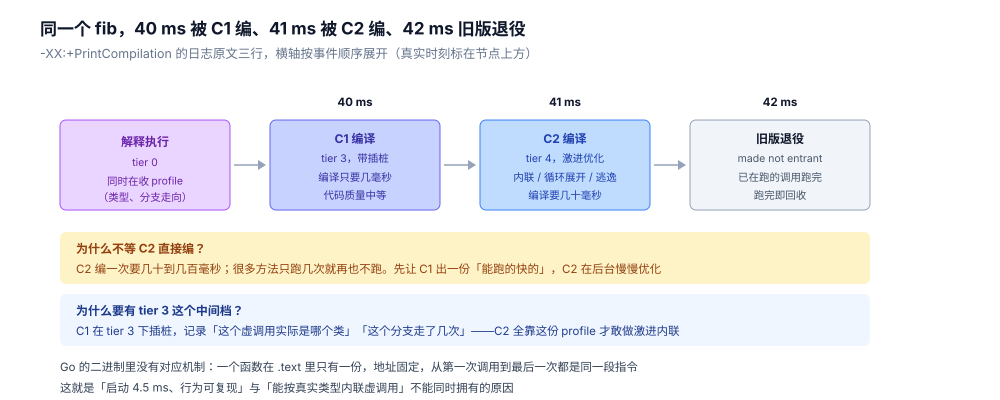

# AOT、JIT 与解释执行

> 同一份 `fib(32)`，三条路线给出的数字差了两个数量级：Go 的 AOT 版本 16 ms，Java 的 JIT 版本 11 ms，Java 的纯解释版本 591 ms，PHP 的 Zend VM 版本 211 ms（开 JIT 后 76 ms）。这份差异不是「谁的语言快」，而是「编译发生在哪一刻」的必然结果。
>
> 本篇是 [README.md](README.md) 里原规划「AOT 与 JIT 两条路线」的补齐版：加上 PHP 就是三条，因为解释执行不是「AOT 的劣化版」，它是另一条完整路线（[执行链路.md](../../01-编程语言/php/执行链路.md)）。
>
> 素材来源：本机 Docker 实测，三个容器同一台宿主机（4 核，无 CPU 配额）：`golang:1.26-bookworm`（go1.26.8）、`eclipse-temurin:17-jdk`（17.0.20.1）、`php:8.0-fpm`（8.0.30）。

---

## 一、从零：同一份 fib，三种产物

**本节要点**：三条路线的差别，在「产物」这一步就定下来了。看产物形态比看文档快。

### 1.1 三份等价的代码

```go
// Go
func fib(n int) int {
	if n < 2 {
		return n
	}
	return fib(n-1) + fib(n-2)
}
```

```java
// Java
static int fib(int n) {
    return n < 2 ? n : fib(n - 1) + fib(n - 2);
}
```

```php
// PHP
function fib(int $n): int
{
    return $n < 2 ? $n : fib($n - 1) + fib($n - 2);
}
```

### 1.2 三次「构建」，产物完全不同

| | 构建命令 | 产物 | 产物里是什么 |
|---|---|---|---|
| Go | `go build` | ELF 可执行文件 | **机器码**（x86 指令） |
| Java | `javac` | `.class` | **字节码**（JVM 指令集） |
| PHP | 没有这一步 | 无 | 源码直接被读 |

Go 的产物可以直接 `objdump` 出 x86：

```text
  49e140:	cmp    $0x2,%rax
  49e143:	jl     49e160 <main.fib+0x20>
  ...
```

Java 的产物只能 `javap` 出字节码：

```text
  static int fib(int);
    Code:
       0: iload_0
       1: iconst_2
       2: if_icmpge     9
       5: iload_0
       6: goto          22
       9: iload_0
      10: iconst_1
      11: isub
      12: invokestatic  #7                  // Method fib:(I)I
```

文件头也不一样：`.class` 以 `ca fe ba be` 开头（`od -t x1` 可验），这是 JVM 规定的魔数，不是任何 CPU 的指令格式。

PHP 没有构建期，所以「产物」要靠 opcode dump 才看得见（`opcache.opt_debug_level=0x10000`）：

```text
$_main:
0000 T1 = FETCH_IS (global) string("_GET")
...
0011 V6 = DO_UCALL
0014 RETURN int(1)
```

这才是三条路线最本质的差别：**不是「编译得好不好」，是「什么时候把源码变成什么形态的东西」**。

### 1.3 PHP 的「构建期」被推迟到了每个请求

Go 的产物在磁盘上，Java 的产物在 class 文件里，PHP 的产物在**共享内存**里——而且第一次请求时才有。

如果打开 opcache，PHP 的执行模型就变成：

```text
第一次请求：源码 → opcode → 存进共享内存 → 执行
之后每请求：从共享内存取 opcode → 执行
```

**这时候它已经不完全是「解释执行」了，而是「首次编译 + 缓存编译产物」**。所以严格说，三条路线的差别是「编译产物被缓存到哪、缓存多久」：

| | 编译产物存在哪 | 缓存多久 |
|---|---|---|
| Go | 磁盘上的 ELF | 永久（除非重新构建） |
| Java | 磁盘上的 `.class`（字节码）+ 内存里的机器码 | 字节码永久，机器码随进程 |
| PHP | 磁盘无产物，共享内存里有 opcode | 随 FPM 进程 / 到 reload 为止 |

---

## 二、原理：编译发生在哪一刻，决定了什么

**本节要点**：编译得越早，运行期越省事，但对「运行期才知道的信息」利用得越少。三条路线是在这个权衡上选了三个不同的点。

### 2.1 三条时间轴

```text
Go（AOT）
  构建期 ──── 编译成机器码 ────┐
                                └─ 运行期：直接执行
                                    （能利用的信息：构建机的 CPU 型号、build tag）

Java（分层 JIT）
  构建期 ── 编译成字节码 ──┐
                            └─ 运行期：先解释 → 热点方法编译成机器码 → 更热再优化
                                （能利用的信息：真实类型、真实分支概率、运行中的 profile）

PHP（每请求编译 + opcache）
  构建期 ── 无 ──┐
                  └─ 运行期：每请求 源码→opcode（首次），然后 Zend VM 解释执行
                              （能利用的信息：几乎没有；JIT 打开后才有 profile）
```

三条轴的关键差别不是「谁先谁后」，而是**编译时能看到什么信息**。



读法：三段竖虚线把「构建期 / 启动 / 请求处理」分开，看每一行的色块落在哪一格。Go 的绿色块只在最左边，Java 的三块颜色依次加深代表编译级别递进，PHP 那一行最左边是虚线框——它没有这个阶段。

AOT 在构建期看不到「这次请求里 `$obj` 实际是什么类」，所以虚调用只能走虚表。JIT 在运行期能看到，所以能把虚调用内联成直接调用——这是 JIT 在峰值上能反超 AOT 的唯一原因，也是它启动慢的全部代价。

### 2.2 AOT 的取舍

**得到**：启动快、内存占用确定、无需预热、行为可复现。

- Go 的 Hello World 启动 **4.5 ~ 7.0 ms**（同机 C 程序 2.5 ~ 2.9 ms），其中大部分是 runtime 自己的初始化（`GODEBUG=inittrace=1` 显示 15 个包的 `init`）。
- 没有解释器、没有 JIT 编译器、没有 profile 数据结构常驻。

**失去**：编译期看不到运行期信息，跨模块优化只能靠内联与链接期分析。

### 2.3 分层 JIT 的取舍：为什么是两层而不是一层

HotSpot 的执行不是「解释 → 编译」两级，而是**多级**。实测日志（`-XX:+PrintCompilation`）里最关键的三行：

```text
40    4       3       Bench32::fib (23 bytes)
41    5       4       Bench32::fib (23 bytes)
42    4       3       Bench32::fib (23 bytes)   made not entrant
```

第 3 列是**编译级别**：

| 级别 | 是什么 | 特点 |
|---|---|---|
| 0 | 解释执行 | 最慢，但立刻可用，还要收集 profile |
| 1 ~ 3 | C1（客户端编译器） | 编译快、代码质量中等；级别 3 额外插桩收集 profile |
| 4 | C2（服务端编译器） | 编译慢、代码质量高（激进内联、循环展开、逃逸分析） |

上面三行的意思是：`fib` 在进程启动后 **40 ms** 被 C1 编译（带 profile），**41 ms** 又被 C2 编译（更激进），**42 ms** 旧的那份被标记 `made not entrant`（不再进入，等在跑的调用退出后回收）。

**为什么不等 C2 直接编？** 因为 C2 编译一次要几十到几百毫秒，而很多方法只跑几次就再也不跑了。先让 C1 编一份「能跑的快的」，再让 C2 在后台慢慢优化——这既避免「一上来就卡住」，也避免「为跑一次的方法付 C2 的编译代价」。

**为什么要有级别 3？** C1 在级别 3 下会插桩（记录「这个虚调用实际是哪个类」「这个分支走了几次」）。这些 profile 就是 C2 能做出「激进优化」的依据。没有 profile，C2 不敢内联虚调用。

### 2.4 每请求编译的取舍

PHP 走的是第三种：**不缓存机器码，缓存 opcode**。

- **得到**：改代码即生效（相对于编译型语言的重新构建 + 部署），无状态，进程可随意重启。
- **失去**：每请求都要付翻译成本，除非开 opcache；即使开了，opcode 也还是要被 Zend VM 逐条解释，不是机器码。

PHP 8 的 tracing JIT 想补上后半截：把热点 opcode 轨迹编成机器码。实测 `fib(32)` 从 211 ~ 240 ms 降到 76 ~ 88 ms，**快 2.7 ~ 3.0 倍**——但仍是 Go 的 16 ms 的 5 倍左右。

原因不难理解：PHP 的 JIT 是在「opcode 之上」做编译，而 opcode 本身已经丢掉了类型信息（PHP 是动态类型），JIT 生成的代码里仍然要带类型检查。

### 2.5 一张判据表

| 判据 | AOT（Go） | 分层 JIT（Java） | 每请求编译（PHP） |
|---|---|---|---|
| 编译发生在 | 构建期 | 运行期（首次执行后） | 每个请求（首次请求后靠缓存） |
| 产物形态 | 机器码 | 字节码 → 机器码 | opcode →（JIT 后）机器码 |
| 启动开销 | 小 | 大（JVM + 解释器 + JIT 线程） | 中（CLI）/ 极小（FPM 复用进程） |
| 峰值性能 | 高 | **最高**（有 profile） | 低（比纯解释高，仍低于 AOT） |
| 预热 | 不需要 | 需要（几十 ms 到几秒） | 不需要（FPM 常驻） |
| 改代码成本 | 重新构建 + 部署 | 重新编译 + 重启 | 传文件 + reload |
| 可预测性 | 高 | 低（JIT 时机不定） | 高 |

⚠️ 「产物形态」那一列的三格不只是「深度递减」。机器码给 CPU 的译码器、字节码给 JVM 的解释器、opcode 给 Zend VM 的 `switch`——**消费者不同，编码格式就完全不同**。同一段 `fib` 在三种形态下的字节数（49 / 23 / 19 条）、编码差异与三层可移植性边界，见 [机器码、字节码与opcode.md](机器码、字节码与opcode.md)；机器码进去之后 CPU 里怎么执行，见 [CPU怎么执行一条指令.md](../计算机底层原理/微架构/CPU怎么执行一条指令.md)。

---

## 三、实测：启动与峰值是两条曲线

**本节要点**：三条路线的排名在「启动」和「峰值」两个维度上是**反的**。任何单点对比都会得出错误结论。

### 3.1 启动：从 execve 到输出第一行

各跑 3 轮 × 10 次，取区间（二进制都在容器内路径，不在宿主挂载上）：

| 程序 | 启动总耗时 |
|---|---|
| C（动态链接，hello） | **2,472 ~ 2,889 µs** |
| Go（静态，hello） | **4,546 ~ 6,965 µs** |
| PHP CLI（`php -r 'echo 1;'`） | **33,369 µs** |
| Java（默认分层 JIT，fib 版） | **85,604 ~ 105,423 µs** |
| Java（只 C1） | **83,136 ~ 89,001 µs** |
| Java（`-Xint` 纯解释） | **331,299 ~ 387,858 µs** |

三件事值得注意：

1. **Go 比 C 慢一倍**（4.5 vs 2.5 ms），差的是 runtime 初始化——`inittrace` 里那 15 个包。
2. **Java 比 Go 慢 19 倍**（85 vs 4.5 ms）。这里面没有「JIT 编译热点」的成本（Hello World 没有热点），全是 JVM 自身：加载模块、初始化类元数据、启动编译线程、解释器建表。
3. **`-Xint` 比默认慢 4 倍**（331 vs 85 ms），但那不是「编译更慢」——纯解释模式下连 JVM 自己启动时跑的那些 Java 代码都是解释执行的。

### 3.2 峰值：同一份 `fib(32)`

| 执行方式 | `fib(32)` 耗时 | 相对最慢 |
|---|---|---|
| Java 只 C1 | **10.7 ~ 11.4 ms** | 1.0× |
| Java 默认（C1 + C2） | **11.0 ~ 13.5 ms** | 1.0× |
| Go（AOT） | **15.9 ~ 16.6 ms** | 1.5× |
| PHP + tracing JIT | **76.1 ~ 88.4 ms** | 7.4× |
| PHP（opcode 缓存，JIT 关） | **211.3 ~ 240.3 ms** | 21× |
| Java `-Xint`（纯解释） | **590.6 ~ 654.4 ms** | 55× |



读法：左右两个面板各自独立刻度，不要横向比较。左面板四档的宽度差就是「初始化成本」的量级差（C 10 px 对 Java 340 px）；右面板看第一行与第三行——Java 的 JIT 版本比 Go 的 AOT 版本还短，这是基准形状造成的偶然，不是语言的普遍结论。

两个反直觉的地方：

**① Java 的 JIT 版本比 Go 的 AOT 版本快 1.5 倍。** 这不是「Java 比 Go 快」，而是这个基准的形状特殊：`fib` 是纯递归、无内存分配、只有一个分支。C1/C2 能把递归调用内联到很深的层次，并利用 profile 确定 `n < 2` 的分支走向。换一个「分配多、虚调用多、分支随机」的基准，结论很可能反过来——AOT 没有 profile 但也从不猜错，JIT 猜对了收益巨大，猜错了要去优化重来。

**② `-Xint` 慢 55 倍，但「解释执行」不等于「慢 55 倍」。** PHP 的 Zend VM 也是解释执行，它只慢 21 倍。差别在于 PHP 的 opcode 是**为解释执行设计的**（一条 `SEND_VAR` 直接对应一个 C 函数调用），而 JVM 的字节码是为 JIT 设计的（栈式、细粒度，解释器要模拟一个栈机的每个动作）。**解释器的开销取决于指令集与解释器的匹配度，不是「解释」这个动作本身。**

### 3.3 两条曲线的交叉点

把启动和峰值放在一起：

```text
耗时
 │
 │  Java -Xint ──────────────── 591 ms（启动 331 ms 也慢）
 │
 │  PHP 无 JIT ────── 211 ms
 │  PHP + JIT ── 76 ms
 │
 │  Go ─ 16 ms
 │  Java JIT ─ 11 ms
 └──────────────────────────────────► 计算量
        启动成本：Java 85 ms / Go 4.5 ms / PHP-FPM 0.4 ms
```

结论按「任务总耗时」算：

- **总耗时 < 10 ms 的任务**（CLI 工具、serverless 冷启动）：AOT 完胜。Java 的 85 ms 启动已经超过任务本身的全部时间。
- **总耗时 100 ms ~ 秒级**：JIT 开始回本。891 ms 的 `-Xint` 与 11 ms 的 JIT，交叉点在几十毫秒量级。
- **长时间运行的服务**：JIT 的峰值优势会盖过启动成本，但**前提是进程真的活到预热完成**。

### 3.4 JIT 的回本时间怎么估

一个粗略的算法：从 `PrintCompilation` 日志看第一个热点方法被 C2 编译的时刻。本轮实测里 `fib` 在 **40 ms** 就被 C1 编译、41 ms 被 C2 编译——但那是「已经进入热点循环之后」的时间戳，进程本身已经在 85 ms 启动完之后又跑了一段。

实务上的判据不是这条日志，而是**「一个进程要处理多少个请求」**：

- 如果一个 JVM 进程处理 10 个请求就退出（CLI 风格），JIT 没有意义，`-Xint` 甚至可能更快（省掉编译器线程）。
- 如果处理 100 万个请求，启动的 85 ms 平摊到每个请求上是 0.085 µs，完全可以忽略。

---

## 四、JIT 在看什么：把日志读成时间轴

**本节要点**：`-XX:+PrintCompilation` 是唯一能直接看到「编译正在发生」的手段。它会告诉你哪个方法、什么级别、多大、什么时候被废弃。

### 4.1 四列各是什么

```text
40    4       3       Bench32::fib (23 bytes)
│     │       │       │            │
│     │       │       │            └─ 编译后代码大小
│     │       │       └─ 方法名
│     │       └─ 编译级别（3 = C1 带 profile，4 = C2）
│     └─ 编译序号（单调递增，同一方法编两次会有两个号）
└─ 相对进程启动的毫秒数
```

标志位还有 `s`（synchronized）、`!`（有异常处理器）、`%`（OSR，栈上替换）、`n`（native 包装）、`made not entrant`（已废弃）。

### 4.2 为什么同一个方法要编两次

因为**编译器的目标不同**：

- C1 的目标是「快出代码」，它做少量优化，但编译只要几毫秒。它插桩收集 profile（级别 3）。
- C2 的目标是「出好代码」，它依赖 profile 做激进内联、循环展开、逃逸分析，编译要几十到几百毫秒。

`fib` 的第一版（序号 4，级别 3）在 40 ms，第二版（序号 5，级别 4）在 41 ms。**间隔 1 ms**——说明 C1 编完之后立刻就有足够 profile 让 C2 接手。



读法：横轴按事件顺序展开，真实时刻标在节点上方（三个事件只隔 1 ms，按真实比例画会挤成一团）。重点看最左边那格——解释执行不是「什么都不做」，它在同时收集 profile，这份数据就是右边两格敢不敢做激进优化的前提。

### 4.3 「made not entrant」是什么意思

第三行：

```text
42    4       3       Bench32::fib (23 bytes)   made not entrant
```

序号 4 那份（级别 3 的 C1 代码）被标记为「不再进入新调用」。已经在里面执行的调用会继续跑完，跑完之后这块代码被回收。

这不是「编译失败」，而是**正常的版本替换**：C2 版本上线之后，旧的 C1 版本退役。它也是「去优化」（deoptimization）的近亲——当 JIT 基于 profile 做的假设被打破（比如某个虚调用突然换了实现类），运行时会**退回解释执行**，重新收集 profile 再编译。所以一个 Java 服务的性能曲线可能是「阶梯上升 + 偶尔掉一格」，掉的那一格就是去优化。

### 4.4 这些机制在 AOT 里一个都没有

Go 二进制里没有「编译线程」、没有 profile 数据结构、没有「方法版本」概念。一个函数在 `.text` 里只有一份，地址固定，从第一次调用到最后一次调用都是同一段指令。

这就是 Go 能做到「启动 4.5 ms、行为完全可复现」的原因，也是它做不到「根据真实类型内联虚调用」的原因。

---

## 五、选型：三个判据

**本节要点**：不要按「哪个快」选，按「任务的生命周期形状」选。

### 5.1 判据

**① 任务的存活时间**

| 存活时间 | 选什么 | 理由 |
|---|---|---|
| < 1 s（CLI、serverless、init container） | AOT | JIT 的启动成本无法摊薄 |
| 分钟级（批处理） | JIT 可用，但要看是否是计算密集 | 预热成本能摊掉，峰值收益能吃满 |
| 小时级以上（常驻服务） | 都可以，看峰值需求 | 启动成本可忽略 |

**② 是否需要「运行期才知道」的优化**

如果你的瓶颈是「大量虚调用 / 接口调用 + 类型稳定」，JIT 有结构性优势；如果瓶颈是「纯计算 + 内存分配」，AOT 与 JIT 差距不大，AOT 的可预测性更值钱。

**③ 是否要求「同一份产物到处跑」**

JIT 的产物是字节码，天生跨平台（JVM 装在哪儿都能跑）；AOT 的产物绑定 `GOOS`/`GOARCH`，交叉编译要显式指定。这一条在容器时代被削弱了（镜像本身就绑平台），但在「一份 jar 到处部署」的场景里仍是 JIT 的核心优势。

### 5.2 三个常见误判

**误判一：「解释执行一定慢」。** 慢的是「指令集与解释器不匹配」的解释执行。JVM 的 `-Xint` 慢 55 倍，PHP 的 Zend VM 只慢 21 倍——两者都是解释执行，差 2.6 倍。

**误判二：「JIT 一定比 AOT 快」。** 只在「有稳定热点 + 类型稳定」时成立。启动阶段 JIT 一定更慢（85 ms vs 4.5 ms，19 倍），短任务里这个差距永远摊不平。

**误判三：「PHP 开了 JIT 就追上编译型语言」。** `fib(32)` 上，PHP+JIT 是 76 ms，Go 是 16 ms，仍差 4.7 倍。JIT 把 PHP 从「21 倍慢」拉到「4.7 倍慢」，这是很大的改进，但不是「追平」——因为 PHP 的 JIT 编译的是 opcode，类型信息已经在 opcode 这一层丢掉了。

---

## 六、校验口径

> ✅ 实测（三容器同一宿主：`golang:1.26-bookworm` / `eclipse-temurin:17-jdk` / `php:8.0-fpm`，宿主 4 核，容器无 CPU 配额）：

- `fib(32)`：三份等价代码（Go 递归、Java `static int fib`、PHP 递归函数），各自预热一次 `fib(27)`，再计时 `fib(32)`。Go / Java 各 7 次、PHP 两档各 7 次，取区间。
  - Go：进程内 `time.Since`；Java：`System.nanoTime`；PHP：`hrtime(true)`。
  - PHP 的 `fib(30)` 波动过大（166 ~ 407 ms），不可用；放大到 `fib(32)` 后稳定在 ±7% 内，两档差异才可复现。
- 启动耗时：`date +%s%N` 包住 10 次执行取平均，每档 3 轮。**二进制与 `.class` 都 `cp` 到容器内 `/tmp` 再跑**（放在宿主挂载上时 Go 从 4.5 ms 涨到 25 ms，见 [从源码到main.md](../../01-编程语言/go/运行时/从源码到main.md) 的校验口径）。
- JIT 参数：`-XX:+PrintCompilation` 看分层；`-Xint` 关全部 JIT；`-XX:TieredStopAtLevel=1` 只留 C1。
- PHP JIT：`opcache.jit=tracing` + `opcache.jit_buffer_size=64M`，并用 `opcache_get_status(true)['jit']` 确认 `enabled=true, on=true, kind=5, opt_level=4`。
- 产物形态：Go 用 `objdump -d`、Java 用 `javap -c`、PHP 用 `opcache.opt_debug_level=0x10000`。

⚠️ **未实测 / 边界**：

- **三个语言没有在同一台「裸机」上测**，都是容器内的读数，且是同一宿主的三个容器同时存在（会有一点 CPU 竞争）。横向比较应看量级，不要看小数点。
- **`fib` 是一个对 JIT 特别友好的基准**（纯递归、单分支、无分配）。它不能代表「Java 比 Go 快」——换一个分配密集或虚调用密集的基准，AOT 与 JIT 的相对位置可能反转。本篇的结论只取「量级」这一层。
- 没有测 JIT 的去优化场景（需要构造「类型不稳定」的循环），4.3 的机制描述来自 JVM 文档与日志现象，未构造实验。
- 没有测 GraalVM native-image（AOT 版的 Java），也没有测 PHP 8.3+ 的 JIT 改进。
- 启动耗时包含了 `fork` + `execve` 的固定成本（同机 C 基准 2.5 ms 即为此），因此「Go vs Java」的倍数被这个固定项略微压缩。

---

## 延伸追问

- **AOT 能不能也吃到 profile 的红利？** 能，方法是 PGO（profile-guided optimization）：先跑一遍收集 profile，再带着 profile 重新编译。Go 1.21 起支持 `go build -pgo=auto`，用上一版二进制的运行 profile 优化内联与分支布局。但它的粒度比 JIT 粗得多——JIT 的 profile 是「这次运行的真实类型」，PGO 的是「上次运行的平均值」，遇到分布偏移就会猜错且无法自我修正。
- **GraalVM 的 native-image 算哪条路？** 算 AOT 的一条变体：它在构建期做大量静态分析（包括把所有可达代码编成机器码），运行时没有解释器也没有 JIT。代价是「运行期才知道的东西」全被砍掉（动态类加载、反射需要额外配置），换来的是启动 10 ms 级。所以它把 Java 的启动问题解决了，但也丢了 Java 的一部分动态性——这是同一条权衡曲线上的另一个点，不是第三条路。
- **tier 3 的插桩开销有多大？** 本轮没测（需要对比 tier 1 与 tier 3 的执行耗时）。一般量级是 10%~30%，具体取决于方法里有多少可内联的调用点。这个开销是**临时的**：C2 版本上线后，插桩代码就随着旧版本一起退役了。
- **去优化（deoptimization）什么时候发生？** 当 JIT 基于 profile 做的假设被打破时：某个虚调用点一直是 A 类，突然来了 B 类；或者某个 `instanceof` 检查的结果翻转。运行时会**退回解释执行**那个方法（从当前的局部变量状态重建解释器栈帧），重新收集 profile。所以一个 Java 服务的延迟曲线可能是「阶梯下降 + 偶尔尖刺」，尖刺就是去优化。
- **为什么 `fib` 上 Java 的 JIT 比 Go 的 AOT 快？** 因为 `fib` 的形状对 JIT 特别有利：纯递归、只有两个分支、无内存分配。C1/C2 能把递归内联到很深的层次，并且用 profile 确定 `n < 2` 的分支走向；Go 的 AOT 不做这种基于运行数据的推测。换一个「对象分配密集 + 虚调用类型不稳定」的基准，Go 因为「从不猜错」反而可能更稳。基准选什么，结论就长什么样。

---

## 关联

- [从可执行文件到第一条指令.md](从可执行文件到第一条指令.md) — **上游**。三条路线共同的前半段：ELF 装载与第一条指令。
- [执行链路.md](../../01-编程语言/php/执行链路.md) — **第三路的落地**。PHP 的「每请求编译 + opcache」在这里有完整读数。
- [从源码到main.md](../../01-编程语言/go/运行时/从源码到main.md) — **第一路的落地**。Go 的构建期编译与链接器。
- [程序启动流程.md](../../01-编程语言/go/运行时/程序启动流程.md) — **互补**。Go 的启动成本具体花在 `rt0_go` 的哪一步。
- [编译与gcflags.md](../../01-编程语言/go/工程实践/编译与gcflags.md) — **另一条判据**。构建期能改什么（内联、逃逸、`-N -l`）。
> 反向引用（本篇被下列文档引到）：[JIT与执行引擎.md](../../01-编程语言/java/运行时/JIT与执行引擎.md)、[机器码、字节码与opcode.md](机器码、字节码与opcode.md)、[CPU怎么执行一条指令.md](../计算机底层原理/微架构/CPU怎么执行一条指令.md)
