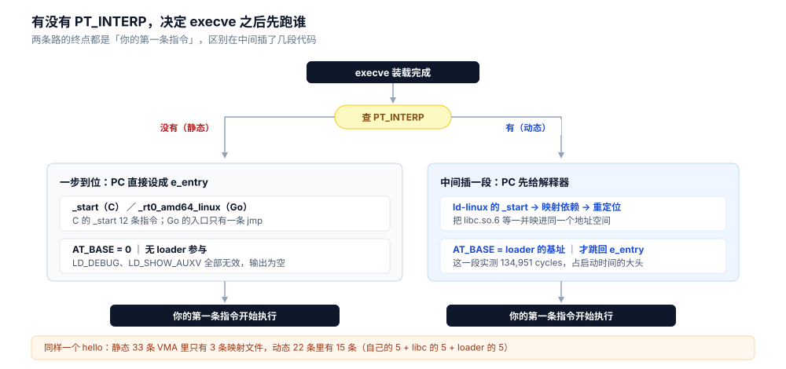

# 从可执行文件到第一条指令

> 一个已经编译好的文件，怎么变成一个正在跑的进程：`execve` 里的五步、`PT_INTERP` 决定的分叉、内核留在栈上的四样东西、段如何变成 VMA、以及「2.3 MB 的二进制只碰了 800 KB 页」的成因。
>
> 本篇**语言无关**：同一个 hello 用 Go（静态）和 C（动态）各编一遍，逐项对照。终点是「你的第一条指令」，属于哪种语言的运行时初始化不在本篇（Go 见 [程序启动流程.md](../../01-编程语言/go/运行时/程序启动流程.md)；PHP 的每请求编译与 Zend 执行另成《执行链路》一篇，尚未落地）。

---

## 一、从零：两条命令看清自己的程序

**本节要点**：不需要读内核源码，`file` 和 `readelf` 两条命令就能把你的程序定性——它是静态还是动态、入口在哪、有几个段、要不要解释器。这四个答案决定了后面整条路径。

### 1.1 先编两个 hello

```bash
# 静态的那个：Go 默认不开 cgo 时就是静态链接
CGO_ENABLED=0 go build -o hello_go hello.go

# 动态的那个：gcc 默认链 glibc
gcc -O2 -o hello_c hello.c
```

```c
// hello.c
#include <stdio.h>
int main(void) { puts("hello"); return 0; }
```

```go
// hello.go
package main

import "fmt"

func main() { fmt.Println("hello") }
```

两个程序做的事一模一样，产物差多少：

| | 字节数 | `file` 的第一句话 |
|---|---|---|
| `hello_go` | **2,397,206** | `ELF 64-bit LSB executable` … `statically linked` |
| `hello_c` | **15,960** | `ELF 64-bit LSB pie executable` … `dynamically linked, interpreter /lib64/ld-linux-x86-64.so.2` |

体积差 **150 倍**。这个差不是「Go 啰嗦」，往下第三节会看到其中 789 KB 根本不会进内存。

### 1.2 六个字段就够定性

```bash
readelf -h hello_go | grep -E 'Type|Entry|Number of program headers'
readelf -l hello_go | grep -E 'INTERP|LOAD|GNU_STACK|GNU_RELRO'
```

| 字段 | `hello_go` | `hello_c` | 它决定了什么 |
|---|---|---|---|
| `Type` | `EXEC` | `DYN`（PIE） | 加载地址固定还是随机 |
| `Entry point` | `0x4805a0` | `0x1070` | 内核最后跳到的那个地址 |
| 程序头数 | **6** | **13** | 段表多长 |
| `PT_LOAD` | **3** 个 | **4** 个 | 要映射几段 |
| `PT_INTERP` | **无** | `/lib64/ld-linux-x86-64.so.2` | 要不要先跑一段别人的代码 |
| `GNU_RELRO` | **无** | 有 | 有没有「先只读、重定位后再放开」的页 |

前五行是所有人都知道的常识，第六行是后面第三节那条分叉的根。

### 1.3 把六个字段读成一句话

`hello_go` 说的是：「我是固定地址的可执行文件，一共三段要映射，我不用别人帮忙，直接从 `0x4805a0` 开始执行。」

`hello_c` 说的是：「我是可以在任意地址加载的文件，四段要映射，但**请先帮我把 `/lib64/ld-linux-x86-64.so.2` 跑起来**，它会去找我的 libc，等它弄完再跳到 `0x1070`。」

后半句就是全部差别的来源。

---

## 二、execve 里的五步

**本节要点**：`execve` 返回 0 的意思是「装载完成、入口地址已设好」，**不是「程序跑过了」**——第一条指令还没执行。中间五步全在内核里，用户态看不到过程，只能看每一步留下的结果。


读法：左边是内核做的动作，右边是「做完之后你用哪条命令能看到什么」。注意第 ⑤ 步的落点不是 `main`——这张图只画到「第一条指令」，`main` 还要再等一段。

### 2.1 前两步：认头、建映射

内核在 `binfmt_elf` 里读文件头，核 `\x7fELF` 与位数；通过后按 `PT_LOAD` 逐段建立 VMA。**这一步只建 VMA，不读页面内容**——这是后面「2.3 MB 只碰 800 KB」的前提。

`execve` 成功后立刻能看到的结果：

```text
$ strace -e trace=execve ./hello_c
execve("./hello_c", ["./hello_c"], 0x7fff05ff8e60 /* 10 vars */) = 0
hello
```

第二个参数是 `argv` 的**指针数组**，第三个是 `envp` 的指针数组。两者都是「用户态地址」，内核会逐个拷到新栈上去——因为旧地址空间马上就要被丢掉。

### 2.2 第三步：找解释器

有 `PT_INTERP` 就去打开那个路径的文件。**打不开就直接返回 `ENOENT`，你自己的程序一个字节都不会执行**。这一步的坑在第七节单独讲，因为它的报错极具误导性。

### 2.3 第四步：在新栈顶摆四样东西

内核在新地址空间的栈顶按下表顺序铺开（从高地址往低方向长）：

```text
高地址
  ┌──────────────┐
  │ 参数字符串 …  │   ← argv[0]、argv[1]、环境变量串，然后是平台串
  ├──────────────┤
  │ AT_NULL      │   ← auxv 结束标记
  │ AT_xxx 值…   │
  ├──────────────┤
  │ envp[0..n]   │   ← 指针数组，以 NULL 结尾
  ├──────────────┤
  │ argv[0..n]   │   ← 指针数组，以 NULL 结尾
  ├──────────────┤
  │ argc         │   ← 就这么一个整数
  └──────────────┘
低地址（rsp 指在这）
```

**`rsp` 恰好指向 `argc`**。这就是为什么 `_start` 的第一条有意义的指令是「从栈顶取参数」，而不是「调用某个函数拿参数」——参数早就在寄存器指向的那块内存里了。

### 2.4 第五步：设 PC

`e_entry` 写进 `pt_regs->ip`，返回用户态。**落点是 `_start`（C）或 `_rt0_amd64_linux`（Go），不是 `main`**。第四节拿两个反汇编逐条对照。

### 2.5 内核留下的三张收据

用户态拿不到「内核刚才做了什么」的直接证据，但有三个数可以核对：

| 收据 | 是什么 | 怎么读 |
|---|---|---|
| `AT_PHDR` | 程序头在**内存**里的地址 | 与 `readelf -l` 里 `PHDR` 的 vaddr 比 |
| `AT_PHNUM` | 程序头有几个 | 与 `readelf -h` 的 `Number of program headers` 比 |
| `AT_ENTRY` | 内核即将跳到的地址 | 与 `readelf -h` 的 `Entry point` 比 |

C 侧用 glibc 自带的开关直接打印：

```text
$ LD_SHOW_AUXV=1 ./hello_c
AT_PHDR:              0x61de378c1040
AT_PHENT:             56
AT_PHNUM:             13
AT_BASE:              0x756dd6f98000
AT_ENTRY:             0x61de378c2070
AT_EXECFN:            ./hello_c
```

核对一遍：`AT_PHNUM = 13` 与 `readelf` 报的 13 个程序头对上；`AT_ENTRY - AT_PHDR = 0x61de378c2070 - 0x61de378c1040 = 0x1030`，而 `readelf` 里 `Entry = 0x1070`、`PHDR` 在 vaddr `0x40`，`0x1070 - 0x40 = 0x1030`——**两边独立算出来的差值一样**，说明这三个数确实是同一份数据。

`LD_SHOW_AUXV` 只对动态程序有效（它由 loader 实现）。静态版要自己读 `/proc/self/auxv`：

```go
// 每项 16 字节：type uint64 + value uint64，遇到 type==0 结束
f, _ := os.ReadFile("/proc/self/auxv")
for i := 0; i+16 <= len(f); i += 16 {
    t := binary.LittleEndian.Uint64(f[i:])
    if t == 0 { break }
    v := binary.LittleEndian.Uint64(f[i+8:])
    // AT_PHDR=3 AT_PHENT=4 AT_PHNUM=5 AT_BASE=7 AT_ENTRY=9
}
```

`hello_go` 读出：

```text
AT_PHDR            0x400040
AT_PHENT           0x38
AT_PHNUM           0x6
AT_BASE            0x0
AT_ENTRY           0x480bc0
```

`AT_PHNUM = 6` 与它的 6 个程序头对上，`AT_PHDR = 0x400040` 与 `PHDR` 的 vaddr `0x400040` 逐位一致。

**`AT_BASE = 0`**。这一条是判据，下一节用。

---

## 三、解释器这一层

**本节要点**：有 `PT_INTERP` 的程序，内核第一次跳的不是你的代码，是 loader 的 `_start`。loader 把你的依赖也映进同一个地址空间、做完重定位、跑完各家的 init，才跳回你的 `e_entry`。这一段实测花掉 13 万个 CPU cycle。



读法：两条路的终点是同一个「你的第一条指令」，区别只在中间插了谁的代码。左边一步到位，右边多了一层；多出来那层的代价见 3.3 的读数。

### 3.1 loader 干了三件事

```text
$ LD_DEBUG=libs ./hello_c
      find library=libc.so.6 [0]; searching
       search cache=/etc/ld.so.cache
        trying file=/lib/x86_64-linux-gnu/libc.so.6
      calling init: /lib64/ld-linux-x86-64.so.2
      calling init: /lib/x86_64-linux-gnu/libc.so.6
      initialize program: ./hello_c
```

1. **找库**：先查 `/etc/ld.so.cache`，未命中再走 `LD_LIBRARY_PATH`、`/etc/ld.so.conf`。找到之后把 `libc.so.6` 的几个 `PT_LOAD` 也映射进**同一个**地址空间。
2. **重定位**：把 ELF 里写死的地址改成运行时真实地址。PIE 程序的 `e_entry` 是相对量，`AT_ENTRY` 是基址加上它之后的绝对量。
3. **调 init**：每个 `.so` 的构造函数按依赖顺序跑一遍，最后才把控制权交给主程序。

### 3.2 读数是 134,951 个 cycle

```text
$ LD_DEBUG=statistics ./hello_c
  total startup time in dynamic loader: 134951 cycles
            time needed for relocation: 37672 cycles (27.9%)
                 number of relocations: 83
      number of relocations from cache: 7
           time needed to load objects: 41136 cycles (30.4%)
```

三个数值得记住：

- **13.5 万 cycle** 是纯开销，静态程序一分不花。
- **重定位占 27.9%、装载对象占 30.4%**，两者合计过半，剩下的才是别的。
- 重定位只有 **83 次**——一个 hello 就要 83 次。这个数随依赖量线性涨，一个中型 Web 服务动辄几万次。

同一条命令对 `hello_go` 无效：

```text
$ LD_DEBUG=libs ./hello_go | wc -l
1        # 只有 "hello" 这一行
$ LD_DEBUG=statistics ./hello_go | wc -l
1
$ LD_SHOW_AUXV=1 ./hello_go | wc -l
1
```

三个开关全部静默。**这不是 Go 特殊，是这三个变量都实现在 loader 里，而静态程序没有 loader**。

### 3.3 `AT_BASE` 是「有没有 loader」的唯一判据

| | `AT_BASE` |
|---|---|
| `hello_go`（静态） | `0x0` |
| `hello_c`（动态） | `0x756dd6f98000` |

`AT_BASE` 的定义就是「解释器被加载到的基址」。没有解释器，这个字段没有任何值可填，只能是 0。

排查时比查 `PT_INTERP` 更快：程序已经在跑，`/proc/PID/auxv` 里第 7 项非 0 就是动态的。

### 3.4 「Go 是静态的」不是语言属性

同一个 `hello.go`，换链接模式：

```bash
CGO_ENABLED=1 go build -ldflags '-linkmode=external' -o hello_go_ext hello.go
```

```text
$ file hello_go_ext
ELF 64-bit LSB executable, x86-64, dynamically linked,
  interpreter /lib64/ld-linux-x86-64.so.2, for GNU/Linux 3.2.0

$ LD_DEBUG=libs ./hello_go_ext | grep -E 'find library|calling init'
      find library=libc.so.6 [0]; searching
      calling init: /lib64/ld-linux-x86-64.so.2
      calling init: /lib/x86_64-linux-gnu/libc.so.6
```

体积 2,380,792 字节，比静态版只小 1.6 万字节，但 **`INTERP` 有了、loader 进来了、三个 `LD_*` 开关全部生效**。

所以准确的说法是：**`CGO_ENABLED=0` 默认走内部链接器、产物静态；换外部链接器（需要 cgo）就回到 glibc 那套**。这与 [编译与gcflags.md](../../01-编程语言/go/工程实践/编译与gcflags.md) 7.1 节两组体积读数是同一件事的两个面——那边看产物大小与部署可行性，这边看装载路径。

---

## 四、第一条指令

**本节要点**：两个入口都只有一件事要做——把内核摆好的 `argc`/`argv` 收下来，转交给下一层。C 用 12 条指令交给 `__libc_start_main`，Go 用 3 条指令交给 `rt0_go`。差别不在入口写法，在「转交给谁」之后那段有多长。

### 4.1 C 的 `_start`：12 条指令

```text
$ objdump -d hello_c | sed -n '/<_start>:/,/^$/p'
0000000000001070 <_start>:
    1070: 31 ed                 xor    %ebp,%ebp
    1072: 49 89 d1              mov    %rdx,%r9
    1075: 5e                    pop    %rsi              ← argc
    1076: 48 89 e2              mov    %rsp,%rdx         ← argv
    1079: 48 83 e4 f0           and    $0xfffffffffffffff0,%rsp
    107d: 50                    push   %rax
    107e: 54                    push   %rsp
    107f: 45 31 c0              xor    %r8d,%r8d
    1082: 31 c9                 xor    %ecx,%ecx
    1084: 48 8d 3d c5 ff ff ff  lea    -0x3b(%rip),%rdi  # 1050 <main>
    108b: ff 15 2f 2f 00 00     call   *0x2f2f(%rip)     # __libc_start_main
    1091: f4                    hlt
```

两处值得停一下：

- `pop %rsi` 弹的就是 **`argc`**，紧接着 `mov %rsp,%rdx` 拿到的是 **`argv` 的地址**。这两条指令是 ABI 的约定，不是巧合——它与 2.3 节的栈布局一一对应。
- `lea -0x3b(%rip),%rdi` 取到的是 `main` 的地址 `0x1050`，**比 `_start` 自己的 `0x1070` 还低 32 字节**。链接器把 `main` 排在入口前面，因为入口只是一段固定的转发代码，位置无所谓。

`call __libc_start_main` 之后才是 libc 的初始化（TLS、`atexit` 链、`__libc_start_call_main`），最后那次才真的调 `main`。

### 4.2 Go 的 `_rt0_amd64_linux`：3 条

```text
$ readelf -h hello_go | grep Entry
  Entry point address:               0x4805a0

$ objdump -d --start-address=0x4805a0 --stop-address=0x4805b0 hello_go
00000000004805a0 <_rt0_amd64_linux>:
  4805a0: e9 1b cf ff ff   jmp  47d4c0 <_rt0_amd64>
  4805a5: cc               int3
```

**一条 `jmp`**，后面全是 `int3` 填充。跳到 `_rt0_amd64`：

```text
000000000047d4c0 <_rt0_amd64>:
  47d4c0: 48 8b 3c 24        mov    (%rsp),%rdi        ← argc
  47d4c4: 48 8d 74 24 08     lea    0x8(%rsp),%rsi     ← argv
  47d4c9: e9 12 00 00 00     jmp    47d4e0 <runtime.rt0_go.abi0>
```

**3 条指令**：`mov (%rsp),%rdi` 取 `argc`，`lea 0x8(%rsp),%rsi` 取 `argv`，然后跳进 `rt0_go`。

与 C 侧对照：`pop %rsi` 对应 `mov (%rsp),%rdi`，`mov %rsp,%rdx` 对应 `lea 0x8(%rsp),%rsi`。**两套完全不同的语言，从栈顶取参数的写法一致到一一对应**——因为都受同一份内核栈布局约束。

`rt0_go` 之后才是 `schedinit`、`mallocinit`、`main` 那一长串，已在 [程序启动流程.md](../../01-编程语言/go/运行时/程序启动流程.md) 逐节拆过，本篇不重复。

### 4.3 入口为什么不是 `main`

```text
$ go tool nm hello_go | grep -E ' T (_rt0_amd64_linux|_rt0_amd64|runtime.rt0_go.abi0|main.main)$'
  47d4c0 T _rt0_amd64
  4805a0 T _rt0_amd64_linux
  47d4e0 T runtime.rt0_go.abi0
  49e140 T main.main
```

`e_entry = 0x4805a0 = _rt0_amd64_linux`，而 `main.main` 在 `0x49e140`，**两者相距 121,760 字节（约 119 KB）**。

这 119 KB 就是从「你的第一条指令」走到「你的 `main`」之间要跑的全部代码。C 侧同样的距离是 **-32 字节**（`main` 在入口之前），因为 libc 的初始化不在你的二进制里。

**判据**：`readelf -h` 的 `Entry point` 与 `go tool nm` 的 `main.main` 之间的差，就是「运行时启动成本」的体积上界。这个数在 Go 里约 100 KB 量级，在任何语言的动态程序里接近于 0（因为大头在 `.so` 里）。

---

## 五、段如何变成 VMA

**本节要点**：程序头里的 `PT_LOAD` 数与 `/proc/PID/maps` 的行数**不是一一对应**。页对齐会让一个段跨页、`GNU_RELRO` 会把一段劈成两行，两者叠加就多出一行。判断程序真实占用只能看 `smaps` 的 `Rss`，不能数行数。


读法：看黄色那两行——`vaddr +0x3000` 与 `vaddr +0x2000` 对应的是**同一个文件页**，只是落到两个不同的虚拟地址。这不是 bug，是页对齐与 RELRO 叠加的必然结果。

### 5.1 数出来的条数

把两个程序都挂起来，读它自己的 maps：

```bash
./sleeper_go & P=$!; sleep 0.4; wc -l < /proc/$P/maps
awk '{ if ($6 ~ /^\//) f++; else a++ } END {print "file=" f, "anon=" a}' /proc/$P/maps
awk '{print $2}' /proc/$P/maps | sort | uniq -c
```

| | 静态 `sleeper_go` | 动态 `sleeper_c` |
|---|---|---|
| VMA 总数 | **33** | **22** |
| 映射到文件的 | **3** | **15** |
| 匿名 | 30 | 7 |
| `---p`（无权限） | **10** | **0** |
| `r--p` / `r-xp` / `rw-p` | 3 / 2 / 18 | 11 / 4 / 7 |

动态程序 15 条映射文件的行里，自己的二进制只占 5 条，`libc.so.6` 5 条，`ld-linux` 5 条：

```text
652aab143000-652aab144000 r--p 00000000  /tmp/sleeper_c
652aab144000-652aab145000 r-xp 00001000  /tmp/sleeper_c
652aab145000-652aab146000 r--p 00002000  /tmp/sleeper_c
652aab146000-652aab147000 r--p 00002000  /tmp/sleeper_c     ← 同一偏移第二次
652aab147000-652aab148000 rw-p 00003000  /tmp/sleeper_c
7c4f7499b000-7c4f74b17000 r-xp 00026000  /usr/lib/x86_64-linux-gnu/libc.so.6
...
7c4f74b8b000-7c4f74bb1000 r-xp 00001000  /usr/lib/x86_64-linux-gnu/ld-linux-x86-64.so.2
```

### 5.2 第 5 条从哪来

两条原因叠加：

1. **`LOAD ③` 只有 `0xdc` 字节，不到一页。** 链接器为了让 `LOAD ④` 页对齐，把它的 `vaddr` 抬到 `0x3dd0`，而文件偏移还是 `0x2dd0`——**两者相差整一页**。内核映射时 `vaddr` 取 `0x3000`、`offset` 取 `0x2000`，于是同一个文件页 `0x2000` 出现在两个虚拟地址上。
2. **`GNU_RELRO` 把 `LOAD ④` 的前一段先设成只读。** 重定位必须写这块内存，写完再 `mprotect` 成只读；所以它比后面那段 `rw-p` 早出现一行，权限也不同。

Go 侧三条 `LOAD` 变成三条 VMA，因为它的 `vaddr` 与 `offset` 恒等（每段从整页开始）、也没有 `GNU_RELRO`。**「段数 ≠ VMA 数」只在动态 + RELRO 同时成立时才出现。**

### 5.3 那 10 条 `---p` 不是栈保护页

`sleeper_go` 的 maps 里 10 条 `rsp` 为 `00000000`、权限 `---p` 的行，名字都叫 `[anon: Go: ...]`：

```text
3bcf10000000-3bcf13c00000 ---p  [anon: Go: heap reservation]
7570de000000-7570f579e000 ---p  [anon: Go: scavenge index]
7570fe000000-75711579e000 ---p  [anon: Go: page summary]
```

这些是 Go 运行时**预留但不提交**的虚拟地址区间——地址占住了，页表项没建，访问即段错误。`heap reservation` 一条就有 60 MB。

它们不是 goroutine 栈的 guard page（主协程的栈在 `[stack]` 里，只有 132 KB）。**看到一个 `---p` 就断定是栈保护是错的**，要看它后面的名字。

---

## 六、缺页：2.3 MB 只用 800 KB

**本节要点**：`PT_LOAD` 建的是 VMA，不是内存。页面要等真正被访问才从文件读进来（缺页），所以「二进制多大」和「启动要读多少」是两个数。

### 6.1 按需缺页的读数

```bash
cp hello_go hello_c /tmp/     # 关键：放到容器自己的文件系统里，别放挂载目录
/usr/bin/time -v /tmp/hello_go 2>&1 | grep -E 'Minor|Major|Maximum'
```

| | 静态 `hello_go` | 动态 `hello_c` |
|---|---|---|
| 文件大小 | 2,397,206 B | 15,960 B |
| minor fault | **216 ~ 265** | **71 ~ 76** |
| major fault | 0 | 0 |
| 最大常驻（RSS） | 1,804 ~ 1,932 KB | 1,132 ~ 1,264 KB |

**体积差 150 倍，缺页只差 3 倍**。2.3 MB 的文件里，启动过程真正碰到的页约 0.84~1.04 MB（216~265 页 × 4 KB），其余的页从未被访问，也就从未被读。

反过来，动态程序的 71 次少得不多，因为它必须把 `libc` 的代码页也搬进来——`smaps` 能看到 `libc` 的 `Rss` 是 780 KB，是自己二进制（16 KB）的 **48 倍**。**动态链接的程序，占内存的从来不是你的代码。**

### 6.2 预留 1.2 GB，碰 544 kB

`smaps` 里按映射名汇总，静态程序的匿名区：

| 映射 | `Size` | `Rss` |
|---|---|---|
| `[anon: Go: ...]` 合计 | **1,225,416 KB** | **544 KB** |
| `/tmp/sleeper_go` | 1,308 KB | 1,308 KB |

**预留 1.2 GB 虚拟地址，实际碰了 544 KB**，比例约 1:2250。这就是 5.3 节那 10 条 `---p` 的实际代价：地址空间是免费的，页表项和物理页才要钱。

静态程序的二进制只映射了 1,308 KB，比文件（2,341 KB）小 1,033 KB——差的那部分正是 `.symtab`、`.debug_*` 这些**不在任何 `PT_LOAD` 里**的段。

### 6.3 顺手验一句常听到的话

「`-s -w` 能减小二进制，所以程序启动更快、占内存更少。」

```text
$ CGO_ENABLED=0 go build -ldflags '-s -w' -o hello_go_sw hello.go
hello_go        2,397,206
hello_go_sw     1,589,410     ← 少了 789 KB
```

但两者缺页数是 **231/215/246** 与 **230/231/231**——**完全一样**。

原因已经在 6.2 节：被裁掉的符号段不在 `PT_LOAD` 里，从来不参与映射，也就从来不会缺页。裁符号只省磁盘和镜像层，**不省内存、不影响启动**。这个结论在镜像瘦身时很重要（见 [编译与gcflags.md](../../01-编程语言/go/工程实践/编译与gcflags.md) 4.2 与 7.3 的体积读数）。

### 6.4 一个会让读数全错的陷阱

第一次在挂载目录里测，得到的是另一组数：

```text
--- 在 /lab（宿主 bind mount）里 ---
hello_go   Major fault: 34   Minor: 221
hello_c    Major fault:  1   Minor:  70
```

`major fault = 34` 意味着「有 34 次真要从存储读」。但同两个文件复制到 `/tmp` 再测，**两个程序的 major fault 全部变成 0**。

差别只在文件位置：`/lab` 是 Docker Desktop 挂到宿主的目录，走的是 virtiofs，**不受 Linux 页缓存管理**；`/tmp` 在容器自己的文件系统里，第二次读就命中页缓存。

**判据**：任何与「文件页是否驻留」有关的测量，二进制必须放在容器内路径或 `--tmpfs`，否则测到的是文件共享层的行为。这一条不写进口径，读数就没法复现。

---

## 七、出问题按什么顺序查

**本节要点**：装载阶段失败的报错都发生在你的第一行代码之前，所以日志里什么都不会有。按「内核能不能装载 → loader 能不能跑 → 入口对不对 → 依赖找不找得到」四层往下走，每层都有一条命令。

### 7.1 四层判据

| 层 | 现象 | 命令 | 判据 |
|---|---|---|---|
| ① 内核装载 | `exec format error`（退出码 126） | `file ./prog`、`readelf -h` | 架构对不对、是不是 ELF |
| ② 解释器 | `cannot execute: required file not found`（127） | `readelf -l \| grep INTERP` | 那个路径在**目标机器**上存不存在 |
| ③ 入口 | 起来了但立刻退，无输出 | `readelf -h \| grep Entry`、`gdb` 断点 | 入口地址落在哪个段内 |
| ④ 依赖 | `error while loading shared libraries: X` | `LD_DEBUG=libs`、`ldd` | 找库的搜索路径命中没有 |

### 7.2 `ENOENT` 有两种含义

把动态程序的解释器改成一个不存在的路径：

```text
$ patchelf --set-interpreter /nonexistent/ld-musl-x86_64.so.1 bad_interp
$ ./bad_interp
bash: ./bad_interp: cannot execute: required file not found
退出码 = 127

$ strace -e trace=execve ./bad_interp
execve("./bad_interp", ["./bad_interp"], 0x7ffdb428c660 /* 10 vars */) = -1
  ENOENT (No such file or directory)
```

**但文件就在那儿，16,736 字节。**

内核在 `load_elf_binary` 里打开解释器失败时，把 `ENOENT` 原样返回给调用者，而调用者（shell）只能用**你给的路径**拼错误信息。于是「解释器不存在」被报成了「你的文件不存在」。

这就是 `debian` 编译、`alpine` 运行时报 `not found` 的全部机制（那个事故的部署视角见 [编译与gcflags.md](../../01-编程语言/go/工程实践/编译与gcflags.md) 7.2）。**看到 `not found` 但 `ls` 有文件，第一件事是 `readelf -l | grep INTERP`，不是重装。**

### 7.3 另外三个高频故障

| 现象 | 根因 | 一条命令确认 |
|---|---|---|
| `exec format error` | 架构不符（`arm64` 产物在 `amd64` 上跑） | `readelf -h \| grep Machine` |
| `error while loading shared libraries` | 依赖库不在搜索路径 | `LD_DEBUG=libs ./prog 2>&1 \| grep 'find library'` |
| 启动慢但 CPU 不高 | 装载阶段在等存储（major fault） | `/usr/bin/time -v ./prog \| grep -i major` |

判据：**这三条都发生在 `main` 之前**，所以任何「在 `main` 里打日志」的做法都看不到它们。只能用文件层的工具查。

---

## 八、三组结论

**本节要点**：这一整篇可以压成三句话，每句都有前面的读数支撑。

1. **`execve` 返回 0 只代表装载完成。** 入口地址设好了，第一条指令还没执行。中间五步全在内核里，落地物是 VMA、栈上的四样东西、和 `AT_PHDR`/`AT_PHNUM`/`AT_ENTRY` 三个可核对的数。
2. **`PT_INTERP` 是唯一的分叉点。** 有它，内核先跑 loader，多花 13.5 万 cycle，`AT_BASE` 非 0，VMA 里多出 10 条别人的映射；没有它，一步到位，三个 `LD_*` 开关全部失效。而「有没有它」是链接模式决定的，不是语言决定的——`-linkmode=external` 能让 Go 也变成动态。
3. **段数与内存占用要分开算。** `PT_LOAD` 建 VMA 不建页；文件 2.3 MB、映射 1.3 MB、真正碰不到 1 MB 是三个数。裁符号省的是文件，不省内存；预留 1.2 GB 地址空间只碰 544 KB，因为地址免费、页表才要钱。

---

## 校验口径

> ✅ 真跑（`golang:1.26-bookworm`，单容器，内核 6.18.54.1-microsoft-standard-WSL2）：go1.26.8 linux/amd64、gcc 12.2.0、glibc 2.36、binutils readelf/objdump、strace 6.1、patchelf。

**实测覆盖**

| 项 | 手段 | 读数位置 |
|---|---|---|
| ELF 头与程序头 | `readelf -h/-l/-S` | 1.2、3.4、5.3 |
| 解释器与 RELRO | `readelf -l` | 2.2、5.2 |
| 系统调用 | `strace -e trace=execve` | 2.1、7.2 |
| 栈上布局 | `LD_SHOW_AUXV=1`、`/proc/self/auxv` | 2.5 |
| loader 行为 | `LD_DEBUG=libs/statistics` | 3.1、3.2 |
| 地址空间 | `/proc/PID/maps`、`/proc/PID/smaps` | 5.1、6.2 |
| 缺页 | `/usr/bin/time -v` | 6.1、6.3、6.4 |
| 入口指令 | `objdump -d`、`go tool nm` | 4.1~4.3 |

**未实测与边界**

- ⚠️ 内核是 **WSL2 定制内核**（`6.18.54.1-microsoft-standard`），不是主线发行版内核。`binfmt_elf` 的装载路径与主线同源，ELF/auxv/入口行为可迁移；但页缓存行为受 virtiofs 影响，6.4 节已单独标出。
- ⚠️ 只测了 **x86-64**。`aarch64` 的 `_start` 与入口汇编完全不同（`arm64` 的 Go 入口是 `_rt0_arm64_linux`），结论中「12 条 / 3 条指令」这类数字不可外推。
- ⚠️ 未测 **`LD_PRELOAD`、静态 PIE（`-buildmode=pie`）、`musl`** 三条路径。静态 PIE 会让 `Type` 变 `DYN` 而 `AT_BASE` 仍为 0，本篇的判据对它需要修正。
- 缺页读数连跑 3 次给区间；`LD_DEBUG=statistics` 的 cycle 数只取了一轮，不同机器频率下绝对值会变，**比例（27.9% / 30.4%）才是可迁移的部分**。

**可复现**

```bash
docker run -d --name elflab --cap-add SYS_PTRACE --cap-add SYS_ADMIN \
  -v "$PWD":/lab golang:1.26-bookworm sleep infinity
docker exec elflab bash -c "apt-get update && apt-get install -y strace file patchelf"
# 所有读数按第二~六节的命令逐条重跑
```

---

## 延伸追问

- **为什么 `AT_PHDR` 不是文件偏移而是内存地址？** 因为 loader 要能在运行时遍历程序头（例如为了找 `PT_GNU_RELRO` 做 `mprotect`），而 PIE 程序的加载地址是随机的。内核算好基址后直接给出绝对地址，省掉一次加法。
- **`ENTRY` 与 `AT_ENTRY` 一定是同一个值吗？** 静态程序是；动态程序不是——`readelf -h` 给的是文件里的相对量，`AT_ENTRY` 是加上 loader 算出的基址之后的绝对量。本文两次核对都用「差值相等」而不是「数值相等」，原因在此。
- **`hlt` 之后还会回到 `_start` 吗？** 不会。`__libc_start_main` 正常情况下不返回；万一返回，`hlt` 会触发 `SIGSEGV`——这是有意为之，让「libc 提前返回」变成一个立刻可见的崩溃而不是跑到未知地址。
- **`--cap-add SYS_ADMIN` 是不是必须的？** 本篇的命令不需要；它进容器只是为后续可能的重挂 `/proc/sys` 留口子（造冷读要用）。只跑第二~六节的命令，`SYS_PTRACE` 就够 `strace` 用。

## 关联

- [程序启动流程.md](../../01-编程语言/go/运行时/程序启动流程.md) — **下游机制**。本篇终点是 `_rt0_amd64_linux` 的第一条指令，那篇从这条指令接着讲到 `main.main`。
- 《从源码到 main》（Go 侧，待补） — **上游阶段**。本篇起点是可执行文件，那篇讲源文件怎么变成它。
- [编译与gcflags.md](../../01-编程语言/go/工程实践/编译与gcflags.md) — **互补**。本篇讲装载机制，那篇讲产物形态与部署可行性（`-s -w` 体积、CGO 静态/动态、debian→alpine 事故）。
- 《执行链路》（PHP 侧，待补） — **另一条路**。php-fpm 走完本篇的第③段之后，进入「每请求编译一遍」的第二层。
- 《AOT、JIT 与解释执行》（待补） — **总纲·对照**。三条路线的取舍，本篇是它们共同的前半段。
- [用户态内核态与一次IO的内存路径.md](../操作系统/用户态内核态与一次IO的内存路径.md) — **互补**。本篇讲地址空间怎么建，那篇讲建好之后数据怎么穿过两态。
- [目录.md](../../目录.md) — 全仓索引
