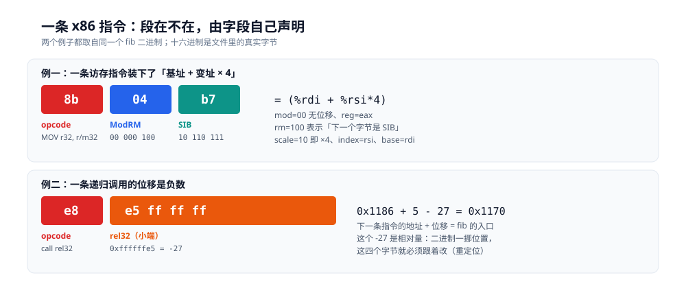

# 机器码、字节码与 opcode

> 同一段 `fib`，三种形态：C 编出来的函数体 **49 字节**、`javac` 编出来的 `Code` 属性 **23 字节**、PHP 编出来的 **19 条 opcode**。指令条数几乎一样（21 / 16 / 19），字节数差一倍多——差别不在「编译到多深一层」，在「**谁来吃它**」。
>
> 本篇补的是 [AOT、JIT与解释执行.md](AOT、JIT与解释执行.md) 2.5 节那张判据表里「产物形态」一列：那列写了「机器码 / 字节码 / opcode」三个词，但没解释它们的区别到底在哪。速度对照仍在那边，本篇只讲**形态与编码**。
>
> 素材来源：本机 Docker 实测，三个容器同一宿主机（4 核）：`gcc 12.2.0`（Debian 12）、`eclipse-temurin:17-jdk`（javac 17）、`php:8.0-cli`（8.0.30）。

---

## 一、从零：同一段 fib，三种形态各长什么样

**本节要点**：不看文档，直接让三种产物自己说话。三份代码语义完全相同，编出来的东西长度差一倍、条数却几乎一样——这个反差就是全篇的起点。

### 1.1 三份等价代码

```c
/* fib.c */
long fib(int n) { return n < 2 ? n : fib(n - 1) + fib(n - 2); }
```

```java
// Fib.java
static int fib(int n) { return n < 2 ? n : fib(n - 1) + fib(n - 2); }
```

```php
<?php
function fib(int $n): int { return $n < 2 ? $n : fib($n - 1) + fib($n - 2); }
```

三份都能直接跑，语义一致（`fib(20)` 都是 6765）。下面看各自的产物。

### 1.2 三种形态的第一手读数

**机器码**（`gcc -O2 -fno-inline`，`objdump -d`）：

```text
0000000000001170 <fib>:
    1170:  41 54                 push   %r12
    1172:  45 31 e4              xor    %r12d,%r12d
    1175:  55                    push   %rbp
    1176:  89 fd                 mov    %edi,%ebp
    1178:  53                    push   %rbx
    1179:  83 ff 01              cmp    $0x1,%edi
    117c:  7e 18                 jle    1196 <fib+0x26>
    117e:  89 fb                 mov    %edi,%ebx
    1180:  8d 7b ff              lea    -0x1(%rbx),%edi
    1183:  83 eb 02              sub    $0x2,%ebx
    1186:  e8 e5 ff ff ff        call   1170 <fib>
    118b:  49 01 c4              add    %rax,%r12
    118e:  83 fb 01              cmp    $0x1,%ebx
    1191:  7f ed                 jg     1180 <fib+0x10>
    1193:  83 e5 01              and    $0x1,%ebp
    1196:  48 63 c5              movslq %ebp,%rax
    1199:  5b                    pop    %rbx
    119a:  5d                    pop    %rbp
    119b:  4c 01 e0              add    %r12,%rax
    119e:  41 5c                 pop    %r12
    11a0:  c3                    ret
```

`nm -S` 报的 size 是 `0x31` = **49 字节**，数下来 **21 条**指令，平均 **2.33 字节/条**。

**字节码**（`javac` 17 + `javap -c -p`）：

```text
static int fib(int);
  Code:
     0: iload_0
     1: iconst_2
     2: if_icmpge     9
     5: iload_0
     6: goto          22
     9: iload_0
    10: iconst_1
    11: isub
    12: invokestatic  #7                  // Method fib:(I)I
    15: iload_0
    16: iconst_2
    17: isub
    18: invokestatic  #7                  // Method fib:(I)I
    21: iadd
    22: ireturn
```

最后一条指令在偏移 22、长 1 字节，所以 `code_length` = **23 字节**，**16 条**，平均 **1.44 字节/条**。

**opcode**（`php -d opcache.opt_debug_level=0x10000`）：

```text
fib:
     ; (lines=19, args=1, vars=1, tmps=7)
0000 CV0($n) = RECV 1
0001 T1 = IS_SMALLER CV0($n) int(2)
0002 JMPZ T1 0005
0003 T2 = QM_ASSIGN CV0($n)
0004 JMP 0015
0005 INIT_FCALL_BY_NAME 1 string("fib")
0006 T3 = SUB CV0($n) int(1)
0007 SEND_VAL_EX T3 1
0008 V4 = DO_FCALL_BY_NAME
0009 INIT_FCALL_BY_NAME 1 string("fib")
0010 T5 = SUB CV0($n) int(2)
0011 SEND_VAL_EX T5 1
0012 V6 = DO_FCALL_BY_NAME
0013 T7 = ADD V4 V6
0014 T2 = QM_ASSIGN T7
0015 VERIFY_RETURN_TYPE T2
0016 RETURN T2
0017 VERIFY_RETURN_TYPE
0018 RETURN null
```

**19 条**，编号 `0000` ~ `0018`，4 位十进制、按序号递增。

### 1.3 三个数字先说明什么

| 形态 | 指令条数 | 字节数 | 平均 | 谁生成的 |
|---|---|---|---|---|
| 机器码（`gcc -O2 -fno-inline`） | 21 | **49** | 2.33 | 编译器后端 |
| 字节码（`javac` 17） | 16 | **23** | 1.44 | 编译器前端 + 后端 |
| opcode（PHP 8.0） | 19 | 每条一个结构体 | — | 编译器，但每请求重来（命中 opcache 时复用） |


读法：三行的小方块数量几乎一样（21 / 16 / 19 条），但右侧体积差一倍多（49 / 23 字节）。最后一行没有字节数——opcode 是结构体数组，体积要按结构体大小算，本轮没有实测，所以留空而不是估一个。

两点值得先记住：

1. **条数几乎一样**（21 / 16 / 19）。这说明「同一段逻辑需要多少步」是语言无关的——三种形态在同一个抽象层次上描述计算。
2. **字节数差一倍多**（49 vs 23）。这一段差距完全不来自「逻辑复杂度」，只来自**编码格式**：x86 是变长编码，字段要按位塞；JVM 是定长前缀，操作数固定长度。

再补一个容易被忽略的读数：把 `-fno-inline` 去掉，同一个 `fib` 从 49 字节涨到 **958 字节**（`0x3be`）。

```bash
gcc -O2            -o fib_a fib.c && nm -S fib_a | grep ' T fib$'   # 0000000000001170 00000000000003be T fib
gcc -O2 -fno-inline -o fib_b fib.c && nm -S fib_b | grep ' T fib$'  # 0000000000001170 0000000000000031 T fib
```

**20 倍**。机器码的体积是被优化决策决定的（这里是递归被深内联展开），而字节码的体积由类文件格式决定，`javac` 只有 `-g` 那点调试信息的开关能动它。

---

## 二、原理：三个词的区分不在「深度」，在「消费者」

**本节要点**：把三者想成「同一件事越编越低」是错的。判据是**谁读它**——CPU 的译码器、一个用机器码写的解释器、还是一个 `switch`。消费者决定了编码格式能有多「方便」。

### 2.1 机器码的消费者：CPU 的译码器

译码器是**硬件**，它必须在一个时钟周期内从一串字节里切出指令边界。x86 的指令长度是 1 ~ 15 字节，切错一个字节整条流就废了，所以编码必须自描述：前缀字段声明后面有多长。

这就解释了 49 字节里那些看着别扭的填空：

- `41 54` 而不是 `54`——`41` 是 REX 前缀，声明「我要用 `r12` 这个扩展寄存器」；
- `7e 18` 里的 `18` 是**相对位移**，跳多远取决于这条指令自己的位置；
- `e8 e5 ff ff ff` 里的 4 个字节是负数——往回跳。

硬件不认名字，只认字段。所以机器码里没有「变量 `n`」这种东西，只有「第 5 号寄存器」。

### 2.2 字节码的消费者：一个用机器码写的解释器

JVM 的 `iload_0` 不被任何硬件认识。它是**另一个程序**读的数据，那个程序（HotSpot 的解释器）本身是编译好的机器码。

```text
你的代码 → javac → 字节码 → [HotSpot 解释器（机器码）] → CPU
                              ↑
                        这一层是软件，不是硅
```

所以字节码可以「为读取方便」而设计：每条指令以单字节 opcode 开头，操作数长度由 opcode 决定，没有位域、没有变长前缀。`iload_0` 就是 `0x1a` 一个字节，`iconst_2` 就是 `0x05`。

代价是**多了一层间接**：JVM 要先把字节码读进内存、建立方法表、再逐条派发。这也是为什么同一个 `fib`，Java 冷启动时走的路径比 C 长。

### 2.3 opcode 的消费者：一个 `switch`

PHP 的 opcode 更「软」：它不是字节流，而是**结构体数组**。`Zend/zend_compile.h` 里 `zend_op` 的字段是 `opcode`（一个枚举）、`op1`/`op2`/`result`（各是一个 `znode`）、`extended_value`、`lineno`。

执行时 `Zend/zend_vm_execute.h` 干的事大致是：

```c
while (1) {
    const zend_op *opline = EX(opline);
    switch (opline->opcode) {
        case ZEND_ADD:      /* ... */ break;
        case ZEND_ASSIGN:   /* ... */ break;
        /* 每条 opcode 一个 case */
    }
    EX(opline) = opline + 1;
}
```

所以 opcode 的名字（`FETCH_IS`、`DO_ICALL`）是**枚举常量名**，不是字节值。`php -d opcache.opt_debug_level` 打印时把它们翻译成了助记符。

⭐ 这带来一个直接后果：**opcode 不可能像机器码那样紧凑**。每条 `zend_op` 都要按结构体对齐，装 4 个字段加行号，体积比等价字节码大得多。PHP 用这点空间换了「编译极快」——它不需要做寄存器分配，`T1`/`CV0` 这样的编号就是槽位下标。

### 2.4 三者的统一：所有解释器最终都跑机器码

看起来是三层，实际是两层：

| 层 | 里面是什么 | 谁执行 |
|---|---|---|
| 你的代码编译成的东西 | 机器码 / 字节码 / opcode | `fib` 本身 |
| 执行它的那个东西 | 解释器、JIT 编译器、VM 派发循环 | **全是机器码** |

`Zend VM` 那个 `switch` 编译出来，就是一堆 `cmp` + `jne` + `jmp`。JVM 的解释器同理。所以「解释执行」不是「不产生机器码」，而是「**机器码不是你写的这段代码，是那个解释器**」。

⭐ 这条判断能解释一个常见困惑：为什么 PHP 开了 JIT 也只是快 2.7 ~ 3.0 倍（[AOT、JIT与解释执行.md](AOT、JIT与解释执行.md) 3.2 的读数）？因为 JIT 只是把**热点那段 opcode** 编成机器码，冷路径仍然回落到 `switch`。而 `fib` 这种全递归的基准，热点覆盖率再高也架不住每次调用都要查一遍函数表。

### 2.5 判据表

| 判据 | 机器码 | 字节码 | opcode |
|---|---|---|---|
| 消费者 | CPU 译码器（硬件） | JVM 解释器（软件） | VM 的 `switch`（软件） |
| 编码单元 | 变长字节（1 ~ 15） | 单字节 opcode + 定长操作数 | 固定大小的结构体 |
| 操作数怎么写 | 寄存器号 / 位移 / 立即数，按位塞 | 局部变量表槽位下标 | 临时变量编号（`T1`、`CV0`） |
| 类型信息 | 部分保留（靠指令宽度） | **保留**（`iadd` / `fadd` / `ladd`） | **丢了**（`ADD` 一条管所有） |
| 变量名 | 无 | 无（只有槽位号，`-g` 才有调试表） | 无（`CV0($n)` 里的 `$n` 是调试信息） |
| 换平台要什么 | 重新编译 | 换一个 JVM | 换一个 PHP |
| 谁生成 | 编译器后端 | 编译器 | 编译器（每请求，或 opcache 命中） |

---

## 三、机器码：变长字节流怎么读

**本节要点**：x86 的每条指令都是「前缀 + opcode + 寻址 + 位移 + 立即数」里若干段的拼接，段在不在由字段自己声明。看懂 `e8 e5 ff ff ff`，就懂了为什么机器码不可移植。

### 3.1 一条 `call` 的五个字节

`fib` 第 11 条是 `e8 e5 ff ff ff`，它调用自己（递归）。拆开看：

```text
e8              E8 cd           call rel32
e5 ff ff ff     小端 int32      = 0xffffffe5 = -27
```

跳转目标是「**下一条指令的地址 + 位移**」，不是「当前指令 + 位移」：

```text
0x1186 + 5 (指令自身长度) + (-27) = 0x118b - 0x1b = 0x1170  ← 正是 fib 的入口
```

`objdump` 已经替我们算好并显示成 `call 1170 <fib>`。自己动手算一遍的价值在于：**这个 `-27` 是相对量**。同一段代码，只要链接器把它挪到别的位置，这 4 个字节就得跟着改——这就是「重定位」要干的事（[从可执行文件到第一条指令.md](从可执行文件到第一条指令.md) 3.1 节）。

⭐ 顺带解释一个常见现象：为什么反汇编出来的地址和 `nm` 的不一致时程序就错了？因为相对位移是按「这条指令在这里」算出来的，地址基准一错，`-27` 落到的地方就不是 `fib` 了。

### 3.2 REX / ModRM / SIB：一个字节装三个字段

再看 `loadScaled(int *p, int i) { return p[i] + 1; }`（`gcc -O2`）：

```text
0000000000001180 <loadScaled>:
    1180:  48 63 f6        movslq %esi,%rsi
    1183:  8b 04 b7        mov    (%rdi,%rsi,4),%eax
    1186:  83 c0 01        add    $0x1,%eax
    1189:  c3              ret
```

`8b 04 b7` 三个字节，装下了「读内存 + 基址 + 变址 + 比例」四件事：

| 字节 | 字段 | 读法 |
|---|---|---|
| `8b` | opcode | `MOV r32, r/m32` |
| `04` | ModRM | `00 000 100` → mod=00（无位移）、reg=000（`eax`）、rm=100（**后面跟 SIB**） |
| `b7` | SIB | `10 110 111` → scale=`10`（×4）、index=`110`（`rsi`）、base=`111`（`rdi`） |

拼起来就是 `(%rdi + %rsi*4)`，正是 `int` 数组的 `p[i]`。**没有 `[]` 这种语法概念，只有「基址 + 变址 × 2^scale」的算术。**



读法：上面一行三个字节各管一件事——`8b` 说做什么，`04` 说操作数怎么寻址（并声明「后面还有 SIB」），`b7` 说基址、变址、比例各是谁。下面一行是同一个二进制里的递归调用，四位位移是 `0xffffffe5`，也就是 -27。

ModRM 的 `rm=100` 是个特殊约定：它不是「寄存器 4」，而是「**下一个字节是 SIB**」。同理 `mod=00` 且 `rm=101` 表示「后面跟一个 32 位位移」。**指令长度不是查表得来的，是边读边算出来的**——这是 x86 译码器复杂度的来源，也是它每周期只能译 4 ~ 5 条的原因（RISC 定长指令能到 6 ~ 8 条）。

### 3.3 为什么平均 2.33 字节

`fib` 那 21 条指令的长度分布：1 字节的 5 条（`push`/`pop`/`ret`）、2 字节的 6 条、3 字节的 9 条、5 字节的 1 条。加起来 5×1 + 6×2 + 9×3 + 1×5 = 49，与 `nm` 的 size 一致。平均 2.33。

对比 JVM 的 1.44：JVM 里 `iload_0`（1 字节，操作数隐含在 opcode 里）、`invokestatic`（3 字节：opcode + 2 字节常量池下标）是最长的。**`fib` 这段用到的指令不超过 3 字节**，因为操作数宽度固定（常量池下标 2 字节）。

⭐ 这个差别有个直接的工程后果：**同规模的方法，x86 的 `I-cache` 压力更大**。`fib` 49 字节 vs 字节码 23 字节，两者在 L1i（本机 32 KiB/核）里都放得下，但一个几百万行的方法体就未必了。这也是为什么 JIT 特别在意「代码缓存」的大小。

---

## 四、字节码：定长编码换来了什么

**本节要点**：字节码用「浪费一点空间换读取简单」——每个字段长度固定、没有位域、没有变长前缀。代价是它必须配一个解释器，而这个解释器的版本号就是字节码的失效边界。

### 4.1 class 文件的前 8 个字节

```text
$ od -A x -t x1 -N 16 Fib.class
000000 ca fe ba be 00 00 00 3d 00 20 0a 00 02 00 03 07
```

| 字节 | 含义 |
|---|---|
| `ca fe ba be` | 魔数，四个字节固定 |
| `00 00 00 3d` | 版本号：minor=0，major=**0x3d = 61** |
| `00 20` | 常量池计数 = 32（规范里这个数比实际项数多 1，即 31 项） |
| `0a 00 02 00 03` | 第 1 项：`CONSTANT_Methodref`（tag `0a`），指向 #2 和 #3 |

`61` 对应 Java 17。整个 `Fib.class` 是 **491 字节**，其中 `fib` 的指令只占 **23 字节**——其余是常量池、方法表、`Code` 属性的头部（`max_stack` / `max_locals`）、`LineNumberTable` 这些**为了被快速读取而存在的元数据**。

### 4.2 单字节 opcode 与局部变量表槽位

`iload_0` 的字节值是 `0x1a`。JVM 规范里 `iload_0` ~ `iload_3` 各占一个 opcode（`0x1a` ~ `0x1d`），专门用来省掉「加载第 0 个 int 局部变量」时那个操作数字节。

这跟 x86 的 `push %r12` 要用 `41 54`（前缀 + opcode）是同一个动机的两面：**高频操作给短编码**。区别是 JVM 用「多占一个 opcode 编号」来省字节，x86 用「加一个前缀字节」来扩展寄存器。

操作数写的是**局部变量表的下标**，不是寄存器号：

```text
 0: iload_0        ← 直接读槽位 0（就是参数 n），不带操作数
 1: iconst_2       ← 常量 2 也有专用 opcode，不带操作数
 2: if_icmpge 9    ← 唯一带操作数的一条，2 字节的跳转目标
```

`iconst_0` ~ `iconst_5` 六个 opcode 专门表示 0 ~ 5 这六个常量。所以 `n < 2` 编译出来是 `iload_0` + `iconst_2` + `if_icmpge`——**两条是零操作数的单字节指令**，这正是 23 字节能装下 16 条指令的原因。

### 4.3 版本号就是可移植性的边界

`major=61` 只能被 JVM 17 及以上加载。用 Java 8 跑同一个 `.class`：

```text
$ java Fib
Error: A JNI error has occurred, please check your installation and try again
Exception in thread "main" java.lang.UnsupportedClassVersionError: Fib has been compiled
by a more recent version of the Java Runtime (class file version 61.0), this version of
the Java Runtime only recognizes class file versions up to 52.0
```

**52.0 = Java 8**。报错发生在 `ClassLoader.defineClass1` 里，也就是**加载阶段**，还没到执行。

⭐ 这就是字节码「跨平台」的真实边界：跨的是 CPU 架构（同一份 `.class` 在 x86 和 arm64 上都能跑），不跨的是 JVM 版本。`javac --release 8` 能把版本号降到 52，但前提是代码里没用 8 之后的新 API——**兼容性由编译选项控制，不是由字节码格式自动保证**。

### 4.4 定长编码的代价

JVM 的 `Code` 属性里每条指令的偏移是**顺序递增**的：`0,1,2,5,6,9,10,11,12,15,16,17,18,21,22`。看偏移就能算出每条指令的长度：

- 偏移 2 → 5，说明 `if_icmpge` 占 3 字节（1 opcode + 2 操作数）
- 偏移 12 → 15，`invokestatic` 也是 3 字节
- 其余相邻偏移差 1，全是单字节指令

这种「长度靠 opcode 查表」的设计让译码（在 JVM 里叫 dispatch）变成一次数组索引，而不是 x86 那种边读边算。**代价是常用的单字节 opcode 只能带固定宽度的操作数**，所以 `invokestatic` 的常量池下标是 2 字节，常量池最多 65535 项——这是「一个类不能有超过 65535 个常量」这条限制的来源。

⚠️ 这句话不能推广成「JVM 指令都不超过 3 字节」：`goto_w`、`invokeinterface`、`multianewarray` 是 5、5、4 字节，`tableswitch` / `lookupswitch` 更是变长。`fib` 里一条都没用上。

---

## 五、opcode：为什么不叫字节码

**本节要点**：PHP 的编译产物不是字节流，是结构体数组。它牺牲了体积，换来了「编译器可以非常简单」——不需要寄存器分配，不需要紧凑编码。

### 5.1 每条 opcode 是一个结构体

`Zend/zend_compile.h` 里 `zend_op` 的字段：

| 字段 | 装什么 |
|---|---|
| `opcode` | 枚举值，决定走哪个 `case` |
| `op1` / `op2` | 两个输入操作数，各是一个 `znode`（可以是常量、临时变量、CV） |
| `result` | 输出槽位 |
| `extended_value` | 额外的整型参数（如 `INIT_FCALL` 的参数个数） |
| `lineno` | 行号，给报错和调试用 |

所以 dump 出来的 `0006 T3 = SUB CV0($n) int(1)` 是**一行结构体**：`opcode=ZEND_SUB`、`op1=CV0`、`op2=常量 1`、`result=T3`。编号 `0006` 是这个结构体在数组里的下标。

⭐ 序号是 4 位十进制、顺序递增。它跟 JVM 的「字节偏移」不是一回事——opcode 数组里每条**等长**，所以下标 × 结构体大小就是地址；字节码里每条不等长，偏移必须逐条累加。

### 5.2 丢了类型

对比三份产物对「加法」的表示：

| 形态 | 加法的表示 | 类型在哪 |
|---|---|---|
| 机器码 | `49 01 c4`（`add %rax,%r12`） | 在**寄存器宽度**里（`49` 前缀 = REX.W\|B，64 位 + 扩展寄存器） |
| 字节码 | `iadd`（`0x60`） | 在**opcode 本身**里（`i` = int，`ladd` / `fadd` / `dadd` 各是一个 opcode） |
| opcode | `ADD`（一条） | **不在这条指令里**，在操作数的运行时类型里 |

这条差异的后果很实际：

- JVM 的 `iadd` 不可能拿到一个 `long`——类型在编译期就定死了，运行期不用查。所以 Java 的 `int` 溢出是静默回绕。
- PHP 的 `ADD` 拿到的两个 `znode` 可能是 int、float、字符串、数组。执行时要先看两边类型，再决定走哪条路。**这一步就是 PHP 的 opcode 比 JVM 的字节码慢一个量级的直接原因之一**。

### 5.3 三个方向的失效边界

| 形态 | 换 CPU 架构 | 换运行时版本 | 换语言版本 |
|---|---|---|---|
| 机器码 | ❌ 必须重编（`exec format error`） | — | — |
| 字节码 | ✅ 一份到处跑 | ❌ `61.0` 在 `52.0` 上拒绝加载 | — |
| opcode | ✅ 无关 | ❌ opcache 的共享内存布局随版本变 | ❌ 8.0 的 opcode 编号 8.1 未必认 |


读法：绿色是「这份产物不用改就能过去」，红色是「必须重做」，灰色是「这个问题对这种形态不存在」。注意第二行第二格——字节码的失效点在**加载阶段**，不是执行阶段，所以报错信息里直接给了两个版本号。

⚠️ 最后一行要小心：PHP 的 opcache 文件缓存（`opcache.file_cache`）在不同版本之间**不保证兼容**，升级后要清掉重建。这不是「报错」，是「行为变了」——属于最难查的一类。

---

## 六、出问题按什么顺序查

**本节要点**：三种形态各有自己的失效方式，报错文本已经把层次说清楚了。先看报错出现在哪一步，再决定查什么。

### 6.1 四层判据

| 现象 | 卡在哪一层 | 先看什么 |
|---|---|---|
| `exec format error`（退出码 126） | 机器码 / 架构 | `file <二进制>` 与 `uname -m` 对不上 |
| `cannot execute: required file not found` | 机器码 / 解释器 | 动态链接的 `.so` 缺了（[从可执行文件到第一条指令.md](从可执行文件到第一条指令.md) 7.2） |
| `UnsupportedClassVersionError` | 字节码 / 运行时版本 | 报错里的两个版本号（`61.0` vs `52.0`） |
| 代码改了但行为没变 | opcode / 缓存 | `validate_timestamps` 与 `revalidate_freq`（[执行链路.md](../../01-编程语言/php/执行链路.md) 5.1） |

### 6.2 三种典型误判

**「反汇编出来是乱码」**：不是二进制坏了，是 `objdump` 把数据段当代码反了，或者 `go tool nm` 的地址来自另一个二进制。判据：地址范围是否落在 `.text` 里（`readelf -SW` 看段范围）。

**「`.class` 在别的机器上跑不了」**：先看 `major` 版本号（`od -A x -t x1 -N 8` 的第 7、8 字节），不要先怀疑 JDK 装错了。`61` / `52` 这些数字在报错里是直接给出的。

**「PHP 改了代码不生效」**：不要先怀疑 opcache 没开，先确认是哪一档（`validate_timestamps=1` 有 2 秒窗口、`=0` 永远不生效、`opcache_reset()` 立即生效）。三档的代价在 [执行链路.md](../../01-编程语言/php/执行链路.md) 5.3 有读数。

---

## 七、三组结论

1. **三个词的区分在「谁读它」，不在「编到多深」**。机器码给硬件译码器、字节码给软件解释器、opcode 给一个 `switch`。所有解释器自己都是机器码，所以「解释执行」是两层结构，不是没有机器码。
2. **指令条数几乎相同，字节数差一倍多**。`fib` 是 21 / 16 / 19 条，49 / 23 / 19 条。条数反映逻辑复杂度（语言无关），字节数反映**编码格式**（变长 vs 定长 vs 结构体）。机器码的体积还会被优化决策放大 20 倍（49 → 958）。
3. **可移植性沿着「消费者」分裂**。机器码绑 ISA，字节码绑 JVM 版本（`61.0` 在 `52.0` 上直接拒载），opcode 绑 PHP 版本且失效是静默的（opcache 布局变了）。

---

## 校验口径

> ✅ 实测（三容器同一宿主：`perf-lab` = debian:bookworm-slim + `gcc 12.2.0`、`eclipse-temurin:17-jdk`、`php:8.0-cli` 8.0.30；宿主 Intel i7-6700HQ，WSL2 内核 6.18.54.1，容器无 CPU 配额）：

- **机器码字节数**：`nm -S --defined-only <elf> | grep ' T fib$'` 取 size 字段（`0x31` / `0x3be`），不做手工累加。指令条数与长度分布用 `objdump -d` 输出逐行数出来核对：21 条的长度依次为 `2+3+1+2+1+3+2+2+3+3+5+3+3+2+3+3+1+1+3+2+1 = 49`，按长度归类是 1 字节 × 5、2 字节 × 6、3 字节 × 9、5 字节 × 1，三种算法都得 49。
- **字节码字节数**：`javap -c -p Fib.class` 的最后一条指令偏移 `22` 加其长度 `1` = `23`。`code_length` 未从 class 文件二进制直接解析，是按 `javap` 的偏移反推的。
- **opcode 条数**：`php -d zend_extension=opcache.so -d opcache.enable_cli=1 -d opcache.opt_debug_level=0x10000 fib.php`，`fib` 段的编号 `0000` ~ `0018` 共 19 条。官方镜像没有 `php.ini`，`opcache.enable_cli` 默认 Off，两个 `-d` 缺一不可。
- **版本拒载**：`eclipse-temurin:8-jdk` 跑 `javac 17` 编出的 `Fib.class`，报 `UnsupportedClassVersionError`，原文已引在 4.3。
- **class 头字节**：`od -A x -t x1 -N 16 Fib.class`（该镜像无 `xxd`）。

⚠️ **未实测 / 边界**：

- **`zend_op` 结构体的字节大小没有实测**。5.1 只列字段名与含义，没写「每条占多少字节」——那需要写 PHP 扩展或用 `gdb` 读符号表，本轮没做。所以表格里 opcode 一列写「每条一个结构体」，不写具体数字。
- **`fib` 只有 21 条指令，长度分布不代表一般情况**。3.3 的「平均 2.33 字节」是这个函数的值，不是 x86 的全体统计。
- **没有测 arm64**。机器码一节全部基于 x86-64；`aarch64` 是定长 4 字节编码，3.2 关于 ModRM/SIB 的结论完全不适用。
- **没有测 GraalVM native-image** 与 **PHP 8.3+ 的 opcode 变更**，5.3 第三行的「失效是静默的」来自 opcache 的设计约束，本轮用 8.0 单版本，没做跨版本对拍。

---

## 延伸追问

- **为什么 x86 不做成定长编码？** 因为要向后兼容。定长编码（如 RISC-V 的 32 位）设计更干净、译码更快，但会让 1978 年的 8086 二进制失效。x86 选择「一边兼容一边加前缀」，代价是译码器越来越复杂——现代 x86 前端干脆先把变长指令译成定长的微操作，后端再按 RISC 的方式跑。所以「CISC vs RISC」在今天的真实分界不在指令集，在**前端译码**这一段。
- **字节码为什么不用变长编码节省空间？** 因为它不需要被硬件在一个周期内切开。JVM 的派发是一次 `switch` 或查表，慢一点无所谓——反正解释执行本身就慢。真正在意体积的场景（移动端、Applet 时代）才用压缩，比如 Android 的 DEX 格式就是为了减小 `.class` 的体积重新设计的。
- **opcode 会不会也编成机器码？** 会，这就是 PHP 的 JIT。但它编的是「**一段 opcode 的轨迹**」（tracing JIT），不是单个 opcode。单个 opcode 编成机器码没有意义——`ADD` 那条指令本身就要做类型判断，编出来的代码和 `switch` 里那个 case 一样长。
- **能不能说「字节码是中间表示（IR）」？** 严格说字节码是 IR 的一种**落地形式**。编译器内部的 IR（SSA 形式、三地址码）是为了优化而设计的，字节码是为了**分发与验证**而设计的——它保留了类型、加了栈深度约束（`max_stack`），这些都不是优化需要的东西。把两者混为一谈，会解释不了「为什么 `javac` 几乎不优化」。
- **为什么 PHP 的 opcode 有 `VERIFY_RETURN_TYPE` 这种指令？** 因为 PHP 7 起支持返回类型声明，`function fib(int $n): int` 的返回值要在运行期校验。这条指令在 JVM 里不存在——Java 的返回类型在编译期就检查完了，字节码的 `ireturn` 天然只返回 int。**指令集里多出来的每一条，都是语言语义在运行期的投影。**

---

## 关联

- [AOT、JIT与解释执行.md](AOT、JIT与解释执行.md) — **上游**。三条路线的时间轴与「编译发生在哪一刻」的取舍；本篇补的是它 2.5 节判据表里「产物形态」那一列的展开。
- [从可执行文件到第一条指令.md](从可执行文件到第一条指令.md) — **互补**。那边讲 ELF 怎么被装载、第一条指令是什么；本篇讲那条指令的字节怎么读。重定位在那边 3.1，本篇 3.1 的 `-27` 是它的具体例子。
- [执行链路.md](../../01-编程语言/php/执行链路.md) — **PHP 侧的落地**。opcode 的生成、Zend VM 的派发、opcache 的四档 CPU 读数。
- [运行时数据区与栈帧.md](../../01-编程语言/java/运行时/运行时数据区与栈帧.md) — **Java 侧的互补**。字节码里五种 `invoke` 指令的形态与栈帧的关系。
- [CPU怎么执行一条指令.md](../计算机底层原理/微架构/CPU怎么执行一条指令.md) — **下游**。这些字节进去之后，CPU 里发生什么。
> 反向引用（本篇被下列文档引到）：[JIT与执行引擎.md](../../01-编程语言/java/运行时/JIT与执行引擎.md)、[向量化与SIMD.md](../计算机底层原理/微架构/向量化与SIMD.md)
