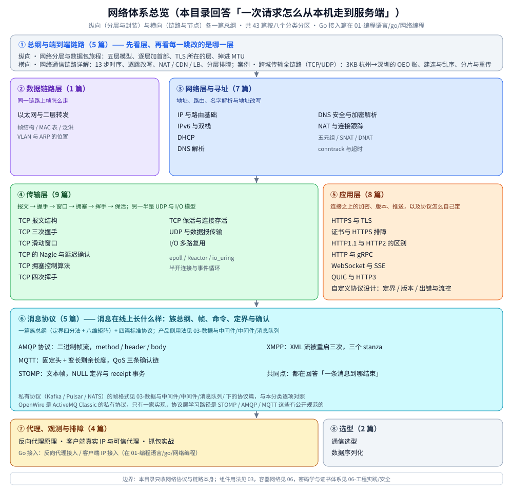

# 网络笔记索引（本目录导读）

> 本目录是「一次请求怎么从本机走到服务端」的完整链条：**纵向（分层与封装）** 与 **横向（链路与节点）**
> 各有一篇总纲，其余篇目都是这条链上的某个环节。
>
> 内容整理自个人学习笔记。**本文件只给阅读顺序与依赖关系**——每篇的知识点描述见
> [全仓知识点目录](../../目录.md)，本目录**不重复描述**；跨目录的延伸见「四、与其它目录的分工」。
>
> 当前共 **37 篇网络专题文档**（不含各级 README），按 **8 个分类**组织；Go 侧的接入实现另有两篇，
> 在 [go/网络编程/](../../01-编程语言/go/网络编程/)。
>
> 📎 其中三个成规模的分类各有自己的导读（[网络层与寻址/](网络层与寻址/README.md) 6 篇、[传输层/](传输层/README.md) 9 篇、
> [应用层/](应用层/README.md) 8 篇）：**分类内的读序、篇间依赖与边界在那三份里**，本文件只给跨分类的主线、专题线与依赖。
> 其余分类篇数少（代理与网关 3、消息协议 5、选型 2、数据链路层 1、观测与排障 1），由本文件第三节直接覆盖。
>
> ⭐ 「消息协议」分类（族总纲 + MQTT / STOMP / XMPP / AMQP 四篇标准协议）是本目录唯一按**协议族**切出来的一组：
> 它们与「应用层」同属协议原理层，但方向不是「Web 请求怎么走」，而是「一条消息在线上长什么样」。产品侧
> 怎么用这些协议见 [中间件/消息队列/](../../03-数据与中间件/中间件/消息队列/)。这一族的入口是
> [消息协议族全景.md](消息协议/消息协议族全景.md)——四个可变量、两档分野（标准协议 vs Kafka / Pulsar / RocketMQ / NATS 这组 broker 原生协议）与各自的八维横向矩阵都在那里，本目录四篇协议从它往下读，broker 原生四协议的帧形态对照也只在那篇（细节留在各产品册）；四个都不合适、决定自研时，再看应用层的 [自定义协议设计.md](应用层/自定义协议设计.md)。

---

## 一、先读哪两篇（总纲，互不重复）

| 顺序 | 篇 | 视角 | 一句话 |
|---|---|---|---|
| ① | [网络分层与数据包旅程.md](网络分层与数据包旅程.md) | ⭐ **纵向** | 五层模型 + 一个包在本机怎么被逐层造出来（逐层加首部、TLS 在哪一层、掉进 MTU 会怎样） |
| ② | [网络通信链路详解.md](网络通信链路详解.md) | ⭐ **横向** | 跨过哪些节点、每一跳改了什么、在哪儿观测；**13 步旅程的完整时序只在这里有一份** |

> ⭐ **这两篇怎么配合**：先看 ① 建立「层」的概念，再看 ② 才看得懂「每一跳改的是哪一层」。
> ② 的 2.1 表同时是**本目录的入口**——13 步每一步都链到了对应的篇。

## 二、推荐阅读顺序

### 2.1 主线：跟着一个请求走（第一次通读走这条）

```text
① 网络分层与数据包旅程        ← 纵向总纲：层是什么、包怎么被造出来
② 网络通信链路详解            ← 横向总纲：链路上有谁、13 步怎么走
        ↓
③ 以太网与二层转发            ← 同一链路上：帧、MAC 表与交换机怎么转发
④ DHCP                        ← 想出门先拿到四个参数（IP / 掩码 / 网关 / DNS）
⑤ IP 与路由基础               ← 同网段还是跨网段、下一跳是谁、ARP / NDP
⑥ IPv6 与双栈                 ← 地址变长之后，链路与自动配置改了什么
⑦ NAT 与连接跟踪              ← 地址在途中被改写时，回程靠什么还原
⑧ DNS 解析                    ← 拿到域名对应的 IP（可能是 CDN 的就近节点）
⑨ DNS 安全与加密解析          ← 劫持、污染与 DoH / DoT / DNSSEC
        ↓
⑩ UDP 与数据报传输            ← 传输层的另一半：没有连接、没有保证
⑪ TCP 报文结构                ← 首部字段与序号：后面几篇的共同基础
⑫ TCP 三次握手                ← 建连接
⑬ TCP 滑动窗口                ← 传数据（窗口决定吞吐上限）
⑭ TCP 的 Nagle 与延迟确认      ← 小包优化（两条一起看才懂为什么「互相伤害」）
⑮ TCP 拥塞控制算法            ← 窗口的另一半：cwnd 与 ECN
⑯ TCP 四次挥手                ← 断连接（TIME_WAIT / CLOSE_WAIT 都在这一步）
⑰ TCP 保活与连接存活          ← 连接建立后：keepalive、心跳与半开连接
        ↓
⑱ HTTPS 与 TLS                ← 连接之上的加密
⑲ 证书与 HTTPS 排障           ← 证书链、五步校验与六类握手错误
⑳ HTTP1.1 与 HTTP2 的区别     ← 应用层的传输绑定：并发模型、消息定界、头部压缩、流控
㉑ HTTP 与 gRPC                ← gRPC 与 HTTP 的差别、连接池与多路复用
㉒ WebSocket 与 SSE            ← 服务端推送：三条链路与各自的坑
㉓ QUIC 与 HTTP3               ← 为什么把 TCP 换掉；浏览器怎么发现 h3
㉔ 数据序列化                  ← 请求体到底怎么编码（JSON / Protobuf）
        ↓
㉕ IO 多路复用                 ← 换个视角：服务端怎么同时接住成千上万条连接
㉖ 通信选型                    ← 最后做决策（见过各层才有判断依据）
        ↓
㉗ 反向代理原理                ← 服务端怎么把请求转给上游、头部怎么治理
㉘ 客户端真实 IP 与可信代理     ← 代理链上「客户端到底是谁」（与 ㉗ 是一对）
㉙ nginx 配置语义              ← 把 ㉗ 落成配置：location 匹配、proxy_pass、rewrite、limit_req
        ↓
🧰 抓包实战                    ← 手上功夫：在哪抓、怎么读（随时可插入）
```

### 2.2 专题线：只想补某一块

| 目的 | 按这个顺序读 |
|---|---|
| **排查「慢 / 不通」** | [网络通信链路详解.md](网络通信链路详解.md)（五、症状→层级→证据→工具表）→ [IP与路由基础.md](网络层与寻址/IP与路由基础.md)（MTU / PMTUD）→ [DNS解析.md](网络层与寻址/DNS解析.md)（排查命令）→ [抓包实战.md](观测与排障/抓包实战.md) |
| **长连接莫名断开** | [NAT与连接跟踪.md](网络层与寻址/NAT与连接跟踪.md)（五、空闲超时）→ [TCP保活与连接存活.md](传输层/TCP保活与连接存活.md)（四层保活与心跳参数）→ [TCP四次挥手.md](传输层/tcp/TCP四次挥手.md)（`CLOSE_WAIT`） |
| **复习 TCP** | [TCP报文结构.md](传输层/tcp/TCP报文结构.md) → [TCP三次握手.md](传输层/tcp/TCP三次握手.md) → [TCP滑动窗口.md](传输层/tcp/TCP滑动窗口.md) → [TCP的Nagle与延迟确认.md](传输层/tcp/TCP的Nagle与延迟确认.md) → [TCP拥塞控制算法.md](传输层/tcp/TCP拥塞控制算法.md) → [TCP四次挥手.md](传输层/tcp/TCP四次挥手.md) → [TCP保活与连接存活.md](传输层/TCP保活与连接存活.md) |
| **搞懂 IP 与路由** | [IP与路由基础.md](网络层与寻址/IP与路由基础.md) → [IPv6与双栈.md](网络层与寻址/IPv6与双栈.md) → [NAT与连接跟踪.md](网络层与寻址/NAT与连接跟踪.md) → [网络通信链路详解.md](网络通信链路详解.md)（逐跳改写） |
| **排查 DNS 与证书** | [DNS安全与加密解析.md](网络层与寻址/DNS安全与加密解析.md) → [证书与HTTPS排障.md](应用层/证书与HTTPS排障.md) → [HTTPS与TLS.md](应用层/HTTPS与TLS.md) |
| **做技术选型** | [通信选型.md](选型/通信选型.md) → [HTTP1.1与HTTP2的区别.md](应用层/HTTP1.1与HTTP2的区别.md) → [HTTP与gRPC.md](应用层/HTTP与gRPC.md) → [WebSocket.md](应用层/WebSocket.md) → [SSE.md](应用层/SSE.md) → [数据序列化.md](选型/数据序列化.md) |
| **只想搞懂 HTTP 版本差异** | [HTTP1.1与HTTP2的区别.md](应用层/HTTP1.1与HTTP2的区别.md) → [HTTP与gRPC.md](应用层/HTTP与gRPC.md) → [QUIC与HTTP3.md](应用层/QUIC与HTTP3.md) |
| **只看 HTTP/3 相关** | [QUIC与HTTP3.md](应用层/QUIC与HTTP3.md) → [HTTPS与TLS.md](应用层/HTTPS与TLS.md)（ALPN）→ [TCP三次握手.md](传输层/tcp/TCP三次握手.md)（对照它被压成 1-RTT） |
| **要动手抓一次包** | [抓包实战.md](观测与排障/抓包实战.md) → [网络通信链路详解.md](网络通信链路详解.md)（五、分层观测点） |
| **做反向代理 / 网关** | [反向代理原理.md](代理与网关/反向代理原理.md) → [反向代理接入.md](../../01-编程语言/go/网络编程/反向代理接入.md) → [客户端真实IP与可信代理.md](代理与网关/客户端真实IP与可信代理.md) → [客户端IP接入.md](../../01-编程语言/go/网络编程/客户端IP接入.md) → [Nginx配置语义.md](代理与网关/Nginx配置语义.md) → [通信选型.md](选型/通信选型.md) |
| **排查「客户端 IP 不对 / 限流误伤」** | [客户端真实IP与可信代理.md](代理与网关/客户端真实IP与可信代理.md) → [客户端IP接入.md](../../01-编程语言/go/网络编程/客户端IP接入.md) → [反向代理原理.md](代理与网关/反向代理原理.md) |
| **搞懂消息协议怎么定帧** | [消息协议族全景.md](消息协议/消息协议族全景.md)（先看这族怎么分：定界 / 确认 / 路由 / 演进，以及标准协议与 broker 原生协议两档的分野）→ [AMQP.md](消息协议/AMQP.md)（二进制帧流）→ [MQTT.md](消息协议/MQTT.md)（位段定长头）→ [STOMP.md](消息协议/STOMP.md)（文本帧）→ [XMPP.md](消息协议/XMPP.md)（XML 流）；broker 原生四协议（Kafka / Pulsar / RocketMQ / NATS）的帧形态看同一篇 3.5 ~ 3.8；四个都不合适、决定自研时再看 [自定义协议设计.md](应用层/自定义协议设计.md) |
| **只想看某个协议的字节** | 标准四协议：[AMQP.md](消息协议/AMQP.md) / [MQTT.md](消息协议/MQTT.md) / [STOMP.md](消息协议/STOMP.md) / [XMPP.md](消息协议/XMPP.md)，配合 [抓包实战.md](观测与排障/抓包实战.md) 读原始字节；broker 原生四协议：Kafka 的 [Kafka协议.md](../../03-数据与中间件/中间件/消息队列/Kafka/Kafka协议.md) / Pulsar 的 [Pulsar协议.md](../../03-数据与中间件/中间件/消息队列/Pulsar/Pulsar协议.md) / NATS 的 [NATS协议.md](../../03-数据与中间件/中间件/消息队列/NATS/NATS协议.md) / RocketMQ 的 [核心概念与架构.md](../../03-数据与中间件/中间件/消息队列/RocketMQ/核心概念与架构.md)（`RemotingCommand` 在第六节） |

### 2.3 依赖关系（谁要前置）

| 本篇 | 建议先读 | 为什么 |
|---|---|---|
| [网络通信链路详解.md](网络通信链路详解.md) | [网络分层与数据包旅程.md](网络分层与数据包旅程.md) | 先有「层」，才看得懂「每跳改的是哪一层」 |
| [以太网与二层转发.md](数据链路层/以太网与二层转发.md) | [网络分层与数据包旅程.md](网络分层与数据包旅程.md) | 帧是最外层封装，先知道它在哪一层 |
| [IP与路由基础.md](网络层与寻址/IP与路由基础.md) | [网络分层与数据包旅程.md](网络分层与数据包旅程.md) | 先知道「为什么要两套地址」，再谈寻址与选路 |
| [IPv6与双栈.md](网络层与寻址/IPv6与双栈.md) | [IP与路由基础.md](网络层与寻址/IP与路由基础.md)、[DHCP.md](网络层与寻址/DHCP.md) | 地址与自动配置要和 v4 对照着看 |
| [NAT与连接跟踪.md](网络层与寻址/NAT与连接跟踪.md) | [IP与路由基础.md](网络层与寻址/IP与路由基础.md) | 先懂地址与端口，才懂五元组改写 |
| [DNS安全与加密解析.md](网络层与寻址/DNS安全与加密解析.md) | [DNS解析.md](网络层与寻址/DNS解析.md) | 先懂递归、缓存与记录类型 |
| [UDP与数据报传输.md](传输层/UDP与数据报传输.md) | [IP与路由基础.md](网络层与寻址/IP与路由基础.md) | 大包与分片的代价要先懂 MTU |
| [TCP三次握手.md](传输层/tcp/TCP三次握手.md) | [TCP报文结构.md](传输层/tcp/TCP报文结构.md) | 握手报文就是带 `SYN` / `ACK` 标志位的首部 |
| [TCP滑动窗口.md](传输层/tcp/TCP滑动窗口.md) | [TCP报文结构.md](传输层/tcp/TCP报文结构.md)、[TCP三次握手.md](传输层/tcp/TCP三次握手.md) | 窗口字段在首部里；连接建好才谈吞吐 |
| [TCP的Nagle与延迟确认.md](传输层/tcp/TCP的Nagle与延迟确认.md) | [TCP滑动窗口.md](传输层/tcp/TCP滑动窗口.md) | 都是传输效率问题，放一起看 |
| [TCP拥塞控制算法.md](传输层/tcp/TCP拥塞控制算法.md) | [TCP滑动窗口.md](传输层/tcp/TCP滑动窗口.md) | `min(rwnd, cwnd)` 的另一半 |
| [TCP四次挥手.md](传输层/tcp/TCP四次挥手.md) | [TCP三次握手.md](传输层/tcp/TCP三次握手.md) | 关闭是握手的镜像，`TIME_WAIT` 在这一步出现 |
| [TCP保活与连接存活.md](传输层/TCP保活与连接存活.md) | [TCP四次挥手.md](传输层/tcp/TCP四次挥手.md)、[NAT与连接跟踪.md](网络层与寻址/NAT与连接跟踪.md) | 半开连接与中间设备超时是同一件事的两面 |
| [HTTPS与TLS.md](应用层/HTTPS与TLS.md) | [TCP三次握手.md](传输层/tcp/TCP三次握手.md)、[DNS解析.md](网络层与寻址/DNS解析.md) | TLS 跑在 TCP 之上；证书要靠 SNI 选 |
| [证书与HTTPS排障.md](应用层/证书与HTTPS排障.md) | [HTTPS与TLS.md](应用层/HTTPS与TLS.md) | 先懂握手，再谈证书链与错误码 |
| [HTTP1.1与HTTP2的区别.md](应用层/HTTP1.1与HTTP2的区别.md) | [HTTPS与TLS.md](应用层/HTTPS与TLS.md)、[TCP报文结构.md](传输层/tcp/TCP报文结构.md) | 版本是 ALPN 协商的结果；定界的根因是「TCP 是字节流」 |
| [HTTP与gRPC.md](应用层/HTTP与gRPC.md) | [HTTPS与TLS.md](应用层/HTTPS与TLS.md)、[HTTP1.1与HTTP2的区别.md](应用层/HTTP1.1与HTTP2的区别.md) | 应用层在 TLS 之上；HTTP/2 是 gRPC 的地基 |
| [WebSocket.md](应用层/WebSocket.md) | [HTTP1.1与HTTP2的区别.md](应用层/HTTP1.1与HTTP2的区别.md)、[NAT与连接跟踪.md](网络层与寻址/NAT与连接跟踪.md) | RFC 6455 的握手、帧布局与掩码，及升级后丢失的 HTTP 语义 |
| [SSE.md](应用层/SSE.md) | [HTTP1.1与HTTP2的区别.md](应用层/HTTP1.1与HTTP2的区别.md)、[WebSocket.md](应用层/WebSocket.md) | 事件流格式、`Last-Event-ID` 续传与六连接上限，推送链路上更便宜的那一半 |
| [QUIC与HTTP3.md](应用层/QUIC与HTTP3.md) | [HTTPS与TLS.md](应用层/HTTPS与TLS.md)、[TCP三次握手.md](传输层/tcp/TCP三次握手.md)、[UDP与数据报传输.md](传输层/UDP与数据报传输.md) | 要懂 1-RTT / 0-RTT 的价值，先知道 TCP + TLS 要几次往返 |
| [自定义协议设计.md](应用层/自定义协议设计.md) | [TCP报文结构.md](传输层/tcp/TCP报文结构.md)、[数据序列化.md](选型/数据序列化.md) | 定界源于「TCP 是字节流」，序列化只管编码不管边界；四变量骨架见族总纲 |
| [反向代理原理.md](代理与网关/反向代理原理.md) | [HTTP与gRPC.md](应用层/HTTP与gRPC.md)、[TCP报文结构.md](传输层/tcp/TCP报文结构.md) | 要懂逐跳头与连接复用 |
| [反向代理接入.md](../../01-编程语言/go/网络编程/反向代理接入.md) | [反向代理原理.md](代理与网关/反向代理原理.md) | 先懂「该做什么」，再谈「怎么接」 |
| [客户端真实IP与可信代理.md](代理与网关/客户端真实IP与可信代理.md) | [反向代理原理.md](代理与网关/反向代理原理.md) | 先知道代理这一跳写了什么头，再谈「信哪个」 |
| [客户端IP接入.md](../../01-编程语言/go/网络编程/客户端IP接入.md) | [客户端真实IP与可信代理.md](代理与网关/客户端真实IP与可信代理.md) | 先懂五条规则，再谈落地 |
| [抓包实战.md](观测与排障/抓包实战.md) | [网络通信链路详解.md](网络通信链路详解.md)、[TCP报文结构.md](传输层/tcp/TCP报文结构.md) | 先知道「该看什么」，抓包才有意义 |
| [通信选型.md](选型/通信选型.md) | 前面大部分 | 没见过各层，选型表看不出取舍 |
| [消息协议族全景.md](消息协议/消息协议族全景.md) | [TCP报文结构.md](传输层/tcp/TCP报文结构.md) | 定界问题源于「TCP 是字节流」，先有这条才谈得上四种定界家族 |
| [AMQP.md](消息协议/AMQP.md) | [消息协议族全景.md](消息协议/消息协议族全景.md)、[HTTP1.1与HTTP2的区别.md](应用层/HTTP1.1与HTTP2的区别.md) | 先有「帧要自己定边界」的概念，才看得懂 channel 多路复用与 HTTP/2 的流是一类思路 |
| [MQTT.md](消息协议/MQTT.md) | [消息协议族全景.md](消息协议/消息协议族全景.md) | 变长剩余长度是「省字节」的极端做法，先懂定界在解决什么 |
| [STOMP.md](消息协议/STOMP.md) | [MQTT.md](消息协议/MQTT.md) | 两者是同一件事的两种权衡：二进制位段 vs 文本命令 |
| [XMPP.md](消息协议/XMPP.md) | [HTTPS与TLS.md](应用层/HTTPS与TLS.md)、[DNS解析.md](网络层与寻址/DNS解析.md) | 流的 TLS 升级与联邦寻址要先懂 TLS 握手与 SRV 记录 |

> ⚠️ **两条「反直觉」的顺序提醒**：
> 1. **DHCP 排在 DNS 之前**——没有 IP / 掩码 / 网关 / DNS 这四参数，连 DNS 查询都发不出去；
> 2. **DHCP 与 DNS 都在 TCP 之前**——它们是「建连接之前」的准备动作，不是 TCP 的一部分。

## 三、现有篇章地图（按主题分组）



图注：网络体系总览：纵向与横向两篇总纲，加上数据链路层、网络层与寻址、传输层、应用层、消息协议、代理与观测、选型八个分类共 37 篇的分布，以及各分类之间的阅读方向。

### 总纲与端到端链路（2 篇）

| 篇章 | 主要职责 |
|---|---|
| [网络分层与数据包旅程.md](网络分层与数据包旅程.md) | ⭐ **纵向**：五层模型、两套地址的分工、一次封装示意与 TLS 所在的层 |
| [网络通信链路详解.md](网络通信链路详解.md) | ⭐ **横向**：13 步端到端时序、逐跳改写、NAT/conntrack、AS/BGP、CDN/LB、MTU 与分层排障导航 |

### 数据链路层（1 篇）

| 篇章 | 主要职责 |
|---|---|
| [以太网与二层转发.md](数据链路层/以太网与二层转发.md) | 以太网帧结构、MAC / OUI、单播 / 组播 / 广播、交换机 MAC 表与泛洪、VLAN |

### 网络层与寻址（6 篇）

> 📎 本分类有自己的导读：[网络层与寻址/README.md](网络层与寻址/README.md)——两条线（地址本体 / 地址来源）怎么分、按问题走的读序、篇间依赖与两处待修的重复段落。

| 篇章 | 主要职责 |
|---|---|
| [IP与路由基础.md](网络层与寻址/IP与路由基础.md) | IP 地址与 CIDR、最长前缀匹配、下一跳决策、ARP/NDP、ICMP、MTU/MSS/分片与 PMTUD |
| [IPv6与双栈.md](网络层与寻址/IPv6与双栈.md) | 40 字节首部与扩展头、地址分类、RA/SLAAC/DHCPv6/DAD、NDP、双栈选择与排查 |
| [DHCP.md](网络层与寻址/DHCP.md) | DHCPv4 DORA 与 T1/T2、租约形状的复用、IPv6 自动配置的组合与 M/O 标志 |
| [DNS解析.md](网络层与寻址/DNS解析.md) | 域名层级、递归/迭代、TTL 与缓存、记录类型、GSLB、解析链路 |
| [DNS安全与加密解析.md](网络层与寻址/DNS安全与加密解析.md) | 劫持与污染的判据、HTTPDNS、DoH / DoT / DoQ、DNSSEC、负缓存 |
| [NAT与连接跟踪.md](网络层与寻址/NAT与连接跟踪.md) | SNAT / DNAT、四种转发模式、conntrack 五元组、端口耗尽与超时表、IPv6 无 NAT |

### 传输层（9 篇）

> 📎 本分类有自己的导读：[传输层/README.md](传输层/README.md)——TCP 六篇为什么必须按 ①~⑥ 读、`tcp/` 为何不单独设入口、旁路与两个横切各换的是什么维度。

| 篇章 | 主要职责 |
|---|---|
| [TCP报文结构.md](传输层/tcp/TCP报文结构.md) | 连接的本质、首部字段、`SEG.LEN` 与确认号公式、累计 ACK 与 SACK、字节流边界 |
| [TCP三次握手.md](传输层/tcp/TCP三次握手.md) | 握手逐步拆解、两个队列与 `backlog`、溢出行为、TCP Fast Open |
| [TCP滑动窗口.md](传输层/tcp/TCP滑动窗口.md) | 窗口滑动、`min(rwnd, cwnd)`、窗口缩放 / SACK / 零窗口探测、socket 选项 |
| [TCP的Nagle与延迟确认.md](传输层/tcp/TCP的Nagle与延迟确认.md) | Nagle 的条件触发、延迟确认的实现差异、两者叠加的时序与破解 |
| [TCP拥塞控制算法.md](传输层/tcp/TCP拥塞控制算法.md) | AIMD、Tahoe/Reno、ECN、CUBIC 与 BBR 的边界 |
| [TCP四次挥手.md](传输层/tcp/TCP四次挥手.md) | 关闭时序、半关闭、`TIME_WAIT` 与 2MSL、`CLOSE_WAIT` 成因与排查 |
| [TCP保活与连接存活.md](传输层/TCP保活与连接存活.md) | keepalive 探什么、四层保活分工、半开连接、心跳间隔、连接池探活与排查 |
| [UDP与数据报传输.md](传输层/UDP与数据报传输.md) | 数据报语义与消息边界、8 字节首部与校验和、不保证什么、MTU 与队列丢包 |
| [IO多路复用.md](传输层/IO多路复用.md) | 五种 I/O 模型、select/poll/epoll、LT vs ET、Reactor、`io_uring`、fd 上限 |

### 应用层（8 篇）

> 📎 本分类有自己的导读：[应用层/README.md](应用层/README.md)——五个现成协议与两个横切（安全 / 方法论）的分工、按问题走的读序，以及各篇与 03 / 06 侧篇目的边界。

| 篇章 | 主要职责 |
|---|---|
| [HTTPS与TLS.md](应用层/HTTPS与TLS.md) | TLS 1.2/1.3 握手、RSA vs ECDHE、会话复用、0-RTT、mTLS、ECH、HSTS 与性能 |
| [证书与HTTPS排障.md](应用层/证书与HTTPS排障.md) | X.509 字段、信任链五步校验、自签与 ACME、证书固定、六类握手错误与排障命令 |
| [HTTP1.1与HTTP2的区别.md](应用层/HTTP1.1与HTTP2的区别.md) | ⭐ **HTTP 版本差异的唯一详解源**：ALPN、连接与并发模型、三种定界、HPACK、两级流控、队头阻塞（含 7.4 的 60 请求量化实测） |
| [HTTP与gRPC.md](应用层/HTTP与gRPC.md) | gRPC 与 HTTP 的差别、HTTP/2 五处改动、gRPC 落地的三件必做事（超时 / 重试预算 / 单例连接）、`curl` 与 `tshark` 的抓包判据；客户端池调参已按语言拆出 |
| [WebSocket.md](应用层/WebSocket.md) | RFC 6455 握手与 Accept 算法、帧字节布局、掩码、分片与关闭握手，`Upgrade` 逐跳；⭐ 本机实测 |
| [SSE.md](应用层/SSE.md) | 事件流四类行、空行分界、`Last-Event-ID` 续传三步时序、六连接上限与代理缓冲 |
| [QUIC与HTTP3.md](应用层/QUIC与HTTP3.md) | 流隔离边界、0-RTT 与连接迁移、SVCB / Alt-Svc 两条发现路径与回退 |
| [自定义协议设计.md](应用层/自定义协议设计.md) | ⭐ **只有这一篇讲「自己定一套协议」**：定界方式、序列化、版本演进、粘包半包的两段读循环；后四节补上线才暴露的问题——错误码分级、超时与幂等重试、流控与背压、协议可观测性 |

### 消息协议（5 篇）

这五篇的共同问题是「**一条消息在线上到哪结束、怎么被确认**」，与「应用层」的差别在于：应用层那八篇面向的是 Web 请求、推送与**自研协议的方法**，这五篇面向的是**消息中间件与即时通信背后的标准协议族**。入口是族总纲：它既讲标准四协议各占「定界方式」的哪一格，也把 Kafka / Pulsar / RocketMQ / NATS 这组 broker 原生协议的帧形态并排对照（细节留在 03 侧各产品册，不在这里重讲）；四个都不合适、决定自研时，方法篇在 [应用层/自定义协议设计.md](应用层/自定义协议设计.md)。

| 篇章 | 主要职责 |
|---|---|
| [消息协议族全景.md](消息协议/消息协议族全景.md) | ⭐ **族总纲，先看这篇**：四个可变量（定界 / 确认 / 路由 / 演进）、四种定界家族与各自的接入层代价、两档分野与两套八维横向矩阵（标准四协议 / broker 原生四协议）、一条 TCP 上三条逻辑流的三种标识（会话号 / 请求号 / 订阅号）、⭐ **建连各要几个往返**（等于重连成本）、协议 → 产品反查 |
| [AMQP.md](消息协议/AMQP.md) | 帧头与帧尾 `0xCE` 双重定界、帧类型与方法类的分工、`channel id` 多路复用、大消息的分帧重组、0-9-1 与 1.0 不是版本升级 |
| [MQTT.md](消息协议/MQTT.md) | 固定头 1 字节与变长剩余长度（0~268435455）、14 种报文类型、QoS 三条确认链、保留消息与遗嘱 |
| [STOMP.md](消息协议/STOMP.md) | 文本帧三段结构、13 种命令、`content-length` 与 `NUL` 的取舍、`receipt` 事务与 `ack` 三种模式 |
| [XMPP.md](消息协议/XMPP.md) | XML 流被重启三次、三个 stanza、JID 的 bare / full 两段、联邦的 SRV → STARTTLS → SASL 链路 |

> ⚠️ **别把「消息队列产品」和「消息协议」混在一个目录里**：产品的能力与用法在
> [中间件/消息队列/](../../03-数据与中间件/中间件/消息队列/)，协议的字节布局在本目录。同一个 AMQP 协议
> 可以被 RabbitMQ 之外的 broker 实现，同一个 broker 也可能讲多种协议，所以两者不能互相归属。

### 代理、观测与排障（4 篇）

| 篇章 | 主要职责 |
|---|---|
| [反向代理原理.md](代理与网关/反向代理原理.md) | 正反向代理差别、逐跳头实测、`Director` 三类边界、头部治理、`Transport` 参数 |
| [客户端真实IP与可信代理.md](代理与网关/客户端真实IP与可信代理.md) | 可信代理链五条规则、五个易错点、`Forwarded` 对照、L4 的 PROXY protocol |
| [Nginx配置语义.md](代理与网关/Nginx配置语义.md) | `location` 检查顺序 5 例、`proxy_pass` 斜杠 2 例、`rewrite` 三 flag、`limit_req` 被 `return` 跳过（均本机实测） |
| [抓包实战.md](观测与排障/抓包实战.md) | 抓包点与过滤器、报文判读、三类假象、TCP/UDP/QUIC 与 IPv4/IPv6 的过滤边界 |

> 📎 Go 接入实现（在语言目录）：[反向代理接入.md](../../01-编程语言/go/网络编程/反向代理接入.md)、[客户端IP接入.md](../../01-编程语言/go/网络编程/客户端IP接入.md)。

### 选型（2 篇）

| 篇章 | 主要职责 |
|---|---|
| [通信选型.md](选型/通信选型.md) | 传输层、同步 RPC 与异步消息、七种应用层协议与六种序列化格式的横向选型；⭐ **3.1 ② 是「服务端推送三选一」（WebSocket / SSE / gRPC 流式）的权威版** |
| [数据序列化.md](选型/数据序列化.md) | JSON 与 Protobuf 的对比与选型；序列化不定义消息边界 |

## 四、与其它目录的分工

| 相关目录 | 关系 |
|---|---|
| [go/](../../01-编程语言/go/) | 语言侧实现：`go/运行时/GMP调度.md` 决定一个网络请求由谁处理；[反向代理接入.md](../../01-编程语言/go/网络编程/反向代理接入.md) 与 [客户端IP接入.md](../../01-编程语言/go/网络编程/客户端IP接入.md) 是代理与 IP 解析的落地 |
| [java/](../../01-编程语言/java/) | 同上：`java/接入Skywalking.md`、`IO多路复用` 里 Java NIO 的对照组 |
| [部署/](../../06-工程实践/部署/) | 容器与集群里的网络：`docker/网络与存储.md`（veth / bridge / DNAT）、`k8s/K8s部署流程.md`（CNI、Service、Ingress） |
| [安全/](../../06-工程实践/安全/) | TLS 的上游：`数字证书与PKI.md`（证书链与信任）、`加密算法.md`（套件里的算法） |
| [分布式/](../../04-架构与系统/分布式/) | 再往上一层：`服务发现.md`、`负载均衡.md`、`Raft协议.md` 等以网络为前提 |
| [算法/](../算法/) | `TCP拥塞控制算法.md` 是「TCP滑动窗口」的延伸原理 |

## 五、本目录的边界与缺口

**边界**：本目录只收**网络协议与链路本身**——从「四个参数怎么拿到」到「请求能不能到达、多快到达」为止。
自 2026-10 起另收**消息协议族**（AMQP / MQTT / STOMP / XMPP + 通用定界方法），因为它们的字节布局属原理层，
与被哪个产品实现无关；族总纲另含 **Kafka / Pulsar / RocketMQ / NATS 的帧形态对照**，但只做跨协议并排，
不搬各产品的参数与排障细节。

| 本目录收 | 不收（在哪） |
|---|---|
| 分层与封装、链路与逐跳、二层转发、IP 与路由、IPv6、NAT、TCP/UDP、DNS、TLS、应用层协议 | **组件的用法**（Redis / MQ / 注册中心）→ [中间件/](../../03-数据与中间件/中间件/)、[数据存储/](../../03-数据与中间件/数据存储/) |
| **消息协议族的帧与命令**（AMQP / MQTT / STOMP / XMPP）、**broker 原生四协议的帧形态对照**（Kafka / Pulsar / RocketMQ / NATS，只在族总纲做并排）、通用定界与版本方法 | **MQ 产品的粒度、可靠性、部署与排障** → [中间件/消息队列/](../../03-数据与中间件/中间件/消息队列/)；**IM 业务侧的序号、回执、撤回** → [系统设计/IM系统/](../../04-架构与系统/系统设计/IM系统/) |
| 服务端的连接模型（I/O 多路复用）与连接保活 | **容器与集群网络**（veth / bridge / CNI / Service / Ingress）→ [部署/](../../06-工程实践/部署/) |
| 协议与序列化选型 | **密码算法与证书体系** → [安全/](../../06-工程实践/安全/) |
| 代理原理与可信客户端 IP | **代理的代码实现** → [go/网络编程/](../../01-编程语言/go/网络编程/) |
| | **系统侧观测工具**（eBPF / perf / `ss` 的深度用法）→ [性能排查.md](../linux/性能排查.md) |

**缺口处理记录**：

| 原缺口 | 现在补在哪 | 怎么补的 |
|---|---|---|
| QUIC / HTTP/3 | [QUIC与HTTP3.md](应用层/QUIC与HTTP3.md) | 队头阻塞 → UDP 之上的取舍 → 两条发现路径与回退 |
| 抓包实战 | [抓包实战.md](观测与排障/抓包实战.md) | 在哪抓 / 过滤表达式 / 怎么读；Windows `pktmon` 实测 |
| IP 与路由 | [IP与路由基础.md](网络层与寻址/IP与路由基础.md) | CIDR、最长前缀匹配、ARP/NDP、ICMP、MTU/分片/PMTUD |
| UDP 与数据报 | [UDP与数据报传输.md](传输层/UDP与数据报传输.md) | 数据报语义、首部与校验和、应用层补什么、队列丢包 |
| HTTP/1.1 与 HTTP/2 对照 | [HTTP1.1与HTTP2的区别.md](应用层/HTTP1.1与HTTP2的区别.md) | 把原先散在 HTTP 篇的差异机制收成一篇 |
| IPv6 | [IPv6与双栈.md](网络层与寻址/IPv6与双栈.md) | 从三篇的零散段落收成一篇：首部、地址、自动配置、NDP、双栈排查 |
| 数据链路层 | [以太网与二层转发.md](数据链路层/以太网与二层转发.md) | 帧结构、MAC 表、泛洪、VLAN |
| NAT 与会话超时 | [NAT与连接跟踪.md](网络层与寻址/NAT与连接跟踪.md) | SNAT / DNAT、conntrack、超时表与心跳判据 |
| DNS 安全 | [DNS安全与加密解析.md](网络层与寻址/DNS安全与加密解析.md) | 劫持 vs 污染、HTTPDNS、DoH/DoT/DoQ、DNSSEC |
| 证书排障 | [证书与HTTPS排障.md](应用层/证书与HTTPS排障.md) | 从 HTTPS 篇拆出：X.509、信任链、ACME、错误码 |
| WebSocket / SSE | [WebSocket.md](应用层/WebSocket.md)、[SSE.md](应用层/SSE.md) | 从 HTTP 与 gRPC 篇拆出，再按协议拆分：WebSocket 专讲握手与帧布局，SSE 专讲事件流与续传 |
| 连接保活 | [TCP保活与连接存活.md](传输层/TCP保活与连接存活.md) | 从 TCP 窗口、四次挥手、I/O 多路复用三处收成一篇 |
| 代理 / IP 的代码落地 | [反向代理接入.md](../../01-编程语言/go/网络编程/反向代理接入.md)、[客户端IP接入.md](../../01-编程语言/go/网络编程/客户端IP接入.md) | 原理篇留结论，Go 实现按语言目录拆分并互链 |
| **消息协议族** | [消息协议/](消息协议/) 族总纲 + 四篇协议 | 从「消息队列产品」目录里把**协议层**抽出来独立成分类：AMQP 篇整体迁入，MQTT / STOMP / XMPP 新写，另加一篇族总纲；族总纲已扩到 broker 原生四协议（Kafka / Pulsar / RocketMQ / NATS）的帧形态对照；通用的自研方法篇已归到应用层 |
| **消息协议缺族总纲** | [消息协议族全景.md](消息协议/消息协议族全景.md) | 四协议的横向对照原先只寄生在 [MQTT.md](消息协议/MQTT.md) 的「最小头」论证里，另三篇看不到；上收成族总纲，并把「协议 → 产品」反查与「多路复用三种标识」一并补齐 |

**仍保持「暂不补」的 4 项**：

| 缺口 | 现状 | 结论 |
|---|---|---|
| **BGP / 路由协议** | 只在链路篇「公网那一跳」点到 | 属运营商领域，本仓库以「应用视角的链路」为主 |
| **SOCKS / 正向代理** | 全仓 0 次 | 与仓库主线（后端服务链路）距离较远 |
| **VPN**（IPsec / WireGuard） | 只在链路篇的封装开销表里出现 | 同上 |
| **iptables / netfilter / eBPF** | 链路篇少量；eBPF 全仓都在 [linux/](../linux/) | 观测手段链到 linux 目录，不搬进来 |

## 六、三条维护原则

1. **一处讲透，其他地方互链。** 二层转发由 [以太网与二层转发.md](数据链路层/以太网与二层转发.md) 负责；寻址与选路由 [IP与路由基础.md](网络层与寻址/IP与路由基础.md) 负责；IPv6 由 [IPv6与双栈.md](网络层与寻址/IPv6与双栈.md) 负责；NAT 与超时由 [NAT与连接跟踪.md](网络层与寻址/NAT与连接跟踪.md) 负责；保活由 [TCP保活与连接存活.md](传输层/TCP保活与连接存活.md) 负责；证书排障由 [证书与HTTPS排障.md](应用层/证书与HTTPS排障.md) 负责；推送由 [WebSocket.md](应用层/WebSocket.md) 与 [SSE.md](应用层/SSE.md) 负责；HTTP 版本差异由 [HTTP1.1与HTTP2的区别.md](应用层/HTTP1.1与HTTP2的区别.md) 负责；**消息协议的帧布局**由 [消息协议/](消息协议/) 对应篇负责——AMQP 的帧与 method 只在这一处讲，产品篇（RabbitMQ）只链不重讲；**八协议（标准四 + broker 原生四）的横向对照**由 [消息协议族全景.md](消息协议/消息协议族全景.md) 统一负责，四篇标准协议各自不再内置跨协议对比表，broker 原生四协议的字节细节仍留在 03 侧各产品册。
2. **不要混淆相近机制。** IP 分片 ≠ TCP 分段；TCP 字节流 ≠ UDP 数据报；`rwnd` 流量控制 ≠ `cwnd` 拥塞控制；HTTP/2 应用层多路复用 ≠ 消除 TCP 层队头阻塞；DNSSEC 完整性 ≠ DNS 查询加密；TLS ≠ HTTP；`io_uring` 的完成式语义 ≠ epoll 的就绪式语义；TCP keepalive ≠ 业务心跳。
3. **版本敏感内容要标口径。** Linux sysctl 默认值（如 `somaxconn`）、内核 API、浏览器 HTTP/3 发现方式、延迟确认定时器、Go/Java 运行时实现都须注明版本或写「实现相关」；**单机实测不能直接写成协议定律**。

## 七、参考标准与官方文档

- [RFC 9293 — TCP](https://www.rfc-editor.org/rfc/rfc9293.html)、[RFC 7413 — TCP Fast Open（Experimental）](https://www.rfc-editor.org/rfc/rfc7413.html)、[RFC 1122 — Host Requirements](https://www.rfc-editor.org/rfc/rfc1122.html)、[Linux `listen(2)`](https://man7.org/linux/man-pages/man2/listen.2.html)
- [RFC 791 — IPv4](https://www.rfc-editor.org/rfc/rfc791.html)、[RFC 8200 — IPv6](https://www.rfc-editor.org/rfc/rfc8200.html)、[RFC 5737 — IPv4 文档地址](https://www.rfc-editor.org/rfc/rfc5737.html)、[RFC 3849 — IPv6 文档地址](https://www.rfc-editor.org/rfc/rfc3849.html)
- [RFC 4861 — NDP](https://www.rfc-editor.org/rfc/rfc4861.html)、[RFC 4862 — SLAAC](https://www.rfc-editor.org/rfc/rfc4862.html)、[RFC 8201 — IPv6 PMTUD](https://www.rfc-editor.org/rfc/rfc8201.html)、[RFC 8899 — PLPMTUD](https://www.rfc-editor.org/rfc/rfc8899.html)、[RFC 1191 — PMTUD](https://www.rfc-editor.org/rfc/rfc1191.html)
- [RFC 768 — UDP](https://www.rfc-editor.org/rfc/rfc768.html)、[RFC 2131 — DHCP](https://www.rfc-editor.org/rfc/rfc2131.html)、[RFC 826 — ARP](https://www.rfc-editor.org/rfc/rfc826.html)
- [RFC 9112 — HTTP/1.1](https://www.rfc-editor.org/rfc/rfc9112.html)、[RFC 9113 — HTTP/2](https://www.rfc-editor.org/rfc/rfc9113.html)、[RFC 9218 — HTTP 优先级](https://www.rfc-editor.org/rfc/rfc9218.html)、[RFC 9114 — HTTP/3](https://www.rfc-editor.org/rfc/rfc9114.html)、[RFC 9460 — SVCB/HTTPS 记录](https://www.rfc-editor.org/rfc/rfc9460.html)、[RFC 6455 — WebSocket](https://www.rfc-editor.org/rfc/rfc6455.html)
- [RFC 9520 — DNS 负缓存](https://www.rfc-editor.org/rfc/rfc9520.html)、[RFC 9250 — DNS over QUIC](https://www.rfc-editor.org/rfc/rfc9250.html)、[RFC 8484 — DoH](https://www.rfc-editor.org/rfc/rfc8484.html)、[RFC 4033 — DNSSEC](https://www.rfc-editor.org/rfc/rfc4033.html)
- [RFC 5280 — X.509](https://www.rfc-editor.org/rfc/rfc5280.html)、[RFC 8555 — ACME](https://www.rfc-editor.org/rfc/rfc8555.html)、[RFC 9438 — TCP CUBIC](https://www.rfc-editor.org/rfc/rfc9438.html)、[RFC 3168 — ECN](https://www.rfc-editor.org/rfc/rfc3168.html)、[`io_uring(7)`](https://man7.org/linux/man-pages/man7/io_uring.7.html)
- **消息协议**：[RFC 6120 — XMPP 核心](https://www.rfc-editor.org/rfc/rfc6120.html)、[RFC 6121 — XMPP IM 与 presence](https://www.rfc-editor.org/rfc/rfc6121.html)、[OASIS MQTT 5.0](https://docs.oasis-open.org/mqtt/mqtt/v5.0/mqtt-v5.0.html)、[AMQP 0-9-1 规范](https://www.rabbitmq.com/resources/specs/amqp0-9-1.pdf)、[STOMP 1.2 规范](https://stomp.github.io/stomp-specification-1.2.html)
