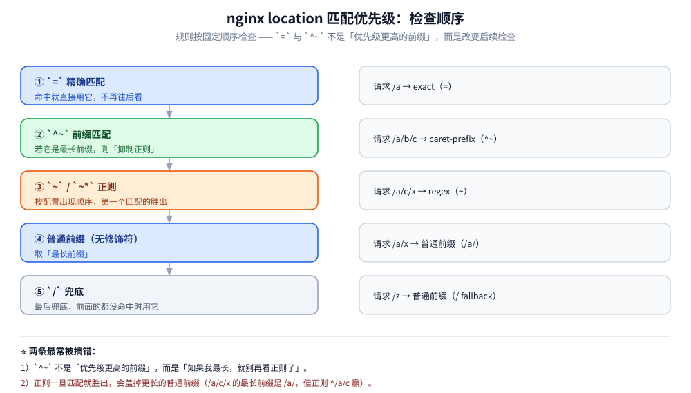
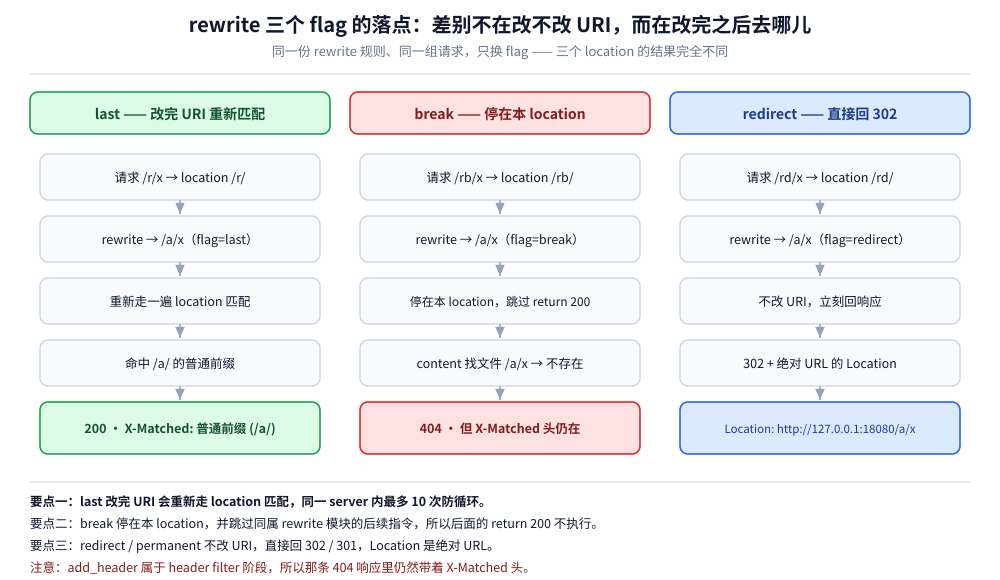

# Nginx 配置语义

> 覆盖：四条最容易被「看一遍就以为懂了」骗过去的配置语义——`location` 按什么顺序匹配、`proxy_pass` 末尾那个斜杠究竟换掉了哪一段 URI、`rewrite` 的三个 flag 各把请求送到哪里、`limit_req` 为什么管不住一个写了 `return` 的 location。四条全部在本机 `nginx/1.15.11` 隔离实例上真跑过（`location` 5 例、`proxy_pass` 2 例、`rewrite` 3 例、`limit_req` 正反例对照）。
>
> 不覆盖：11 个处理阶段的框架级原理与 `rewrite_log` 逐阶段实测见 [04-HTTP框架执行流程.md](../../linux/深入理解Nginx/04-HTTP框架执行流程.md)；在 Nginx 里跑 Lua 的用法与六个典型能力见 [OpenResty.md](../../../03-数据与中间件/中间件/网关与代理/OpenResty.md)；网关产品选型与 Nginx 能力边界的另外四组实测见 [网关选型对比.md](../../../03-数据与中间件/中间件/网关与代理/网关选型对比.md)。
>
> 内容整理自个人学习笔记，素材见 [素材清单](../../../素材清单.md)。限流的算法原理（令牌桶 / 漏桶）见 [限流算法.md](../../../04-架构与系统/分布式/稳定性/限流算法.md)。

---

## 一、location 到底按什么顺序匹配？

**本节要点**：`=` 与 `^~` **不是「优先级更高的前缀」**，它们改变的是**后续还检不检查正则**。记住这一点，比背那五行规则有用。

规则（按检查顺序）：

```text
1. `=`  精确匹配        → 命中就用它，结束
2. `^~` 前缀匹配        → 若它是最长前缀，则「抑制正则」，用它
3. `~` / `~*` 正则      → 按配置文件中的出现顺序，第一个匹配的胜出
4. 普通前缀（无修饰符）  → 取「最长前缀」
5. `/`                  → 兜底
```

实测配置与结果（5 个 location 同时存在）：

```nginx
location = /a     { ... }   # 精确
location ^~ /a/b  { ... }   # 前缀 + 抑制正则
location ~ ^/a/c  { ... }   # 正则
location /a/      { ... }   # 普通前缀
location /        { ... }   # 兜底
```

```text
请求        X-Matched 响应头                结论
/a          exact (=)                       精确匹配优先于一切
/a/b/c      caret-prefix (^~)               ^~ 是最长前缀 → 抑制正则
/a/c/x      regex (~)                       正则优先于「普通前缀 /a/」
/a/x        普通前缀 (/a/)                   最长前缀命中
/z          普通前缀 (/ fallback)            兜底
```

⭐ **两条最常被搞错**：

1. **`^~` 不是"优先级更高的前缀"**，而是"**如果我最长，就别再看正则了**"。`/a/b/c` 命中 `^~ /a/b` 而不是正则 `~ ^/a/c`，就是它在起作用。
2. **正则一旦匹配就胜出，会盖掉更长的普通前缀**：`/a/c/x` 的最长前缀是 `/a/`，但正则 `^/a/c` 出现了 → 正则赢。



这条链与 nginx 1.31.x 的 `predicate` 第五档关系，见 [01-编译安装与配置.md](../../linux/深入理解Nginx/01-编译安装与配置.md) 第 5.3 节与第 7.3 节；`rewrite_log` 的逐阶段验证见 [04-HTTP框架执行流程.md](../../linux/深入理解Nginx/04-HTTP框架执行流程.md) 第三节。

## 二、`proxy_pass` 末尾那个斜杠，为什么会改变上游收到的路径？

**本节要点**：判据只有一句——**`proxy_pass` 的 URI 部分只要写了（哪怕只是一个 `/`），就用它替换掉 location 匹配到的那一段**；完全没写 URI 时，原样透传。

实测（`/api/` 与 `/api2/` 两个 location，只有 `proxy_pass` 的末尾斜杠不同）：

```nginx
location /api/  { proxy_pass http://127.0.0.1:18081/; }   # 带斜杠
location /api2/ { proxy_pass http://127.0.0.1:18081;  }   # 不带斜杠
```

```text
请求 /api/users?x=1  → 后端收到 /users?x=1         ← 带斜杠：剥掉 location 前缀
请求 /api2/users?x=1 → 后端收到 /api2/users?x=1    ← 不带斜杠：保留完整 URI
```

⚠️ 这个差异在网关改造里是大坑：后端服务期望的路径是 `/users`，而 location 是 `/api/`，此时**必须**写成 `proxy_pass http://backend/`（带斜杠），否则后端会收到 404。

⚠️ 另一个连带坑：`proxy_pass` 里**用了变量**（如 `proxy_pass http://$upstream;`）时，nginx 会改用"原样透传"，此时**必须**自己拼好 URI——动态 upstream 场景最容易踩。写成变量的换后端写法见 [网关选型对比.md](../../../03-数据与中间件/中间件/网关与代理/网关选型对比.md) 第 3.3 节，OpenResty 侧的灰度示例见 [OpenResty.md](../../../03-数据与中间件/中间件/网关与代理/OpenResty.md) 第六节。

> 补充：**正则 location 里带不带斜杠都会被整个替换**，这条与上面两例的口径不同，见 [01-编译安装与配置.md](../../linux/深入理解Nginx/01-编译安装与配置.md) 第 6.1 节。

## 三、`rewrite` 的三个 flag 分别把请求送去了哪里？

**本节要点**：`last` / `break` 的差别不是"改不改 URI"（都改），而是**改完之后还回不回去重新匹配 location**；`redirect` / `permanent` 根本不改 URI，直接回跳转。

实测：

```nginx
location /r/  { rewrite ^/r/(.*)$  /a/$1 last; }        # last
location /rb/ { rewrite ^/rb/(.*)$ /a/$1 break;
                add_header X-Matched "break (same location)" always; return 200; }
location /rd/ { rewrite ^/rd/(.*)$ /a/$1 redirect; }     # 302
```

```text
请求 /r/x   → 200  X-Matched: 普通前缀 (/a/)           ← last：改了 URI 后「重新走 location 匹配」
请求 /rb/x  → 404  X-Matched: break (same location)   ← break：停在本 location
请求 /rd/x  → 302  Location: http://127.0.0.1:18080/a/x  ← redirect：返回 302 + 绝对 URL
```

⭐ 三个 flag 的准确语义：

| flag | 做什么 | 后续 |
|---|---|---|
| `last` | 重写 URI | **重新走一遍 location 匹配**（在同一个 server 内，最多 10 次防循环） |
| `break` | 重写 URI | **停在本 location**，不再匹配、且**跳过本 location 里排在后面的 rewrite 模块指令** |
| `redirect` | 不改 URI | 返回 **302**，`Location` 是**绝对 URL** |
| `permanent` | 同上 | 返回 **301** |

⚠️ **实测里那个 404 是个绝佳的反面教材**：`/rb/x` 里 `rewrite ... break` 之后**同一 location 里的 `return 200` 没有执行**（因为 `rewrite` 与 `return` 同属 rewrite 模块，`break` 把它后面的同胞都跳过了），于是请求落到 content 阶段去找文件 `/a/x` → 不存在 → 404。但 `add_header ... always` 属于 header filter 阶段，仍然生效——所以响应里**既有 404 又有那个头**。



这条"404 里还带着自定头"的现象与 `add_header` 只在特定状态码下生效的规则有关，实测见 [04-HTTP框架执行流程.md](../../linux/深入理解Nginx/04-HTTP框架执行流程.md) 第 4.2 节。

## 四、`limit_req` 为什么限不住一个写了 `return` 的 location？

**本节要点**：`limit_req` 在 PREACCESS 阶段执行，而 `return` 在 REWRITE 阶段就把请求结束了——**阶段够不着，限流就静默失效**。"我配了限流却测不出来"，多半是测试用的 location 太早返回。

先看三个参数：

```nginx
http {
    limit_req_zone $binary_remote_addr zone=perip:1m rate=2r/s;   # 定义在 http 层：共享内存区
    server {
        location /limited {
            limit_req zone=perip burst=1 nodelay;
        }
    }
}
```

| 参数 | 含义 |
|---|---|
| `zone=perip:1m` | 共享内存区（1MB 大约能存 1.6 万个 IP 的状态）+ **限流键**（这里是按 IP） |
| `rate=2r/s` | 令牌生成速率（可写 `30r/m`） |
| `burst=1` | 允许的突发排队数；**超出就拒**（默认返回 503） |
| `nodelay` | 突发不排队、**立即处理**；不写则是"排队 + 延迟处理" |

实测（`rate=2r/s, burst=1, nodelay`，连发 6 个）：

```text
[200, 200, 503, 503, 503, 503]     ← 前 2 个：1 个立即可用的令牌 + 1 个 burst
再等 2 秒单发 1 个: 200             ← 令牌按速率补充回来了
```

⭐ 阶段顺序不是"背下来"的，是能测出来的——把限流和 `return` 放进**参数完全相同**的两个 location，唯一差别是**有没有真实的 content handler**：

```nginx
# ④a 反例：本 location 里有 return
location = /limited-return {
    limit_req zone=perip burst=1 nodelay;
    return 200;
}

# ④b 正例：交给静态文件做 content handler
location = /limited {
    limit_req zone=perip burst=1 nodelay;
    root html;
}
```

连发 6 个请求的实测结果：

```text
④a /limited-return（内含 return 200）: [200, 200, 200, 200, 200, 200]   → 限流完全没生效
④b /limited（静态文件当 content handler）: [200, 200, 503, 503, 503, 503] → 第 3 个起被拒
再等 2 秒单发 1 个: 200（令牌补充回来了）
```

⭐ **根因**（这正是阶段模型的直接证据）：

```text
nginx 阶段顺序:  REWRITE  →  POST_REWRITE  →  PREACCESS  →  ACCESS  →  CONTENT
                   ↑                            ↑
               return / rewrite 在这里      limit_req 在这里

④a：return 在 REWRITE 阶段就把请求结束了 → limit_req 所在的 PREACCESS 根本没跑到
④b：没有 return，请求正常走到 PREACCESS → 限流生效
```

⚠️ **推论（很容易踩）**：**任何用 `return` 直接返回的 location，写在它里面的 `limit_req` / `access_by_lua*` 都可能够不着**。测限流时 location 里**必须有一个真实的 content handler**（静态文件、`proxy_pass`、或者 OpenResty 的 `content_by_lua*`）。

> 同理，OpenResty 里的**鉴权必须写在 `access_by_lua*`**而不是 `rewrite_by_lua*`：写在 rewrite 阶段虽然在 `limit_req` 之前，但它**挡不住**后续阶段的逻辑（写错了也能"跑通"，直到某天发现限流没生效）。阶段与 Lua 入口的对照见 [OpenResty.md](../../../03-数据与中间件/中间件/网关与代理/OpenResty.md) 第二节。

⭐ 还有一个**进阶口径**：`limit_req` 是**漏桶式的排队整形**（要么排队、要么拒绝），**不是令牌桶**——它**不允许突发**（除非配 `burst`），这与 [限流算法.md](../../../04-架构与系统/分布式/稳定性/限流算法.md) 第二节讲的令牌桶语义不同。要真正做"允许突发 + 跨机共享配额"，得用 OpenResty 的 `resty.limit.req`（见 [OpenResty.md](../../../03-数据与中间件/中间件/网关与代理/OpenResty.md) 第五节）或 Redis+Lua 方案（见 [限流算法.md](../../../04-架构与系统/分布式/稳定性/限流算法.md) 第九节）。

## 五、应用场景

**本节要点**：这四条语义全部落在"入口层改配置"这一类工作上，**改错时症状都很像、根因却完全不同**。

| 场景 | 用哪条语义 | 典型症状 |
|---|---|---|
| 网关改造：`/api/*` 转发到期望根路径的后端 | 二（`proxy_pass` 斜杠） | 上游一律 404，但直连后端正常 |
| 新增接口要精确命中、不被泛化规则吃掉 | 一（`=` 精确匹配） | 新接口走了旧规则的处理逻辑 |
| 旧链接迁移、域名 / 路径跳转 | 三（`redirect` / `permanent`） | 客户端拿到 200 空响应，而不是 301/302 |
| 压测时确认「限流到底有没有生效」 | 四（阶段顺序） | 限流配置看着对，实测一个都拦不住 |
| 在 OpenResty 里写鉴权 / 限流脚本 | 四（同一阶段模型的 Lua 侧） | 脚本里 `ngx.exit` 写了，但限流仍不生效 |

## 六、具体使用：怎么在本机把这四条复现出来

**本节要点**：四条读数都来自一个**隔离实例**——独立 prefix、独立端口（`18080`），不碰任何已有的 nginx。

```bash
# ① 启动：-p 指定 prefix，-c 指定 conf（Windows 下用 phpstudy 自带的 nginx 1.15.11）
nginx.exe -p D:/tmp/ngx-semantics -c conf/nginx.conf

# ② 改配置后 reload，或停止（⚠️ 不要 taskkill 整个 nginx.exe，会连带杀掉 phpstudy 的）
nginx.exe -p D:/tmp/ngx-semantics -c conf/nginx.conf -s reload
nginx.exe -p D:/tmp/ngx-semantics -c conf/nginx.conf -s stop
```

```bash
# ③ 看命中了哪个 location：让每个 location 回一个不同的 X-Matched 头
curl -s -D - -o /dev/null http://127.0.0.1:18080/a/b/c | grep -i x-matched

# ④ 连发 6 个看限流：前 2 个 200，第 3 个起 503
for i in $(seq 6); do
  curl -s -o /dev/null -w "%{http_code} " http://127.0.0.1:18080/limited
done

# ⑤ 看 rewrite 的落点：-i 带上响应头，观察状态码与 X-Matched 是否同时出现
curl -s -i http://127.0.0.1:18080/rb/x | head -5
```

`proxy_pass` 两例需要一个**把请求行原样打印出来的后端**（本机实验中是 `18081` 端口上的临时打印服务），否则"后端收到什么 URI"看不见。

## 延伸追问

- **`=` 和 `^~` 能同时命中吗？** → 不能。`=` 只匹配**完全相同**的 URI，命中即结束；`^~` 是前缀匹配，只在没有精确命中、且自己是最长前缀时抑制正则。二者语义不重叠。
- **为什么 `break` 之后 `add_header` 还生效？** → `break` 只终止**本 location 里的 rewrite 模块指令**并停止 location 重匹配；`add_header` 属于 header filter 阶段，是响应生成之后才跑的，不受影响。
- **`limit_req` 为什么默认返回 503，而不是 429？** → nginx 的历史默认值是 503，可用 `limit_req_status 429;` 改。语义上 429（Too Many Requests）更准确，很多网关会显式改掉。
- **`return` 一定比 `limit_req` 早吗？** → 同一 location 里是的：`return` 属于 rewrite 模块，在 REWRITE 阶段执行；`limit_req` 在 PREACCESS 阶段。但 `rewrite` 带 `last` 会重新匹配，如果重新匹配后落到的 location 没有 `return`，限流仍可能生效——**判据是这条请求最终有没有走到 PREACCESS**。
- **`limit_req` 的 key 只能是 IP 吗？** → 不是。`limit_req_zone` 的 key 是任意变量组合（如 `$binary_remote_addr$uri`），但**不能用请求体或 Lua 里算出来的值**——那些只有 OpenResty 的 `resty.limit.req` 才能做。
- **这些语义在 OpenResty 里有变化吗？** → 没有。OpenResty 就是 Nginx，`location` / `proxy_pass` / `rewrite` / `limit_req` 的语义完全一致；它多出来的是"能在阶段里挂 Lua"。

## 关联

- **上游机制**：[04-HTTP框架执行流程.md](../../linux/深入理解Nginx/04-HTTP框架执行流程.md) — 11 个处理阶段的整体框架，本篇第四节的"阶段够不着"是它在限流上的一个具体后果
- **上游机制**：[01-编译安装与配置.md](../../linux/深入理解Nginx/01-编译安装与配置.md) — `location` 第五档 `predicate`、正则 location 的替换规则
- **对照/互补**：[反向代理原理.md](反向代理原理.md) — Go 侧 `ReverseProxy` 同样要处理"剥前缀"，但用 `Director` / `StripPrefix` 表达
- **对照/互补**：[客户端真实IP与可信代理.md](客户端真实IP与可信代理.md) — `limit_req` 按 `$binary_remote_addr` 限流时，取到的是不是真实客户端 IP
- **下游产品**：[OpenResty.md](../../../03-数据与中间件/中间件/网关与代理/OpenResty.md) — 在同一套阶段模型上挂 Lua，把限流、鉴权、路由做成可编程的
- **能力边界**：[网关选型对比.md](../../../03-数据与中间件/中间件/网关与代理/网关选型对比.md) — Nginx 够用到什么程度，哪些事必须换产品
- **算法原理**：[限流算法.md](../../../04-架构与系统/分布式/稳定性/限流算法.md) — 令牌桶 / 漏桶的区别，以及 `limit_req` 为什么算"漏桶式整形"
