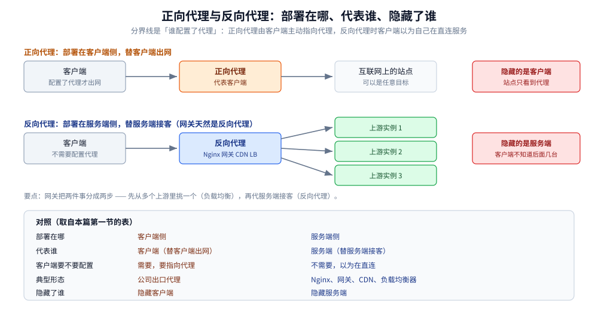
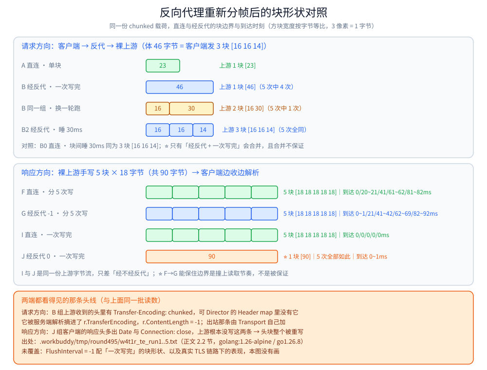
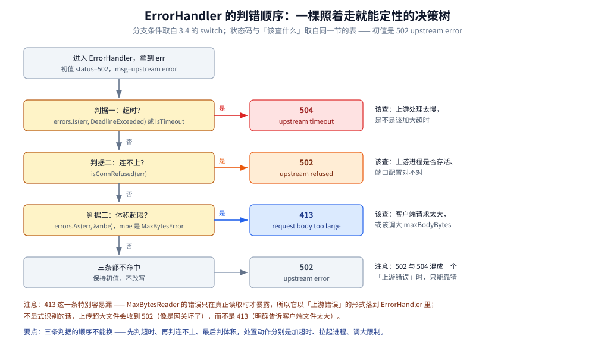
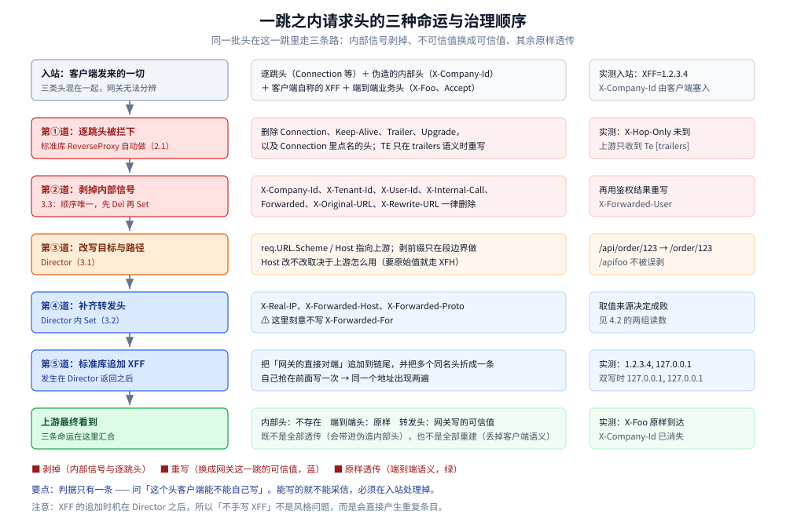
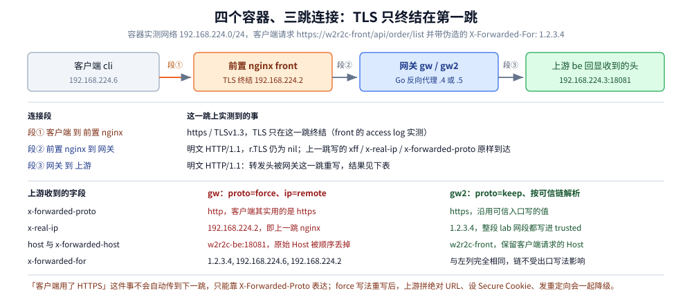
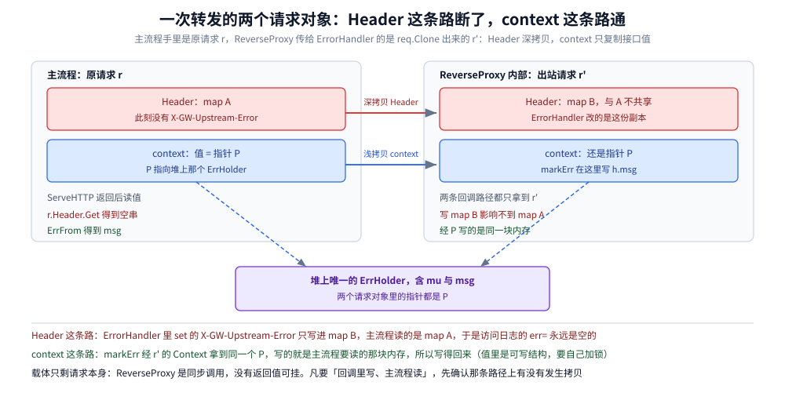
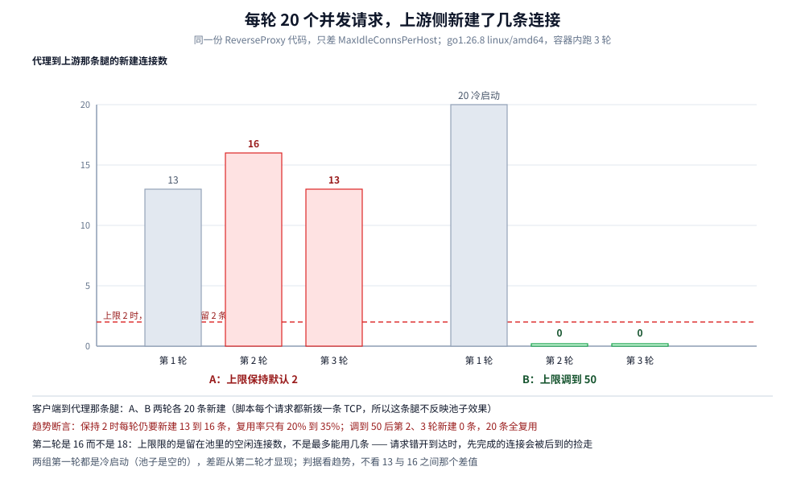

# 反向代理原理

> 覆盖：反向代理与正向代理的差别、`httputil.ReverseProxy` 替你做了什么、你只需要做哪三件事、头部治理的完整口径、出站请求 Clone 后 Header 传不回来的坑，以及 `Transport` 的四个必调参数。
>
> 不覆盖：Go 侧的接入骨架、单例边界、初始化顺序与优雅退出见 [反向代理接入.md](../../../01-编程语言/go/网络编程/反向代理接入.md)；`X-Forwarded-For` 的语义与可信代理链解析见 [客户端真实IP与可信代理.md](客户端真实IP与可信代理.md)；逐跳头与连接复用在协议层的来由见 [HTTP与gRPC.md](../应用层/HTTP与gRPC.md)；请求到达代理之前那一跳改了什么见 [网络通信链路详解.md](../网络通信链路详解.md)。
>
> 内容整理自个人学习笔记；实现取自自研网关项目 [gateway](https://github.com/Eleven-26/gateway)（module `gwlab`，Go 1.26.5）的 `internal/proxy/`。
>
> ✅ 实测口径：逐跳头明细表引自该项目 `docs/项目分析与执行链路.md` §5.7 与 §6.1（带 backend 侧 JSON 回显）；`MaxIdleConnsPerHost` 的对照实验与 2.2 的 `Transfer-Encoding` 重新分帧实验均为**本机容器实测**（2.2 连跑 5 次，读数见该节）；⚠️ **未实测**在其他代理（Nginx / APISIX）上的同款行为。

---

## 一、反向代理和正向代理差在哪？

**本节要点**：两者都是「代理」，差别在**代理谁**。

| | 正向代理 | 反向代理 |
|---|---|---|
| 部署在哪 | 客户端侧 | **服务端侧** |
| 代表谁 | 客户端（替客户端出网） | **服务端**（替服务端接客） |
| 客户端是否需要配置 | 需要（要指向代理） | **不需要**（客户端以为在直连服务） |
| 典型形态 | 公司出口代理、科学上网 | Nginx、网关、CDN、负载均衡器 |
| 隐藏了谁 | 隐藏客户端 | **隐藏服务端**（客户端不知道后面有几个实例） |

⭐ 所以**网关天然是反向代理**：它要对客户端表现为「就是我要访问的那个服务」，
同时在后面做路由、鉴权、限流、负载均衡。

⚠️ 一个容易混的点：**反向代理和负载均衡不是一回事**。
反向代理是「**代服务端接客**」这件事，负载均衡是「**从多个上游里挑一个**」这件事。
网关两者都做，但分成两步：**先挑节点（负载均衡），再转发（反向代理）**。

⭐ 把两种代理画在同一张拓扑里最直观：分界线是「**谁配置了代理**」——
正向代理的连接由客户端主动指向代理，反向代理时客户端**以为自己在直连服务端**：



图注：正向代理与反向代理的部署位置对照：客户端侧代理隐藏客户端，服务端侧代理隐藏服务端。

## 二、`httputil.ReverseProxy` 替你做了什么？

**本节要点**：标准库这一层已经把最容易出错的部分做对了，知道它做了什么，才知道自己不用重复做。

| 它做的 | 为什么重要 |
|---|---|
| **逐跳头（Hop-by-hop）剔除**：`Connection` / `Keep-Alive` / `TE` / `Transfer-Encoding` / `Trailer` / `Upgrade` | 这些头描述的是「**这一跳**」的连接语义（比如「这个连接用完就关」），原样转给下一跳会让语义错乱 |
| **流式转发**请求体与响应体 | 不会把 1GB 的上传读进内存；对大文件与 SSE 都是必需 |
| **支持 HTTP/1.1 升级**（WebSocket） | 升级要接管底层连接，手写几乎必然出错 |
| **自动追加 `X-Forwarded-For`** | ⚠️ 正因为是自动的，**自己再设一次就会重复**（见 3.2） |

> ⚠️ 这行「剔除」清单里，`Transfer-Encoding` 的口径要单独读：实测**头线在两端都还看得见**，
> 被剔掉的只是「对端那份分帧」，块边界由代理重新决定。详见 2.2。

⭐ 说清「逐跳头为什么不能转发」的一个例子：

```text
客户端 → 网关：  Connection: close        ← 「这个连接用完就关」
如果没有剔除，网关把它转给上游：
上游 → 网关：    Connection: close        ← 上游关掉了「网关和上游」的连接
```

看起来没大问题，但如果上游真的照做，网关与上游之间的**连接池**就被这次请求搞坏了 ——
每个请求都会新建连接。这类问题的表现是「连接数异常高」，极难定位到头上。

### 2.1 本机实测：六个逐跳头里哪些真的到不了上游

**本节要点**：上面那张表列了六个头，实测确认它们**确实都不出现在上游**；
但 `TE` 有个例外口径 —— 它不是被删掉，而是被**重写**成固定值。

容器实测（`golang:1.26-alpine`，`go1.26.8 linux/amd64`，脚本
`.workbuddy/tmp/round495/w2r2c_xff.go`）：客户端用裸 TCP 连接手工拼请求行，
保证发出去的头字节不被 `http.Client` 改写；上游把收到的头原样回显。

```text
客户端发出：
    Connection: close, X-Hop-Only
    X-Hop-Only: hop-only-value
    Keep-Alive: timeout=5, max=100
    TE: trailers
    Trailer: X-Late
    Upgrade: websocket
    X-Foo: end-to-end-value
上游实际收到的全部头：
    Accept-Encoding      [gzip]
    Te                   [trailers]
    X-Foo                [end-to-end-value]
    X-Forwarded-For      [127.0.0.1]
```

四条读数的意义：

| 读数 | 结论 |
|---|---|
| `Connection`、`Keep-Alive`、`Trailer`、`Upgrade` 都没到上游 | 与第二节的表一致：逐跳头在代理边界被拦下 |
| `X-Hop-Only` 也没到上游 | ⭐ 剔除**不止那六个名字** —— `Connection` 里点名的头同样被删掉，这是「用 `Connection` 声明扩展逐跳头」的标准做法，自己手写转发时最容易漏 |
| `Te: trailers` 到了上游，且值是 `trailers` | ⚠️ `TE` 是唯一**有条件透传**的：客户端带 `trailers` 语义时标准库会重写成 `TE: trailers` 带下去。所以「逐跳头一个都不转」这句要改成「**除 `TE` 的 trailers 语义外**都不转」 |
| `Accept-Encoding: gzip` 是代理**自己加的** | 客户端没发这个头。⭐ 这正是「压缩到底谁做」那条追问的现实来源：默认 `Transport` 会代替客户端要求 gzip |

⭐ `X-Foo: end-to-end-value` 原样到达，端到端头不受影响 ——
本节实测的判据与第四节的口径是同一件事：**按语义分类处理，而不是「全部透传」或「全部重建」**。

### 2.2 本机实测：`Transfer-Encoding` 是被**重新分帧**，不是被删掉

**本节要点**：第二节那张表把 `Transfer-Encoding` 列进了「剔除」清单，这条要单独校准口径 ——
`Transfer-Encoding: chunked` 这条**头线在两端都看得见**（上游收得到、客户端也收得到），
看不见的是**对端那份分帧本身**：代理把体读进自己的缓冲，块边界与头线都由它重新决定。

容器实测（`golang:1.26-alpine`，`go1.26.8 linux/amd64`，脚本
`.workbuddy/tmp/round495/w4t1_te2.go`）：这一轮把上游换成**裸 TCP 服务**，逐行打印它收到的请求头原文，
并自己解析「收到几个块、每块几字节」；客户端同样用裸 TCP 手工拼请求字节。
响应方向让裸上游手写 5 个 18 字节的 chunk，客户端边收边解析、记录每块到达时刻。
块数、每块字节、头线、`map` 的键这些**确定性读数本机连跑 5 次一致**（5 份输出存于
`.workbuddy/tmp/round495/w4t1r_te_run1..5.txt`；剥掉响应头里的 `Date` 与到达时刻数组后逐行比对，
**只有 B 组「上游收到几块」那一行会变**，其余逐字相同；更早那 3 份 `w4t1_te_run1..3.txt` 的读数值也一致）。
⚠️ 两类例外：**到达时刻**属时序读数，同一块在 5 次运行里最大相差 10ms
（G 组第 5 块为 82/82/82/82/92ms），只用来说趋势；⭐ 而 B 组那一行**本身就不是确定性读数** ——
5 次里 4 次是 1 块 `[46]`、1 次是 2 块 `[16 30]`。这恰好是本节结论的直接证据：块边界真的不受保证。
⚠️ 复跑请走 `go run w4t1_te2.go`；同目录那份旧二进制 `w4t1_te2` 是修复前的编译产物，响应侧分帧写坏了，
跑它会报 `ReverseProxy read error during body copy: malformed chunked encoding`，读数不可信。

**请求方向（客户端 → 反代 → 裸上游）**：

```text
A 直连（对照）：客户端发单块 23 字节
    上游收到的请求头  POST /echo HTTP/1.1 / Host: gw.test / Connection: close
                     / X-Client-Marker: raw / Transfer-Encoding: chunked
    上游解析到的分帧  块数 = 1，各块字节 = [23]

B 经反代：客户端发 3 块 [16 16 14]（合计 46 字节），一次写完
    上游收到的请求头  POST /echo HTTP/1.1 / Host: gw.test
                     / Transfer-Encoding: chunked      ← ⭐ 这条头线又出现了
                     / X-Client-Marker: raw / X-Forwarded-For: 127.0.0.1
                     / Accept-Encoding: gzip
    上游解析到的分帧  块数 = 1，各块字节 = [46]         ← 客户端的三块被并成一块
                     （5 次里有 1 次是 2 块 [16 30]，见上面的时序例外说明）
    Director 里的读数 Header map 含 Transfer-Encoding = false；
                     r.TransferEncoding = [chunked]；r.ContentLength = -1；
                     map 的键 = [Connection X-Client-Marker]

B0 直连（对照）：同样 3 块，但块与块之间睡 30ms
    上游解析到的分帧  块数 = 3，各块字节 = [16 16 14]

B2 经反代：同样 3 块、同样睡 30ms
    上游解析到的分帧  块数 = 3，各块字节 = [16 16 14]
```

| 读数 | 结论 |
|---|---|
| B 组上游**确实收到了** `Transfer-Encoding: chunked` | ⚠️ 第二节那句「剔除」在 `Transfer-Encoding` 上不能读成「这条头到不了上游」—— 它到得了，只是**不是从客户端抄过去的那一条** |
| Director 里 `req.Header` 的 map **没有** `Transfer-Encoding`，值在 `r.TransferEncoding` 字段里 | 剔除确实发生过一次，但发生在**代理之前**：Go 的 HTTP 服务端解析请求时就把它从 map 摘进结构体字段（`go doc net/http.Request` 对这个字段的注释原话是 chunked 会在收发时 *automatically added and removed as necessary*）。所以「逐跳头剔除」这一条对它是**空操作**，Director 里想删也无从删 |
| 出站那条头线是 `Transport` 因 `r.ContentLength = -1`（体长未知）自己加的；客户端 3 块 → 上游 5 次里 4 次 1 块 `[46]`、1 次 2 块 `[16 30]` | ⭐ 准确口径是「**语义不转发，分帧由代理重新决定**」：它按「自己一次读到手多少」重新出块，块边界**不受保证**——同一次实验换一轮跑就变了 |
| B0 与 B2 都是 3 块 `[16 16 14]` | 上一条的对照：分帧不是固定合并，而是**跟着读取节奏走**。把「上游一块一块」这件事押在代理身上不可靠 |

⭐ 顺带一个容易反着理解的读数：Director 里那串 `map` 的键**还包含 `Connection`**，
而上游最终没收到它 —— 说明逐跳头是在 Director **之后**才被删的。
所以「在 Director 里 `req.Header.Del("Connection")`」是有效写法，
「以为进 Director 之前已经删干净了」这个预期则不成立。

**响应方向（裸上游手写 5 个 18 字节的 chunk → 客户端逐块解析）**：

```text
F 直连，上游分 5 次写、每次睡 20ms
    客户端收到的响应头  HTTP/1.1 200 OK / Content-Type: text/plain / Transfer-Encoding: chunked
    客户端收到         5 块 [18 18 18 18 18]，到达 0/20~21/41/61~62/81~82ms

I 直连，上游把同样 5 块**一次写完**
    客户端收到         5 块 [18 18 18 18 18]，到达时刻 5 次全为 0/0/0/0/0ms

J 经反代（默认 FlushInterval = 0），上游是「一次写完」那个
    客户端收到的响应头  HTTP/1.1 200 OK / Content-Type: text/plain / Date: ... / Connection: close
                       / Transfer-Encoding: chunked
    客户端收到         ⭐ 1 块 [90]，5 次全部如此，到达 0~1ms
    ModifyResponse 里的读数 Header map 含 Transfer-Encoding = false；
                       res.TransferEncoding = [chunked]；res.ContentLength = -1；
                       map 的键 = [Content-Type]

G 经反代（FlushInterval = -1），上游是分 5 次写那个
    客户端收到         5 块 [18 18 18 18 18]，到达 0~1/21/41~42/62~69/82~92ms
```

| 读数 | 结论 |
|---|---|
| J 组客户端的响应头里多出 `Date` 与 `Connection: close`，而上游那两条根本没写 | ⭐ 出站**整个头块都是代理重写的**，`Transfer-Encoding: chunked` 只是其中一条 —— 「上游返回的头」与「客户端收到的头」在框架层是两份东西 |
| 代理内部 `res.Header` 里**也没有** `Transfer-Encoding`，它在 `res.TransferEncoding` 字段里、`res.ContentLength = -1` | 想在 `ModifyResponse` 里按头名判断「上游是不是流式」会判空，得看 `res.ContentLength == -1` 或 `res.TransferEncoding`；想 `res.Header.Del("Transfer-Encoding")` 同样删不到东西（与请求方向那侧正好镜像） |
| I 的 5 块到 J 变成 **1 块** `[90]`；F 的 5 块到 G 仍是 5 块 | ⚠️ 块边界同样是代理重新决定的：上游一次写完 → 代理一次读到 90 字节 → 出一块；上游分次写 → 恰好一块一次。**能保住边界是撞上的，不是被保证的** |
| 四种形状拼回的体**逐字相同**（都是那 90 字节） | 合并只改「分块形状与到达时刻」，不改内容 —— 只有**按块到达做流式**（SSE、逐块进度）的消费方才会被这个差异打到 |

⚠️ 还有一个形状要单独记：客户端**同时**带 `Content-Length: 5` 与 `Transfer-Encoding: chunked` 时（B3），
本机 Go 1.26.8 的反代**没有拒收**，它按 chunked 解析并把 23 字节整份转给上游 ——
上游看到的头线里**只有** `Transfer-Encoding: chunked`，`Content-Length` 不见了。
这正是请求走私的原料：**网关这层「谁赢」是实现的选择题，不是协议给的保证**，
要拒收就得自己在入口判（和 3.3 剥离伪造头是同一处位置）。

⚠️ 本节**未覆盖**：`FlushInterval = -1` 在「上游一次写完」这个场景下的块形状没测；
真实 TLS 链路（多一跳终结）下的表现也没测。



图注：同一份 chunked 载荷经反代后的块形状对照。上半为请求方向（客户端 3 块 16/16/14 → 上游 5 次中 4 次为 1 块 46、1 次为 2 块 16/30），下半为响应方向（上游分 5 次写时客户端收到 5 块 18 字节，上游一次写完时直连仍是 5 块、经反代只剩 1 块 90 字节）；方块宽度按字节等比，底部橙框是两端都看得见的 `Transfer-Encoding` 头线口径。图内读数全部出自上面那 5 次运行。

## 三、你只需要做哪三件事？

### 3.1 Director：改写目标 + 剥前缀（⚠️ 段边界）

```go
Director: func(req *http.Request) {
    req.URL.Scheme = target.Scheme
    req.URL.Host = target.Host

    // 剥前缀只在**路径段边界**上做：path == prefix 或 path 以 prefix+"/" 开头
    if stripPrefix != "" && (req.URL.Path == stripPrefix ||
        strings.HasPrefix(req.URL.Path, stripPrefix+"/")) {
        req.URL.Path = strings.TrimPrefix(req.URL.Path, stripPrefix)
        if req.URL.Path == "" { req.URL.Path = "/" }
    }
}
```

⭐ **第一版写成裸的 `strings.HasPrefix` + `TrimPrefix`，于是就踩了这个坑**：

```text
stripPrefix = /api

网关侧路径 /api/order/123  → 剥掉 → /order/123     ✅ 预期
网关侧路径 /apifoo         → 裸 HasPrefix 命中 → 剥成 foo   ❌ 谁都没定义过这个路径
```

**「前缀」和「路径段」不是一回事**：`/api` 是 `/api/order` 的前缀，也是 `/apifoo` 的前缀，
但我们只想让前者被剥。判据就是**看前缀后面是不是 `/` 或刚好结束**。

> ⚠️ 顺带一个「怎么发现这类 bug」的经验：它的表现是**上游收到一个不存在的路径**（404 或奇怪的 400），
> 而网关侧的日志看起来一切正常（路由匹配 OK、状态码来自上游）。
> 只有把**上游实际收到的 path** 也记下来，才能一眼看出路径被改错了 ——
> 这也是为什么「访问日志要记上游地址与上游耗时」这类字段值得加。

### 3.2 补齐 `X-Forwarded-*`：⚠️ `X-Forwarded-For` 不要自己写

```go
// ⚠️ X-Real-IP 写的是「客户端」还是「对端」，取决于**取值来源**：
//    从 req.RemoteAddr 推 → 直连对端（网关在 LB 后面时那就是 LB 的地址）
//    从 ctx 里入口解析好的结果取 → 真实客户端（本项目采用，见客户端真实IP篇第七节）
req.Header.Set("X-Real-IP", clientIPOf(req))
req.Header.Set("X-Forwarded-Host", req.Host)       // 原始 Host
req.Header.Set("X-Forwarded-Proto", scheme(req))   // http / https
// ⚠️ X-Forwarded-For 不在这里设 —— ReverseProxy 会自己追加 RemoteAddr
```

⭐ **为什么必须「不写」**：`ReverseProxy` 在 `Director` 返回**之后**会把 `RemoteAddr` 追加到 `XFF` 上。
如果 Director 里也写一次，结果是：

```text
X-Forwarded-For: 127.0.0.1, 127.0.0.1     ← 同一个地址出现两次（本机实测踩过）
```

项目文档 §6.1 的真实回显证明了修正后的行为：

```json
{"backend":"A","headers":{
  "X-Forwarded-For":"127.0.0.1",
  "X-Forwarded-Host":"api.example.com",
  "X-Forwarded-Proto":"http",
  "X-Forwarded-User":"anonymous",
  "X-Real-IP":"127.0.0.1",
  "X-Trace-Id":"8ac2a6da2445b0475a15c376ad322eb0"},
 "method":"GET","path":"/api/order/list","query":"","ts":"19:10:03.292"}
```

> 📎 来源：项目 `docs/项目分析与执行链路.md` §6.1「逐跳头实测」（backend A 的回显）。
> → `X-Forwarded-For` **只有一个 IP**，验证了「不在 Director 里手写 XFF」这一决策。

⚠️ **另一件必须知道的事**：`ReverseProxy` **不清理入站的 XFF**。
所以上游看到的 XFF 是 `客户端值, 网关IP` —— **客户端那部分是伪造的**。

```json
{"backend":"C","headers":{
  "X-Forwarded-For":"1.2.3.4, 127.0.0.1",     ← 1.2.3.4 是客户端自己塞的
  "X-Real-IP":"127.0.0.1",                     ← 这个才是网关写的、本跳可信的
  ...}}
```

⭐ 结论：**取真实客户端 IP 要用 `X-Real-IP`（或按可信代理链解析 XFF），不能直接读 XFF 的最左端**。
完整规则见 [客户端真实IP与可信代理.md](客户端真实IP与可信代理.md)。

⚠️ 上面这个读数是在**网关直接面对客户端**（单跳）时取得的，此时「对端」正好就是真实客户端。
一旦网关前面还有 LB，**取值来源**就决定了成败：从 `req.RemoteAddr` 推得到的是 LB 的地址，
必须改用入口 `clientip.Resolve` 解析好、挂在 ctx 上的结果 —— 项目已按后者实现，
反例与实测见 [客户端真实IP与可信代理.md](客户端真实IP与可信代理.md) 第七节。

### 3.3 剥离客户端伪造的内部头（多租户系统的必修项）

```go
// 这些头只允许由可信内部产生，入站一律剥掉
var InternalHeaders = []string{
    "X-Company-Id", "X-Tenant-Id", "X-User-Id", "X-Internal-Call", "X-Forwarded-User",
    "Forwarded", "X-Original-URL", "X-Rewrite-URL",
}

// ② 剥离伪造的内部头
for _, h := range InternalHeaders { req.Header.Del(h) }
// 把网关鉴权出来的身份**重新**写进去（此刻它才是可信的）
if id := auth.FromContext(req.Context()); id != nil {
    req.Header.Set("X-Forwarded-User", id.Subject)
}
```

⭐ **每一类都在防一种具体的攻击**：

| 头 | 伪造它能做什么 |
|---|---|
| `X-Company-Id` / `X-Tenant-Id` | **横向越权**：上游按它做租户过滤，伪造即可读别家数据 |
| `X-User-Id` | 冒充指定用户 |
| `X-Internal-Call` | 冒充「内部流量」跳过业务侧校验 |
| `X-Forwarded-User` | 冒充已鉴权身份（**必须先剥再写**，顺序反了就等于没做） |
| `Forwarded`（RFC 7239） | XFF 的标准化写法，同样可伪造客户端 IP / 协议 |
| `X-Original-URL` / `X-Rewrite-URL` | nginx / IIS 系常用注入面，**部分后端框架会按它重写实际处理的路径** —— 从而绕过网关的路由与鉴权规则 |

⚠️ **顺序是唯一的**：**先 `Del` 全部，再 `Set` 可信值**。
反过来的话，客户端伪造的同名头会覆盖网关写入的身份 —— 这类漏洞在很多自研网关上出现过。

> 💡 **一个判断自己有没有漏的做法**：把「网关会信任哪些请求头」列成一张表，
> 然后问「这些头客户端能不能自己写」。**能写的就必须在入站剥掉** ——
> 因为它们在语义上属于「内部信号」，而客户端不是内部。

### 3.4 `ErrorHandler`：区分超时与连不上

```go
ErrorHandler: func(w http.ResponseWriter, r *http.Request, err error) {
    status, msg := http.StatusBadGateway, "upstream error"
    switch {
    case errors.Is(err, context.DeadlineExceeded), os.IsTimeout(err):
        status, msg = http.StatusGatewayTimeout, "upstream timeout"      // 504
    case isConnRefused(err):
        status, msg = http.StatusBadGateway, "upstream refused"          // 502
    default:
        var mbe *http.MaxBytesError
        if errors.As(err, &mbe) {
            status, msg = http.StatusRequestEntityTooLarge, "request body too large"   // 413
        }
    }
    ...
}
```

⭐ **为什么必须区分**：这三个错误的**处置完全不同**。

| 现象 | 状态码 | 该查什么 |
|---|---|---|
| 上游超时（504） | 上游处理太慢 | 上游的性能、是不是该加大超时 |
| 上游拒绝连接（502） | 上游没在监听 | 上游进程是否存活、端口配置对不对 |
| 请求体超限（413） | 客户端请求太大 | 客户端的问题，或该调大 `maxBodyBytes` |

⚠️ **`413` 这一条特别值得说**：它很可能是从 `MaxBytesReader` 冒出来的 ——
网关如果用 `MaxBytesReader` 限制请求体，**错误只在真正读取时才暴露**，
所以它会以「上游错误」的形式出现在 `ErrorHandler` 里。
不显式识别的话，用户上传一个超大文件会收到 502（像是网关坏了），而不是 413（明确告诉我文件太大）。

⭐ 把这段 `switch` 的判断顺序画出来，就是值班时能直接照着走的一棵决策树
（分支条件、三个状态码、「该查什么」全部取自上面的代码与表）：



图注：ErrorHandler 的判错顺序：先判超时、再判连不上、最后判体积超限，分别落到 504 、 502 与 413。

## 四、头部治理的完整口径是什么？

把上面几条合起来，就是一张「客户端传了什么 → 上游看到什么」的对照表：

| 请求头 | 客户端传入 | 网关动作 | 上游最终看到 |
|---|---|---|---|
| `X-Company-Id` / `X-Tenant-Id` / `X-User-Id` / `X-Internal-Call` | 任意伪造 | **一律删除** | 不存在 |
| `Forwarded` / `X-Original-URL` / `X-Rewrite-URL` | 任意伪造 | **一律删除** | 不存在 |
| `X-Forwarded-User` | 伪造 | 先删除，再用**鉴权结果**重写 | 真实身份（`u-2` / `apikey:ak_live_` / `anonymous`） |
| `X-Forwarded-For` | 传入 | **不手写**，由 ReverseProxy 追加 | `客户端值, 网关IP`（可伪造，见 3.2） |
| `X-Real-IP` | — | 网关写入**入口解析出的客户端 IP**（经 ctx 传递，缺省时回落 `RemoteAddr`） | 真实客户端 IP |
| `X-Forwarded-Host` | — | 网关写入原始 Host | 原始 Host |
| `X-Forwarded-Proto` | — | 按 `r.TLS` 判断 | `http` / `https` |
| `X-Trace-Id` | 可传入 | 复用（缺失则新生成）并透传 + 回写 | 同一个 TraceID |
| `Host` | `api.example.com` | 改成上游 `host:port` | 上游地址 |

> 📎 表中数据引自项目 `docs/项目分析与执行链路.md` §5.7「请求头改写链路（逐跳明细）」。

⭐ **这张表本身就是「一个反向代理该做多少头部治理」的答案**：
不是「全部透传」（会带进伪造的内部头），也不是「全部重建」（会丢掉客户端语义，
比如 `traceparent`、`Accept`、自定义业务头）。
**正确的口径是按语义分类**：内部信号剥掉、客户端不可信的换成可信值、其余原样透传。

⭐ 一张图把第二节与第三节合起来看：**同一批头在这一跳里走三条路**，
而 `X-Forwarded-For` 的追加发生在 `Director` **返回之后**（3.2 的 `127.0.0.1, 127.0.0.1`
就是「自己抢在标准库之前写了一次」的证据，2.1 的实测读数则给出另一条边界：逐跳头根本进不去）：



图注：一跳之内的头部治理顺序：逐跳头与内部头在入口被拦下，转发头由网关重写，XFF 在 Director 之后才追加。

### 4.1 标准 `Forwarded`（RFC 7239）与 `X-Forwarded-*` 的定位差异

| | `X-Forwarded-For` / `-Proto` / `-Host` | `Forwarded` |
|---|---|---|
| 来源 | **事实标准**，nginx / LB / 云网关的默认写法 | **RFC 7239 标准化写法** |
| 表达力 | 一条纯 IP 链（`1.1.1.1, 10.0.1.5`）；协议与 Host 要另开 `-Proto` / `-Host` 头 | 结构化参数：`for=` / `by=` / `proto=` / `host=` 写在同一头里，例如 `for=192.0.2.60;proto=https;by=203.0.113.43` |
| 语法细节 | 没有正式规范，端口与 IPv6 的写法各家不一 | 值**可加引号**，IPv6 用方括号（`for="[2001:db8::1]:5000"`），`for` 里可带端口 |
| 生态支持 | 极广 | 较窄（nginx 要用 `proxy_set_header Forwarded …` 手工拼；很多 SDK 不解析它） |

⚠️ **两者的安全性质完全一样**：都是**客户端能自己塞的普通请求头**。
所以「先判对端是否可信、再从右往左解析」这套规则对二者同样适用；`Forwarded` 的差别只在于**语义更全但解析更麻烦**。
本项目把它与 `X-Original-URL` 等一起列入**入站一律剥离**的名单（见 3.3）。

⭐ **是否透传取决于信任边界**，没有统一答案：

| 你前面是什么 | 该怎么处理转发头 |
|---|---|
| **你自己部署的代理 / LB**（网段可控） | 可以把它写的头**当作可信证据**，按可信链解析后复用 |
| **客户端直连、或第三方 CDN**（网段不可控、可能被伪造） | ⭐ **必须当成客户端可伪造的普通头**处理：入站剥离，只用自己这一跳写入的可信值 |

> 📎 完整判据（可信网段怎么配、每跳要不要写进 `trusted`）见 [客户端真实IP与可信代理.md](客户端真实IP与可信代理.md)。

### 4.2 TLS 卸载在哪一跳，决定 `X-Forwarded-Proto` 的真值

**本节要点**：3.2 里「按 `r.TLS` 判断 `X-Forwarded-Proto`」这个写法**只在网关自己终结 TLS 时成立**；
TLS 在更前面一跳被终结时 `r.TLS` 恒为 `nil`，网关会把前置代理**已经写对的 `https` 覆盖成 `http`**。

四容器实测拓扑：`w2r2c-cli`（客户端，192.168.224.6）→ `w2r2c-front`（nginx，TLS 终结，192.168.224.2）
→ `w2r2c-gw` / `w2r2c-gw2`（同一个 Go 代理的两种写法）→ `w2r2c-be`（把收到的头原样回显）。
镜像 `nginx:mainline-alpine` + `alpine:3.21`，两个网关为 `go1.26.8 linux/amd64`，
自定义网络 `w2r2c-net`（192.168.224.0/24）；脚本与配置在 `.workbuddy/tmp/round495/`
（`w2r2c_proxylab.go`、`w2r2c-proxylab.conf`，自签证书由 `w2r2c_cert.go` 用 `crypto/x509` 生成）。
客户端发 `https://w2r2c-front/api/order/list`，并带上伪造的 `X-Forwarded-For: 1.2.3.4`：

```text
【第一跳 nginx 的 access log（TLS 只终结在这里）】
192.168.224.6 -> https/TLSv1.3 "GET /api/order/list HTTP/1.1" xff="1.2.3.4" xfp_sent="https" real_peer="192.168.224.6" status=200

【两种网关写法收到的入站完全相同（gw 自己打的日志，行首是日志时间戳）】
18:32:03.299398 [gw] remote_addr=192.168.224.2 tls=false inbound_xff="1.2.3.4, 192.168.224.6" inbound_x_real_ip="192.168.224.6" inbound_x_forwarded_proto="https" inbound_host="w2r2c-be:18081"
18:32:05.641685 [gw] remote_addr=192.168.224.2 tls=false inbound_xff="1.2.3.4, 192.168.224.6" inbound_x_real_ip="192.168.224.6" inbound_x_forwarded_proto="https" inbound_host="w2r2c-front"

【上游 be 收到 —— gw：-proto=force -xrealip=remote -sethost=upstream（一律按自己这一跳重写）】
{"peer":"192.168.224.4:42176","tls":false,"host":"w2r2c-be:18081","xfh":"w2r2c-be:18081","proto":"http","real_ip":"192.168.224.2","xff":["1.2.3.4, 192.168.224.6, 192.168.224.2"]}

【上游 be 收到 —— gw2：-proto=keep -xrealip=resolve -sethost=keep -trusted=192.168.224.0/24（可信入口沿用 + 按可信链解析）】
{"peer":"192.168.224.5:44548","tls":false,"host":"w2r2c-front","xfh":"w2r2c-front","proto":"https","real_ip":"1.2.3.4","xff":["1.2.3.4, 192.168.224.6, 192.168.224.2"]}
```

⭐ 上面两组各连跑 3 次，除上游观测到的对端临时端口外逐字一致（头字段属确定性读数，可精确比较）。五条结论：

| 读数 | 说明 |
|---|---|
| 第一跳 `https/TLSv1.3`，第二跳与上游那跳都是 `tls:false` | TLS **只终结在 nginx 那一跳**，nginx→网关、网关→上游两段都是明文。**「客户端用了 HTTPS」这件事不会自动传到下一跳** |
| `proto` 一个 `http` 一个 `https` | ⚠️ 入站 `X-Forwarded-Proto` 明明是 `https`，`force` 写法仍按 `r.TLS == nil` 改写成 `http`。上游据此拼绝对 URL、设 `Secure` Cookie、发重定向时**全部降级**，而且请求是成功的、日志也正常 —— 又是一个静默失效 |
| `real_ip` 为 `192.168.224.2` 而非 `192.168.224.6` | nginx 按 `$remote_addr` 写的是**真实对端** `192.168.224.6`；`remote` 写法把它**覆盖成上一跳（nginx）的地址** —— 第七节「出口又推一遍」那个错误的多跳版本 |
| `xff` 一条头、三个条目 | 链是 `1.2.3.4`（客户端自称）→ `192.168.224.6`（nginx 追加它的对端）→ `192.168.224.2`（网关追加它的对端）。**每一段都能对上「谁写的」**，所以取真实 IP 只能从右往左按可信网段扫（见客户端真实IP篇第二、三节） |
| `host` 与 `xfh` 同为 `w2r2c-be:18081` | ⚠️ **顺序坑**：`req.Host = target.Host` 写在 `Set("X-Forwarded-Host", req.Host)` **之前**，原始 Host 就被丢了。要么先存一份原始 Host，要么把两句换顺序（见「使用」段 1) 的骨架） |

**修法口径**与可信代理判定同源：`X-Forwarded-Proto` 与 `X-Real-IP` 都是「**先看直接对端可不可信，再决定沿用还是重写**」——可信入口写的值沿用（`keep`），不可信对端写的一律剥掉、只按自己这一跳重写。
只有「网关自己就是 TLS 终结点」时，`scheme(req)` 按 `r.TLS` 判才成立。



图注：反向代理链路里的四容器三跳连接：TLS 只在第一跳终结，后两跳明文，转发头逐跳重写后可能失真。

## 五、出站请求被 Clone 之后，Header 为什么传不回来？

**本节要点**：`ErrorHandler` 里改 `Header` 对主流程**不可见** —— 因为 `ReverseProxy` 传进来的是**深拷贝**。

```go
// ⚠️ 它其实**传不回来**：ReverseProxy 把出站请求 Clone 了一份，Header 是深拷贝，
// 在 ErrorHandler 里改它对主流程不可见（这就是"proxy 的上游错误不落访问日志"那个老缺口的成因）。
const ErrHeader = "X-GW-Upstream-Error"
```

**问题的形态**：

```text
代理出错 → ErrorHandler 里 set 了一个 X-GW-Upstream-Error 头 → 主流程读不到
   → 访问日志的 err= 永远是空的 → 「上游报错了，但日志里看不出是哪一类错误」
```

⭐ **正确做法是用 `context` 传递**（context 能穿过 `Clone`）：

```go
type ErrHolder struct { mu sync.Mutex; msg string }

func markErr(r *http.Request, msg string) {          // ErrorHandler 里调用
    if h, ok := r.Context().Value(errHolderKey{}).(*ErrHolder); ok {
        h.mu.Lock(); h.msg = msg; h.mu.Unlock()
    }
}

func ErrFrom(r *http.Request) string {               // 主流程在 ServeHTTP 返回后调用
    if h, ok := r.Context().Value(errHolderKey{}).(*ErrHolder); ok { ... }
    return r.Header.Get(ErrHeader)   // 兼容：老路径没有挂 ErrHolder
}
```

| 载体 | 能否穿过 `Clone` | 是否适合传「本次转发的错误」 |
|---|---|---|
| `Header` | ❌ 深拷贝，改动不可见 | 不适合（但可作兼容兜底） |
| `context` | ✅ 值随请求一起被拷贝引用 | **适合**（但要自己加锁，因为值里是个可写结构） |
| 返回值 | — | `ReverseProxy` 的调用是同步的，没有返回值可用 |

⚠️ **这个坑的教训是通用的**：**凡是要「在库的回调里写、在主流程里读」的数据**，
**都要先确认那条路径上有没有发生拷贝**。标准库为了安全会频繁 `Clone` 请求，
而 `Header` 是引用类型，一旦深拷贝，改它就只影响副本。



图注：Clone 之后的可见性：出站请求的 Header 是独立副本，改了主流程读不到；context 里的指针仍指向同一个 ErrHolder，所以写得回来。

## 六、`Transport` 有哪四个必调参数？

```go
transport := &http.Transport{
    Proxy:                 nil,   // 明确不走环境变量里的代理
    MaxIdleConns:          200,
    MaxIdleConnsPerHost:   50,    // 默认只有 2，网关这种场景必须调大
    IdleConnTimeout:       90 * time.Second,
    TLSHandshakeTimeout:   5 * time.Second,
    DialContext: (&net.Dialer{Timeout: 2 * time.Second, KeepAlive: 30 * time.Second}).DialContext,
}
```

| 参数 | 默认值 | 为什么必须改 |
|---|---|---|
| **`MaxIdleConnsPerHost`** | **2** | 默认值是给「一个程序调几个 API」的场景定的。网关对同一个上游可能同时有几百个请求 —— 保持 2 会让**绝大部分请求都新建连接**（TCP 三次握手 + TLS 握手的成本全吃进去） |
| **`Proxy: nil`** | 继承环境变量 | 网关**不该**受部署机器上 `HTTP_PROXY` 影响。不显式置 nil 的后果是：某台机器上设了代理，这台机器的上游流量悄悄走了代理 |
| 每节点独立 `Transport` | — | TLS 参数（自定义 CA / SNI / mTLS）是**按节点**配的，共用会「串味」；连接池粒度也自然变成每节点 |
| `TLSHandshakeTimeout` | 0（无限制） | 不加限制时，一个僵死的 TLS 握手会占住连接直到 TCP 超时 |

⭐ **TLS 加载失败时绝不能静默降级**：

```go
if err != nil {
    // 用一份「校验必然失败」的配置让握手报出明确的 x509 错误 ——
    // **绝不能**静默降级成跳过校验或明文，那是真正危险的失败模式。
    fmt.Fprintf(os.Stderr, "上游 %s 的 TLS 配置加载失败，握手将直接失败: %v\n", upstream.Addr, err)
    tlsCfg = &tls.Config{MinVersion: tls.VersionTLS12}
}
```

⚠️ 这里的取舍是**故意选「更坏的结果」**：让请求直接失败，而不是「成功但没加密」。
**安全配置的加载失败必须是硬失败** ——
静默降级成明文，会让「以为自己在用 HTTPS」这件事一直骗到有人抓包为止。

### 6.1 本机实测：`MaxIdleConnsPerHost` 保持 2 与调到 50 的差别

**本节要点**：「保持默认 2 会让绝大部分请求都新建连接」这句判断可以**数出来**——
上游侧的新建连接数就是最直接的指标。

容器实测（`golang:1.26-alpine`，`go1.26.8 linux/amd64`，脚本同 2.1）：
同一个上游、同一份 `ReverseProxy` 代码，只差 `MaxIdleConnsPerHost`；
每轮并发 20 个请求，跑 3 轮；两条腿（客户端→代理、代理→上游）分别计数：

```text
http.DefaultMaxIdleConnsPerHost = 2
A：MaxIdleConnsPerHost = 2（默认值）（每轮 20 个并发请求，分别统计两条腿的新建连接数）
    第 1 轮：成功 20/20   客户端→代理新建 20   代理→上游新建 13
    第 2 轮：成功 20/20   客户端→代理新建 20   代理→上游新建 16
    第 3 轮：成功 20/20   客户端→代理新建 20   代理→上游新建 13
B：MaxIdleConnsPerHost = 50（调大）（每轮 20 个并发请求，分别统计两条腿的新建连接数）
    第 1 轮：成功 20/20   客户端→代理新建 20   代理→上游新建 20
    第 2 轮：成功 20/20   客户端→代理新建 20   代理→上游新建  0
    第 3 轮：成功 20/20   客户端→代理新建 20   代理→上游新建  0
```

⭐ 这是并发计数，轮之间有波动（A 组三轮分别是 13 / 16 / 13），所以只断言趋势：
**保持默认 2 时，每轮 20 个并发请求仍有 13～16 个要在上游侧新建连接**（复用率只有 20%～35%）；
**调到 50 后第 2、3 轮新建 0 条**，20 条连接全部复用。
两组第一轮都是冷启动（池子是空的），差距从第二轮才显现 ——
这正是上面「连接数异常高」那个现象的成因：**每一轮都要重新付 TCP 三次握手的成本**。

⚠️ 读数里一个容易看错的地方：A 组第二轮新建 16 条而不是 18 条。
`MaxIdleConnsPerHost` 限的是**留在池里的空闲连接数**，不是「最多能用几条」——
请求错开到达时，先完成的连接会被后到的请求捡走，所以复用条数会略大于 2。
**判据不看这个差值，看的是趋势：默认值下每轮都要新建一大半。**



图注：每轮 20 个并发请求时上游侧新建连接数：上限 2 时三轮为 13 、16 、13，上限 50 时第二轮起归零。

## 七、应用场景

**本节要点**：反向代理是网关的最小内核，它的头部治理与错误处理直接决定「能不能上生产」。

| 场景 | 涉及哪一块 | 为什么值得注意 |
|---|---|---|
| 多租户网关 | 剥离客户端伪造的内部头 | 漏了就成越权入口（伪造 `X-Company-Id`），详见 本篇 3.3 |
| 跨域 / 多跳代理 | `X-Forwarded-*` 的写入 | 哪些头由谁写有硬规则，详见 [客户端真实IP与可信代理.md](客户端真实IP与可信代理.md) |
| 上游连接池 | `MaxIdleConnsPerHost` 等四参数 | 默认值偏保守会拖慢上游，详见 本篇 6.1 |
| 请求链路排障 | `ErrorHandler` 与 context | 出问题时要能区分超时与连不上，详见 本篇 3.4 |
| 协议转换 | 换一种上游协议 | HTTP → gRPC 是「反向代理」的变体，详见 [从零实现网关.md](../../../01-编程语言/go/网络编程/从零实现网关.md) |
| TLS 卸载位置 | `X-Forwarded-Proto` 的真值 | 卸载在哪一跳决定它写什么，详见 本篇 4.2 |

## 八、具体使用

**本节要点**：把前六节的结论落成一份可用的接入骨架 —— Director 怎么写、三个必踩的坑、排障该看什么。

### 8.1 把反向代理接进网关

**本节要点**：完整骨架（`Transport` → `ReverseProxy` → `Director` → 优雅退出）见 [反向代理接入.md](../../../01-编程语言/go/网络编程/反向代理接入.md)；这里只留「接进来时一定会踩」的三类问题。

`Director` 里要做的只有四步：**改写目标 → 按段边界剥前缀 → 补齐 `X-Forwarded-*` → 先剥内部头再写可信身份**。
其中目标改写与原始 `Host` 的顺序是实测翻过车的点：先把原始 `Host` 存进局部变量，再改 `req.Host`，最后用它写 `X-Forwarded-Host`。

#### 三个必踩的坑

| 情况 | 现象 | 判定 |
|---|---|---|
| **`X-Forwarded-For` 两边都设** | 上游看到 `127.0.0.1, 127.0.0.1` | Director 里只设 `X-Real-IP` 等，XFF 交给 ReverseProxy |
| **`StripPrefix` 用裸 `HasPrefix`** | `/apifoo` 被 `/api` 误剥 | 判据加上「段边界」：`path == prefix` 或 `path` 以 `prefix+"/"` 开头 |
| **`ErrorHandler` 里写 `Header` 期望主流程能读到** | 访问日志的 `err=` 永远是空 | 改用 `context` 传递 |

#### 排障时该看什么

| 症状 | 先看 |
|---|---|
| 上游说「路径不对」 | 网关侧原始 path vs 上游收到的 path（`StripPrefix` 是否误剥） |
| 上游说「读不到租户」 | 请求头里 `X-Company-Id` 是否存在 —— 如果存在，说明**剥离没生效**（那是个安全问题） |
| 上游说「客户端 IP 是网关的」 | 检查上游读的是 `X-Forwarded-For` 还是 `X-Real-IP` |
| 504 与 502 混杂 | 分别对应「上游慢」与「上游没监听」，看 `err=` 字段（它靠 context 传递才拿得到） |

> ⚠️ **一个反向代理的 `Host` 头语义**：本项目把 `req.Host` 改成了上游地址。
> 这在「上游按 Host 做虚拟主机」的部署里会导致匹配不到 ——
> 反过来说，如果上游需要原始 Host，就必须通过 `X-Forwarded-Host` 传（本项目正是这么做的）。
> **改不改 Host 没有对错，取决于上游怎么用**；关键是把选择明确写进文档。

⚠️ **上面骨架里那两句的顺序在实测里翻过车**：`req.Host = target.Host` 写在
`req.Header.Set("X-Forwarded-Host", req.Host)` **之前**时，上游收到的
`X-Forwarded-Host` 会变成**上游地址而不是原始 Host**（实测：`host` 与 `xfh` 同为
`w2r2c-be:18081`，见 4.2 表格最后一行）。正确写法是把原始 Host 先存进局部变量再用，
或者把「补 `X-Forwarded-Host`」挪到改 `req.Host` 之前。

## 延伸追问

- **为什么用标准库的 `ReverseProxy` 而不是自己写转发？** →
  它处理好了三件很难写对的事：逐跳头剔除、流式转发（不缓冲整个 body）、
  HTTP/1.1 升级（WebSocket 要 `Hijack` 底层连接）。自己写这三件事的收益为负。
- **`FlushInterval` 是干什么的？** → 控制响应流式刷出的频率。
  默认 0（不主动 flush）会让 SSE / 流式响应攒在缓冲里，客户端看起来「卡住」；
  设成 `100ms` 是个折中（更平滑但会多几次系统调用）。
- **反向代理要不要拆掉客户端的 `Accept-Encoding`？** → 一般不要。
  但**要么完全透传（让上游自己压）、要么自己在网关压**，不能两边都压 ——
  否则会出现「压了两层」或「Content-Encoding 与 Content-Length 不一致」。
- **上游返回 5xx 时反向代理要不要改写响应体？** →
  通常不要（上游的错误信息对排障有价值），但**要把状态码与 trace 记进访问日志**。
  如果是敏感信息泄露风险（上游把堆栈打给了客户端），要在网关侧统一兜一层。
- **同一个上游地址配了多个（不同 TLS 参数）怎么办？** →
  每个「节点 × 剥前缀」组合各自持有 `Transport`，所以 TLS 参数不会串味。
  但这也意味着**连接池是按节点分的** —— 节点多了要注意总连接数。
- **为什么错误码要区分 502 与 504？** →
  因为运维动作不同：502（连不上）要看进程与端口，504（超时）要看性能与超时配置。
  混成一个「上游错误」，值班的人只能靠猜。
- **`Forwarded` 和 `X-Forwarded-For` 该用哪个？** →
  功能重叠、**安全性质相同**（都可被客户端伪造）。`Forwarded`（RFC 7239）语法更规范、能同时表达 `proto`/`host`，
  但生态支持窄；`X-Forwarded-*` 是事实标准。**选哪个不影响安全模型**——关键仍是「这一跳是不是我自己部署的」（见 4.1）。
- **网关要不要把客户端传来的转发头原样转给上游？** →
  ⚠️ 不要。若不能确定上游只从可信入口收流量，客户端可以借网关把自己的伪造值送到上游。
  正确做法是**入站剥离、按可信链解析后重写**（见 3.2 与 4.1）。

## 关联

- **上游/总纲**：[四层转发与七层代理.md](四层转发与七层代理.md) — 本篇讲的这套「终结再重建」在三种 LB 形态里处于哪一格、代价有多大
- **上游/总纲**：[网络分层与数据包旅程.md](../网络分层与数据包旅程.md) — 代理只处理应用层报文
- **对照/互补**：[客户端真实IP与可信代理.md](客户端真实IP与可信代理.md) — 为什么 `X-Forwarded-For` 不能直接采信、可信代理链怎么解析
- **对照/互补**：[网络通信链路详解.md](../网络通信链路详解.md) — 请求在到达反向代理之前那一跳（LB / NAT）改了什么
- **对照/互补**：[HTTP与gRPC.md](../应用层/HTTP与gRPC.md) — 逐跳头、连接复用这些概念在协议层的来由
- **下游机制**：[从零实现网关.md](../../../01-编程语言/go/网络编程/从零实现网关.md) — 反向代理在七级流水线里的位置与一节简版实现
- **下游机制**：[JWT与APIKey鉴权.md](../../../06-工程实践/安全/身份与访问/JWT与APIKey鉴权.md) — 网关写入可信身份头的来源（`X-Forwarded-User`）
- **运维/配置**：[网关选型对比.md](../../../03-数据与中间件/中间件/网关与代理/网关选型对比.md) — Nginx / APISIX / Kong 在这件事上的能力对照

> 反向引用（本篇被下列文档引到）：[net包与TCP-UDP编程.md](../../../01-编程语言/go/网络编程/net包与TCP-UDP编程.md)、[反向代理接入.md](../../../01-编程语言/go/网络编程/反向代理接入.md)、[客户端IP接入.md](../../../01-编程语言/go/网络编程/客户端IP接入.md)、[网关路由匹配.md](../../../01-编程语言/go/网络编程/网关路由匹配.md)、[04-HTTP框架执行流程.md](../../linux/深入理解Nginx/04-HTTP框架执行流程.md)、[08-upstream与子请求.md](../../linux/深入理解Nginx/08-upstream与子请求.md)、[08-WWW服务器.md](../../linux/鸟哥服务器架设篇/08-WWW服务器.md)、[09-文件共享服务.md](../../linux/鸟哥服务器架设篇/09-文件共享服务.md)、[IO多路复用.md](../传输层/IO多路复用.md)、[TCP拥塞控制算法.md](../传输层/tcp/TCP拥塞控制算法.md)、[证书与HTTPS排障.md](../应用层/证书与HTTPS排障.md)、[NAT与连接跟踪.md](../网络层与寻址/NAT与连接跟踪.md)
