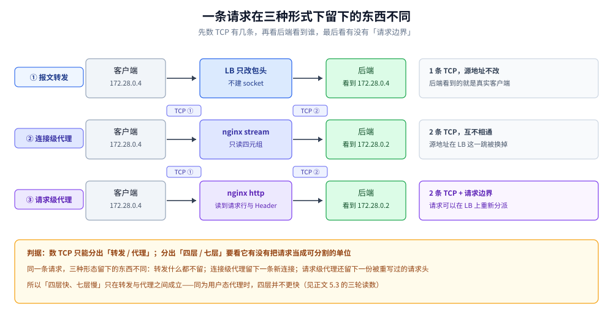
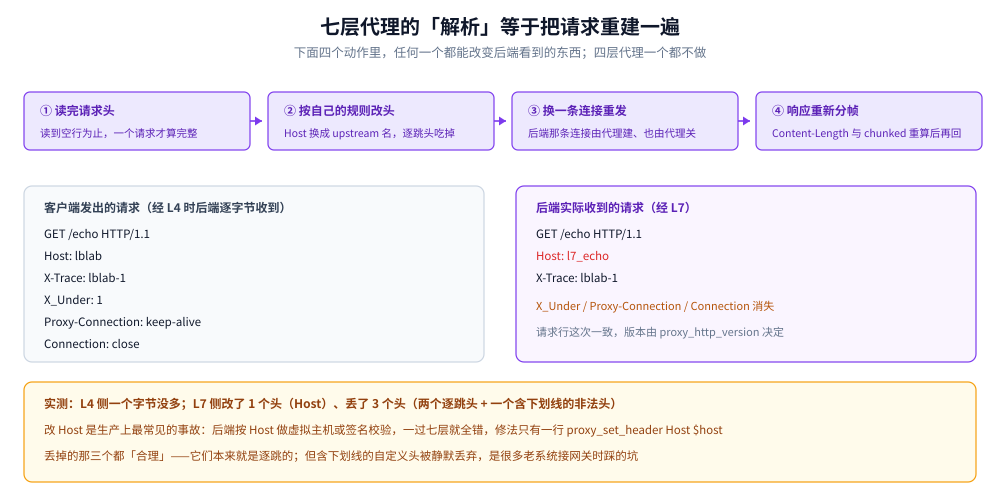
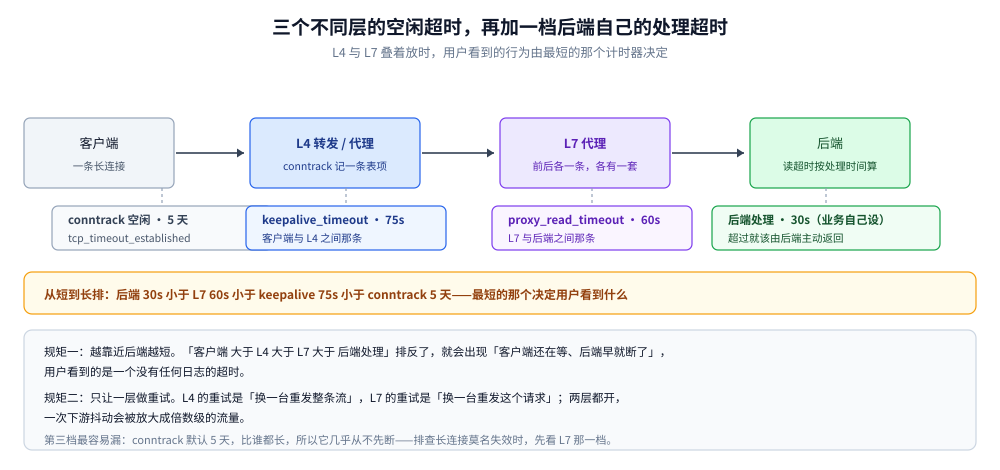

# 四层转发与七层代理

> 覆盖：同一个 LB 位置上三种形态的差别——**报文转发**（IPVS DR/NAT/TUN、DPDK、XDP、云 NLB）、**连接级代理**（nginx `stream`、HAProxy `mode tcp`）、**请求级代理**（nginx `http`、Envoy HCM）；每一种「改不改包、建不建第二条 TCP、看不看应用层」这三件事，分别决定了源地址能不能留、容量模型怎么算、慢客户端拖住谁、路由能细到哪一步；含 8 组本机实测。
>
> 不覆盖：具体产品的选型与「哪个产品支持哪种模式」见 [网关选型对比.md](../../../03-数据与中间件/中间件/网关与代理/网关选型对比.md) 3.7 与第八节；负载均衡的分类轴、选路策略、会话保持与重试边界见 [负载均衡.md](../../../04-架构与系统/分布式/服务治理/负载均衡.md) 第一、三、五节；L7 代理在 Go 里的实现、逐跳头处理与 `Transport` 参数见 [反向代理原理.md](反向代理原理.md)；NAT 与 conntrack 本身见 [NAT与连接跟踪.md](../网络层与寻址/NAT与连接跟踪.md)；客户端真实 IP 的完整判定链与可信代理规则见 [客户端真实IP与可信代理.md](客户端真实IP与可信代理.md)。
>
> 内容整理自个人学习笔记。**实测口径**：`nginx/1.31.8` 三容器拓扑（客户端 `172.28.0.4` / LB `172.28.0.2` / 后端 `172.28.0.3`，同一个 Docker bridge），后端与压测客户端是 Go 1.26 交叉编译的静态二进制，直接调 BSD socket；宿主内核 `6.18.54.1-microsoft-standard-WSL2`、`nproc=4`、`tcp_rmem` 上限 `33554432`、`tcp_wmem` 上限 `4194304`。**报文级真转发（IPVS / DPDK / XDP / 云 NLB）本轮没有实测**——它在容器里需要 `ip_vs` 模块与 VIP，本篇对它的描述是机制陈述，相关小节单独标注。

---

## 一、「四层」和「七层」到底在说哪一种差别？

**本节要点**：这两个词把两件正交的事压成了一个词——**要不要终结连接**（转发 / 代理）、**终结之后要不要解析应用层**（连接级 / 请求级）。三件事组合起来是**三种**形态，不是两种；把它们混成「四层快、七层慢」会同时错过两个关键结论。

### 1.1 三种形态，不是两种

| 形态 | 代表 | 建不建新连接 | 看不看应用层 | 后端看到的对端 | 一条请求占几条 TCP |
|---|---|---|---|---|---|
| **报文转发** | IPVS DR / NAT / TUN、DPDK、XDP、云 NLB、K8s Service（DNAT） | **不建**（只改包头） | 不看 | **真实客户端** | 1（同一条，端到端） |
| **连接级代理** | nginx `stream{}`、HAProxy `mode tcp` | 建 | 不看 | **代理自己** | 2（前后各一条） |
| **请求级代理** | nginx `http{}`、Envoy HCM、云 ALB | 建 | **看** | **代理自己** | 2，且**请求边界落在代理手里** |

⭐ **判据**：在 `netstat` / `ss` 上看到第二条 TCP，只能说明「这是代理」，**说明不了「四层还是七层」**。区分后两者的唯一判据是——**它有没有把请求当成一个可分割的单位**。

> 这一条解释了 [网关选型对比.md](../../../03-数据与中间件/中间件/网关与代理/网关选型对比.md) 3.7 里那句容易被跳过的话：「HAProxy TCP 代理（用户态）—— **完整建两条连接，不是改包**」。所谓「四层负载均衡」在产品目录里往往是**四层代理**，不是转发。

### 1.2 一条请求在三种形态下的形状



图注：同样一次「客户端请求一个后端」，三种形态在拓扑上留下的东西完全不同；差别不在带宽，而在**谁是这个连接的对端**。

**怎么读**：先数 TCP——第一行只有一条，从客户端一直接到后端，LB 只是中间被改写的一跳；后两行各有两条，前后互不相通。再看**后端看到谁**——第一行看到客户端，后两行看到 LB，这就是为什么 L7 必须要 `X-Forwarded-For`（第八节会看到实测）。最后看第三行多出来的那个「请求边界」标记：它才是四层代理与七层代理的分水岭，也是第四节所有能力的来源。

### 1.3 「四层」说的是认到哪一层，不是跑在哪一层

一个常见的误读是「四层在内核、七层在用户态」：

- IPVS 在内核、DPDK 在用户态轮询、XDP 在网卡驱动、云 NLB 在硬件——它们都是四层；
- nginx `stream{}` 在用户态、和 `http{}` 是**同一个进程、同一份配置文件的兄弟块**——它也是四层。

> ⭐ 所以「这一层是四层还是七层」由**它读到第几层的信息**决定：读到 `IP:port` 就停 → 四层；读到请求行、Header 再决定 → 七层。代码写在哪、跑在哪个 ring，与层级无关。

---

## 二、报文转发为什么天然保留源地址？

**本节要点**：报文转发不动应用数据、也不建新连接，所以「谁发来的」这个事实一路没被抹掉。但**这条性质属于「转发」，不属于「四层」**——四层代理一样会把源地址换成自己，这是本轮最容易翻车的认知。

### 2.1 三种转发模式，差别只在回程

| 模式 | 改什么 | 回程是否过 LB | 前提 |
|---|---|---|---|
| **DR（直接路由）** | 只改**目的 MAC**，IP 一个字节不动 | ❌ 不过 | LB 与后端二层可达；后端把 VIP 配在环回口并抑制 ARP |
| **NAT（LVS-NAT）** | 改**目的 IP / 端口** | ✅ 必须过 | 后端网关指向 LB，LB 承担双向流量 |
| **隧道（IPIP / GRE）** | 在原始报文外再套一层 IP 头 | 取决于后端网关 | 可跨网段，**可用 MTU 变小** |


图注：三种模式的去程几乎一样，差别全在下排那根回程红线要不要穿过 LB。

**怎么读**：DR 行后端配了 VIP 在环回口，所以它回包的源地址就是 VIP，客户端认得出这条连接；这也是为什么 DR 的「不改 IP」不是省事，而是**回程能绕过 LB 的唯一办法**。NAT 行回程必须回到 LB 做反改写，于是同一台机器扛两个方向的量。隧道行把原包整个塞进外层 IP 头，跨网段能通了，代价是 MTU 变小、可能踩 PMTUD 黑洞（见 [网络通信链路详解.md](../网络通信链路详解.md) 4.1）。

> ⚠️ **三种模式与产品支持矩阵本轮未实测**：IPVS 需要内核 `ip_vs` 模块与 VIP，云 NLB 需要云账号。能确定的是「改哪个字段、回程走哪」，具体参数请按内核版本与厂商文档核对。

### 2.2 实测：同样是「四层」，nginx `stream` 一样丢源地址

三容器拓扑里客户端是 `172.28.0.4`，LB 是 `172.28.0.2`，后端 `172.28.0.3`。后端在应答里回显它 `accept` 到的对端：

```text
$ ./lblab get 172.28.0.2 9001 /          # L4：nginx stream{} → 后端 9101
TAG=A PEER=172.28.0.2:58250 PROXY=- PATH=/

$ ./lblab get 172.28.0.2 9002 /          # L7：nginx http{}   → 后端 9101
TAG=A PEER=172.28.0.2:58260 PROXY=- PATH=/
```

两行都是 `172.28.0.2`——**都不是客户端**。也就是说：`stream{}` 虽然不解析 HTTP，但它仍然是一条「客户端↔LB、LB↔后端」的两段连接，源地址在 LB 这一跳被换掉了。

> ⭐ 这条读数是本篇最重要的一条：**「L4 保留源 IP」只在报文转发形态成立**。一旦换成用户态的四层代理（nginx `stream`、HAProxy `tcp`），源地址就是代理自己的——和 L7 一样丢。所以「要不要保留源 IP」这个需求，判据不是「上四层」，而是「上真转发，还是上代理 + PROXY protocol」。

### 2.3 补回源地址：四层只能靠 PROXY protocol

```text
$ ./lblab get 172.28.0.2 9003 /          # L4 + proxy_protocol on
TAG=PP PEER=172.28.0.2:49514 PROXY=172.28.0.4:57102 PATH=/
```

后端看到两个地址：`PEER` 是这一跳的对端（LB，端口 `49514`），`PROXY` 是 nginx 在 payload 前插的那行 `PROXY TCP4 …` 里带过来的原始客户端（`172.28.0.4:57102`）。**两个端口不相等**——这正是「连接被终结过」的直接证据：`57102` 是客户端自己的源端口，`49514` 是 LB 新建那条连接的源端口。

PROXY protocol 的字段布局与可信判定见 [客户端真实IP与可信代理.md](客户端真实IP与可信代理.md)；这里只记一条判据：**它工作在四层，所以只有四层代理能加**。等 L7 把请求解析完再想加，已经晚了——那时源地址早在 TCP 层丢了。

---

## 三、七层代理为什么必须重写请求？

**本节要点**：L7 代理不是「把字节搬过去再顺便看一眼」，而是**收下一个完整请求、在自己的连接上重新发一个**。重新发，就意味着头部被重新生成——不是全部原样带过去，也不是全部丢掉。

### 3.1 实测：后端收到的请求头被改了四处

客户端经两条路发同一个请求（`GET /echo`，带四个特殊头），后端把收到的请求头原样回吐：

```text
$ ./lblab head 172.28.0.2 9006 /echo     # 经 L4（nginx stream）
GET /echo HTTP/1.1|Host: lblab|X-Trace: lblab-1|X_Under: 1|Proxy-Connection: keep-alive|Connection: close||

$ ./lblab head 172.28.0.2 9002 /echo     # 经 L7（nginx http）
GET /echo HTTP/1.1|Host: l7_echo|X-Trace: lblab-1||
```

（管道符是换行，由后端替换后回显。）逐项对照：

| 头 | 客户端发出 | 经 L4 后端收到 | 经 L7 后端收到 | 为什么 |
|---|---|---|---|---|
| 请求行 | `GET /echo HTTP/1.1` | 原样 | `GET /echo HTTP/1.1` | 版本由 `proxy_http_version` 决定，**不是原样透传** |
| `Host` | `lblab` | `lblab` | **`l7_echo`** | 默认 `proxy_set_header Host $proxy_host`，填的是 upstream 名 |
| `X-Trace` | `lblab-1` | `lblab-1` | `lblab-1` | 普通自定义头原样透传 |
| `X_Under` | `1` | `1` | **消失** | 含下划线的头默认被丢弃（`underscores_in_headers off`） |
| `Proxy-Connection` | `keep-alive` | 原样 | **消失** | 逐跳头，代理必须吃掉 |
| `Connection` | `close` | 原样 | **消失** | 两条连接各管各的，代理自己决定什么时候关 |

> ⭐ 这张表比任何文字都说明问题：**L4 那一列和后端收到的完全一样，一个字节没多**；L7 那一列改了 `Host`、丢了三个头。三个丢掉的都合理（两个逐跳头 + 一个非法头），**改了 `Host` 才是生产上最常见的事故**——后端按 `Host` 做虚拟主机或签名校验，一过 L7 就全挂。

连「协议版本」都不保证原样。同一个 location 只多一行 `proxy_http_version 1.0`：

```text
$ ./lblab head 172.28.0.2 9002 /echo10     # 该 location 写了 proxy_http_version 1.0
GET /echo10 HTTP/1.0|Host: l7_echo|X-Trace: lblab-1||
```

请求行从 `HTTP/1.1` 变成 `HTTP/1.0`。本机 `nginx/1.31.8` 不写这条指令时发给上游的是 `1.1`，而很多老版本默认发 `1.0`——**同一份配置换一个 nginx 小版本，后端看到的版本号就可能变**，需要固定版本时只能显式写。

### 3.2 重新生成请求的四个动作



图注：L7 代理的「解析」不是读一遍，是**把请求重建一遍**；四个动作里任何一个都可以改变后端看到的东西。

**怎么读**：左边是客户端发来的原始字节，右边是后端收到的字节，中间四个格子依次是「读头 → 改头 → 换连接重发 → 把响应重新分帧」。注意第三个格子：它换的是**连接**，不只是地址，所以 `Connection: close` 这种「这一条连接要关了」的意思传不到后端——代理会自己决定关哪一条。

### 3.3 请求边界带来的第二件事：按内容选后端

```text
$ ./lblab get 172.28.0.2 9001 /b         # 同一个 /b 路径，经 L4
TAG=A PEER=172.28.0.2:41068 PROXY=- PATH=/b

$ ./lblab get 172.28.0.2 9002 /b         # 经 L7
TAG=B PEER=172.28.0.2:40364 PROXY=- PATH=/b
```

L4 把 `/b` 送到 `TAG=A` 那台（它只有一个 upstream），L7 按 `location /b` 送到 `TAG=B`。这就是「要不要按内容路由」这条判据的物理来源：**只有看见请求，才可能按请求分流**。

### 3.4 三条推论

| 推论 | 后果 | 对策 |
|---|---|---|
| 后端收到的 `Host` 不一定是原来的 | 虚拟主机、签名校验、绝对 URL 生成全错 | 显式 `proxy_set_header Host $host` |
| 含下划线的头会消失 | 内部自定义头（很多老系统用 `X_USER_ID`）静默丢失 | 改连字符，或 `underscores_in_headers on` |
| 逐跳头两端不共享 | 后端收不到客户端的 `Connection: close`、`TE`、`Upgrade` 语义 | 由代理显式转换（如 `Upgrade` 需要 `proxy_http_version 1.1` + `Connection "upgrade"`） |

---

## 四、多出来的一次连接换来了什么、付出了什么？

**本节要点**：第二条 TCP 是**能力**的来源，也是**代价**的来源——同一件事的两面，不能只挑一面。

### 4.1 换来的六项，全部依赖「请求边界」

| 能力 | 为什么 L4 做不到 |
|---|---|
| 按 path / Header / Cookie 路由 | 看不到这些字节 |
| **请求级重试**（换一台再发一次） | 不知道一个请求从哪开始到哪结束，重发就是重发半个流 |
| 请求级限流与灰度权重 | 计数单位是连接，不是请求（长连接下一次都不算） |
| 协议转换（HTTP/1.1 ↔ h2、gRPC-Web） | 不解析就没有可以转换的语义 |
| 响应缓存与压缩 | 需要完整的响应体 |
| 后端连接池化 | 一条连接只能对一条连接（第五节实测） |

### 4.2 付出的六项

| 代价 | 具体表现 |
|---|---|
| 两次握手 | 客户端↔LB、LB↔后端各一次 RTT；同机房可忽略，跨地域不可忽略 |
| 用户态数据搬运 | 每个字节至少进出内核两次；真转发只过一次 |
| 缓冲内存 | `proxy_buffers` + 临时文件，慢客户端会把它撑起来（第六节） |
| 两套超时 | 前后各一组，且要满足「前长后短」，否则代理先断（第七节） |
| 源地址必须靠头补 | `X-Forwarded-For` 可伪造，必须配可信代理链 |
| 自身成为单点 | LB 挂了全站不可用；真转发下后端还能被直连兜底 |

---

## 五、容量模型差在哪？

**本节要点**：L4 的连接数是**乘法**（客户端并发 × 1），L7 是**加法**（客户端并发 + 一个池子）。这一条直接决定「扩到十万并发时，先炸的是谁」。

### 5.1 实测：200 条客户端连接，后端 accept 了 200 次 vs 0 次

同一台后端，先经 L4、再经 L7，各发 200 条**新建的**客户端连接（每条一个请求，`Connection: close`），数后端 `accept` 了几次：

```text
起始 beA accept = 2
L4 已发 200 条客户端连接
经 L4 之后 beA accept = 202 （增量 200）
L7 已发 200 条客户端连接
经 L7 之后 beA accept = 202 （增量 0）
```

- **L4：1 比 1**。客户端连一条，LB 就得对后端建一条；客户端 10 万并发，后端就要有 10 万个 fd（还没算 TIME_WAIT 堆积）。
- **L7：200 比 0**。后端只有 1 条常连接，200 个请求全在它上面轮转。后端只需要 `upstream keepalive` 那么大一个池子。

> ⚠️ 一个反直觉的读数：本机 `nginx/1.31.8` 在**没写** `keepalive` 指令的 upstream 上也会复用后端连接（`9002` 与显式写了 `keepalive 32` 的 `9005`，200 条连接都只产生 0～1 次新 accept）。所以这对数字说明的是「L7 能不能池化」，不是「写不写 keepalive 的差别」；后者在本机没测出差异。

### 5.2 fd 与内存怎么算

| 项 | L4（代理形态） | L7 |
|---|---|---|
| 客户端侧 fd | `C`（并发连接数） | `C` |
| 后端侧 fd | `C`（每个客户端一条） | `P`（池子上限） |
| 内核 conntrack | `2C` 条（两段各一条） | `2C` 条 |
| 每连接用户态内存 | 小（两个 16KB 级缓冲） | 大（http 请求/响应缓冲 + 每请求对象） |
| 谁先炸 | **后端 fd 与源端口**（`ip_local_port_range` 只有 28232 个可用） | **LB 的内存与 CPU** |

> ⭐ 这条解释了为什么大流量入口用 L4 顶在前面：它把「客户端连接数」和「后端连接数」解耦成了两件独立的事，代价是**它自己**变成要扛 C 的那一层——所以通常还要再加一层真转发在前面。

### 5.3 延迟：本轮 L7 反而更快

每次都是新建连接、各 2000 次请求，连跑三轮（微秒）：

| 轮次 | L4 `:9001` mean / p50 / p99 | L7 `:9002` mean / p50 / p99 |
|---|---|---|
| 1 | 1220 / 1062 / 3967 | **858 / 771 / 3041** |
| 2 | 1102 / 946 / 3985 | **824 / 750 / 2154** |
| 3 | 1391 / 1225 / 4952 | **942 / 837 / 2919** |

L7 三轮都更快，约 25%～30%。原因不在「七层解析更便宜」，而在于**后端连接被复用了**：四组 bench 共 16000 次请求，`beA` 的 `accept` 总数只从 202 涨到 8212——涨的 8010 次里 8000 次来自 L4 侧（每组 2000 次各建一条），其余十来次是前面几次单发 `get`；L7 侧的 8000 次请求一条后端连接都没新建。L4 每次都要多一次 `connect` + 一次后端 `accept`，这就是那 25% 的来处。

> ⭐ 所以「四层快、七层慢」这句话在本机是**反的**。真正快出量级的是**报文转发**（不走用户态、不做第二次握手），不是「四层」这个标签；同为用户态代理时，`stream{}` 相比 `http{}` 只少了解析，却多了一次后端建连。

---

## 六、慢客户端会拖住谁？

**本节要点**：L7 有一块**用户态缓冲**，它把「后端写完了」和「客户端收到了」这两件事解耦；L4 代理没有这层应用层缓冲，背压是端到端的窗口。这决定了「一个慢客户端能耗掉多少后端连接」。

### 6.1 实测：16 MB 响应 + 每次读 8 KB 停 20 ms 的客户端

同一个后端、同样的慢客户端，只换入口：

```text
L4 :9004   read=16777280 bytes in 43240 ms
           [BIG] #1 write done total=16777216 bytes in 23738.8 ms

L7 :9002   read=16777339 bytes in 42991 ms
           [BIG] #2 write done total=16777216 bytes in 107.1 ms
```

客户端两边都读了 43 秒（它是瓶颈，这点没变），但**后端写完的时间差了 222 倍**：

- 经 L4：后端被客户端的接收窗口一路拖住，**23.7 秒**才写完——这段时间这条后端连接被一个慢客户端独占。
- 经 L7：nginx 把响应吸进自己的缓冲（内存 + 临时文件），后端 **107 毫秒**就脱身了，剩下的 42 秒由 nginx 慢慢喂给客户端。

> 补一组边界：同样条件换成 **4 MB** 响应时，L4 是 `246.8 ms`、L7 是 `91.9 ms`，差别很小。因为 4 MB 全被两端 socket 缓冲吸收了（本机 `tcp_rmem` 上限 32 MB），根本没触发背压。**要做这个对照，响应体必须大于链路上的缓冲总量**，否则测出来的是「缓冲够大」，不是「没有背压」。

### 6.2 缓冲是双刃剑

| 缓冲开着（默认 `proxy_buffering on`） | 缓冲关掉 |
|---|---|
| 后端早脱身，慢客户端不占后端连接 | 后端被客户端窗口拖住，**和 L4 一样慢** |
| 响应写进内存 / 临时文件，占 LB 的盘与内存 | 不占盘，但占后端连接 |
| 大文件下载会把 LB 变成「中转盘」 | 大文件下载更适合直接给后端（或用 `X-Accel-Redirect`） |

> ⭐ 判据一句话：**「后端写完」不等于「客户端收到」**。看后端日志说 200 写完就以为用户拿到了，在 L7 后面是不成立的——真正的时间点要由接入日志或客户端侧确认。

### 6.3 这条差异怎么用在选型上

- 响应**小而快**（API）：缓冲没坏处，L7 更抗慢客户端。
- 响应**大而慢**（文件、视频、导出）：L7 缓冲会把 LB 变成瓶颈设备，此时要么关缓冲让它端到端慢、要么把大流量摘出去走独立的下载入口。
- 上行**大而慢**（上传）：`client_body_buffer_size` 与临时文件同理，只是方向反过来。

---

## 七、为什么生产上要两层叠着？

**本节要点**：L4 买的是「不改包、抗连接数」，L7 买的是「看得懂请求」。两件事都不便宜，所以真实架构是**各买一段**——L4 在最前面扛量，L7 在它后面做路由与治理。

### 7.1 各买什么

| 层 | 位置 | 买到的 | 代价 |
|---|---|---|---|
| **L4（真转发）** | 最前，独占 VIP | 单机几十万并发、不改应用数据、带宽高 | 看不到请求，不能按内容路由 |
| **L4（代理）** | 也可以用 | 简单、配置独立、能加 PROXY protocol | 也有两条 TCP、也占 fd |
| **L7** | L4 后面 | 路由、灰度、限流、重试、协议转换、可观测 | 内存与 CPU、两套超时、源地址要补 |

### 7.2 三档空闲超时加一档处理超时，谁先到



图注：一条链路上挂着三组「空闲多久就断」，再加一档后端自己的处理超时；最短的那个决定用户看到的行为。

**怎么读**：从右往左看，每一跳都有一组自己的计时器——只有最后一组是处理超时，其余三组都是空闲超时。判据是**从短到长排**：`proxy_read_timeout`（默认 60s）通常最短，`keepalive_timeout`（默认 75s）次之，conntrack 最长（`tcp_timeout_established` 默认 5 天）。**如果 L7 比 L4 短**，用户看到的是「L7 先断、L4 还留着一条半死连接」，重连会打到另一台后端——这正是「空闲一会儿第一个请求就失败、重连就好」的成因（见 [网络通信链路详解.md](../网络通信链路详解.md) 4.3）。

### 7.3 叠层的两条硬规矩

1. **超时必须单调**：越靠近后端越短。`客户端 > L4 > L7 > 后端处理`。反了就会出现「客户端以为还在等，后端那边早就断了」。
2. **只有一层做重试**：L4 上做重试是「换一台重发整条流」，L7 上做重试是「换一台重发这个请求」，两层都开就会放大成雪崩（[重试与超时.md](../../../04-架构与系统/分布式/稳定性/重试与超时.md)）。

---

## 八、什么场景选哪个？

**本节要点**：判据只有两条——**要不要看见请求**、**要不要保留源地址**。其余都是这两条的下游。

| 需求 | 报文转发 | 四层代理 | 七层代理 |
|---|---|---|---|
| 只需把连接摊开 | ✅ 首选 | ✅ | 过重 |
| 按 path / Header / Cookie 分流 | ❌ | ❌ | ✅ 唯一选择 |
| 请求级重试、灰度权重、限流 | ❌ | ❌ | ✅ |
| 后端看到的源 IP 必须是真实客户端 | ✅ 天然 | ⚠️ 需 PROXY protocol | ⚠️ 需 XFF + 可信链 |
| 单机十万+ 并发、带宽吃紧 | ✅ 唯一选择 | ⚠️ 用户态瓶颈 | ❌ |
| 协议不固定（不是 HTTP） | ✅ | ✅ | ❌ 除非有对应解析器 |
| 需要协议转换 / gRPC-Web | ❌ | ❌ | ✅ |
| TLS 只按 SNI 分流、不解密 | ✅ | ✅（`ssl_preread`） | ✅ 但没必要 |
| 大文件下载 / 视频 | ✅ | ✅ | ⚠️ 注意缓冲落盘 |

**五条常见误配**：

| 现象 | 真实原因 |
|---|---|
| 「我们上了四层，怎么后端还是拿到 LB 的 IP」 | 上的是四层**代理**不是真转发（2.2） |
| 「过了 L7 之后虚拟主机全错」 | `Host` 被换成 upstream 名（3.1） |
| 「客户端明明设了超时 60s，后端 30s 就断了」 | 两层超时没排单调（7.2） |
| 「加了机器但并发上不去」 | L4 代理形态下后端 fd 是乘法（5.1） |
| 「下载大文件时 LB 磁盘满了」 | L7 缓冲落盘（6.2） |

---

## 九、具体使用：一份配置里同时放两种形态

**本节要点**：`stream{}` 与 `http{}` 是同一个 nginx 里的两个平级块，写法几乎对称——这本身就是「四层与七层是形态，不是产品」的最好证据。

```nginx
# 四层：只看四元组
stream {
    upstream l4_a { server 172.28.0.3:9101; }
    server { listen 9001; proxy_pass l4_a; }

    # 需要真实源地址时，只能在四层补
    upstream l4_pp { server 172.28.0.3:9104; }
    server { listen 9003; proxy_protocol on; proxy_pass l4_pp; }
}

# 七层：能按键值路由
http {
    upstream l7_a { server 172.28.0.3:9101; }
    upstream l7_b { server 172.28.0.3:9102; }

    server {
        listen 9002;
        location /  { proxy_pass http://l7_a; }
        location /b { proxy_pass http://l7_b; }

        # 3.1 的两个坑在这里补齐
        proxy_set_header Host $host;
        underscores_in_headers on;
    }
}
```

> 这两段的对照读数就是第三、五、六节的全部数据；实验台在 `.workbuddy/tmp/lb-lab/`（`main.go` 一个二进制兼做后端与压测客户端，`lblab.conf` 是上面这份配置的完整版）。

**八组读数汇总**：

| # | 对照项 | 读数 |
|---|---|---|
| 1 | 后端看到谁（L4 代理） | `PEER=172.28.0.2:58250`（LB，不是客户端） |
| 2 | 后端看到谁（L4 + PROXY） | `PEER=…:49514` / `PROXY=172.28.0.4:57102` |
| 3 | 后端看到谁（L7） | `PEER=172.28.0.2:58260` |
| 4 | 请求头是否被改写 | L4 逐字节一致；L7 改 `Host`、丢 3 个头、版本随 `proxy_http_version` 变 |
| 5 | 按 path 路由 | L4：`/b` → `TAG=A`；L7：`/b` → `TAG=B` |
| 6 | 200 客户端连接 → 后端 accept | L4 `+200`；L7 `+0` |
| 7 | 16 MB + 慢客户端，后端写完耗时 | L4 `23738.8 ms`；L7 `107.1 ms` |
| 8 | 新建连接延迟（2000 次 × 3 轮） | L4 `1.10~1.39 ms`；L7 `0.82~0.94 ms` |

---

## 延伸追问

- **「四层负载均衡」是不是就不用管应用协议了？** → 转发形态确实不管，但代理形态要管一件事：**什么时候关连接**。`stream{}` 的 `proxy_timeout` 默认 10 分钟，比大多数 HTTP `keepalive_timeout` 长，所以它往往不是第一个断的那一跳。
- **为什么我见过 L7 代理又快又省？** → 因为它复用了后端连接（5.3）。让后端在应答后主动 `close`（或把连接池关掉）再测，L7 的均值会往上走一截——那时它每次也要多一次 `connect`。
- **PROXY protocol 会不会被伪造？** → 会。它只是「payload 前的一行文本」，必须靠**只接受可信来源的连接**来保证——通常是在 L4 上配 `allow/deny`，或在后端只信白名单里的 LB 地址。判定链见 [客户端真实IP与可信代理.md](客户端真实IP与可信代理.md)。
- **L4 上能按域名分流吗？** → 能，但只能靠 SNI（`ssl_preread_server_name`），也就是**不解密只看第一个包**。这属于「用四层的成本买七层的一点点能力」，一旦要按 path 分流就必须换 L7。
- **两层都做健康检查会重复吗？** → 不会重复，但会各算各的。L4 探不通会把整台摘掉，L7 探不通只摘它在自己 upstream 里的那一条；两层阈值不一致时，会出现「L4 认为好、L7 认为坏」的窗口期。
- **容器环境里「四层」到底是谁在做？** → K8s Service 是 DNAT 式真转发（kube-proxy 写 iptables/IPVS），所以它天然保留源地址；但一旦流量进了 Pod 内的 Sidecar，第二段就变成代理，源地址要靠 `X-Forwarded-For` 补。同一个集群里两种形态同时存在，这是 K8s 分层最容易讲混的一点。

## 关联

- **上游/总纲**：[负载均衡.md](../../../04-架构与系统/分布式/服务治理/负载均衡.md) — 三条分类轴、选路策略、长连接失效与重试边界；本篇只展开「看多深」这一根轴
- **对照/互补**：[网关选型对比.md](../../../03-数据与中间件/中间件/网关与代理/网关选型对比.md) — 哪个产品支持哪种模式、Nginx 能力边界与 API 网关的分工
- **下游机制**：[反向代理原理.md](反向代理原理.md) — L7 代理在 Go 里的实现、逐跳头剔除与重新分帧的实测
- **下游机制**：[客户端真实IP与可信代理.md](客户端真实IP与可信代理.md) — XFF 与 PROXY protocol 的可信链判定
- **底座**：[NAT与连接跟踪.md](../网络层与寻址/NAT与连接跟踪.md) — SNAT/DNAT 改哪个字段、conntrack 用什么做键
- **链路视角**：[网络通信链路详解.md](../网络通信链路详解.md) — 入站这一跳在整条链路里的位置、MTU 与回程不对称
- **配置语义**：[Nginx配置语义.md](Nginx配置语义.md) — `location` 优先级、`proxy_pass` 斜杠、`limit_req` 的跳过路径
- **算法侧**：[客户端负载均衡的Go实现.md](../../../01-编程语言/go/工程实践/客户端负载均衡的Go实现.md) — 不发代理、由调用方自己选的另一条路
