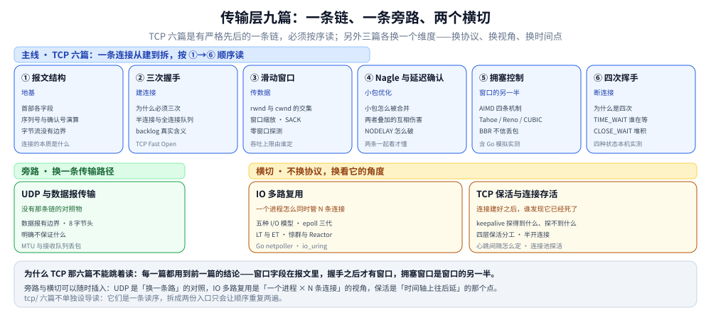

# 传输层

> 本目录回答一个问题：**一条连接是怎么建起来、怎么把字节可靠地送过去、又怎么拆掉的。** 九篇分两块——
> 主体是 TCP 六篇，它们是一条**有严格先后的链**（报文结构 → 三次握手 → 滑动窗口 → Nagle 与延迟确认 → 拥塞控制 → 四次挥手）；
> 另外三篇各换一个维度：UDP 换协议、IO 多路复用换视角、保活换时间点。
>
> 本篇是这个目录的**总入口**，只给索引、阅读路径、篇间依赖与边界；机制细节、命令与实测读数全部在零件篇里，
> 这里不重复。目录级的位置见 [网络/README.md](../README.md)。
>
> 内容整理自个人学习笔记，素材见 [素材清单](../../../素材清单.md)。

---

## 一、这个目录回答什么问题

传输层要解决的是「端口到端口」这一段：**同一台机器上那么多程序，包来了该给谁；给了之后，怎么保证它按序、不丢、不把对端淹掉。**
九篇的排布不是并列关系——TCP 那六篇拆开任何一篇都读不懂，而另外三篇是「不换这套前提也能问的问题」。

图怎么读：**上一排六篇是一条时间轴**——报文结构给出「窗口字段长在哪」，握手之后才有窗口可滑，而拥塞窗口是接收窗口的另一半，
最后才是挥手；跳过任何一篇，下一篇的公式就没有来处。下一排三篇各换一个维度：UDP 换掉整条链、
IO 多路复用把视角从「一条连接」换成「一个进程 × N 条连接」、保活把时间轴往后延到「连接还活着吗」。

---

## 二、现有篇目与一句话职责

### 2.1 主线：TCP 六篇（必须按序读）

| 顺序 | 文件 | 一句话职责 |
|---|---|---|
| ① | [tcp/TCP协议基础与报文结构.md](tcp/TCP协议基础与报文结构.md) | **地基**：TCP 是什么（面向连接 / 可靠 / 全双工 / 字节流四个定语各一条判据）、为什么需要它（IP 之上缺的五件事）、**保证什么与不保证什么**（可靠性边界表，右列就是各类「用了 TCP 还出问题」的根因）、连接的本质（TCB）、首部各字段含义、`SEG.LEN` 与确认号的演算、累计 ACK 与 SACK、字节流为什么没有边界 |
| ② | [tcp/TCP三次握手.md](tcp/TCP三次握手.md) | **建连接**：为什么必须三次、初始序号为什么随机；握手在生产上的真正落点是**两个队列**——`backlog` 的真实含义、队列溢出的三种现象与调优；含 TCP Fast Open |
| ③ | [tcp/TCP滑动窗口.md](tcp/TCP滑动窗口.md) | **传数据**：窗口怎么滑、`min(rwnd, cwnd)` 如何决定吞吐上限，窗口缩放 / SACK / 零窗口探测三个常被忽略的机制，以及落到 socket 选项的写法 |
| ④ | [tcp/TCP的Nagle与延迟确认.md](tcp/TCP的Nagle与延迟确认.md) | **小包优化**：Nagle 怎么合并小包、延迟确认怎么合并 ACK，两者同时开启时的「互相伤害」与 `TCP_NODELAY` 怎么破 |
| ⑤ | [tcp/TCP拥塞控制算法.md](tcp/TCP拥塞控制算法.md) | **窗口的另一半**：慢启动 / 拥塞避免 / 快重传 / 快恢复四条机制，Tahoe 与 Reno 的分岔、ECN、CUBIC 与 BBR 各自解决什么；含 Go 模拟实测 |
| ⑥ | [tcp/TCP四次挥手.md](tcp/TCP四次挥手.md) | **断连接**：为什么是四次、`TIME_WAIT` 到底是谁在等、`CLOSE_WAIT` 堆积怎么定位；含四种状态的本机实测 |

### 2.2 旁路与横切（3 篇）

| 文件 | 维度 | 一句话职责 |
|---|---|---|
| [UDP与数据报传输.md](UDP与数据报传输.md) | 换协议 | **没有那条链的对照物**：数据报语义与消息边界、8 字节首部与校验和、它明确不保证什么、应用层该补什么、MTU 与接收队列丢包 |
| [IO多路复用.md](IO多路复用.md) | 换视角 | **一个进程怎么同时接住成千上万条连接**：五种 I/O 模型、select / poll / epoll 三代演进、LT 与 ET、惊群与 Reactor、Go 的 netpoller、`io_uring` |
| [TCP保活与连接存活.md](TCP保活与连接存活.md) | 换时间点 | **连接建好之后谁发现它已经死了**：keepalive 探得到什么与探不到什么、四层保活怎么分工、半开连接怎么形成、心跳间隔与超时怎么定、连接池为什么要先探活 |

> ⚠️ **`tcp/` 子目录不单独设导读**：那六篇是一条读序，不是一组可并列的分类。拆成两份入口只会让顺序在两张表里重复一遍——
> 所以本 README 直接覆盖到 `tcp/` 下六篇，`tcp/` 本身不放 `README.md`。

---

## 三、按问题走阅读顺序

| 你想解决什么 | 读这个顺序 |
|---|---|
| **第一次系统学 TCP** | [tcp/TCP协议基础与报文结构.md](tcp/TCP协议基础与报文结构.md) → [tcp/TCP三次握手.md](tcp/TCP三次握手.md) → [tcp/TCP滑动窗口.md](tcp/TCP滑动窗口.md) → [tcp/TCP的Nagle与延迟确认.md](tcp/TCP的Nagle与延迟确认.md) → [tcp/TCP拥塞控制算法.md](tcp/TCP拥塞控制算法.md) → [tcp/TCP四次挥手.md](tcp/TCP四次挥手.md)，按 ①~⑥ 一路读 |
| **吞吐上不去** | [tcp/TCP滑动窗口.md](tcp/TCP滑动窗口.md)（`min(rwnd, cwnd)` 先分清是接收窗口还是拥塞窗口限制）→ [tcp/TCP拥塞控制算法.md](tcp/TCP拥塞控制算法.md)（算法与 BBR 换不换） |
| **服务端 `accept` 队列满 / 连接超时** | [tcp/TCP三次握手.md](tcp/TCP三次握手.md) 第二节（半连接与全连接队列、`backlog` 真实含义）→ [IO多路复用.md](IO多路复用.md)（epoll 侧怎么接） |
| **`TIME_WAIT` / `CLOSE_WAIT` 堆积** | [tcp/TCP四次挥手.md](tcp/TCP四次挥手.md) 第二、三节（两种状态成因完全不同）→ 第四节（四种状态的实测对照） |
| **接口偶发变慢、小包特别多** | [tcp/TCP的Nagle与延迟确认.md](tcp/TCP的Nagle与延迟确认.md)（全篇）→ [tcp/TCP滑动窗口.md](tcp/TCP滑动窗口.md)（socket 选项） |
| **长连接过一阵就断** | [TCP保活与连接存活.md](TCP保活与连接存活.md)（四层保活分工与心跳定多少）→ [NAT与连接跟踪.md](../网络层与寻址/NAT与连接跟踪.md) 第五节（各段空闲超时的量级） |
| **想知道为什么不用 UDP 传文件** | [UDP与数据报传输.md](UDP与数据报传输.md)（三、明确不保证什么）→ 四节（应用层要补哪些）→ [QUIC与HTTP3.md](../应用层/QUIC与HTTP3.md)（真的要在 UDP 上做可靠传输时，别人怎么做的） |
| **要在 Go / Java 里做高并发服务** | [IO多路复用.md](IO多路复用.md)（三、四、六节）→ [tcp/TCP三次握手.md](tcp/TCP三次握手.md) 第二节（建连侧的两个队列） |

---

## 四、篇间依赖（谁要前置）

| 本篇 | 建议先读 | 为什么 |
|---|---|---|
| [tcp/TCP三次握手.md](tcp/TCP三次握手.md) | [tcp/TCP协议基础与报文结构.md](tcp/TCP协议基础与报文结构.md) | 握手报文就是带 `SYN` / `ACK` 标志位的首部 |
| [tcp/TCP滑动窗口.md](tcp/TCP滑动窗口.md) | [tcp/TCP协议基础与报文结构.md](tcp/TCP协议基础与报文结构.md)、[tcp/TCP三次握手.md](tcp/TCP三次握手.md) | 窗口字段在首部里；连接建好才谈吞吐 |
| [tcp/TCP的Nagle与延迟确认.md](tcp/TCP的Nagle与延迟确认.md) | [tcp/TCP滑动窗口.md](tcp/TCP滑动窗口.md) | 两者都在讲传输效率，放一起看才懂为什么互相拖累 |
| [tcp/TCP拥塞控制算法.md](tcp/TCP拥塞控制算法.md) | [tcp/TCP滑动窗口.md](tcp/TCP滑动窗口.md) | `min(rwnd, cwnd)` 的另一半 |
| [tcp/TCP四次挥手.md](tcp/TCP四次挥手.md) | [tcp/TCP三次握手.md](tcp/TCP三次握手.md) | 关闭是握手的镜像，`TIME_WAIT` 出现在这一步 |
| [TCP保活与连接存活.md](TCP保活与连接存活.md) | [tcp/TCP四次挥手.md](tcp/TCP四次挥手.md)、[NAT与连接跟踪.md](../网络层与寻址/NAT与连接跟踪.md) | 半开连接与中间设备超时是同一件事的两面 |
| [UDP与数据报传输.md](UDP与数据报传输.md) | [IP与路由基础.md](../网络层与寻址/IP与路由基础.md) | 大包与分片的代价要先懂 MTU |
| [IO多路复用.md](IO多路复用.md) | [tcp/TCP四次挥手.md](tcp/TCP四次挥手.md) | 连接关闭侧在 epoll 上是什么表现，先懂状态才看得懂 |

---

## 五、与相邻目录的边界

| 相邻目录 | 分界 |
|---|---|
| [网络层与寻址/](../网络层与寻址/) | 那边到「主机到主机」为止；本目录从端口开始。**IP 分片 ≠ TCP 分段**：分片在网络层按偏移量切，分段按字节序号在传输层切 |
| [应用层/](../应用层/) | 那边管连接之上装什么（HTTP / TLS / WebSocket）。**HTTP/2 的多路复用是应用层的排队优化，不等于消除 TCP 层的队头阻塞** |
| [网络通信链路详解.md](../网络通信链路详解.md) | 那边是逐跳视角；本目录是「一条连接」视角。同一个 `CLOSE_WAIT`，两边看到的粒度不同 |
| [01-编程语言/go/运行时/](../../../01-编程语言/go/运行时/GMP调度.md) | Go 的 netpoller 怎么接上 runtime 调度在那边；本目录只讲 epoll / `io_uring` 这一层 |
| [02-计算机基础/linux/](../../linux/零拷贝.md) | 零拷贝是另一层的优化（数据在内核态怎么搬），本目录讲连接怎么管 |
| [06-工程实践/部署/docker/](../../../06-工程实践/部署/docker/网络与存储.md) | 容器里的连接与 NAT 是同一套机制的软件实现 |

---

## 六、已知缺口与遗留问题

| 项 | 现状 | 结论 |
|---|---|---|
| ⚠️ **`tcp/` 六篇的链接显示名带 `../` 路径**（原登记 28 处；2026-10-23 实测 `tcp/` 下余 **19 处**，`TCP协议基础与报文结构.md` 的 7 处已清零） | 典型形态：显示名写成 `../TCP拥塞控制算法.md`，而实际目标就是同级的 `TCP拥塞控制算法.md`。成因是文件下沉一层时，脚本给显示名也加了前缀 | **部分已修**。目标路径都是对的，所以链接不会 404，但违反「显示名只写文件名」的规约，且会误导读者按显示名去找。改动纯机械（删显示名里的 `../`），可脚本批量修——余下 19 处分布在三次握手（4）、四次挥手（3）、滑动窗口（6）、Nagle 与延迟确认（6） |
| **SCTP / DCCP / DCTCP** | 全仓各 0 次 | **暂不补**：SCTP 在公网几乎不可用，DCTCP 属数据中心拥塞控制专题，与本仓主线距离较远 |
| **MPTCP 多路径** | 3 篇提及（Nginx 编译、`upstream` 与选型），无专篇 | **暂不补**：现状是「知道有、用不上」，真要上多路径时再补 |
| **QUIC 的传输层部分** | 在 [QUIC与HTTP3.md](../应用层/QUIC与HTTP3.md)，不在本目录 | **不是缺口**：QUIC 是「UDP 之上的可靠传输」，但它服务的对象是 HTTP/3，与 HTTP 版本演进放一起才讲得通 |
| **拥塞控制的内核落地**（各算法的 sysctl 开关与实测对比） | [tcp/TCP拥塞控制算法.md](tcp/TCP拥塞控制算法.md) 有 Go 模拟实测，无内核侧 `net.ipv4.tcp_congestion_control` 的真机对比 | **待定**：需要两台跨公网机器或 netem 才有意义，单机测不出算法差异 |

---

## 关联

- **上游/总纲**：[网络/README.md](../README.md) — 网络目录整体的两篇总纲、36 篇分类地图与主读序
- **上游/总纲**：[网络分层与数据包旅程.md](../网络分层与数据包旅程.md) — 纵向总纲：TCP 段怎么被包进 IP 包（第五节）
- **对照/互补**：[网络通信链路详解.md](../网络通信链路详解.md) — 横向总纲：一条连接在链路上跨过哪些节点
- **对照/互补**：[应用层/README.md](../应用层/README.md) — 连接之上装什么；本目录是它的下游
- **下游机制**：[NAT与连接跟踪.md](../网络层与寻址/NAT与连接跟踪.md) — 长连接被中间设备掐断的根因，保活篇的上游
- **下游机制**：[多副本共享状态.md](../../../04-架构与系统/分布式/稳定性/多副本共享状态.md) — 连接数在多副本下怎么成为共享状态
- **下游机制**：[抓包实战.md](../观测与排障/抓包实战.md) — 本目录各篇的读数怎么在真实链路上验证
