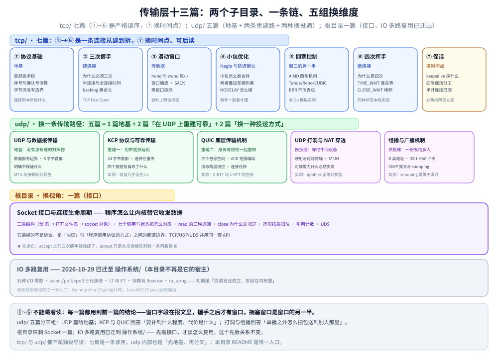

# 传输层

> 本目录回答一个问题：**一条连接是怎么建起来、怎么把字节可靠地送过去、又怎么拆掉的。** 十三篇按目录分三层——
> `tcp/` 七篇（①~⑥ 是一条**有严格先后的链**，⑦ 保活换时间点）、`udp/` 五篇（换协议：地基 + 两条重建路 + 两种换投递）、
> 根目录一篇（IO 多路复用，换视角）。
>
> 本篇是这个目录的**总入口**，只给目录索引、阅读路径、篇间依赖与边界；机制细节、命令与实测读数全部在零件篇里，
> 这里不重复。目录级的位置见 [网络/README.md](../README.md)。
>
> 内容整理自个人学习笔记，素材见 [素材清单](../../../素材清单.md)。

---

## 一、这个目录回答什么问题

传输层要解决的是「端口到端口」这一段：**同一台机器上那么多程序，包来了该给谁；给了之后，怎么保证它按序、不丢、不把对端淹掉。**
十三篇的排布不是并列关系——`tcp/` 那六篇拆开任何一篇都读不懂；`udp/` 的五篇是「换掉整条链」之后的五个不同问题；
根目录那篇换的是视角。



图怎么读：**上排 ①~⑥ 是一条时间轴**——协议基础给出「窗口字段长在哪」，握手之后才有窗口可滑，而拥塞窗口是接收窗口的另一半，
最后才是挥手；跳过任何一篇，下一篇的公式就没有来处。⑦ 保活也在 `tcp/` 里，但它**不在链上**，把时间轴往后延到
「连接还活着吗」，读懂 ⑥ 之后随时可插。中间一格是 `udp/`：先有数据报语义（地基），再分成「自己造可靠」的两条路——
KCP 与 QUIC 底层，两者都**不是** TCP 的替代品，而是「换掉 TCP 之后各自重建了什么」的两种答案。最下一格换的是视角：
IO 多路复用把「一条连接」换成「一个进程 × N 条连接」。

---

## 二、目录索引

```text
02-计算机基础/网络/传输层/
├── README.md                        # 本文件：本目录唯一入口
├── IO多路复用.md                     # 根目录一篇：换视角
├── images/                          # 本目录通用图：IO 多路复用 5 张 + 上面那张总览图
├── tcp/                             # 七篇 + images/（21 张）
│   ├── TCP协议基础与报文结构.md        # ① 地基
│   ├── TCP三次握手.md                 # ② 建连接
│   ├── TCP滑动窗口.md                 # ③ 传数据
│   ├── TCP的Nagle与延迟确认.md         # ④ 小包优化
│   ├── TCP拥塞控制算法.md              # ⑤ 窗口的另一半
│   ├── TCP四次挥手.md                 # ⑥ 断连接
│   ├── TCP保活与连接存活.md            # ⑦ 换时间点（不在链上）
│   └── images/
└── udp/                             # 五篇 + images/（16 张）
    ├── UDP与数据报传输.md              # 换协议：地基
    ├── KCP协议与可靠传输.md            # 重建一：牺牲带宽换延迟
    ├── QUIC底层传输机制.md             # 重建二：连身份与加密一起重做
    └── images/
```

| 位置 | 现有篇数 | 索引在哪 | 为什么放这儿 |
|---|---|---|---|
| `tcp/` | **7** | 本文 3.1（六篇链）+ 3.2（第七篇） | 六篇共用同一套首部与状态机，拆到根目录会与 `IO多路复用.md` 混成一堆 |
| `udp/` | **5** | 本文 3.3 | 「UDP 之上怎么做可靠 / 怎么穿 NAT / 怎么组播」是同一支；KCP 与 QUIC 底层是同一问题的两种答案，打洞与组播是单播之外的两种投递方式，都必须并排放才比得出取舍 |
| 根目录 | **1** | 本文 3.4 | IO 多路复用与具体协议无关，是「一个进程 × N 条连接」的独立视角 |
| `images/` | 6 张 | — | 只放**跨篇通用**的图；篇专属图跟着篇目进各子目录的 `images/` |

> ⚠️ **`tcp/` 与 `udp/` 都不单独设 `README.md`**：`tcp/` 的六篇是一条读序而不是可并列的分类，
> 拆成两份入口只会让顺序在两张表里重复一遍；`udp/` 的五篇里两组是各自问题的对照答案（KCP 与 QUIC、打洞与组播），
> 拿一份入口把它们的差别再讲一遍，不如在本文 3.3 用一张表说清。所以这两个子目录下没有入口文件，**本 README 是唯一入口**。

---

## 三、现有篇目与一句话职责

### 3.1 tcp/ 主线：六篇（必须按序读）

| 顺序 | 文件 | 一句话职责 |
|---|---|---|
| ① | [TCP协议基础与报文结构.md](tcp/TCP协议基础与报文结构.md) | **地基**：TCP 是什么（面向连接 / 可靠 / 全双工 / 字节流四个定语各一条判据）、为什么需要它（IP 之上缺的五件事）、**保证什么与不保证什么**（可靠性边界表，右列就是各类「用了 TCP 还出问题」的根因）、连接的本质（TCB）、首部各字段含义、`SEG.LEN` 与确认号的演算、累计 ACK 与 SACK、字节流为什么没有边界 |
| ② | [TCP三次握手.md](tcp/TCP三次握手.md) | **建连接**：为什么必须三次、初始序号为什么随机；握手在生产上的真正落点是**两个队列**——`backlog` 的真实含义、队列溢出的三种现象与调优；含 TCP Fast Open |
| ③ | [TCP滑动窗口.md](tcp/TCP滑动窗口.md) | **传数据**：窗口怎么滑、`min(rwnd, cwnd)` 如何决定吞吐上限，窗口缩放 / SACK / 零窗口探测三个常被忽略的机制，以及落到 socket 选项的写法 |
| ④ | [TCP的Nagle与延迟确认.md](tcp/TCP的Nagle与延迟确认.md) | **小包优化**：Nagle 怎么合并小包、延迟确认怎么合并 ACK，两者同时开启时的「互相伤害」与 `TCP_NODELAY` 怎么破 |
| ⑤ | [TCP拥塞控制算法.md](tcp/TCP拥塞控制算法.md) | **窗口的另一半**：慢启动 / 拥塞避免 / 快重传 / 快恢复四条机制，Tahoe 与 Reno 的分岔、ECN、CUBIC 与 BBR 各自解决什么；含 Go 模拟实测 |
| ⑥ | [TCP四次挥手.md](tcp/TCP四次挥手.md) | **断连接**：为什么是四次、`TIME_WAIT` 到底是谁在等、`CLOSE_WAIT` 堆积怎么定位；含四种状态的本机实测 |

### 3.2 tcp/ 第七篇：保活（换时间点，不在链上）

| 文件 | 维度 | 一句话职责 |
|---|---|---|
| [TCP保活与连接存活.md](tcp/TCP保活与连接存活.md) | 换时间点 | **连接建好之后谁发现它已经死了**：keepalive 探得到什么与探不到什么、四层保活怎么分工、半开连接怎么形成、心跳间隔与超时怎么定、连接池为什么要先探活 |

它放在 `tcp/` 里是因为**只用得上 TCP 的状态机**（`ESTABLISHED` / `CLOSE_WAIT` 与 `RST`），而不是因为它属于那条读序——
读懂 ⑥ 之后插进来读最顺，但不读 ①~⑤ 也能读懂。

### 3.3 udp/：换协议与换投递（当前 5 篇）

| 文件 | 维度 | 一句话职责 |
|---|---|---|
| [UDP与数据报传输.md](udp/UDP与数据报传输.md) | 换协议（地基） | **没有那条链的对照物**：数据报语义与消息边界、8 字节首部与校验和、它明确不保证什么、应用层该补什么、MTU 与接收队列丢包 |
| [KCP协议与可靠传输.md](udp/KCP协议与可靠传输.md) | 重建一：算法库 | **牺牲带宽换延迟**：24 字节首部、选择重传与 `fastack`、四个旋钮各自改了什么；实测「恢复时间几乎全由 `nc` 决定，`interval` 调小一点没用」 |
| [QUIC底层传输机制.md](udp/QUIC底层传输机制.md) | 重建二：完整协议 | **连身份与加密一起重做**：三个包号空间、ACK 帧的范围编码、流与两层流控、丢失检测的两个阈值、0-RTT 在包号空间的位置、版本协商包 |
| [UDP打洞与NAT穿透.md](udp/UDP打洞与NAT穿透.md) | 换投递：穿过中间设备 | **映射与过滤是两张表**：STUN 查到的地址为什么经常用不上、打洞的四步时序、对称型为什么必然失败；实测「iptables 四种写法全落在对称型，单机做不出打洞成功」 |
| [组播与广播机制.md](udp/组播与广播机制.md) | 换投递：一份发给多人 | **组播省不省带宽取决于交换机**：D 类地址与 32:1 的 MAC 冲突、IGMP 报文与 snooping；实测「未加入组也能网卡上抓到帧，四组配置下全都泛洪」 |

这五篇的关系是「一个地基、两条重建路、两种换投递」，不是并列的五个知识点：`UDP与数据报传输.md` 给出「UDP 不保证什么」，
KCP 与 QUIC 两篇各自回答「要补到什么程度、补的代价是什么」。**要选型就读这两篇的第三节与第四节**：KCP 讲「关掉拥塞控制换延迟」，
QUIC 讲「把连接身份、加密、多流一起重做」——前者简单可控、后者完备但重。

### 3.4 根目录：IO 多路复用（换视角）

| 文件 | 维度 | 一句话职责 |
|---|---|---|
| [IO多路复用.md](IO多路复用.md) | 换视角 | **一个进程怎么同时接住成千上万条连接**：五种 I/O 模型、select / poll / epoll 三代演进、LT 与 ET、惊群与 Reactor、Go 的 netpoller、`io_uring` |

### 3.5 udp/ 五篇的三组关系

`udp/` 现在是完整的一组五篇——2026-10-23 补了 KCP 与 QUIC 底层，2026-10-24 补了打洞与组播，原登记的两个规划位置已全部落地。它们可以分成三组，每组内部是并列取舍、组与组之间是递进：

| 组 | 篇目 | 共同回答 | 组内分界 |
|---|---|---|---|
| **地基** | [UDP与数据报传输.md](udp/UDP与数据报传输.md) | UDP 到底**不**保证什么 | 只讲数据报语义，不讲怎么补 |
| **重建可靠** | [KCP协议与可靠传输.md](udp/KCP协议与可靠传输.md) → [QUIC底层传输机制.md](udp/QUIC底层传输机制.md) | 在 UDP 上把可靠交付补回来 | KCP 是**算法库**（无握手、无连接概念、要调用方驱动）；QUIC 是**完整协议**（含加密与连接身份） |
| **换投递** | [UDP打洞与NAT穿透.md](udp/UDP打洞与NAT穿透.md) → [组播与广播机制.md](udp/组播与广播机制.md) | 单播之外，怎么把包送到「别人」那里 | 打洞是「一对一但隔着 NAT」；组播是「一对多，在二层就分叉」 |

> 📎 **QUIC 的权威宿主是传输层这一篇**：应用层的 [QUIC与HTTP3.md](../应用层/QUIC与HTTP3.md) 只保留「HTTP/3 为什么选它」与两条发现路径，机制细节不在那篇复述。
>
> ⚠️ 组播那篇的范围**明确不含组播路由协议（PIM）**——本机只有单跳网段，做不出发分发树；组播路由属运营商与专网领域，仍按 [网络层与寻址/README.md](../网络层与寻址/README.md) 缺口表的口径「暂不补」。

---

## 四、按问题走阅读顺序

| 你想解决什么 | 读这个顺序 |
|---|---|
| **第一次系统学 TCP** | [TCP协议基础与报文结构.md](tcp/TCP协议基础与报文结构.md) → [TCP三次握手.md](tcp/TCP三次握手.md) → [TCP滑动窗口.md](tcp/TCP滑动窗口.md) → [TCP的Nagle与延迟确认.md](tcp/TCP的Nagle与延迟确认.md) → [TCP拥塞控制算法.md](tcp/TCP拥塞控制算法.md) → [TCP四次挥手.md](tcp/TCP四次挥手.md)，按 ①~⑥ 一路读 |
| **吞吐上不去** | [TCP滑动窗口.md](tcp/TCP滑动窗口.md)（`min(rwnd, cwnd)` 先分清是接收窗口还是拥塞窗口限制）→ [TCP拥塞控制算法.md](tcp/TCP拥塞控制算法.md)（算法与 BBR 换不换） |
| **服务端 `accept` 队列满 / 连接超时** | [TCP三次握手.md](tcp/TCP三次握手.md) 第二节（半连接与全连接队列、`backlog` 真实含义）→ [IO多路复用.md](IO多路复用.md)（epoll 侧怎么接） |
| **`TIME_WAIT` / `CLOSE_WAIT` 堆积** | [TCP四次挥手.md](tcp/TCP四次挥手.md) 第二、三节（两种状态成因完全不同）→ 第四节（四种状态的实测对照） |
| **接口偶发变慢、小包特别多** | [TCP的Nagle与延迟确认.md](tcp/TCP的Nagle与延迟确认.md)（全篇）→ [TCP滑动窗口.md](tcp/TCP滑动窗口.md)（socket 选项） |
| **长连接过一阵就断** | [TCP保活与连接存活.md](tcp/TCP保活与连接存活.md)（四层保活分工与心跳定多少）→ [NAT与连接跟踪.md](../网络层与寻址/NAT与连接跟踪.md) 第五节（各段空闲超时的量级） |
| **想知道为什么不用 UDP 传文件** | [UDP与数据报传输.md](udp/UDP与数据报传输.md)（三、明确不保证什么）→ 四节（应用层要补哪些）→ [KCP协议与可靠传输.md](udp/KCP协议与可靠传输.md)（补到「够快」要付什么账）→ [QUIC底层传输机制.md](udp/QUIC底层传输机制.md)（补到「完备」要重做哪些层） |
| **要在 UDP 上自己做可靠传输** | [KCP协议与可靠传输.md](udp/KCP协议与可靠传输.md)（先把四个旋钮与它们的代价读明白）→ [QUIC底层传输机制.md](udp/QUIC底层传输机制.md)（要连接语义、加密、多流时的完整答案） |
| **两个内网主机要直连（P2P / 音视频）** | [UDP打洞与NAT穿透.md](udp/UDP打洞与NAT穿透.md)（一、先分清映射与过滤两张表）→ 四节（对称型为什么必然失败，先查 conntrack 再谈优化） |
| **一份数据要同时发给多台** | [组播与广播机制.md](udp/组播与广播机制.md)（四、snooping 为什么经常等于没开）→ 六节（什么时候该用组播而不是广播） |
| **HTTP/3 到底为什么快、什么时候不快** | [QUIC底层传输机制.md](udp/QUIC底层传输机制.md)（三、流与两层流控；二、丢失检测的两个阈值）→ [QUIC与HTTP3.md](../应用层/QUIC与HTTP3.md)（两条发现路径与回退） |
| **要做 Go / Java 里高并发服务** | [IO多路复用.md](IO多路复用.md)（三、四、六节）→ [TCP三次握手.md](tcp/TCP三次握手.md) 第二节（建连侧的两个队列） |

---

## 五、篇间依赖（谁要前置）

| 本篇 | 建议先读 | 为什么 |
|---|---|---|
| [TCP三次握手.md](tcp/TCP三次握手.md) | [TCP协议基础与报文结构.md](tcp/TCP协议基础与报文结构.md) | 握手报文就是带 `SYN` / `ACK` 标志位的首部 |
| [TCP滑动窗口.md](tcp/TCP滑动窗口.md) | [TCP协议基础与报文结构.md](tcp/TCP协议基础与报文结构.md)、[TCP三次握手.md](tcp/TCP三次握手.md) | 窗口字段在首部里；连接建好才谈吞吐 |
| [TCP的Nagle与延迟确认.md](tcp/TCP的Nagle与延迟确认.md) | [TCP滑动窗口.md](tcp/TCP滑动窗口.md) | 两者都在讲传输效率，放一起看才懂为什么互相拖累 |
| [TCP拥塞控制算法.md](tcp/TCP拥塞控制算法.md) | [TCP滑动窗口.md](tcp/TCP滑动窗口.md) | `min(rwnd, cwnd)` 的另一半 |
| [TCP四次挥手.md](tcp/TCP四次挥手.md) | [TCP三次握手.md](tcp/TCP三次握手.md) | 关闭是握手的镜像，`TIME_WAIT` 出现在这一步 |
| [TCP保活与连接存活.md](tcp/TCP保活与连接存活.md) | [TCP四次挥手.md](tcp/TCP四次挥手.md)、[NAT与连接跟踪.md](../网络层与寻址/NAT与连接跟踪.md) | 半开连接与中间设备超时是同一件事的两面 |
| [UDP与数据报传输.md](udp/UDP与数据报传输.md) | [IP与路由基础.md](../网络层与寻址/IP与路由基础.md) | 大包与分片的代价要先懂 MTU |
| [KCP协议与可靠传输.md](udp/KCP协议与可靠传输.md) | [UDP与数据报传输.md](udp/UDP与数据报传输.md)、[TCP拥塞控制算法.md](tcp/TCP拥塞控制算法.md) | 要先知道 UDP 不保证什么、以及 TCP 的拥塞控制为什么保守，才看得懂它放弃了什么 |
| [QUIC底层传输机制.md](udp/QUIC底层传输机制.md) | [UDP与数据报传输.md](udp/UDP与数据报传输.md)、[KCP协议与可靠传输.md](udp/KCP协议与可靠传输.md) | 与 KCP 是同一问题的两种答案，先看简单的再看完备的 |
| [UDP打洞与NAT穿透.md](udp/UDP打洞与NAT穿透.md) | [UDP与数据报传输.md](udp/UDP与数据报传输.md)、[NAT与连接跟踪.md](../网络层与寻址/NAT与连接跟踪.md) | 要先知道 UDP 没有连接状态、以及 conntrack 怎么记「伪连接」，才看得懂映射为什么会过期 |
| [组播与广播机制.md](udp/组播与广播机制.md) | [UDP与数据报传输.md](udp/UDP与数据报传输.md)、[以太网与二层转发.md](../数据链路层/以太网与二层转发.md) | 一半机制在二层（MAC 映射与泛洪），不懂帧怎么走就看不懂 snooping 为什么失效 |
| [IO多路复用.md](IO多路复用.md) | [TCP四次挥手.md](tcp/TCP四次挥手.md) | 连接关闭侧在 epoll 上是什么表现，先懂状态才看得懂 |

---

## 六、与相邻目录的边界

| 相邻目录 | 分界 |
|---|---|
| [网络层与寻址/](../网络层与寻址/) | 那边到「主机到主机」为止；本目录从端口开始。**IP 分片 ≠ TCP 分段**：分片在网络层按偏移量切，分段按字节序号在传输层切 |
| [应用层/](../应用层/) | 那边管连接之上装什么（HTTP / TLS / WebSocket）。**HTTP/2 的多路复用是应用层的排队优化，不等于消除 TCP 层的队头阻塞** |
| [网络通信链路详解.md](../网络通信链路详解.md) | 那边是逐跳视角；本目录是「一条连接」视角。同一个 `CLOSE_WAIT`，两边看到的粒度不同 |
| [GMP调度.md](../../../01-编程语言/go/运行时/GMP调度.md) | Go 的 netpoller 怎么接上 runtime 调度在那边；本目录只讲 epoll / `io_uring` 这一层 |
| [零拷贝.md](../../linux/零拷贝.md) | 零拷贝是另一层的优化（数据在内核态怎么搬），本目录讲连接怎么管 |
| [网络与存储.md](../../../06-工程实践/部署/docker/网络与存储.md) | 容器里的连接与 NAT 是同一套机制的软件实现 |

---

## 七、已知缺口与遗留问题

| 项 | 现状 | 结论 |
|---|---|---|
| **`udp/` 五篇已全部落地** | ✅ 2026-10-24 收口：[UDP打洞与NAT穿透.md](udp/UDP打洞与NAT穿透.md) 与 [组播与广播机制.md](udp/组播与广播机制.md) 补齐，`udp/` 现在是「地基 + 两条重建路 + 两种换投递」 | **已收口**。补完实测了 9 组组播读数（MAC 映射 32:1、IGMPv3 report 发往 224.0.0.22、snooping 四组对照、TTL=0 与 ARP=0）与 5 组 NAT 映射读数（MASQUERADE / SNAT / random / 固定端口 / 单侧 NAT） |
| **组播的跨网段转发（PIM）** | [组播与广播机制.md](udp/组播与广播机制.md) 只写到单跳网段，分发树与 PIM-SM 未实测 | **仍暂不补**：属运营商与专网领域；本机只有单跳网段，做不出多跳组播，与 [网络层与寻址/README.md](../网络层与寻址/README.md) 的口径一致 |
| **打洞在真实硬件 NAT 上的四类判据** | [UDP打洞与NAT穿透.md](udp/UDP打洞与NAT穿透.md) 给出的两轴判据，在 iptables 上只覆盖到「对称型」这一格 | **待补**：需要真实家用路由器或运营商 CGNAT 环境才能测出锥型与受限型；本机 iptables 做不出 endpoint-independent mapping |
| ⚠️ **`tcp/` 七篇的链接显示名带 `../` 路径**（原登记 28 处；2026-10-23 实测 `tcp/` 下余 **19 处**，`TCP协议基础与报文结构.md` 的 7 处、`TCP保活与连接存活.md` 的 0 处已清零） | 典型形态：显示名写成 `../TCP拥塞控制算法.md`，而实际目标就是同级的 `TCP拥塞控制算法.md`。成因是文件下沉一层时，脚本给显示名也加了前缀 | **部分已修**。目标路径都是对的，所以链接不会 404，但违反「显示名只写文件名」的规约，且会误导读者按显示名去找。改动纯机械（删显示名里的 `../`），可脚本批量修——余下 19 处分布在三次握手（4）、四次挥手（3）、滑动窗口（6）、Nagle 与延迟确认（6） |
| **SCTP / DCCP / DCTCP** | 全仓各 0 次 | **暂不补**：SCTP 在公网几乎不可用，DCTCP 属数据中心拥塞控制专题，与本仓主线距离较远 |
| **MPTCP 多路径** | 3 篇提及（Nginx 编译、`upstream` 与选型），无专篇 | **暂不补**：现状是「知道有、用不上」，真要上多路径时再补 |
| **QUIC 的传输层视角** | ✅ 已拆分完成（2026-10-23）：机制细节迁入 [QUIC底层传输机制.md](udp/QUIC底层传输机制.md)，应用层那篇只留「HTTP/3 为什么选它」与两条发现路径 | **已收口**。拆完补了四组本机实测：三个包号空间、ACK 帧的字节数、0-RTT 与 1-RTT 共用包号、版本协商包 35 字节 |
| **QUIC 的连接迁移与路径 MTU 探测** | 机制已写进 [QUIC底层传输机制.md](udp/QUIC底层传输机制.md) 第六节，但**未实测**迁移本身 | **待补**：需要在同一台机器上改地址（或两台主机），本机容器只有一个 IP，做不出四元组变化的场景 |
| **KCP 的 FEC 与「同链路 KCP vs TCP」公平对照** | [KCP协议与可靠传输.md](udp/KCP协议与可靠传输.md) 只在纯用户态测了参数矩阵，FEC 模式未测；也没有与 TCP 跑同一条注入丢包的链路 | **待定**：公平对照要求能对 TCP 也注入定点丢包（netem + 固定 IP 的 upstream），单容器做不出 |
| **拥塞控制的内核落地**（各算法的 sysctl 开关与实测对比） | [TCP拥塞控制算法.md](tcp/TCP拥塞控制算法.md) 有 Go 模拟实测，无内核侧 `net.ipv4.tcp_congestion_control` 的真机对比 | **待定**：需要两台跨公网机器或 netem 才有意义，单机测不出算法差异 |

---

## 关联

- **上游/总纲**：[网络/README.md](../README.md) — 网络目录整体的两篇总纲、46 篇分类地图与主读序
- **上游/总纲**：[网络分层与数据包旅程.md](../网络分层与数据包旅程.md) — 纵向总纲：TCP 段怎么被包进 IP 包（第五节）
- **对照/互补**：[网络通信链路详解.md](../网络通信链路详解.md) — 横向总纲：一条连接在链路上跨过哪些节点
- **对照/互补**：[应用层/README.md](../应用层/README.md) — 连接之上装什么；本目录是它的下游
- **下游机制**：[NAT与连接跟踪.md](../网络层与寻址/NAT与连接跟踪.md) — 长连接被中间设备掐断的根因，保活篇的上游
- **下游机制**：[多副本共享状态.md](../../../04-架构与系统/分布式/稳定性/多副本共享状态.md) — 连接数在多副本下怎么成为共享状态
- **下游机制**：[抓包实战.md](../观测与排障/抓包实战.md) — 本目录各篇的读数怎么在真实链路上验证
