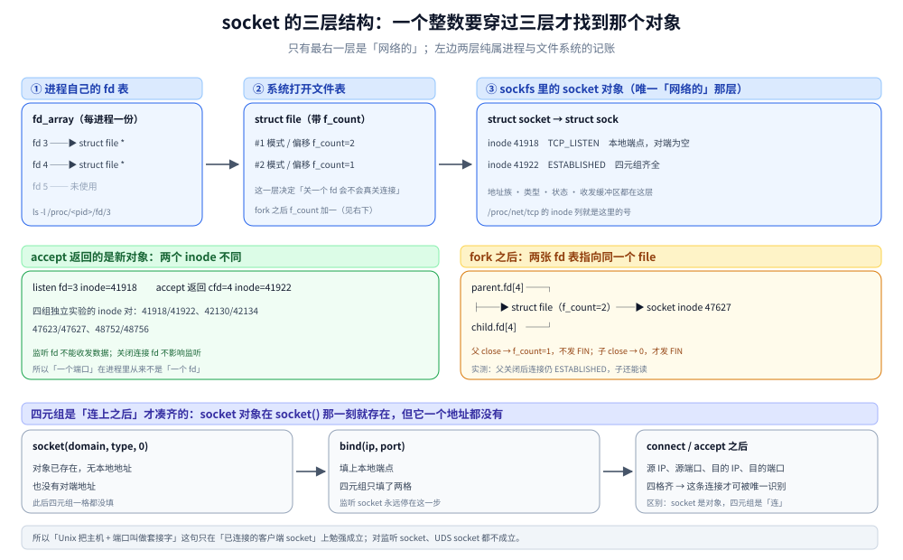
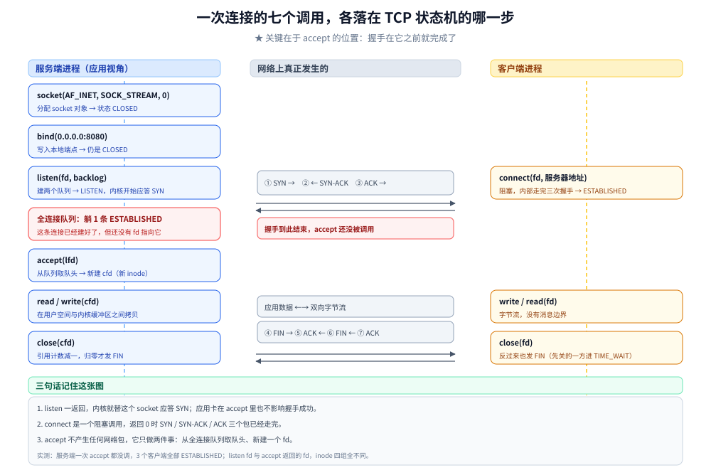
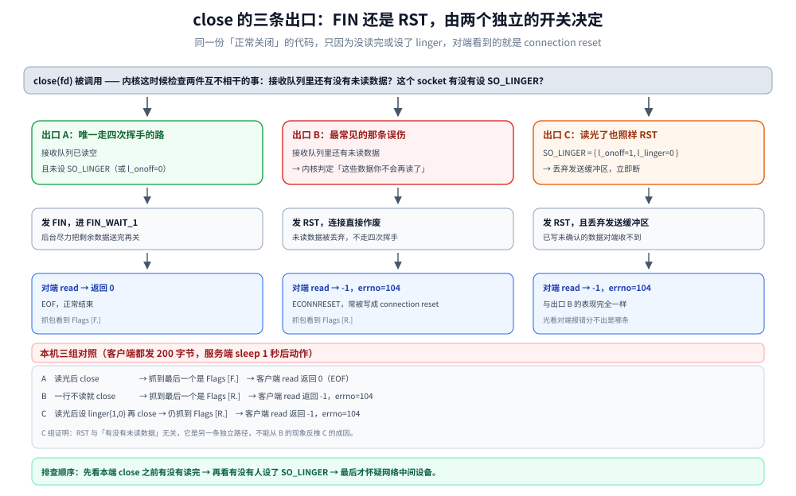
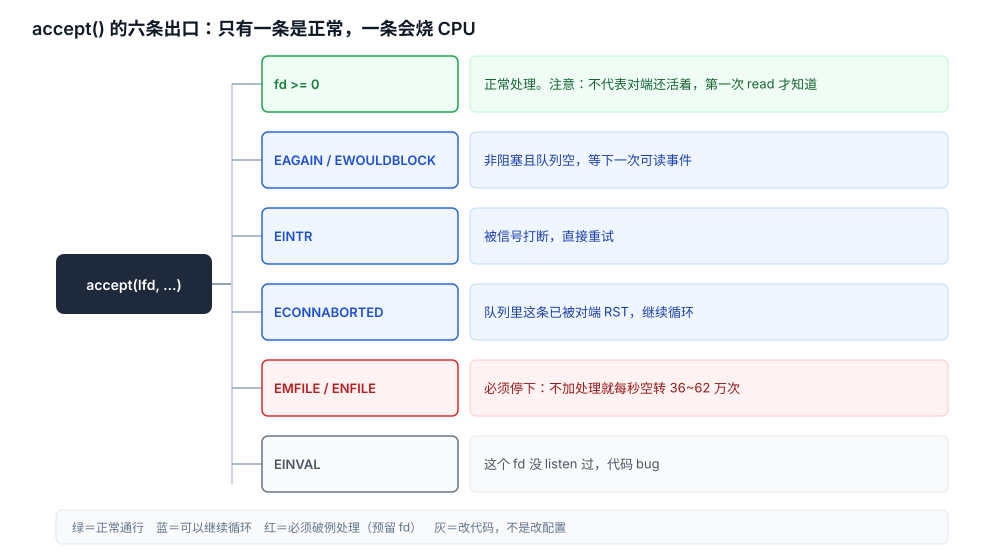

# Socket 接口与连接生命周期

> 覆盖：一次收发的最小代码闭环、socket 在进程里的表示（fd 表 → 打开文件表 → socket 对象三层）、阻塞与非阻塞差在哪（`O_NONBLOCK` 存在哪一层）、客户端临时端口从哪来与什么时候会用光、一次连接的七个调用各落在 TCP 状态机的哪一步、半连接与全连接两个队列的分工、阻塞时进程在哪个等待队列上、`read` 的三种返回怎么区分、一次 `read` 的内核路径、`close` 为什么有时发 RST 而不发 FIN、优雅关闭的四步、socket 选项按层归位、一个 socket 能被几个进程持有、Unix Domain Socket 换的是什么（含抽象命名空间与 `SOCK_SEQPACKET`）、`accept` 的六条出口与 `EMFILE` 空转、一条连接不通时的排查顺序。
>
> 不覆盖：TCP 协议本身的机制（首部、窗口、拥塞、挥手）在 [tcp/](tcp/) 七篇；`epoll` 怎么同时管上万条连接在 [IO多路复用.md](../../操作系统/IO多路复用.md)；各语言的 API 写法与默认选项值在 [net包与TCP-UDP编程.md](../../../01-编程语言/go/网络编程/net包与TCP-UDP编程.md)（Go）与各语言接入篇；字节流怎么划出消息边界在 [自定义协议设计.md](../应用层/自定义协议设计.md)；单机能开多少连接的系统参数清单在 [IO多路复用.md](../../操作系统/IO多路复用.md) 9.1。
>
> 内容整理自个人学习笔记。**实测口径**：Alpine 3.21 容器内用 C 直接调 BSD socket API（musl libc，gcc 14.2），用 `strace` / `ss` / `/proc/net/tcp` / `/proc/<pid>/fdinfo` / `/proc/<pid>/wchan` / `nstat` 交叉取证，宿主内核 `6.18.54.1-microsoft-standard-WSL2`（`nproc=4`、`somaxconn=4096`、`tcp_abort_on_overflow=0`、`ip_local_port_range=32768 60999`）；读数按组落在正文对应小节（最小闭环、阻塞与非阻塞、端口耗尽、等待队列、accept 分配、CLOSE_WAIT、TIME_WAIT 正反例、close 三条出口、UDS 抽象命名空间与延迟、EMFILE 空转、RST 之后 accept 的行为），未实测项在各节末尾单独标出。实验台在 `.workbuddy/tmp/sock-lab/`（`mini.c` / `nblock.c` / `rcvtimeo.c` / `emfile.c` / `abortc.c` / `flags.c` / `portex.c` / `uds2.c` / `socklab.c` / `newlab.c` / `run_all.sh`）。

---

## 一、Socket 是什么？

**本节要点**：socket 不是「主机 + 端口」这对值，而是**内核里的一个通信端点对象**。应用手里只有一个整数，这个整数要穿过三层才找到那个对象；而「四元组」描述的是**已建立的连接**，不是 socket 本身。

下面先跑通一次收发，把七个调用落到真实返回值上，再回头拆它背后有什么。

### 1.1 先跑通一次收发

服务端的骨架二十行左右，去掉打印就是下面这些——这一段请当作本篇的地图，后面每一节都在拆它其中的一行：

```c
/* 服务端：socket -> bind -> listen -> accept -> read -> write -> close */
int lfd = socket(AF_INET, SOCK_STREAM, 0);        /* 拿到一个没有地址的端点 */
int on = 1;
setsockopt(lfd, SOL_SOCKET, SO_REUSEADDR, &on, sizeof on);

struct sockaddr_in a;
memset(&a, 0, sizeof a);
a.sin_family = AF_INET;
a.sin_port = htons(9301);
a.sin_addr.s_addr = htonl(INADDR_LOOPBACK);       /* 只绑本机回环 */
bind(lfd, (struct sockaddr *)&a, sizeof a);       /* 填本地地址 */
listen(lfd, 8);                                   /* 从此刻起内核替你应答 SYN */

int cfd = accept(lfd, NULL, NULL);                /* 阻塞，直到队列里有一条 */

char buf[64];
ssize_t n = read(cfd, buf, sizeof buf - 1);       /* 读客户端发来的 5 字节 */
write(cfd, "PONG\n", 5);

close(cfd);                                       /* 关一条连接 */
close(lfd);                                       /* 关监听 */
```

客户端十二行：

```c
/* 客户端：socket -> connect -> write -> read -> close */
int fd = socket(AF_INET, SOCK_STREAM, 0);
struct sockaddr_in a;
memset(&a, 0, sizeof a);
a.sin_family = AF_INET;
a.sin_port = htons(9301);
a.sin_addr.s_addr = htonl(INADDR_LOOPBACK);
connect(fd, (struct sockaddr *)&a, sizeof a);     /* 一个 RTT，见 2.3 */

write(fd, "PING\n", 5);
char buf[64];
ssize_t n = read(fd, buf, sizeof buf - 1);
close(fd);
```

跑起来是这样（实测版每行前都加了打印，完整可编译文件在 `.workbuddy/tmp/sock-lab/mini.c`）：

```text
--- 服务端 pid=473 ---
socket()               -> fd=3
bind(127.0.0.1:9301)   -> 0
listen(backlog=8)      -> 0   listen-inode=1072578
--- 客户端 pid=475 ---
connect()              -> 0   0.487 ms  本地临时端口=53116
write("PING\n")        -> 5
accept()               -> fd=4   conn-inode=1072582
read()                 -> 5  "PING "
write("PONG\n")        -> 5
close() x2             -> 0
read()                 -> 5  "PONG "
```

这段输出里有六处细节，每一处都是后面某一节的主题：

| 读数 | 它说明了什么 | 展开在哪 |
| --- | --- | --- |
| `fd=3` 而不是 `fd=1` | 0 / 1 / 2 已被 `stdin` / `stdout` / `stderr` 占掉，新 fd 从最小的空槽开始 | 1.2 三层结构 |
| `listen` 就有了 inode | 监听 fd 在 `listen` 返回时已经是一个完整的对象 | 1.2 |
| `accept` 的返回值是 **4**，inode 也不同 | 监听与通信是**两个对象**，不是同一个东西的两个阶段 | 2.4 |
| 客户端 `connect` 用了 0.487 ms | 一个调用 = 一个完整 RTT，代码里看不见 | 2.3 |
| 临时端口 53116 没人指定过 | 客户端不 `bind`，端口由内核从固定区间里挑 | 1.6 |
| `read` 返回 5 而不是「读到 EOF」 | 返回值是**这次读到的字节数**，不是成功标志 | 三 |

⚠️ 两个 `read` 都返回 5，但方向相反、socket 也不是同一个：服务端读的是 `cfd`（连接 fd），客户端读的是 `fd`（它自己的连接 fd）。**同一个数字在不同进程里指向完全不同的对象**——这是后文一切 inode 判据的起点。

先给一个不精确、但能立刻定坐标的类比——**一家餐厅**：

| 类比 | 真实对应 | 类比在哪失效 |
| --- | --- | --- |
| `socket()` 装出一间空店面 | 内核分配 `struct socket` + 在 fd 表占一格 | 店面有门牌，socket 此时**一个地址都没有** |
| `bind()` 挂上「XX 路 12 号」的招牌 | 把本地地址写进 `struct sock` | — |
| `listen()` 开门营业，迎宾员站门口 | 状态置 `LISTEN`，内核开始自动应答 SYN | ⚠️ **迎宾员不是你的进程，是内核**——你在不在 `accept` 都不影响握手 |
| 客户端 `connect()` 客人走到门口 | 走完三次握手 | 「走到门口」在网络上是一个 RTT，不是一个动作（2.3） |
| `accept()` 迎宾员领进门、指派一名专属服务员 | 从全连接队列取出一条，**返回一个新 fd** | 「专属服务员」不是新进程，是同一个进程多拿了一个 fd |
| 服务员 `read` / `write` | 在连接 fd 上收发 | — |
| `close()` 关门歇业 | 引用计数减一，归零才发 FIN | ⚠️ **关门不等于断线**：还有别人持有引用时连接仍在（第六节） |

这个类比只在三件事上有用：**`listen` 之后内核就替你迎客**、**`accept` 只是「取一个已经坐下的客人」**、**监听与通信是两个不同的 fd**。它在两处会把人带偏，而记住这两处比记住类比本身有用：

- **迎宾员是内核**。所以服务端一次 `accept` 都没调，客户端照样能连上、能发数据——2.2 的实测就是这个。
- **服务员不是新进程**。所以「一条连接一个线程」是编程选择，不是 socket 的强制结构；epoll + 一个线程管上万条连接才是常态。



图怎么读：左列三层里，**只有最下面一层是「网络」的**，上面两层纯属进程与文件系统的记账。这解释了三件平时想不通的事：
- 为什么 socket 能用 `read` / `write`——因为它在 VFS 里就是一个文件；
- 为什么 `fork` 之后父子进程能同时读写同一条连接——因为两层 fd 表指向同一个 `struct file`，而这个 `struct file` 带着引用计数；
- 为什么 `accept` 返回的 fd 与监听 fd 不是同一个东西——它们指向两个不同的 inode。右下角那句是本篇要纠的第一个偏差：`bind` 只是给端点**填本地地址**，四元组是连上之后才凑齐的。

最底下那条补的是这个对象「往下一层」的样子：**收发是两条独立的路**（接收队列 / 发送队列），`recv` 与 `send` 各要一次 CPU 拷贝才在用户缓冲与内核之间搬完。队列只是「在哪儿等」，不等于数据已经到了对端——`ss` 里 `Recv-Q` 大是应用读得慢、`Send-Q` 大是对端收得慢，这一条判据就长在这两个队列上。完整的六段缓冲与两次拷贝见 [用户态内核态与一次IO的内存路径.md](../../操作系统/用户态内核态与一次IO的内存路径.md)。

把这两趟搬运单独画出来，因为第三节、第四节的全部判据都落在「拷贝发生在哪一段」上：


图怎么读：上下两行是同一条链路的两个方向，**橙色那一段就是 CPU 拷贝**——收方向在「内核队列 → 应用缓冲」，发方向在「应用缓冲 → 内核队列」，都恰好落在用户态与内核态的交界处。两侧的 DMA 段不占 CPU，所以 `read` 一个 8 KB 的包，真正让 CPU 忙起来的只有中间那一段。

三处映射要记牢：**`read` 返回 `n` 只说明数据进了你的缓冲**（对端收不收得到与它无关）；**`write` 返回 `n` 只说明进了发送队列**（对端什么时候收到、有没有收到，返回值一概不反映，这是 3.3 部分写那条判据的来源）；`sendfile` 之所以叫零拷贝，是它让数据不落到应用缓冲、只在内核里换一次描述，把橙色那一段整段省掉。

### 1.2 一个整数背后有三样东西

应用调 `socket()` 拿到的是一个 `int`，比如 `3`。这个 `3` 在三个地方各有一份记录：

| 层 | 内核结构 | 记的是什么 | 怎么观察 |
| --- | --- | --- | --- |
| 1. 进程的 fd 表 | `files_struct.fd_array` | 第 3 号槽指向哪个 `struct file` | `ls -l /proc/<pid>/fd/3` |
| 2. 系统打开文件表 | `struct file` | 访问模式、当前偏移、引用计数 `f_count` | 不可直接看，靠 `f_count` 的行为间接验证（第六节） |
| 3. socket 对象 | `struct socket` → `struct sock` | 地址族、类型、本地/对端地址、TCP 状态、收发缓冲区 | `/proc/net/tcp` 的 inode 列、`ss -tnp` |

`/proc/<pid>/fd/3` 读出来是 `socket:[41918]`——方括号里那个数就是第 3 层的 inode 号。**同一 inode 一定来自同一个对象，不同 inode 一定是不同对象**，这是后文所有判据的基础。

### 1.3 为什么「主机 + 端口」这个说法不够用

[网络分层与数据包旅程.md](../网络分层与数据包旅程.md) 里有一句「Unix 把『主机 + 端口』叫做套接字」——这是流传很广的简化，但它把两样东西混了：

| 说法 | 它其实描述的是 | 什么时候才成立 |
| --- | --- | --- |
| 「主机 + 端口」 | 一个**端点地址** | `bind` 之后就有；客户端连 `connect` 都不需要，内核会临时分配 |
| 「四元组」（源 IP、源端口、目的 IP、目的端口） | 一条**已建立的连接** | 握手完成、进入 `ESTABLISHED` 之后 |
| socket | 一个**内核对象** | 调 `socket()` 那一刻就存在，此时它一个地址都没有 |

判据很直接：服务端的监听 socket **永远没有四元组**——它只有一个本地端口，对端地址是空的，`ss -ltn` 的 Peer Address 列显示 `0.0.0.0:*`。而它确实是一个 socket。所以「socket = 主机 + 端口」在监听 socket 上就不成立了。

### 1.4 `socket()` 的三个参数决定了它是什么

`socket(domain, type, protocol)` 这三个参数不是「选个协议」这么简单，它们定的是**这个对象的身份**：

| 参数 | 常见取值 | 决定了什么 |
| --- | --- | --- |
| `domain` | `AF_INET` / `AF_INET6` / `AF_UNIX` | 地址怎么表示（4 字节 IP / 16 字节 IPv6 / 一个文件路径） |
| `type` | `SOCK_STREAM` / `SOCK_DGRAM` / `SOCK_RAW` | 有没有连接、有没有消息边界 |
| `protocol` | 习惯写 `0`（由前两个参数推出） | 同一 type 下再细分，比如 `SOCK_RAW` 要指定 `IPPROTO_ICMP` |

⚠️ **`AF_UNIX` + `SOCK_STREAM` 和 `AF_INET` + `SOCK_STREAM` 是两个东西**：前者根本没有 IP，也永远不会有四元组，但它仍是同一个 socket API（第七节）。这也是为什么本篇不把 socket 放进 `tcp/` 或 `udp/`——**它和具体协议是正交的**。

### 1.5 阻塞与非阻塞差在哪

**阻塞不是 socket 的属性**，而是打开文件表里 `struct file->f_flags` 的一个 bit（`O_NONBLOCK`）。1.1 的骨架里没设它，所以每个调用都会「等」；设了它，同样的调用立刻返回。

实测：同一个连接、同一段代码，只切一次标志（对端 1.2 秒后才发第一条，再过 1.5 秒发第二条）：

```text
[cli] 阻塞态 read           -> 5  "WAKE"  耗时 1200 ms
[cli] 切 O_NONBLOCK 后 read -> -1  errno=11(Resource temporarily unavailable)  耗时 0.004 ms
[cli] 切回阻塞 read         -> 5  "DONE"  耗时 1500 ms
```

第一行与第三行都是**在等对端**：1200 ms 与 1500 ms 完全由对端什么时候发决定。中间那行同样没有数据，但返回时间从 `1200 ms` 变成 `0.004 ms`——差了五个数量级，而连接本身一点没变。

三种状态并列看，注意「没数据」那一格的 errno 完全一样：

| 状态 | 怎么进 | 没数据时 `read` | 实测耗时 |
| --- | --- | --- | --- |
| 阻塞（默认） | 什么都不设 | 不返回，进程睡眠 | 1200 / 1500 ms（等到为止） |
| 非阻塞 | `fcntl` 给 `F_SETFL` 加上 `O_NONBLOCK` | 立刻 `-1` + `EAGAIN`（11） | 0.004 ms |
| 阻塞 + 读超时 | `setsockopt(SO_RCVTIMEO)` | 等到超时才 `-1` + `EAGAIN`（11） | 1010 / 1028 ms（设 1 秒） |

⭐ 后两行的 errno **完全相同**（都是 11）。所以「`errno == EAGAIN`」只说明「这次没拿到数据」，**分不出是「刚问过」还是「已经等了一秒」**。要区分只有两条路：看耗时，或者自己记住这次 `read` 有没有设超时。第三节 3.1 的判据表要按这一条来读。

这个标志到底存在哪一层，`/proc/<pid>/fdinfo/<fd>` 直接读得出来：

```text
默认               /proc/self/fdinfo/3  flags:	02
设 O_NONBLOCK 后   /proc/self/fdinfo/3  flags:	04002
子进程看同一个 fd  /proc/self/fdinfo/3  flags:	04002
父进程改回阻塞     /proc/self/fdinfo/3  flags:	02
```

`02` 是 `O_RDWR`、`04000` 是 `O_NONBLOCK`（八进制），或起来就是 `04002`。

⚠️ **子进程看到的是 `04002`**——`fork` 出来的进程继承了非阻塞标志，因为它在 `struct file` 上（1.2 的第二层），不在 fd 表里。所以在多进程共享同一条连接的场景下，**一个进程把 fd 改成非阻塞，持有同一个 `struct file` 的其他进程会一起变**。这是第六节引用计数的同一条结构，只是那次看的是 `f_count`、这次看的是 `f_flags`。

⚠️ `ss` 看不出一个 fd 是不是非阻塞——它只显示 socket 的状态与两个队列。判据只有 `fdinfo` 的 `flags`，或者 `strace` 抓到的 `fcntl`。

所以差别不在快慢，在**谁来等**：阻塞是进程自己睡在这条 socket 的等待队列上（2.8），非阻塞是把「等」交给调用方——通常是一个事件循环，它替一万条连接一起等（[IO多路复用.md](../../操作系统/IO多路复用.md)）。

### 1.6 客户端那个端口是从哪来的

服务端 `bind(9301)` 是写死的；客户端一行 `bind` 都没写，可 `connect` 之后它也有端口（1.1 里是 53116）。这个端口是内核在 `connect` 内部挑的，候选区间由 `ip_local_port_range` 决定：

```text
$ cat /proc/sys/net/ipv4/ip_local_port_range
32768	60999
```

**28232 个**（`60999 - 32768 + 1`）。挑选规则只有一条：**四元组不能与已有连接重复**。对同一个目标反复 `connect`，源端口就只能在这 28232 个值里各用一次。

实测：一个进程持续 `connect` 到同一个 `127.0.0.1:9311`，建好就不断开。

```text
[cli] 共建立 28232 条，源端口实测跨度 32768~60999
[cli] 第 28233 条 connect 失败 errno=99(Address not available)
```

⭐ 三条判据：

- 成功条数 **正好等于区间大小**，源端口跨度正好是区间两端——说明内核把这一段一个不落地用完了，没有第二个来源；
- 第 28233 条的 errno 是 **99（`EADDRNOTAVAIL`）**，不是 `EMFILE`（本地 fd 不够）、也不是 `ECONNREFUSED`（对端没人听）。同一个 errno 号在不同 libc 下文案不同：musl 的 `strerror(99)` 是 `Address not available`，glibc 与 Go 侧写 `cannot assign requested address`；
- 此时 **fd 一个都没少**。所以拿 `ulimit -n` 去查这个故障，什么都查不出来。

⚠️ 这个上限与 CPU、内存、`ulimit` 都无关：单机单目标时 28232 就是硬顶。要缓解只有三条路——缩短连接生命周期（复用连接）、增加目标端点的组合（多后端 IP）、增加源 IP 数量（多网卡 / 多出口）。三个「连不上」的 errno 怎么分锅，见 8.4。

⚠️ **未实测**：改 `ip_local_port_range` 之后上限如何变化。容器里读到的是宿主内核参数，本轮没有去改它。

---

## 二、一次连接的生命周期在 API 上落在哪一步？

**本节要点**：**三次握手发生在 `listen` 之后、`connect` 里面，与 `accept` 无关**。`accept` 只是从「已经建好的队列」里取一条出来，再给你一个新 fd。



图怎么读：横轴是时间，两条泳道分别是服务端与客户端。**请注意 `accept` 那一格的位置——它在握手之后**，这就解释了为什么服务端代码卡在 `accept` 上时，客户端那边 `connect` 早就成功了、数据都已经发过来了，只是没人取。图中的队列画成两个格子（半连接 / 全连接），它们的分工与溢出行为在 [TCP三次握手.md](tcp/TCP三次握手.md) 第二节有完整推导，本篇只用它的结论。

### 2.1 七个调用与状态机的对照

| 调用 | 内核做了什么 | 这条连接的状态 | 网络上有没有包 |
| --- | --- | --- | --- |
| `socket()` | 分配 `struct socket` + `struct sock`，在 fd 表里占一个槽 | `CLOSED` | 无 |
| `bind()` | 把本地地址写进 `struct sock` | `CLOSED` | 无 |
| `listen()` | 置 `TCP_LISTEN`，创建半连接队列与全连接队列 | `LISTEN` | 无（但从此刻起**自动应答 SYN**） |
| 对端 `connect()` | 内核发 SYN、回 ACK 给 SYN-ACK，然后把连接挂进全连接队列 | 该连接 `ESTABLISHED` | 三个：SYN / SYN-ACK / ACK |
| `accept()` | **从全连接队列取**一条，新建 fd 指向它 | 不变（早就 `ESTABLISHED`） | 无 |
| `read()` / `write()` | 在用户空间与内核缓冲区之间拷贝 | `ESTABLISHED` | 有 |
| `close()` | 引用计数减一，归零才发 FIN | `FIN_WAIT_1` | FIN |

表里最容易被读漏的是 `listen()` 那格的括号与 `accept()` 那格。把它们连起来看：**`listen` 之后内核就接手了握手**，应用在不在 `accept` 里都不影响握手成功。

### 2.2 `listen` 之后 SYN 是谁回的

本机实测：服务端只 `socket` / `bind` / `listen`，**一行 `accept` 都没写**，然后起 3 个客户端连进来。

```text
listen(backlog=5) 返回, lfd=3 inode=32329
[t=0s]  /proc/net/tcp  inode=32329  st=0A  tx_queue=0  rx_queue=0
[t=2s]  /proc/net/tcp  inode=32329  st=0A  tx_queue=0  rx_queue=3
```

```text
$ ss -ltn | grep 9101
LISTEN 3      5          127.0.0.1:9101      0.0.0.0:*
$ ss -tn | grep 9101
ESTAB 10     0          127.0.0.1:9101     127.0.0.1:37512
ESTAB 10     0          127.0.0.1:9101     127.0.0.1:37502
ESTAB 10     0          127.0.0.1:9101     127.0.0.1:37490
```

客户端那边：

```text
connect 返回耗时 0.169 ms
write 10 字节 -> 返回 10
```

三条 `ESTABLISHED`，客户端 `connect` 全部成功返回、数据也发出去了，而**服务端进程从未调用过 `accept`**。结论只有一种：**握手是内核完成的**，`listen` 一返回，协议栈就开始替这个 socket 应答 SYN。

这段读数还顺带纠正两个常见误读：

| 来源 | 字段 | 实测值 | 它到底是什么 |
| --- | --- | --- | --- |
| `ss -ltn` | `Recv-Q` | 3 | 当前**全连接队列**里排着几条等 `accept` 的连接 |
| `ss -ltn` | `Send-Q` | 5 | `listen` 的第二个参数（backlog），被 `somaxconn` 截断后的值 |
| `/proc/net/tcp` | `tx_queue` | **0** | ⚠️ **不是 backlog**，LISTEN 态恒为 0 |
| `/proc/net/tcp` | `rx_queue` | 3 | 与 `ss` 的 `Recv-Q` 同源 |

⚠️ 网上不少说法把 `/proc/net/tcp` 的 `tx_queue` 解释成「监听队列上限」，本机读数是 **0**，这个解释不成立。要上限就看 `ss -ltn` 的 `Send-Q`。

### 2.3 `connect` 这一个调用里发生了什么

抓包看顺序（`tcpdump -i lo`，时间戳已略）：

```text
127.0.0.1.36134 > 127.0.0.1.9113: Flags [S],  seq 2197071463, options [mss 65495, sackOK, ...]
127.0.0.1.9113 > 127.0.0.1.36134: Flags [S.], seq 583600347,  ack 2197071464, win 65483
127.0.0.1.36134 > 127.0.0.1.9113: Flags [.],  ack 1, win 64
```

`strace` 下 `connect` 是一个**阻塞调用**，返回 `0` 时上面三个包已经走完，`connect 返回耗时 1.185 ms`。也就是说「建连接」这件事在代码里只占一行，在网络上占了一个完整 RTT。

⚠️ **跨工具对时刻不可靠**：本轮 `strace` 记到 `connect` 返回在 `12:54:42.915793`，而 `tcpdump` 记 SYN 在 `42.916247`——比 `connect` 返回还晚 0.45 ms。物理上不可能，只能说明两个工具的时间戳取自不同时钟源、精度也不一致。**所以本篇只用抓包的先后顺序，不拿 `strace` 与 `tcpdump` 的时刻互相比对。**

### 2.4 `accept` 返回的是一个新的 fd

四组独立实验里，监听 fd 与 `accept` 返回的 fd 的 inode 分别是：

| 监听 fd | 它的 inode | 连接 fd | 它的 inode |
| --- | --- | --- | --- |
| 3 | 41918 | 4 | 41922 |
| 3 | 42130 | 4 | 42134 |
| 3 | 47623 | 4 | 47627 |
| 3 | 48752 | 4 | 48756 |

**每次都是不同的 inode**，说明 `accept` 交给你的是另一个对象。这带出两条硬规则：

- **监听 fd 不能用来收发数据**：它没有对端地址，`read` 会报 `ENOTCONN` / `EINVAL`。
- **连接 fd 关掉不影响监听**：反过来也一样。

两者不是「同一个东西的两个阶段」，而是**两种对象**：

| 维度 | 监听 Socket | 通信 Socket |
| --- | --- | --- |
| 怎么来 | `socket()` 创建，`listen()` 之后才成为监听态 | `accept()` 成功返回时新建 |
| 状态 | `LISTEN`（`/proc/net/tcp` 的 `st=0A`） | `ESTABLISHED`（`st=01`） |
| 对端地址 | **空**，`ss -ltn` 的 Peer 列是 `0.0.0.0:*` | 有，四元组齐全 |
| 能不能 `read` / `write` | **不能**，只用于 `accept()` | 这才是它的用途 |
| 一个服务里有几个 | 通常 1 个 | **每条连接 1 个**，与并发数同阶 |
| 生命周期 | 贯穿整个服务运行期 | `accept()` 到 `close()` |
| `close()` 掉它 | 服务不再接新连接（存量连接不受影响） | 只断这一条 |

判据只有一条：**看它有没有对端地址**。有对端的就是通信 socket，能读写；没有的就是监听 socket，只能 `accept`。`ss -ltn` 与 `ss -tn` 的差别就是这两类，而 `ss -tan` 把两类混在一张表里，`State` 列成了唯一的分辨依据。

### 2.5 `close` 之后是四次挥手

`normal` 那组读数里能看到完整的四个包（服务端在 t≈1.0 s 关闭，客户端在 t≈3.0 s 才关）：

```text
t=39.139 服务端 → 客户端  Flags [F.]       ← 服务端 close，发 FIN
t=39.142 客户端 → 服务端  Flags [.]        ← ACK
t=41.134 客户端 → 服务端  Flags [F.]       ← 客户端 hold 结束、close
t=41.134 服务端 → 客户端  Flags [.]        ← ACK
```

⭐ 中间这 **1.99 秒的间隔**就是应用层面的 `CLOSE_WAIT`：内核早就收到 FIN、回了 ACK，但客户端进程还没调 `close`。`CLOSE_WAIT` 堆积从来不是网络问题，是**代码里有分支没关连接**。成因与定位见 [TCP四次挥手.md](tcp/TCP四次挥手.md) 第三节。

**CLOSE_WAIT 堆积怎么查。** 三条命令从粗到细，全部只读，不需要重启服务：

| 命令 | 看到什么 |
| --- | --- |
| `ss -tan state close-wait` | 哪些连接停在 `CLOSE_WAIT`；`Local` 是**我自己的**地址端口 |
| `ss -tanp state close-wait` | 加上进程名与 pid（需要能看到该进程的权限） |
| `ls -l /proc/<pid>/fd` | 那个进程具体持着哪个 socket inode |

实测：服务端 `accept` 之后既不读也不关，客户端发 6 字节后退出。

```text
$ ss -tan state close-wait | grep 9204
CLOSE-WAIT 7      0          127.0.0.1:9204    127.0.0.1:36557

$ ss -tan | grep 9204
LISTEN     0      8          127.0.0.1:9204       0.0.0.0:*
FIN-WAIT-2 0      0          127.0.0.1:36557    127.0.0.1:9204
CLOSE-WAIT 7      0          127.0.0.1:9204     127.0.0.1:36557

$ grep -i ':23F4' /proc/net/tcp          # 9204 = 0x23F4
   0: 0100007F:23F4 00000000:0000 0A …  788385   ← LISTEN
   1: 0100007F:8ECD 0100007F:23F4 05 …  792660   ← FIN-WAIT-2（客户端侧）
   2: 0100007F:23F4 0100007F:8ECD 08 …  788386   ← CLOSE-WAIT（服务端侧）

$ ls -l /proc/250/fd
lrwx------ 1 root root 64 … 3 -> socket:[788385]    ← 监听 fd
lrwx------ 1 root root 64 … 4 -> socket:[788386]    ← 连接 fd，就是那条 CLOSE-WAIT
```

三处证据能串成一条链：`ss` 的 `CLOSE-WAIT`、`/proc/net/tcp` 的 `st=08`、`/proc/<pid>/fd` 里的 inode `788386` 指的是同一个对象。**先 `ss` 找出谁、再 `/proc/<pid>/fd` 找出哪个 fd**，两步就能定位到代码位置。

⭐ 判据只有一条：**`CLOSE-WAIT` 的 `Local` 列永远是「你自己」**。对端处于 `CLOSE_WAIT` 时你在本机看不到——所以「我们这边 `CLOSE_WAIT` 堆积」等价于「我们的代码漏了 `close`」。

⚠️ 常见误诊：把 `CLOSE_WAIT` 当成「连接被对端异常断开」。不是——对端是**正常**发了 FIN 的，异常断开（进程被杀、RST）根本进不了 `CLOSE_WAIT`，它会直接消失并让本端 `read` 报 `ECONNRESET`（第三节 3.1）。

**TIME_WAIT 落在谁身上。** 它是**先发 FIN 的那一方**产生的，不是「先调 `close()` 的那一方」——两者在正常场景下一致，在半关闭或对端已经先关时会分岔。

正例：服务端读光数据后 `close`，客户端还活着。

```text
$ ss -tan state time-wait | grep 9207
TIME-WAIT  0      0          127.0.0.1:9207     127.0.0.1:37918
$ grep -i ':23F7' /proc/net/tcp          # 9207 = 0x23F7
   4: 0100007F:23F7 0100007F:941E 06 …
```

`Local` 是服务端的 9207，`st=06` 就是 `TIME_WAIT` —— 服务端先发 FIN，所以服务端背这一条。

反例：对端的 FIN 先到，服务端随后才 `close`（同一台机、同样两端，只改了先后）：

```text
# 客户端先退出 → 服务端进 CLOSE_WAIT → 服务端 close → LAST_ACK → CLOSED
$ ss -tan state time-wait | grep 9205
0      0          127.0.0.1:43867    127.0.0.1:9205
```

这次 `Local` 变成了**客户端的端口 43867**。服务端从 `CLOSE_WAIT` 经 `LAST_ACK` 直接到 `CLOSED`，**根本不进 `TIME_WAIT`**。所以「`TIME_WAIT` 多 = 我主动关得多」这条经验只在双方都没有半关闭时成立。

`TIME_WAIT` 持续 2MSL（Linux 固定 60 秒），做两件事：让最后一个 ACK 有机会重发，让这条连接的旧报文在网络里消散。它占的是**四元组**而不是端口本身——所以服务端重启时 `bind` 会撞上残留的 `TIME_WAIT`，`SO_REUSEADDR` 解决的就是这个（5.2）。

⚠️ 本节这几条命令在本轮容器（Alpine 3.21 / 内核 6.18）实测；`CLOSE_WAIT` 那条的 `Recv-Q=7` 是客户端发来但没人读的 6 字节加上 shell 的一个换行，不代表固定值。


### 2.6 两个队列：半连接的等 ACK，全连接的等 accept

**`listen()` 那一格里其实创建了两个队列**，它们对应握手的两个半程——这是「`accept` 之前连接已经建立」的结构性原因。

| | 半连接队列（SYN Queue） | 全连接队列（Accept Queue） |
| --- | --- | --- |
| 什么时候进 | 收到 SYN、回了 SYN-ACK，等客户端最后一个 ACK | 收到最后一个 ACK，握手完成 |
| 连接状态 | `SYN_RCVD` | `ESTABLISHED` |
| 在等谁 | 等客户端的 ACK | 等应用调 `accept()` |
| 上限由谁定 | `min(listen backlog, tcp_max_syn_backlog)`，本机后者 512 | `listen(fd, backlog)`，被 `somaxconn` 截断（2.7 实测） |
| 怎么观察 | `ss -tan state syn-recv` | ⭐ **`ss -ltn` 的 `Recv-Q` 列** |
| 堆满了会怎样 | 开 `tcp_syncookies` 时退回 cookie 继续握手，否则丢 SYN | `tcp_abort_on_overflow=0` 时丢 ACK，=1 时回 RST |

⭐ **`ss -ltn` 的 `Recv-Q` 就是全连接队列的长度**，不是「接收缓冲区里有多少字节」——`LISTEN` 态的 socket 没有数据可收。这一点在 2.2 已经用读数验过：3 个客户端连进来后 `Recv-Q=3`，正好是 3 条等 `accept` 的连接。

那半连接队列堆起来长什么样？实测：`listen(fd, 1)`、4 个客户端、服务端一次 `accept` 都不调。

```text
t=1s  ss -ltn  →  LISTEN 2  1  127.0.0.1:9201  0.0.0.0:*

$ ss -tan | grep 9201 | awk '{print $1}' | sort | uniq -c
      4 ESTAB
      1 LISTEN
      2 SYN-SENT

$ nstat -az | grep -E 'ListenOverflows|ListenDrops|SyncookiesSent|TCPReqQFullDrop'
TcpExtListenOverflows           12
TcpExtListenDrops               12
TcpExtSyncookiesSent             0
TcpExtTCPReqQFullDrop            0
```

三个细节都反直觉：

- **服务端一条 `SYN-RECV` 都没有**，卡住的是客户端那 2 条 `SYN-SENT`。因为 `tcp_abort_on_overflow=0` 时，内核丢掉第三次握手的 ACK 之后，会顺手把这条连接**从半连接队列里删掉**——队列满不是「堆着不动」，是「两边都没留下」。
- **痕迹只在计数器里**。`ListenOverflows=12` / `ListenDrops=12` 就是「这期间丢了 12 次」。生产上「客户端偶尔超时、服务端日志一行没有」时，这两个数是唯一线索。
- **`SyncookiesSent=0`** 说明没走到 syncookie 那条路，**`TCPReqQFullDrop=0`** 说明丢的不是 SYN 而是 ACK——两者一起才能确定「满的是全连接队列，不是半连接队列」。

所以半连接队列在正常情况下**存在时间只有一个 RTT**，`ss` 抓不到；能抓到 `SYN_RCVD` 的场合是服务端的 SYN-ACK 发不出去（对端不可达）或客户端故意不回 ACK（SYN flood）。日常排障看到的「队列满」几乎全是全连接队列，也就是 `Recv-Q`。

⭐ **SYN Flood 打的就是这两个队列**：攻击者用**伪造的源 IP** 灌 SYN，服务端为每个 SYN 回 SYN-ACK 并挂进半连接队列，永远等不到第三个 ACK，队列被填满后**真实用户的 SYN 开始被丢**——表现是用户连不上、服务端 CPU 不高、带宽也不高。兜底手段是 `tcp_syncookies=1`（队列满时改用 cookie 建连、不为半开连接分配状态）和入口侧的连接数限制，防护分层见 [Web攻击与防御.md](../../../06-工程实践/安全/应用与数据安全/Web攻击与防御.md) 第八节。

### 2.7 backlog 满了会怎样

`backlog` 不是「随便写多大都行」，也不是「写 1 就只能排 1 条」：

| 配置 | `ss -ltn` 的 Send-Q | 实际能排几条 | 第 N+1 个客户端 |
| --- | --- | --- | --- |
| `listen(fd, 1)` | 1 | **2**（`backlog + 1`） | `connect` **一直不返回** |
| `listen(fd, 5)` | 5 | 3（本轮只连了 3 个） | — |
| `listen(fd, 10000)` | **4096** | — | 被 `somaxconn=4096` 截断 |

`backlog=1` 那组的完整时序：第 1、2 个客户端 `connect` 分别在 0.102 ms / 0.184 ms 返回，队列涨到 `rx_queue=2` 就停住；第 3、4 个客户端**连一行输出都没有**——`connect` 卡住了，7 秒后被外部 `timeout` 杀掉。

```text
[t=2s]  rx_queue=1
[t=3s]  rx_queue=2
[t=4s] ~ [t=12s]  rx_queue=2      ← 一直不动
```

为什么会「卡住」而不是「报错」：`tcp_abort_on_overflow = 0`（本机默认）时，队列满了内核**默默丢掉第三次握手的 ACK**，客户端于是停在 `SYN_SENT` 反复重传 SYN，表现为**不报错、不失败、就是慢**。生产上「服务端 hang 住、客户端超时、服务端日志一行都没有」多半是这一格。

⭐ **要等多久才放弃**：Linux 默认 `tcp_syn_retries=6`，第 1 次重传在 **1 秒**后，之后 3、7、15、31、63 秒，总计约 **127 秒**。所以队列一满，本来一个 RTT 就能建好的连接直接进入「秒级→分钟级」超时，而**客户端只留一句 `i/o timeout`**，看不出是队列问题。跨城 RTT 按 20~40 ms 算时，这笔账更刺眼：本该 30 ms 的建连，实际卡了 127 秒。

### 2.8 阻塞的时候进程在哪等

1.5 说「阻塞是进程自己睡在等待队列上」，这一节把那个队列找出来——**每一个 socket 对象里都挂着一组等待队列**，`accept` 没连接可接、`read` 没数据可读时，进程就被挂到对应的队列上再调 `schedule()` 交出 CPU。

不用读源码也能看见它在哪：`/proc/<pid>/wchan` 显示「这个进程睡眠时最后停在哪个内核函数」。

实测：服务端只 `listen` 不 `accept`，客户端连上后不发数据。

```text
[srv] listen 9304，等待 accept
服务端阻塞在 accept 时的 wchan : inet_csk_accept
客户端阻塞在 read 时的 wchan   : wait_woken
```

两行读出来的东西不一样，正好对应两条不同的等待路径：

| wchan | 谁在等 | 等的是哪件事 |
| --- | --- | --- |
| `inet_csk_accept` | `accept()` | 全连接队列里出现一条（2.6） |
| `wait_woken` | `read()` | 接收队列里出现数据（1.1 图最底下那个队列） |
| `unix_stream_read_generic` | UDS 的 `read()` | 同一条路，只是没有网络栈（第七节） |
| `nanosleep` / `hrtimer_nanosleep` | `sleep()` / `usleep()` | 定时器，与连接无关 |

⚠️ 前两行是本轮实测，后两行是按同一条判据推的、没在本次输出里出现。`read` 那格在别的内核或调用路径上也可能显示成 `sk_wait_data`——`wait_woken` 是更外层的通用包装，两者指的是同一件事。

把这个队列放在心里，才讲得清「阻塞的代价」和「epoll 省了什么」：

- 进程挂起后**不占 CPU**，但占着线程（内核栈 + 用户栈，Go 是协程栈）；一万条连接就是一万个挂起的执行体。
- 数据到达时，是**软中断里**唤醒等待队列上的进程，不是进程自己轮询出来的。所以「阻塞」和「非阻塞 + 轮询」在 CPU 占用上是相反的两个极端。
- `epoll` 并不消灭这个队列：它把自己的一组回调也挂到**同一个** `sk_wq` 上，于是「数据到了叫醒谁」从「叫醒那个进程」变成「给就绪链表加一项」。这也是为什么 epoll 与阻塞式 `read` 能共存——两条路等的是同一个东西，只是被叫醒时做的事不同。

⚠️ **未实测**：`/proc/<pid>/stack` 在容器里读出来是空的（没有权限取内核栈帧），所以这一节只有 `wchan` 的函数名，没有完整调用栈。内核路径（`tcp_recvmsg` → `sk_wait_data` → `wait_woken` → `schedule`）是按源码写的，本轮没有逐帧验证。

---

## 三、`read` 的三种返回怎么区分？

**本节要点**：`read` 在 socket 上返回 `0` 只表示**对端有序关闭**，不是「没数据」；「没数据」是 `-1` 加 `EAGAIN`。把这两件事混了，就会出现「空闲连接被当成断开」的死循环。

### 3.1 三种返回的判据

一个非阻塞连接的完整生命周期里，`read` 依次给出三种结果：

| 时刻 | 返回 | `errno` | 含义 | 该怎么办 |
| --- | --- | --- | --- | --- |
| 对端还没发数据 | `-1` | `11`（`EAGAIN` / `EWOULDBLOCK`） | 暂时没数据，**连接是好的** | 等下一次可读事件，不要关连接 |
| 对端发来 5 字节 | `5` | `0` | 读到数据 | 处理，然后继续读 |
| 对端 close | `0` | `0` | **对端有序关闭**（EOF） | 本端也该 close |

实测输出：

```text
1) 对端尚未发数据，非阻塞 read -> -1 errno=11(Resource temporarily unavailable)
2) 对端发来数据后 read -> 5 内容=HELLO errno=0
3) 对端 close 之后 read -> 0（EOF，不是错误）
```

⚠️ 还有一种不在上表里的：对端发了 **RST**，`read` 返回 `-1` 且 `errno = 104`（`ECONNRESET`）。它和 `EAGAIN` 都是「返回 -1」，但一个该重试、一个必须关连接——**只看返回值不看 `errno` 就分不出来**。

⚠️ 就算看清了 `EAGAIN` 也不够：它有两个来源，返回值与 errno 一模一样。非阻塞下「刚问过、确实没数据」是立刻返回（1.5 实测 0.004 ms），阻塞 + `SO_RCVTIMEO` 下「等够一秒还是没数据」要等满超时（1.5 实测 1010 ms）。**判据只能是耗时，或者记住这个 fd 有没有设超时**。

写业务代码时很少直接面对 `errno`，但**上面这几种情况一个都没消失，只是换了外壳**：

| 底层发生什么 | C 里怎么看到 | Go 里怎么看到 |
| --- | --- | --- |
| 对端有序关闭 | `read` 返回 `0` | `Read` 返回 `(0, io.EOF)` |
| 暂时没数据（非阻塞） | `-1` + `EAGAIN` | **看不到** —— 运行时用 netpoll 阻塞住，普通 `net.Conn` 不暴露 `EAGAIN` |
| 对端发 RST | `-1` + `ECONNRESET` | `*net.OpError`，`errors.Is(err, syscall.ECONNRESET)` 为真 |
| 读超时 | `-1` + `EAGAIN`（与「没数据」同一个 errno，1.5 实测 1010 ms） | `i/o timeout`，`errors.Is(err, os.ErrDeadlineExceeded)` 为真 |
| 被信号打断 | `-1` + `EINTR` | **看不到** —— 运行时自动重试 |

⭐ 两处「看不到」值得记：**`EAGAIN` 与 `EINTR` 都被运行时吃掉了**。所以「Go 里不容易写错非阻塞」不是语法糖，是 runtime 把它俩接走了；代价是想自己控制等待逻辑时要绕到 `syscall.RawConn`，那时 `EAGAIN` 又以「回调返回 false」的形式回来。这几条报错原文的实测在 [net包与TCP-UDP编程.md](../../../01-编程语言/go/网络编程/net包与TCP-UDP编程.md) 第六节。

⚠️ 但 `ErrClosed` / `ECONNRESET` / `io.EOF` 三者**必须分开处理**：混成 `if err != nil { 重连 }`，就会把「正常的关闭」也当成故障，做出无限重连。

### 3.2 为什么不能把「读超时」当错误处理

很多代码写 `if (n <= 0) { close(); reconnect(); }`。`n == 0` 时这么写是对的；`n == -1 && errno == EAGAIN` 时这么写，等于**每 100 毫秒把一条好连接拆掉重建**。判据只有一条：

| 条件 | 结论 |
| --- | --- |
| `n > 0` | 有数据 |
| `n == 0` | 对端关，本端也关 |
| `n == -1 && errno == EINTR` | 被信号打断，**重试** |
| `n == -1 && errno == EAGAIN` | 没数据（非阻塞）或等超时（设了 `SO_RCVTIMEO`），两者 errno 相同；按自己的超时策略处理，**不要关连接** |
| `n == -1 && 其它 errno` | 真错误（`ECONNRESET` / `ETIMEDOUT`），关连接 |

### 3.3 非阻塞下 `write` 可能只写一半

阻塞模式下 `write(fd, buf, n)` 返回小于 `n` 的情况很少见；非阻塞模式下**很正常**：内核发送缓冲区满了，只塞进去一部分就返回已写的字节数。

判据是返回值本身，不是 `errno`：

| 返回 | 含义 |
| --- | --- |
| `== n` | 全写进去了 |
| `> 0 && < n` | **部分写**，剩下的要自己排队、等可写事件再写 |
| `-1 && errno == EAGAIN` | 一个字节都没写进去，等下 `EPOLLOUT` |

⚠️ 「部分写」是 `IO多路复用` 事件循环里最常写错的一格：直接把没写完的部分丢掉，日志不报错，对端收到半条消息。缓冲与 `EPOLLOUT` 的订阅规则见 [IO多路复用.md](../../操作系统/IO多路复用.md) 9.4。

⚠️ 这里只讲「一次 `write` 变成多次 `read`」的那一半。反过来「两次 `write` 被一次 `read` 全拿走」同样成立，原因一样：**TCP 是字节流，没有消息边界**。划界规则（定长 / 分隔符 / 长度前缀）见 [自定义协议设计.md](../应用层/自定义协议设计.md)。

部分写之后**什么时候能继续写**，由触发模式决定——这是 LT 与 ET 差别最大的地方：

| 触发模式 | 发送缓冲区腾出空间后 | 你要做什么 |
| --- | --- | --- |
| LT（水平触发，默认） | 内核**持续**报可写，直到你写完 | 可以少写一点，下次还会提醒；代价是空转 |
| ET（边缘触发） | 只在「由满变不满」那一刻**报一次** | 必须循环写到返回 `EAGAIN` 或写完；漏掉这次边沿就再也没有可写事件 |

所以 ET 下的写循环形态是固定的：写完 → 还有剩 → 留在用户态队列 → 订阅 `EPOLLOUT` → 下次事件继续写 → 写完立刻取消订阅。

⚠️ 两者的坑方向相反：LT 下忘了取消订阅只是多几次空转；ET 下忘了**订阅**，剩下的数据就永远发不出去。两套语义的完整对照在 [IO多路复用.md](../../操作系统/IO多路复用.md) 第四节，本节只记「它决定了部分写之后还有没有下一次机会」。

### 3.4 一次 `read` 在内核里走了哪几段

1.1 说过 socket 在 VFS 里就是一个文件，`strace` 上看到的就是这条链的边界——八个系统调用对应 1.1 的八行输出，一个不多：

```text
719   socket(AF_INET, SOCK_STREAM, IPPROTO_IP) = 3
719   bind(3, {sa_family=AF_INET, sin_port=htons(9312), sin_addr=inet_addr("127.0.0.1")}, 16) = 0
719   listen(3, 8)                      = 0
719   accept(3, NULL, NULL)             = 4
719   read(4, "PING\n", 63)             = 5
719   write(4, "PONG\n", 5)             = 5
719   close(4)                          = 0
719   close(3)                          = 0
```

`read(4, "PING\n", 63) = 5` 这一行是用户态与内核态的分界：**进去时只声明「最多要 63 字节」，出来时内核告诉它「只给了 5 字节」**。那 5 字节是沿哪条路被搬过来的，strace 看不见：

```text
read(2)
└─ ksys_read
   └─ vfs_read                     ← socket 与普通文件在这里还分不开
      └─ sock_read_iter            ← file->f_op 里存的函数，socket 专有
         └─ sock_recvmsg
            └─ inet_recvmsg
               └─ tcp_recvmsg      ← 收数据、判断要不要等、拷进用户缓冲
                  └─ sk_wait_data  ← 没数据时才走到这里（2.8 的 wchan）
                     └─ schedule()
```

这张链一次答掉三个「为什么」：

| 现象 | 答案在链的哪一段 |
| --- | --- |
| socket 能用 `read` / `write` | `vfs_read` 是公共入口，socket 只是换了一套 `f_op` |
| `epoll` 管不了普通文件 | 普通文件的 `f_op` 里没有 poll 需要的等待队列语义（[IO多路复用.md](../../操作系统/IO多路复用.md) 9.2） |
| 「两次搬运」里只有一次占 CPU | 那次拷贝就在 `tcp_recvmsg` 里，也就是图 2 的橙色段 |

⚠️ 本轮只验到两头：`strace` 能看见 syscall 边界，`wchan` 能看见栈底的 `wait_woken`（2.8）。**中间那几层的函数名取自源码，没有逐帧验证**——要拿完整调用栈得靠 `perf` 或 `bpftrace`，容器里没有跑。

### 3.5 一次 `write` 在内核里走了哪几段

3.4 那条链是收方向，发方向是它的镜像，但**入口不同**：`read` 走 `sock_read_iter`，`write` 走 `sock_write_iter`，两者是 `file_operations` 里并列的两个函数指针。

```text
write(2)
└─ ksys_write
   └─ vfs_write                     ← 与 read 共用这一层
      └─ sock_write_iter            ← f_op->write_iter，socket 专有
         └─ sock_sendmsg
            └─ inet_sendmsg
               └─ tcp_sendmsg       ← 把用户缓冲拷进 sk_write_queue 上的 sk_buff
                  └─ sk_stream_wait_memory   ← 发送队列装不下时才走到这里
                     └─ schedule()
```

与 3.4 对照，差别只落在三格：

| 环节 | `read` | `write` |
|---|---|---|
| `f_op` 里的入口 | `sock_read_iter` | `sock_write_iter` |
| 真正搬字节的函数 | `tcp_recvmsg`（`copy_to_user`） | `tcp_sendmsg`（`copy_from_user`） |
| 装不下时等在哪 | `sk_wait_data` | `sk_stream_wait_memory` |

**`sk_stream_wait_memory` 是全篇排障价值最高的一格**：它一旦出现，说明卡的**不是对端慢，是本机发送队列满**。队列满的直接证据是 `ss -tnm` 的三列：

```text
ESTAB 0  706624  172.30.0.4:57116  172.30.0.3:9201
  skmem:(r0,rb131072,t0,tb705024,...)  ... rwnd_limited:5112ms(99.1%) notsent:706624
```

三个数字连起来读：`Send-Q = 706624` 是卡在队列里的字节数；`notsent:706624` 说明它们**一个都没发出去**；`rwnd_limited` 占 **99.1%** 指出卡它的是**对端接收窗口**——对端应用不读，窗口开到 0。这三条互不重复：第一条说「有多少」，第二条说「发没发」，第三条说「谁卡的」。

⚠️ **`wchan` 在 Go 程序里看不到这一格**。同一个阻塞写，用裸 `syscall.Write`，`wchan` 是 `wait_woken`；换成 `net.Conn.Write`，`wchan` 变成 `do_epoll_wait`——runtime 把阻塞写转成「非阻塞 + netpoll 等事件」，线程压根没停在 `sk_stream_wait_memory` 上。**所以 wchan 看不到写阻塞，不是因为没阻塞，是被 runtime 换了形状**（与 2.8 里 `read` 的 `wchan` 是 `wait_woken` 同理）。

这也解释了 3.3 的部分写：非阻塞下 `write(65536)` 会返回「内核这次装得下多少」，实测第 3 次只写回 **15552** 字节，第 4 次直接 `EAGAIN`（累计 146624）——`tcp_sendmsg` 只拷装得下的部分，装不下的不拷、也不等。

⚠️ 中间几层函数名取自源码；本轮验到的是两头：`strace` 的 syscall 边界与 `wchan` 的栈底函数名。

> 📎 3.5 这条链停在 `tcp_sendmsg`——协议栈往下那半条（`tcp_write_xmit` → `ip_queue_xmit` → `dev_queue_xmit` → 驱动 TX ring → 网卡 DMA）在 [跨城传输全链路-TCP篇.md](../跨城传输全链路-TCP篇.md) 3.2，那里还有 GSO 开关下「一次 `write(3072)` 线上是 1 个还是 3 个包」的读数。


---

## 四、`close` 之后对端为什么收到 RST？

**本节要点**：`close` 在 **接收缓冲区还有未读数据**时会发 RST，而不是 FIN；`SO_LINGER{on=1, linger=0}` 是另一条独立路径，**即使数据读光了也发 RST**。对端收到 RST 的表现是 `read` 报 `ECONNRESET`，且**本端已发出但未被确认的数据会丢**。



图怎么读：三条出口的分岔点在 `close` 内部对**接收队列与 linger 设置**的检查，应用层完全看不见——这就是为什么它属于「静默行为」。左上那条是唯一会走完整四次挥手的路径；右侧两条都会让对端看到 `ECONNRESET`，但成因完全不同：一条是「我自己没读完」，一条是「我要求立即断」。图下方那行是排查顺序：先查对端有没有读完，再查有没有人设了 linger。

### 4.1 同一段代码只改一行，结果完全不同

三组实验的服务端代码只差在后两行，客户端都是连上后发 200 字节、hold 3 秒再读：

| 服务端做法 | 抓到的最后一个包 | 客户端 `read` |
| --- | --- | --- |
| `sleep(1)` → **读光** → `close` | `Flags [F.]` | 返回 **0**（EOF） |
| `sleep(1)` → **一行不读** → `close` | `Flags [R.]` | `-1`，`errno=104`（Connection reset by peer） |
| `sleep(1)` → **读光** → `SO_LINGER{1,0}` → `close` | `Flags [R.]` | `-1`，`errno=104` |

第二行就是「我明明正常关的，对方却报 connection reset」——**只要接收缓冲区里还有没读走的数据，`close` 就把 FIN 换成 RST**。协议栈的考虑是：既然这些数据你不会再读了，就没必要让对方以为你都处理过。

第三行更值得注意：**数据读得干干净净，照样发 RST**。所以「有没有未读数据」和「有没有设 linger」是两条**独立**的 RST 成因，不能互相推断。

### 4.2 `SO_LINGER` 的两个分支

`struct linger { int l_onoff; int l_linger; }` 三个组合，行为完全不同：

| `l_onoff` | `l_linger` | `close` 做什么 | 何时返回 |
| --- | --- | --- | --- |
| 0 | 任意 | 默认行为：后台尽力发完剩余数据再 FIN | 立即返回 |
| 1 | 0 | **丢弃发送缓冲区、立即发 RST** | 立即返回 |
| 1 | >0 | 阻塞等待剩余数据被确认，最多等 `l_linger` 秒 | 等完或超时才返回 |

`l_linger > 0` 那一格有个隐蔽代价：`close` 会**阻塞**。在事件循环里对一个慢客户端做这件事，整个循环都停住——这比丢掉一条连接严重得多。

### 4.3 `shutdown` 与 `close` 不是一回事

| 动作 | 作用对象 | 效果 | 引用计数 |
| --- | --- | --- | --- |
| `shutdown(fd, SHUT_WR)` | **这条连接** | 发 FIN，之后本端还能 `read` | **不变** |
| `shutdown(fd, SHUT_RD)` | 这条连接 | 本端不能再读（对端不知道） | 不变 |
| `close(fd)` | **这一个 fd** | 引用计数减一，归零才发 FIN | **减一** |

⭐ 半关闭（只关写、继续读）只能用 `shutdown` 表达，`close` 做不到。而 `close` 在 `fork` 之后常常**关不掉连接**——那是下一节。

### 4.4 优雅关闭为什么不能直接 `close`

服务重启时直接把监听 fd 和所有连接 fd 一起 `close`，会同时踩三个坑：正在处理的请求被掐断、已写出但未被确认的数据被丢、对端收到 RST 而不是 EOF。标准动作是四步：

| 步 | 动作 | 为什么必须是这一条 |
| --- | --- | --- |
| 1 | 停止 `accept`（关监听 fd，或从事件循环里摘掉） | 不再接新连接，存量连接才有机会收敛 |
| 2 | 对每条连接 `shutdown(fd, SHUT_WR)` | 发 FIN 说「我不再发了」，**但本端还能读** |
| 3 | 继续 `read` 到返回 `0` | 把对端在途的请求读完；读到 0 才说明对端也关了 |
| 4 | `close(fd)` 释放 | 此时接收缓冲区已空，`close` 才发 FIN 而不是 RST（4.1 那条） |

⭐ 关键在 2 与 4 之间：**`shutdown(SHUT_WR)` 是半关闭，`close` 是全关**。少第 2 步（直接 `close`），对端可能还在写，它收到的是 RST；少第 3 步（`shutdown` 完立刻 `close`），接收缓冲区里未读的数据会让 `close` 改发 RST——正好是 4.1 那张表的第二条。

⚠️ 第 3 步必须有**超时**。一条不守规矩的长连接能让进程永远退不掉，这就是「优雅关闭」和「卡住不退」的分界线：给一个 deadline，到点就 `close`，剩下的按失败处理。

Go 的 `http.Server.Shutdown(ctx)` 是这套动作的一个实现：关监听、等活跃请求结束、`ctx` 到期强制返回。它没有显式调 `shutdown(SHUT_WR)`，而是让每个连接在响应写完后自己 `close`——**效果等价，因为 HTTP 的响应本身就是「我说完了」的信号**。对没有请求-响应边界的自定义协议，只能靠 `shutdown(SHUT_WR)`。

⚠️ **未实测**：本节是流程与判据，本轮没有测优雅关闭的时序读数（没有测「在途请求被掐断」与「按四步退完」的对照）。


---

## 五、socket 选项各自改的是哪一层？

**本节要点**：选项不是「一堆开关」，**每个都落在协议栈的某一道机制上**。分清它改的是「内核缓冲区」「协议行为」还是「绑定语义」，就知道该去哪一篇查细节。

### 5.1 按层归位

| 选项 | 改的是 | 具体影响 | 细节在哪 |
| --- | --- | --- | --- |
| `SO_RCVBUF` / `SO_SNDBUF` | 内核缓冲区大小 | 影响可通告的接收窗口，进而影响吞吐上限 | [TCP滑动窗口.md](tcp/TCP滑动窗口.md) 第三节 |
| `TCP_NODELAY` | 关掉 Nagle | 小包立即发，代价是包数变多 | [TCP的Nagle与延迟确认.md](tcp/TCP的Nagle与延迟确认.md) |
| `TCP_QUICKACK` | 延迟确认 | 立刻回 ACK，不等 40 ms | 同上 |
| `TCP_KEEPIDLE` / `KEEPINTVL` / `KEEPCNT` | keepalive 三个时间 | 空闲多久开始探、隔多久探一次、探几次算死 | [TCP保活与连接存活.md](tcp/TCP保活与连接存活.md) |
| `SO_KEEPALIVE` | keepalive 总开关 | 只探对端内核，探不到进程卡死 | 同上 |
| `SO_RCVTIMEO` / `SO_SNDTIMEO` | **超时语义** | `read` / `write` 最多等多久，超时返回 `EAGAIN`（与「没数据」同一个 errno） | 本篇 1.5 |
| `SO_REUSEADDR` | **绑定语义** | 让 `bind` 在 `TIME_WAIT` 残留时也能成功 | [TCP四次挥手.md](tcp/TCP四次挥手.md) |
| `SO_REUSEPORT` | **绑定语义** | 多个进程可同时监听同一端口 | 本节 5.2 |
| `SO_LINGER` | **关闭语义** | 决定 `close` 发 FIN 还是 RST | 本篇第四节 |

⚠️ **阻塞/非阻塞不在这张表里**：它不是 `setsockopt` 选项，而是 `fcntl` 改的 `O_NONBLOCK` 位，存在打开文件表上（1.5）。要查一个 fd 是不是非阻塞，看 `/proc/<pid>/fdinfo/<fd>` 的 `flags`，别去翻 `setsockopt` 的参数表。

⚠️ **各语言替你设了哪些默认值不在这里**：比如 Go 的 `net` 包默认就开了 `TCP_NODELAY`、默认给监听器设了 `SO_REUSEADDR`，这些的源码依据与实测在 [net包与TCP-UDP编程.md](../../../01-编程语言/go/网络编程/net包与TCP-UDP编程.md) 第七节——本篇只讲「这个选项改的是什么」。

### 5.2 `SO_REUSEADDR` 与 `SO_REUSEPORT` 是最常混的一对

两者名字像、都能让 `bind` 成功，但解决的是**完全不同**的问题：

| | `SO_REUSEADDR` | `SO_REUSEPORT` |
| --- | --- | --- |
| 解决什么 | `TIME_WAIT` 残留导致的重启失败 | 多个**进程**同时监听同一端口 |
| 能绕过「端口已被占用」吗 | **不能**（另一个活着的进程占着，照样 `EADDRINUSE`） | 能 |
| 谁做流量分配 | 不涉及 | **内核**按四元组哈希分给其中一个监听者 |
| 典型用途 | 服务重启不报 `Address already in use` | 多进程 `accept` 负载均衡（省掉 master-worker 的 fd 传递） |

本机实测这三件事：

```text
# 1) 不带 REUSEPORT，第二个进程 bind 同一端口
$ ./socklab noaccept 9116 8 1
bind: Address in use
EXIT=1

# 2) 带 REUSEPORT，两个进程同时监听 9117
$ ss -ltn | grep 9117
LISTEN 0      8          127.0.0.1:9117      0.0.0.0:*
LISTEN 0      8          127.0.0.1:9117      0.0.0.0:*
```

⭐ 注意两边都设了 `SO_REUSEADDR`（`listen_tcp_ex` 里无条件设），**第二个进程仍然 `EADDRINUSE`**——这就是「`REUSEADDR` 不等于「端口可以随便共用」」的直接证据。

**它到底解决什么问题。** 常见说法是「`SO_REUSEPORT` 用来解决 accept 惊群」。这句话在今天的内核上只对了一半，值得用读数说清——先把三种「多个进程等同一件事」分开：

| 场景 | 谁会醒 | 现状 |
| --- | --- | --- |
| 多个进程阻塞在**同一个 lfd** 的 `accept()` | 内核挑等待者唤醒 | 现代内核用排他唤醒，**只叫一个** |
| 多个进程 `epoll_wait` **同一个**监听 fd | 就绪队列里的全部 | 需要 `EPOLLEXCLUSIVE`（4.5+）才只叫一个 |
| 每个进程各自 `listen` 同一端口（`SO_REUSEPORT`） | 按四元组哈希选一个队列 | 只有该队列的持有者被唤醒 |

第二行才是今天还需要 `EPOLLEXCLUSIVE` 的场合。`SO_REUSEPORT` 走的是第三行——**每个进程有自己的监听队列**，结构上就不存在「抢同一条连接」。

实测一：4 个 worker 共享同一个监听 fd，40 个客户端依次连入。

```text
$ ./newlab herd 9209 4 40
     10 worker=393
     10 worker=394
     10 worker=395
     10 worker=396

STAT pid=393 voluntary_ctxt_switches=11
STAT pid=394 voluntary_ctxt_switches=11
STAT pid=395 voluntary_ctxt_switches=11
STAT pid=396 voluntary_ctxt_switches=11
```

每个 worker 抢到 **10 条**、自愿上下文切换 **11 次**（10 次 `accept` 唤醒 + 1 次 fork 后的初始切换）。如果真有惊群，每个连接要唤醒 4 个进程，每个 worker 该有约 **40 次**切换——**11 对 40，差了一个数量级**。而 10/10/10/10 这么整齐，说明内核是 FIFO 轮流叫，不是让 4 个一起抢。

实测二：改用 `SO_REUSEPORT`，每个 worker 自己 `listen` 同一端口。

```text
$ ./newlab herd_rp 9210 4 40
      8 worker=414
     10 worker=415
     11 worker=416
     11 worker=417

STAT pid=414 voluntary_ctxt_switches=9
STAT pid=415 voluntary_ctxt_switches=11
STAT pid=416 voluntary_ctxt_switches=13
STAT pid=417 voluntary_ctxt_switches=12
```

分配变成 **8/10/11/11**，不再严格轮转——内核按**四元组哈希**把连接分到四个队列，40 条连接（源端口各不相同）落上去自然带零头。切换次数也跟着各自的工作量走，仍然没有多余唤醒。

⭐ 所以今天选 `SO_REUSEPORT` 的理由不是「治惊群」，而是这三条：

| 理由 | 说明 |
| --- | --- |
| 每个进程有独立 backlog | 一个 worker 卡住不会堵死别人的全连接队列（2.6、2.7） |
| 少一次 fd 传递 | master 不必把 `accept` 回来的 fd 通过 UDS 发给 worker（nginx 的传统做法是共享 lfd + `accept_mutex`，1.9.1 之后才有 `reuseport` 选项） |
| 重启能平滑换血 | 新进程先 `listen` 成功，旧进程停止 `accept` 后退出，端口不中断 |

⚠️ 两条边界：① 本轮测的是**阻塞 `accept`** 的写法，不是 `epoll_wait` 写法；epoll 侧的惊群与 `EPOLLEXCLUSIVE` 是另一套机制，见 [IO多路复用.md](../../操作系统/IO多路复用.md) 5.1。② 读数取自 `6.18.54.1-microsoft-standard-WSL2`（`nproc=4`，4 个 worker 正好一核一个，不存在「叫醒了却排不上 CPU」的额外切换），Linux 2.6 时代的 `accept` 确实会惊群——**不要把这条读数当成「从来如此」**。


---

## 六、一个 socket 能被几个进程持有？

**本节要点**：`close` 关的是**一个 fd**，不是一条连接。连接要等到**持有它的所有 fd 都关掉**才发 FIN——这就是「`fork` 之后父进程关了连接还在」的原因。

### 6.1 引用计数怎么走

`fork` 之后，子进程复制父进程的 fd 表，两张表里的槽**指向同一个 `struct file`**，该结构的引用计数加一：

```text
fork 前:  parent.fd[4] ──┐
                          ├──> struct file (f_count=1) ──> socket inode 47627
fork 后:  parent.fd[4] ──┤
          child.fd[4]  ──┘    struct file (f_count=2) ──> socket inode 47627
parent close:  f_count=1  （不发 FIN）
child  close:  f_count=0  （才发 FIN）
```

实测：父进程在 t≈1.6 s 关闭连接 fd，t≈2.8 s 时 `ss` 仍能看到这条连接：

```text
parent(pid=165): close cfd inode=47627，子进程仍持有引用
ESTAB 0      0          127.0.0.1:55180    127.0.0.1:9112
ESTAB 137    0          127.0.0.1:9112     127.0.0.1:55180   ← 服务端侧还有 137 字节没读
child(pid=169): 读 cfd inode=47627 返回 63 (errno=0)
child: close 完成，退出
```

父进程 `close` 之后连接**依然 `ESTABLISHED`**，子进程还能正常读到数据。这解释了两类生产现象：

- **master 进程关掉连接 fd 不影响 worker**：只要 worker 还持有，连接就活着。
- **「明明 `close` 了连接还在」**：多半是有别的线程 / 协程 / 进程继承了同一个 fd。

### 6.2 顺带把第四节串起来

上面那组读数里还有个尾巴：子进程只读了 **63 字节**（缓冲区开了 64 字节），剩下 **137 字节**没读就 `close` 了。结果客户端收到的是：

```text
hold 3s 后 read -> 返回 -1  errno=104(Connection reset by peer)
```

**不是 0（EOF），是 RST**——因为子进程 `close` 时接收缓冲区里还有未读数据，正好踩中第四节 4.1 那一条。父进程 `close` 没发 FIN（引用计数不为零），子进程 `close` 发了 RST（有未读数据），两次关闭的行为完全不同，而代码里看起来都是「关了个文件」。

⚠️ **未实测**：`sendfile` / `splice` 场景下的引用计数、以及 `SCM_RIGHTS` 在进程间传递 fd 之后的行为，本轮没有测。

---

## 七、Unix Domain Socket 换的是什么？

**本节要点**：`AF_UNIX` 换的是**地址族**，不是传输协议。它仍然是一个 socket，仍然可以用 `SOCK_STREAM`，只是地址从「IP + 端口」变成「一个文件路径」，数据根本不进出网络栈。

### 7.1 换的只是「地址怎么表示」

| | loopback TCP | Unix Domain Socket |
| --- | --- | --- |
| 地址族 | `AF_INET` | `AF_UNIX` |
| 地址形式 | `(127.0.0.1, 9114)` | `/tmp/b.sock` 一个路径，或 `@name` 抽象命名空间（不落磁盘，7.4） |
| 有没有 IP / 端口 | 有 | **没有** |
| 有没有四元组 | 有 | **没有**（靠 inode 认） |
| 有没有消息边界 | `SOCK_STREAM` 没有 | `SOCK_SEQPACKET` **有**（7.4） |
| 数据路径 | 走完整 TCP/IP 栈（哪怕是 lo） | 内核直接在内核内拷，不生成 IP 包 |
| 能否跨机器 | 能 | **不能** |
| 权限控制 | 靠防火墙 / 端口 | 靠**文件权限** |

⚠️ 最后一行常被低估：`chmod 660` + 属组 就能限制谁能连这个 socket，比防火墙规则直观得多——这也是容器运行时（containerd、Docker）本机通信全用 UDS 的原因之一。

### 7.2 地址还有第二种写法：抽象命名空间与消息边界

7.1 那个 `/tmp/b.sock` 有个副作用：**它是磁盘上的真实文件**。进程崩溃没清理，下次 `bind` 会撞上 `EADDRINUSE`——一个已经没人在听的残留文件。Linux 提供了第二个选择：把 `sun_path[0]` 置成 `'\0'`，名字从 `sun_path + 1` 开始写。这样地址只存在于内核里，**不生成文件、也不用 `unlink`**。

实测两种形态（同一段代码，只改 `type` 参数）：

```text
[stream] 服务端 bind 抽象地址 @socklab.stream（磁盘上没有这个文件）
u_str LISTEN 0      4      @socklab.stream 1073420            * 0
[stream] 客户端连发 3 条：3 / 5 / 7 字节
[stream] 第 1 次 read -> 15 字节  "AAABBBBBCCCCCCC"
[stream] 第 2 次 read -> 0（结束）
[seqpacket] 服务端 bind 抽象地址 @socklab.seqpacket（磁盘上没有这个文件）
u_seq LISTEN 0      4      @socklab.seqpacket 1071004            * 0
[seqpacket] 客户端连发 3 条：3 / 5 / 7 字节
[seqpacket] 第 1 次 read ->  3 字节  "AAA"
[seqpacket] 第 2 次 read ->  5 字节  "BBBBB"
[seqpacket] 第 3 次 read ->  7 字节  "CCCCCCC"
```

⭐ 两件事一次看清：

| 现象 | 它意味着 |
| --- | --- |
| `ss -xl` 里显示 `@socklab.stream`，磁盘上 `/tmp` 下什么都没有 | `@` 开头就是抽象命名空间，编址只在内存里；进程退出自动消失 |
| `u_str` 与 `u_seq` 两个前缀 | 同一个地址族下，`SOCK_STREAM` 与 `SOCK_SEQPACKET` 是两个不同的对象类型 |
| STREAM 一次拿到 **15 字节** | 3 + 5 + 7 被合并——字节流没有消息边界，和 TCP 一样（3.3） |
| SEQPACKET 依次拿到 **3 / 5 / 7** | **每条 `write` 就是一条消息**，`read` 一次只取一条，边界不会被合并或切开 |

⚠️ 抽象命名空间有个必须踩准的坑：`addrlen` 要算成 `offsetof(struct sockaddr_un, sun_path) + 1 + strlen(name)`。少算那 1 个字节（第一个 `'\0'`）会 `EINVAL`，多算会把结尾的对齐零也算进名字里，于是 `connect` 找不到那个地址。

什么时候用哪个，判据只有三条：

| 需求 | 选 |
| --- | --- |
| 本机进程间传字节流，对端按 `read` 收到的字节自己找边界 | `SOCK_STREAM`（和 TCP 写法完全一致，只换地址族） |
| 本机进程间传「一条一条」的消息，希望读一次就是一条 | `SOCK_SEQPACKET`，省掉自己做长度前缀 |
| 不想在磁盘留文件、也不关心重启后地址是否还在 | 抽象命名空间 `@name` |

⚠️ `SOCK_SEQPACKET` 只在 `AF_UNIX` 上有完整支持，`AF_INET` 没有对应物——这也是本篇把它放在 UDS 这一节而不是第三节的原因：它换掉的是「字节流」这个属性，而那个属性是传输层给的（[UDP与数据报传输.md](udp/UDP与数据报传输.md) 里有 TCP 字节流与 UDP 报文的对照）。

### 7.3 实测延迟：快，但不是数量级

3000 次 1 字节 ping-pong，同一容器内 `127.0.0.1` 与 `/tmp/b2.sock` 交替跑 5 轮：

| 轮次 | loopback TCP（单次） | UDS（单次） |
| --- | --- | --- |
| 1 | 99.68 μs | 95.36 μs |
| 2 | 170.43 μs | 49.66 μs |
| 3 | 98.69 μs | 39.91 μs |
| 4 | 58.98 μs | 47.32 μs |
| 5 | 63.21 μs | 39.48 μs |

另一轮 2000 次的读数是 TCP 105.24 / 114.18 / 199.87 μs、UDS 94.97 / 109.76 / 92.80 μs。

⚠️ **两轮的结论并不一致，只能给区间**：合并看 UDS 单次在 **39～95 μs**、loopback TCP 在 **59～200 μs**，中位数大约差一半，但**单轮极值能差 3 倍以上**，主要来自宿主机调度抖动。所以：**「UDS 比 loopback TCP 快」成立，「快一个数量级」不成立**，拿它当选型硬依据前要在目标机器上自己测。

### 7.4 什么时候该用

| 场景 | 判断 |
| --- | --- |
| 同一台机器上的进程间通信（sidecar、agent、容器运行时） | ✅ 优先 UDS，顺带能用文件权限做访问控制 |
| 需要跨主机 | ❌ 不可能，UDS 只在本机 |
| 需要走现有的 TCP 中间件（LB、代理、抓包工具） | ❌ 那些工具看不到 UDS |
| 只是本地调试，想用 `nc` / `curl` 连 | ⚠️ 要 `curl --unix-socket`，比 TCP 麻烦一点 |

具体写法在各语言篇（Go 的 `net.Dial("unix", ...)` 与 `Listen("unix", ...)` 见 [net包与TCP-UDP编程.md](../../../01-编程语言/go/网络编程/net包与TCP-UDP编程.md) 第九节），本篇只给判据。

---

## 八、怎么写出一个不掉坑的 accept 循环？

**本节要点**：`accept` 的返回值不能当布尔用——它有六条出口，每种要的动作不同，其中 `EMFILE` 那一格会以每秒几十万次的速度空转；而**返回了 fd 也不代表这条连接是活的**。

### 8.1 `accept` 的六条出口

| 返回 | `errno` | 含义 | 处置 |
| --- | --- | --- | --- |
| `>= 0` | — | 取到一条连接 | 正常处理。⚠️ 它**不代表对端还活着**，见 8.3 |
| `-1` | `EAGAIN` / `EWOULDBLOCK`（11） | 非阻塞且队列空 | 等下一次可读事件，**别关监听** |
| `-1` | `EINTR`（4） | 被信号打断 | 直接重试 |
| `-1` | `EMFILE`（24）/ `ENFILE`（23） | fd 用光了 | ⚠️ **必须停下**，见 8.2 |
| `-1` | `ECONNABORTED`（103） | 队列里这条已被对端 RST | 继续循环，别退出 |
| `-1` | `EINVAL`（22） | 这个 fd 没 `listen` 过 | 代码 bug，改代码 |



图怎么读：六格里**只有最上面一格是「这条路正常」**，其余五格都是错误，但错误之间还得再分——三种颜色对应三种完全不同的处置。蓝色三格（`EAGAIN` / `EINTR` / `ECONNABORTED`）都是「等一下或再来一次」，循环照转不用管；红色那格是「环境已经出问题」，不停下来就会空转；灰色那格在正常运行时**一次都不该出现**，出现了就是代码写错（比如对没 `listen` 的 fd 调 `accept`），这时候改配置、调参数全都没用。

最常见的一行错写法是 `if (accept(...) < 0) continue;`——它把 `EMFILE` 与 `EAGAIN` 归成一类，前者是「出事了」、后者是「正常」。这两格的区别只写在 `errno` 里。

⚠️ **`ECONNABORTED` 本轮没造出来**。8.3 的实验里明明发了 RST，`accept` 照样返回了 fd。按内核源码，它会出现在「取出连接时发现状态已被打掉」的那个竞态窗口，属于少数路径。所以：**它不该是主路径，但也绝不能漏**——漏了就等于把「偶发一次」变成「从今往后不再接新连接」。

### 8.2 `EMFILE` 会让 `accept` 空转，把 CPU 烧光

造法：`ulimit -n 24` 把配额压到极小，再用 `/dev/null` 把剩下的 fd 全吃光（实测额外占了 19 个，此后再 `open` 就返回 `errno=24`）。此时监听 fd 还在、连接也进得来，但 `accept` 拿不出新 fd。

先看这时的队列状态：

```text
--- EMFILE 期间 ss -ltn ---
LISTEN 3      8          127.0.0.1:9307      0.0.0.0:*
```

`Recv-Q = 3` ——三条连接**好好地躺在全连接队列里**（列的含义见 2.2），`accept` 因为给不出 fd 而取不走它们。接着跑 10 万次 `accept`：

```text
accept 循环 100000 次：成功 0 / EMFILE 100000 / 其它 0（末次 errno=24）
耗时 160.6 ms，约 622707 次/秒
同期 CPU：utime=92 ms stime=72 ms
```

连跑三次：`160.6 / 172.0 / 279.4 ms`，即 **36~62 万次/秒**；同期 CPU 时间 `164~260 ms`，**几乎等于墙钟时间**——这不是「等」，是实打实在烧 CPU。生产上这一格就是 `top` 里 `sy` 那列顶到 100% 的死循环，而日志里一行都没有。

修法只有一种：**平时预留一个 fd，出事时先腾出它**。

```c
int spare = open("/dev/null", O_RDONLY);        /* 常驻，平时不用 */

int c = accept(lfd, NULL, NULL);
if (c < 0 && (errno == EMFILE || errno == ENFILE)) {
    close(spare);                                /* 腾出一个位置 */
    c = accept(lfd, NULL, NULL);                 /* 把队头那条取出来 */
    if (c >= 0) close(c);                        /* 立刻关掉，不处理它 */
    spare = open("/dev/null", O_RDONLY);         /* 重新预留 */
    /* 这里必须记日志 + 限速，否则日志自己也会打爆 */
}
```

实测这一段的输出是：

```text
修法（关预留 fd -> accept -> 关连接 -> 重新预留）：取走并丢弃 3 条
```

⭐ 但请注意这行读数的另一半含义：**那三条请求被丢弃了**。客户端看到的是「连上就被关」。这不是 bug 修好了，是两害相权——要么丢掉这几条，要么整个服务停止接新连接。

⚠️ 修法解决的是「空转」，不是「fd 不够」。根因通常只有两个：泄漏（`ls /proc/<pid>/fd | wc -l` 一直涨）或容量不足（`ulimit` / `fs.file-max` 该调了，参数清单见 [IO多路复用.md](../../操作系统/IO多路复用.md) 9.1）。

### 8.3 `accept` 成功，不代表这条连接还活着

造法：客户端 `connect` 成功后立刻设 `SO_LINGER{1,0}` 并 `close`——这会让它**直接发 RST 而不是 FIN**（4.2）。服务端阻塞在 `accept` 上。

```text
[srv] accept -> 4  errno=0(No error information)
[srv] 对这条连接 read -> -1  errno=104(Connection reset by peer)
```

三轮连跑，结果完全一致：`accept` 返回了一个正常的 fd，errno 是 0；**真相要到第一次 `read` 才露出来**。

| 看起来 | 实际上 |
| --- | --- |
| `accept` 返回了 fd | 只说明「队列里曾经有过一条」，不保证对端还在 |
| 这个 fd 能存进连接表 | 能，但没有意义——它可能是条死连接 |
| `ss -tn state established` 数出来一堆 | 它数的是本地内核里的连接对象，不是「对面还有人」 |

所以「连接数」这个指标单独看没有意义：它统计的是「我这边的 fd」，不是「对面还有人」。判断存活只有两条路——**读一次（拿到 EOF / `ECONNRESET`）**，或者靠心跳（[TCP保活与连接存活.md](tcp/TCP保活与连接存活.md)）。

### 8.4 一条连接不通，按什么顺序查

前面几节的证据链各自散开，这里按**因果顺序**排成一张路线表。第一列从「客户端报什么错」开始——因为那是整条链路上唯一带着 errno 的信息。

| 看到的现象 | 第一条命令 | 看哪一格 | 结论与去处 |
| --- | --- | --- | --- |
| 客户端报 `ECONNREFUSED` | `ss -ltn \| grep <port>` | 有没有 `LISTEN` | 对端没人听 |
| 客户端报 `EADDRNOTAVAIL` | `cat /proc/sys/net/ipv4/ip_local_port_range` | 区间大小（本机 28232） | 本地源端口耗尽（1.6） |
| 客户端报 `EMFILE` / `too many open files` | `ulimit -n`、`ls /proc/<pid>/fd \| wc -l` | 已用 vs 上限 | 本地 fd 耗尽（8.2） |
| 连上了但没响应 | `ss -tan \| grep <port>` | 状态列 | `SYN-SENT` → 握手没成（2.7）；`ESTAB` → 往上找应用 |
| 服务端 hang，日志一行没有 | `nstat -az \| grep -E 'ListenOverflows\|ListenDrops'` | 非 0 就是证据 | 全连接队列满（2.6、2.7） |
| 一堆 `CLOSE_WAIT` | `ss -tan state close-wait` | `Local` 永远是我方 | 代码漏 `close`（2.5） |
| 一堆 `TIME_WAIT` | `ss -tan state time-wait` | `Local` 是先发 FIN 的一方 | 正常，除非端口不够（2.5、1.6） |
| 进程不占 CPU 也不返回 | `cat /proc/<pid>/wchan` | `inet_csk_accept` / `wait_woken` | 在等新连接 / 在等数据（2.8） |
| 哪个 fd 对应哪条连接 | `ls -l /proc/<pid>/fd` + `grep <inode> /proc/net/tcp` | inode 号 | 把进程、`ss`、内核表串成一条（2.5） |

⭐ 两条使用原则：

- **有 errno 先看 errno，没 errno 再看状态，状态也正常就去看计数器。** 三者是「应用层 → 协议栈 → 内核统计」三个不同深度的证据，跳过前一层直接用后一层最容易误诊。
- 命令顺序不是效率问题，是**证据强度**问题：`wchan` 与 `ss` 是快照，`nstat` 是累计量。快照只能说明「此刻」，累计量才能说明「这半小时里发生过」。

⚠️ 表里每条命令都在本轮单独实测过，但**「按这张表走完一整条真实故障」没有做过**——它是把各节的证据按因果排了序，不是一次演练记录。

---

## 延伸追问

- **`accept` 之前三次握手完成了吗？** → 完成了。`listen` 一返回内核就开始应答 SYN，握手结果排进全连接队列；`accept` 只是把队头取出来并新建 fd。实测「服务端一次 `accept` 都没调，3 个客户端全部 `ESTABLISHED`」。
- **为什么 `close` 有时发 RST？** → 两条独立成因：接收缓冲区有未读数据；或设了 `SO_LINGER{on=1, linger=0}`。实测两者都产生 `Flags [R.]`，且后者在读光数据的情况下照样发。
- **`SO_REUSEADDR` 能让两个进程监听同一端口吗？** → 不能。它只解决 `TIME_WAIT` 残留导致的 `bind` 失败；要让多进程共存得用 `SO_REUSEPORT`，由内核按四元组哈希分流。
- **`fork` 之后父进程关掉连接，客户端会断吗？** → 不会。`close` 关的是一个 fd，`struct file` 的引用计数没归零就不发 FIN；实测父进程关闭后连接仍是 `ESTABLISHED`、子进程还能读。
- **`read` 返回 0 和返回 -1 有什么本质区别？** → `0` 是对端有序关闭（该关连接）；`-1` 要看 `errno`：`EAGAIN` 是没数据（该等事件）、`EINTR` 是重试、`ECONNRESET` 是真错误。Go 里前两个被运行时接走了，只剩 `io.EOF`、`ECONNRESET` 与 `i/o timeout` 三种要自己分。
- **`listen` 之后到底有几个队列？** → 两个。半连接队列等客户端最后一个 ACK（状态 `SYN_RCVD`），全连接队列等应用 `accept`（状态 `ESTABLISHED`）。⚠️ `ss -ltn` 的 `Recv-Q` 是**全连接队列的长度**，不是接收缓冲里的字节数——`LISTEN` 态没有数据可收。
- **`TIME_WAIT` 一定落在主动 `close` 的一方吗？** → 落在**先发 FIN** 的一方，两者在正常场景下一致、在半关闭或对端先关时分岔。实测反例：对端先关时，本端从 `CLOSE_WAIT` 经 `LAST_ACK` 直接到 `CLOSED`，**根本不进 `TIME_WAIT`**。
- **优雅关闭为什么不能直接 `close`？** → 会同时踩两个坑：对端在途的请求被掐断，且接收缓冲区未读的数据会让 `close` 改发 RST 而不是 FIN。标准四步是「停 `accept` → `shutdown(SHUT_WR)` → 读到 `0` → `close`」，第 3 步必须带超时。
- **UDS 比 loopback TCP 快多少？** → 本机 3000 次往返的中位数大约差一半（39～95 μs 对 59～200 μs），但极值受调度影响能差 3 倍；不宜当成「快一个数量级」。
- **阻塞和非阻塞，同一个 `read` 的返回值有区别吗？** → 没数据时都是 `-1` + `EAGAIN`（11），连 `SO_RCVTIMEO` 超时也是 11，光看 errno 分不出来。差别只在耗时：实测非阻塞 0.004 ms 立刻返回，阻塞 1200 ms 等到对端发，带 1 秒超时的 1010 ms 才返回。`O_NONBLOCK` 存在 `struct file` 上（`fdinfo` 里 `flags: 04002`），所以 `fork` 之后子进程继承。
- **客户端没 `bind`，端口是哪来的？** → 内核在 `connect` 里从 `ip_local_port_range`（本机 32768～60999）挑一个没被占的。对同一个目标最多只能建 28232 条——实测第 28233 条 `connect` 返回 `errno=99`（`EADDRNOTAVAIL`），源端口跨度正好是区间两端。
- **`accept` 返回 `-1` 直接 `continue` 行不行？** → 只有 `EAGAIN` / `EINTR` / `ECONNABORTED` 可以。`EMFILE` 会让循环变成每秒 36～62 万次的空转：实测 10 万次全失败只用 160～279 ms，CPU 时间几乎等于墙钟时间。
- **`accept` 返回了 fd，这条连接就一定好吗？** → 不一定。客户端握手后立刻 RST，`accept` 照样返回 fd 且 errno 为 0，第一次 `read` 才报 `ECONNRESET`（104），三轮实测一致。
- **UDS 的 `@name` 是什么？** → 抽象命名空间：`sun_path[0]` 置 `'\0'`、名字从 `sun_path + 1` 开始。不生成磁盘文件、进程退出自动回收，`ss -xl` 里显示成 `@name`。
- **`SOCK_SEQPACKET` 和 `SOCK_STREAM` 差在哪？** → 消息边界。同一段代码连发 3 / 5 / 7 字节，STREAM 一次 `read` 拿到 15 字节，SEQPACKET 依次拿到 3 / 5 / 7。

## 关联

- **上游/总纲**：[网络分层与数据包旅程.md](../网络分层与数据包旅程.md) — 纵向总纲：应用层的字节怎么被交给传输层，本篇从「应用怎么拿到这个交接口」接上
- **上游/总纲**：[网络通信链路详解.md](../网络通信链路详解.md) — 横向总纲：一条连接在链路上跨过哪些节点
- **下游机制**：[tcp/TCP三次握手.md](tcp/TCP三次握手.md) — 本篇 2.2、2.6 引用的两个队列与 backlog 在这里展开
- **下游机制**：[tcp/TCP四次挥手.md](tcp/TCP四次挥手.md) — 本篇 2.5 的 `CLOSE_WAIT`、第四节 `close` 的 FIN 侧
- **对照/互补**：[IO多路复用.md](../../操作系统/IO多路复用.md) — 同一个 socket 怎么被一个进程同时管住上万条；本篇讲接口，那篇讲并发
- **对照/互补**：[用户态内核态与一次IO的内存路径.md](../../操作系统/用户态内核态与一次IO的内存路径.md) — 本篇图 1 最底下那两个队列，在那篇里是六段缓冲中的两段；对照看能分清「接口生命周期」与「数据搬运」
- **下游机制**：[net包与TCP-UDP编程.md](../../../01-编程语言/go/网络编程/net包与TCP-UDP编程.md) — 各语言对这套接口的封装、默认选项值与 UDS 写法
- **下游机制**：[自定义协议设计.md](../应用层/自定义协议设计.md) — 本篇 3.3 只讲「字节流没有消息边界」这个事实，怎么划界（定长 / 分隔符 / 长度前缀）在那篇
