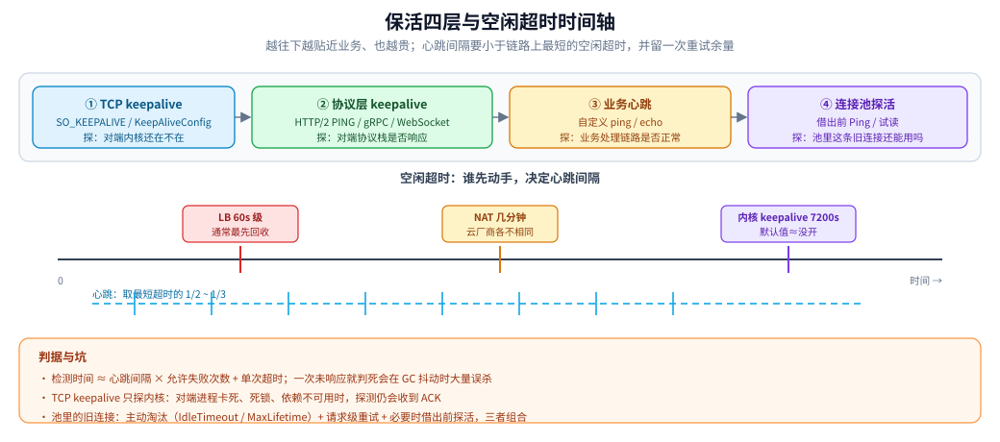
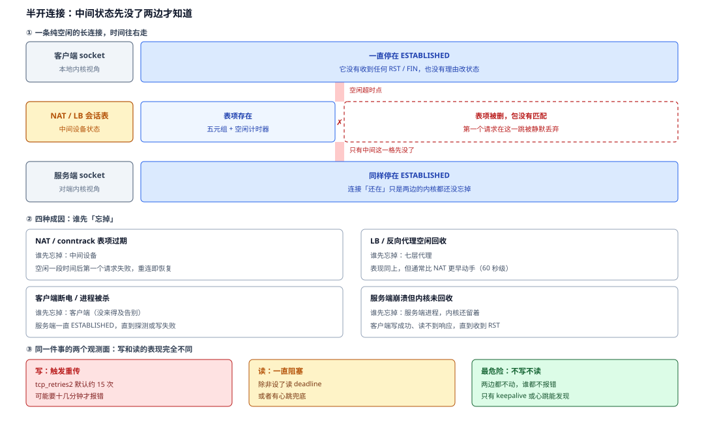
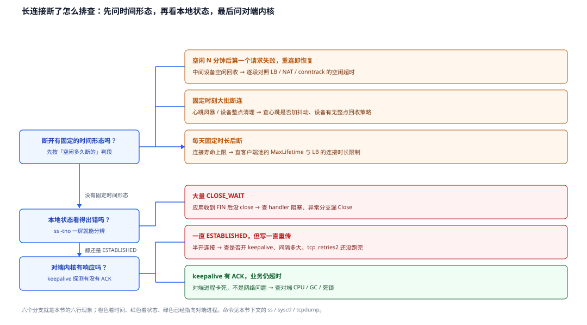

# TCP 保活与连接存活

> 覆盖：TCP keepalive 探得到什么、探不到什么；TCP / 协议层 / 业务心跳 / 连接池探活这四层怎么分工；半开连接怎么形成；心跳间隔与超时怎么定；长连接断开后怎么排查。
>
> 不覆盖：链路上各段空闲超时的量级表与心跳周期的推导见 [NAT与连接跟踪.md](../网络层与寻址/NAT与连接跟踪.md) 第五节；`CLOSE_WAIT` 与四次挥手见 [TCP四次挥手.md](tcp/TCP四次挥手.md)；Nagle 与延迟确认见 [TCP的Nagle与延迟确认.md](tcp/TCP的Nagle与延迟确认.md)；WebSocket / SSE / gRPC 流各自的心跳写法见 [WebSocket.md](../应用层/WebSocket.md) 与 [SSE.md](../应用层/SSE.md)。
>
> 内容整理自个人学习笔记；Go 侧代码只用标准库，`go build` / `go vet` / `gofmt` 通过，**未做长连接断链的运行时实测**，相关机制说明以 RFC 1122、Linux 内核参数与 Go 标准库为准。

---

## 一、TCP keepalive 到底探什么、探不到什么？

**本节要点**：`SO_KEEPALIVE` 探测的是**对端 TCP 栈还在不在**，不是「进程还能不能干活」；而且默认参数下它慢到基本等于没开。

### 1.1 探测的形状

连接**空闲**超过 `tcp_keepalive_time` 后，内核开始发探测报文：一个**不带数据的 ACK**（序号为已经发过的最后一个字节）。

```text
连接空闲 7200s（Linux 默认）
  → 发第 1 个探测 → 对端内核回 ACK（说明 TCP 栈还在）
  → 再等 75s 没响应 → 发第 2 个
  → 连续 9 个都没响应 → 判定连接死亡，向上层返回 ETIMEDOUT
```

| 参数（Linux） | 默认值 | 含义 |
|---|---|---|
| `net.ipv4.tcp_keepalive_time` | **7200 秒** | 空闲多久开始探测 |
| `net.ipv4.tcp_keepalive_intvl` | **75 秒** | 两次探测的间隔 |
| `net.ipv4.tcp_keepalive_probes` | **9** | 连续失败多少次判定死亡 |

⭐ 按默认值算，一条断掉的连接要 **2 小时 11 分**才会被发现。这就是「NAT 5 分钟就把会话删了，而服务端两小时后还以为连接在」的来由。

### 1.2 三个探不到的场景

| 场景 | 探测结果 | 为什么 |
|---|---|---|
| 对端进程**卡死**（死循环、长时间 STW、`SIGSTOP`），但内核还在 | **存活** | 内核收到探测后直接回 ACK，不需要进程参与 |
| 对端机器**断电 / 断网** | 死亡（探测无响应） | 没有内核回 ACK |
| 对端**重启**后连接状态已丢 | 死亡（回 RST） | 新内核不认识这条连接 |
| 中间设备**静默丢弃**会话表项 | 通常死亡（探测被丢） | 但若设备只阻断业务端口、放行 ACK，则可能一直「存活」 |

⭐ 所以 **keepalive 只能当「死连接清理」的兜底，不能当业务健康检查**。进程卡死、死锁、依赖不可用，它一个都报不出来。

### 1.3 谁在开、默认值是谁的

| 运行时 | 默认行为 | 备注 |
|---|---|---|
| Linux 内核 | 全局**关闭** keepalive（应用需显式 `setsockopt`） | 内核参数只是「开了之后用多少」 |
| **Go `net.Dialer`** | **默认开启**，`KeepAlive = 15s` | Go 1.23+ 可用 `KeepAliveConfig` 精确控制 idle / interval / count |
| Java `Socket` | 默认关闭 | 需 `setKeepAlive(true)`；间隔仍受内核参数控制 |
| Nginx | `keepalive_timeout` 是 **HTTP 空闲连接**超时，不是 TCP keepalive | 两者常被混为一谈 |

⚠️ 最容易误读的一条：**Go 的 15s 覆盖的是内核 7200s 的「空闲起点」，但探测间隔与次数仍取内核值**（除非用 `KeepAliveConfig` 一并设置）。所以只看到「Go 默认开了 keepalive」就以为探测很快，是不成立的。

## 二、保活有哪四层？各自能解决什么？

**本节要点**：四层不是互斥选项，而是**从下往上逐层补能力**；越往上越懂业务，也越贵。

| 层 | 手段 | 探什么 | 探不到什么 | 典型间隔 |
|---|---|---|---|---|
| **TCP keepalive** | `SO_KEEPALIVE` | 对端内核是否还在 | 进程卡死、依赖故障 | 秒级～小时级（看配置） |
| **协议层 keepalive** | HTTP/2 `PING`、gRPC keepalive、WebSocket `ping/pong` | 对端协议栈是否响应 | 业务 handler 是否正常 | 30 秒～2 分钟 |
| **业务心跳** | 自定义 `ping` / `echo` 接口 | 业务处理链路是否正常 | 下游依赖是否健康（除非心跳覆盖） | 5 秒～60 秒 |
| **连接池探活** | 取连接前 `Ping` / 试读 | 池里这条旧连接还能不能用 | 服务是否即将过载 | 每次借出时 |

⭐ 各层的判据：

- **只想清理死连接** → TCP keepalive 够用，但要把间隔压到小于链路上最短的空闲超时；
- **要发现「连接在、服务挂」** → 必须协议层或业务心跳；
- **要避免「池里拿出旧连接，第一个请求失败」** → 连接池探活或请求级重试；
- **要判断业务整体健康** → 业务心跳 + 健康检查，而不是任何一层 TCP 机制。



图注：保活四层与超时时间轴：TCP keepalive 探内核、协议层 PING 探协议栈、业务心跳探处理链路、连接池探活探旧连接，越往上越贴近业务也越贵。

## 三、半开连接是怎么形成的？

**本节要点**：半开连接 = **一端认为连接还在，另一端已经没了**；它几乎总由「中间状态被单方面删除」造成。

```text
客户端 ── 连接 ──  NAT / LB  ── 连接 ──  服务端
                      │
                      └─ 空闲超时，会话表项被删
                         两侧的 socket 仍停在 ESTABLISHED
```

四种典型成因：

| 成因 | 谁先「忘掉」 | 表现 |
|---|---|---|
| **NAT / conntrack 表项过期** | 中间设备 | 空闲一段时间后，第一个请求失败；重连即恢复 |
| **LB / 反向代理空闲回收** | 七层代理 | 同上，但通常比 NAT 更早（60 秒级） |
| **客户端断电 / 进程被杀** | 客户端 | 服务端连接一直 `ESTABLISHED`，直到探测或写失败 |
| **服务端进程崩溃但内核未回收** | 服务端 | 客户端写成功、读不到响应，直到 RST |

⭐ 半开连接的两个观测面：

- **写**会触发重传，按 `tcp_retries2`（默认约 15 次）算，可能要 **十几分钟**才报错；
- **读**会一直阻塞，除非设了读 deadline 或有心跳。

**不写不读的纯空闲连接**是最危险的：两边都不动，只有 keepalive 或心跳能发现。



图注：半开连接的形成与两个观测面：三条泳道画出「只有中间那一格先没了」，四格列出四种成因，底部三格对照写、读、不写不读的表现。

**图怎么读**：上面一组泳道的关键是**三条线只有一条会自己变**——中间设备的表项到了空闲超时就被删，两侧 socket 却没收到任何 FIN / RST，所以状态仍停在 `ESTABLISHED`；这正好解释了「重连即恢复、老连接一直卡着」这对表现。中间四格就是上面那张成因表，重点看**「谁先忘掉」这一列**：中间设备先忘，两端都还以为在；客户端先忘（断电、进程被杀），服务端要等探测或写失败；服务端进程先忘（崩溃但内核未回收），客户端写成功却读不到响应。底部三格是**同一件事的两个观测面**：写会触发重传，按 `tcp_retries2` 默认约 15 次算要十几分钟才报错；读会一直阻塞，除非设了读 deadline 或有心跳；而「不写不读」那一格最危险，因为两边都没有动作去碰它。

> 📎 `CLOSE_WAIT` 堆积是另一类问题（对端已 FIN、本地没 close），成因与排查见 [TCP四次挥手.md](tcp/TCP四次挥手.md) 第三节。

## 四、心跳间隔与超时该怎么定？

**本节要点**：先找到链路上**最短的空闲超时**，再取它的 **1/2～1/3** 作为心跳间隔；超时阈值要覆盖「连续丢几次」而不是一次未响应就判死。

### 4.1 间隔：跟着最短超时走

```text
链路上最短空闲超时 = min(LB 60s, NAT 300s, conntrack 5d, 服务端 IdleTimeout)
心跳间隔 ≤ 最短超时 / 2
```

为什么是 1/2 而不是「略小于」：心跳本身可能丢一次、也可能被延迟，留一次重试余量才不会刚好卡在边界上。

> 📎 各段的典型量级与「谁通常最先动手」见 [NAT与连接跟踪.md](../网络层与寻址/NAT与连接跟踪.md) 第五节。

### 4.2 超时：检测时间 = 间隔 × 允许失败次数 + 单次超时

```text
检测时间 ≈ heartbeat_interval × failure_threshold + request_timeout
```

| 目标 | 参数取向 |
|---|---|
| 快速发现断链（交易、协同） | 间隔 5s × 失败 2 次 + 超时 2s ≈ 12s |
| 兼顾误判（服务端有 GC 抖动） | 间隔 15s × 失败 3 次 + 超时 5s ≈ 50s |
| 移动端省电 | 间隔 60s 级，靠系统推送兜底 |

⚠️ **一次未响应就判死**在 GC / 网络抖动下会大量误杀；**失败次数太多**又会让检测时间远超预期。两个参数必须一起定。

### 4.3 心跳本身的三条工程约束

| 约束 | 原因 |
|---|---|
| **间隔加抖动**（如 ±20%） | 大量客户端同时心跳会在整点形成脉冲，打爆服务端 |
| **心跳要便宜且幂等** | 它按固定频率执行，成本会被连接数放大 |
| **心跳要和业务流量分开观测** | 否则健康检查的成功率会掩盖真实业务错误率 |

⭐ 心跳的目的有两个，别混：**保持中间设备会话表项新鲜**（防半开），以及**发现对端处理链路故障**（防假活）。前者只要间隔够小，后者要求心跳真的走业务处理路径。

## 五、连接池里的旧连接为什么要先探活？

**本节要点**：池子会把「对端已经关掉、本地还没发现」的连接继续借出去；第一个使用者必然失败。

### 5.1 三种处理策略

| 策略 | 做法 | 适用 | 代价 |
|---|---|---|---|
| **借出前探活** | `Ping` / 试读一次 | 数据库、Redis 等长连接池 | 每次借出多一个 RTT |
| **请求级重试** | 失败且判定为「连接已失效」时换一条重试一次 | HTTP 幂等请求 | 只对幂等操作安全 |
| **主动淘汰** | `IdleTimeout` / `MaxLifetime` 小于中间设备超时 | 通用兜底 | 连接复用率下降 |

⭐ 三种策略通常**组合使用**：主动淘汰把大部分旧连接清掉，请求级重试兜住漏网之鱼，探活只用在不能重试的协议上。

### 5.2 Go 的两种默认行为

| 组件 | 行为 |
|---|---|
| `http.Transport` | 复用的连接在写入时失败，且请求**可重试**（幂等、未写完）时，会换一条新连接重试 |
| `database/sql` | 不自动探活；需配 `SetConnMaxIdleTime` / `SetConnMaxLifetime`，必要时 `PingContext` |

⚠️ **不要把「重试」当成万能的**：非幂等请求（下单、支付）在连接写入一半时失败，重试可能造成重复副作用。这类请求只能靠**更短的 idle 淘汰 + 业务幂等键**。

## 六、长连接断了怎么排查？

**本节要点**：先按「空闲多久断的」判断是哪一段，再决定抓什么；不要一上来就怀疑服务端。

| 现象 | 高概率原因 | 先查什么 |
|---|---|---|
| **空闲 N 分钟后第一个请求失败，重连正常** | 中间设备空闲回收 | 逐段对照空闲超时（[NAT与连接跟踪.md](../网络层与寻址/NAT与连接跟踪.md) 第五节） |
| 大量 `CLOSE_WAIT` | 应用收到 FIN 后没 close | handler 阻塞、异常分支漏 `Close`（[TCP四次挥手.md](tcp/TCP四次挥手.md)） |
| 连接一直 `ESTABLISHED` 但对端无响应 | 半开连接 | 是否开了 keepalive、间隔多大；写是否一直重传 |
| keepalive 探测有 ACK，业务仍超时 | 对端进程卡死 | 看对端 CPU / GC / 死锁，不是网络问题 |
| 固定时刻大批断连 | 心跳风暴 / 中间设备定时清理 | 心跳是否加抖动；设备是否有整点回收策略 |
| 每天固定时长后断 | 连接寿命上限（`MaxLifetime`） | 客户端池配置与 LB 的连接时长限制 |



图注：长连接断开排障决策树：先问时间形态，再问本地状态，最后问对端内核有没有响应；六张分支卡一一对应上表六行现象。

**图怎么读**：三个问题框就是**三次分流**，顺序不能倒——先看时间形态（有没有「空闲多久」「固定时刻」「固定时长」这类规律），因为这三类一眼就能定位到中间设备或池配置；没有规律才看本地状态，`ss -tno` 一屏就能把「大量 `CLOSE_WAIT`」和「全是 `ESTABLISHED`」分开；最后才问对端内核有没有响应，因为 keepalive 探测**有 ACK 但业务仍超时**说明问题已经不在网络上了。卡片颜色标出**责任段**：橙＝中间设备与连接池、红＝本地应用、绿＝对端进程。

常用命令：

```bash
# Linux：连接状态、keepalive 计时器、重传与 RTT
ss -tno state established
ss -ti dst 10.0.0.5

# 内核 keepalive 参数
sysctl net.ipv4.tcp_keepalive_time net.ipv4.tcp_keepalive_intvl net.ipv4.tcp_keepalive_probes

# 只看 keepalive 探测（无载荷的 ACK）
tcpdump -ni any 'tcp and tcp[tcpflags] & tcp-ack != 0 and tcp[12:1] & 0xf0 = 0x50'
```

Windows 侧用 `netstat -ano` 看状态、`pktmon` 抓包；容器内注意在**正确的网络命名空间**里执行。

## 七、应用场景

**本节要点**：所有「长连接 + 中间设备」的组合，都要在保活上做选择。

| 场景 | 涉及哪一层 | 为什么值得注意 |
|---|---|---|
| WebSocket / SSE / gRPC 流 | 协议层 + 业务心跳 | 代理空闲超时会掐断长流，详见 [WebSocket.md](../应用层/WebSocket.md) 与 [SSE.md](../应用层/SSE.md) |
| HTTP 连接池 | 池探活 + 主动淘汰 | 旧连接会让第一个请求失败，详见 [HTTP客户端与连接池.md](../../../01-编程语言/go/网络编程/HTTP客户端与连接池.md) |
| 数据库 / Redis 连接池 | `MaxLifetime` + `Ping` | 中间设备与云厂商都有连接寿命限制 |
| 移动端推送长连接 | 业务心跳 + 系统推送 | 省电与实时性要折中 |
| 跨地域专线 | TCP keepalive | 链路中断后要尽快清理死连接 |

## 八、具体使用

**本节要点**：把「空闲起点、探测间隔、失败次数」三个参数一次配全，并让服务端与客户端的空闲超时相互兼容。

### 8.1 Go：精确控制 TCP keepalive

```go
d := net.Dialer{
    Timeout: 3 * time.Second,
    KeepAliveConfig: net.KeepAliveConfig{
        Enable:   true,
        Idle:     15 * time.Second,
        Interval: 5 * time.Second,
        Count:    3,
    },
}
conn, err := d.DialContext(ctx, "tcp", addr)
if err != nil {
    return err
}
// 15s 空闲后开始探测，5s 一次、连续 3 次失败判死 → 最迟约 30s 发现
```

⚠️ 自定义 `DialContext` 时，`net.Dialer` 的默认值不再自动生效，三个参数都要写全。

### 8.2 Go：服务端空闲超时要与客户端兼容

```go
srv := &http.Server{
    Addr:              ":8080",
    IdleTimeout:       120 * time.Second, // 空闲 keep-alive 连接的上限
    ReadHeaderTimeout: 5 * time.Second,
}
```

⭐ 服务端 `IdleTimeout` **小于**客户端的复用间隔时，客户端会把「服务端正常关闭」误判成故障。两侧要一起看：客户端心跳 / 复用间隔 < 服务端空闲超时 < 中间设备空闲超时（或反过来用心跳保活）。

### 8.3 gRPC：协议层 keepalive

```go
import "google.golang.org/grpc/keepalive"

// 服务端
grpc.NewServer(
    grpc.KeepaliveParams(keepalive.ServerParameters{
        MaxConnectionIdle: 5 * time.Minute,
        Time:              2 * time.Minute, // 空闲多久发 PING
        Timeout:           20 * time.Second,
    }),
    grpc.KeepaliveEnforcementPolicy(keepalive.EnforcementPolicy{
        MinTime:             30 * time.Second, // 允许客户端最密的心跳
        PermitWithoutStream: true,
    }),
)
```

⚠️ 客户端心跳比服务端 `MinTime` 更密时，服务端会以 `GOAWAY` 断开；两侧参数必须对齐。

## 延伸追问

- **TCP keepalive 能替代业务心跳吗？** → 不能。它只探对端内核，进程卡死、死锁、依赖故障都探不到。
- **为什么 Linux 默认 7200 秒？** → 它是「清理死连接」的兜底，不是健康检查；按默认值两小时才发现死连接，对长连接业务太慢。
- **Go 默认 15s 就够了吗？** → 那只改空闲起点；探测间隔与次数仍取内核值，要精确控制得用 `KeepAliveConfig`。
- **心跳间隔越短越好吗？** → 不是。成本随连接数线性放大，还会形成整点脉冲；按最短空闲超时的 1/2～1/3 取即可。
- **为什么连接池里的连接会「先坏一条」？** → 对端或中间设备已经关掉，本地还没收到 FIN；借出前探活或请求级重试可兜住。
- **半开连接和 `CLOSE_WAIT` 是一回事吗？** → 不是。半开是**双方状态不一致**；`CLOSE_WAIT` 是对端已 FIN、本地应用没 close。

## 关联

- **上游/总纲**：[网络通信链路详解.md](../网络通信链路详解.md) — 长连接在链路上会经过哪些设备
- **对照/互补**：[NAT与连接跟踪.md](../网络层与寻址/NAT与连接跟踪.md) — 各段空闲超时的量级与心跳周期判据
- **对照/互补**：[TCP四次挥手.md](tcp/TCP四次挥手.md) — `CLOSE_WAIT`、`TIME_WAIT` 与半关闭
- **对照/互补**：[TCP的Nagle与延迟确认.md](tcp/TCP的Nagle与延迟确认.md) — `SO_KEEPALIVE` 与 Nagle 在同一个 socket 上的取舍
- **下游机制**：[WebSocket.md](../应用层/WebSocket.md)、[SSE.md](../应用层/SSE.md) — 长连接协议各自的心跳与重连
- **下游机制**：[HTTP客户端与连接池.md](../../../01-编程语言/go/网络编程/HTTP客户端与连接池.md) — 池化连接的探活与淘汰
