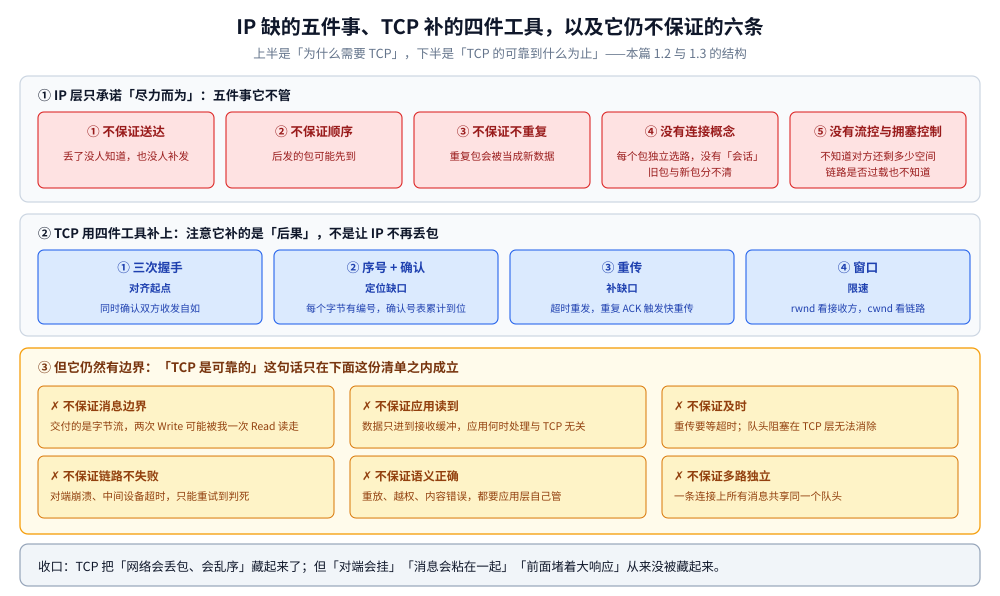
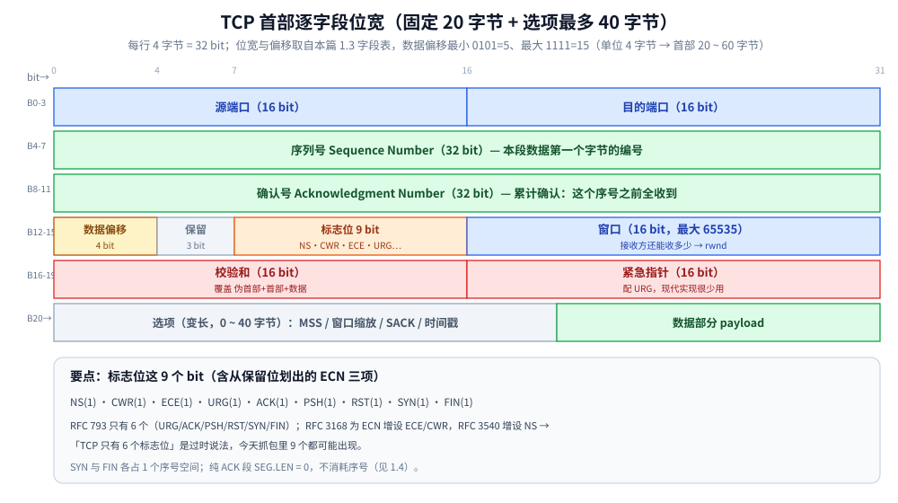
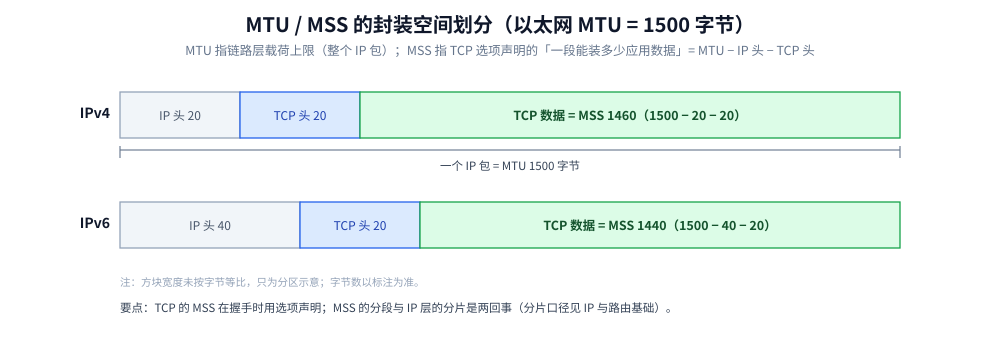
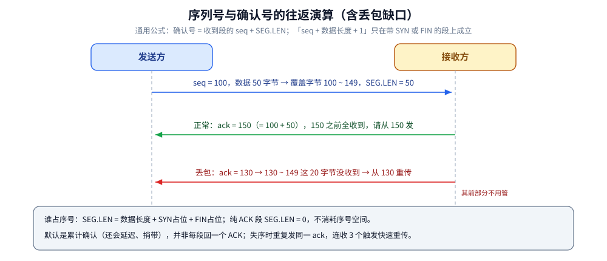
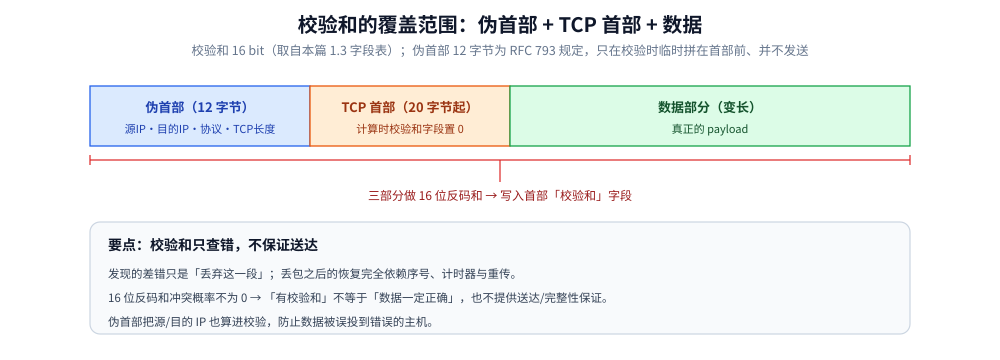

# TCP 协议基础与报文结构

> 覆盖：TCP 是什么（四个定语与各自的判据）、为什么需要它（IP 之上缺的五件事）、它保证什么又不保证什么、连接的本质、首部各字段的含义、序列号与确认号的演算，以及「字节流没有边界」在应用层的两种解法。
>
> 不覆盖：三次握手与四次挥手见 [TCP三次握手.md](TCP三次握手.md) 与 [TCP四次挥手.md](TCP四次挥手.md)；滑动窗口与 `rwnd` / `cwnd` 见 [TCP滑动窗口.md](TCP滑动窗口.md)；拥塞控制的四条机制见 [TCP拥塞控制算法.md](TCP拥塞控制算法.md)；UDP 首部对照见 [UDP与数据报传输.md](../udp/UDP与数据报传输.md)。
>
> 内容整理自个人学习笔记，素材见 [素材清单](../../../../素材清单.md)。
>
> ⚠️ 实测口径：本篇以协议机制与代码口径为主；两节 Go / Java 代码可编译（本机 `gofmt` / `go vet` 通过），**未做运行时验证**。

---

## 一、TCP 是什么，为什么需要它，报文又长什么样？

**本节要点**：四个定语——**面向连接、可靠、全双工、字节流**——各管一件事，缺一个就会误判。而「可靠」是有严格边界的：它保证字节按序送达，**不保证消息边界、不保证应用读到、不保证及时**。先把这条边界立住，后面所有机制才有分寸。

### 1.1 TCP 是什么

一句话：**TCP 是一个面向连接的、可靠的、全双工的字节流协议**，位于 OSI 第四层（传输层），管的是「端口到端口」这一段。

四个定语不是同义反复，每个都对应一条可以验证的判据：

| 定语 | 准确含义 | 怎么验证它 |
|---|---|---|
| **面向连接** | 通信前先握手建立状态，两端各自维护一本账；之后的数据段只带序号，不再重复携带「我是谁」 | 连接期间网线断了，两端**不会立刻知道**——账还记着，只是对不上 |
| **可靠** | 不是「不丢包」，而是「丢了能补」：按序、不重、不丢，连接存活期间最终交付的字节序列与写入的一致 | 中途丢几个包，应用读到的仍是完整有序的字节流——重传补上了，代价是延迟（1.3 那张表的右列） |
| **全双工** | 两个方向**独立**：各有自己的序号空间与窗口，一个方向关了另一个还能用（半关闭） | `shutdown(WR)` 之后仍能收数据，见 [TCP四次挥手.md](TCP四次挥手.md) 1.3 |
| **字节流** | 交付单位是**字节**，不是消息。协议层不认识「第几条消息」 | `Write` 两次，对端可能一次 `Read` 拿到全部，也可能分十次——本篇 3.1 |

⭐ 最容易误读的是第一条。「面向连接」里的**连接不是一条通道**，而是两端各自记的一本账——网络里没有「连接」这个实体，只有两台主机上的两份状态。这本账叫什么、记了什么，是 1.4 的主题。

⚠️ 后三个定语之间有依赖：**因为交付的是字节流，才需要序号按字节编号**；**因为要按序补缺，才需要连接存活期间的状态**。所以四个词顺序读下来是一条链，不是四个并列标签。

### 1.2 为什么需要 TCP：IP 之上缺了哪五件事

IP 只承诺「尽力而为」——它把包送到「尽力」为止，剩下的不管（`无连接、不保证送达、不保证顺序` 的完整口径见 [IP与路由基础.md](../../网络层与寻址/IP与路由基础.md) 1.4）。把它做不到的事列清楚，TCP 存在的理由就自动出来了：

| # | IP 不提供 | 应用直接跑在 IP 上会看到什么 |
|---|---|---|
| ① | **不保证送达** | 包丢了没人告诉发送方，也没人补发，数据**静默缺失** |
| ② | **不保证顺序** | 后发的包先到，应用读到的字节顺序与写入的不一致 |
| ③ | **不保证不重复** | 中间设备或上游重传可能造成重复包，应用多收一遍 |
| ④ | **没有「连接」这个概念** | 每个包独立选路，网络里不存在「会话」。谁都可以往这个地址发包，分不清新旧 |
| ⑤ | **没有流控与拥塞控制** | 发送方不知道接收方缓冲还剩多少，也不知道链路是否已经过载 |

前三件是「数据对不对」，第五件是「发多快」，第四件是「什么算一次通信」。

⭐ 五件里最难的是 ④：前三件都能用「加序号 + 加确认」局部修补，但「什么算一次通信、旧包怎么识别」必须由两端**共同约定**——这正是握手要解决的事，也是为什么「连接」只能是一个约定（1.4 展开）。

**如果应用层自己补这五件事，要写什么？** 一份最小清单：

| 要补的能力 | 自己实现要写的东西 |
|---|---|
| 按序 + 去重 | 每个字节编号、维护接收窗口、重排缓冲、丢弃重复区间 |
| 补丢包 | 确认机制、超时计时器（还要估算 RTT）、重传队列 |
| 流量控制 | 通告「我还能收多少」、发送方按它限速 |
| 拥塞控制 | 探测链路容量、丢包后降速、慢慢试探再涨 |
| 连接生命周期 | 建立、同步起点、拆除、处理半开与超时 |

⭐ 所以 TCP 的实质价值不是「让网络变可靠」（IP 层照样丢包），而是**把「在不可靠网络上做可靠传输」这套复杂度封成了一个可复用的协议件**：应用只管 `read` / `write`，剩下的交给内核。

反过来也成立——**不是所有应用都需要这五件事**。DNS 一问一答，丢了重问一次就行；直播丢一两帧用户看不出来。这些场景用 TCP 反而要付「握手 + 等重传超时 + 队头阻塞」的代价。UDP 的价值不是「更快」，而是**把要不要可靠这个决定交回应用**，见 [UDP与数据报传输.md](../udp/UDP与数据报传输.md) 第三节。

### 1.3 用什么补、补到什么程度：三大机制与可靠性边界

1.2 那张清单落到协议里，是四件工具：

| 机制 | 补的是哪一件 | 一句话原理 |
|---|---|---|
| **① 三次握手** | ④ 连接概念 | 交换初始序号、对齐起点，同时确认双方收发自如 |
| **② 序号 + 确认** | ①②③ 乱序 / 重复 / 缺失 | 每个字节有编号；确认号表示「这之前全部收到」 |
| **③ 重传** | ① 丢包 | 超时未确认就重发；收到重复 ACK 触发快速重传 |
| **④ 窗口** | ⑤ 发多快 | `rwnd` 看接收方容量，`cwnd` 看链路容量，实际发送量取 `min` |

⚠️ 别把**流量控制**与**拥塞控制**混成一张表：前者看**接收方**还能收多少（`rwnd`），后者看**中间链路**还扛不扛得住（`cwnd`）。四条机制与 CUBIC / BBR 见 [TCP拥塞控制算法.md](TCP拥塞控制算法.md)。

**补到什么程度？** 这是最容易被高估的地方。「TCP 是可靠的」有严格边界，右列每一条都是真实故障的来源：

| TCP 保证 | TCP 不保证 |
|---|---|
| **按序交付**：不重、不乱（连接存活期间） | **不保证消息边界**：两次 `Write` 可能被一次 `Read` 取走，应用必须自己划界（本篇 3.1） |
| **送达**：丢了会重传，直到确认或判定连接已死 | **不保证应用读到**：数据进的是接收缓冲，应用何时处理、是否处理与 TCP 无关 |
| **流量控制**：不淹接收方缓冲区 | **不保证及时**：重传可能等数百毫秒，队头阻塞无法在 TCP 层消除 |
| **拥塞控制**：不压垮中间链路 | **不保证链路不失败**：对端崩溃、中间设备超时、网线断开，TCP 只能重试到判死 |
| **比特差错检测**：校验和查出传输错误 | **不保证语义正确**：重放、越权、内容错误都要应用层自己管（见 1.7） |
| **双向独立**：全双工，一个方向可半关闭 | **不保证多路独立**：一条连接上的所有消息共享同一个队头 |

⭐ 一句话收口：TCP 把「网络会丢包、会乱序」对应用**隐藏**了，但没有隐藏「对端会挂」「消息会粘在一起」「这条连接前面正堵着一个大响应」。前者是协议承诺，后者是应用必须接手的部分——所有「用了 TCP 怎么还出问题」的困惑，基本都能落回这张表的右列。



图注：三段对照着读——上段是「为什么需要 TCP」（1.2 那五件事），中段是「用什么补」（1.3 的四件工具），下段是**补到什么程度**（上面那张表的图形版）。下段每一条都能对应到一类真实故障，读的时候可以拿自己遇到过的问题去对号。

### 1.4 先搞清「TCP 连接」的本质

1.1 说「连接是两端各自记的一本账」。这本账具体记什么？——TCB（传输控制块）。

**常见误解**：认为客户端和服务端之间有一条 **"虚拟通道"**。

**实际情况**：

> **虚拟通道并不存在**。真实存在的只有**物理层面的通道**——
> 客户端和服务端相互可达（能互相找到对方）。
>
> 客户端和服务端实际做的事情是：
> **各自创建一个"传输控制模块"（TCB）**，在里面**记录状态信息**，
> 并通过彼此通信来**了解对方的状态、维护这些信息**，
> 用这些信息去控制数据的**可靠传输和流量控制**。

**为什么需要记录状态？**

```text
客户端发出数据 → 没有收到服务端的确认 → 两种情况：
  ① 数据根本没发出去
  ② 数据发出去了，服务端也收到了，但确认没能回来
```

两种情况都导致客户端**无法知道数据是否送达**。
所以规则是：**只要收不到确认，就认为没发送成功 → 触发重传**。

> **结论**：**我们常说的 TCP 连接，本质就是这些为了可靠传输而维护的状态信息/数据信息的集合。**
> 它是个**虚拟概念**，不是一条真实的软件通道。

### 1.5 报文结构：头部 + 数据部分

结构上**每行 4 字节**，前 5 个部分固定（20 字节），之后是**可选项**。

| # | 字段 | 长度 | 说明 |
|---|---|---|---|
| **1** | **源端口 + 目标端口** | 各 2 字节 | 源端口 = 发送方数据出来的端口；目标端口 = 被请求方（接收方）的端口。<br>2 字节 → **端口范围 0 ~ 65535** |
| **2** | **序列号（Sequence Number）** | 4 字节 | **本段数据第一个字节的编号**（关键定义，见下） |
| **3** | **确认号（Acknowledgment Number）** | 4 字节 | ⭐ **累计确认**：表示「这个序号之前的字节我全收到了，请从这里开始发下一个」。**不等于「序号 + 数据长度 + 1」**，见 1.6 |
| **4** | **数据偏移** | **4 bit** | 数据部分从哪个位置开始（即首部有多长）。**单位是 4 字节**<br>最小 `0101`=5 → 5×4 = **20 字节**（最小 TCP 首部）<br>最大 `1111`=15 → 15×4 = **60 字节**（含最多 40 字节选项） |
| **5** | **保留位** | 3 bit | 保留未用，必须置 0 |
| **6** | **标志位** | **9 bit** | 见下方标志位表 |
| **7** | **窗口** | 2 字节 | 最大 65535（约 64KB）。**并非固定**——可通过 Options 中的**窗口缩放因子**放大，带宽时延积大时要用 |
| **8** | **校验和** | 2 字节 | 覆盖「伪首部 + TCP 首部 + 数据」，用于**检测传输中的差错**（⚠️ 不等于可靠传输，见 1.7） |
| **9** | **紧急指针** | 2 字节 | 配合 `URG` 使用，指出紧急数据的位置（现代实现很少用） |
| **10** | **选项 + 数据部分** | 变长 | 选项（MSS / 窗口缩放 / SACK / 时间戳）与真正的 payload |

**标志位**（原 RFC 793 定义 6 个，后又从保留位里划出 3 个）：

| flag | 含义 | 备注 |
|---|---|---|
| **URG** | 紧急指针有效 | 历史遗留，现代实现基本忽略 |
| **ACK** | 确认号字段有效 | 建连后几乎所有报文都置位 |
| **PSH** | 提示接收方尽快把数据交给应用 | ⚠️ **只是提示**：能否立即交付取决于接收方实现与缓冲区状态，**不保证应用马上读到** |
| **RST** | 重置连接 | 用于异常关闭与拒绝连接 |
| **SYN** | 同步序号 | 握手用，**占 1 个序号空间** |
| **FIN** | 发送方没有更多数据 | 关闭用，**占 1 个序号空间** |
| **ECE** | ECN-Echo | 用于 ECN 协商与回显拥塞经历，见 [TCP拥塞控制算法.md](TCP拥塞控制算法.md) |
| **CWR** | Congestion Window Reduced | 收到 ECE 并已减小拥塞窗口时的确认 |
| **NS** | ECN-nonce（实验性，RFC 3540） | 基本未部署 |

> ⚠️ 所以「TCP 只有 6 个标志位」是**过时的说法**：`ECE` 与 `CWR` 是 RFC 3168 为 ECN 增设的，今天在抓包里已经能看到。





图注：MTU 与 MSS 的封装空间划分：以太网 MTU 1500 字节里，IPv4 为 IP 头 20 加 TCP 头 20 加 MSS 1460，IPv6 为 IP 头 40 加 TCP 头 20 加 MSS 1440。

### 1.6 序列号与确认号的取值演算（这里最容易讲不清）

**场景**：三次握手时，客户端随机初始序列号 `x = 100`，服务端随机初始序列号 `y = 1000`（都是随机的，只是举例）。

#### ① 规则：谁占序号，谁不占

```text
SEG.LEN（这一段消耗的序号空间） = 数据长度 + SYN占位 + FIN占位
     · 有数据的普通段：SEG.LEN = 数据长度
     · 带 SYN 的段：   SEG.LEN = 数据长度 + 1
     · 带 FIN 的段：   SEG.LEN = 数据长度 + 1
     · 纯 ACK 段：     SEG.LEN = 0        ← 不消耗序号空间
```

**发送方本段的序号** = 上一个已发送字节 + 1（**数据侧**）；**接收方回的确认号** = 收到段的 `seq + SEG.LEN`（**确认侧**）。

#### ② 带数据的一次往返

```text
客户端 → 服务端：seq = 100，数据长度 50，不带 SYN/FIN
                 SEG.LEN = 50
                 这段覆盖字节 100 ~ 149

服务端 → 客户端：ack = 100 + 50 = 150
                 含义：「150 之前的全部字节我都收到了，请从 150 开始发下一个」
```

⭐⭐ **这才是通用公式：`确认号 = 收到段的 seq + SEG.LEN`。** 常见写法「序列号 + 数据长度 + 1」只在**带 SYN 或 FIN 的那一段**上成立（因为那时 `SEG.LEN = 数据长度 + 1`），把它当通用公式会算错普通数据段。

**丢包场景**：如果接收方回的是 `ack = 130` 而不是 150：

```text
发送方：已发到 149
接收方：确认号 130  →  意味着 130 ~ 149 之间的 20 个字节没收到
→ 发送方从 130 开始重传（其前的部分不用管）
```

**这就是重传机制的工作方式——靠确认号判断缺口位置。**



图注：序列号与确认号的往返演算：发送方发 seq=100 数据 50 字节覆盖 100 到 149，接收方正常回 ack=150，丢包时回 ack=130 表示 130 到 149 没收到需从 130 重传。

#### ③ 累计确认、重复 ACK 与 SACK

| 机制 | 行为 | 用途 |
|---|---|---|
| **累计确认** | 一个确认号可以代表「这之前全部收到」，**不需要每段一对一回 ACK** | 减少确认开销 |
| **重复 ACK** | 收到失序段时，重复发同一个 `ack` | 发送方收到 **3 个重复 ACK** 即触发**快速重传** |
| **SACK**（选项） | 在选项里带上「我还额外收到了哪些区间」 | 一次丢包时可只重传缺失区间，不必重传其后全部 |

> ⚠️ 「接收方对每个数据包都回一个确认」是常见误解：TCP 默认是**累计确认**（还可能延迟、捎带），一次 ACK 覆盖多段是常态。SACK 与窗口缩放、时间戳几个选项的细节见 [TCP滑动窗口.md](TCP滑动窗口.md)。

### 1.7 校验和：只查错，不保证送达

`校验和`覆盖「伪首部（源/目的 IP、协议号、TCP 长度）+ TCP 首部 + 数据」，用于**检测传输中的比特差错**。

⚠️ **它不是可靠性机制**：校验和发现的错误只是「丢弃这一段」，**丢包之后的恢复完全依赖序号、计时器与重传**。而且校验和是 16 位反码和，冲突概率不为 0——所以「有校验和」不等于「数据一定正确」。



图注：校验和的覆盖范围：伪首部（源 IP、目的 IP、协议号、TCP 长度）加 TCP 首部加数据三部分做 16 位反码和写入校验和字段，只查错不保证送达。

## 二、应用场景

**本节要点**：首部字段不是背诵项 —— 它们的取值共同决定「连接能不能复用、消息到哪儿结束、丢包怎么补」。

| 场景 | 用到首部的哪一块 | 为什么值得注意 |
|---|---|---|
| 自定义二进制协议 / RPC | 序列号 + 长度前缀 | 「字节流没有边界」要靠长度前缀或定界符解决，详见 本篇 3.1 |
| 框架的拆包粘包 | 长度字段 + `SYN` / `FIN` | `LengthFieldBasedFrameDecoder` 就是长度前缀的工业版，详见 本篇 3.2 |
| 半关闭（`shutdown(WR)`） | `FIN` 只关一个方向 | HTTP/1.0 的 `Connection: close` 就依赖它，详见 本篇 3.1 |
| 抓包判读 | 首部各字段 | 序号、确认号、窗口与标志位是分析的基本盘，详见 [抓包实战.md](../../观测与排障/抓包实战.md) 第三节 |
| 连接池复用 | `SYN` / `FIN` / 保活 | 复用的前提是连接还活着，详见 [HTTP与gRPC.md](../../应用层/HTTP与gRPC.md) |

## 三、具体使用

**本节要点**：两节代码解决同一件事 ——「字节流没有边界」，Go 侧手写长度前缀，Java 侧交给 Netty 的帧解码器。

### 3.1 Go（字节流边界与半关闭）

#### 字节流没有边界：长度前缀编解码

1.6 讲的「序列号按**字节**编号」就是这句话的来源：**TCP 交付的是流，不是消息**。
`Write` 返回 `nil` 只表示进了发送缓冲，**不表示对方收到**；一次 `Read` 也可能只拿到半个包。
所以任何自定义协议都必须自己划界——**生产上最常用的就是 4 字节长度前缀**。

```go
package tcpdemo

import (
	"bufio"
	"encoding/binary"
	"errors"
	"fmt"
	"io"
	"net"
	"time"
)

// MaxFrame 是硬性上限：**长度字段来自网络，属于不可信输入**。
// 不设上限时，一个恶意/损坏的 "长度=4G" 会让服务端立刻分配 4GB 内存。
const MaxFrame = 4 << 20

// WriteFrame 头和体**合成一个 buffer 一次写出**。
// 分两次 Write 在语义上没错（TCP 会拼起来），但会多一次系统调用，
// 而且在关闭 Nagle 的连接上更容易被拆成两个段发出去。
func WriteFrame(w io.Writer, payload []byte) error {
	if len(payload) > MaxFrame {
		return fmt.Errorf("tcpdemo: payload %d bytes exceeds frame limit %d", len(payload), MaxFrame)
	}

	buf := make([]byte, 4+len(payload))
	binary.BigEndian.PutUint32(buf[:4], uint32(len(payload))) // 统一大端：网络字节序
	copy(buf[4:], payload)

	_, err := w.Write(buf)
	return err
}

// ReadFrame 必须配 *bufio.Reader："读满 N 字节"是它的基本职责。
// 直接对 conn 做 4 次 Read 看似等价，实际会在半包处把协议解析写成一堆分支。
func ReadFrame(r *bufio.Reader) ([]byte, error) {
	var hdr [4]byte
	if _, err := io.ReadFull(r, hdr[:]); err != nil {
		// io.ErrUnexpectedEOF：对端在"半个头"处关闭连接，属于协议级错误，不能当普通 EOF 忽略
		return nil, err
	}

	n := binary.BigEndian.Uint32(hdr[:])
	if n > MaxFrame {
		return nil, fmt.Errorf("tcpdemo: peer announced %d bytes, limit is %d", n, MaxFrame)
	}

	payload := make([]byte, n)
	if _, err := io.ReadFull(r, payload); err != nil {
		return nil, err
	}
	return payload, nil
}

// Serve 演示"每条连接一个 goroutine + 逐帧处理"，以及为什么读写都要单独设 deadline。
func Serve(ln net.Listener) error {
	for {
		c, err := ln.Accept()
		if err != nil {
			return err
		}
		go handle(c.(*net.TCPConn))
	}
}

func handle(c *net.TCPConn) {
	defer c.Close() // ⚠️ defer Close 的位置只能在函数入口：中途任何 return 都不能漏

	r := bufio.NewReader(c)
	for {
		// 每帧重设 deadline：一次性设 30s 只覆盖第一条请求，长连接会莫名超时
		if err := c.SetReadDeadline(time.Now().Add(30 * time.Second)); err != nil {
			return
		}
		frame, err := ReadFrame(r)
		if errors.Is(err, io.EOF) {
			return // 对端正常关闭
		}
		if err != nil {
			return // 含超时（net.Error.Timeout）与半包；生产上这里要分开打点
		}

		if err := c.SetWriteDeadline(time.Now().Add(5 * time.Second)); err != nil {
			return
		}
		// ⚠️ 对端不收 → 发送缓冲写满 → Write 阻塞。没有写 deadline 时，
		// 这个 goroutine 会永久挂着，连接与内存一起泄漏（这就是协程泄漏最常见的形态之一）。
		if err := WriteFrame(c, append([]byte("echo:"), frame...)); err != nil {
			return
		}
	}
}
```

> 三种划界方式的选择：

| 方式 | 适用 | 缺点 |
|---|---|---|
| **长度前缀** | 通用，HTTP/2、gRPC、绝大多数私有协议 | 需要双方约定宽度与字节序 |
| **分隔符**（如 `\r\n`） | 文本协议（Redis RESP、HTTP 头） | 值里出现分隔符必须转义 |
| **定长** | 极简单的固定结构 | 浪费或需二次变长 |

#### 半关闭：`FIN` 只关一个方向

正文「四次挥手」的实现层对应物就是 `CloseWrite`——**这是"我发完了"而不是"连接结束了"**：

```go
package tcpdemo

import (
	"errors"
	"io"
	"net"
)

// RequestThenDrain 表达正确的请求/结束语义：
// 把 req 写进 socket，然后 CloseWrite 告知对端"我没有更多数据了"，但**仍然继续读完响应**，
// 最后才 Close 整条连接。反过来"写完直接 Close"会让对端的响应永远发不回来。
func RequestThenDrain(c *net.TCPConn, req io.Reader, resp io.Writer) error {
	if _, err := io.Copy(c, req); err != nil { // 这里是"写进 socket"，不是读
		return err
	}
	if err := c.CloseWrite(); err != nil {
		return err
	}

	if _, err := io.Copy(resp, c); err != nil && !errors.Is(err, io.ErrUnexpectedEOF) {
		return err
	}
	return c.Close()
}
```

> `UDPConn` 也有 `SetWriteBuffer` 之类选项，但 UDP 没有连接概念，
> 上面的划界与半关闭对它完全不成立——这正是正文「连接是双方各自维护的状态集合」的直接推论。
### 3.2 Java（Netty 的 `LengthFieldBasedFrameDecoder`）

#### Netty：`LengthFieldBasedFrameDecoder` 就是 3.1 的工业版

```java
package notes.tcp;

import io.netty.channel.ChannelInitializer;
import io.netty.channel.socket.SocketChannel;
import io.netty.handler.codec.LengthFieldBasedFrameDecoder;
import io.netty.handler.codec.LengthFieldPrepender;
import io.netty.handler.timeout.IdleStateHandler;
import java.util.concurrent.TimeUnit;

public class FrameInitializer extends ChannelInitializer<SocketChannel> {

    private static final int MAX_FRAME = 4 << 20;

    @Override
    protected void initChannel(SocketChannel ch) {
        ch.config().setTcpNoDelay(true);          // 对应 Go 的 SetNoDelay
        ch.config().setSoKeepAlive(true);
        ch.config().setWriteBufferWaterMark(new io.netty.channel.WriteBufferWaterMark(32 << 10, 64 << 10));
        // ↑ 高水位 = 发送缓冲积压上限，触发后 isWritable() 变 false —— 这就是正文"窗口打满"在应用层的镜像

        // 4 字节大端长度前缀 + 不剥离（保留原始帧）
        ch.pipeline().addLast(new LengthFieldBasedFrameDecoder(MAX_FRAME, 0, 4, 0, 4));
        ch.pipeline().addLast(new LengthFieldPrepender(4, false));

        // 应用层心跳：SO_KEEPALIVE 探测不到"进程卡死"，必须靠它
        ch.pipeline().addLast(new IdleStateHandler(30, 0, 0, TimeUnit.SECONDS));
    }
}
```

> **Netty 与 Go 的一个方向性差异**：Netty 显式区分 EventLoop / 工作线程（见
> [IO多路复用.md](../IO多路复用.md) 的 Reactor 一节），**Handler 里绝对不能做阻塞调用**；
> Go 用「每连接一个 goroutine」把这件事交给了调度器，所以 Go 侧的坑是
> **忘记 `SetReadDeadline`**（ goroutine 挂死），Netty 侧的坑是 **EventLoop 被阻塞**（一批连接全部卡住）。

---

## 延伸追问

- **确认号的通用公式是什么？** → ⭐ **`确认号 = 收到段的 seq + SEG.LEN`**，其中 `SEG.LEN = 数据长度 + SYN占位 + FIN占位`。常见写法「序列号 + 数据长度 + 1」只在**带 SYN 或 FIN 的段**上成立（那时 `SEG.LEN = 数据长度 + 1`）；**纯 ACK 段 `SEG.LEN = 0`**，不消耗序号空间（RFC 9293 的说法是"否则我们就会 ACK 彼此的 ACK"）。把它当通用公式去算普通数据段的 ACK，会**多算 1**。
- **接收方是每个数据包都回一个 ACK 吗？** → 不是。TCP 默认**累计确认**：一个确认号代表「这之前全部收到」，一次 ACK 可以覆盖多段（还会延迟与捎带）。发生**失序**时接收方会重复发送同一个 `ack`（**重复 ACK**），发送方连收 3 个即触发**快速重传**；选项 **SACK** 能进一步告诉发送方「我还额外收到了哪些区间」，避免重传其后全部。
- **TCP 只有 6 个标志位吗？** → 不是了。RFC 793 定义了 6 个（URG/ACK/PSH/RST/SYN/FIN），RFC 3168 又从保留位里划出 **ECE 与 CWR** 用于 ECN，另有实验性的 **NS**。所以今天抓包里 9 个标志位都可能出现，ECN 的协商过程见 [TCP拥塞控制算法.md](TCP拥塞控制算法.md)。
- **`PSH` 是不是「立即交付给应用」的保证？** → 不是。它只是**发送方给接收方的提示**，接收方**可以**选择立即上抛，但能否被应用读到还取决于它的读取时机与缓冲区状态。把 `PSH` 当成「一到就一定会被处理」是常见的过度解读。
- **校验和能保证数据不丢吗？** → 不能。校验和只能**发现传输中的比特差错**并丢弃该段；**丢失的恢复靠序号 + 计时器 + 重传**。而且 16 位反码校验和的冲突概率不为 0，它既不提供完整性保证（那是 AEAD/TLS 的事），也不提供送达保证。
- **为什么序列号要随机？** → **防止网络中延迟的旧报文干扰新连接**（同一四元组的新旧连接如果序号重合，会收到上一条连接的残留报文）。
- **窗口最大只有 64KB 够用吗？** → 靠 Options 中的**窗口缩放因子**按指数放大，可支持更大的带宽时延积。
- **MTU 和 MSS 的关系？** → MTU 是链路层能承载的最大载荷（以太网 1500 字节），
  **MSS 是 TCP 选项里声明的「一段能装多少应用数据」**：IPv4 为 `1500 − 20 − 20 = 1460`，IPv6 为 `1500 − 40 − 20 = 1440`。三段关系（MTU / MSS / IP 分片）的完整口径见 [IP与路由基础.md](../../网络层与寻址/IP与路由基础.md) 第八节。

---

## 关联

- **上游/总纲**：[网络分层与数据包旅程.md](../../网络分层与数据包旅程.md) — 传输层在五层模型里的位置；本节 1.2 说的「IP 只做尽力而为」在那边的第五节
- **上游/总纲**：[IP与路由基础.md](../../网络层与寻址/IP与路由基础.md) — 1.4 的「无连接、尽力而为、不保证送达与顺序」是 1.2 那张五件事表的前提
- **对照/互补**：[TCP三次握手.md](TCP三次握手.md) — 首部字段在建连过程中的作用
- **对照/互补**：[TCP四次挥手.md](TCP四次挥手.md) — `FIN` / `ACK` / `RST` 标志位与序号占用规则
- **对照/互补**：[TCP滑动窗口.md](TCP滑动窗口.md) — 窗口、SACK、窗口缩放与零窗口探测
- **对照/互补**：[TCP拥塞控制算法.md](TCP拥塞控制算法.md) — `ECE` / `CWR` 与 ECN 的协商与回显
- **对照/互补**：[UDP与数据报传输.md](../udp/UDP与数据报传输.md) — 1.3 那张「保证 / 不保证」表的对称物：UDP 明确不保证什么
- **下游机制**：[数据序列化.md](../../选型/数据序列化.md) — 长度前缀之外的边界方案（TLV、JSON 流）
- **下游机制**：[抓包实战.md](../../观测与排障/抓包实战.md) — 在报文里读首部字段

> 反向引用（本篇被下列文档引到）：[net包与TCP-UDP编程.md](../../../../01-编程语言/go/网络编程/net包与TCP-UDP编程.md)、[TCP的Nagle与延迟确认.md](TCP的Nagle与延迟确认.md)、[HTTP1.1与HTTP2的区别.md](../../应用层/HTTP1.1与HTTP2的区别.md)、[HTTP与gRPC.md](../../应用层/HTTP与gRPC.md)、[Protobuf.md](../../../../03-数据与中间件/中间件/RPC框架/gRPC/Protobuf.md)
